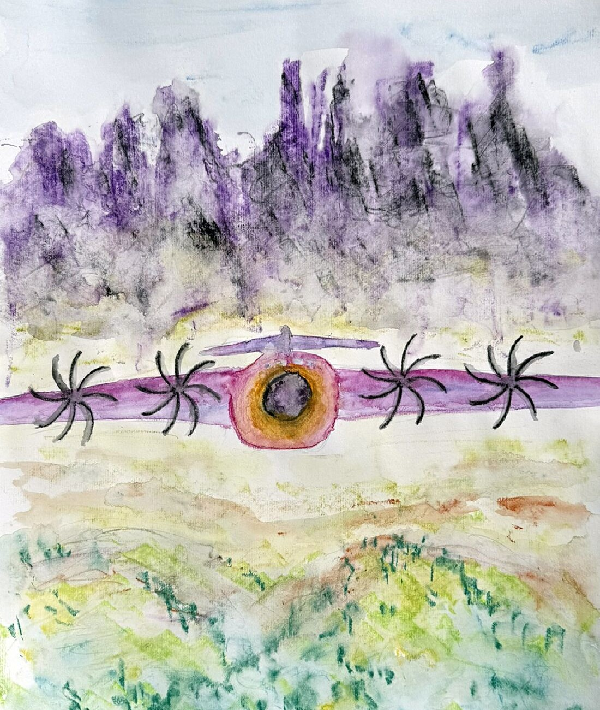
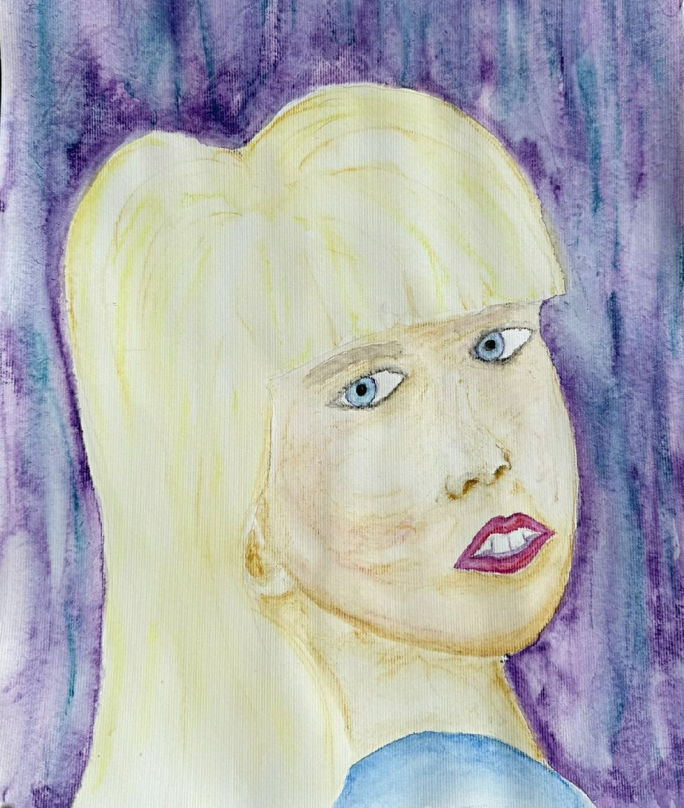

# 
Smilo Adler, Flieger

von John David Li

## 
Impressum

**Titel:** Smilo Adler, Flieger

**Autor (Pseudonym):** John David Li

**Verantwortlich für den Original-Inhalt:**

Roland Lindenbauer 
Erlkamerstr. 2a 
D-83607 Holzkirchen

**Kontakt:** 1tinker7bell (at ) gmail.com

**Urheberrecht:** © 2026 Roland Lindenbauer.

**Lizenzhinweis:** Dieses Werk mit dem Titel "Smilo Adler, Flieger" von John David Li ist lizenziert unter einer Creative Commons Namensnennung 4.0 International Lizenz (CC BY 4.0).

Lizenztext einsehbar unter: [https://creativecommons.org/licenses/by/4.0/deed.de](https://creativecommons.org/licenses/by/4.0/deed.de)

**Ergänzender Hinweis des Autors:**
Ich begrüße und erlaube ausdrücklich Übersetzungen, Fortsetzungen, rein korrigierende Eingriffe, sowie die kommerzielle Nutzung dieses Textes. 
*Sollten Sie diesen Text jedoch inhaltlich stark verändern, und die beschriebene Gesellschaft in eine dystopische verwandeln, weisen Sie bitte deutlich darauf hin, dass es sich um eine Bearbeitung handelt, die stark vom Original abweicht. Ich behalte mir gemäß den Lizenzbedingungen vor, die Nennung meines Namens im Zusammenhang mit Gewaltverherrlichung, diskriminierenden Inhalten oder sinnentstellenden Bearbeitungen des Werkes zu untersagen.*

**Bildnachweis:** Alle Aquarelle sind Originale des Autors.

## 
Vorwort

Dieser Roman ist eine postapokalyptische Fiktion. Alle Charaktere und Handlungen sind frei erfunden. Ähnlichkeiten mit lebenden oder verstorbenen Personen sind rein zufällig.

Obwohl der Roman auf Deutsch verfasst ist, findet die beschriebene Kommunikation in der Welt der Figuren allgemein auf Englisch statt.

Ich empfehle diesen Roman für Jugendliche ab 16 Jahren. Neben dem nötigen Verständnis für die technischen und chemischen Details erlaubt dieses Alter auch einen abgeklärteren Blick auf das Thema der ersten Liebe.

Zur Orientierung beim Lesen: Besonders betonte Worte in Gesprächen sind *kursiv* hervorgehoben

Temperaturangaben erfolgen durchgehend in Grad Celsius.

Gewidmet ist dieser Roman der Vision einer besseren Welt.

## 
Prolog

Das Klimaziel, das zu Anfang des 21. Jahrhunderts beschlossen wurde, wurde bei Weitem verfehlt. Zum Ende des Jahrhunderts war die Arktis im Sommer völlig eisfrei, und die Alpengletscher waren verschwunden. Auch Grönland war größtenteils bereits abgetaut. Selbst in der Antarktis lag im dortigen Sommer nur noch auf den Gebirgen Schnee und Eis.

Die meisten Küstenstädte waren im Meer versunken, und die Landkarten mussten jedes Jahrzehnt neu erstellt werden wegen des massiven Landverlustes. Der Golfstrom war völlig versiegt, was den Atlantik in Äquatornähe umso mehr aufheizte. Die Länder südlich des Mittelmeers waren völlig unbewohnbar, und in den nördlichen Mittelmeerstaaten waren Sommertemperaturen von über 50 Grad an der Tagesordnung, manchmal sogar bis 60 Grad. Wohlhabende Städte mit ausreichenden Wasservorkommen wandelten ihre Infrastruktur in klimatisierte Arkologien um. Diese nutzten interne Hydroponik-Anlagen; modifizierte Getreidesorten wurden teilweise auch auf Außenflächen kultiviert. Viele dieser Arkologien wurden von der Mafia oder streng religiösen Gruppierungen kontrolliert. Bettelnde und flüchtende Menschen sperrte man konsequent aus.

Indessen kamen um die noch fruchtbaren Ländereien immer heftigere Streitereien auf. Die ESA platzierte in weiser Voraussicht auf dem Mond eine Messanlage, die verschiedenste Frequenzen auf der Erde aufzeichnete, und als Datenpaket Richtung Erde sandte, sodass daraus Rückschlüsse auf Wettergeschehen, Radioaktivität, oder Wärmeentwicklung gezogen werden konnten. Gleichzeitig zogen etliche europäische hochintelligente Personen mit einer rund eine Million starken Anhängerschaft und dem gesammelten Wissen der Menschheit in hochwassersichere Höhlen und aufgelassene Bergwerke. Sie wandelten diese in Privatbesitz um und etablierten dort im folgenden Jahrzehnt eine hochtechnologische, pazifistische Gesellschaft. Die einzelnen Zufluchten waren über ein niederfrequentes Netzwerk miteinander verbunden. Ein kleinerer Teil der Gruppe wanderte nach Island aus.

In den folgenden Jahrzehnten eskalierten die Streitigkeiten zu offenen Kriegen, die zum Zerfall der Europäischen Union führten. Es folgte ein rücksichtsloser Kampf der Nationen gegeneinander. Die verheerenden Folgen waren Zerstörung und weltweite Hungersnöte. Auch der europäische Wildbestand wurde fast vollständig ausgerottet, woran die oft sintflutartigen Regenfälle einen großen Anteil hatten. Nahe sichere Überlebenschancen boten sich in dieser Zeit nur Ratten und kleinen Tieren in den Baumkronen.

In Afrika vereinigte ein charismatischer Propagandist die Staaten zu einem nubischen Reich, sodass jede nicht-schwarze Person dort um ihr Leben fürchten musste, und kapselte sich vom Rest der Welt ab, Besitzansprüche von China und anderen Ländern ignorierend.

In Südamerika besann sich der Teil der Bevölkerung mit indigenen Wurzeln ihrer Herkunft und kehrte in die stark dezimierten Regenwälder zurück, von wo aus sie jahrzehntelang, getarnt und mit Gift und Guerillataktik, einen Partisanenkampf gegen die Anhängerschaft der Regierungen führte; als Folge breitete sich der Dschungel wieder etwas aus, und dieser Bürgerkrieg stieß die dortige Wirtschaft in den Abgrund.

In Nordamerika annektierten die USA mit konventionellen Waffen Grönland sowie weite Teile Kanadas. Die kanadischen Truppen befanden sich in einer verzweifelten Defensive, um zumindest ihre letzten Kerngebiete zu verteidigen

China, seiner afrikanischen Gebiete beraubt, wollte sich an seinen Nachbarn schadlos halten und führte einen gnadenlosen Krieg gegen Sibirien und Südostasien, die Mongolei bereits annektiert.

Auch in den Erdumlaufbahnen tobte der Krieg, bis sämtliche Satelliten zerstört waren. Ihre Trümmer regneten häufig als Sternschnuppen auf die Erde herab.

Nur Australien nebst Neuseeland und Pazifikinseln versuchten das Beste aus den klimatischen Bedingungen zu machen und hielten sich aus kriegerischen Auseinandersetzungen heraus.

Nach mehr als einhundert Kriegsjahren gipfelte der Konflikt in einer Eskalation: Der Einsatz nuklearer Waffen wurde initiiert. Die Folge war, dass der Norden der USA und der Süden Kanadas, sowie Russland westlich des Urals und der Nahe Osten fast völlig zerstört wurden; außerdem fielen ihnen global fast alle Hauptstädte zum Opfer, sowie auch viele Großstädte der Nordhalbkugel, insbesondere in China. Die Wucht der Explosionswellen löste heftige Erdbeben und Vulkanausbrüche aus, gefolgt von einem globalen radioaktiven Fallout. Der anschließende nukleare Winter bewirkte zwar eine rasche Abkühlung, führte jedoch auch zum Zusammenbruch der verbliebenen Flora. Zudem wurden durch die Zerstörungen etliche gefährliche, hochentwickelte, künstliche Mikroorganismen aus militärischen und privaten Forschungslaboratorien freigesetzt.

Gezeichnet von radioaktiver Verstrahlung und Unterernährung wurden ganze Landstriche durch diese Viren und Bakterien entvölkert. Da die Schutzkeller schon lange leergeräumt waren, blieben den wenigen Überlebenden auf offenem Terrain fast nur Ratten als Nahrungsquelle. Diese vermehrten sich aufgrund ihrer kurzen Generationenfolge rasant, und wurden immun gegen die Mikroorganismen. Allerdings fungierten sie nun als Überträger diverser Seuchen. Auch ihre stark dezimierten Jäger - vor Jahren verwilderte Hauskatzen - vermehrten sich wieder.

Etwa ein bis zwei Jahrzehnte nach der Apokalypse - nachdem sie mehr als ein Jahrhundert im Untergrund überdauert hatten - kamen die Überlebenden in Europas Berggebieten wieder an die Erdoberfläche, anfangs vorwiegend ältere Leute wegen der Gefahr, missgebildete Babys zu gebären. Sie gründeten die ersten Siedlungen je nach Falloutbelastung des Bodens, und bildeten die Basis einer neuen Zivilisation auf den Gebieten nördlich der existierenden Arkologien mit einer Verfassung, die in den Jahren im Untergrund ausgearbeitet und von allen ratifiziert worden war.

Der Roman spielt etwa ein Jahrhundert nach der Wiederbesiedelung.

## 
Kapitel 01

**
03. Februar
**

Vor mir liegt der Brandherd, rauchumwallt, knapp unter einem schroffen Grat. Rechts sind schroffe Felsen, die nach unten hin in einen bewaldeten Steilhang übergehen. Nach links erweitert sich der Baumbestand über eine felsige Brücke nach oben hin in einen lichten Bergwald, der von vielen Latschen durchsetzt ist. Der Brand ist noch relativ klein; es sind weniger als ein Dutzend Bäume, umrahmt von der Schneelandschaft mit einer riesigen schneefreien Zone, die kreisförmig und erheblich größer ist, als man erwarten würde.

Der Flugzeugmotor läuft mit den standardmäßigen Bor-Batterien ruhig, und ich halte direkt auf die brennenden Bäume etwa in Grathöhe zu. Die Sicht ist wegen des Rauchs mäßig bis schlecht, aber ich besitze genug Ortskenntnis, dass ich auf Infrarotsicht verzichten kann. Den optimalen Zeitpunkt für den Wasserabwurf muss ich eher erfühlen als mathematisch berechnen. Ich nähere mich im Aufwärtsflug mit hoher Geschwindigkeit, und zum erfühlten Zeitpunkt öffne ich die Wassertanks, sodass sich über vier Kubikmeter Wasser in einem Bogen nach vorne-unten ergießen. Durch den plötzlichen Gewichtsverlust schießt die Maschine hoch, und gleichzeitig erschrecke ich, da sich beim Auftreffen des Wassers auf der rechten Seite so etwas wie eine Wasserexplosion ereignet. Sofort drehe ich den Flieger nach links, damit ich nicht in eine Dampfwolke komme, die womöglich in meine Kanzel gelangt. Mit solch einem Ereignis rechnet in diesem Umfeld schließlich niemand. Am Flugzeugheck wird dennoch ein wenig gerüttelt, was mich jedoch nicht stört. Ich beende die Kurve, bis ich wieder hinunter ins Tal Richtung Norden fliege. Beim Zurückblicken kann ich nichts Ungewöhnliches erkennen, das diese extreme Wasserexplosion erklären würde. In etwa drei Kilometer Entfernung sehe ich vor mir einen kleinen See, jedoch mit zugefrorenen Rändern, sodass er zur Wasseraufnahme nicht geeignet ist. Keine Minute später kommen mir, etwas tiefer fliegend als ich, am westlichen Hang über den Kamm ein Dutzend Flug-Trikes entgegen, die hintereinander wie eine Perlenschnur aufgereiht sind; es sind alles exzellente Flugkräfte. Diese Trikes fassen zwar nur hundert bis zweihundert Liter Wasser, sind aber in Masse auch effektiv, und zur Benetzung angrenzender Gebiete zuständig, damit der Funkenflug nicht neue Brandherde legt.

Ich gebe über Funk durch: »Smilo an die Crew, bitte haltet euch an die linke Seite, denn auf der rechten ist etwas sehr Ungewöhnliches, das eine Gefahr für euch und eure Trikes sein kann; außerdem gibt es dort ohnehin nur Felsen.«

Ich höre: »Schlusslicht hat auch verstanden«, und schon fliege ich selbst über diesen Kamm und bin somit aus deren Sicht. Ich halte in westnordwestlicher Richtung auf einen Sattel zu, der zum Ausläufer des südlich liegenden Gebirgsstocks gehört, mit einem kleinen Gipfel im Norden. Unter mir sind zwei Täler, die zu einem kleinen Flüsschen im Norden gerichtet sind.

Nach etwa zwei Minuten habe ich den Sattel erreicht, und sehe ein paar hundert Meter unter mir mein Dorf, das ich seit meiner Geburt kenne. Im Zentrum liegt der große flache See, sodass ich aus der Höhe klar seinen Grund erkenne, und der im Winter ständig von Eis befreit wird. Westlich erstreckt sich ein flacher Ausläufer des Gebirgsstocks nach Norden hin, dessen Hang neben dem See über eine Länge von nahezu zwei Kilometern in vierundzwanzig Terrassen durchgehend bebaut ist, mit einer großen Kantine, die sich am südlichen Ende im Talgrund hervorspringend über zwei Etagen erstreckt. Die oben an das Terrassendorf anschließende Hochfläche wird in den südlichen zwei Dritteln beherrscht vom grasbewachsenen Flugplatz mit Hangars, und nördlich einer kleinen bebauten Erhebung. Weiter im Westen - für mich im Flugzeug nicht sichtbar - geht das Dorf über zwölf Terrassen wieder bergab, und im anschließenden Flachstück befindet sich in der südlichen Hälfte eine Flug-Trike-Produktion, deren westliches Ende in der Tiefe hinter dem Flugplatz für mich sichtbar ist.

Ich fliege eine große Schleife nach Süden ins Tal hinein, um Höhe abzubauen, und sehe nun auch den Hang mit dem Sattel, über den ich vorhin hinweg flog. An dessen Seeseite erstreckt sich das Dorf über vierzig Terrassen emporsteigend in einer Länge von wenig mehr als einem Kilometer, und reicht beinahe bis zum Sattel hoch. Über Funk melde ich: »Almendorf, bitte kommen, hier Smilo.«

»Hier Flugplatz Almendorf.«

»Ich nehme gleich eine Ladung Wasser auf; die obersten Bäume brennen noch, aber irgendetwas ist sehr sonderbar. Näheres nach meiner Rückkehr.«

»Ok, ich sag's dem Chef.«

Dem See nähere ich mich von Süden in niedriger Höhe und langsamer Geschwindigkeit. Beim Vorbeiflug an der zweiten Etage der Kantine sind einige Gesichter an den Fenstern zu erkennen, vor allem von Kindern und Jugendlichen. Von draußen dringen die Töne des Waldbrand-Alarms in mein Cockpit. Voraus sind am Westufer des Sees neben einer schneefreien grasbewachsenen Landebahn einige Leute damit beschäftigt, Wassertanks zu füllen, zum Austausch für die zurückkehrenden Flug-Trikes. Auf der Ostseite hat anscheinend am Seeweg eine Gruppe Kinder ein Spiel Tunnelball unterbrochen, denn alle blicken zum Flugzeug. Etwa hundert Meter vom Südende des Sees tauche ich mit den Füllstutzen ins Wasser, und spüre unmittelbar den Ruck des Widerstands. Ich beschleunige sofort wieder, und hebe nach einem Dutzend Sekunden mit gefüllten Wassertanks wieder ab. Ich drücke einen Knopf, damit dem Löschwasser etwas Ammoniumsulfat zugesetzt wird; die andere Option wäre Ammoniumpolyphosphat gewesen.

Im Steigflug geht es weiter über den See und ein Stück den Fluss entlang bevor die nördliche Erhebung beim Sattel erreicht ist, und nach Osten hin dessen Hang entlang abgedreht werden kann. Etwas später schlage ich die südöstliche Richtung ein. Im Süden sind - etwas höher fliegend - die hintersten Trikes zu erkennen, die jedoch gleich wieder im Flug über den Sattel verschwinden. Das reicht gerade für ein »Hi Smilo«, das aus meinem Funkgerät ertönt. Ich steige weiter über die beiden Täler zu dem Kamm, hinter dem Richtung Süden zum Feuer abzudrehen ist.

Wieder halte ich auf den Brand zu, und sehe nur noch ein paar der obersten Bäume unter Feuer stehen. Man merkt halt doch die Nässe vom Winter. Die Sicht ist inzwischen deutlich besser. In den Felsen rechts davon ist ein Glühen zu erkennen, anders als glühendes Holz. Diesmal drehe ich nach dem Wasserabwurf sofort nach links, um eine Kurve zu drehen, und wieder gibt es bei der Stelle, die im Felsen glüht, eine Wasserexplosion. Das Feuer ist gelöscht, und ich fliege rechts davon über den Grat, um zu sehen, ob dort mit Brandgefahr zu rechnen ist, entdecke aber stattdessen einen frischen Felsabgang, der nun den Hang hinunter verstreut zwischen den Bäumen liegt. Das muss einen ordentlichen Bums gegeben haben, als anscheinend etwas gegen die Felsen geknallt ist, etwas größeres als Münchhausens Kanonenkugel.

Ich drehe eine weitere Runde, ohne etwas Zusätzliches zu entdecken, dann fliege ich den gleichen Weg zurück wie vorhin. Über dem Sattel sehe ich die ersten Trikes mit ausgetauschtem Wassertank bereits wieder starten, und spreche ins Funkgerät: »Hier Smilo, an die Benetzungs-Crew. Der Brand ist vorerst gelöscht, aber es wäre sehr gut, wenn ihr das Gelände auf der linken Seite ordentlich durchnässt, denn dort ist die Ausbreitungsgefahr am größten. Aber meidet auf jeden Fall die glühende Stelle im Felsen rechts; das könnte echt gefährlich werden. - Flugplatz bitte kommen.«

»Hier Flugplatz, habe mitgehört.«

»Gut. Ich lande in Kürze am oberen Flugplatz. Verständigt bitte das Rabennest, dass sie die Stelle besonders beobachten; ich weiß nicht, ob sich aus der glühenden Stelle in den Felsen wieder ein Brand entwickeln kann.«

»Wir sind in ständigem Kontakt mit dem Rabennest. Sie checken momentan noch, ob auf den Kameraaufzeichnungen etwas zu erkennen ist. Gute Landung.«

Wenig später setze ich auf dem Flugplatz auf. Vor den Hangars steht eine Gruppe junger Menschen, teilweise mit den typischen Jacken unserer Hochschule, und ein Herr mittleren Alters - Claude Molet, unser Flugplatzleiter, schwarzhaarig mit kurzem Bart, den linken Unterarm und das linke Unterbein durch Prothesen ersetzt. Während meines Aussteigens aus der Maschine kommt er mir entgegen und hebt die Hand zum Fliegergruß, den ich erwidere. Dann wendet er sich zur Gruppe Studierender um mit den Worten: »Bringt das Flugzeug bitte in den Hangar, und ladet die Batterien wieder auf. Und prüft zur Übung alles durch.«

»Und schaut euch das Heck mit Seiten- und Höhenruder besonders gut an, denn das hat einen Dampfstrahl abbekommen«, ergänze ich, und nehme meinen Helm ab.

Von der Gruppe kommt ein »Aye. Und wann dürfen wir endlich selbst einmal mit den drei großen Maschinen fliegen? Immer gibt es nur Theorie und Simulation.«

»Ihr wisst doch, dass unsere drei Feuerflieger noch fast einen Monat weit weg im Norden ihre Hubschrauberausbildung machen. Erst danach fangen eure praktischen Schulungen an.«

Als Claude vor mir steht, klopft er mir auf die Schulter: »Gratuliere, mit deinem ersten realen Einsatz bist du nun unser vierter echter Feuerflieger vor Ort. Wer rechnet schon im Winter mit einem Waldbrand, aber zum Glück warst du ja zur Stelle. Wie alt bist du eigentlich?«

»Noch bin ich fünfzehn.«

»Da bist du wohl der jüngste, der jemals zum Feuerflieger ernannt wurde. Aber wir sollten jetzt besser in den Turm hochgehen; vielleicht gibt es schon Neuigkeiten vom Rabennest.«

Während des Ganges dorthin tönt aus unseren mitgeführten Funkgeräten: »Hallo Flugplatz Almendorf, hier ist Beate von der Westroute zurück mit ein paar Gütern. Ich lande unten beim Lagerhaus. Und ich sehe soeben, wie das große Löschflugzeug in den Hangar gebracht wird. Gab es denn irgendetwas, oder laufen nun doch Schulungen?«

Die Antwort ertönt prompt: »Ja, einen kleinen Waldbrand.«

»Was? Jetzt im Winter?«

»Du kannst ja nach dem Ausladen zu uns hochkommen, dann erfährst du alles.«

Im Turm angekommen, dreht sich eine junge Frau von den Bildschirmen zu uns um - Louise Molet, Claudes Tochter, mit langem braunem Haar und einem ständigen Lächeln im Gesicht: »Es gibt Neues: Offensichtlich ist ein massives Stück von einem Satelliten abgestürzt, das groß genug war, um nicht zu verglühen. Aber sprecht besser selbst mit Sven vom Rabennest.«

Mit diesen Worten dreht sie den Bildschirm zu uns hin, und Sven beginnt zu sprechen: »Zwei Kameras haben etwas aufgezeichnet. Zuerst die nächste Kamera, die am gleichen Grat weiter oben angebracht ist, ergo zur Brandbeobachtung nicht gut geeignet; aber man sieht von der Seite einen Feuerball auf den Grat zurasen. Ich spiele es in Zeitlupe ab, da in Echtzeit alles nur wie ein kurzes Aufblitzen erscheint.«

Am Bildschirm erscheint ein Tal, in dem ein leuchtender Ball auf den Grat zufliegt - selbst in Zeitlupe rasend schnell. Anschließend sieht man, wie sich eine Staubwolke ausbreitet, und in Zeitlupe eine sehr langsame Rauchentwicklung, jedoch ist der Brandherd selbst vom Gratverlauf verdeckt. Während wir das betrachten, meldet sich die Gruppe der kleinen Feuerflieger, über Funk mit Louise kommunizierend, und landet auf dem Flugfeld neben dem See.

»Und nun die Aufzeichnung vom höchsten Gipfel, der dem Tal ungefähr gegenüber liegt. Das Brandgeschehen ist von dort aus deutlich zu erkennen; ich spiele es auch in Zeitlupe ab und vergrößere den Ausschnitt«

Man sieht in relativer Frontalansicht, wie ein Lichtball auf die teils bewachsene Felswand zurast. Das Bild hält vor seinem Auftreffen kurz an, springt in die Großaufnahme, und läuft weiter.

»Habt ihr gesehen, wie der Feuerball die Zirbel rechts in der Baumgruppe durchschlägt, und anschließend auf dem Fels aufprallt? Das war um genau 13:51:38 Uhr. Nun breitet sich eine Luftwalze rundherum aus, die Staub aufwirbelt. Einige Felsbrocken splittern ab, während das Gestein im unmittelbaren Einschlagszentrum zu schmelzen scheint. Der Brand selbst breitet sich von der durchgeschlagenen Zirbel nach oben in normalem Tempo aus, aber die zunehmende Rauchentwicklung verdeckt dann die Sicht. Im Größenvergleich mit den Bäumen dürfte die Feuerkugel zwischen vierzig und sechzig Zentimeter gemessen haben. Die Auswertung der Wärmebildkamera bringt wenig, da die Hitze des Balls über der Messgrenze lag, und die Stellenoch immer darüber liegt, das heißt über 1800 Grad. Die Dateien habe ich euch bereits zugesandt, denn wie ich euch kenne, wollen das noch mehr Leute sehen. Smilo taucht dann als Erster zirka zwanzig Minuten nach unserem Alarm auf; eine gute Zeit in Anbetracht, dass niemand damit gerechnet hat.«

Claude wendet sich wieder mir zu: »Smilo, was meinst du, du warst vor Ort.«

»Das würde erklären, warum das Wasser beim Auftreffen auf die Einschlagstelle regelrecht explodiert ist. Und auch die erheblichen Felsabgänge auf der anderen Seite des Grates. Auf jeden Fall muss die äußere Hülle ein Stoff sein, der bei diesen Temperaturen noch fest ist; entweder eine keramische Verbindung oder eines der schwereren Metalle.«

»Vielleicht einer der Killersatelliten, von denen ich gehört habe; diese sollen sehr robust sein. Die anderen Trümmer verglühen ja normalerweise in der Atmosphäre.«

»Ja, mein Vater hat davon erzählt; du weißt, er ist neben der Lehrtätigkeit auch Historiker. Jedenfalls die Chinesen waren die ersten, die diese in die Erdumlaufbahn gebracht haben. Sie haben eine äußere Hülle aus Wolfram, und im Inneren einen Hochleistungslaser, mit dem sie nicht-chinesische Satelliten zerstört haben, angetrieben von einem Nuklearreaktor. Die anderen Nationen zogen nach, teilweise mit anderen Hüllen, wenn kein Wolfram zur Verfügung stand, und seitdem gibt es nur noch die Sternschnuppen und keine Signale mehr.«

»Ich halte das für wahrscheinlicher als einen Meteor.«

»Ich würde mir das morgen gerne etwas näher anschauen, vom Boden aus. Mit einem Deltagleiter ohne Trike-Unterbau kann man vermutlich dort irgendwo landen«, schlage ich vor.

»Aber erst am Nachmittag, wenn es bis dahin hoffentlich ausgekühlt ist. Und nimm einen Geigerzähler mit, denn wer weiß, was da wirklich heruntergekommen ist. Keine Landung bei Anzeichen von Radioaktivität, verstanden?«

»Aye. Aber sollten wir nicht zu den Hangars hinuntergehen? Dort warten sicher etliche neugierige Leute.«

»Ja, machen wir.« Zu Louise gewandt: »Du passt weiter gut auf?«

»Aye, mache ich doch immer, Opachen.«

Im Hinuntergehen frage ich: »Hat Louise schon ein Kind? Und wie geht's deinen Zwillingen?«

»Ja, Louise hat vor drei Monaten entbunden, einen Jean-Luc. Ließest du dich öfter im Turm blicken, würdest du so etwas mitbekommen. Und die Zwillinge sind vor einem halben Jahr nach Kreisstadt gezogen; sie wollen beide Bauingenieurwesen studieren.«

Bei den Hangars stehen neben etwa drei Dutzend Studierenden auch die beiden Verbindungsflugkräfte Beate Unger und Tina Sperling, sowie Helmuth Hase, Versorgungsflugkraft wie ich, aber für die nördlichen Vorberge. Außerdem Yvonne Carter, unsere Geologin und Bergbauingenieurin, Liliane Lindner, Lehrkraft für Flug-Trikes, Egon Lötsch, Zahnarzt und Humanmediziner, und Iphigenie Lysander, Leiterin der Fachhochschule für Aerodynamik und Flugtechnik höchstselbst.

Claude stellt sich in Position und räuspert sich vernehmlich. Als sich alle ihm zuwenden, spricht er zu ihnen: »Um Gerüchten vorzubeugen, es hat sich folgendes ereignet: Kurz vor vierzehn Uhr gab es im Tal oberhalb der Ödalm einen von Osten kommenden Einschlag in die Felswand. Es ist noch nicht geklärt, um welche Art Objekt es sich handelt, und ob es radioaktiv oder sonstwie gefährlich ist, aber mit einiger Wahrscheinlichkeit handelt es sich um ein massives Satellitenstück. Seine Temperatur beträgt noch immer über 1800 Grad. Eine genauere Untersuchung kann erst in den nächsten Tagen durchgeführt werden, wenn es abgekühlt ist, zumal die Gegend dort ziemlich unzugänglich ist. Auf keinen Fall möchte ich, dass sich jemand auf eigene Faust der Stelle nähert.«

Ich trete nun neben ihn: »Ich habe vor, mir die Einschlagstelle morgen Nachmittag näher anzusehen. Wenn jemand mitkommen möchte: Eine sehr sichere Handhabung der kleinen Deltagleiter ist dort unumgänglich, sowie Klettererfahrung.«

Erst herrscht nur betretenes Schweigen und gegenseitiges Anschauen, und zu sehen ist auch eine Person, die von hinten durch die Gruppe drängt - Tina Sperling, schwarzhaarig, und ungefähr in meinem Alter: »Ich will auf jeden Fall mit!«

»Wer denn sonst als unsere Bergziege.«

»Irgendwer muss ja dem kleinen Vögelchen beistehen und aus der Patsche helfen, du bist ja verloren ohne mich«, und zerzaust mit ihrer rechten Hand mein Haupthaar.

»Und du kleiner Spatz willst wieder einmal Bergziege spielen.«

»Ich plustere mich halt gerne so weit auf, damit ich zu schwer für den kleinen Adler bin.«

Von links ertönt die Stimme von Yvonne Carter - ein riesiger Muskelberg im mittleren Alter: »Ich möchte euer Gespräch nur ungern unterbrechen, aber ich würde mich der Gruppe gerne anschließen.«

»Du hast ja die Gegend vorhin gesehen. Traust du dir dort eine Landung mit dem Deltagleiter zu?«

»Nicht auf dem Grat, aber unten auf dem kleinen Vorbau. Ich muss dann eben über hundert Meter den steilen Hang hinaufsteigen.«

Mich umblickend frage ich: »Sonst noch jemand, der mitkommen will?«

Da sich keine weitere Person meldet, wende ich mich wieder Tina, Yvonne und Claude zu: »Ich würde vorschlagen, wir treffen uns hier wieder morgen um dreizehn Uhr. Wenn das Rabennest unter siebzig Grad meldet, würden wir losfliegen. Auf jeden Fall Geigerzähler und Kletterausrüstung inklusive Steigeisen und Werkzeug mitnehmen; ein Rucksack sollte dafür reichen. Und wir brauchen drei der Deltasegler mit kleinem Heckmotor, denn ich möchte mich nicht erst lange im Aufwind hochschrauben müssen.«

»Die Deltasegler werden zur Verfügung stehen. Aber geht dort keine Risiken ein, kommt lieber erfolglos aber heil zurück. - Ihr kommt doch heute Abend in die Kantine zu unserer Fliegerecke? - Ich werde gleich alles dem Koordinator berichten, und ich kann nicht vorhersehen, ob er lieber andere Vorgehensweisen hätte. Bis später.«

»Na hoffentlich nicht. Bis bald, ich schaue jetzt einmal zu meiner Tante.«  

Beim Abstieg über die Treppe neben dem Schrägaufzug und der Rutsche kann ich einige Flugübende beobachten, die mit den Deltaseglern Kreise über dem See ziehen. Der Waldbrandalarm ist vorbei, und somit der Seebereich wieder zum Training freigegeben. Auf Ebene F zweige ich in den langen Arkadengang ab, mit seinen großen Fenstern Richtung See, die jetzt im Winter geschlossen sind. Unterwegs ein altes Paar grüßend, das in einer Nische sitzend an Kleidungsstücken näht, schaue ich nach etwa zweihundert Metern durch die Fenster auf der anderen Gangseite, und erblicke meine Tante schließlich im dritten Raum. Ich trete in ein großes sechsseitiges Zimmer mit Gewölbedecke, das an der seeabgewandten Seite Türen und offene Durchgänge aufweist, sowie kleine Wohnhöhlen für Kleinkinder.

»Hallo Tantchen, bist du heute allein mit zwei Kindern?«

»Grüß dich, Smilo, nett dass du wieder einmal vorbeikommst. Die zwei anderen Begleitkräfte sind mit den anderen Kindern zum See hinunter, denn diese wollten beim Waldbrandalarm nahe bei den Aktivitäten sein. Und jetzt sind sie vermutlich in den Ziegenställen. Nur die beiden wollten hier heroben bleiben.«

Zwei Kleinkinder kommen nun auch von ihrem Spiel mit Holzklötzen zu uns angewackelt, und zeigen schon den Fliegergruß, welcher sich in Almendorf offensichtlich als allgemeine Begrüßung etabliert hat.

Tante Ottilie Döberl, eine kleine dunkelblonde Frau mittleren Alters, wendet sich den Kindern zu: »Ihr habt doch vorhin drunten auf dem See ein Flugzeug gesehen, das ein wenig ins Wasser eingetaucht und kurz danach wieder emporgestiegen ist. Das hier ist mein Neffe Smilo, der hat dieses Flugzeug geflogen.«

»Und das ist eine Fliegerkluft, die habe ich schon bei anderen gesehen«, und schon beginnen sie meine Kleidung zu befühlen, wohl wegen seiner metallischen Farben: Die Hose von Gelb zu Grün wechselnd, die Jacke von Blau über Lila zu Magenta.

»Ich wollte dir eigentlich nur erzählen, dass ich heute meinen ersten Einsatz mit der großen Maschine hatte; es ist alles glatt gelaufen.«

»Ich hab's schon gehört, und dass anscheinend irgendetwas vom Himmel gefallen ist. Hast du es schon deinen Eltern mitgeteilt?«

»Nein, noch nicht. Ich rede lieber am Abend mit ihnen, denn dann haben wir Zeit zu quatschen. Sie scheinen sich dort an der Küste schon gut eingelebt zu haben.«

»Ja, ich vermisse meine kleine Schwester ziemlich.«

»Aber ich verabschiede mich jetzt. Der Alarm hat mich in der Kantine erreicht, als ich gerade mit dem Mittagessen fertig war. Ursprünglich wollte ich mich nachmittags mit Biochemie beschäftigen. Ich mache mich in meinem Zimmer zunächst frisch, und kann dann hoffentlich noch ein wenig lernen. Tschüss.«

»Was sonst als Sohn einer Biologin. Lass dich wieder einmal blicken, tschüss.«

Und ab geht es in mein Zimmer, die Treppe hinunter auf Ebene B und fast bis ganz nach vorne, in die Nähe vom Lagerhaus und der Dorfleitung.  

Am Abend, als es draußen bereits dunkel ist, laufe ich auf Ebene B bis ans andere Ende des Dorfes im Süden, und wechsle bei der letzten Treppe auf Ebene A; auf der untersten Ebene gibt es nördlich davon wegen der Hangars für Flug-Trikes, der Fahrradgaragen und einiger Ziegenställe keinen Arkadengang. Beim Betreten der Kantine komme ich in einen riesigen Raum auf einer Fläche von drei zusammengefügten Sechsecken mit über dreißig Metern Seitenlänge, wovon das bergnahe Sechseck die Küche und Hygieneräume beherbergt, die anderen zwei mit einer kleinen Bühne am südlichsten Ende unzählige Tische und Stühle. Darüber erstreckt sich eine sehr hohe Gewölbedecke mit einigen Säulen als deren Stütze. Oberhalb davon auf Ebene C befindet sich ein Saal gleicher Größe mit einer Essensausgabe in der Mitte; und das Dach ist ein Gewächshaus, in welchem der Chefkoch seine Chili-Plantage unterhält. Insgesamt haben fünftausend Personen gut Platz.

Mein Weg führt zur Raummitte, wo Salatbar und Essensbar dreifach aufgestellt sind, mit zwei Geschirrabgaben daneben. Beim Salat herrscht dichtes Gedränge, jedoch kann ich mir dazwischen schnell eine kleine Schüssel mit zwiebelreichem Bohnensalat füllen; um diese Zeit ist eben Hochbetrieb. Beim Tablettgeschirr fürs Hauptgericht gibt es am Rand zwei Spalte, in die man Besteck einklemmen kann. Ich nehme nur einen Löffel, bediene mich an den Kartoffeln und am mittelscharfen Pilzgulasch. Die Salatschüssel findet auf dem Tablettgeschirr Platz. Ich gehe den Weg wieder zurück, da sich die Fliegerecke seeseitig unmittelbar neben dem Eingang befindet. Auf der anderen Seite hängen drei große Bildschirme mit Eingabeterminals, an denen sich anscheinend soeben eine Studierende für eine allgemeine Gemeinschaftstätigkeit in den nächsten drei Tagen einträgt.

»Wieder einmal ohne Suppe, Suppenkaspar?«, begrüßt mich Tina.

»Weißt du nach all den Jahren noch immer nicht, dass ich fast nie Suppe esse?«

»Dabei passt die Suppentasse exakt auf die Salatschüssel, oder umgekehrt, und beide auf die runde Tellermitte des Tablettgeschirrs.«

»Mag sein, aber ich will mir zuerst etwas zu trinken holen. Weiß jemand, was es bei den Säulen hier gibt?«

»Links kalten Kamillentee und rechts Kirschsaftschorle.«

»Kein Kräutertrunk? Aber Kirsche passt gut zum Gulasch.«

»Bist du dir sicher?«

»Beides rot, oder?«

»Seltsame Logik.«

Bei meiner Rückkehr bemerke ich auf den Kartoffeln im Gulasch eine in Flugzeugform.

»Was für eine nette Idee, danke.«

»Ich war schon sehr früh da, und mir war etwas langweilig. Übrigens, Claude hat mir vorhin erzählt, dass der Einschlag um achtzehn Uhr noch immer über der Messgrenze war.«

»Echt? Das Zeug ist verdammt heiß. Und für die Kartoffelkunst würde ich dir ja gerne ein Edelweiß überreichen, aber die sind im Winter extrem rar.«

»Wie fühlt man sich als frisch gebackener Feuerflieger«, kommt von Beate.

»Eigentlich nicht anders als vorher; aber jetzt will ich essen, ich habe echt Hunger«, und ich höre den Gesprächen am Tisch nur halb zu.

Als ich mich, mit leerem Geschirr vor mir, zurücklehne und vernehmlich aufstoße, tritt Claude an meinen Stuhl: »Nun, da du gestärkt bist, verträgst du sicher etwas Gewicht.«

»Was hast du vor?«

»Auch im Namen vom Koordinator -- überreiche ich dir das Feuerflieger-Abzeichen, auch wenn du vorerst quasi nur auf der Reservebank sitzt«, und er überreicht mir einen etwa zwei Zentimeter großen Anstecker in rot, das ein Flugzeug über Flammen darstellt.«

»Vielen Dank, das passt farbmäßig gut zu meinem Abendmahl und auf meine Jacke«, und ich befestige ihn am blau-metallic-farbenen Kragen, der mit dem Violett und Magenta des Schulterbereichs der Jacke kontrastiert.

»Und übrigens, er gab auch grünes Licht für euer morgiges Vorhaben. - Und willst du noch feiern heute?«

»Das verschiebe ich auf später, wenn ich auch Lust auf Tanzen verspüre; vielleicht morgen beim Fest. Außerdem will ich heute bald an meinen Computer, denn ich habe noch nicht mit meinen Eltern telefoniert.«

»Dann schau in deinem Profil auch in den Reiter Ausbildung.«

Und schon steht eine Schlange - überwiegend junge Flugkräfte -, an, um mich zu umarmen, mir zu gratulieren, und etwas Smalltalk zu betreiben. Nach einigen weiteren Gesprächen verabschiede ich mich bereits kurz nach acht Uhr, bringe das Geschirr in die Kantinenmitte zurück, und schlendere zu meinem Quartier; durch die Fenster des Arkadenganges betrachte ich eine sternenklare Nacht.

## 
Kapitel 02

**
04. Februar
**

Es war wohl eine bitterkalte Nacht, denn im heller werdenden Licht des angehenden Morgens sehe ich Eisblumen an den Arkadenfenstern. Nach meiner Morgentoilette und einer kurzen Tai-Chi-Form gehe ich über die nördliche Treppe zum Lagerhaus auf Ebene A hinunter. Um halb acht Uhr sollte bereits jemand anwesend sein; und wirklich, ich treffe an der Ausgabestelle eine junge Auszubildende an: »Einen schönen guten Morgen, liegt etwas für die Südversorgung an?«

»Hallo Smilo, die Hochalm braucht einige frische Lebensmittel und eine Packung Hygienepapier, und einen Topf scharfes Gulasch musst du von der Kantine mitnehmen«, spricht sie, einen Drahtkorb mit etwa vierzig mal achtzig Zentimeter Grundfläche auf die Theke hinauf hievend. »Und das Rabennest hätte gern Haferflocken und getrocknetes Obst, sowie einen großen Topf Kartoffelgulasch und einen kleinen mit Tomatensuppe«, und sie stellt zwei 5-Kilo-Säcke in den Korb dazu. »Außerdem musst du auf deinem Trike einen Doppelsitz montieren, denn du sollst von der Ödalm zwei Kinder mitnehmen, die eine Woche dort verbracht haben. Außerdem braucht die Alm Zwiebeln, fünf Kilo Kartoffeln, zwei Salatköpfe, etwas Gemüse deiner Wahl, und einen Topf Paprikagulasch, alles von der Kantine, sowie auch fünf Kilo Mehl und drei Liter Öl«, beides packt sie in den Korb dazu. »Brauchst du ein Körbchen für die Dinge von der Kantine?«

»Ja, das wäre heute wirklich hilfreich, und eine Thermohülle fürs Gemüse bitte.«

»Außerdem hätte ich noch einen großen Korb mit einer Melkmaschine für die Brunntalalm nebst ein paar anderen Sachen; willst du das gleich mitnehmen?«

»Nein, ich komme dafür später wieder, bis bald.«

Ich gruppiere die Gegenstände im Korb etwas um, damit ich das Körbchen, etwa vierzig mal vierzig Zentimeter und halb so hoch wie der große Korb, in der Mitte einhängen kann. Dann hebe ich alles auf den Boden; das wiegt bestimmt fünfundzwanzig Kilo. Gut, dass diese Größe genügend Griffe und Rollen auf der Unterseite hat. Durch ein ostseitiges Tor gehe ich ins Freie und betrete den vor mir liegenden Bahnhof. Rechterhand nach Süden hin führt die Bahn zweigleisig mit vier Zentimeter breiten Schienen in den Fels hinein, mit der Haltestelle im Tunneleingang. Linkerhand ist ein etwa hundert Meter langes Rangiergelände, von dem ein Gleis durch ein großes, jetzt geschlossenen Tor ins Lagerhaus hineinführt. Weiter nordwärts sieht man die dreigleisige Bahn von Bodenschienen in hängende Stahlseile übergehen, mit jeweils einem weiteren Seil vom Gleis aus, weiter außen und höher gelegen. Am Übergang befindet sich jeweils ein Einfädler für die Waggons. Die Bahn fährt pro Gleis auf vier Seilen etwa zwei bis drei Meter über dem Grund, mit Stützpfeilern zirka alle dreißig Meter, beziehungsweise an Haltepunkten auf zwei Schienen ebenerdig; dieser Teil geht etwa zwanzig Kilometer bis zum Ende der Vorberge. Weiter führt sie auf Schienen weitere zwanzig Kilometer nach Kreisstadt. Das Gebiet der Vorberge ist größtenteils Schwemmgebiet, und Auswaschungen würden bei Bodengleisen den Bahnbetrieb zu oft stilllegen. Die beiden östlichen Bahnlinien sind für Personenverkehr und etwas Güterverkehr, der mit den Anlagen im Berg verbunden ist, das westliche Gleis ist rein für Warentransport bis zu unserem Lagerhaus.

Da die Ampel grün leuchtet, rolle ich den Korb über den Bahnübergang, und, nach zehn Metern Richtung Süden drehend, zum zweiten Hangar, in dem sich mein Flug-Trike befindet. Der Doppelsitz hinter meinem Sitz ist schnell montiert, und der Korb darauf befestigt. Dann schiebe ich das Fluggerät über den sechs Meter breiten Weg und eine zwei Meter hohe, leicht abfallende Böschung zur Start- und Landebahn am See; hier im Norden befindet sich ein größeres dreieckiges Gebiet mit Sumpfkräutern zwischen See und Siedlung, das jetzt noch unter Schnee begraben ist.

Ich starte meinen Trikemotor, fliege über dem See in geringer Höhe zur Kantine vor, und gehe mit dem Körbchen die zwei Meter hohe Böschung hoch. Es folgt ein Bahnübergang, an dem die Bahn zweigleisig wieder aus dem Felsen herauskommt - eine weitere Haltestelle enthaltend -, und um die Kantine herum verläuft. Mein Weg führt einige Meter weiter vorne durch eine Tür zur südlichen Treppe, hinauf auf Ebene C, um mir zwei Brötchen und Aufstrich zu nehmen, und wieder zurück, um zum Kücheneingang zu gelangen. Babuschka - eigentlich Katharina Gajewskij, unsere uralte gute Kantinenfee -, ist bereits zugegen.

»Einen guten Morgen Babuschka, ich habe wieder etwas Essen auszuliefern«, und stelle das Körbchen auf einen der herumstehenden Transportwägelchen: »Einen großen Topf Kartoffelgulasch, einen Topf scharfes Gulasch, einen Topf Paprikagulasch, und einen kleinen Topf Tomatensuppe bitte.«

»Guten Morgen, Smilo, ja, es ist alles noch übrig von gestern. Ich mach’s fertig, du kannst derweil ruhig frühstücken; im großen Spender ist heißer Pfefferminztee.«

Ich gehe durch die Tür in die Kantine, nehme mir eine Tasse Tee aus einem großen Behälter auf der mittleren Speisetheke, und mache es mir am nächsten Tisch mit Brötchen und Aufstrich gemütlich. Nach zehn Minuten zurück in der Küche nehme ich das Körbchen: »Danke dir Babuschka, tschüss.«

»Das Paprikagulasch ist unten, das scharfe oben, es hat geradeso Platz im Körbchen, tschüss.«

Beim Trike stelle ich die Töpfe in die freie Mitte des Korbes, und hole dann von Ebene C das nötige Gemüse, welches ich, geschützt in einer Thermohülle, im Körbchen auf die Töpfe lege.  

Zuerst will ich zur Hochalm. Auf dem Flug dorthin merke ich trotz warmer Kleidung und Helm, dass wir deutlich unter null Grad haben; am meisten spüre ich das in den Fingern und dem Hals, verstärkt durch den Gegenwind. Es vergehen keine zehn Minuten, und ich habe mich die fünfhundert Höhenmeter hochgeschraubt, und lande auf einer festgetretenen Schneepiste. Es ist angenehm, dass sich alle um ein benutzbares Flugfeld kümmern.

»Grüß dich, Smilo«, empfängt mich Josef Breuer - ein alter weißbärtiger Mann - in der Eingangstür zur Blockhütte. Deren unterer Teil ist einen Meter hoch gemauert, und darauf sind dicke Baumstämme geschichtet.

»Guten Morgen, ich habe deine Bestellung; ich stelle die Lebensmittel in die Butte, die du in deinen Händen hältst«, und ich folge ihm ins Hausinnere, wo ich in eine Duftwolke seiner Destille trete. »Ich muss mich an deinem Kachelofen aufwärmen, denn es ist ziemlich kalt draußen.«

»Es hat minus zwanzig Grad. Brauchst du einen Enzian zum Wärmen von innen?«

»Lieber nicht, ich muss noch fliegen«, versuche ich sein Angebot höflich abzuwimmeln.

»Wie du meinst. Ich hätte eine Kiste Enzian und eine Kiste Zirbe fertig. Kannst du sie mitnehmen?«

»Das ist heute äußerst ungünstig, das nächste Mal vielleicht. Ich muss noch zwei Kinder von der Ödalm ins Tal bringen.«

»In Ordnung, es wird ja nicht schlecht.«

Nach einer Viertelstunde Gespräche über Alltägliches breche ich mit dem leeren Topf seiner vorherigen Lieferung wieder auf.  

Das Rabennest ist von der Hochalm zwar nicht einmal vier Kilometer entfernt, aber es ist ein Kilometer an Höhe zu überwinden; das geht nur mit einer Extraschleife. Eine Handvoll Minuten später lande ich dort, und schiebe das Trike lieber in den wärmeren Hangar. »Hallo Sven, wie kalt habt ihr es hier oben?«, begrüße ich den Leiter der Station, als er durch die Tür zum Hangar tritt.

»Hallo Smilo, momentan sind's minus dreißig.«

Mit den Worten: »Du hilfst mir sicher beim Reinbringen« drücke ich ihm die zwei 5-Kilo-Säcke in die Arme.

»Heute gibt’s wieder normales Frühstück!«, ruft er durch die Tür in den dahinterliegenden Bereich. Ich folge mit dem kleinen Topf auf dem großen in den geräumigen Beobachtungsraum, dessen nördliche Fensterreihe einen Panoramablick über Almendorf und den See in fünf Kilometern Entfernung eröffnet, und dessen südliche Fenster zu einem jetzt verschneiten Hochplateau zeigen. Im Nordostbereich befinden sich um die hundert Bildschirme nebst drei Computer-Bedienanlagen, und an beiden Seiten neben dem Pult je ein vier mal drei Meter großer Riesenbildschirm.

»Wird auch Zeit, Tagchen auch« kommt von Alex, dem jüngsten in der Stationsbesatzung, der sich vom Computerpult erhebt.

»Und wer hat vergessen, rechtzeitig zu bestellen? Verstaue bitte alles in der Küche, Alex, du bist ja ohnehin schon auf dem Weg dorthin«, spricht Sven, und stellt die Säcke auf einen Tisch; ich tue es ihm gleich.

»Und wie sieht die Einschlagstelle aus?«

»Svenja, leg doch das Wärmebild vom Einschlag auf den rechten großen und leicht das Sichtbild darüber«, worauf der Riesenbildschirm hell wird. Er zeigt auf einen gelben Fleck, mit Zahlenkolonnen daneben, in einem überwiegend blau und türkis getöntem Bild mit erkennbaren Konturen von Fels und Baum: »Gestern, so um zwanzig Uhr, hat es auf 1800 Grad abgekühlt. Jetzt hat es 100 bis 150 Grad; das hängt sicher davon ab, wie dick das Zeug ist. Die Bäume vom Waldbrand sind jedenfalls erkaltet.«

»Ich möchte am Nachmittag dort nachsehen; meinst du, bis dahin ist es kühl genug?«

»Die Abkühlung geht jetzt langsamer, aber es ist draußen ziemlich kalt. Es wird dann vermutlich nur noch handwarm sein. Aber vergiss nicht den Geigerzähler.«

»Klar, das ist bereits vorgemerkt. Ich bin auch nicht allein, Tina und Yvonne kommen mit.«

»Ha, Tina, die lässt sich diese Kletterpartie natürlich nicht entgehen. Wir werden euch dann sicher sehen. Svenja, ist Tina irgendwo unterwegs? Es ist ungefähr ihre Zeit.«

»Ja, sie ist kurz nach Smilos Ankunft über den Sattel im Osten geflogen und noch im Bereich des Hochplateaus«, zeigt sie einen kleinen Punkt auf einem der Bildschirme. »Und drüben beim Klammkogel zieht ein junger Adler seine Kreise; das ist doch dein Wappentier, Smilo, oder?«, und sie deutet - mich angrinsend - auf einen anderen Punkt.

»Und du hast wohl selbst Adleraugen, dass du die kleinen Punkte so klar siehst; ich kann da nichts genaues erkennen.«

»Klar doch«, antwortet sie, noch mehr grinsend.

Zu Sven gewandt frage ich: »Gab es sonst noch Vorkommnisse seit gestern?«

»Ja, einen kleinen Lawinenabgang in der Nacht, und einen Brand im südlichen Talgrund; dem Anschein nach war das ein Heustadel, den konnte der Bodentrupp der Feuerwehr schon löschen; man reagiert meistens schnell auf unseren Alarm.«

»Und wo ist eigentlich Gertrud?«

»Eine Kamera im Westen ist ausgefallen, und sie sieht nach, was Sache ist. Sie hat gleich eine aus unserer Reserve mitgenommen, falls sie sie austauschen muss.«

Nun kommt Alex aus der Küche heran geschlurft, und Sven sagt zu ihm: »Na, bist du satt? Dann kannst du ja Svenja ablösen, die ist schon über acht Stunden an den Bildschirmen. Und hast du die alten Töpfe mitgenommen, oder willst du sie selbst ins Tal bringen?«

»Ja ja«, meint Alex und schlurft in die Küche zurück, um kurz danach mit drei leeren Töpfen wieder aufzutauchen.

»Ich muss jetzt ohnehin weiter zur Ödalm, tschüss an alle«, verabschiede ich mich, und nehme das Kochgeschirr, um es im Trike zu platzieren.  

Mein Weg quert eines der Täler, die zu unserem See führen. In der Tiefe, etwa anderthalb Kilometer unter mir, sind die Stützen für die Stahlseile der Bahn zu erkennen, die in die Felswand des Gebirgsstocks hineinführt. Zufällig kommt in diesem Moment ein Güterzug mit fünf Wagen voller Kleincontainer heraus; vermutlich sind das Salzsäure und Natronlauge aus der Salzsolen-Elektrolyse für Kreisstadt. Als ich über einen Grat nördlich eines Gipfels hinwegfliege, ist der Zug nur ein kleines Stück vorangekommen, was mich nicht verwundert, da sich Gefahrguttransporte mit maximal dreißig Stundenkilometern bewegen.

Nach dem Überflug eines weiteren Grates eine halbe Minute später sehe ich die Rückseite des gestrigen Einschlags nahe vor mir, erkennbar an den frischen Felsabgängen. Ich kreise zwei mal über der Stelle und erkenne, wie sich der große Brocken nach schräg-unten in den Fels hineingeschmolzen hat, und einen Trichter bildet. Nahe daneben gibt es eine weitere Stelle mit Material auf weggeschmolzenem Fels.

Nach einem zweiminütigen Sinkflug entlang des Talgrunds lande ich an der Ödalm südlich des Sees neben der mittleren von drei großen Blockhütten, dem Haupthaus. Sie sind in gleicher Bauweise gefertigt wie auf der Hochalm. In der untersten Hütte werden Kräuter bearbeitet, die oberste dient als geräumiger Ziegenstall, und etwas entfernt sind östlich und westlich auch je ein Heustadel erkennbar. Auf einer von Schnee befreiten Fläche rundherum sind eine Menge Ziegen unterwegs, die Frischfutter suchen; sie sind alle weiß, eine Mischung aus Angora- und Appenzellerziegen - eine Besonderheit inmitten der ansonsten überall üblichen braunen Ziegen.

»Hannes, Michel, macht euch zur Heimreise bereit!«, höre ich es aus dem Haupthaus tönen.

Kurz darauf treten Peter Brunner und seine Frau Heidi, beide etwa fünfzigjährig, aus der Hütte. Während ich noch ihre Lieferung auf einen großen Tisch neben dem Eingang stelle, übergeben sie mir die leeren Töpfe vom letzten Mal.

»Grüß dich, Smilo, schön dass du da bist. Die Kinder kommen gleich.«

»Hallo, ich komme kurz hinein zum Aufwärmen. Ich war zuvor im Rabennest, dort hat's minus dreißig Grad, und dazu spürte ich den Wind durch's Fliegen.«

Den großen Korb kann ich hinten an den Doppelsitz hängen mitsamt Körbchen und den Töpfen. Dann trete ich in den Hauptraum, der mit einem Kachelofen ausgestattet ist, und allem, was zum Kochen und Wohnen nötig ist, nebst einem Bücherregal und einer Ecke zur Wollbearbeitung, sowie einem Minimum an Technik. Die Westseite des Raumes enthält Türen zu Schlafplätzen, die Ostseite einen Eingang zur Käserei.

»Gestern war ja ziemlich viel Flugverkehr oben an der Baumgrenze; was war denn los? Um diese Jahreszeit brennt doch nichts, außer man lagert Heu schlecht.«

»Ein massives Stück von einem Satelliten ist offensichtlich gegen den Fels geknallt, und hat dabei ein Stück Bergwald angezündet. Genaueres können wir noch nicht sagen, aber heute Nachmittag wollen wir die Stelle vom Einschlag untersuchen. Die anhaltend niedrigen Temperaturen begünstigten immerhin die Abkühlung des eingeschlagenen Objekts.«

»Wir haben's mitgekriegt«, sagt der neunjährige Hannes vom Schlafraum kommend, dick eingepackt in warme Kleidung, hinter ihm der achtjährige Michel. Vor einer Woche habe ich beide hierher hochgeflogen. »Da war zuerst ein Knall, und wir sind sofort rausgerannt. Und da haben wir gesehen, wie eine Lawine oben ins Tal rauscht, dann brennende Bäume, die immer mehr geworden sind. Dann haben wir vor lauter Rauch nichts mehr gesehen. Nach einer Pause ist ein Löschflugzeug gekommen, und kurz darauf die Trikes, und die sind alle nochmal gekommen.«

»Und war die Woche schön? Habt ihr etwas gelernt?«, frage ich.

»Ja, wir haben geholfen, aus Milch Käse zu machen.«

»Und wie man diese Ziegen hier behandelt und füttert.«

»Vergiss das Melken nicht, das haben wir auch probiert.«

»Und wie man die Wolle erst kämmt und dann spinnt; aber leider ist es zum Scheren zu kalt.«

»Mich hat das Spinnen weniger interessiert, aber ich durfte mir einen Filzhut machen, den zeige ich dann den Anderen in der Schule.«

»Und all die Kräuter, wie man sie im unteren Haus trocknet, und welches Kraut wie aussieht.«

»Silberdistel«

»Und Enzian«

»Und Wasserdost«

Ich unterbreche sie: »Ihr braucht jetzt nicht alle Kräuter aufzählen. Wo möchtet ihr denn bei der Landung im Dorf hin, zum Lagerhaus oder zur Kantine?«

»Kantine bitte.«

»Ich auch.«

»Dann fliegen wir los, die Sicherungen am Doppelsitz kennt ihr ja bereits«, und anschließend zu Peter und Heidi gewandt: »Bis zum nächsten Mal.«

»Tschüss.«

Der Flug dauert keine zehn Minuten. Sobald das Dorf in Sicht ist, melde ich über Funk, dass Hannes und Michel in der Kantine zu finden sind, und begleite sie dorthin mit den leeren Töpfen im Gepäck. Anschließend geht es vor zu meinem Garagenplatz, wo ich den Doppelsitz wieder abmontiere. Mit den leeren Transportmitteln zurück im Lagerhaus, versucht die Auszubildende vergeblich, den Korb für die Brunntalalm auf die Theke zu hieven. Sie übergibt ihn dann durch den Teil der Theke, den man öffnen kann.

Der Korb ist aber auch wirklich schwer; er enthält dem Anschein nach neben dem Melkmaschinenteil auch einen Monatsvorrat an Lebensmitteln. Im Hangar benutze ich ein Hubgerät, um ihn an den Holmen des Trikes montieren zu können.  

Der Flug führt vom Lagerhaus Richtung Westen über zwei Sättel zu einer Alm, die rundum von sechs Gipfeln umrahmt ist. Es sind zwei Gebäude im Blockhüttenstil, das Wohnhaus und ein sehr großer Stall, sowie etwas abseits ein Heustadel. Eine größere Herde brauner Ziegen scharrt in einem Gesprenkel aus Schnee und Wiese, oder zupft an herumliegenden Heuballen. Das Landefeld ist zum Glück durch einen Zaun abgetrennt. Die Ziegen meckern schon ziemlich laut, vermutlich weil sie heute noch nicht gemolken wurden. Nach Austausch der Melkeinheit und dem Abliefern einiger 10-Kilo-Säcke halte ich mich nicht länger auf, damit die Ziegen befriedigt werden können, und kehre mit dem kaputten Melkmaschinenteil zurück.

Allerdings lande ich nicht beim Lagerhaus, sondern fliege zum Weg auf der Ostseite des Sees. Drei Meter Wegbreite sind wahrlich ausreichend, und eine Zone, die breit genug für die Flügel ist, und in der sich niemand auf dem Weg befindet, ist schnell gefunden. Die Reparaturwerkstätten liegen auf der untersten Ebene, nördlich der langgezogenen Tischlerei und einer Musikinstrumentenmanufaktur. Jedoch hinter dem Tor, durch das ich eintrete, ist niemand anzutreffen. Daher stelle ich die defekte Melkeinheit drinnen mitsamt Korb ab, und hinterlasse ein paar Zeilen auf einem Zettel.

Als ich zum Hangar zurückkehre, ist es elf Uhr vorbei, also noch genügend Zeit, kurz in mein Zimmer zu gehen, und dann gemütlich zur Kantine zu spazieren.  

Heute nehme ich den letzten Kantineneingang nahe der Ausgabetheken, von denen ich mir mit Reis und Erbsen gefüllte Paprika mit reichlich Pilzsauce nehme, und nähere mich der Fliegerecke. Im Vorbeigehen fülle ich eine Tasse mit kaltem Kräutertrunk. Tina kommt auch soeben mit einem großen Fruchtsaftglas an, und setzt sich zu zwei Schüsseln und einem voll gefüllten Tablettteller; anscheinend hat sie großen Appetit.

»Ich wusste, dass ich euch vorher hier treffe«, begrüßt mich Yvonne Carter: »Was meint ihr, können wir heute schon nahe ran? Ich platze vor Neugierde.«

»Es sieht ganz gut aus, denn ich kam vor zwei Stunden zufällig vorbei.«

»Zufällig. Wer's glaubt«, unterbricht mich Tina

»Ehrlich.«

»Und du hast dem Zufall gehörig nachgeholfen?«

»Na wie würdest *du* denn vom Rabennest zur Ödalm fliegen?« Das ließ sie verstummen.

Ich fahre fort: »Jedenfalls sieht man, wie sich zwei Objekte - ein großes und ein kleineres - nebeneinander in den Fels geschmolzen haben; den Trichter schätze ich auf fast einen halben Meter, genau war das aus der Höhe nicht zu erkennen. Und mit Handschuhen dürften wir die Objekte anfassen können ohne sich zu verbrennen.«

»Das sind gute Nachrichten. Aber jetzt hier noch eine Stunde herumsitzen zu müssen, fällt mir sehr schwer. Mit dem Essen bin ich schon fertig; mehr als Salat brachte ich nicht hinunter.«

»Du könntest doch schon die nötigen Utensilien zusammentragen.«

»Ja, das ist eine gute Idee. Was denkst du, was wir brauchen?«

»Auf jeden Fall warme Kleidung, denn dort werden auch am Nachmittag Minusgrade herrschen. Dann drei Deltasegler mit kleinem Heckmotor, jede Menge Seile, eine Seilwinde, drei Kletterausrüstungen...«

»Ich nehme meine eigene«, unterbricht mich Tina

»Dazu Steigeisen, am besten zwei Werkzeugkisten und zwei Brecheisen, vielleicht eine zwei Meter lange Metallkette, falls sich die Objekte nicht leicht vom Ätzkalk lösen, und nicht zu vergessen: Drei Geigerzähler. Ich schlage vor, du verstaust die Sachen, die wir nicht am Körper tragen, in drei Rucksäcken, denn so können wir sie gut mitführen.«

»Und eine kleine Fotokamera zur Dokumentation«, wendet Tina ein.

»Ja, das werde ich machen, da bin ich beschäftigt, bis dann, ihr beiden« verabschiedet sich Yvonne.

»Tschüss.«

»In ihrem Alter ist sie noch so nervös?«, fragt Tina.

»Das wird sich wohl nie legen, wenn man die Neigung dazu hat. Bei dir jedenfalls habe ich diese Befürchtung nicht, wenn ich mir deinen Fressberg ansehe.«

Das Mittagessen, kombiniert mit einer kurzen Ruhephase, und den vertrauten Neckereien zwischen uns - seit der Kindheit befreundeten Jugendlichen -, ließ die Zeit rasch vergehen.

Als wir zum Flugplatz hochkommen wartet schon Yvonne in voller Montur, unruhig umhergehend, neben drei bereits aufgespannten Deltaseglern. Davor lagern drei Rucksäcke, mit einem Geigerzähler und einer Kletterausrüstung obenauf liegend. Im westlichen Bereich des Flugplatzes sehe ich die Feuerwehr-Bodentruppe, wie sie einen aus altem Bruchholz bestehenden provisorischen Stadel für eine Feuerwehrübung vorbereitet, mit einem darin liegenden Dummy, den sie retten soll. Es wird dabei jedoch nicht alles gelöscht, damit das Feuer für die Einwohnerschaft der Feier des "Tages der Verbundenheit aller Menschen" dient, für manche vielleicht auch einem verspäteten Imbolc; Feste, die normalerweise bis spät in die Nacht dauern.

»Ich habe noch Extra-Arbeitshandschuhe eingepackt, falls unsere zu dünn sind. Und statt der Kette habe ich ein drei Millimeter starkes Stahlseil genommen«, begrüßt uns Yvonne.

Während ich die Steigeisen an meine Schuhgröße anpasse, um sie gegebenenfalls schnell anlegen zu können, und den Klettergurt mit seinen Karabinern und anderen Hilfen anlege, läuft Tina in den Hangar, und kommt kurz danach voll gerüstet wieder heraus.

»Ich schlage vor, dass wir nach der Überquerung des Grates zur Ödalm auf Dauerfunk schalten. Uns stört's nicht, wenn wir Huster, Schnaufer oder Tinas Rülpser hören, und sonst hört's kaum jemand. Von dort weg müssen wir auch unsere Geigerzähler überwachen. - So, los geht's!«, rufe ich, und schreite, meinen Deltasegler am Lenkdreieck tragend, zur Startrampe.  

Nach dem Start schalte ich einen kleinen Mini-Heckrotor hinzu, der sich am hinteren Teil des Längsholms befindet, angetrieben von einer kleinen Batterie mit maximal zwei Stunden Kapazität. Ich segle über den See, und nehme die gleiche Route wie gestern mit dem Löschflugzeug. Am Ziel angekommen kreise ich einige Male bei der Einschlagstelle, und kann in diesem Bereich keine Radioaktivität feststellen.

»Tina, vierzig Meter am Grat entlang ist eine zwei mal fünf Meter große Felsplatte, fast eben. Traust du dir zu, dort zu landen? Fast hundertfünfzig Meter vom Vorbau hochzusteigen könnten wir so vermeiden.«

»Also ich bin bei der Stelle raus«, kommt von Yvonne: »Ich lande unten auf dem Vorbau, da dürfte stabiles Firn-Eis drauf sein nach der Hitzewelle vom Einschlag und dem Wasser durch eure Löschaktivitäten. Ich steige dann die Schneise von dem alten Felssturz hoch.«

»Das sollte kein Problem sein«, kommt von Tina.

Nachdem ich Yvonne sicher landen gesehen habe, kehre ich zur Felsplatte zurück, wo Tina bereits Sicherungen eingeschlagen hat. »Soll ich meinen Gleiter am Grat höher verlagern? Es sind jetzt nur noch zwei mal zwei Meter übrig.«

»Bleib ruhig dort und sichere alles, der Platz sollte mir reichen.«

Ich fliege die Stelle schräg zum Grat und ein wenig tiefer ohne Motor an, drücke kurz vor der Platte das Lenkdreieck weit nach vorne, um Auftrieb zu erzeugen, woraufhin ich fünf Meter hochsteige, und langsam einen Meter fast senkrecht hinabschwebe, wobei ich die Nase wieder senke. 

»Punktlandung. Ich sichere dich«, kommentiert Tina, kommt hinter ihrem Segler hervor, und hängt mich und meinen Segler an Seile mit Karabiner.

»Was erwartest du nach über zwölf Jahren Erfahrung? Jetzt müssen wir nur noch ein Stück den Grat entlang.«

»Lass mich das machen, ich muss nur noch das Sicherungsseil vorbereiten.« Kurz darauf scheint sie wie eine Elfe auf dem Grat dahinzuschweben, so sicher, als wäre es bloß ein Schwebebalken. Dabei wickelt sie zwei Seile ab. Am Ende der Strecke schlägt sie drei Haken in die Felsen, und meldet dann: »Smilo, du kannst dich einhaken und herüber kommen.«

Ich muss immer wieder nach unten ausweichen, um Gratspitzen für meine Hände zu haben. »So elegant wie du komme ich nicht voran, Bergziege.«

»Verlangt auch keiner. Wir ergänzen uns eben, Vögelchen, du Fliegen, ich Klettern.«

»Ich habe die Seilwinde mit; sollen wir diese gleich festmachen?«

»Ja, beim mittleren Haken bitte; ich habe aber kein Seil mehr, denn die beiden, die schon hinunter hängen, waren meine letzten.«

»Ich habe zwei mit; wenn wir eines einhängen, bleibt noch immer eines als Reserve.«

»Du kannst dich dann beim ersten Haken abseilen, ich nehme den dritten«, meint Tina und kommt zu mir, um zu helfen.

Nachdem wir uns fünfunddreißig Meter zur Stelle abgeseilt haben, sehen wir Yvonne bereits bei dreiviertel der Strecke, wie sie ihre Steigeisen in den vereisten Hang stößt. Mit deutlichem Schnaufen in unseren Funkgeräten ertönt:. »Und könnt ihr schon etwas sagen?«

Ich halte meinen Geigerzähler ganz nahe an den Einschlag, und berichte: »Es ist definitiv nicht radioaktiv. Es ist kalt bis handwarm und stellenweise wärmer. Der ehemalige feste Teil ist nun eine mehr als einen Meter messende zerrissene runde Scheibe, mit vielen Löchern und unzähligen Rissen und Spalten zum Rand hin, in einem schönen Gelb. Es hat sich annähernd einen halben Meter in den schrägen Fels nach unten geschmolzen. Rechts davon gibt es auch Material; es ist anscheinend Flüssigkeit, die in dünne Felsspalten hinüber geschwappt ist, und dabei den Kalk etwas auflöst hat. Aber der größere Teil ist von dort auf einen Felsvorsprung hinunter getropft, wo es auch einen Schmelztrichter gibt. Ich könnte mit dem Brecheisen probieren, ob sich die Platte vom Fels lösen lässt.«

»Warte lieber noch, denn ich würde gerne Fotos vom Originalzustand machen.«

Sieben Minuten später steht Yvonne neben uns, und packt ihre Kamera wieder ein: »Ich habe mich am linken Seil gesichert. Dann lass uns erst beim Tropfen probieren, ob man ihn heraushieven kann. Wir könnten es mit Brecheisen an gegenüberliegenden Seiten probieren.« Es ist zwar möglich, gut in den Ätzkalk zu stoßen, aber der Trichter ist zu tief und schmal, um etwas heben zu können.

»Der Fels ist vorne relativ dünn; vielleicht kann ich mit dem Stemmeisen etwas wegschlagen«, schlage ich vor.

»Ja, vielleicht gelingt's auf diese Weise«, meint Yvonne.

Während Tina und ich links und rechts an einer Gesteinszone fast einen Meter unter dem Rand herumhämmern, wo sich der kleine Überhang des Felsvorsprungs wieder hineinwölbt, sieht sich Yvonne das darüber liegende Spaltenstück an, und probiert, das Gewirr aus dünnen Platten mit dem Brecheisen herauszuarbeiten. Nach einer Viertelstunde geht plötzlich ein Riss durch den Fels bei uns, und fast der ganze Vorsprung stürzt in die Tiefe. Meine Hand mit dem Hammer bekommt den sich herauslösenden Tropfen reaktionsschnell noch zu fassen, und ich rufe: »Yvonne, schnell, ich kann das Ding nicht lange halten, es ist verdammt schwer! Tina, ist dir auch nichts passiert?«

»Der fallende Fels hat den Meißel rausgeschleudert, und meine linke Hand gleich mit. Ich habe nur einen Schrecken bekommen, sonst ist alles heil.«

Keine fünf Sekunden später landet Yvonne zwischen uns, und nimmt mir das Teil ab: »Es hat sicher über zwanzig Kilo; da glaube ich gerne, dass du mit einer Hand Schwierigkeiten hast. Und es ist noch relativ warm, ich kann's durch die Handschuhe spüren. Könntet ihr etwas von meinem Werkzeug abnehmen? Dann könnte ich den Tropfen in den Rucksack stecken.«

»Kannst du mir geben«, bietet sich Tina an.

»Danke, ich lege es auf den Sims zwischen den zwei Stellen«, sagt Yvonne und bewegt sich die zwei Meter wieder hoch.

»Geht das filigrane Teil raus aus seinem Loch?«

»Nein, leider verspießt sich etwas.«

»Das will ich mir ansehen«, meldet sich Tina.

»Dann schauen wir beide nun zur Scheibe. Tina, lass das Stahlseil auf dem Sims vorerst liegen.«

Yvonne und ich platzieren uns links und rechts vom Trichter; ich finde auf dem Sims guten Stand. Am anderen Simsende fängt Tina bereits an, den Hammer auf den Meißel zu schlagen. Die Scheibe liegt in einer Schräge von etwa fünfzig Grad im Loch, ihr unterer Teil ist fast bis zur Mitte gespalten. »Smilo, probiere einmal auf halb zwei Uhr, ob du es etwas anheben kannst, ich probier's auf halb elf.« Da man leicht in den Ätzkalk stochern kann, ist ein Anheben möglich, jedoch nur bedingt, da die Scheibe sehr leicht weitere Brüche bekommt. »Smilo, arbeite dich obenherum weiter in den Ätzkalk hinein ohne hochzuheben. Ich muss mich zuerst am Seil äußerst kurz sichern, für das, was ich vorhabe.«

Wir stochern weiter, bis wir einen fünf bis zehn Zentimeter tiefen Spalt hinter dem oberen Halbkreis geschaffen haben, dann meint Yvonne: »Das dürfte reichen. Wir fädeln jetzt oben das Stahlseil ein und sägen uns hinter der Scheibe durch den Ätzkalk. Bei den Spalten am Rand musst du aufpassen, dass du dahinter bleibst; dafür haben wir ja vorher einen Spalt gestochert. Ich schätze, wir werden rasch vorankommen.«

Es dauert dennoch fast eine halbe Stunde, bis wir zwei Fünftel der Höhe hinuntergesägt haben. In der Zwischenzeit hören wir von Tina einen Freudenschrei: »Ich hab's heraus gebracht; es ist keine fünf Kilo schwer, aber ziemlich unförmig. Ich bring's mal hoch zum kleinen Felsplateau.«

»So, jetzt bin ich einmal gespannt« höre ich von Yvonne, die beide Seilteile mit einer Schraubklemme verbindet, sodass sie eine Schlinge bildet. Dann fasst sie diese ziemlich weit außen, sucht mit ihren Steigeisen einen guten Stand am Trichterrand zum Dagegenhalten, und versucht, mit kräftigem Ruckeln und vollem Gewicht nach hinten die ganze Scheibe vom Ätzkalk zu lösen.

»So etwas kann nur eine wahre Walküre« entfährt es mir.

»Du weißt, dass ich diese Bezeichnung nicht ausstehen kann, Smilo!«, weist mich Yvonne laut zurecht.

»Tut mir leid, das ist mir so rausgerutscht; es sind vielleicht meine jungen Jahre, dass ich manchmal unbedachte Äußerungen von mir gebe.«

»Schon gut, wir sind momentan alle ein wenig angespannt.«

»Kann ich von mir nicht behaupten, ich fühle mich wohl hier« hören wir von Tina.

»Das glaube ich dir sogar aufs Wort.«

Beim neunten Ruck löst sich die Scheibe, und Yvonne fällt mit einem »Huch« voll in ihre Seilsicherung. 

»Wäre nett, wenn ihr mich wieder aufrichtet.«

Tina eilt sofort zu Hilfe, und zu zweit bringen wir Yvonne mit Scheibe aus der Rücklage wieder in die Aufrechte.

»Ich teste einmal, wie schwer die Scheibe ist«, meldet Yvonne, steckt ihre Ellbogen in zwei breite Spalten, und hebt sie hoch. »Ich schätze das Gewicht auf siebzig bis achtzig Kilo. Das wird als Ganzes schwer zu transportieren sein.«

»Hm, das sollte rechnerisch machbar sein. Der Spalt unten ist breit genug, dass das Lenkdreieck reinpasst, und es hat genug Löcher, dass man's gut am Längs- und Querholm aufhängen kann. Das Gewicht ist noch im Bereich des Machbaren, nur landen kann ich nicht auf eigenen Beinen, das muss mit den beiden kleinen Rädern am Lenkdreieck geschehen. Zuerst müssen wir die Scheibe aber hochbringen. Nach unten hin sehe ich keine Möglichkeit; es ist viel zu unwegsam, da bräuchte man einen Hubschrauber, aber der ist hunderte Kilometer entfernt«, meine ich.

»Ich würde mich am Seil mit der Seilwinde sichern, und mit der Scheibe mit nach oben gehen. Das muss aber ganz langsam geschehen, denn ich habe meine Steigeisen noch an. Nur gut, dass wir das Stahlseil als Hilfe haben; die Scheibe ist stellenweise derart scharfkantig dass sie glatt Seile durchschneiden könnte, aber an der Schlinge geht's. Smilo und Tina, ihr müsstet oben die Seilwinde bedienen.«

»Smilo, das kannst du auch allein«, vermeldet Tina: »Ich hole derweil deinen Deltasegler zur Winde rüber, und fixiere das Lenkdreieck, dass er nicht wegrollt. Und eine Schlinge, die die Nase waagrecht hält.«

Während ich Yvonne inklusive Scheibe mit der Seilwinde in einem sehr langsamen Tempo hochhole, und Tina mit dem Segler beschäftigt ist - mit dem Gewicht des Seglers tanzt sie noch immer grazil über den Grat -, meldet sich Helmuth am Funk, der mit seinem Trike heranfliegt: »Na, wie geht's euch? Wie ich sehe, bergt ihr bereits irgendetwas.«

»Schön, dass du vorbeikommst, du kannst uns zuschauen, und vor eventuell angreifenden Katzen warnen.«

»Als ob die so etwas wagen würden, die haben viel zu viel Respekt vor euch, haha.«

Es braucht dann noch etwas Zeit, bis die Scheibe oben ist, und die dann - von Yvonne und mir hochgehalten -, von Tina am Segler festgemacht wird, so weit vorne wie möglich.

Während des Festmachens meldet sich Tina zu Wort: »Sollen wir den Segler austauschen? Ich sehe, dass sich im rechten Rad ein Spalt auftut.«

Ich schaue auch aufs Rad und vermelde: »Helmuth, es fügt sich gut, dass du vor Ort bist. Fliege bitte nach Almendorf und lasse die untere Landebahn räumen.«

»Wieso *das* denn, Smilo?«

»Ich habe eine schwere Ladung, und möchte mir bei der Landung nicht die Beine brechen, oder dass das Rad am Lenkdreieck bricht wegen einer zu harten Landung. Zudem werde ich entgegen der Landerichtung ankommen.«

»Warum nimmst du nicht das obere Flugfeld?«

»Dort ist heute das Feuer und die Feier.«

»Ja, stimmt; ich bin von der letzten Alm direkt herüber geflogen. Dann werde ich denen unten einmal einheizen. Es wäre ja eigentlich ohnehin Vorschrift, aber viele sind eben Faulsäcke, und schieben ihre Trikes in Pausen nicht die Böschung hoch«, und schon wendet Helmuth in Richtung Tal.

»Du kannst dich auf mich berufen, nicht dass sie dich deswegen anmurren.«

Tina nimmt sich einige Zeit, um die Scheibe ordentlich zu verschnüren. Als ich dann, unter dem Segler stehend, die Scheibe mit dem Rücken hochhebe, kommt Helmuth zurück mit der Durchsage: »Die untere Landebahn ist ohne Hindernisse.«

»Danke.«

Tina löst die Bodenfixierungen am Segler, dann meine Sicherung, und sagt: »Alles Gute.«

Ich lasse mich nach vorne kippen, stoße mich in Schräglage vom Felsgrat ab, soweit das mit dem Gewicht möglich ist, schalte den Mini-Heckrotor dazu, und baue mit einem steilen Flug nach unten Geschwindigkeit auf. Nach rund einhundert Metern im Fast-Sturzflug ziehe ich die Nase hoch, um die aerodynamische Stabilität des Fluggeräts zu überprüfen. Den Aufstiegsweg hinunter fliegend brauche ich nicht einmal fünf Minuten, bis ich mich von Norden dem See nähere. Ich schalte den Mini-Heckrotor aus, und gebe den Funkspruch ab: »Achtung, hier kommt ein Schwertransport von Norden her.« Ich gleite zuerst ein paar hundert Meter in etwa einem Meter Höhe über dem Flugfeld dahin, um erst einmal meine Hochgeschwindigkeit abzubauen, dann wechsle ich auf zwanzig bis dreißig Zentimeter über Grund, immer ganz leicht Auftrieb gebend, um langsamer zu werden. Schließlich wechsle ich auf zehn Zentimeter Höhe, da ich merke, dass bald kein Auftrieb mehr herrschen wird, bis ich sanft aufsetze, und noch ein Stück auf den Rädern des Lenkdreiecks rolle. Kurz vor der Mitte der Landebahn kommt das Luftfahrzeug zum Halt; das Rad hat es glücklicherweise ausgehalten.

Nach dem Abhängen krieche ich unter dem Segler hervor, und sehe, wie Claude Molet die Böschung herunter auf mich zukommt: »Hallo Claude, du bist hier unten?«

»Hallo Smilo, die Funk-Durchsage von Helmuth hat mich zu neugierig gemacht, um oben zu bleiben; zudem konnte ich es mir nicht verkneifen, bezüglich der Vorschrift etwas nachzutreten. Und du hast etwas mitgebracht? Ich sehe etwas Gelbes.«

»Tina und Yvonne kommen auch noch mit kleineren Stücken; das hier ist das größte. Ich warte noch auf die beiden, um die Fixierung zu lösen, denn mir allein wäre es zu schwer.«

»Da hast du dich wohl auch nicht an die Vorschriften gehalten.«

»Streng genommen hast du recht. Der Segler ist zugelassen für 125 Kilo Last. Das Ding hat gute 70 Kilo, und mit mir und etwas Gepäck sind's um die 140 Kilo, also ist das Limit nur geringfügig überschritten. Und meistens werden Geringfügigkeiten akzeptiert, wenn nichts passiert. Oder wolltest du vom Norden einen Hubschrauber anfordern, der dann dort eine halbe Woche lang nicht zur Verfügung steht?«

»Ha, ha, argumentieren kannst du ja, du scheinst ein Talent dafür zu haben. Diese maximale Traglast bezieht sich regulär auf das Pilotengewicht, nicht auf sperrige Frachtstücke. Aber was ist das gelbe Zeug, weißt du das?«

»Es ist nur eine dünne Schicht; vermutlich ein Wolframoxid vom Wolfram, das mit der Luft reagiert hat. Aber warten wir lieber die Untersuchung von Yvonne ab. Nun sollte ich aber selbst die Böschung hochkommen mit dem schweren Stück. Zudem muss das rechte Laufrad ersetzt werden; ein vorhandener Riss hat sich vermutlich vergrößert.«

Claude wendet sich zu einer Gruppe schwatzender Studierender: »Könntet ihr einmal helfen, den Segler hochzuschieben?«

Mehr als die Hälfte der Gruppe hilft bereitwillig mit. Von den übrigen Zuschauenden ernte ich jedoch einige missgünstige Blicke, vermutlich aufgrund der vermeintlichen Sonderbehandlung. Oben am breiten Weg angekommen, entledige ich mich der Kletterausrüstung, und stopfe sie zum Werkzeug in den Rucksack. Dann sehe ich mich im Hangar vor mir nach einem Hubwagen um, und platziere diesen unter der gelben Scheibe. Da ertönt auch schon ein frohgelaunter Funkspruch: »Hallo Leute, Tina kommt.« Sie landet bei mir, und wir bringen auch ihren Segler die Böschung hoch.

»Yvonne braucht noch etwas Zeit, sie hatte noch den halben Abstieg vor sich, als ich losgeflogen bin. Wie wär's mit Hilfe beim Abhängen und Ordnen der vielen Seile?« Das musste Tina nicht zweimal sagen, und schon bald liegt das filigrane Einschlagstück neben dem Hubwagen, sieben neu aufgewickelte Seile und ein schwerer Rucksack mit Werkzeug neben meinem, und auch die Flügel des Seglers sind gefaltet.

»Kommt ihr abends in die Kantine, oder gehört ihr zu denen, die Kartoffeln am Feuer braten?«, meldet sich Claude.

»Kantine!«, rufen Tina und ich gemeinsam.

Claude wendet sich an uns: »Ich muss wieder hoch, um nachzusehen, was die Leute treiben; die ersten Feiernden sind schon dort. Den schweren Rucksack und den gepackten Segler kann ich mitnehmen, und gebt mir auch gleich eure beiden Geigerzähler.« Wir helfen ihm, den Segler zum nördlichen Freiaufzug zu bringen, wo er sich in einer Art Schlepplift einhängt, und nach Einschalten hochziehen lässt.

»Ich möchte noch einige Runden drehen, können wir wieder starten?«, wendet sich eine Flugschülerin an mich.

»Starten ist kein Problem, sondern nur das Herumstehen lassen auf der Landebahn. Und die ausstehenden Leute werden von Süden her landen, wie es hier gebräuchlich ist.« Daraufhin lässt sie ihr Trike die Böschung hinunter und fliegt los.

Nach etwa zehn Minuten, in der Tina und ich herumalbern, kommt Yvonne, dicht gefolgt von Helmuth, über den östlichen Sattel, und sie fliegen die übliche Südschleife bevor sie landen - Yvonne bei uns, Helmuth mit seinem Trike ein Stück weiter nördlich bei seinem Hangar. Nach Falten ihres Seglers am breiten Weg machen wir uns daran, die gelbe Platte in gleicher Weise abzuhängen wie sie am Grat angehängt wurde, jetzt aber mit gutem Stand. Wir legen sie auf den Hubwagen, und das filigrane Stück darauf.

Inzwischen kommt auch Helmuth angerannt: »Hallo ihr drei, ich habe eure Starts aufgenommen, ich sende sie euch später zu. Smilo, ich habe deinen aus einer etwas tieferen Position von vorne aufgenommen; es sieht spektakulär aus, stellst du's in dein Profil?«

»Vielleicht als Erinnerung, aber nur mit Geheim-Einstufung.«

»Wieso denn das, da kriegt's fast keiner zu sehen.«

»Ich möchte nicht, dass das jemand nachmacht, der zu wenig Erfahrung hat.«

»Ich muss ohnehin noch zum oberen Flugplatz hoch, bevor ich meine Füße ein wenig hochlege; ich nehme einen Segler und die Seile mit«, kommt von Tina.

»Dann begleite ich dich, und nehme den letzten Segler mit hoch, sowie den Rest - das ist, glaube ich, Smilos Rucksack, Yvonnes Kletterausrüstung, und ein Geigerzähler«, vermeldet Helmuth.

»Vergesst nicht, dass das Rad ausgetauscht werden muss.«

Ich helfe Yvonne, die Objekte unter Benutzung des nächsten Schrägaufzugs in ihr Analytik-Labor zu befördern, das neben anderen Labors in einem Block neben dem der Ärzteschaft liegt, fast direkt über uns einige Ebenen höher. Anschließend bringe ich den Hubwagen zurück, und mache mich auf den Weg zu meinem Zimmer, um mich frisch zu machen, und ein kleines Nickerchen zu halten.  

Es ist noch ziemlich früh, als ich in die Kantine komme. Gut gelaunt trage ich mich für den nächsten Tag zur Kantinenarbeit ein, zumal für diese Zeit ohnehin Schlechtwetter vorhergesagt ist. Ich nehme den letzten Platz Gemüse reinigen; die zwei noch offenen Servicedienste können andere nehmen, denn Geschirr spülen liegt mir weniger. 

Es sind kaum Leute im Raum anzutreffen; die meisten werden schon oben bei der Feier sein. Also beschließe ich, von fast jedem Gericht zu nehmen. Mit einem Riesenberg Essen auf einem Tablettteller und zwei Salatschüsseln lange ich bei der Fliegerecke an.

»Na, bringst du das alles in deinem Magen unter?« begrüßt mich Tina, die soeben durch die vorderste Kantinentür eintritt.

»Na sicher doch, der Tag wird heute lang.«

Kurz darauf setzt sie sich mit ebenso vielen Köstlichkeiten zu mir, allerdings nicht so bunt gemischt. »Na was hast du denn noch vor heute?«

»Ich schaue anschließend zur Feier, um meiner Tanzlust zu frönen. Außerdem hole ich das Feiern von gestern nach. Fragt sich nur, welche Musik es gibt.«

»Ich war doch vorhin schon oben: Im Südhangar gibt es langsame Musik, zum Schmusen geeignet, und im Nordhangar Irish Folk und Country oder etwas in dieser Richtung, vielleicht auch Square-dance.«

»Nordhangar hört sich gut an, diese Stilrichtung mag ich. Hast du auch mitbekommen, ob sie den Dummy ohne Brandschaden retten konnten?«

»Ja, haben sie, sogar sehr schnell. Sie sehen das als gutes Omen für dieses Jahr; abergläubische Leute.«

»Sollen sie ruhig, zumindest haben sie nun eine grundsätzlich positive Einstellung.«

»Da hast du recht. - Gibst du mir etwas von deinem Salat ab? Ich habe zu wenig mitgenommen.«

»Ja, nimm dir, meine zweite Schüssel ist noch fast voll.«

»Ich habe jetzt großen Hunger, und ihr scheint's auch«, sagt Yvonne und gesellt sich zu uns.

»Ist bei deiner Untersuchung schon etwas herausgekommen?«

»Ja, so wie vermutet ist die Scheibe sehr reines Wolfram, an der Oberfläche oxidiert; und sie wiegt ziemlich genau neunundsiebzig Kilo. Eine schnelle Spektralanalyse hat für den Tropfen und das filigrane Teil ein Gemisch aus Metallen und Oxiden festgestellt, die bei 3300 Grad noch flüssig sind, mit sehr hohem Anteil an Yttrium und Praseodym sowie größere Spuren von Neodym, Lithium und Fluor neben anderen Elementen. Die Wolfram-Hülle hat sie bis zum Aufprall offenbar vor Oxidation bewahrt. Aber sehr viel ist wohl während des Absturzes verdampft, nur Spuren sind wahrscheinlich noch zu finden. Die Indizien sprechen dafür, dass es sich um einen der chinesischen Hochleistungslaser gehandelt hat, zumal ich auf der gelben Scheibe zwei kaum wahrnehmbare Zeichen gefunden habe, die chinesisch anmuten, jedoch auch vom Fels eingeprägt sein könnten. Vom sonst üblichen Nuklearreaktor für Energiegewinnung konnte ich aber nichts feststellen; vermutlich wurden sie schon vorher voneinander getrennt. Ich schätze die Aufpralltemperatur auf 3000 bis 3200 Grad, da verdampft selbst Ätzkalk.«

»Das war jetzt eine Menge Information. Eines weiß ich jetzt schon: Über das Wolfram wird man sich freuen.«

»Übrigens, ich werde in den nächsten Tagen noch einmal hochsteigen, denn ich habe gesehen, dass überall kleine Flüssigkeitsspritzer verteilt sind. Bei Seltenerd-Elementen lohnen sich auch Kleinstmengen.«

»Danke für die Informationen. Ich habe fertig gegessen, jetzt möchte ich mich bewegen. Schönen Gruß an Claude und andere, falls sie noch vorbeikommen. Tschüss, vielleicht sieht man sich oben.« Ich bringe mein Geschirr zurück, und laufe zur Treppe, die nach oben zum Flugplatz führt.

## 
Kapitel 03

**
05. Februar
**

Es ist schon längst Tag, als ich erwache; gestern ist es doch etwas spät geworden. Und ich erinnere mich, dass mich in der Nacht Donnerschläge kurz aus dem Schlaf gerissen haben. Wenn ich aus dem Spezialfenster - Standard für Wohnräume entlang der Arkadengänge -, blicke, sehe ich heftigen Regen gegen die Arkadenfenster klatschen. Es ist anscheinend draußen erheblich wärmer geworden, sonst wäre es Schnee.

Ich schalte meinen Computer ein, um nachzusehen, ob es eine dringende E-Mail gibt, was jedoch nicht der Fall ist. Dabei bemerke ich, dass es bereits halb neun Uhr vorbei ist. Da muss ich mich jetzt aber beeilen, um noch rechtzeitig um neun Uhr in der Küche zu sein. Ordentliche Körperpflege im Bad und anschließendes Ankleiden mit der Fliegermontur dauern keine zehn Minuten, denn darin bin ich schon geübt. Den Helm mit Funk nehme ich am linken Armgelenk mit; schließlich kann man nicht wissen, ob es heute wieder Alarm gibt. Beim Vorbeieilen an der Bäckerei schnappe ich mir schnell zwei Brötchen. Dann führt mein Weg in den Tunnel, der hinter den Räumen auf Ebene C verläuft. Man muss dort nur auf einen Knopf drücken, damit die nächste Fahrgelegenheit, die im Tunnel im Uhrzeigersinn kreist, anhält. Nach einer halben Minute stoppt ein vollautomatisches Transportelement an dieser Stelle. Das sechs Meter lange Fahrzeug verfügt über offene Doppelsitzreihen sowie Stellplätze. Ein mittig an der Front angebrachter Führungsarm ragt zur Energie- und Datenaufnahme in einen fünf Zentimeter breiten Bodenspalt. Ich setze mich grüßend hinter zwei Leute, die im Wagen bereits unterwegs sind. Durch Sensoren ermittelt, fährt der Doppelsitzer - wie wir ihn nennen - wieder an, und ich finde Zeit, mein Frühstück zu mir zu nehmen, diesmal ohne Aufstrich. Nach dem Verspeisen der Brötchen steige ich aus; es ist inzwischen der siebte Halt bei etwa zwei Dritteln der Strecke. Im Laufschritt geht es weiter, da ich zu Fuß schneller bin als der mit höchstens zehn bis zwölf Stundenkilometer fahrende Doppelsitzer. Dabei hole ich sogar noch das vorausfahrende Gefährt ein. An der letzten Treppe im Süden sehe ich im Gang voraus linksseitig Eingänge zum oberen Stockwerk der Kantine, sowie rechts zwei Räume zur Selbstbedienung: Der eine mit Essensbedarf wie Bäckereiwaren, Gemüse, Aufstriche, Tees oder Gewürze, der andere mit Gebrauchsartikeln wie Papierwaren oder Hygieneartikel; sie werden täglich aufgefüllt von den Beständen im Lagerhaus, wo auch andere Gegenstände wie Werkzeug zu erhalten sind. Ich rutsche jedoch auf Ebene A hinunter.

Ich lasse die Eingänge zur unteren Kantinenetage links liegen, und gehe gerade voraus auf das große Küchentor zu. Rechts befinden sich breite Eingänge im Felsen zu Erdkellern und Hydroponik-Anlagen. Eintretend komme ich in einen stark nach Lavendel duftenden großen Raum - ein Geruch, der im ganzen Dorf anzutreffen ist, und gar nicht mehr wahrgenommen wird, aber hier durch von der Decke hängende Lavendelzweige intensiver ist. Überall wird schon gearbeitet. Vor mir breiten sich einige Tische aus, an denen die Salate zubereitet werden, mit mehrstöckigen Transportwagen dazwischen, vollgepackt mit den Salat-Rohstoffen. Überwacht wird dieser Bereich von unserer uralten Babuschka - eine Institution im Dorf.

Daran schließt der Bereich des Chefkochs Olaf Nowak und seiner zwei Nachwuchskräfte an: Sechs riesige am Boden stehende Bottiche, beheizt und mit Rührwerk, mit einem Kettenflaschenzug zum Befüllen von Riesentöpfen, und einem Schöpflöffel, der eher an einen Wassereimer denken lässt. Des Weiteren beherbergt er eine fünf Meter lange Ölwanne mit zwei Abtrennern zum Braten, und schließlich, zur Felswand hin, einen Elektroherdblock mit mindestens einem Dutzend großer Töpfe. Olaf dreht sich grinsend zu mir hin: »Smilo, keine Sekunde zu früh.«

»Was kann ich denn tun?«

»Der letzte Platz ist bei den Karotten«, und er zeigt auf einen der Langtische im dritten Bereich, an denen Gemüse bearbeitet wird: »Wer lange feiern kann sollte tags darauf auch arbeiten können.«

»Und wer arbeitet soll danach auch feiern können.«

Ich lege meinen Helm ab, nehme mit einem Schäler auf einem Stehstuhl Platz, und greife zur ersten Wurzel aus einem riesigen Berg Karotten, frisch aus dem Erdkeller; sie sind zwar gewaschen, zeigen aber noch Erdanhaftungen. Mir gegenüber am Tisch sitzt eine junge Frau in einem langen schwarzen Spitzenkleid, einem breiten schwarzen Halsband mit Metallstacheln, langem schwarzem Haar, schwarz geschminktem Mund, und schwarz umrahmten Augen; zu dieser sage ich: »Hallo, ich bin Smilo.«

»Hallo, und ich bin Barbie.«

»Barbie? Sorry, aber dieser Name passt nicht zu dir. Bist du neu hier? Ich denke, ich habe dich bisher noch nicht gesehen.«

Sie zuckt mit den Schultern: »Eltern eben. Meinen Bruder haben sie Ken genannt. Ja, ich bin mit dem Wintersemester im Januar gekommen.«

»Und du übst noch mit dem Deltasegler über dem See?«

»Stimmt. Vorgestern gab es allerdings eine längere Unterbrechung wegen Waldbrandalarm.«

»Das hast du mir zu verdanken, wir brauchten ungehinderten Zugang zum Wasser.«

»Du gehörst zum Feuerflugteam?«

»Ja, ich bin Teil von ihm.«

»Eines von dem Dutzend Trikes?«

»Nein, der mit der großen Maschine.«

»Krass«, und etwas später zur Karotte, die sie in Arbeit hat: »Gerade der Erde entsprungen, und schon dem Tode geweiht.«

Nach einer Gesprächspause, in der ich einen Studenten beobachte, der am Tisch der Kartoffelschäler nebenan immer wieder zu Barbie herüberblickt, meine ich: »Warum gibt es eigentlich keine Gemüseschälmaschinen; zerkleinert wird schließlich auch mit einer Maschine da vorne am Tischende.«

»Solche Maschinen gibt es, aber die arbeiten viel zu schlampig.«

»Wieso das denn?«

Barbie nimmt eine Karotte mit einem Doppelende: »An den glatten Außenflächen putzen sie ganz passabel, aber hier zwischen den zwei Wurzeln tun sie gar nichts, und der ganze Dreck kommt mit ins Essen. Bei den Unebenheiten der Kartoffeln ist es nicht besser. Und manchmal stößt man auf lebende Raupen, wenn man ihrer Spur folgt, und das will ich wirklich nicht in einem Mahl haben. Das macht Olaf ganz gut, dass er bei so etwas nur Menschenaugen vertraut. Und überhaupt, auch wenn die Auswahl nicht so groß ist, qualitativ ist sein Essen besser als im kleinen Restaurant beim Lagerhaus. Und auch gesünder: Bei ihm gibt es keinen zugesetzten Zucker im Essen, oder gar Desserts. Vor die Wahl gestellt würde ich nur hier essen und nicht im Restaurant. Und das bei 5000 versus 200 Speisenden.«

Nun kommt der Student von nebenan, und stellt sich zu Barbie hin: »Na, Gruftine, hast Du heute schon die Spinnweben aus deinem Haar entfernt?«

»Verpiss dich, du Rüpel.«

»Irgendwann werde ich deine harte Schale knacken.«

»Aber erst, wenn du selbst Spinnweben zwischen den Knochen hängen hast.«

»Kartoffel schälen, nicht tratschen«, kommt von Olaf herüber, woraufhin der Student wieder an seinen Platz zurückgeht.

Barbie erzählt mir: »Der redet schon die ganze Woche so sonderbar und eigentlich beleidigend.«

»Ich glaube, er steht auf dich, weiß aber nicht, wie er dich ansprechen soll.«

»Du redest ja auch ganz normal mit mir. Und nicht einmal in Versform - ich liebe Lyrik.«

»Ich kenne sogar ein paar, aber nicht viele. Es war einmal ein Lattenzaun...«

»Mit Zwischenraum hindurchzuschaun. Morgenstern, ganz passabel, aber Rilke gefällt mir besser. Warum nur sind die Gedichte nur nach Autoren geordnet und nicht nach Themen? Wenn ich eines mit sagen wir einmal "Blaumeisen" wollte, muss man jede Menge Autoren durchgehen, bis man endlich eines findet.«

»So betrachtet hast du recht. Wäre das nicht etwas für dich, solch ein Themenverzeichnis zu erstellen?«

»Daran habe ich auch schon gedacht. Aber erst mache ich meine Ausbildung; alles was nötig ist, um im Krähennest zugelassen zu werden.«

»Auf dem einzelnen Berg im Nordwesten? Meines Wissens ist dieser mit einem Ehepaar besetzt.«

»Es geht auch alleine, denn den Großteil überwacht ohnehin der Computer. Und wenn Waldbrand-Saison ist, hole ich mir jemanden dazu; einen normalen Menschen wie dich, nicht so einen wie den da drüben. Und den Rest des Jahres habe ich dort meine Stille, und kann mich hoffentlich der Lyrik widmen; dann muss ich mir nicht all die Banalitäten der meisten anderen anhören. Das jetzige Paar dort ist schon ziemlich betagt, und möchte sich in naher Zukunft im Tal zurückziehen, und nur noch seinem Nebenjob nachgehen, Geschichten zu illustrieren.«

»Das klingt nach einem guten Plan, wenn dich ein solches Leben glücklich macht. Hast du Chancen fürs Krähennest?«

»Ja natürlich. Ich hab's mit der Koordinatorin dort schon klar gemacht; und das Paar wartet, bis ich ausgebildet bin. Im Grunde fehlen nur noch Flugkünste und Computertechnologie für Fortgeschrittene. Hast du gewusst, dass Krähen die Botschafter der Toten sind?«

»Nein.«

»Hast du Lust, einige Gedichte zu hören? Bei den meisten Menschen ist das überhaupt nicht angesagt.«

»Wenn du welche zum Thema Vögel oder Fliegen hast, gern; das ist nämlich meine Leidenschaft.«

»Siehst du, auch du hast es lieber themenspezifisch«, und Barbie beginnt in gekonnter Weise mit angenehmer Stimme Gedichte zu rezitieren.

Mit einigen sprachlichen Pausen machen wir weiter Karotten für die Schneidemaschine bereit, aus der Olaf oder eine Nachwuchskraft öfter Schnipsel entnehmen. Es ist etwa elf Uhr zwanzig, als Barbie sagt: »So, das ist jetzt die letzte Karotte von unserem Berg. - Und hat es dir gefallen?«

»Ja, du machst das richtig gut mit dem Rezitieren, auch wenn ich eher auch eine Lyrikbanause bin. Du könntest eine Lyriklesung offiziell ankündigen. Es würden vermutlich nur wenige Personen erscheinen, aber diese hören dann wirklich zu, und wissen dich zu würdigen.«

»Ja, das klingt wie ein guter Vorschlag. -- Ich danke dir, du warst diesmal ein angenehmer Arbeitspartner. Ich hätte heute ja den Einzelplatz zum Zwiebel schälen genommen, aber bei einem Bedarf von nur zwei Dutzend hat das Olafs Auszubildender schnell gemacht. Und so konnte ich dich kennenlernen. Ich gehe nun, um eine Trainingsstunde zur Mittagsstunde nicht zu versäumen; man sieht sich bestimmt wieder einmal, tschüss.«

»Mich hat's auch gefreut, dich näher kennenzulernen. Ich bleibe noch, tschüss.«

Nach und nach trudeln die Freiwilligen vom Servicetrupp ein, die die nächsten drei Stunden dafür zu sorgen haben, dass die Ausgabestellen bestückt und nachgefüllt werden, die Küche sauber bleibt, und gebrauchtes Geschirr in den großen Spülmaschinen an der Wand zur Kantine gereinigt wird. Abends um achtzehn und neunzehn Uhr werden nochmals Servicekräfte kommen. Nachts und bis zum nächsten Mittag verbleibt nur ein Topf Gulasch oder Gemüseeintopf in der Ausgabe.

Währenddessen sammle ich Gemüseabfälle an inzwischen leeren Tischen in einem großen Eimer, welchen später jemand zur Kompostierung für unsere Pilzzuchten bringen wird. Als ich bei den Kartoffelschälern vorbeikomme, sage ich zum rüpelhaften Studenten: »Probier's doch einmal mit Lyrik und Freundlichkeit.«

»Gedichte? Was soll denn so'n Scheiß.«

»Dann kann ich dir auch nicht helfen.«

Kurz vor zwölf Uhr, als schon die ersten Konsumenten kommen, gehe ich in die Kantine hinüber, um mich an Kartoffelauflauf mit gebratener Pilz-Gemüse-Mischung und Salat gütlich zu tun.  

Zurück in meinem Zimmer sehe ich am Computer zuerst in den lokalen Wetterbericht. Morgen Vormittag soll es teilweise noch stark regnen, und nachmittags aufheitern. In meinen E-Mails entdecke ich eine Nachricht von Martin Müller, dem Koordinator unseres Dorfes. Ich solle heute noch bei ihm vorbeikommen. Was der wohl von mir will? Es wird doch nicht wegen meiner gestrigen geringfügigen Übertretung sein? Nicht einmal Konstantin Nemetz, normalerweise Qualitätsprüfer in unserer Flug-Trike-Produktion, aber auch Ordnungshüter, der sich bei solchen Übertretungen gern mit Belehrungen meldet, hat sich gerührt. Aber sonst fällt mir nichts ein, denn mein Vater, der mit ihm befreundet ist - besonders bezüglich Historiker-Interessen -, ist seit letztem Spätsommer weit weg, und fürs Überbringen von Gegenständen nicht erreichbar.

Es lässt mir keine Ruhe, darum gehe ich sofort hinauf auf Ebene C, wo sich der Arkadengang in einen Tunnel Richtung Westen wandelt, rechterhand an der kurzen Nordfront mit den Räumen für Lagerverwaltung, Koordination und Sicherheit, alle über dem großen Lagerhaus gelegen. Linkerhand im Felsen befinden sich gesicherte Räume mit Computerservern und Technik für kritische Infrastruktur. Ich trete rechts in den ersten Sicherheitsraum ein, und sage zu den zwei dort Arbeitenden: »Ich soll mich bei Martin Müller melden.«

»Komm herüber, Smilo«, tönt es durch eine offene Verbindungstür aus dessen Büro.

Ich wechsle in den anderen Raum: »Hallo Martin, hier bin ich.«

»Kannst du dir denken, warum ich dich gerufen habe?«

»Weiß nicht«, sage ich zaghaft: »Ausdrucke kann ich meinem Vater nicht mehr geben.«

»Kannst du dich erinnern? Vor über einem Jahr hast du um eine Ausbildung im Adlerhorst angesucht. Jetzt wär's soweit, vom 28. Februar bis zum 29. März.«

»Ja, endlich, es freut mich, dass es klappt«, falle ich ihm fast ins Wort, und die Anspannung der letzten Stunde weicht Erleichterung.

»Aber bedenke, du wirst damit Geheimnisträger, denn dort befindet sich kritische Infrastruktur zur Verteidigung an unserer Südgrenze zu Italien. Und damit stehen deine Aktivitäten unter Beobachtung der Sicherheit.«

»Das ist ja auch bei den höheren Führungskräften der Fall, wie Iphigenie Lysander oder Raimund Berger. Und auch das Sicherheitspersonal beobachtet sich gegenseitig. Ich habe kein Problem damit.«

Mit den Worten »Dann ist's ja gut« holt er einige bedruckte Papierblätter hervor: »Das ist ein Geheimnisträger-Kontrakt; diesen müsstest du durchlesen, und anschließend unterschrieben sowie mit Fingerabdruck zurückbringen, am besten noch heute.«

Ich werfe einen kurzen Blick auf die fünf Seiten und unterzeichne mit den Worten: »Ich nehme an, die Verträge sind alle gleich formuliert. Mein Vater hat mir seinen gezeigt, und ich weiß bereits, was er beinhaltet. Was ist eigentlich das Gefährlichste für die Verteidigung?«

»Umso besser, morgen wirst du ihn auch in deinem Computer-Profil im Reiter Sicherheit finden. Dann werde ich das der Leitung vom Adlerhorst zurückmelden; Rote Lotte, wenn du sie vorab schon kontaktieren möchtest. Und auch wenn manche mit Waffengewalt Gegenstände entwenden wollen, am gefährlichsten für unser Gesellschaftssystem halte ich Spionierende. Und als vertrauliche Information: Nach Aufdeckung dürfen diese bei uns zumeist ein neues Leben auf den Shetland Islands beginnen.«

Spionage hat wohl überall einen hohen Stellenwert – die Macht des Wissens. Und die Rote Lotte hat offenbar die Gelegenheit in Jugend oder später wahrgenommen, einen Wunschnamen anzunehmen; das tun nicht viele.

»Ich würde mir gern auf dem Weg dorthin die Station auf dem Sonnblick am Tag vorher ansehen, das wäre dann der 27. Februar.«

»Das kannst du gerne machen, sie ist sehenswert. Aber kontaktiere vorher Smilo Grothe, den Leiter. Die Station betreiben nur ein Dutzend Leute, und daher ist nicht sicher, ob jemand für eine Führung Zeit hat; ansonsten kannst du nur die Einrichtungen betrachten.«

»Auch ein Smilo? Der Name ist ja das Gegenteil von verbreitet. Ich werde ihn heute noch anschreiben.«

»Da wäre noch etwas. Du bist dann einen ganzen Monat abwesend. Und die Südversorgung möchte ich ungern auf Beate, Tina und Helmuth aufteilen. Es gibt einen Studenten im dritten Semester, der bis zum Studienende hier bleiben will, und Interesse an dieser Tätigkeit hätte. Tim Thorwald - ich schicke ihn heute Abend zur Fliegerecke. In der verbleibenden Zeit müsstest du ihn in deine Routen einführen.«

»Das kann ich machen. Aber hat er genug Zeit für Studium und Versorgungsfliegerei, wenn's wieder warm wird? Oder will er's nur diesen einen Monat machen?«

»Eigentlich ist's für länger gedacht. Für dich gibt es vielleicht ab Sommer ein neues Betätigungsfeld, das auch mit Fliegen zu tun hat. Aber ich will nicht über Vorschläge ohne genauem Plan sprechen. Und wenn sich die Kunden darauf einstellen, dass sie manchmal drei, vier Tage warten müssen, sofern es nicht ganz dringend ist, ist der Aufwand nur noch halb so groß; das geht mit Sicherheit. Und bei großen Sturmtiefs geschehen solche Verzögerungen ohnehin.«

»Ich plane es dann zeitlich passend zu seinen Vorlesungen. Tschüss.«

»Tschüss. Und du kannst am Abend auch einmal zu meiner Ecke kommen, am anderen Ende der Kantine. Du bist immer willkommen.«

Ich gehe auf der anderen Raumseite durch eine offene Tür in die Lagerverwaltung, wo ich eine Auszubildende anspreche: »Hallo, hat sich bei der Südversorgung etwas angesammelt?«

»Nur die Hochalm: Da ist beim Unwetter heute Nacht ein gläsernes Kühlrohr zu Bruch gegangen, es ist aber nicht dringend. Sonst gibt's nichts; die Leute schauen eben auch, ob das Wetter zum Fliegen taugt, um euch zu schonen.«  

Zurück in meinem Zimmer schreibe ich sofort eine E-Mail an Smilo Grothe. Anschließend suche ich das allgemeine Profil der Roten Lotte. Erfreulich, dass sie nur wenig mit "geheim" geflaggt hat. Geburtstag natürlich wie viele andere auch, und vielleicht noch ein paar Dinge, die für mich nicht sichtbar sind. Sie stammt aus Radenthein, ein Dorf im Süden, das einige Kilometer weiter am See wieder erbaut wurde. Drittes Kind von Eltern, die beide in der Hydroponik-Anlagen-Technik tätig sind. Mit dreizehn Jahren hat sie sich als mündig erklärt, und ihren Namen geändert; sehr viel früher als der Durchschnitt. Und sie liebt das Klettern, wie Tina. Ihr Porträtbild zeigt eine entschlossene Frau um die dreißig, und es erklärt vor allem ihren Namen: Eine Mähne aus knallroten Haaren. Auch ein Foto ihrer Lebensgefährtin ist sichtbar. Und der Reiter Ausbildung zeigt eine Flugschulung in frühen Jahren, vier Semester Bergbauingenieurwesen, und eine Spezialausbildung Leitungslegung, nebenbei etwas Meteorologie, Lasertechnik und Computertechnik. Mit neunzehn war sie von Anfang an beim Aufbau einer Station an der Südspitze des Ural als Technikerin beschäftigt, wo sie in weiterer Folge mit der Vizeleitung betraut wurde, bis nach vier Jahren eine neue Eisenbahnstrecke durch die breite Zone der vor über hundert Jahren stattgefundenen Nuklearkatastrophe zum Ural vorgedrungen ist. Zurückgekehrt in ihre Heimat übernahm sie kurze Zeit die Leitung eines in Führungsnot geratenen Magnesit-Bergwerks, und ließ sich dann als Führungskraft im Adlerhorst nieder - durch die Grenze zu Italien ein systemkritischer Beobachtungsposten. In den weiteren Reitern - Sicherheit, Medizin, et-cetera -, kann ich ohnehin nichts sehen wegen fehlender Berechtigung, aber die letzten beiden, Kunst und Interessen, füllen manche mit Unmengen Daten. Bei ihr gibt es an dieser Stelle nur drei Fotos, die sie in Hatha-Yoga-Asanas auf Felsspitzen hoch über dem Grund zeigen.

Ich bemerke, als ich in einer E-Mail an meine Eltern berichte, was gestern alles geschehen ist, neuen Posteingang. Smilo Grothe hat bereits zurückgeschrieben, dass der Zeitpunkt günstig sei, da sich am gleichen Tag die neue Koordinatorin von Habach angemeldet hat. Anschließend schaue ich noch in das Profil von Tim Thorwald, jedoch außer seinem Foto und seinem Studium der Luftfahrttechnik zeigt er nichts weiter. Zumindest weiß ich, wie er aussieht, wenn ich ihn sehe.

Ich könnte nun mein Biochemiestudium vorantreiben, denn schließlich steht bald eine Prüfung an, aber dazu fühle ich mich innerlich noch zu sehr aufgewühlt. Also nehme ich meine Violine, die ich in den letzten Monaten etwas vernachlässigt habe, und merke das bei meinen Technikübungen. Am Ende belohne ich mich selbst mit einigen schönen Musikstücken, die ich gut beherrsche.  

Pünktlich um achtzehn Uhr komme ich mit meinem Abendessen zur Fliegerecke in der Kantine, wo mich Tina begrüßt: »Na, Vögelchen, hast du heute bei diesem Wetter gefaulenzt?«

»Nicht nur, ich habe heute diese Karotten in deinem Essen geschält. Und selber?«

»Ich hatte heute leider eine dringende Lieferung. Zum Glück hat es weiter oben geschneit, denn reine Regenflüge mag ich nicht besonders. Beim Rückflug habe ich im Rabennest Halt gemacht, da gerade Mittagszeit war. Sie haben sich einen Spaß erlaubt, und mir doch glatt einen Teller besonders scharfes Gulasch vorgesetzt, schon mehrfach aufgewärmt. Als ich mit offenem Maul herumlief und um Luft rang, haben sie so richtig gelacht. Aber sie haben sich erbarmt und mir Tomatensuppe und Kartoffelgulasch gegeben. Ich habe ihnen dann heimlich in der Küche Chili in den Salzstreuer gefüllt; das hat leider nicht funktioniert. Sven, der später zum Essen kam, und das Chili statt des Salzes erwischte, meinte nur, dass es ihm nun sogar besser schmecke.«

»Und ich habe eine Überraschung. Wenn die Feuerflieger aus dem Norden zurückkommen, werde ich mich verabschieden.«

»Wie? Was? Wieso denn?«

Helmuth fragt: »Machst du dann etwa auch eine Hubschrauberausbildung?«

»Das wüsste ich«, meint Claude: »folgst du deinen Eltern an die Nordwestküste?«

Ich warte noch einige weitere Spekulationen ab, bis mich Tina am Arm rüttelt: »Nun sag schon, spann mich nicht so auf die Folter!«

»Keine Sorge, ich komme wieder. Ich habe mich einmal für eine praktische Ausbildung beworben, und werde einen Monat lang im Adlerhorst sein.«

Helmuth: »Adlerhorst, echt, an der Südgrenze?«

Beate: »Das wird kein Honigschlecken; ich habe einen Bekannten, der schon einmal dort war.«

Claude: »Ich kann es verstehen, dass dich das reizt. Dort kannst du weiterhin fliegen und übernimmst Verantwortung für die Grenzsicherheit.«

Tina: »Aber dann bist du zu deinem Geburtstag gar nicht hier.«

»Geburtstage werden überbewertet. Und ich bin schließlich kein Kind mehr.«

»Stimmt, du hast dich letzten Sommer für mündig erklärt. Ich warte noch ein wenig damit; ich bin mir noch nicht einmal sicher, was ich später machen will.«

»Bestimmt etwas, wo du auf Felsen herumturnen kannst. Aber mir ist meine Zukunft auch noch nicht klar; es muss jedoch auf jeden Fall etwas mit Fliegen sein.«

»Wie läuft das eigentlich ab mit dem Mündig werden, wie lange dauert der Prozess?«

»Zuerst stellst du einen Antrag.«

»Das ist mir bewusst, aber wie läuft das Verfahren danach ab?«

»Es folgt eine psychologische Begutachtung, die normalerweise bei jüngeren Antragstellern besonders gründlich ausfällt. Dabei wird geprüft, ob man die bestehenden gesellschaftlichen Strukturen versteht, und die vollständige Selbstverantwortung für den weiteren Lebenslauf übernehmen kann. Und natürlich die Sozialverträglichkeit. Mit achtzehn Jahren ist das beinahe nur noch eine Formsache, aber vorher kann die Untersuchung bis zu einem halben Tag dauern.«

»Und wie lange war's bei dir?«

»Über drei Stunden. Wie du weißt, sind ein paar Wochen später meine Eltern in das neu gegründete Dorf an der Nordwestküste gezogen. Meeresbiologie ist ein Traum meiner Mutter, und mein Vater kann als Lehrkraft überall arbeiten. Ich bin dann nach unten ins Männerhaus gezogen, und du nach oben ins Frauenhaus; du wolltest ja nicht mitgehen.«

»Dort im Norden gibt's ja keine Berge. Und ich kenne nur ein paar Leute, die vor sechzehn schon mündig wurden. Du warst echt früh dran.«

»Die Rote Lotte, die Leiterin vom Adlerhorst, war erst dreizehn.«

»Wow, das haut mich um. Rote Lotte - sieht sie auch danach aus?«

»Was ihr Profilfoto betrifft, definitiv ja.«

»Sie hat dich wohl beeindruckt«, meint Claude: »Ich wünsche dir eine gute Ausbildung im Süden, und schau, dass es nicht zu Konflikten kommt, denn ihr seid wohl beide Alphatierchen, scheint's.«

»Ich kann mich unterordnen und nehme durchaus Befehle und Vorschläge an, wenn sie vernünftig sind. Ich sehe da kein Problem.«

In diesem Moment kommt ein Student, der aussieht wie Tim, begleitet von einer jungen Frau: »Hallo, ich bin Tim Thorwald, und das neben mir ist Nele Tiefenbach. Du bist wohl Smilo?«

»Richtig erfasst. Du willst in die Südversorgung eingeführt werden? Wann hast du denn Zeit?«

»Nicht nur ich, sondern auch Nele; sie ist im gleichen Seminar wie ich, und hat sich erst jetzt gemeldet. Morgen haben wir vor zehn und nach fünfzehn Uhr Zeit.«

»Am Vormittag ist noch schlechtes Wetter angesagt. Momentan ist aber ohnehin nur die Hochalm zu versorgen. Dann treffen wir uns morgen mit den Trikes nach fünfzehn Uhr beim Lagerhaus?«

Tim und Nele nicken sich zu: »Geht in Ordnung. Am Freitag geht's ab vierzehn Uhr.«

»Zur allgemeinen Information: Jetzt im Winter sind nur Hochalm, Ödalm, Brunntalalm und Seealm offen. Und natürlich das Rabennest. Die Seealm kann auch von Westen versorgt werden, wenn zu viel zu tun ist. Im Frühjahr werden die Ziegen von Brunntalalm und Seealm auf verschiedene höhergelegene Almen getrieben, und auch andere Almen für Alpenkräuter werden nach und nach bewirtschaftet. Am Wochenende würde ich alle Häuser mit euch abfliegen, auch wenn momentan niemand dort ist. Am besten nehmt ihr Kameras mit für Aufnahmen. Die Wetterprognose ist günstig. Da die Flüge jedoch auf das Wochenende fallen, bedeutet das einen Dienst ohne Pause für euch. Seid ihr damit einverstanden?.«

»Das wäre ok für uns.«

»Und stellt euch darauf ein, dass die Flüge im Winter oft sehr kalt sind. Im Frühjahr wird's dann angenehm.«

»Das habe ich auch schon festgestellt.«

»Und schaust du heute Abend um zwanzig Uhr in den oberen Stock hoch?«, meldet sich Nele: »Die Studierenden haben dann gegessen, und die Kindertheatergruppe will eine Stunde lang ein eigenes Theaterstück aufführen. Meine kleine Cousine spielt mit.«

»Das klingt gut; Tina, bist du auch interessiert?«

»Ich bin dabei, wenn's kein Drama ist.«

»Es sind normalerweise lustige Stücke, ich kenn's aber selbst noch nicht; meine Cousine macht gern ein Geheimnis daraus. Der Titel lautet: "Als die Ziegen das Fliegen lernten."«

»Ha, da muss ich jetzt schon lachen.«

Etwas später um neunzehn Uhr dreißig gehen wir zu zehnt zur Aufführung hoch.

## 
Kapitel 04

**
06. Februar
**

Zumindest ich bin pünktlich um fünfzehn Uhr am Lagerhaus. Es hat zwar schon am Vormittag aufgeklart, trotzdem lernte ich bis zu einem verspäteten Mittagessen Biochemie, vor allem wegen der bald anstehenden Prüfungen meines Fernstudiums, die noch vor der Abreise zum Adlerhorst sind. Nun genieße ich am Nordende des Flugfeldes, neben dem Dreieck mit Sumpfkräutern am See, den Sonnenschein. Bald wird die Sonne hinter den obersten Gebäuden des Dorfes verschwinden. Und es ist warm geworden, es hat eindeutig Plusgrade.

Nach einer halben Stunde kommen Nele und Tim angeflogen: »Sorry für die Verspätung, die Vortragende überzog gehörig ihre Vorlesung, beziehungsweise bei einigen Studierenden kamen sehr viele Fragen auf.«

»Schon gut, es ist noch über eine Stunde hell. Gehen wir einmal zum Lagerhaus und fragen, was es zu befördern gibt. Dann braucht ihr euch nicht auf der Website vom Lagerhaus zu den Bedarfsmeldungen durchklicken; die Sicherheit hat euch sicher schon Zugriffe gegeben. Außer ihr wollt auch durchstöbern, was bei uns an Kunst und Mode herumhängt.«

»Wo müsste ich suchen?«

»Es gibt einen Reiter, der nun für für euch sichtbar ist, der nennt sich "Bedarfsmeldungen"; dort wählt ihr "Versorgung" - es ist der einzige Unterordner, den ihr seht.«

»Alles klar.«

Im Lagerhaus wird uns ein gläsernes Kühlrohr und ein Laib Brot im üblichen Korb ausgehändigt. »Das Brot habe ich selbst von der Bäckerei geholt; momentan ist nicht viel los. Aber einen Topf scharfes Gulasch müsst ihr von der Kantine mitnehmen, alles für die Hochalm«, erzählt der Lagermitarbeiter.

»Schon wieder? Ich glaube der Josef isst Gulasch schon zum Frühstück.«

»Mir kommen ungewöhnlichere Sachen unter, tschüss.«

»Wer von euch beiden will denn den Korb nehmen?«, wende ich mich an Nele und Tim, woraufhin sich Nele schneller meldet.

»Und ich möchte euch die hiesigen Flugregeln in Erinnerung rufen. Richtung Süden dürft ihr höchstens bis zum Ende des Sumpfkräuterdreiecks starten, ansonsten Richtung Norden; und an der Ostseite des Sees nach Süden.«

»Klar, das haben wir nicht vergessen.«

»Ich fliege immer zur Kantine vor; man könnte auch hin und zurück laufen, das dürft ihr machen wie ihr wollt.«

»Wer will schon fast vier Kilometer laufen, wenn man fliegen kann?«

Bei der Kantine frage ich: »Wer von euch beiden will in die Kantine um einen Topf scharfes Gulasch laufen, und in Neles Korb dazustellen?«

Nele ist wieder schneller.

Der Flug dauert um die fünf Minuten, dann können wir neben der Blockhütte landen.

»Es fühlt sich an, als wären wir in den Frostbereich gekommen«, meint Tim.

»Kein Wunder, wir sind fünfhundert Meter höher. Wundert euch nicht über die Bewohner der Almen; manche von ihnen gelten als ziemlich verschroben.« Damit treten wir mit unserer Lieferung in die Hütte.

Und wir kommen nach einer Viertelstunde wieder heraus, mit den zwei Kisten vom letzten Mal und einer dritten, die wir alle im Korb unterbringen, sowie einem leeren Topf, den ich an meinen Sitz hänge.

»Der ist doch alkoholsüchtig, meint ihr nicht?«, fragt Nele: »Und dieser Geruch von seiner Brennerei.«

»Wie gesagt, manche sind verschroben; vielleicht durch Probleme in der Vergangenheit. Aber es gibt genug Leute im Dorf, die auf seine Produkte schwören, wenn sie wieder einmal zu üppig gegessen haben, oder Latschenöl brauchen. Und dies ist eben *sein* Beitrag für die Gemeinschaft. Ziemlich betagt ist er auch schon. Aber ihr werdet im Sommer sehen, dass hier meistens Kunstschaffende mehrere Tage logieren, die ihr auch mitversorgen müsst.«

»Na, dann bin ich gespannt, welche Leute uns in den anderen Almen begegnen.«

»Dann sage ich euch gleich einmal tschüss, das war's für heute. Den Weg hinunter kennt ihr ja. Ich schätze, morgen gibt es Föhn. Und Nele, liefere die Flaschen mit Zirbe, Enzian und Latschenöl gleich im Lagerhaus ab.«

»Ja klar, tschüss.«  

Nach Abstellen meines Trikes steige ich zu Ebene P hoch, mit dem leeren Topf im Gepäck. Der Flug war äußerst kurz, und ich brauche nach all dem Lernen vorher einen körperlichen Ausgleich; vielleicht finde ich bei den Angeboten etwas Passendes. Ein Raum mit Kinderballett - nein danke. Drei Räume mit Tai-Chi, die gut besucht sind, aber mir zu wenig Action bieten; außerdem könnte ich das auch in meinem Zimmer machen. Dann drei Räume mit Laufbändern und anderen Geräten, die wie meistens leer stehen. Im nächsten Raum steht eine Tischtennisplatte mit aufgestellter hinterer Hälfte, damit der einzige Anwesende - ein Student - spielen kann. Das ist mehr nach meinem Geschmack.

»Darf ich mitmachen? Ich muss aber sagen, dass ich's nicht gut kann«, frage ich beim Eintreten.

»Ja, ein Partner ist mir lieber als eine Wand. Ich bin Ken.«

»Und ich bin Smilo. Hast du zufällig eine schwarzgekleidete Schwester, die Barbie heißt?«

»Kennst du sie etwa? Du siehst nicht wie ein Lyrik-Typ aus.«

»Ich habe sie in der Kantinenküche kennengelernt, und mich ein wenig mit ihr unterhalten.«

»Ah ja, dort ist sie öfter. Stör dich nicht an ihrem Schwarz-Tick, im Herzen ist sie gut.«

»Ich weiß, sie hat mir jede Menge Gedichte vorgetragen.«

»Das macht sie nicht bei jedem Menschen. Die Platte ist jetzt fertig, bist du bereit, zu verlieren?«

»Sicher doch.«

Ich treffe zwar jeden Ball, aber den Drall, den Ken jedem Ball mitgibt, lässt mich oft die Platte verfehlen. Die Zeit vergeht rasch; unversehens ist es achtzehn Uhr.»Ich danke dir, ich treffe mich jetzt mit Freunden, tschüss.«

»Ich danke *dir*. Dein Reaktionsvermögen ist zwar exzellent, aber deine Technik ist noch sehr ausbaufähig. Tschüss.«  

In der Fliegerecke treffe ich auf Tina, die mich kauend begrüßt: »Hi, kennst du dich mit Transistoren aus?«

»Hallo auch, Elektronik ist nicht unbedingt meins. Kennst du dich mit Photosynthese aus?«

»Jedem das seine. Und wie war sonst dein Tag?«

»Voller Lehrbücher.«

»Das hast du nun vom Fernstudium. Da lobe ich mir die Lehrkräfte vor Ort.«

»Und wie kommst du voran?«

»Das kann ich noch nicht sagen, ich habe ja erst vor einem Monat erstmals immatrikuliert, für Meteorologie. Und nachmittags besuche ich auch die Mittelschule - dort läuft's gut.«

»Ja, Meteorologie war auch mein erstes Studium.«

»Du hast bald eine Prüfung, oder?«

»Nicht nur eine, sondern drei auf einmal; das heißt, die zweite muss ich schaffen, um zur dritten antreten zu dürfen. Es wird ein ganzer Tag Kreisstadt.«

»Und hast du Bammel?«

»Ja, ein wenig, obwohl ich weiß, dass ich den Stoff eigentlich kann.«

»Wie kann das sein? Beim Fliegen Nerven aus Stahl, und bei Prüfungen aus Gummi?«

»Die Psychologie hätte sicher eine Antwort darauf. Hast du heute noch etwas vor?«

»Ja, ich will eine Karte bauen zum Empfang verschiedener Wellenlängen. Das gehört zum Elektronik-Unterricht der Mittelschule. Interessiert?«

»Nein, da wäre ich dir sicher keine Hilfe. Örtliche Veranstaltungen habe ich am Computer auch nicht gesehen, und eine Stunde nach Kreisstadt ist mir zu weit. Vielleicht mache ich doch noch etwas Biochemie.«

»Wenn du etwas Action brauchst, gründe doch deine eigene Musikgruppe; ein paar Instrumente zu deiner Violine werden sich doch finden lassen.«

»Vielleicht nach der Adlerhorst-Ausbildung. Ich will nicht am Anfang schon wochenlang durch Abwesenheit glänzen.«

»Geht's um Zukunftspläne? Hallo miteinander«, gesellt sich Claude zu uns.

»Na, wie geht's deinem Enkel?«

»Er ist ein rechter Schreihals, aber lieb.«

»Du bist schon Großvater? Gratuliere«, meldet sich Tina.

»Ja, seit drei Monaten. Das spricht sich wohl nicht so schnell herum wie Sensationen.«

»Auch von mir herzlichen Glückwunsch«, kommt von Beate, die mit ihrem Essen Platz nimmt.

So geht der Abend dahin. Später im Zimmer unterhalte ich mich ausführlich mit meinen Eltern via Bildschirm-Konferenz.

## 
Kapitel 05

**
07. Februar
**

Nach einem Vormittag, der von Lernen erfüllt war, freue ich mich jetzt auf den kleinen Ausflug. Es ist sehr warm geworden, mit Temperaturen um die fünfzehn Grad; vermutlich wird das Ende von Schnee und Eis eingeläutet. Meine beiden Einzuweisenden kommen pünktlich. »Schauen wir einmal, was es heute zu tun gibt.« Tim und Nele nicken zustimmend und folgen mir über die Bahngleise. »Und heute ist relativ starker Föhn; habt ihr beiden Erfahrung damit?«

»Wir haben das beim Flugunterricht nur theoretisch durchgenommen, für die Praxis ergab sich nie eine Gelegenheit.«

»Dann zeige ich euch heute einmal, was es heißt, im Föhn zu fliegen. Hoffentlich vergesst ihr das nicht mehr. Das Meteorologie-Seminar habt ihr?«

»Noch nicht, haben wir aber noch vor.«

»Für Flugkräfte ist es eines der Wichtigsten; ich hab's nach meinen Pflichtschuljahren gleich mit zwölf Jahren besucht, und die Prüfung mit etwas Nachhilfe von meinem Vater auch auf Anhieb geschafft. So, wir sind am Lagerhaus angelangt.«

Dort gibt es eine Überraschung. »Wir haben nur etwas für das Rabennest, aber die haben wohl gehört, dass ihr heute zu dritt seid. Sie haben anscheinend in ihrem Ersatzteillager Inventur durchgeführt«, grinst uns die Auszubildende an, und öffnet den Durchgang zum Lager. Dahinter sind drei große Körbe aufgereiht mit allerlei technischem Kram, bei denen selbst das Rollen schwer ist; jeder Behälter wiegt bestimmt über hundert Kilo. Zum Glück haben wir für solche Fälle die Hebehilfen, um die Körbe am Trike zu befestigen.

Ich weise Tim und Nele an: »Auch wenn das Rabennest im Süden liegt, werden wir zuerst nach Westen fliegen, und an den Südhängen der Vorberge hochsteigen. Ich werde mich dann über Funk melden, was weiter geschieht. Bitte stellt auf Kanal drei, sonst hört's vielleicht das halbe Dorf.« Gesagt, getan, fliegen wir hintereinander aufgereiht bis zum zweiten Kogel, bei dem ich per Funk Anweisungen gebe.

»Wir drehen jetzt nach Süden und fliegen zur Ostseite von dem Gipfel vor uns. Und wir reduzieren die Geschwindigkeit auf etwa siebzig Stundenkilometer. Wir sind nun auf etwa dreizehnhundert Meter, und steigen bis dorthin sicher noch auf fünfzehn- oder sechzehnhundert. Achtet genau darauf, wie sich die Steigleistung ändert, je näher wir der Felswand kommen. Wenn wir beim Gipfel sind, werde ich nach Osten abdrehen und die Wand entlang fliegen.«

»Ich habe jetzt bereits Probleme, mit eurem Steigflug mitzuhalten«, kommt von Tim.

»Dann erhöhe deine Geschwindigkeit auf hundertzwanzig, fliege eine Schleife nach Norden, und reihe dich anschließend weiter oben wieder hinter uns ein. Entweder hast du den schwersten Korb, oder es liegt an deinem eigenen Gewicht.«

Bei der Wand angekommen gebe ich durch: »Ich muss jetzt sogar auch auf achtzig km/h erhöhen; merkt ihr, wie wir trotzdem nichts an Höhe gewinnen?«

»Ich brauche schon wieder eine Schleife, sonst geht's für mich nur noch bergab«, vernehme ich von Tim.

»Und nur durch die Geschwindigkeit kann man dagegenhalten?« fragt Nele.

»Ja, bis zur Höchstgeschwindigkeit. Und bei wirklich starkem Föhn reicht nicht einmal diese. Da kannst du nur bei den Vorbergen auf über zweitausend Meter hochsteigen, damit du weit über den Gipfeln bist, wenn du die Wand erreichst.«

»Krass, ich habe mir das nicht so arg vorgestellt.«

»Deshalb gab's diese Lektion. So, wir erhöhen nun unsere Geschwindigkeit voll, sonst verfehlen wir das Rabennest. Wir müssen ohnehin bereits über den Sattel im Osten kommen, damit wir noch die Höhe erreichen. Und stellt den Funk wieder auf Kanal zwei, damit wir alle Flugmeldungen hören können.«  

Im Rabennest werden wir freudig begrüßt; es sind sogar alle vier anwesend. Während Alex und Gertrud die Lieferung wegräumen, die ich nach und nach auf den Tisch neben dem Eingang lege, bekommen Nele und Tim die Station von Sven und Svenja erklärt.

Nach einer Viertelstunde - ich bin mit dem Ausräumen soeben fertig geworden, und höre soeben den Erklärungen Svenjas zu - kommt einer der äußerst seltenen Alarmanrufe, den Sven sofort annimmt.

»Ist Smilo oben bei euch? Über Funk erreiche ich ihn nicht.«

»Ja, er ist hier in der Station.«

»Er soll so schnell wie möglich herunterkommen und neben dem Löschflugzeug landen, das wir momentan aus dem Hangar schieben.«

Das scheint wirklich dringend zu sein, und ich laufe los mit der Ansage: »Ihr beiden kommt alleine zurecht?«

»Ja, klar«, höre ich die Antwort.

Im Hinauseilen vernehme ich noch: »Kommt so etwas oft vor...«  

Zehn Sekunden später befinde ich mich bereits in der Luft auf dem Weg nach Almendorf. Kurz darauf habe ich freie Sicht, und erkenne kurz vor dem See - etwa vier Kilometer entfernt - auf der Ostseite des Tales einige Trikes und eine Menschengruppe, aus der sich soeben ein kleines Luftkissenboot löst. Es schlägt den Weg ein, der in einer Südkehre zum Flugplatz hoch führt. Für genaueres ist mir alles zu klein, da bräuchte ich wohl Svenjas Adleraugen.

Über Funk rufe ich: »Flugplatz, hier ist Smilo im Landeanflug in zwei Minuten. Was ist passiert?«

»Hier Flugplatz. Das Pferd von einem Holzarbeiter mit angehängten Baumstämmen ist durchgedreht, und der Mann hat eine ganz schlimme Bauchverletzung erlitten. Du musst ihn zur Unfallklinik in Kreisstadt fliegen. Ein Krankenwagen fährt dort bereits zum Flughafen hinaus.«

»Wir haben doch auch einen OP.«

»Die Verletzung ist zu schlimm, da braucht es mindestens zwei OP-Ärzte gleichzeitig.«

»Welche Maschine bekomme ich?«

»Die Kleine, die hat den geringsten Bodenabstand zur Kanzel. Und stelle dein Trike ruhig daneben ab, wir kümmern uns drum.«

Kurze Zeit später biege ich um die südlichen Hangars, und lande neben dem Löschflugzeug an der Westseite vom Flugplatz. Die Kuppel der Pilotenkanzel ist schon nach rechts aufgeklappt, und jemand arbeitet daran, den hinteren Sitz zu lösen. Ich springe von hinten über die Tragfläche zum Cockpit hoch, und helfe mit, die Verankerungen des Sitzes zu lösen. Als wir diesen zu ausgestreckten helfenden Händen hinausheben, kommt das Luftkissenboot an. Die Leute heben die Trage mit dem Verletzten auf eine Hebebühne, welche in der Zwischenzeit herbeigebracht wurde. Während ich die Rückenlehne vom vorderen Sitz umklappe, springt hinten Fritz Loibl - ein Humanmediziner - in die Kanzel. Gemeinsam heben wir die Trage in den engen Raum, und schieben die Beine des Verletzten in den Teil hinter dem Pilotensitz, wo man Gepäckstücke lagern kann. Ich klappe meine Rückenlehne wieder hoch, und sehe, wie Fritz eine vermutlich ziemlich unbequeme Position über dem Verletzten einnimmt; aber viel Platz gibt es eben nicht. Aus dem Bauch des Verletzten sehe ich einen dürren Ast herausragen, was mich fast zum Würgen bringt. Nicht daran denken und nach vorne schauen. Ich schließe die Kuppel, und starte den Motor. Als Hebebühne und Leute den Flugzeugbereich verlassen haben, gebe ich Vollgas, und hebe kurz danach ab.

Die vierzig Kilometer nach Kreisstadt sollte ich in zehn Minuten schaffen; die Räder lasse ich ausgefahren. Am Nordende des Sees sehe ich ein Pferd mit zwei Baumstämmen dranhängend, das eine Person beruhigt, die nach Ruth Aschenbrenner aussieht - Veterinär- und Humanmedizinerin. Ich frage Fritz: »Wie schlimm ist es wirklich?«

»Schlimmer, als du dir vorstellen kannst; es kommt auf jede Sekunde an.«

»So schlimm? Kennst du die Unfallklinik? Wie sieht das Dach aus, oder Plätze daneben?«

»Daneben sind jede Menge großer Bäume, dort kann nicht einmal ein Hubschrauber landen. Das Dach ist begrünt mit einer breiten Umrandung aus Steinplatten, etwa zwanzig Zentimeter hoch und einen Meter breit, und am Nordende ein Häuschen mit dem Aufzug.«

»Wie groß ist es, und hat es ein Geländer?«

»Kein Geländer, und die Größe schätze ich auf fünfzig mal zwanzig Meter.«

»Dann will ich hoffen, dass sie heute nicht auf dem Dach feiern; aber wir haben ohnehin noch Winter. Ich habe vor, dort zu landen, denn das erspart eine Viertelstunde Transport durch die halbe Stadt.«

»Wenn du dir das zutraust; es könnte entscheidend sein. Welche Blutgruppe hast du?«

»Ich habe B.«

»Wie ich auch, der Verletzte bräuchte aber dringend A positiv.«

»Wer ist der Verletzte eigentlich? Ich kenne viele Almbewirtschafter, die im Winter ins Holz gehen, aber ihn nicht.«

»Das liegt sicher daran, dass er am Nordrand der Vorberge der Haflingerzucht zugehörig ist.«

»Und weißt du, was wirklich passiert ist?«

»Zeugen haben berichtet, dass eine Horde Ratten von einem Rudel Katzen gejagt wurde, und alles unter dem Bauch des Pferdes hindurch. Das war selbst einem gemütlichen Haflinger-Pferd zu viel, und es ist seinem Fluchtinstinkt gefolgt. Dabei sind die nachgeschleppten Stämme gegen einen an einer Kiefer angelehnten dürren Baum gestoßen, der umgefallen ist, und mit einem spitzen Ast den Bauch durchstoßen hat. Ein Zeuge hatte zum Glück eine Miniflex dabei; damit konnten wir den Ast vom Baum trennen. Der Verletzte ist momentan sediert, sonst würde er sich durch die Schmerzen selbst *noch* mehr verletzen.«

»Ein Rudel Katzen?«

»Ja, das scheint ein neues Verhalten zu sein. Ruth hat schon letztes Jahr davon gehört. Wie lange dauert's noch zur Klinik?«

»Ich schätze um die fünf Minuten, wir verlassen soeben die Vorberge.«

Sobald ich die Konturen von Kreisstadt sehe, rufe ich mehrfach über Funk auf Kanal eins: »Unfallklinik bitte melden, hier ist ein Krankentransport.«

Schließlich meldet sich jemand: »Sicherheit Unfallklinik, was liegt an?«

»Ich fliege einen Schwerverletzten und möchte auf dem Dach landen. Ist die Fläche frei?«

»Der Hubschrauberlandeplatz ist frei.«

»Ich fliege keinen Hubschrauber. Ist das Gründach frei?«

»Es sollte frei sein, aber ich sehe sofort nach. Ist das Dach nicht zu kurz für ein Trike?«

»Es sind auch Konserven der Blutgruppe A positiv nötig, gib bitte Bescheid.« Bezüglich Flugzeugtyp lasse ich mich lieber nicht auf eine Diskussion ein.

Etwa zwei Kilometer entfernt finde ich die Unfallklinik im Häusergewirr, vornehmlich durch die vielen Bäume ringsherum. Das Dach erscheint mir aber deutlich kürzer als fünfzig Meter. Soviel zu Schätzungen. Das wird jetzt grenzwertig. Beim Aufzug sehe ich eine weißgekleidete Person auf der Umrandung sitzen.

Ich fliege die Klinik einige Meter unter Dachniveau an, und bremse den Flug. Hinter mir höre ich Fritz: »Ich will mich nicht einmischen, aber wenn du weiter diese Höhe hältst, landen wir mitten im oberen Stockwerk.«

»Vertraue mir, ich weiß, was ich tue.« Ich schalte sechs Sekunden vor der der Landung den Motor aus, lege den Gang für Gegenschub ein, und reduziere die Geschwindigkeit so weit wie möglich.

Drei Sekunden - ich bereite mich vor, den richtigen Zeitpunkt zu erwischen.

Zwei Sekunden - ich gebe vollen Auftrieb, sodass ich die Geschwindigkeit in Höhe umwandle, falle aber sofort wieder, da das Tempo nun weit unter der Stall-Geschwindigkeit ist. Jedoch das Fahrwerk berührt bereits die südliche Umrandung. Zwei Meter weiter setzen die zwei hinteren Räder auf der Grasfläche auf, gleich darauf auch das einzelne vordere. Sofort schalte ich den Motor wieder ein, damit mit dem Gegenschub zusätzlich zu den Bremsen größere Wirkung erzielt wird. Vier Meter vor der nördlichen Umrandung - bereits auf dem Hubschrauberlandeplatz - kommt das Flugzeug zum Stehen.

Ich öffne die Kuppel der Kanzel, und lege die Rücklehne des Sitzes wieder um. »Dann heben wir ihn raus, lebt er noch?«

Fritz packt hinten an; wir schieben den Verletzten wieder nach vorne und heben ihn hoch.

»Betonung auf *noch*. Ist Fliegen immer so nervenaufreibend?«

»Nur manchmal.«

Zwei kräftige Männer vom Klinikpersonal, die auf einem Rolltisch stehen, nehmen die Krankenliege entgegen, und jemand von der Sicherheit schützt diesen vor dem Wegrollen. Die weißgekleidete Person von vorhin tritt hinzu, und befiehlt den beiden Männern: »Sofort in den OP, so schnell wie möglich.« Gleich darauf sind sie im Lift verschwunden.

Fritz sagt zu mir: »Danke, warte aber nicht auf mich. Ich bleibe hier; vielleicht kann ich im OP dabei sein und zuschauen. Zurück komme ich mit der Bahn.«

»Dann bis später.«  

Nun tritt die Person von der Sicherheit zu mir: »Also, wenn ich das nicht mit eigenen Augen gesehen hätte, ich hätte das nie und nimmer für möglich gehalten, und alle des Lügens bezichtigt, die so etwas erzählen. Leider habe ich keine Aufnahme gemacht. Hallo, ich bin Stefan.«

»Hallo auch, ich bin Smilo. Ja, das war durchaus grenzwertig. Jetzt stehe ich jedoch vor dem Problem, wieder vom Dach herunterzukommen. Habt ihr Rampen in Höhe der Umrandung?«

Stefan überlegt etwas, dann meldet er: »Wir haben zwei Meter lange Bleche für Rollstuhlfahrende im Keller. Diese sind ziemlich stabil, und sollten das Gewicht des Flugzeuges aushalten.«

»Dann lass uns diese holen, zwei oder drei Stück.«

Im Keller sind sie schnell gefunden; es sind wirklich schwere Bleche, die uns beide brauchen, um sie in den Lift zu bringen. Oben angekommen legen wir drei Stück an die nördliche Umrandung. Die genaue Positionierung ist durch das nahe Flugzeug gut zu erfassen.

»Bevor ich starte, kannst du nachfragen, wie es dem Verletzten geht?«, frage ich.

Stefan spricht etwas in sein Funkgerät und meldet: »Er ist noch im OP; das ist eigentlich ein gutes Zeichen, dass er überlebt hat. Und euer Arzt darf sogar zusehen; du kannst ihn später ja ausfragen. Es hat mich gefreut, dich kennenzulernen. Das sind also Feuerflieger, ich seh's am Abzeichen.«

»Mich auch, tschüss. Ich rolle jetzt zurück und starte vom Südende.«

»Wenigstens *das* möchte ich aufnehmen; ich habe deine Erlaubnis, ja?«

»Ja natürlich, aber behalt's für dich und mach's nicht öffentlich, damit das keine ungeübte Person nachmacht.«

»Klar.«

Ich rolle zurück, lege den Gang für Vorwärts ein, trete die Bremsen voll durch, gebe im Stillstand Vollgas, bis der Motor seine maximale Leistung erreicht hat, und löse dann schlagartig die Bremsen. Mit maximaler Beschleunigung rolle ich nach Norden, bis mich die Bleche an der Umrandung wie eine Rampe empor schleudern. Da die Startgeschwindigkeit noch nicht vollständig erreicht ist, sackt die Maschine zunächst fünf Meter ab, bevor sie sich kurz darauf stabilisiert. Ich drehe eine Runde um die Klinik, von der mir Stefan zuwinkt, und mache mich auf den Weg nach Almendorf.

Es ist erst eine gute Stunde vergangen, als ich am Flugplatz zurück bin. Ich rolle in den offenen Hangar, und lade die Batterien. Dann schlage ich den Weg zum Turm ein.

»Und hat alles geklappt?«, begrüßt mich Claude.

»Was mich betrifft, schon. Was bei der Operation herauskommt, kann ich nicht sagen. Zumindest hat er noch gelebt, als ich wieder losgeflogen bin.«

»Dann wollen wir das Beste hoffen. Deine zwei Einzuweisenden sind inzwischen auch zurück. Sie haben gesagt, sie werden sich die Lektion mit dem Föhn merken. Hast du irgendetwas mit ihnen gemacht?«

»Ich habe ihnen an der Felswand nur gezeigt, wie sich der Föhn auf die Steigfähigkeit beziehungsweise Sinkgeschwindigkeit auswirkt, mehr nicht.«

»Ach so. Ja, heute war ein guter Tag, so etwas zu zeigen. Bei manchen ergibt sich im Flugunterricht nie eine Gelegenheit, das vorzuführen.«

»Etwas anderes: Du siehst von hier aus relativ viel. Hast du wahrgenommen, dass neuerdings Katzen in Rudeln Ratten jagen?«

»Mit diesen Mistviechern habe ich nicht viel am Hut, da fragst du den Falschen. Dein Trike haben wir in den offenen Hangar gestellt.«

»Das habe ich gesehen, das Löschflugzeug steht dort nun auch drin; aber wo ihr den hinteren Sitz hingestellt habt - keine Ahnung.«

»Keine Sorge, das machen wir.«

»Weißt du, ob es heute irgendeine Veranstaltung gibt? Vom Lernen habe ich heute genug.«

»Ich habe nichts vernommen; du, Louise?«

»Nein. Außerdem ist mir mein Kleiner Abendunterhaltung genug.«

»Dann werde ich wohl wieder am Abend mit Tina abhängen. Ich mache mich jetzt mit dem Trike auf den Weg zu meinem Zimmer, tschüss.«  

Nach einer Körpererfrischung schaue ich in meine Mailbox. Eine E-Mail stammt von meiner Mutter, und beinhaltet nichts wirklich Neues. Und eine Mail hat mir Stefan geschrieben mit dem Video meines Abflugs. Das stelle ich als Erinnerung in mein Profil, als geheim eingestuft. Und soeben kommt eine von Martin, ich solle in sein Büro hochkommen. Warum nur habe ich immer ein ungutes Gefühl, wenn ich sein Büro betrete, obwohl ich weiß, dass er wohlwollend mir gegenüber ist. Vermutlich liegt es daran, dass er durch das Unterbinden bestimmter Aktivitäten einen erheblichen Einfluss auf meinen Lebensweg ausüben kann.

In seinem Büro fragt mich Martin, ob ich auf dem Klinikdach gelandet sei. Ich bejahe.

»Das ist aber keine Geringfügigkeit mehr, denn die Länge jener Dachwiese ist nur ein Bruchteil dessen, was für Landebahnen vorgeschrieben ist. Hast du etwas dazu zu sagen?«

»Ich berufe mich auf die Verfassung.«

Er hebt die Augenbraue in Erwartung einer genaueren Antwort.

»Man kann sich über Vorschriften hinwegsetzen, wenn triftige Gründe vorliegen, wie die Rettung von Menschenleben, und niemand dabei gefährdet oder verletzt wird. Dieser Zeitvorsprung war wahrscheinlich entscheidend, dass der Holzarbeiter überlebt. Zuletzt war er noch im OP. Fritz kann dir später mehr sagen, denn er ist dabei. Und gefährdet habe ich auch niemanden.«

»Und wenn du die Landung fehl eingeschätzt hättest?«

»Dann wäre höchstens das Fahrwerk weggebrochen, und ich wäre am Wassertank gelandet, mehr aber auch nicht. So etwas lässt sich reparieren, und ist in Anbetracht der Rettung von Personen für mich vertretbar.«

»Ich werde dahingehend noch Fritz Loibl befragen. Wenn er deine Aussage bestätigt, akzeptiere ich deine Beweggründe. Aber übertreibe deine Eigenmächtigkeiten nicht, tschüss.«

»Ja, tschüss.«

Zurück im Zimmer schreibe ich eine längere Nachricht an meine Eltern. Dann, kurz bevor ich mich zur Kantine aufmachen will, kommt eine E-Mail von einer unbekannten Person: »Hallo, ich bin Klara Engels, Fachkraft für Chirurgie, und die Person, die bei deiner Landung auf dem Dach war. Die Operation ist noch nicht vorbei; es sind noch eine Reihe Nähte notwendig, aber keine Gefahr mehr. Wir haben einen vierzig Zentimeter langen spitzen Ast aus dem Bauchraum geholt, der mehrfach den Darm und die Leber perforiert hat. Sein Zustand ist nun stabil. Der finale Verschluss der Bauchdecke kann auch vom übrigen Operationspersonal übernommen werden, sogar von Fritz. Ich bin gegangen, denn mein Tag war heute lange genug. Von Fritz erhielt ich deinen Namen. Ich habe deine Landung aufgenommen, die Datei findest du angehängt. Es sieht sehr ungewöhnlich aus, aber eine Bereicherung für mich, was Flugkräfte zustande bringen. Es war nett, dich kennengelernt zu haben.«

Ich danke ihr und bitte sie, die Datei geheim zu halten, damit kein Mensch zur Nachahmung animiert wird, der dazu nicht imstande ist. Die Landung sieht wirklich spektakulär aus, und das Video geht bis dahin, als der Verletzte ausgeladen wurde.Anschließend schlendere ich den Arkadengang entlang, um Tina in der Kantine zu treffen.

## 
Kapitel 06

**
11. Februar
**

Heute ist mein großer Prüfungstag: Chemie I von acht bis zwölf Uhr, Biochemie I von zwölf Uhr dreißig bis sechzehn Uhr dreißig, und Biochemie II von siebzehn bis einundzwanzig Uhr, aber nur, wenn ich Biochemie I schaffe. Ich habe die Möglichkeit voll ausgeschöpft, die Prüfung für das vorangegangene Semester erst im Folgenden abzulegen. Außerdem bin ich im Fernstudium ohnehin ziemlich unabhängig von Terminen, da ich nicht an Vorlesungen teilnehme, sondern nur nach digitalen Lehrbüchern lerne, und Praktika überall ablegen kann. Ich muss nur gelegentlich mit Sonja Huber - meiner Lehrkraft - Kontakt halten, um Hausaufgaben und Praktikums-Nachweise vorzuweisen, Projekte zu besprechen, sowie mündliche Gespräche über den Wissensstand führen. Dafür ist die Prüfung relativ umfangreich. Termine im Dezember und Januar, sowie Juni und Juli sind für vor Ort Studierende vorgesehen, die restlichen Monate auch für alle anderen. Und heute liegen die Prüfungstermine derart, dass ich alle drei ablegen kann. Ab dem dritten Semester werden in Absprache mit dem Lehrkörper eigene Projekte und schriftliche Abhandlungen dazukommen.

Samstag und Sonntag habe ich Nele und Tim alles Notwendige bezüglich der Almen gezeigt; es gab keine Probleme, und das Wetter war auch noch gut. Die nördliche Kälte, die es bis südlich der Alpen schaffte, und in Norditalien die warme Mittelmeerluft abregnen ließ, wird langsam zurückgedrängt, und die Auseinandersetzung zwischen südlicher Wärme und polarer Kälte wird dem Alpennordrand dadurch einige schwere Regenfälle bescheren; quasi eine kleine Regenzeit um den Frühlingsbeginn. Gestern hat es schon stärker geregnet, aber ich musste ohnehin einmal alle Kapitel meiner Lehrbücher durchgehen, ob ich auch keines vergessen habe, denn bei meiner bevorzugten Lernweise schweife ich gerne ab, und beschäftige mich themenspezifisch in unseren Wissensdatenbanken gerne auch mit Wissensgebieten, die erst in späteren Semestern genauer behandelt werden.

Ich beschließe, nach Kreisstadt zu fliegen, da nur leichter Regen herrscht. Mit der Bahn würde ich inzwischen etwas zu spät kommen, was zwar grundsätzlich kein Problem darstellt, aber die Prüfungszeit verkürzen würde bei gleichbleibender Anforderung. Am Trike-Flugplatz ist fast nichts los, was wohl dem Wetter geschuldet ist, und ich nehme mir dort eines der vielen Fahrräder. Die Hochschule für chemische Bereiche ist nicht weit entfernt, denn es liegt alles im Südosten und Osten, wie auch Bahnhof, Flughafen und Industriegebiet, sodass ich kurz nach sieben Uhr dreißig eintreffe. Sämtliche Prüfungsräume befinden sich in einem bestimmten Schulbereich mit einem kleinen Buffet im Gang, das belegte Brötchen und Getränke bietet. Hunger verspüre ich keinen, aber eine Fruchtsaft-Flasche nehme ich mit in den Prüfungsraum. Der heutige Saalwärter inspiziert die Flasche und meine Kleidung, und ich registriere mich mit meinem Fingerabdruck. Er weist mir dann eine von acht Kabinen zu, in der ich am Computer auf die Prüfungsfragen warte. Diese sind für jeden Prüfling pro Termin dieselben, aber jeweils andere für jeden Termin. Diesen Teil sollte man in drei Stunden schaffen, um noch eine Stunde für die praktische Prüfung zur Verfügung zu haben: Zwei Aufgaben sind an einem Tisch vor der Kabine auszuführen, die für alle Prüfungsteilnehmende unterschiedlich sind. Geräte und Chemikalien sind an den Saalwänden in alphabetischer Ordnung zu finden. Außerdem ist jeder Prüfungsraum elektromagnetisch abgeschirmt, und hat eine eigene Toilette, die nach jeder Benutzung überprüft wird. Ich kenne niemanden, der bei diesen Vorkehrungen schummeln würde.

Kurz vor acht Uhr kommt eine dreiköpfige Prüfungskommission in den Raum, und setzt sich hinter Pulte mit je acht Bildschirmen, an denen sie die Eingaben life sehen und beurteilen kann. Die Bewertungen werden erst nach Prüfungsende untereinander freigeschaltet. Pünktlich um acht Uhr erscheint die erste Frage, die ich mit Tastatur und Zeichenpad beantworte. Das System lädt die jeweils nächste Aufgabe, sobald die vorherige Eingabe bestätigt ist. Die Prüfung in Chemie I beinhaltet zahlreiche Rechenaufgaben, die eine hohe Präzision bei den Endergebnissen erfordern. Glücklicherweise hängt in jeder Kabine ein Periodensystem mit genauen Werten. Allein die Atomgewichte im dreistelligen Kommabereich zu wissen wäre etwas viel verlangt. Dafür sind aber meine zwei praktischen Aufgaben ziemlich einfach, sodass ich die Prüfung bereits eine halbe Stunde vor zwölf Uhr abschließen kann. Fünf Minuten später vermeldet der Saalwärter: »Smilo Adler, bestanden.« Ich bin nun entlassen, und trete in den Gang hinaus. Dabei bemerke ich, dass eine Kabine leer ist; also sind wir nur zu siebt erschienen. Am Buffet genehmige ich mir jetzt doch ein Brötchen. Manche Geprüfte sehen in ihrem Profil sofort nach, wie die Einzelbewertungen waren, die in einem Unterordner dritter Ebene unter Ausbildung zu finden sind, aber ich bin ohne Computer angereist.

Biochemie I und II laufen gleichermaßen ab, jeweils in anderen Räumen und mit unterschiedlichen Anforderungen. Allerdings habe ich bei Biochemie II nur eine praktische Aufgabe, die jedoch in der Kürze der Zeit schwerer zu bewältigen ist: Nämlich aus Chitin-Pulver und Zutaten meiner Wahl brauchbares Chitex als Folie oder Monofil herzustellen. Bei I sind wir als Prüflinge zu acht, bei II nur noch zu dritt; diese Abendtermine sind nicht allzu beliebt. Es wird etwas später als einundzwanzig Uhr, da das Prüfungskomitee meine Folie fast eine Viertelstunde lang testet. Während dieser Wartezeit meldet sich vernehmlich mein Magen.

Schlussendlich habe ich alle Prüfungen bestanden; anschließend vertilge ich fünf Brötchenhälften. Ein paar Studierende stehen aus anderen Prüfungen auch noch herum und bedienen sich, darum frage ich, was sie noch vorhätten. Als Standardantwort kommt, sie wollen nur noch nach Hause, sowie ein Hinweis auf ein Tanzlokal in der zweiten Parallelstraße. Ich suche dieses mit dem Fahrrad, finde es, und bin erfreut, dass dort ziemlich Andrang ist. Es findet ein Wettbewerb in Streetdance statt: Schön anzusehen, aber nichts für mich zum Mitmachen. Einige Tanzende könnten auch als Akrobaten auftreten. Ich passe mich am Rand der Tanzfläche dem Rhythmus der Musik an. Dabei knüpfe ich einige Kontakte; die Fliegeruniform erweist sich hierbei als vorteilhaft.

Es ist beinahe Mitternacht, als ich zum Flugplatz zurückkomme. Der Regen hat zugenommen, ergo wird das ein ungemütlicher Heimflug. Nachtflüge werden zwar nicht gerne gesehen, sind aber nicht verboten, wenn man die Flugzeugbeleuchtung einschaltet. Außerdem bin ich jetzt mit ziemlicher Sicherheit allein unterwegs. In meinem Zimmer angekommen will ich nur noch ins Bett.

## 
Kapitel 07

**
12. Februar
**

Mit einem Schwall Wasser im Gesicht geweckt zu werden ist nicht angenehm, vor allem, wenn man überhaupt nicht ausgeschlafen ist. »Muss das sein?«

»Wie ist es gestern gelaufen, sag; du bist nicht mehr aufgetaucht«, begrüßt mich Tina.

»Bestanden, und nun lass mich weiterschlafen.«

»Und mit welchen Noten?«, rüttelt sie weiter an mir herum.

»Weiß nicht. Und kannst du nicht anklopfen wie jeder normale Mensch?«

»Das habe ich, aber du hast nicht reagiert; da muss man doch nachsehen, ob etwas passiert ist. Außerdem hast du heute noch etwas vor.«

Ich schaue zum Fenster hinaus und sehe, wie dichter Regen gegen die Arkadenfenster klatscht. »Ich? Heute? Meine Dusche ist da drüben, nicht draußen.«

»Ja, eine Dusche brauchst du jetzt dringend, am besten kalt zum Munter werden. Ich mache derweil unser Frühstück.«

Ich taumle ins Bad, denn ich kenne Tina gut genug, um zu wissen, dass sie sonst keine Ruhe gibt. Warmes Wasser tut auch seine Wirkung. Meine Fliegeruniform suche ich danach am Boden zusammen, wo ich sie am Weg zum Bett verloren habe. Am Tisch erwartet mich eine große Tasse Tee und zwei Brötchenhälften mit einem roten Aufstrich, vielleicht Tomate.

»Schöner starker Pfefferminztee wird dich aufwecken. Lass dir ruhig Zeit, denn die eine Bahn erreichen wir ohnehin nicht mehr.«

»Wir fahren wohin?«

»Schau mal«, zeigt sie mir ihren Arm.

»Der Ärmel ist ein wenig kurz; du wächst halt noch.«

»Eben. Und bei dir sieht's nicht viel besser aus.«

»Da müssen wir nur ins Lagerhaus hinuntergehen.«

»Aber bei uns gibt es doch keine ordentliche Auswahl. Ich habe heute bis Nachmittag frei, und wir fahren nach Kreisstadt. Du bist schließlich schon mündig, und kannst mich in die Bekleidungsräume mitnehmen. Es soll dort eine richtig große Auswahl geben; oder warst du schon einmal drin?«

»Nein. Aber du hast recht, ich könnte mir etwas suchen, das mir längere Zeit passt; wir sind schließlich schon fast ausgewachsen.«

»Na siehst du. Und mach einmal deinen Computer an; ich bin neugierig, welche Noten du bekommen hast. Gelernt hast du oft genug.«

»Wie die Herrin befiehlt. Aber ich bin ohnehin selbst auch neugierig.«

Auf meiner Ausbildungsseite in meinem Profil sehe ich die drei neuen Einträge mit dem gestrigen Datum. Ich sehe unter Chemie I nach, und sehe "Gut", sowie die Anmerkung: "Die zweite Aufgabe enthielt bei der Berechnung der ausgleichenden Molmasse einen Zahlendreher im Atomgewicht, was zu einem falschen Ergebnis führte. Allgemeines Chemiewissen ist profund." Das will ich näher wissen und klicke weiter rein. Stimmt, da habe ich wirklich einen Zahlendreher im Dezimalbereich produziert, jedoch die weiteren Antworten waren ohne Makel.

»Iiiiih, was sind denn *das* für blöde Fragen. Und du kennst dich da aus?«

»Natürlich.«

Biochemie I und II sind beide "sehr gut" mit keinen Beanstandungen, wenn man von stilistischen Satzformulierungen absieht.

»Und weißt du schon, wie's weitergeht?«

»Das ist mir noch nicht ganz klar. Ich sollte mich nun auf eines der Chemiegebiete spezialisieren, und da gibt es etliche interessante.«

Nachdem keine E-Mail eingegangen ist, schalte ich den Computer wieder aus, und nehme mir eines der Brötchen. Nach zwei Sekunden fahre ich in die Höhe: »Willst du mich umbringen? Das ist ja reinstes Chili. Das zweite Brötchen kannst *du* essen.«

»Ich wollte sicher gehen, dass du munter wirst. Ich habe aber noch ein Reserve-Brötchen; auf dieses kannst du deinen Kräuteraufstrich schmieren«, mit diesen Worten schnappt sich Tina mein zweites Brötchen und beißt genüsslich hinein.

»Bist du dir sicher, dass du nicht mit Olaf verwandt bist?«

»Soviel ich weiß, nicht.«  

Zur nächsten Bahn stehen wir - neben anderen - an der Haltestelle beim Lagerhaus. Tina schleppt einen großen Rucksack voll alter Klamotten mit. Der Zug lässt nicht lange auf sich warten, und schon bald befinden wir uns über dem Schwemmgebiet.

»Sieh einmal nach unten, Smilo, es sieht aus als schwebten wir über dem Meer.«

»Oder über einem großen See. Es ist wahrlich kein Wunder bei all dem Regen und gleichzeitiger Schneeschmelze. Ich schaue immer, ob ich neue Erdrutsche an den Hängen entdecke.«

»Und hast du?«

»Dort vorne auf der rechten Seite kommt einer.«

»Sieht aus wie ein alter.«

»Das ist er auch, aber oben ist ein weiteres Stück abgebrochen und abgegangen.«

»Und unten sitzen eine Menge Katzen, die anscheinend darauf warten, dass sich Ratten aus der Schlammlawine herausgraben.«

»Stimmt. Und hast du schon gehört, dass Katzen seit einiger Zeit im Rudel jagen?«

»Wirklich?«

»Das wurde bereits ein paarmal beobachtet. Wie wohnt es sich denn oben neben meiner Tante?«

»Gut; es ist eine sehr nette Frau, und bei irgendwelchen Fragen oder Problemen kann man sich immer an sie wenden. Sie hilft jedes Mal, soweit es ihr möglich ist. Aber das riesige Zimmer für mich allein war mir zu groß. Ich habe nach einer Mitbewohnerin gesucht, und jemanden in der Mittelschule mit ähnlichen Interessen gefunden - die dreizehnjährige Mara Blank. Ihre Eltern sind einverstanden, dass sie dadurch selbständiger wird.«

»Die Blanks von den Hydroponik-Anlagen? Meine Mutter hatte öfter mit dem Ehepaar zu tun.«

»Ja genau, Mara ist ihre älteste Tochter.«

»Und was sind eure gemeinsamen Interessen?«

»Leider nicht das Klettern, aber dafür Elektronik und Labortechnik.«

»Blutanalysen?«

»Die kann ich doch längst. Momentan mache ich viel Forensik, und am Donnerstag nachmittags bei Yvonne im Labor Spektral- und andere Analysen zur Boden- und Gesteinsbestimmung, gemeinsam mit vier anderen Lernenden. Irgendwie mag ich diese Frau; vielleicht mache ich bei ihr das Herbstseminar Geologie, wenn ich im Sommer Meteorologie abschließen kann.«

»Wird dir so ein Pensum nicht zu viel?«

»Nein, das geht alles. In der Früh mache ich schnell die Südtour; ich bin ja nicht so Flug besessen wie du. Dann montags und freitags Vorlesungen in Meteorologie, und Dienstag bis Donnerstag Mittelschule beziehungsweise Labors. Bei Geologie werden noch einige Wochenend-Exkursionen dazukommen. Da bleibt noch genügend Zeit, in verschiedene Wissensgebiete reinzuschnuppern. Und die meisten Wochenenden habe ich frei zum Klettern. Aber für mich steht fest, dass ich mich nicht im Baubereich spezialisieren werde. Bei einem kurzen Schnupperpraktikum habe ich festgestellt, dass es vielen der dort Auszubildenden an der nötigen Abstraktionsfähigkeit fehlt.«

»Ist es wirklich so schlimm?«

»Einige hatten erhebliche Schwierigkeiten, dreidimensionale Baupläne korrekt zu lesen. Das fehlende logische Verständnis spiegelt sich leider auch in ihrer stark vereinfachten Alltagssprache wider, und auch in ihren Gesprächsthemen.«

»Und wann lernst du?«

»Das brauche ich bei meinen Interessen fast nie, das kapiere ich immer sofort. Nur manchmal gibt's Hausaufgaben, wie letzthin die Elektronikkarte. Nur für Chinesisch nehme ich mir täglich eine halbe Stunde Zeit.«

»Was, *Chinesisch*? Warum nicht eine leichtere Sprache von den südlichen Nachbarn?«

»Mir gefällt, wie ein gleiches Wort durch verschiedene Betonung die Bedeutung ändern kann. Seit heuer bin ich im Anfängerkurs von Mei Ling, Mittwochabend, gemeinsam mit ein paar älteren Leuten.«

»Seit du nach oben gezogen bist bekomme ich anscheinend vieles nicht mehr mit. Ich sehe soeben, dass wir bei der Ziegelei angelangt sind; jetzt geht's nur noch auf Schienen weiter. Ich möchte meine morgendlichen Tai-Chi-Übungen nachholen. Schließt du dich an?«

»Na klar.«

Also nutzen wir den freien Platz im Waggon für eine platzsparende Tai-Chi-Form, und auch einige andere Reisende machen mit, vielleicht von uns angesteckt.  

Nach einer Stunde Fahrzeit steigen wir am Bahnhof von Kreisstadt aus. Tina fragt mich: »Kennst du dich im Untergrund aus? Ich habe keine Lust, bei diesem Regen durch die Straßen zu spazieren.«

»Ich kenne auch nur die Straßen, aber irgendwo wird sicher eine Karte hängen.«

Wir finden sie beim Abgang. »Schau, die haben einige Bahnen, die im Kreis fahren: Eine um das Zentrum und eine um die Stadt herum. Und dazwischen jede Menge, die stadteinwärts und ein paar Häuserblocks weiter wieder hinaus fahren.«

»Ja, es hat Ähnlichkeit mit einem Stern, oder Kreis. Im Norden ist die Linie 11 und geht reihum bis 49, und innen und außen sind Linie 10 und 50. Und wo sind wir?«

»Beim Südbahnhof, hier, ich hab's. Da geht die 22 hinein und die 23 hinaus.«

»Und siehst du, wo das Textillagerhaus ist?«

»Hier, wo die 23 hineinführt und die 24 hinaus; es ist fast beim Zentrum.«

»Super, da brauchen wir nicht einmal umsteigen.«

»Bist du dir sicher? Über 22 - 10 - 24 ist die Strecke kürzer.«

»Kommt's dir auf die paar Minuten an? Ich bin für die 23.«

»Wie Madame befiehlt. Ich schaue noch, wo die Unfallklinik ist.«

»Ah, willst du den verletzten Holzarbeiter besuchen?«

»Ja. Ich habe die Unfallklinik gefunden, hier an der 10, westlich der medizinischen Fachhochschule. Willst du auch noch irgendwohin?«

»Eigentlich nicht, alles andere bekomme ich in unserem Lagerhaus.«

»Na, dann lass uns hinuntergehen. Treppe?«

»Klar, ich bin noch nicht gebrechlich.«

Im Untergrund sieht es ähnlich aus wie in unserem Dorf. Keine Minute später, und ein Doppelsitzer der Linie 23 hält vor uns, sodass wir einsteigen können. Als wir uns wieder stadteinwärts bewegen, meine ich zu Tina: »Achte auf den Eingang; die kleinen Schilder kann man leicht übersehen.«

»Ja, für die wichtigen Gebäude könnten sie größer sein. Für Straßennamen können sie's ja beibehalten.«

»Und die werden sich ausgerechnet nach dir richten. Jedenfalls zu Fuß wären wir schon längst dort.«

»Und sehr nass. Ich will lieber trocken neue Kleidung probieren.«

»Wenigstens konnte ich jetzt noch etwas ausruhen, wenn du mich schon viel zu früh aus dem Schlaf reißen musstest.«

»Ja, ja, gib's mir. Dabei brauchst du selbst auch passende Klamotten.«

Nach etwa fünfundzwanzig Minuten Fahrt halten wir beim Eingang zum Textillagerhaus. Drinnen gibt es mehrere Sperrtüren, und links einen besetzten Schalter für die Textilabgabe. Zu diesem gehen wir, und Tina nimmt ihren großen Rucksack vom Rücken.

»Guten Morgen, du willst Kleidung abgeben?«

»Ja, das wollen wir; aber wie läuft hier alles überhaupt ab?«

»Ihr seid wohl zum ersten Mal hier? Und ihr seht noch sehr jung aus - ist denn jemand von euch schon mündig?«

»Ja, ich.«

»Gut. Nicht mehr gebrauchte Kleidung wird hier abgegeben, ein weiterer Schalter ist auch beim Ausgang. Wir reinigen die Stücke und reparieren sie gegebenenfalls, dann führen wir sie der Wiederverwendung zu: Den Großteil als Kleidung, jedoch manches kann nur noch anderen Zwecken dienen. Wenn du in den Innenbereich willst, musst du dich mit deinem Fingerabdruck an der Sperrtür authentifizieren, und eine Person kannst du mitnehmen. Also drückt ihr beide einen Finger auf das entsprechende Feld, damit zwei Personen eintreten können. Du bist dann verantwortlich für deine Begleitung. Drinnen ist alles nach Größe sortiert, und ihr kommt in den Raum mit Größe K. Nach links werden die Größen kleiner, nach rechts größer, und die gängigen Größen füllen einen ganzen Raum. Dich schätze ich auf Größe M oder N, deine Begleitung auf vermutlich J. Es gibt in jedem Raum mehrere Umkleidekabinen, und wenn ihr etwas behalten möchtet, dann werft bei den Kabinen den Kleiderbügel in den vorgesehenen Schlitz. Das ist wirklich wichtig, dass ihr den Kleiderbügel einwerft, denn einige Kleidungsstücke kann man auch am Computer bestellen; durch das Einwerfen wird die lange Bügelnummer erfasst, und das Stück aus dem Sortiment genommen. Die Strukturierung der Räume ist identisch. Von rechts nach links: Arbeitskleidung, Alltags- und Nachtkleidung, Freizeit- und Sportkleidung, und historische Kleidung, falls ihr uralte Kleidung aus Baumwolle oder Seide wollt. Habt ihr noch Fragen oder besondere Wünsche? Denn manche Spezialkleidung ist nicht frei erhältlich.«

»Ich hätte gern einen Fliegeranzug aus besonders starkem Chitex.«

»Ah, ich sehe du bist Feuerflieger, da kann ich den Wunsch verstehen. Die findest du bei der Arbeitskleidung im hinteren Bereich, aber die Auswahl ist ziemlich klein.«

»Und in unserem Lagerhaus vielleicht gar nicht vorhanden.«

»Na, dann hoffe ich, dass ihr findet, was ihr sucht. Um diese Uhrzeit ist ohnehin fast nichts los, also seid ihr ziemlich ungestört. Tschüss.«

»Tschüss.«

Nach dem Eintreten schlägt Tina vor: »Suchen wir zuerst Bekleidung für dich. Bei Männern geht das meistens etwas schneller.«

»Einverstanden. Schauen wir gleich bei Größe N, denn vielleicht wachse ich bei diesen Stücken nicht mehr raus.«

Wir gehen die Arbeitskleidung durch, bis wir zu den Fliegeranzügen kommen. »Nimm doch auch einen normalen als Reserve, wenn's draußen heiß ist. Dann sehen wir auch gleich, ob die Größe N passt.«

»Die Muster auf diesem Stand gefallen mir alle nicht.«

Tina, bereits beim nächsten Stand: »Was hältst du davon: Goldgelb überlaufend zu Knallrot.«

»Vom Farbverlauf gut, aber doch etwas zu knallig.«

Dem dritten Stand entnehme ich einen Fliegeranzug: »Sieh mal, von Metallgrün zu Goldgelb, den probiere ich.«

»Ja, gut, der ist schön. Wie ein großer Käfer.«

Ich probiere ihn, und er ist nur so wenig zu groß, dass es nicht stört. »Passt er?«

»Chic. Den solltest du behalten.«

Also werfe ich den Kleiderbügel in den Schlitz, und wir gehen in den hinteren Bereich, wo wir einen Stand mit schwerem Chitex finden. Die Auswahl ist wirklich nicht groß - nur rund ein Dutzend Fliegeruniformen neben anderer Berufskleidung. Ein Modell in Kobaltblau entspricht meinen Vorstellungen, und beim Probieren passt es ebenso gut wie die Standardausführung.

»Brauchst du sonst noch etwas?«

»Alltagskleidung gibt es bei uns genug zur Auswahl, aber ich bin neugierig, was sich hinter historischer Kleidung verbirgt. Im Computer ist mir so etwas nicht aufgefallen.«

»Ich auch.«

Als wir dort sind, sehen wir, dass es sich wohl um noch brauchbare Fundstücke aus Ruinen früherer Siedlungen handelt: Vom Kleidungsstil wie auf den Bildern vergangener Jahrhunderte. Wir sehen flüchtig das Angebot durch, bis mir ein Seidenanzug im China-Stil auffällt, in Aubergine mit grünem Randmuster, und einem goldenen Drachen am Rücken. »Was meinst du, das wäre doch etwas für besondere Anlässe?«

»Klasse, vom Adler zum Drachen, du machst dich. Ich finde ihn schön.«

»Gut, das war's jetzt für mich, gehen wir zu deiner Größe.«

»Einverstanden.«

Auch für Tina finden wir zwei entsprechende Fliegermonturen, dazu einen Schlafanzug, zwei Alltagskleider, ausreichend Bergsteigerkleidung, einen Schwimmanzug, ein rotes Abendkleid, und aus dem historischen Bereich einen blau-goldenen Sari, ein gelbes Kostüm im Stil des Barock, einen schwarzen Samtumhang, und natürlich Schuhe.

Anschließend schaut sich jemand beim Ausgang kurz an, was wir an Kleidung mit hinaus nehmen. Ich kann dabei meine alte Fliegerkluft abgeben.

»Und willst du noch irgendwo hin, Tina?«

»Ich habe auf der Straße gegenüber einen Frisiersalon gesehen, der auf Haare färben spezialisiert ist; den würde ich vor dem nach Hause fahren gerne besuchen.«

»Dabei brauchst du mich ja nicht. Ich würde derweil in die Unfallklinik schauen. Es wird dann kurz vor Mittag sein - wir könnten uns in der Mensa der chemischen Hochschule treffen, die ist unmittelbar östlich des Südbahnhofs.«

»Lieber im Südbahnhof bei unserer Bahn, denn ich habe am Nachmittag noch Unterricht in der Mittelschule.«

»Ach *darum* warst du in der Früh so in Eile; das geht in Ordnung, bis später.«  

Der verletzte Holzarbeiter ist auf einem guten Weg der Besserung. Er muss noch über zwei Wochen hier bleiben und sich anschließend einige Monate schonen, meint er, und bekundet auch seine Dankbarkeit für die schnelle Rettung. Beim Verlassen der Klinik treffe ich zufällig Klara wieder, als sie aus einer Operation kommend in eine Pause geht, und wechsle ein paar Worte mit ihr.

Kurz vor Zugabfahrt sehe ich von hinten eine Person mit azurblauen Haaren, die sich beim Umdrehen als Tina entpuppt.

»Na, du lässt dir aber Zeit, die Bahn fährt gleich ab«, begrüßt sie mich.

»Dann steigen wir schnell ein. Das blaue Haar steht dir, du könntest dich ja "Blaue Schlaue" nennen.«

»Meinst du in Anlehnung an "Rote Lotte"? Veralber mich nicht. Außerdem fände ich "Amazure" besser.«

»Was sind denn Amazuren?«

»Na, Amazonen mit azurblauen Haaren«, und wir beide lachen.

»Na, du Amazure, der Spitzname ist ja noch besser als Bergziege.« Und die ganze Fahrt albern wir weiter so herum. Zum Abschluss sage ich noch: »Zeige dich einmal im gelben Barockkleid, das passt farblich sicher gut zum Haar.«

Zurück im Zimmer entdecke ich eine E-Mail von Martin, ich solle zu ihm ins Büro kommen. Schon wieder. Also bring ich's lieber gleich hinter mich.

Diesmal klopfe ich an seine Bürotür und öffne, als ich ein »Herein« höre.

»Ah, da bist du endlich, nimm doch Platz. Eine neue Fliegerkluft?«

»Ja, meine alte wurde schon etwas kurz.«

»Ich vergesse immer wieder, wie jung du noch bist. Aber weswegen ich dich her zitiert habe: Ich wusste von deinen Prüfungen und habe mir heute früh deine Ergebnisse angesehen: Beachtlich. Weißt du schon, wie es weitergehen soll?«

»Ich könnte mit Biochemie weitermachen, das interessiert mich sehr. Aber so richtig bin ich mir noch nicht im Klaren über die Zukunft.«

»Ich habe doch letzthin etwas angedeutet, wenn du dich erinnerst, und das Projekt verdichtet sich. Ab Sommer gibt es wahrscheinlich eine Forschungsgruppe für den Bau einer neuen Art Segelflugzeug. Bei dieser könntest du mitwirken.«

»Aber ich verstehe doch nichts von Flugzeugbau.«

»Das brauchst du auch nicht, denn dafür würden genug kluge Köpfe dabei sein. Deine Rolle wäre eher praktischer Natur: Das Verhalten verschiedener Materialien und Formen auszutesten. Das wäre so etwas wie ein Testpilot, der mitredet. Aber da dies durchaus auch einmal gefährlich sein könnte, wäre bei den Testflügen ein angelegter Fallschirm Pflicht. Schwimmen kannst du ja, oder?«

»Ja, das kann ich ganz gut. Und mein Interesse ist geweckt. Ich würde es aber doch gerne überschlafen und erst morgen antworten - eine E-Mail genügt? Und wie lange würde das Projekt dauern?«

»Ja, E-Mail genügt. Und dauern würde es vermutlich vom Sommer bis nächstes Frühjahr. Allerdings gäbe es noch eine Sache.«

»Hab ich's doch gewusst, das Ganze hat einen Haken; es wäre doch sonst zu traumhaft.«

»Das kannst *du* entscheiden, ob du's als Haken siehst. Es wäre nämlich mit Sicherheit vorteilhaft, wenn du auch das zweite Semester "Aerodynamik und Strömungslehre" hättest, zumindest das Wissen, zur Not auch ohne Prüfung.«

»Na ja, Haken ist das keiner. Aber das Semester läuft schon seit Jahresanfang, und ich bin bald einen Monat im Süden.«

»Das wäre kein Problem. Ich habe bereits mit Iphigenie Lysander gesprochen - sie würde dann auch ratgebend im Forschungsteam sein. Du hast doch schon Erfahrung mit Fernstudium. Daher kannst du dir Lernmaterial abholen und nach Süden mitnehmen; vielleicht kommst du ja trotz der Anstrengungen zum Lernen, denn man weiß nie, ob das Wetter die Ausbildung stark beeinträchtigt. Und du kannst Nachhilfeunterricht in Anspruch nehmen, wenn du etwas nicht so recht verstehst. Und während der zwei Wochen vor deiner Reise und der drei Monate danach würde ich dich bitten, die Vorlesungen zu besuchen. Außerdem würdest du freien Zugang zu unserer Strömungsanlage am Hang oberhalb der Flug-Trike-Manufaktur bekommen. Abends ist sie meistens frei, falls du keinen Termin gebucht hast, um Tests durchzuführen. Melde dich bei Iphigenie, wenn du das Semester noch machst, damit sie alles in die Wege leitet.«

»Und was verschafft mir diese Vorzugsbehandlung?«

»Nun ja, ich muss zugeben, dass du momentan in unserem Dorf die beste Flugkraft bist, und du scheinst die Luftströmungen regelrecht zu fühlen. Normalerweise bin ich etwas geizig mit Lob, aber manchmal kann man's äußern.«

»Danke.«

»Und wenn du April bis Juni Zeit übrig hast, kannst du dich vielleicht bei der Flugtaxi-Bereitschaft mit deinen verfügbaren Zeiten anmelden. Im Frühjahr kommen sicherlich wieder etliche Kunstschaffende und Erholungssuchende, die auf Almen wollen.«

»Daran habe ich auch schon gedacht, nachdem die Südversorgung nun von anderen gemacht wird.«

»Und wenn du irgendwann einmal Aufklärungs- und Entdeckungsflüge machen möchtest, wäre das Herbstseminar Geologie bei Yvonne vorteilhaft; dieses lässt viel Zeit übrig, da Vorlesungen nur montags und freitags angesetzt sind.«

»Ha, da wäre ich vielleicht mit Amazure zusammen.«

»Amazure? Wer ist das?«

»Ein neuer Spitzname für unsere Bergziege, Tina.«

»Den Witz muss ich nicht verstehen, oder? Sei's drum, ich würde mich morgen über deine Zusage freuen.«

»Du kannst dir Tina ja demnächst ansehen, vielleicht verstehst du's dann. Tschüss.«

»Tschüss, bis zum nächsten Mal.«  

Da ich mir über die weitere Chemie-Richtung ohnehin noch nicht sicher bin, reizt mich das Angebot für Aerodynamik und Strömungslehre II schon sehr, und ich beschließe, sofort alles in die Wege zu leiten. Zuerst hole ich meinen Computer aus dem Zimmer, dann steige ich zum Auditorium hoch, das sich südseitig an der kleinen Erhebung nördlich des oberen Flugplatzes befindet. Gleich daneben ist das Studienbüro untergebracht, und dahinter das von Iphigenie. Es ist kurz vor fünfzehn Uhr; ich muss etwas im Studienbüro warten, da ich keinen Termin habe. Als Raimund Berger, der Leiter der Flug-Trike-Manufaktur, aus Iphigenies Büro herauskommt, werde ich hinein gewunken.

»Hallo, du bist doch Smilo, oder? Martin hat schon mit mir gesprochen. Du willst noch im laufenden Seminar mitmachen?«

»Ja gerne, ich hoffe es bereitet keine Umstände.«

»Nein, gar nicht.« Dann sieht sie wohl einiges in ihrem Computer nach, das sie mit einem: »Ah ja« beendet.

Anschließend kramt sie in ihrem Schreibtisch und fördert einen Schlüssel zu Tage: »Das ist der Schlüssel zur Strömungsanlage; wie dort alles funktioniert, müsstest du noch von Aerodynamik I wissen. Damit hast du jederzeit Zugang, auch nachts. Aber bitte gehe sorgsam mit dem Schlüssel um; die Aushändigung stellt einen Vertrauensbeweis dar.«

Beim Hinausgehen ins Studienbüro sagt sie zu mir: »Die Studienunterlagen sind pro Wissensgebiet wochenweise geordnet, was jedoch nicht heißt, dass es mit der Realität korreliert. Aber zumindest weißt du, was du an Stoff aufzuholen hast. Und vielleicht machst du dich anschließend wieder mit der Strömungsanlage vertraut. Bis siebzehn Uhr sind einige Zweitsemester dort.«

Im Studienbüro beauftragt sie den Mitarbeiter: »Juri, bitte suche die Daten von Smilo Adler heraus - er war bereits mehrmals hier -, und immatrikuliere ihn für das laufende Semester Aerodynamik und Strömungslehre II. Dann gib ihm sämtliche Lehrunterlagen; seinen Computer hat er ja in Voraussicht mitgenommen. Und überreiche ihm einen Plan sämtlicher Vorlesungen mitsamt der Kontaktadressen beteiligter Lehrkräfte. Danke.« Damit macht sie einen Fliegergruß zu mir und geht in ihr Büro zurück.

Der Transfer der Daten auf meinen Computer dauert nur einige Minuten, denn die Dateien sind jederzeit verfügbar, und in der Zwischenzeit werde ich immatrikuliert. 

»So, fertig. Du kennst dich ja bereits aus in unserem Betrieb«, mit diesen Worten gibt mir Juri den Computer zurück.

»Ich danke dir, und sehe gleich einmal nach, wann welche Vorlesungen sind.«

Diese sind über alle fünf Wochentage verteilt: Die frühesten ab zehn Uhr, und teilweise bis achtzehn Uhr, oft mit Pausen dazwischen. Beim ersten Seminar damals war es ähnlich. Das bedeutet, dass mir nur in den frühen Morgenstunden Zeit für Flüge bleibt. Ich beschließe, umgehend zu handeln, suche mir an der Wand einen Zugang zum allgemeinen Datensystem, und schließe dort meinen Computer an. Unter Almendorf melde ich mich für die nächsten zwei Wochen als Flugtaxi-Bereitschaft von sieben Uhr dreißig bis neun Uhr dreißig an, mit den Anmerkungen "Anmeldung bis sieben Uhr." und "Nicht bei schwerem Regen oder Sturm". Anscheinend bin ich momentan der einzige mit einem Angebot. Eigentlich ist es kein großes Wunder, denn Gäste kommen erfahrungsgemäß frühestens im März. Vielleicht gibt es aber dennoch einen oder zwei Flüge als Taxi.

»Tschüss, bis zum nächsten Mal«, verabschiede ich mich von Juri, und gehe am Rande des Flugfeldes zur Strömungsanlage im Süden. Mittwochs endet die letzte Vorlesung bereits um fünfzehn Uhr, aber laut Iphigenies Aussage soll dort noch jemand sein.

Nachdem ich mich im Raum als Nachzügler vorgestellt habe, nimmt mich die anwesende Arbeitsgruppe bereitwillig auf. Ein Student erklärt mir sogar den laufenden Versuch, und ich höre Sätze wie: »Da musst du einiges an Stoff nachholen. Da würde ich nicht mit dir tauschen wollen«, und ähnliche Reden. Sogar gemeinsames Lernen bietet mir jemand an, was ich aber auf frühestens April verschiebe. Nach dem Grund gefragt sind alle etwas perplex, als ich ihnen eröffne, dass ich den ganzen März an der Südgrenze verbringe. »Wie willst du das denn schaffen?«, oder »Gehörst du zu denen, die das Studium nicht ernst nehmen?«, reden sie, dazwischen ein Geflüster zweier Studentinnen, vielleicht sogar absichtlich: »Sieht der nicht süß aus?«, mit der Antwort: »Ja, schon, aber noch seeehr jung.«

Da ich sie nicht süß finde gehe ich lieber nicht auf dieses Geschwätz ein, sondern sage: »Ich weiß vom ersten Seminar, wie anspruchsvoll Aerodynamik und Strömungslehre ist, und ich bin überzeugt, dass ich es schaffen kann, zumal ich auch schon Erfahrung mit Fernstudium habe.«

»Welches Fernstudium?«

»In erster Linie Biochemie, zwei Semester.«

»Biochemie? Das ist auch nicht gerade leichter Stoff. Na dann viel Glück bei deinem Vorhaben. Melde dich, wenn du Hilfe benötigst.«

Später, auf dem Weg zur Kantine, schaue ich am Flugplatz noch im Turm vorbei. 

»Claude ist in einer Besprechung mit Martin, und geht danach direkt zur Kantine, wenn du ihn treffen möchtest«, begrüßt mich Louise.

»Ich danke dir, aber es ist eigentlich nur ein Höflichkeitsbesuch. Wie geht's denn dir und dem Kleinen?«

»Ein Schreihals ist er noch immer; da bin ich froh, dass er tagsüber bei den Begleitkräften ist. Aber es hat sich bereits deutlich gebessert. Es liegt wohl an einem ständigen Hungergefühl. Die Ärzteschaft ist auf einem guten Weg, das zu lösen. Nachdem sie mit Akupunktur begonnen haben, trat die Besserung ein. Vielleicht kann man das später in seinem Leben auf Akupressur abändern, das er selbst machen kann. Oder sie finden eine körperliche Fehlfunktion, aber Genetik-Sachverständige gibt es hier nicht. Das wird in Kreisstadt untersucht; eine Probe haben sie kürzlich dorthin gesandt. Ich wäre vermutlich nicht auf solch eine Ursache gekommen, da bin ich über die Erfahrung der Begleitkräfte froh. - Und selber?«

»Ich habe mich vorhin hier fürs laufende Seminar angemeldet; es wird sicher anstrengend. Und ich bin neugierig, wie die Ausbildung an der Südgrenze nächsten Monat laufen wird. Sonst gibt es nichts Neues.«

»Das freut mich.«

»Ich gehe jetzt zur Kantine, denn mein letztes Mahl war das Frühstück, tschüss.«

»Tschüss.«  

Mit einem großen Berg Essen komme ich zur Fliegerecke und sehe mich um: »Ist Tina noch gar nicht hier?«

»Ich habe sie heute noch nicht gesehen«, kommt von Claude.

»Ich auch nicht«, meldet Beate.

»Vielleicht ist sie noch in der Schule; mittwochs kommt sie seit heuer immer relativ spät«, meint Helmuth.

»Schon möglich. Und wie habt ihr diesen schönen Tag mit starkem Dauerregen verbracht?«

»Ich hatte eine äußerst dringende Lieferung für die Bodenalm im Nordosten; das war ein wirklich sehr unangenehmer Flug, das könnt ihr mir glauben. Der Betreiber ist nämlich zuckerkrank, und hatte seinen Vorrat an Insulin noch auf dem Küchentisch liegen neben einer in Papier gewickelten Ziegenkäserolle und einem Stück Brot für sein Frühstück. Er hantierte gerade noch im Nebenraum herum, da stürmten drei große, aber ziemlich magere Katzen durchs offene Fenster, und flüchteten mit diesen drei Dingen wieder durchs Fenster. Als er selbst zum Fenster kam, verschwanden sie gerade in einem nahen Waldstück. Dort gibt es keine Chance, das Insulin wiederzufinden.«

»Das ist interessant«, kommt am Nebentisch von Ruth Aschenbrenner, die gerade mit Fritz Loibl dort ihr Abendmahl einnimmt: »Kürzlich hatten wir den Fall von ungewöhnlichem Katzenverhalten, als der Unfall mit dem Holzarbeiter und seinem Pferd geschah.«

»Und woran kann das liegen?«

»Nun ja, meine Theorie ist folgende: Während der letzten Kriegsjahre und den Pandemien nach der Nuklearkatastrophe gab es viel zu fressen durch die Toten, um die sich niemand kümmerte. Die Ratten haben sich rasch an die gefährlichen Krankheitserreger angepasst und vermehrten sich ungehemmt, während die Katzen durch die Viren stark dezimiert wurden, wie die Menschen auch. Nun scheint sich das Verhältnis umzukehren, und zu viele Katzen haben inzwischen zu wenig Ratten zum Jagen. Nun müssen sie neue Überlebensstrategien finden. Jedenfalls solltet ihr sie nicht füttern, sonst gewöhnen sie sich zu sehr an Menschen, und werden zur Plage.«

»Und könnten die Katzen die Ratten ausrotten?«, fragt Claude.

»Das halte ich für sehr unwahrscheinlich, denn Ratten kommen an Stellen, wo Katzen nicht hinkönnen. Und sie sind Überlebenskünstler unter den Warmblütern wie Kakerlaken unter Insekten.«

»Hunde und Wölfe als Katzenjäger sind ja hierzulande ausgestorben.«

»In dieser Gegend ja, aber in der nördlichen Polarzone gibt es noch Wölfe, die sich langsam Richtung Süden ausbreiten. Auch Rentiere haben dort überlebt, wie hierzulande Ziegen zwischen Gämsen im Hochgebirge. Und es gibt inzwischen Hunde-, Hühner-, Schaf- und Eselzuchten durch Tierimporte aus den Mittelmeerländern.«

»Und die Haflingerzucht in unserer Nähe.«

»Die Haflinger sind allerdings nicht importiert sondern stammen ursprünglich noch aus Kriegszeiten, gerettet durch einen Flüchtenden.«

In diesem Augenblick nähert sich eine blauhaarige Frau mit einem kleinen Schleier vor dem Gesicht, gekleidet in ein historisches gelbes Kleid.

»Hallo Amazure«, rufe ich ihr entgegen: »Du siehst umwerfend aus.«

»Wer ist denn Amazure, ich kenne doch so ziemlich jede Person?«

»Na ich«, sagt sie nach Abstellen des Essens am Tisch, und lüftet ihren Schleier.

»Tina?«, kommt es aus vielen Mündern.

»Wenn's genehm ist«, sagt Tina, und macht einen kleinen Knicks.

»Du wirst damit so manchen Männern den Kopf verdrehen.«

»Wenn die sich von ein bisschen Outfit-Änderung derart beeinflussen lassen, sind sie's nicht wert. Aber es freut mich, dass es euch gefällt. Und jetzt mache ich mich über mein Essen her.«

»Und wieso Amazure?«

»Ist uns heute Mittag eingefallen«, meint sie auf mich deutend: »Passt doch, solange ich blaue Haare habe.«

Die Gespräche und viele Komplimente an Tina gehen in ähnlicher Weise weiter, sogar Martin beglückwünscht sie im Vorbeigehen. Nach zwanzig Uhr verabschiede ich mich, um einen Teil des versäumten Lehrstoffs aufzuarbeiten. Außerdem bin ich mir inzwischen sehr sicher, dass ich den Testpiloten machen werde, warte jedoch mit der Antwort trotzdem bis zum nächsten Tag.

## 
Kapitel 08

**
27. Februar
**

Eine Woche lang war es noch ziemlich regnerisch, dann besserte sich das Wetter. Aber ich hatte ohnehin die meiste Zeit zu lernen. Am Tag nach meiner Immatrikulation merkte ich bei den Vorlesungen, dass für vieles das Wissen aus den vorhergehenden Wochen vorausgesetzt wird. Also schwänzte ich den Freitag, und lernte mit dem Wochenende drei Tage durch, damit ich auf aktuellen Lehrstoffstand kam. Die Tage danach wiederholte ich, damit sich alles verfestigte. Ich weiß nicht, wie sich das manche Erwachsene vorstellen, als ob es so einfach wäre. Mir fällt das Wissen nicht so leicht zu wie offenbar Tina; ich muss erhebliche Energie in das Selbststudium investieren. Am Anfang brauchte ich sogar eine Stunde Nachhilfe; jetzt muss ich während der Ausbildung im Süden nur noch genug Zeit finden, den im kommenden Monat versäumten Lehrstoff auch in meinem Kopf zu verankern. Für das nötige Semester-Projekt ist mir sogar bereits etwas eingefallen: Eine Umkehrung der sonst üblichen Experimente, mit der Form möglichst wenige Wirbel zu erzeugen. Ich werde es "Erzeugung eines Maximums an Verwirbelung im Fließwasser von Hydroponik-Anlagen durch Einfügung von Objekten zwecks optimaler Versorgung diverser Pflanzenwurzeln" nennen, und damit eine Herabsenkung der Fließgeschwindigkeit ermöglichen.

Als Ausgleich für den Kopf ging ich oft zum Tischtennis hoch. Abends war meistens Ken zugegen, als einziger. Nach dem Mittagsmahl musste ich immer solo spielen. Und langsam bessert sich auch mein Spiel dank Ken, der mir ein paar Techniken gezeigt hat.

Auch für mein Flugtaxi war mehr Betrieb, als ich erwartet hätte. Es fing vor einer guten Woche an, als ich für acht Uhr zum Flugplatz von Kreisstadt gerufen wurde. Dort nahm ich gemeinsam mit zwei örtlichen Flugtaxis vier Mitglieder eines Expertenteams auf, um sie zur Ödalm zu fliegen. Acht weitere Sachverständige hatten eigene Trikes; sie reihten sich hinter uns ein. Da ich zwei der vier flog, hörte ich einige Gesprächsfetzen zwischen ihnen: Es ging wohl um ein Sanatorium. Wir drei Taxis mussten noch ein zweites Mal fliegen, um am Flugplatz zurückgebliebene Instrumente zu holen. Beim Ausladen bei der Ödalm sah ich, dass auch Martin und Yvonne zum Expertenteam gestoßen sind, aber ich flog ohne Gruß nach Hause zurück, um die Vorlesung noch rechtzeitig zu erreichen.

Freitags wollte ein einzelner Almbetreiber mitsamt Hausrat und Vorräten zu einer niedrig gelegenen Alm, und samstags ein älteres Ehepaar, für die ich sogar drei Flüge brauchte. Gestern Abend ist das Expertenteam wieder abgereist. Man hatte bei mir nachgefragt, und mittwochs war es mir kurz nach sechzehn Uhr möglich. Allerdings musste ich diesmal dreimal fliegen, da aus Kreisstadt nur noch ein Flugtaxi verfügbar war.

Tina hat seit dem Abend vor zwei Wochen das gelbe Kleid nicht mehr angezogen. Ihr wurden die vielen Komplimente, blöden Anmachen und Kommentare zu viel.

Und jetzt geht es zum Sonnblick; das Wetter ist relativ gut. Ungefähr um sieben Uhr, als es hell wird, starte ich mit etwas Gepäck.  

Den ersten Teil könnte ich auch in der Nacht fliegen. Es geht nach Süden zur Scharte östlich des Rabennests, dem ich einen kurzen Gruß funke, und weiter über das Hochplateau. Es hat hier noch Minusgrade, jedoch ich beabsichtige, wegen der besseren Übersicht weiter auf dieser Höhe zu bleiben. Sobald ich zu einem großen Fluss komme, drehe ich nach Westen ab, und folge dem Tal. In der Nähe der Gegend, wo der Fluss entspringt, fliege ich über einen Sattel und komme zu einem weiteren großen Fluss, dessen Tal dort nach Norden abdreht. Ich folge noch ein Stück westwärts flussauf, und gegenüber einer Bergspitze im Norden drehe ich nach Süden in das Tal eines Zuflusses. Als ich mich dem Talende nähere, steige ich auf eine Höhe von dreitausend Meter, und schaue, welcher der vor mir liegenden Berggipfel die Station beherbergt. Schließlich finde ich die Gebäude ein wenig höher als meine Flugposition. Auf Kanal zwei melde ich mich über Funk, und hoffe, dass sie ihn überhaupt abhören: »Hallo, hier kommt Smilo Adler mit dem Trike, wo darf ich landen?«

Kurz darauf kommt die Antwort: »Die Landebahn ist hinter dem Kamm von West nach Ost, nicht zu übersehen.«

Ich fliege etwas westlich der Station über den Kamm, drehe kurz dahinter auf das Landefeld, und rolle bis ans Ende aus. Ich falte die Flügel und sichere mein Trike neben einem anderen, das bereits abgestellt ist. Es ist kurz vor neun Uhr.

Eine Tür zur Station öffnet sich, und eine Mitarbeiterin der Station winkt mich hinein: »Hallo Smilo, ich bin Anja Auerbach. Ich führe dich in unseren Aufenthaltsraum. Christin Behrens, die Habach koordiniert, ist bereits hier; du kannst dich ja derweil mit ihr unterhalten. Die Führung wird nach zehn Uhr beginnen, wenn auch Franz Feuerstein, der Koordinator von Dorf am Brenner, eingelangt ist. Um vierzehn oder fünfzehn Uhr wird die Führung vorbei sein, und die Koordinierenden werden mit Sicherheit unmittelbar zurückfliegen, aber du kannst gerne hier übernachten. Es gibt einige kleine Kammern mit Matratzen auf Feldbetten neben dem Aufenthaltsraum.«

In diesem Augenblick treten wir nach einer kurzen Treppe in einen großen fünfeckigen Raum: Zwei Seiten Richtung Süden und Westen mit großen Fenstern zeigen einen schönen Ausblick. Anja spricht weiter, auf die Wand mit der Eingangstür zeigend: »An dieser Seite sind die Türen zu Toiletten und Duschen; bitte gehe sparsam mit Wasser um. Die nächste Wand gegenüber den Fenstern enthält Übernachtungszimmer. Hinter jeder der vielen Türen befindet sich eine kleine Kammer. Du kannst dir eine aussuchen; es sind alle frei, und sehen alle gleich aus. An der Essenstheke kannst du dich bedienen, und zu Christin dort drüben am Fenster gesellen. Ich gehe jetzt zurück an meinen Arbeitsplatz, bis später.«

»Bis bald«, verabschiede ich mich und gehe zur einzigen Person, die sich inzwischen umgedreht hat, und eine Tasse in Händen hält. »Hallo, ich bin Smilo Adler. Und du bist Christin, die Koordinatorin von Habach?«

»Noch nicht, mein Amtsantritt ist erst morgen; ich grüße dich. Aber ich wollte meiner Kollegschaft in Habach Gelegenheit geben, in Ruhe eine Überraschung vorzubereiten, die sie sich nicht hätten nehmen lassen. Zudem sind wir geschichtlich stark mit dem Sonnblick verbunden. Was eignet sich also besser, als die Station einmal kennenzulernen. Und wo kommst du her, Smilo?«

»Ich komme aus Almendorf, bin dort Student und Flugkraft, und auf dem Weg zu einer Probe-Schutzkraft-Ausbildung im Adlerhorst an der südlichen Grenze.«

»Ah, Almendorf; wart ihr nicht die ersten, die nach der Katastrophe aus den Löchern hervorgekrochen sind?«

»Das ist Ansichtssache. Wenn es um das erste bewohnte Haus geht, dann ja. Aber wenn es um den Auszug aus dem Berg geht, sind mindestens fünf Siedlungen früher entstanden.«

»Wie kommt's? Ich kenne eure Geschichte nicht. Erzähl, wir haben noch viel Zeit bis zur Führung.«

Ich nehme mir auch eine Tasse und fülle sie mit warmem Frühlingstee, und überlege dabei, wo ich die Historie am besten starte. Dann fange ich an zu erzählen: »Ich beginne ganz vorne. Der Gebirgsstock besteht überwiegend aus Kalkstein mit Salzvorkommen, durchzogen von vielen Höhlen. Drei Gruppen gingen hinein, je eine von Osten, Süden und Westen. Eingänge sicherte man mit Ultraschall gegen Ratten. Meine Vorfahren kamen mit der Ostgruppe, gemeinsam mit einer großen Schar grün-alternativ orientierter Kinder reicher Eltern aus dem Industriegebiet entlang der Donau. Manche dieser Kinder wurden als schwarze Schafe in ihren Familien angesehen, und ließen sich vielfach auszahlen bei Verzicht auf weitere Ansprüche. Aber auch Industrielle selbst hielten es für eine lohnende Investition in die Zukunft angesichts der sich ausweitenden Kriegsgeschehen, zumal eine erhebliche Anzahl Forscher mit in unserer Gruppe waren. Dadurch konnten wir weit mehr Geräte und Ressourcen anschaffen als Bedarf war. Das Problem war anfangs nur der benötigte Platz, angesichts von ungefähr dreißigtausend Menschen, die sich im Ostbereich einnisteten. Priorisiert wurden zuerst kleine Wasserkraftwerke mit Druckleitungen im Berg, die Erweiterung der Stollen und Räume, und die Installation von Hydroponik-Anlagen, sowie Pilzfarmen, Algentanks und Kartoffelanbau. Während ungefähr ein Drittel der Leute für Bergbau geschult wurden, durchleuchtete man mit Hilfe der anderen Gruppen den Gebirgsstock oberhalb der tiefsten Stellen, indem an mehreren Orten ELF-Wellen in eine bestimmte Richtung ausgestrahlt wurden, die in jeweiliger Absprache von einer künstlich erzeugten hochfrequenten Fläche vor dem Berg reflektiert wurden. An vielen Orten empfing man die Rückstrahlung wieder. Eine computergestützte Auswertung ergab im Zusammenspiel mit Schallwellenreflexionen im Laufe einiger Monate ein relativ gutes Bild von Wasservorkommen und -läufen ab einer bestimmten Größe im Berginneren. Aber nicht alle geologischen Vorkommnisse konnten anfangs gedeutet werden. Jedenfalls bereits ein halbes Jahr nach Einzug wurden Stollen in alle Richtungen gefräst. Wir vermieden absichtlich Sprengstoff, sondern benutzten ausschließlich Fräser, die im weichen Kalkstein gut vorankamen. Die Form der Tunnel wurde in gotischem Stil gehalten zwecks Gewichtsverteilung ohne extra Stützen, und fast alle haben bis heute gehalten. Nur einige Verwerfungen wurden mit Stahlbeton gesichert. Wir drangen auf die Hochfläche des Bergplateaus vor, wo wir an schwer zugänglichen Stellen eine riesige Anzahl getarnter Platten mit geschützten Perowskiten ausbrachten, die Sonnen- und Schnee-abhängig zeitweise derart viel Energie lieferten, dass Elektrolyseprozesse für Wasser, und später auch Salzsole, unumgänglich war. Nach zwei Jahren hatten sich die Wohnverhältnisse bereits merklich stabilisiert. In vielen Räumen waren Vollspektrum-Lampen installiert als Ersatz für fehlendes Tageslicht, und ein Abflusssystem mit Klärbereich wurde fertiggestellt. In den folgenden Jahren wurden Lagerräume geschaffen, um den Großteil der Elemente des Periodensystems in industriell nutzbarer Form einzulagern, allerdings teure wie Gold oder Platin nur in Kleinmengen, und radioaktive gar nicht. Dafür aber Riesenmengen an Eisen und Stahl, Kupfer und Aluminium, sowie größere Mengen Kohlenstoff, Silizium, Bor, Phosphor, Schwefel, Lithium und Magnesium. Nach drei Jahren war eine Verbindung im Berginneren zur Südgruppe geschaffen, welche etwa fünftausend Leute zählte, und kurz darauf auch zur Westgruppe mit etwa fünfzehntausend Menschen. Diese beiden waren finanziell nicht so gut aufgestellt, bauten dafür aber Pilzzuchten großzügig aus, und legten Vorräte von Erde an. Im Hauptgang ungefähr von Ost nach West verlegte man zwanzig Kilometer Schienen, was die Einlagerung von Gütern erleichterte. Und die West-Gruppe baute mit dem Wissen einer anderen Kolonie eine Chitex-Produktion aus dem Pilz-Überschuss auf.

Als sich nach elf Jahren die politische Situation derart änderte, dass mit dem Schlimmsten zu rechnen war, verschloss man die Haupteingänge, die durch Abraumhalden an Kalkstein leicht zu finden waren, und holte Güter nur noch über kleine Zugänge in abgelegenen Gebieten hinein. Bei uns war das hauptsächlich morsches Holz für die Pilzfarmen. Und die Kommunikation mit anderen Gruppen in den Gebirgen war nur noch über niederfrequente Richtsender und Empfänger in der Höhe an die sichtbaren Nachbarn möglich, sowie über Kurzwelle mittels verschlüsselter Nachrichten, wenn sie wichtig waren. Aber das wird bei euch nicht anders gewesen sein.«

»Ja, es war bei uns um diese Zeit genauso, außer Kurzwellensendungen. Wir waren nur eine kleine Gruppe von etwa dreihundert Leuten, hatten aber eine Koryphäe in Lasertechnik an Bord. Wir hatten uns im Habachtaler Smaragdbergwerk breit gemacht, und der Haupteingang blieb für Flüchtende im allgemeinen gesperrt. Aber wir hatten dort eine Kamera installiert, und wenn die flüchtige Person jemandem gut bekannt war mitsamt seiner Gesinnung, lotsten wir sie über einen schwer zugänglichen Nebeneingang ins Berginnere; das waren aber nur wenige. Einige Jahre später gelang unserem Lasertechniker ein Durchbruch hinsichtlich des Verbergens von Objekten - auch großen -, und einer besseren Wirkung der Hochleistungslaser, was in Folge zu einer starken Verbundenheit mit dem Sonnblick führte; aber das ist eine andere Geschichte. Erzähle weiter von euch.«

»Süd- und Westeingang blieben komplett verschlossen, hatten aber Kameras installiert. Und es gab einen auf alt getrimmten Hinweis zum Osteingang. Jenseits des Haupteingangs gibt es etwas tiefer gelegen einen kleinen Eingang zu einem Felsendom; alles ist dort natürlich entstanden. Vom Dom krümmen sich ein paar unwegsame Gänge, die quasi Sackgassen sind. Nur in einem Tunnel gibt es in der Höhe ein schwer zu erkennendes Loch, welches in einen gewundenen Gang führt, und höher steigend hinter der Blockade am Haupttor herauskommt. Er wurde zufällig von einem Kind von unserer Seite aus entdeckt, das Forscher spielte. Jedoch beim Loch drehte es um, da es ihm ohne Seil zu tief war. Wir installierten in jenem Bereich nicht nur Kameras, sondern auch Lautsprecher, und beim Dom betäubende Elektrowaffen, natürlich getarnt. Später wurde die Anlage durch die neue Lasertechnik ergänzt.

Es gibt ein paar Meter unter dem Domeingang eine kleine Quelle im Freien, die wir fassten, um Wasser zum Trinken, Waschen oder Anderem entnehmen zu können, und errichteten eine Latrine. Im Winter wird das allerdings etwas kalt. Im Dom stellten wir hundert Feldbetten mit zweihundert Decken auf, sowie einen Holzofen. Im Gang, der vom Dom wegführt und später verzweigt, wurde hinter der Ecke ein großer Topf mit einem Schild "Topf darf von hier nicht entfernt werden" platziert.

Bald tauchten auch Flüchtende auf, jedoch war es schwer, herauszufinden, wer wirklich flüchtete, und wer für die Regierung spionierte. Drinnen neben dem Eingang hing eine Tafel, was sie zu erwarten hatten, und was sie zu tun beziehungsweise zu lassen hatten, quasi eine Hausordnung. Heute ist diese Tafel in unserem Museum zu finden. Da konnte jeder entscheiden, ob er die etwas unbequeme Wartezeit in Kauf nimmt. Zur Beschäftigung konnte sich jeder ein Heft und einen Bleistift nehmen, um sein Leben oder etwas anderes aufzuschreiben. Tagsüber war der Dom beleuchtet, zur Schlafenszeit dunkel. Aber es waren auch Wärmebildkameras, und solche zur Nachtsicht installiert. Durch Beobachtung und Belauschen verrieten sich Spionierende normalerweise selbst, indem sie zu viele Fragen bestimmter Art an Geflüchtete stellten, oder zur Schlafenszeit zu Erkundungen in die Gänge aufbrachen. Wenn in der Nacht niemand in der Nähe war, wurde der Topf mit Essen aufgefüllt von jemandem, der sich beim Loch hinunter ließ. Zumeist war es ölige Pilzsuppe mit etwas Gemüse. Nachdem die Geflüchteten den Topf einmal eigenmächtig versetzt hatten, mussten sie ihre Nahrung am Folgetag vom Höhlenboden aufnehmen; diese Maßnahme zeigte nachhaltige Wirkung. Ebenfalls nachts wurden unverdächtige Geflüchtete nach mindestens einem Monat Beobachtung von unseren Leuten, die mit Nachtsichtgeräten ausgestattet waren, durch den Domeingang von den Feldbetten geholt. Mit verdeckten Augen und Ohren wurden sie wie durch ein sinnverwirrendes Labyrinth durch einen anderen Eingang in den Berg geführt, wo sie dann eine grundlegende Schulung erhielten. Meines Wissens befand sich nie eine spionierende Person unter ihnen. Insgesamt waren das im Verlauf der vielen Jahre bis zur Katastrophe über fünfzigtausend Menschen, was uns an die Grenzen der Kapazitäten brachte; deshalb musste Gemüse schließlich rationiert werden.

Nach einigen Jahren tauchten auch die ersten Rekrutierungskommandos mit je acht Soldaten auf. Wenn sie dem kleinen Pfad zum Domeingang folgten, wurden sie vor dem Eintreten von den ferngesteuerten Elektrowaffen betäubt. Das klappte auch, wenn sie nach dem ersten Kommando noch ein zweites in der Hinterhand hatten. Nur einmal, als sie drei Kommandos hintereinander schickten, konnte das letzte in den Dom eindringen. Dort entbrannte allerdings ein Kampf zwischen Geflüchteten, die alles Mögliche als Waffe griffen, und den Rekrutierenden. In Überzahl gewannen die Geflüchteten schließlich, unterstützt von einer Elektrowaffe im Inneren des Doms; allerdings betäubte sie fast mehr Geflüchtete als Soldaten. Und einer enttarnte sich als Spion, als er Partei für das Militär ergriff. Als die Geflüchteten Anstalten machten, Lynchjustiz an den Betäubten in und vor der Höhle auszuüben, bedurfte es Lautsprecherdurchsagen in voller Lautstärke. Es gab insgesamt zwanzig Tote und dreißig Verletzte; das war eine ziemlich unschöne Angelegenheit. Doch normalerweise wurden die Betäubten nach einer gewissen Zeit als Gefangene weggebracht; das sollte innerhalb einer Stunde geschehen. Was macht man jedoch mit gefangenen Rekrutierungstrupps und enttarnten verdeckten Regierungskräften, die man von der Rückkehr zu ihrer Militäreinheit abhalten will? Deportation war nicht möglich, und generelle Einkerkerung menschenunwürdig. Nach einem kurzen Einzelverhör, bei dem die Aussagen weitgehend übereinstimmten, stellte man die Gefangenen vor die Wahl: Entweder ein lebenslanger Verbleib in einem Verlies, oder nach eidlichem Abschwören von der Regierung und einem Bekenntnis zur Desertion in diese Kolonie eine etwa dreimonatige Prozedur mit Hypnose und Gehirnwäsche - um ihr eigenes Gedankengut unseren Ansichten anzupassen -, und danach ein relativ unbeschränktes Leben führen. Ein Teil entschied sich sofort dafür, besonders wenn sie nicht eingefleischte Soldaten waren, ein Teil erst nach einigen Jahren Kerker. Nur sehr wenige wurden in ihrem Verlies alt. Bei den psychisch Veränderten traten danach keine größeren Probleme auf.«

»Ist dieses Verfahren tatsächlich effektiv? Das übersteigt meine Vorstellungskraft.«

»Ja durchaus. Mein Vater ist nebenberuflich Historiker, und hat mir so einiges erzählt. Schon vor dem Millennium gab es Forschungen zur Gedankenkontrolle anderer Menschen. Die Prozedur ist sehr unschön, sie war aber damals die einzige praktikable Alternative zur Einkerkerung. Man muss einen Menschen über seine psychische Grenze hinaus belasten, beispielsweise durch Schlafentzug, und anderem. Zum Zeitpunkt des Nervenzusammenbruchs verliert er auch seine natürliche Resilienz gegenüber fremdem Gedankengut, und man kann ihm dieses implantieren, sodass er es nachher als seine eigenen Ansichten betrachtet. In Kombination mit Wiederholungen, Hypnose und anderen mir nicht bekannten Methoden war die Wirkungsweise sehr effektiv; nur selten waren nachträgliche Korrekturen erforderlich.

Jedenfalls wurden zu jener Zeit auch die Anfänge des Sicherheitssystems begründet, ähnlich wie wir es heute kennen. Die Bevölkerung wurde mit Fingerabdrücken und Iris-Scans erfasst; alle erhielten einen Chip mit zusätzlichen wichtigen Daten - vor allem medizinischen -, und mussten sich bei jedem Aus- und Eintreten mit Fingerabdruck identifizieren. Und computergestützt wurde durch eine Kamera überprüft, ob die Person mit den gespeicherten Daten übereinstimmt. Bestimmte Personen bekamen natürlich keine Berechtigung für sensible Bereiche und Ausgänge, und standen zudem unter Beobachtung. 

Man einigte sich auf drei Frequenzen, und bestimmte Geräte, um auch umfangreichere Datensätze im niederfrequenten Richtfunk zwischen den Kolonien übermitteln zu können. Und etwa ein Jahrzehnt später kursierten darüber die ersten Entwürfe zu einer eigenen Verfassung, unterschrieben von einer "Moidele"; ich weiß aber nicht, wo der Ursprung war.«

»Da kann ich dir aushelfen. Moidele lebte in einer sehr kleinen und armen Kolonie, die sich von anderen Geräte wie den niederfrequenten Richtfunk, einige Solarplatten, und eine winzige Hydroponik-Anlage sogar erbetteln musste. Untergekrochen sind sie gar nicht so weit von euch: In der Radmer, am westlichsten Rand, wo sie zwei mittelalterliche Kupferbergwerksstollen wieder begehbar machten, die über einen Schacht verbunden waren. Der weitere Ausbau erfolgte alles per Hand mit Hammer und Meißel. Schutz nach außen gab es so gut wie keinen. Aber sie hatten eine geräumige geheime Kammer, in der sich ein Hydroponik-Regal, ein Teil der Pilzzucht, ein Kartoffelbeet und die Computerzentrale befanden. Sie war die Behausung etwa der Hälfte der Gruppe. Insgesamt waren es nicht einmal dreißig Leute, und Moidele wurde als leicht autistisches Kind in dieser Geheimkammer geboren. Leider starb sie viel zu jung, darum steht am Ende der Verfassung "Im Namen von Moidele". Und folgende Geschichte ist überliefert: Als eines Tages ein Rekrutierungstrupp anklopfte, öffneten zwei Alte. Die Soldaten durchsuchten beide Stollen, und fanden lediglich elf Betten, hölzerne Abstützungen, Erde, Abfallgruben, sowie mit Brennnesseln bedecktes Totholz, und eine ausreichende Pilzzucht. Sie stießen auf die beiden Alten, vier Invalide, zwei Ältere mit Down-Syndrom, zwei kränkliche Dürre mit Hautausschlag, und einen Greis. Daraufhin nahmen sie die beiden Alten, die noch rüstig wirkten, mit, zur Zwangsarbeit in einer Munitionsfabrik, sowie den trocknenden Vorrat an Pilzen. Und nie wieder ließ sich eine Rekrutierungstruppe blicken, da nichts zu holen war. Aber erzähle nun weiter von euch.«

»Nach etwa einem halben Jahrhundert - genaue historische Jahreszahlen liegen mir hierbei nicht vor - wurden die Pläne für einen Fusionsreaktor übermittelt. Mit unserer niederfrequenten Kommunikation dauerte die Wissensweitergabe drei Tage. Und dieser Proton-11Bor-Reaktor mit seinen zehn Tonnen steht noch immer im Berg.

Zu dieser Zeit kam auch eine ganze Kompanie vom Militär angerückt. Ihre Lastwagen sahen ziemlich ramponiert aus, stellenweise notdürftig geflickt, und sie führten ein Monstrum von Maschine mit sich, das vermutlich vom Straßentunnelbau beschlagnahmt war. Sie machten einen kurzen Probelauf am Haupteingang und zogen sich in ihrer Mittagspause zu einem Zelt etwas entfernt zurück. Da wurde endlich auch eine Anwendung für die angesammelte Salzsäure beziehungsweise Hypochlorige Säure gefunden, denn überwiegend wurde im Alltag nur die bei der Elektrolyse anfallende Natronlauge verwendet, hauptsächlich zur Seifenproduktion. Man leitete das Säuregemisch durch kleine Kanäle in über hundert Metern Höhe, und ließ sie auf das Ungetüm von Maschine regnen. Nachfolgendes Phosphorpulver wurde noch in der Luft entzündet, was ein spektakuläres Schauspiel mit dem freiwerdenden Wasserstoff aus der Reaktion der Säure mit dem Metall hervorrief. Die Truppen zogen sich daraufhin umgehend zurück, da einige Soldaten vermutlich Verätzungen erlitten hatten. Sie wollten mit Sicherheit keine weitere Front mit einem neuen Feind; zudem wusste ja niemand, was mit den früheren Kommandos geschehen war. Seitdem hatten wir Ruhe vor Truppen; nur gelegentlich schlich sich eine verdeckte Regierungskraft bei den Geflüchteten ein, zumeist waren das Personen mit einem körperlichen Gebrechen. Die Maschine zerstörte man danach noch weiter, und sie steht als rostiges Relikt noch heute dort, da sie viel zu groß für irgendein Museum ist.

Irgendwann, relativ spät, kam auch jemand mit drei Haflinger-Pferden, deren sehr versteckte Zucht schließlich doch entdeckt worden war. Mit zwei Stuten und einem Hengst ist ihm die Flucht noch gelungen. Wir brachten ihn in einer gesonderten Höhle mit einem abgelegenen Ausgang unter.

Unmittelbar nach der Nuklearkatastrophe beobachtete man, wie sich der Himmel innerhalb einer Woche verdunkelte, und aus dem Frühsommer ein Winter wurde wegen der Nacht auch tagsüber. Erdbeben brachten einige Stollen zum Einsturz, aber glücklicherweise gab es nur Verletzte, keine Toten. Während dieser Verfinsterungswoche wurde schon eifrig miteinander diskutiert auf einer bestimmten Kurzwellenfrequenz, reserviert nur dafür. Ziegen und Gämsen suchten von selbst Zuflucht in den wärmeren Stollen; ebenso überwand eine Anzahl Vögel den Ultraschallschutz, angelockt durch die thermischen Aufwinde der Höhleneingänge. Nach einem Monat waren die errechneten Konstruktionspläne so konkret, dass mit der Produktion begonnen werden konnte, denn alle wussten, dass einen fünfzehnjährigen nuklearen Winter kaum etwas überstehen würde. Das war ein ungeheurer Druck, der alle dazu brachte, sich zu beteiligen. In der Zwischenzeit stellten wir bereits ein großes Luftkissenboot mit ausreichend Borbatterien her. Auch fertigten wie einige Flug-Trikes nach alten Plänen, die mit einer 7-Kilo-Batterie und Elektromotor ausgestattet wurden. Die Flügeloberseiten imprägnierte man mit Perowskiten, um im Notfall die Batterie laden zu können, wenn sich einmal die Lichtverhältnisse bessern würden. Ältere Leute in Schutzkleidung kundschafteten die Gegend im Umkreis einer Flugstunde aus, und lieferten Boden- und Pflanzenproben. Von Siedlungen waren überwiegend nur noch zerbombte Ruinen übrig, und Bodenfahrzeuge hätten keine Chance vorwärts zu kommen angesichts des vielen Totholzes und der Erdrutsche. Erstaunlicherweise hat aber ungefähr nördlich ein Wasserkraftwerk die Kriegszeit fast unbeschadet überstanden, das nahe der Mündung unseres Flüsschens in einen größeren gelegen ist.«

»Erzähle mir davon, wie der Winter verkürzt wurde. Wir waren zu wenige, um sich daran zu beteiligen, darum gibt es kaum Aufzeichnungen.«

»Im folgenden Monat wurden also Dinge für das Projekt hergestellt, denn menschliche Ressourcen dafür hatten wir genug: Mit den Kindern und Kriegsflüchtigen ist die Population der drei Gruppen auf über hunderttausend angewachsen. Die Westgruppe fertigte Kunststoffhüllen für gigantische Ballone aus Hi-Tech-Material mit einer hauchdünnen Silazan-Beschichtung gegen die aggressive Atmosphäre; sie mussten schließlich mehrere Tonnen tragen. Wegen der Chitex-Produktion hatten sie die besseren Maschinen parat.

Wir fertigten ein zwanzig Kilometer langes aerodynamisches Halteseil, das neben zwei Aluminiumleitern auch eine Glasfaser enthielt. Zwei hundertzwanzig Meter lange Spreizstangen überkreuzt waren die Träger von je einem Tether-Kabel an den Enden. Mit Spannungsseilen im Konstrukt und zur Haltevorrichtung beim Ballon und nach unten wurde alles stabil gehalten. Ein am Heck installiertes Leitwerk sorgte für eine stabile Ausrichtung im Luftstrom. Die achtzig Meter langen Tether-Kabel dienten dazu, entweder negative Ladung zu versprühen, beziehungsweise den Ruß positiv zu laden, jeweils zwei in entgegengesetzten Himmelsrichtungen, mithilfe der 10000 Volt Hochspannungsleitung im Halteseil. Uns oblag auch die Herstellung jeder Menge kleiner Sensoren, Messinstrumente, sämtlicher Elektronik, einer computergesteuerten Seilwinde zur Höhensteuerung, der Anlage für Hochspannung, und geeignete Blitzschutzvorrichtungen für die ganze Anlage, sowie einer Helium-Druckflasche zur Nachbefüllung des Hauptballons. Natürlich alles mit einer Silazan-Schutzschicht, wo es notwendig war.

Die Südgruppe stellte die Start-Ballons her. Unter dem enormen Druck der globalen Abkühlung musste die Fertigung beschleunigt werden; für standardisierte Qualitätskontrollen blieb kaum Spielraum.

Anschließend installierten wir alles auf dem Hochplateau, zuerst im äußersten Nordosten des Gebirgsstocks. Natürlich in Schutzanzügen überwiegend von älteren Personen. Wir waren mit bei den ersten, die dieses Konstrukt mit einer Ballonkaskade an dem Halteseil in die Stratosphäre hochbrachten. Ziel war, dass sich die entgegengesetzt geladenen Rußteilchen gegenseitig anziehen, agglomerieren, und dadurch schneller absinken. Als nächstes wurde eine gleiche Station im Nordwesten in die Stratosphäre entlassen, und als drittes im Süden. So war jede unserer Gruppen für eine dieser Stationen zuständig.

Wir stellten diese Dinge weiter her, um Kolonien, die ausreichend Energieleistung, aber zu wenig Ressourcen hatten, damit zu versorgen, und Reserven zu haben, falls eine Station betriebsunfähig wurde. Der Transport zu anderen Kolonien geschah mit dem großen Luftkissenboot überwiegend auf dem Wasserweg, was unseren Aktionsradius auf Flüsse in unserer Nähe und entlang der Donau beschränkte. Nach einem halben Jahr war das alpine Stationsnetzwerk weitgehend etabliert. Um gegenseitige Interferenzen zu vermeiden, wurde ein Mindestabstand von zehn Kilometern zwischen den einzelnen Einheiten gewahrt. Die Karpaten folgten bald danach, und auch Skandinavien hatte es innerhalb eines Jahres geschafft. Auch wenn dadurch global andere Gebiete größere Dürren erfuhren, eine länger andauernde Dunkelheit und Kälte hätte insgesamt üblere Konsequenzen für die Vegetation, weil einige frostbewährte Pflanzen mit einer verkürzten Dunkelperiode überleben könnten.«

»Und es hat sich offensichtlich gelohnt, oder?«

»Ja. Mancherorts wurde man gelegentlich zurückgeworfen, wenn beispielsweise das Halteseil riss - das war das überwiegende Problem -, aber die Beobachtungen zeigten, dass sich der Himmel schneller klärte, als man ohne dieses Projekt erwarten durfte. Innerhalb von etwa zwei Jahren hatten wir an die fünfhundert Stationen in der Stratosphäre. Dass wir zu vier Prozent daran Anteil hatten, erfüllt uns noch immer mit Freude.

Aber weiter in der Geschichte. Im Herbst dokumentierten die Aufklärungstruppen verendete Wildkatzen im Operationsgebiet mit anderer Todesursache als Kälte. Da die radiologischen Messungen unauffällig blieben, wurden Tierkadaver zu Analysezwecken in die Labore überführt. Wir konnten zwei Arten von Krankheitserregern isolieren, und gaben die Sequenzen der Spikeproteine weiter. Andere Gruppen, die wohl das Gleiche taten, fanden fünfzehn weitere. Mit unserer Ausrüstung konnten wir siebzehn Totimpfstoffe auf Spike-Basis mit Adjuvans herstellen, und legten auch siebzehn genetisch modifizierte Hefekulturen an. Über Kurzwelle hatten wir auch viel Informationsaustausch mit Skandinavien, Schottland und Island, allerdings war es für die Einwohnerschaft dieser Insel zu spät, denn da sie relativ ungeschützt vor Umwelteinflüssen lebte, erlagen viele Überlebende der Atombombenexplosion den dadurch freigesetzten Krankheitserregern aus zerstörten Laboren.

Im zweiten Jahr des nuklearen Winters merkte man bereits leichtes Dämmerlicht. Man schickte im Sommer ein neunköpfiges Team in alle Richtungen aus. Im Gepäck hatten die Flugkräfte je siebzehn Impfstoffe, aufgeteilt auf vier Impfungen. Sie steuerten die einzelnen Kolonien an, vorgemeldet über den Richtfunk. Im Schnitt mussten sie nach jeder fünften zurückkehren, um neuen Impfstoff aufzunehmen. In den südlichen Tälern bemerkten sie auch Rauch aus drei ruinenähnlichen Gebäuden aufsteigen; das waren offenbar Menschen, die aus Schutzkellern hervorgekrochen sind, und die Seuchen überlebt haben. Man warf dort Pilzkulturen ab mit einer Anleitung zum Züchten, und welche Sicherheitsmaßnahmen sinnvoll wären. Auf Landeversuche wurde verzichtet, nachdem ein erster Aufklärer im Anflug unter Gewehrbeschuss genommen worden war; der Vorfall resultierte glücklicherweise nur in einem Sachschaden am Trike. Ländliche Gegend war vor der Katastrophe ohnehin bereits dünn besiedelt, weil sich die meisten in größeren Städten gesammelt hatten.«

»Ah, *ihr* habt uns damals den Impfstoff gebracht; wir hatten damals Quarantäne-Bedingungen angeordnet.«

»Ja, sehr wahrscheinlich. In den französischen Alpen nahe Schweizer Gebiet waren zwei Kolonien bereits auch so weit. Aber Skandinavien musste noch ein Jahr auf eigene Herstellung warten, denn deren Berge waren zu weit entfernt, und Großbritannien sowieso. Östlich kamen wir bis zu den Karpaten und nördlich bis zum Harz. Die Pyrenäen wurden etwas später von den Westalpen aus beliefert. Außerdem kamen vom Sonnblick Meldungen, wo in den Ostalpen mit stärkerem Rußregen zu rechnen war, und wie stark radioaktiv er würde.

Im dritten Jahr dachte man über Besiedelung nach. Die nördliche Gegend hatte großes Glück bezüglich radioaktivem Fallout, darum beschloss man, Siedlungen und Werke dort zu planen. Ein Geologenteam untersuchte die Stellen, an denen Siedlungen oder Fabriken einmal entstehen sollten, ob das machbar würde. Und da man frühestens in fünf Jahren ausziehen wollte, wenn die klimatischen Bedingungen besser waren, konnte man sich Zeit lassen. Über den Winter wurden konkrete Pläne und ein Zeitplan erstellt.

Das vierte Jahr kam, und der Himmel hatte sich auf ein Maß aufgehellt, das für manche Pflanzen bereits ausreichend war. Im Spätfrühjahr, als die Temperatur bereits erträglich war, trieb man südlich vor dem nördlichen See Stelzen in den Boden, und stellte darauf in zweieinhalb Metern Höhe ein großzügig bemessenes Blockhaus, denn die Frühjahresschmelze fand noch immer statt, nur jetzt stattdessen erst im Sommer. Irgendwann würde sie bestimmt wieder größer. Das nötige Holz kam von dem vielen Totholz, das überall herumlag, und man schuf dabei Wege für schwere Bodenfahrzeuge. Im Blockhaus installierte man unseren zweiten 10-Tonnen Fusionsreaktor. Über den Sommer wurden die Hänge östlich und westlich des Sees bis zum Felsen abgetragen, und der Abraum über ein breites Förderband an eine Stelle zwei Kilometer nordöstlich befördert. Die Arbeiten wurden von über tausend Kräften älterer Generationen in Schutzbekleidung durchgeführt. Aufgrund der Strahlenbelastung durch den kontinuierlichen Niederschlag radioaktiver Rußpartikel war diese Selektion unumgänglich. Ein Teil der Belegschaft war im Blockhaus und in Großzelten untergebracht; das übrige Personal wurde täglich mit zwei großen und zwölf kleineren Luftkissenfahrzeugen in die Stollenanlagen zurücktransferiert.

Im Herbst versenkte man Druckpumpen auf den Grund des Sees, um flüssiges vier Grad kaltes Wasser hochzupumpen in ein stark isoliertes hundert-Kubikmeter-Reservoir auf dem Plateau im Westen oberhalb der Felsen. Eine Heizung verhinderte eine Abkühlung des Wassers unter zwei Grad. Und alle hundert Meter wurde am Westhang eine Rutsche aus Holz installiert. Dann teilte man den Hang in hundert Meter lange und fünf Meter hohe Abschnitte ein. Etwa fünfhundert Arbeitskräfte bekamen je einen dieser Bereiche, um aus dem Kalkstein Würfel mit zirka dreißig Zentimeter Seitenlänge herauszufräsen. Ziel war die Bildung von vierundzwanzig Terrassen mit fünf Metern Höhe und zehn bis fünfzehn Metern Tiefe, je nach Steilheit des Geländes. Die Fräsmaschinen bezogen das Wasser aus dem Reservoir, und hatten beheizbare Boosterpumpen, um Probleme bei sehr tiefen Temperaturen zu vermeiden. Die zweihundert stärksten Leute hatten die Aufgabe, die etwa siebzig Kilo wiegenden Steinwürfel über die Rutschen nach unten zu befördern, und dort angekommen auf das Förderband zu hieven, welches nun zur künftigen Stelle eines Zementwerkes führte. Am Fuß des Hanges war eine tiefe Drainage, damit das Kalkschlamm-Wasser vom Fräsen nicht in den See floss. Die restlichen dreihundert Leute glätteten mit Fräsern das Plateau in der Höhe, füllten Karstlöcher mit Kalkschotter, und erledigten Service-Leistungen. Und man begann, im Berg zwanzigtausend Menschen im Bauhandwerk auszubilden - auch für Gewölbe -, sowie genügend Schutzanzüge für diese herzustellen. Außerdem wechselte man das Profil der Schienen für Waggonräder, die auch auf Seilen fahren können, fertigte über vier Zentimeter starke Stahlseile samt Spannungsvorrichtungen, und natürlich auch Transportwaggons.

Im fünften Jahr zeigte sich zum ersten Mal für kurze Zeit wieder blauer Himmel, bevor sich der graue Schleier darüber legte, was für ein großes Fest sorgte. Überhaupt war die Rußschicht so weit ausgedünnt, dass ausreichend Licht für alle Pflanzen durchdrang, auch sonnenliebende. Eine neue Gruppe von fünfhundert älteren Leuten mit Bauhandwerk-Kenntnissen begann damit, je ein Kleinkraftwerk nördlich des Zementwerkes und beim Ende der Vorberge wieder aufzubauen, und nördlich der Vorberge Ton- und Lehmgruben zu errichten. Im Herbst baute man fast einen Kilometer nördlich der geplanten Siedlung mit den Steinquadern ein kleines Zementwerk, mit Strom vom inzwischen fertiggestellten Kleinkraftwerk. Die dreihundert Arbeitskräfte vom Plateau wurden mit dem Einebnen fertig, und begannen, die kleine Anhöhe im Norden zu bearbeiten. Zum Winteranfang ließ man die Steinquader an Ort und Stelle für die späteren Bauarbeiten, und das Zementwerk wurde in Betrieb genommen, vorläufig noch ohne den weiteren Schritt, das anfallende Kohlendioxid chemisch in Methanol umzuwandeln; das kam erst fünf Jahre später. Und auf der dünnen Schneedecke beförderte man mit den Bodenfahrzeugen und gezogenen Schlitten entlang des Flüsschens die angehäuften Steinquader an die Stellen, wo die Stützen für eine Bahn bis zu den Vorbergen geplant waren. Konstruktionstechnisch handelte es sich bei den Schlitten lediglich um modifizierte, gebogene Metallsegmente. In umgekehrter Richtung wurde Ton zum Zementwerk transportiert.

Das sechste Jahr kam, und im Frühjahr wurden die Terrassen am Westhang des Sees und der kleinen Anhöhe am Plateau fertiggestellt. Man fing an, am Abhang westlich des Plateaus zwölf Terrassen herauszuarbeiten, und am Osthang des Sees auf einen Kilometer Länge vierzig Terrassen. Siebentausend Menschen begannen, nach einer gründlichen Reinigung von Ruß, auf den Terrassen westlich des Sees, in Gruppen von fünf Leuten - zuständig für jeweils fünf Räume -, Mauern und Decken aufzustellen, im Abstand von zwei Metern zur senkrechten Felswand. Sie benutzten die herumliegenden Felswürfel aus dem letzten Winter. Zwei größere Gruppen waren zuständig für den Bau der geplanten Kantine und des Lagerhauses. Etwa ein Drittel hatte Steinsägen, um gegebenenfalls die Würfel anzupassen. Zweitausend Menschen belieferten sie mit Schalholz, hergestellt mittels Sägemaschinen aus Totholz im Gebiet südlich des Sees, das dadurch hiervon gänzlich befreit wurde. Tausend Leute verteilten Zement auf der Großbaustelle. Sechstausend Arbeitskräfte mauerten die Stützen für die geplante Bahn vom Berg zum Südende der Terrassen, sowie vom Nordende bis zum Ziegelwerk am Rand der Vorberge, jeweils fünf bis neun Leute per Stütze. Tausend Leute bauten eilig das Ziegelwerk am Rand der Vorberge, und nahmen es in Betrieb, mit einer Stromversorgung vom dortigen Kleinkraftwerk. Tausend Leute bereiteten den Untergrund für die Bahn von den Vorbergen zur geplanten Großstadt vor, und zweitausend Menschen reparierten das Kraftwerk im Norden am großen Fluss, das auf Gleichstrom umgestellt wurde. Sie bauten dort auch eine Elektrolysestation, und machten den Erdaushub im Zentralbereich einer geplanten Stadt nahe dem Kraftwerk, unweit einer völlig zerstörten früheren Siedlung. Ein großes Luftkissenfahrzeug wurde zu einer Großküche umfunktioniert, das auf dem Wasserweg alle Großzelte mit Essenstöpfen belieferte. Während des Herbstes, als bereits Minustemperaturen herrschten, wurden die Arbeiten am Kraftwerk am großen Fluss fertiggestellt, und auch an der Elektrolysestation. Auch die Stützen für die Bahn waren fertig, und man installierte die Stahlseile, vier Stück je Gleis, unterbrochen von Schienen beim Zementwerk und zwei weiteren Stellen bis zum Ziegelwerk, und Rangiergleisen beim Lagerhaus im Norden der Siedlung. Zweigleisig auf der Strecke vom Berg bis zur Kantine im Süden der Siedlung, und dreigleisig vom Lagerhaus bis zur Ziegelei. Der Rohbau der Räume auf den Terrassen wurde fertiggestellt. Es folgten nun sämtliche Installationen von Rohren und Leitungen auf den Steinwänden, unter Böden oder über Decken.

Im siebten Jahr wurde im Spätwinter allgemein beschlossen, das Projekt zur Rußabwehr auslaufen zu lassen, da die Rußschicht in der Stratosphäre schon zu sehr ausgedünnt war, als dass die Konstruktionen noch effektiv arbeiten könnten. Am Himmel war nur noch ein ganz leichter grauer Schleier zu sehen; diesen Rest konnte man dem natürlichen Abtransport überlassen. Kurz danach verabschiedete sich unser Polarisierungskreuz durch einen Riss des Halteseils. Die Bahnverbindung war fertiggestellt worden, und auf allen drei Gleisen transportierten Waggons im Dauerbetrieb Ziegel von der Ziegelei zum Lagerhaus. Mit diesen Ziegeln wurden die Räumlichkeiten innen und außen mit einer fünfzehn Zentimeter starken Schicht versehen, wobei sämtliche Leitungs- und Rohrsysteme direkt im Mauerwerk integriert wurden. Im Frühjahr wurde bei den Holzsägen eine provisorische Großtischlerei hingestellt, um die Vielzahl an genormten Fenster- und Türrahmen herzustellen. Und man hatte wieder genug Energie für die Fensterglasherstellung im Berg: Teilweise normales Glas, teilweise Spezialglas, das Licht nur in eine Richtung durchlässt, aber nicht spiegelt. Über eine provisorische Gleisverbindung zwischen Kantine und Lagerhaus wurden ab Sommer Bahnschienen bis zur Ziegelei und bald darauf weiter gebracht; jetzt konnten wir unsere großen Stahlreserven im Berg gebrauchen. Man begann, die Bahn dreigleisig bis zur geplanten Großstadt weiterzuführen. An der Vorderseite der Terrassensiedlung wurden breite Arkadengänge gebaut, in die man zur Winterzeit große Fenster einhängen konnte, installierte Sanitäranlagen, und machte die Räume bezugsfertig. Auf dem Plateau baute man Flugzeughangars mit einem Flugturm, und auf der nördlichen Erhöhung weitere Räume, ein großes Auditorium, sowie die Wasserversorgung für Trinkwasser, Warmwasser und Brauch- oder Löschwasser in großen Reservoirs mit UV-Bestrahlung, gespeist aus Quellen dieses Berghangs. Zum Winteranfang wurden die Terrassen westlich des Plateaus und am Osthang des Sees fertiggestellt, und man begann, die Rohbauten für Räume zu mauern. Dreihundert der insgesamt siebenhundert Bohr- und Fräskräfte begannen mit der Erschließung des Plateaurückens, um einen Bahntunnel zwischen der Kantine und dem Lagerhaus zu errichten, und Räume für die Sicherheit wegen ihrer sensiblen Gerätschaften anzulegen, sowie für Lager, Erdkeller, und Hydroponik-Anlagen. Außerdem Querverbindungen zwischen Ost und West unterhalb des Plateaus. Daran arbeiteten sie mehrere Jahre.

Im April des achten Jahres blieben nur noch tausend Bauhandwerkskräfte bei uns zurück, die anderen reisten über die fertiggestellte Bahn nach Norden zur Großstadt, um sie für eine Besiedelung vorzubereiten. Zement und Ziegel wurden nun überwiegend dorthin transportiert. Und da der Regen von Rußpartikeln inzwischen vernachlässigbar gering war, beschloss man, im Freien auf Schutzanzüge zu verzichten, außer bei einer Warnung vom Sonnblick. Man erstellte konkrete Pläne für den Auszug, und brachte bereits Möbel und Geräte in entsprechende Zimmer.

Am ersten Mai erfolgte schließlich der offizielle Auszug von rund dreitausend Menschen sämtlicher Berufsgruppen mitsamt ihrem Hab und Gut. Dieses Datum markiert bis heute unseren wichtigsten regionalen Feiertag. Man machte eine Bestandsaufnahme von Flora und Fauna. Hochgebirgsfähige Pflanzen hatten die Periode gut überstanden; junge Triebe hatten tiefer Fuß gefasst. Und wir begannen, großräumig mit Flug-Trikes Samen, die wir im Berg hatten kultivieren können, auszustreuen. Deshalb gibt es in unserer Gegend so viele Kräuter.

In die Großstadt, die aufgrund ihrer radähnlichen Struktur Kreisstadt getauft wurde, zogen drei Jahre später nach und nach um die sechzigtausend Menschen, und kurz danach auch in Siedlungen im Süden und Westen. Der Berg wird aber noch immer von etwa fünfhundert Leuten in Betrieb gehalten, zumal Salzabbau und Nahrungserzeugung, sowie Spezialwerke und Labore noch in Betrieb sind. Auch Rohstoffe lagern noch dort. Du siehst, es ist schwer zu sagen, wann die Besiedelung begann: Mit dem ersten Blockhaus, oder dem Auszug am ersten Mai. Ich tendiere zu letzterem.«

»Da hast du recht. Und offenbar weißt du ziemlich genau über eure Geschichte Bescheid.«

»Kein Wunder, zum einen lernen wir die wichtigsten Ereignisse in der Pflichtschule, und zudem ist mein Vater Historiker; da bekam ich mehr als genug zu hören.«  

In diesem Augenblick öffnet sich die Tür, und dem Aussehen nach Smilo Grothe tritt mit einem weiteren Mann ein. »Hallo, dich kenne ich bereits, Christin. Und du musst wohl Smilo Adler sein«, auf mich zeigend.

»Hallo, ja, das bin ich.«

»Dann mach deinem Namen Ehre.«

»Ich versuch's.«

»Das war als Scherz gemeint. Aber wenn du eine Ausbildung bei der Roten Lotte machst, bist du ohnehin schon auf einem guten Weg. Darf ich euch vorstellen, das neben mir ist Franz Feuerstein, der Koordinator von Dorf am Brenner.«

»Hallo Franz, wir hatten schon einmal das Vergnügen«, spricht Christin.

Franz vermeldet: »Ja, ich erinnere mich, und entschuldigt bitte die leichte Verspätung, ich hatte noch eine dringende Angelegenheit, und bin verspätet abgeflogen. Wie ihr euch denken könnt, kommen die meisten Flüchtenden und auch Spionierenden über unser Gebiet rein.«

»Beginnen wir lieber gleich mit der Führung, am besten auf dieser Ebene«, sagt Smilo Grothe, zur östlichsten Tür gehend: »Miteinander reden könnt ihr besser in der Mittagspause.«

Er führt uns zu verschiedenen Computerabschnitten, die von Ost über Nord nach West an den Innenwänden rund um den Aufenthaltsraum installiert sind. Dabei erklärt er, wie die Daten aus den Gerätschaften ausgewertet werden, und wie sie hierbei verschiedenste Frequenzbereiche benutzen. Das sind die klassischen meteorologischen Werte, Übertragungen der Messergebnisse vom Mond aus integrierend, über Beobachtungen, wie sie auch bei uns im Rabennest gemacht werden, zu Auswertungen diverser chemischer Stoffe in Atmosphärenbereichen oberhalb der Berggipfel im Umkreis der Messmöglichkeit, was sogar die Stratosphäre über beinahe den gesamten Ostalpen umfasst. Er zeigt auch die Änderungen seit dem Millennium - erst der langsame Temperaturanstieg wegen der CO2-Emissionen, später der rapide Anstieg, als Unmengen Methan aus auftauenden Permafrostböden freigesetzt wurden, eine leichte Absenkung, als sich größere Mengen Methan abgebaut haben, große Dürren im Süden und sintflutartige Regen im Norden der Alpen, der Zusammenbruch des Energiesystems durch Drohnen-Massenangriffe und andere Kriegsgeschehen. Damit verbunden war das Ende der E-Mobilität, und die gleichzeitige Umstellung auf fossile Brennstoffe, wobei man auf Technik im Zweiten Weltkrieg zurückgriff, indem man bei einem Wasserkraftwerk Braunkohle hydrierte, um Kraftstoffe zu erzeugen. Die steigende Umweltvergiftung durch zerbombte Chemiewerke, der starke Anstieg des CO2 durch sterbende Vegetation und wegen massenhafter Brände, das Ausrotten vieler Tierarten, der tiefe Einschnitt durch den nuklearen Winter, in dem die Station beinahe erfroren wäre, die Verteilung des radioaktiven Fallout, die Klärung der Stratosphäre innerhalb eines Jahrzehnts, die anschließenden Hochwasser durch Abschmelzen des rußigen Schnees, gefolgt von einer Stabilisierung leicht unter dem Niveau vor der Nuklearkatastrophe. Eine sehr langsame Temperaturabsenkung durch Eindämmung der Waldbrände, die aufgrund des vielen Totholzes entstanden, und ein Wiedererstarken der Vegetation. Schließlich unser derzeitiger Stand, der noch deutlich über den Millenniumswerten ist. Anschließend gehen wir auf die Außenterrasse, auf der er uns die Messgeräte erklärt, manche geschützt, manche völlig im Freien stehend. Diesmal gehen wir von West nach Ost, um schließlich wieder in den Aufenthaltsraum zurückzukehren. Dort nehmen wir ein Mittagsmahl ein, bereichert durch etwas Smalltalk.

Weiter geht die Führung über eine Treppe beim Eingang in die oberste Etage, wo er uns kurz die gleichen Messgeräte auf der Terrasse über dem Aufenthaltsraum zeigt, diesmal in südliche Richtungen positioniert, aber ausgewertet von den Computern von vorhin. Zum Großteil sind auf dieser Etage analytische Laboratorien untergebracht, um die im Einzugsgebiet der Station genommenen Boden- und Wasserproben auszuwerten, sowie Veränderungen von Flora und Fauna zu dokumentieren. In der Mitte sind Wassertanks bis unter das Dach. Er erwähnt noch, dass am Dach einige Geräte gleicher Bauart wie schon gesehen nach oben gerichtet sind.

Wir gehen ganz hinunter ins Kellergeschoss, wo sich Lagerräume, ein Verbindungsgang zum Observatorium, und die Energiezentrale befinden, samt dem 10-Tonnen-Fusionsreaktor, den sie erst nach dem nuklearen Winter bauen konnten. Strom wird bezogen über eine Leitung ins Tal, gegebenenfalls vom Reaktor, und einem Solarplattenfeld westlich der Station, das sich etwas entfernt von hier unter der nächsten Anhöhe befindet. Dann geht es wieder hinauf zum Haupteingang, wo sich der Hangar und die Zimmer der Stationsbesatzung befinden. Er zeigt sein eigenes: Es ist erschreckend klein, aber mit eigenen Sanitäranlagen. Anschließend geht es im Freien zur relativ großen Empfangsanlage für die Signale vom Mond, befestigt am Südhang der Bergkuppe. Darüber befindet sich das Observatorium, unsere letzte Station. Wenn nicht spezielle Projekte oder Vorführungen laufen, kartiert der Computer einzelne Abschnitte, und vergleicht sie mit den vorhergehenden, um mögliche Annäherungen größerer Objekte, die nicht in der Atmosphäre verglühen würden, zu entdecken. Objekte aus ehemaligen Satellitenumlaufbahnen können dabei durchrutschen, da ein Kartierungszyklus über eine Woche dauert, und beim Zusammenprall zweier größerer Objekte eines ziemlich schnell die Erde erreichen kann. Das scheint beim Absturz nahe meines Dorfes so gewesen zu sein.

Franz und Christin verabschieden sich anschließend dankend, um mit ihren Flug-Trikes den Rückflug anzutreten, denn es ist inzwischen fünfzehn Uhr. Ich stelle mein Fluggerät in den Hangar, und gehe allein im Freien auf einem sichtbaren Fußpfad zu der Stelle im Westen hinüber, wo sich die Solarplatten befinden sollen. Die meisten sind von Schnee befreit. Die oberhalb der Anlage gelegene Bergkuppe weist jedoch topografische Merkmale auf, die auf eine frühere Explosion hindeuten. Ich muss all das Gehörte erst einmal verdauen, und bleibe weiter im Freien, bis die Sonne untergeht.

Zurück im Aufenthaltsraum suche ich mir ein Übernachtungszimmer, verstaue meinen anfangs abgelegten Rucksack, und checke am Computer Neuigkeiten. Es gibt nur ein paar gute Wünsche per E-Mail. Es ist ohnehin schon Zeit fürs Abendmahl.

Beim Essen holen treffe ich auf Anja, die mit ihrem Teller bei den Südwest-Fenstern Platz nimmt.

»Hallo, darf ich mich zu dir setzen?«, begrüße ich sie.

»Nur zu, ich habe jetzt ohnehin Feierabend, und ein neues Gesicht tut gut.«

»Was ist eigentlich deine Tätigkeit hier?«

»Mein Aufgabenbereich umfasst die Analyse der Bodenproben, weshalb ich meine Arbeitszeiten sehr flexibel gestalten kann. Und welche Funktion nimmst du ein? Ein Anwärter für die Dorfleitung bist du optisch wohl kaum.«

»Beileibe nein, das würde ich auch nicht anstreben. Ich bin Student und betätige mich als Flugkraft.«

»Ah, ich seh's, du trägst das Feuerflieger-Abzeichen. Und schon einen Waldbrand gelöscht?«

»Ja, einen kleinen. Ich sitze jedoch normalerweise auf der Reservebank, und werde nur eingesetzt, wenn ein anderer ausfällt.«

»Für so einen Job könnte man mich nicht haben. Da lobe ich mir die Laborarbeit.«

»Das kann ich verstehen. Aber was mir vorhin draußen aufgefallen ist: Warum liegen die Solarplatten so weit entfernt? Und am Gipfel hat es anscheinend eine Explosion gegeben?«

»Ja, das ist *unsere* Geschichte. Willst du sie hören? ich bin gerade in Erzählerlaune.«

»Ja natürlich, gerne.«  

»Also, wie du weißt, reicht die Geschichte der Station weit vor die Jahrtausendwende zurück. Anfangs war es nur eine Wetterstation, aber später sind andere Gebiete dazugekommen. Als damals das Kriegsgeschehen angefangen hat, waren die Solarplatten noch am Südhang unter der Station. Es gab noch kein Observatorium, aber die Empfangsanlage für Mondsignale, wo sie heute noch steht. Die Rekrutierungstruppen konnten zwar nach Kriegsrecht jeden männlichen wehrfähigen Einwohner zum Militär einziehen sowie weibliche zum Arbeitsdienst, aber wir hatten nach dem Ausfall der meisten Satelliten im Weltall eine gute Verhandlungsposition, denn mit Hilfe der Daten vom Mond konnten wir eine relativ gute Wetterprognose erstellen. Zudem war die einzige andere Empfangsanlage im Land durch Bomben zerstört worden. Und mit einigen Geflüchteten waren wir vierzig Leute, eine geringe Beute im Vergleich mit einigen Kolonien im Berg. Wir arbeiteten damals quasi für beide Seiten, denn eine gewisse Kooperation mit dem Militär war überlebenswichtig.

Aber Gefahr schwebte immer wie ein Damoklesschwert über uns. Nach dem Durchbruch in der Lasertechnik baten wir um Hilfe bei der Umsetzung hier heroben. Die Solarplatten wurden hinüber zum Goldzechkopf gebracht, denn diese würden wir nicht unter einer Tarnung unterbringen können. Dann kam eine größere Gruppe bei Schlechtwetter auf Schleichwegen aus Habach. In einer Nacht-und-Nebel-Aktion wurden bei dafür günstigem Wetter eine Menge Laser beim Goldzechkopf und hier angebracht. Mithilfe polarisierter Flächen in der Luft, die von anderen Lasern in einer extrem hohen Taktrate angestrahlt wurden, konnte man quasi Luftschlösser projizieren. Beim Goldzechkopf entstand die Station als Luftbild, und hier eine Bergkuppe. Da das satellitengestützte Positionssystem nicht mehr funktionierte, konnte man darauf hoffen, dass der Tausch nicht auffällt. Aus der Ferne sieht das völlig real aus, nur wenn du ein paar Meter davorstehst, siehst du ein leichtes Flimmern durch die natürlichen Luftbewegungen, und bemerkst leichten Ozongeruch.

Zu jener Zeit meinte auch Italien, sich am Krieg beteiligen zu müssen, und entsandte Truppen, um auch etwas vom Kuchen abzukriegen. Das Ergebnis sieht man ja heute an den Arkologie-Ruinen. Jedenfalls gelang einem italienischen Bomber der Durchbruch an der Grenze, woraufhin neben anderen Zielen auch die Station auf dem Goldzechkopf vollständig zerstört wurde. Der damalige Leiter war geistesgegenwärtig genug, um sofort die Stromverbindung und die Telekommunikation ins Tal abzutrennen, sowie noch funktionierende Laser am Goldzechkopf auszuschalten. Damit ging die Station quasi auch in den Untergrund.

Da man mit Besuch rechnete, wurden in Eile bemannte Bodenverstecke beim Goldzechkopf gefertigt. Und bald kam auch eine Inspektionstruppe per Hubschrauber dorthin. Als sie misstrauisch wurden, konnten die Soldaten, völlig überrascht, mit Elektrowaffen betäubt werden. Da wir selbst nicht genug zu essen hatten, konnten wir uns Gefangene nicht leisten. Also lud man sie in den Helikopter, und ein alter Geflüchteter mit früherer Flugerfahrung brachte sie im Tiefflug über die Grenze hinter die italienische Front, wo er alles zurückließ. Zuvor hatte er einen Funkspruch abgesetzt, der eine völlige Zerstörung der Station bestätigte, und einen weiteren, der auf Desertion deutete. Er konnte noch flüchten, bevor das italienische Militär beim Hubschrauber auftauchte. Etwa drei Monate später kam der alte Pilot zu uns zurück, ziemlich mitgenommen durch die lange Wanderung mit ständigem Verbergen. Das Militär stufte die abgefangenen Funksprüche offenbar als authentisch ein, da in der Folgezeit keine weiteren Aufklärungstruppen registriert wurden.

Heute setzen wir auf externe Essensversorgung. Irgendwo im Lager stehen aber noch die Hydroponik-Regale, jedoch der Aufwand für die Betreibung einer Kleinanlage lohnt sich bei uns nicht, zumal sich niemand von uns für diese Arbeit begeistert.«

Ich betreibe mit ihr noch etwas Smalltalk, erzähle auch ihr die Geschichte von Almendorf, und mache mich etwas nach zwanzig Uhr in mein Zimmer auf, denn morgen möchte ich früh starten.

## 
Kapitel 09

**
28. Februar
**

In der Früh nehme ich nach der Morgentoilette ein kleines Frühstück ein. Da am Ende bereits Smilo Grothe auftaucht, kann ich mich noch bei ihm bedanken, verabschieden, und einen Gruß an Anja weitergeben. Bei Sonnenaufgang fliege ich los.

Die Strecke zum Adlerhorst ist nicht sehr weit, sie sollte in einer Stunde zu schaffen sein. Allerdings muss ich die Station erst finden, denn ich habe nur eine ungefähre Lagebeschreibung. Ich folge dem Tal nach Süden, bleibe aber in großer Höhe zur besseren Übersicht. Wo der Fluss langsam nordwärts dreht, geht es über einen Pass weiter südwärts; von der Berggruppe jenseits des dortigen Flusses muss man den westlichen Bergkamm ansteuern und einem Einschnitt folgen, anschließend westlich davon einen hohen Gipfel anpeilen, und östlich von diesem fast direkt nach Süden zum Bergrücken jenseits eines weiteren Flusses fliegen. Ich hoffe, dass ich mich korrekt orientiert habe, und sich ungefähr vor mir die Steinkarspitze befindet. Wenn nicht, muss ich bei einer Siedlung unten im Tal nachfragen. Aber ich scheine richtig zu sein, denn mir fällt am Bergkamm eine waagrechte rote Linie auf, wo soeben ein Flug-Trike nach Norden startet. »Hallo Adlerhorst, hier ist Smilo; ich schätze, ich habe euch gefunden«, melde ich über Funk.

»Hallo, die Landebahn ist am Kamm östlich vom Adlerhorst. Vielleicht hast du mich gerade starten gesehen«, kommt als Antwort.

Die Landebahn ist der Berggrat: Geglätteter Stein, etwa fünfzehn Meter breit und fünfzig Meter lang, zur Station hin leicht bergauf. Der vorhin wahrgenommene rote Strich entpuppt sich als ein großes Tuch, das an der Nordseite der Station hängt. Darunter am Felshang scheinen sich auch ein paar kurze Landebahnen mit starker Steigung zu befinden.

Die Rote Lotte begrüßt mich persönlich, erkennbar an ihrer knallroten Haarpracht: »Hallo Smilo, du bist der Erste. Bringe dein Trike gleich in den Hangar.«

»Einen schönen guten Morgen.«

Das Trike ist schnell gefaltet und hineingeschoben, währenddessen fahre ich fort: »Ich habe ein kleines Geschenk mitgebracht, das gebe ich dir gleich.«

»Danke, ich schau's mir nachher an. Heute hast du bis Mittag quasi frei und kannst dich häuslich einrichten. Ich zeige dir die wichtigsten Dinge. Zu Mittag sollten alle angekommen sein, dann stelle ich euch die anderen Teammitglieder vor, und mache einen Rundgang. Anschließend werde ich zu meinem Arbeitseinsatz aufbrechen. Nachmittags und abends bekommt ihr eine Einführung in unsere Computeranlage. Und jetzt, da du bereits im Hangar bist: Hier liegen Spezialräder, diese solltest du irgendwann am Vormittag mit deinen tauschen. Sie haben eine Rückrollsperre und Spikes, um auch an steileren Hängen landen zu können. Das ist die nächste Zeit manchmal nötig; ich hoffe, dass du das kannst.«

»Das habe ich zwar noch nicht oft gemacht, sollte aber kein Problem sein.« Eine handliche Holzkiste vom Trike nehmend und öffnend fahre ich fort: »Mein Dorf kultiviert jede Menge Kräuter, und das ist Lavendel-Duftseife, die wir herstellen.«

»Oh, da werden sich alle freuen, denn wir haben nur gewöhnliche Seife aus unserem Dorf. Und ich mag den Geruch ohnehin.«

Während sie mich durch den Hangar führt, frage ich: »Wie groß ist denn diese Station?«

»Mit Hangar ungefähr fünfzehn mal fünfzig Meter.« Sie zeigt auf einen Abgang an der Hinterwand der Halle und geht weiter: »Bei der Rampe hier geht's in den Keller hinunter mit eigenen Ausgängen. Der misst zehn mal vierzig Meter. Dort, die nördliche Tür führt direkt in den Bildschirmraum. Hier, durch die südliche Tür kommen wir in unseren Aufenthaltsraum.« Sie stellt die Kiste mit den Seifen in einen Schrank mit Hygieneartikeln. »Das ist unser Gesellschaftsraum; du siehst, wir haben hier alles, was man in einer Küche suchen würde.« Die Räumlichkeit ist für die Belegung von zwei Dutzend Personen dimensioniert, verfügt über zwei rechtwinkelige Ecken und eine langgezogene, schräge Wandkonstruktion, und an der Südseite Fenster. Herumzeigend fährt sie fort: »Alle unsere Fenster sind aus Spezialglas: Licht kommt herein, aber geht nicht hinaus; und sie spiegeln draußen nicht, sondern erscheinen dunkel. Solche habt ihr in deinem Dorf vielleicht auch. Hinter der südlichsten Tür hier geht's in ein geräumiges Bad, falls du einmal mehr brauchst als eine Dusche. Aber bitte Wasser sparen, denn wir müssen alles heraufpumpen. Daneben geht's ins Labor. Die beiden großen Bildschirme kannst du an deinem Computer anschließen, um ein großes Bild zu bekommen. An der kurzen Wandseite befindet sich zudem der Zugang zu weiteren Sanitäranlagen.«

Wir gehen ums Bad herum und kommen in den Bildschirmraum, eher schon eine Halle. Die Innenwände sind schräg zu den fensterhaltigen Außenwänden angeordnet. Lotte spricht weiter: »Hier sind Großbildschirme entlang der Laborwand, die nur bei Vorkommnissen benutzt werden. Gegenüber sind die Bildschirme von den vielen Kameras entlang der Grenze: Südlich des Ganges in der Mitte für den westlichen Bereich vom Adlerhorst, nördlich für den östlichen. Du kannst dir denken, dass bei Auffälligkeiten die Bilder etwas klein wären, dann legen wir auf die großen Schirme um.«

Wir gehen zum breiten Gang, der mittig in der westlichen Schrägwand liegt, und von dem mehrere Türen abzweigen. »Hier sind unsere und eure Zimmer, nach Norden oder Süden gerichtet. Die beiden vorderen jeder Seite gehören uns, die drei hinteren sind für euch: Eines nach Süden, zwei nach Norden. Du kannst dir eines aussuchen, es sind alle noch frei.« An eine Schrägwandecke kommend fährt sie fort: »Direkt vor uns mit der normalen Tür und einer großen und kleinen Schleuse daneben ist unsere Quarantänestation; diese kann auch als Notlager genutzt werden, und sie ist momentan frei. Du kannst einmal hineinschauen. Und an der Südseite geht's zu unserer Energiezentrale mit Schaltkonsolen. Ich gehe jetzt zu den Bildschirmen zurück, denn ich will nicht zu lange weg sein, falls der Computer Alarm schlägt. Die anderen Mitarbeiter sind momentan beim Leitungslegen wegen des guten Wetters. Und wenn du willst, kannst du für Mittag irgendetwas für sieben Leute kochen.«

Damit lässt sie mich stehen, und ich schaue um eine weitere Gangecke, wo sich am Ende eine Treppe nach oben und unten befindet. Dann lasse ich es mir nicht nehmen, und sehe in den Quarantäneraum. Er ist ziemlich geräumig, hat die Ausrüstung für Isolierbetten, und allerlei medizinische Geräte; offenbar ist er auch für Notoperationen eingerichtet. Neben den Fenstern der Nordwand geht es zu einer großzügigen Sanitäranlage. Dann sehe ich mir die drei verfügbaren Zimmer an, die einander gleichen, und entscheide mich für die Südseite. Es ist ungefähr trapezförmig, hat ein kleines dreieckiges Bad mit Dusche und Toilette, und misst etwa drei mal sechs Meter. Danach gehe ich zu meinem Trike, wechsle die Räder, und hole meinen Rucksack, um mich im Zimmer häuslich einzurichten. Außerdem schließe ich meinen Computer an, denn anderthalb Stunden Strömungslehre sind sicherlich machbar.

Beim anschließenden Hinaustreten bemerke ich, dass das gegenüberliegende Zimmer inzwischen belegt ist. Während meines Ganges zum Aufenthaltsraum sehe ich Lotte im Labor verschwinden. Und ich bemerke, dass noch nichts kocht. Also nehme ich Kartoffeln, und stelle sie in einem Topf auf den Herd. Meine Kochkünste sind ziemlich einfach, aber sie reichen, dass ich ausreichend gut gewürzten Gurkensalat bereiten kann. Dann brate ich etliche geschnittene Zwiebeln mit einer Menge Öl in einer Pfanne an, welche die inzwischen gekochten und geschnittenen Kartoffeln aufnehmen; die Würze enthält ausreichend Chili. Währenddessen kommt auch der Dritte unserer Gruppe an.

Etwas vor Mittag erscheint Lotte mit den beiden anderen Probe-Schutzkräften und sagt zu mir: »Smilo, schalte den Herd aus und gib einen Deckel auf die Pfanne. Ich beginne mit der Führung. Zur gegenseitigen Vorstellung: Das sind Smilo Adler, Gerda Bichler, und Roger McCraft.« Dann zeigt sie erklärend das Labor, führt uns die Rampe hinunter ins Freie, wo, oben von zwei Fenstern gelöst, die rote Stoffbahn auf dem Boden liegt. Diese rollen wir auf, beförderten sie in einen der Lagerräume, und werfen einen Blick auf die Hydroponik-Anlage, sowie die Computerserver in einem geschützten Raum. Wir steigen am westlichen Ende des Kellers die Treppe hoch, um die Energiezentrale erklärt zu bekommen, und ein Stockwerk höher die Wassertanks.

Zurück im Aufenthaltsraum stellt sie uns den drei Belegschaftsmitgliedern vor, und umgekehrt: »Das ist Gina Wolke, meine Lebensgefährtin. Heute wird sie mich zum Leitungslegen begleiten, jedoch wird sie euch die nächsten Tage in eure Tätigkeiten einweisen. Dann haben wir hier Ester Linde und Elton Goldberg; diese beiden führen euch am Nachmittag in die Bildschirmtätigkeiten und die Alarmmöglichkeiten des Computers ein. Merkt euch alles gut, denn ihr werdet während der Ausbildung zwischen achtzehn und vierundzwanzig Uhr je eine Schicht von zwei Stunden übernehmen. In welcher Reihenfolge könnt ihr selbst untereinander ausmachen. Es wird auch Tage geben, an denen ihr wegen anderer Tätigkeiten befreit seid; und wenn jemand wegen Krankheit ausfällt, sind die beiden anderen je drei Stunden dran. Aber jetzt wollen wir erstmal Mittag essen; Smilo war so nett, etwas zu kochen. Sonst ist's ja oft kalte Küche.«

»Habt ihr denn keine Versorgungsflugkräfte, die Essenstöpfe bringen?«

»Es gibt zwar einige Flugkräfte, die Lufttransporte machen, aber sicher kein Essen. So etwas gibt es höchstens entlang der Bahn an Drau und Gail, wenn die Speisen am Zug abgeholt werden.«

Gina verteilt die Portionen mit Röstkartoffeln und Gurkensalat, woraufhin das gemeinsame Mahl beginnt.

»Da hast du ja gehörig Chili mit rein getan«, kommt von Roger.

»Das ist in meinem Dorf ganz normal. Du müsstest einmal unser scharfes Gulasch kosten; ich denke, du würdest keinen Bissen hinunterbekommen.«

»Ich find's gut«, meint Lotte, und ein mehrstimmiges »Ja« ertönt.

»Ich würde gerne die erste Schicht von achtzehn bis zwanzig Uhr übernehmen, dann komme ich anschließend vielleicht noch zum Lernen«, schlage ich vor.

»Ok, dann mache ich die zweite von zwanzig bis zweiundzwanzig Uhr, da kann ich vorher noch essen und verschnaufen«, meint Gerda.

»Na, dann mache ich eben von zweiundzwanzig Uhr bis Mitternacht; das ist mir ohnehin lieber, denn ich bin gerne lange auf«, spricht Roger.

»Schön, dass ihr euch so schnell einig seid; bei anderen hat das sogar Stunden gedauert«, lobt Lotte.

»Gerda, was machst du denn sonst so?«, fragt Gina.

»Ich studiere derzeit Computertechnik und Psychologie, und will später einmal zur Sicherheit gehen. Und du, Smilo? Du siehst ja noch reichlich jung aus.«

»Ich studiere momentan Aerodynamik und Strömungslehre, biete in der freien Zeit Flugtaxi an, und bin Reserve-Feuerflieger. Über meinen zukünftigen Berufsweg bin ich mir noch nicht im Klaren.«

»Flugtaxi - eine tolle Idee. Aber wir haben nur sehr wenige Flugkräfte hier«, vermeldet Gina.

»Bei uns gibt es jede Menge, denn wir haben eine Flugschule. Jedoch Flugtaxi wird überwiegend nur angeboten, wenn's draußen warm ist, denn dann kommen oft Gäste per Bahn an, die mit Gepäck zu einer Alm wollen.«

»Ja, ich erinnere mich, dass Lotte sagte, du kommst aus Almendorf. Und was ist mit dir, Roger?«

»Ich bin Lasertechniker, und brauche für die Hochschule ein Praktikum bei einer Stelle, die Laser anwendet.«

»Wir testen aber nur ihre Funktionalität, ansonsten sind sie die ganze Zeit inaktiv.«

»Das geht in Ordnung - ich habe mit meiner Lehrkraft gesprochen.«

»Dann ist's ja gut.«

Als Lotte mit dem Essen fertig ist, wendet sie sich an mich: »Smilo, wenn du Zeit hast, kannst du öfter für uns kochen. Bei uns wird's auch nicht besser«, und sich umschauend: »Und es wäre schön, wenn jemand von euch drei in einer Pause am Nachmittag das Geschirr wäscht.«

»Kann ich machen«, meldet sich Gerda.

»Gina, bist du fertig, oder kommst du nach? Ich fliege jetzt zu unserer Arbeitsstelle, bis später.«

»Ich bin fertig, und komme gleich mit. Bis später ihr alle«, verabschieden sich Gina und Lotte.  

Ester löst Elton an den Bildschirmen ab, und Elton kommt nun zu seinem Mittagsmahl. Wir Probe-Schutzkräfte trudeln nach und nach bei Ester ein, etwas später nach seiner Rückkehr auch bei Elton. Sie erläutern uns, welche Auffälligkeiten und Unregelmäßigkeiten der Computer selbst feststellen kann, sowie welche Arten Alarm daraus resultieren. Sie zeigen, wie die Bildschirme bedient werden, wie man die Kameras entlang der Grenze leicht dreht, und wie man Bilder auf die großen Bildschirme legt, auch übereinander, beispielsweise Wärmebild über Realbild. Außerdem erfahren wir, wie man Aufzeichnungen hervorholt, in verschiedenen Geschwindigkeiten oder mit Filtern ablaufen lässt, Ausschnitte selbst aufzeichnet, und wie man Objekte bei einem visuellen Alarm als unverdächtig markieren kann. Unsere biometrischen Daten und Gesichtsprofile werden im lokalen System hinterlegt, um Fehlalarme bei unserem Erscheinen zu vermeiden; jedoch wenn das Gesicht nicht zu erkennen ist, passiert es trotzdem. Wenn wir am Ende der Ausbildung abreisen, werden unsere Daten in eine Datei ehemaliger Mitglieder verschoben, was zwar wieder Alarm auslöst, jedoch einer identifizierten Person; dieser ist leicht abzustellen. »Was macht ihr, wenn mehrere nicht identifizierte Personen irgendwo die Grenze überfliegen wollen?«

»Das habe ich noch nie erlebt, aber wir würden alles an die Sicherheit des nächsten Dorfes weitergeben. Wir sind zwar ein Arm der Sicherheit, aber nur Beobachter und nicht Exekutive.«

»Dann werden alle unsere Handlungen aufgezeichnet?«

»Das stimmt, aber nur, was ihr an diesen Bildschirmen und im Labor treibt. Und Kameras sind hier im Hauptraum, im Labor, bei der Energie- und Wasserversorgung, im Hangar, und an den beiden Eingängen auf Kellerebene. Alle anderen Bereiche sind rein privat. Wenn du also unbeobachtet Sex haben willst, dann in Privatbereichen. Aber im Aufenthaltsraum solltest du nicht zu laut schreien, denn der Gang um das Bad herum ist ohne Türen.«

»Wir haben bei unserem Dorf auch eine Station auf dem Gebirgsstock, um Brände zu melden; ist diese auch so gesichert?«

»Das kann ich mir nicht vorstellen. Solche Beobachtungsposten sind normalerweise ein Arm der Feuerwehr, haben keine Laser, und sind nicht zum Beobachten von Personenbewegungen bestimmt, auch wenn es technisch möglich wäre mit entsprechender Programmierung.«

Wir lernen auch die anderen Kontrollen kennen; vor allem die Energieversorgung bei den Kameras und der Laser entlang der Grenze nehmen einen großen Teil ein. Anschließend wird uns erläutert, dass zur Aktivierung der Lasersysteme die Autorisierung durch zwei berechtigte Personen mittels Fingerabdruck und Iris-Scan zwingend erforderlich ist, auch abschnittsweise. Wir Probe-Schutzkräfte gehören natürlich nicht zu den Berechtigten. Für das Zurücksetzen auf "Inaktiv" genügt eine berechtigte Person. Und schlussendlich lernen wir auch das Paneel für Radarüberwachung kennen, das sich an der Laborsüdwand befindet, bei den großen Bildschirmen um die Ecke. Sieben Stück gibt es entlang der Karnischen Alpen; sie sind normalerweise inaktiv. Keines befindet sich direkt bei der Station. Wir lernen, wie man sie aktivieren, und eine Koordination mit den anderen Daten einleiten kann. Alle Dinge außer Laseraktivierung üben wir selbst ausreichend. Wenn nichts los ist, und man nur eine fünfminütige Kontrolle durchführt, da einige Parameter relativ spät einen Alarm auslösen, kann man sich neben dieser Tätigkeit auch weiterbilden; allerdings darf es nichts Fesselndes sein, damit die Aufmerksamkeit nicht abschweift.  

Um achtzehn Uhr gehen alle zum Abendessen außer mir, und bald kommen in der Dunkelheit auch Lotte und Gina zurück. Sie verziehen sich nach ihrem Abendessen bald in ihr Zimmer. Ich spiele derweil noch ein wenig mit den Umlegemöglichkeiten auf die großen Bildschirme. Um zwanzig Uhr steht noch eine Stunde Schulung an, in der uns gezeigt wird, was bei Nacht zu beachten ist; und wir sind erstaunt, wie hell das Bild im Nachtsichtmodus bei Vollmond wird - fast als wäre es Tag. Erst nach einundzwanzig Uhr finde ich Zeit für das Abendessen; die Belegschaft hat mir eine Schüssel Salat übriggelassen, und aus dem Kühlschrank nehme ich Brot und Aufstrich. Dazu kommt noch lauwarmer Kräutertee. Um zweiundzwanzig Uhr verziehe ich mich selbst zum Schlafen ins Zimmer; an den Bildschirmen sehe ich noch Gerda sitzen.

## 
Kapitel 10

**
01. März
**

Um sechs Uhr habe ich bereits Morgentoilette und Tai-Chi-Form hinter mir. Ich gehe zum Hauptraum, und sehe Elton mit hochgelagerten Beinen an den Bildschirmen sitzen; er schreibt irgendetwas auf ein Blatt Papier. Wir begrüßen uns, und ich blicke mich anschließend im Aufenthaltsraum um. Start ist zwar erst um acht Uhr, aber ein gemütliches Frühstück verschönert den Tag. Jede Menge Getreideflocken und Trockenobst sind vorhanden, aber ich mache erst einmal eine große Kanne Nussbaumblättertee aus einer Tüte in der hintersten Ecke. Und da die anderen anscheinend nicht sehr anspruchsvoll sind, außer einem, nehme ich eine große Schüssel, fülle sie mit einem Berg Haferflocken, sehr viel Trockenobst, vor allem Rosinen, warmem Wasser, Hafermilch, und einer Spur Zimtpulver, nicht zu viel, denn dieses Gewürz ist Mangelware und kommt über Händler aus Indien oder China. Nach ein paar Minuten des Aufquellens und Umrührens koste ich, und runde mit einem Löffel Honig ab; diesen gibt es auch noch nicht im Überfluss. Erstmal sehen, ob es auch den anderen schmeckt; ich jedenfalls genieße es.

Offensichtlich mögen es die Leute, denn nach halb sieben Uhr kommen kurz nacheinander Lotte, Ester, Gerda und Gina, und ich höre Sprüche wie: »Was ist denn das für ein Tee, den kenne ich gar nicht, schmeckt aber gut.«, »Einmal etwas anderes als das übliche Brot mit Aufstrich.«, oder »Lecker, das kannst du öfter machen.«

Lotte und Ester verabschieden sich noch vor sieben Uhr. Elton holt sich eine Schüssel Frühstück und kehrt an seinen Platz zurück, und Gina ist kurz darauf auch verschwunden. Nach einer halben Stunde kehrt sie mit einer Kiste voll verschiedener Gemüsesorten zurück: »So, das ist unsere frische Ernte für heute Abend. Und ihr beiden macht euch genug Brote und Getränke für den ganzen Tag, denn wir werden keine Verpflegungsstation anfliegen. Das wird auch die nächsten Tage so sein, wenn wir die Gerätschaften an der Grenze überprüfen.«

Während ich mir Brote schmiere, frage ich: »Wer macht denn hier tagsüber Dienst? Elton ist ja anscheinend schon seit Mitternacht am Platz.«

»Ester wird spätestens eine Stunde vor Mittag zurückkehren, und seinen Platz übernehmen. Zum Kabellegen arbeiten Teams zu je drei Leuten, wovon eine Person auch die ganze Versorgung übernimmt; das werdet ihr später noch kennenlernen. Die südliche Gruppe hat ihre drei Fachkräfte, aber vom nördlichen Team muss Lotte eine Person abziehen, um nicht allein arbeiten zu müssen. Die Nordgruppe kommt auch zu zweit klar, jedoch Ester muss Lottes Team mit genug Wasserstoff für den ganzen Tag versorgen, da der Verbrauch dort enorm ist. Elton überprüft dann noch, ob die Nährstoffversorgung der Hydroponik-Anlage passt, und hat frei bis Mitternacht.«

»Warum gibt es denn nur vier Leute Stammpersonal bei soviel Arbeit?«

»Wenn alle Kabel verlegt sind, sind nicht mehr nötig; vier Leute sind die Minimalbesatzung, sieben das Maximum: Drei Personen können die Station betreuen, und eine kann weiter Probe-Schutzkräfte in die Überprüfungen einweisen. Für diese wird es dann leichter, da das Leitungslegen wegfällt. Letztes Jahr hatten wir noch zwei Projekt-Mitarbeiter, diese sind aber im Herbst zu einem neuen Projekt aufgebrochen.«

»Und wo verlegt ihr momentan die Kabel?«

»Unser Gebiet geht bis zur Birnlücke, dort schließt die Brenner-Station an, die bis zur Silvretta-Gruppe zuständig ist. Das Nordteam arbeitet momentan vom Dreiherrnspitz Richtung Süden in überwiegend Schiefer. Das Südteam operiert am Hochrast in Richtung Norden, wo überwiegend Glimmerschiefer vorkommt. In diesem vergleichsweise flachen Areal werdet ihr später hauptsächlich eingesetzt, was die Arbeit spürbar erleichtert. Und Lotte arbeitet momentan im anspruchsvollsten Gebiet beim Hochgall, das von Tonalit beherrscht wird; das ist ein sehr hartes Gestein. Wenn sie dann mit euch arbeitet, wird sie den Platz mit dem Südteam tauschen. Geholt werden die Sachen von einem Dorf im Drautal mit Eisenbahnanschluss. Dort übernachten auch die beiden Teams. Im Osten geht unser Gebiet bis zum Tal der Gailitz, wo die Karawanken mit einer eigenen Station beginnen. Durch dieses Tal finden auch gern Grenzübertritte statt, es wird aber gleich von zwei Stationen beobachtet.«

»Und weiter im Osten?«

»Auf serbischen Anhöhen und dem östlichen Balkan gibt es nur einige Beobachtungsposten, aber die Karpaten haben einen guten Grenzschutz bis in den Balkan hinein. Das Gefahrenpotenzial an der griechischen Grenze wird als sehr gering eingestuft. Ein höheres Risiko geht dagegen von Spanien und insbesondere von Italien aus, von denen speziell die Mafia bei uns Fuß fassen will, zwecks Diebstahl, nicht wegen einer Invasion. Darum gibt es auf den Pyrenäen einen gleichartigen Grenzschutz wie hier in den Alpen. Und was im Osten von Asien einströmt, kann niemand sagen. Darum hat man Beobachtungsstationen im Ural erbaut, und man plant welche am Kaukasus. Irgendwann will man diese beiden Gebiete auch verbinden.«

»Aber wenn keine Invasion droht, warum dann die Laser?«

»Solange ihr Gesellschaftssystem auf alten Werten und dem Unterschied von Arm und Reich beruht, kann man Eroberungsgedanken nicht ausschließen. Es bräuchte beispielsweise nur eine charismatische Führungsperson aufzutauchen, welche die einzelnen Arkologien vereinigt. Der Grenzschutz soll zum einen als Abschreckung dienen, zum anderen können Drohnen sehr effektiv zerstört werden. Man könnte damit auch Flugzeuge zum Absturz bringen, wenn das nicht völlig gegen unsere Philosophie wäre. Bei Lebewesen setzen wir lieber auf Betäubung.«

»Auch durch dicke Wolkendecken, wenn Drohnen drüberfliegen?«

»Ja, auch das ist möglich: Wenn der Laser einen Kanal frei dampft, geht das äußerst schnell. Aber eine Zielerfassung geht nur durch Koordination mittels Radar.«

»Und ist Lotte immer so aktiv?«, fragt Gerda.

»Ja, ich kenne sie nicht anders, sie ist ein richtiges Arbeitstier. Verwaltungssachen nehme ich ihr oft ab, diese mag sie weniger. Und manchmal vergisst sie, dass wir anderen nicht mit ihr mithalten können.«

Das erklärt wohl die Aussage, dass es kein Zuckerschlecken wird.

»Soll ich eure Schüsseln mit spülen?«, fragt Gerda weiter.

»Ja, gern, danke.«

Um halb acht Uhr kommt auch Roger, löffelt schnell die große Schüssel leer, und gibt sie wortlos Gerda gerade noch, bevor sie fertig wird. Zum Glück hat sich Elton bereits etwas genommen. Manieren muss Roger wohl noch lernen.

»Roger, nimm dir Rationen und Wasser mit, falls du dich während des Tages stärken musst«, ordnet Gina an: »Wir starten umgehend. Das benötigte Werkzeug und die Messinstrumente befinden sich bereits in einem Transportsack bei den Fluggeräten; achtet darauf, nichts zurückzulassen. Vergesst auch nicht eure eigenen Computer, denn die werden gebraucht werden, und eine Seilsicherung für das Trike. Außerdem fliegt ihr besser mit offenem Visier, sonst gibt der Computer eventuell Alarm. Er folgt zwar eurer Bewegung, aber wenn ihr kurz irgendwo einmal verschwindet, taucht ihr als unidentifizierte Personen wieder auf. Wir werden die nächsten Tage die Grenze Richtung Osten abarbeiten.«

»Gab es bei unserer Ankunft auch Alarm?«

»Natürlich, eure Daten waren ja noch nicht gespeichert.«  

Während Gina im Hangar die Sicherung des Gepäcks überprüft, erzählt sie: »An dieser Station sind auch etliche Kameras, diese heben wir uns aber besser für einen Schlechtwettertag auf. Laser sind hier nicht installiert; diese lagern alle im Keller, und werden nur einmal im Jahr überprüft.«

»Und wenn eine Invasion hier über die Grenze kommt?«, fragt Gerda.

»Solche Vorbereitungen bleiben vor unseren eigenen Informationskräften nicht verborgen. Und nach Alarm für einen Ernstfall können wir die Laser zu dritt innerhalb weniger Stunden installieren.«

Gina führt uns zum Hangartor: »Bevor wir die Grenze abfliegen, nehmen wir uns eine Stunde Zeit, das Landen und Starten an steileren Hängen zu üben. Ihr seht unter der Station drei kurze Landebahnen, dort könnt ihr üben. Wir benutzen sie, wenn Winde das Landen am Grat unmöglich machen. Entlang der Grenze sind die Landestellen zumeist nicht so glatt wie diese. Ich schlage vor, Gerda nimmt die östlichste, Roger die mittlere, und Smilo die westlichste; diese ist etwas schwieriger, aber du hast ja berufliche Flugerfahrung. Aufpassen musst du auf die nahe Felswand; und sie ist auch etwas steiler. Und nehmt nach ein paar Versuchen das Sichern an den Halteringen dazu: Dafür ist es günstig, möglichst nahe zu landen. Ich beobachte euch von hier oben und melde mich, wenn es zu arg wird.«

»Sind wir Probe-Schutzkräfte wegen der Landebahnen zu dritt?«, fragt Gerda.

»Nein, das liegt wohl eher daran, dass Gebirgs-Leitungsleger-Teams normalerweise aus drei Personen bestehen.«

Meine erste Landung ist zwar noch etwas weit vom Haltering entfernt, aber zumindest weich. Das bessert sich, und ab der dritten Landung nehme ich die Sicherung dazu. Nach sechs Durchgängen gibt Gina über Funk durch: »Gerda, Roger, analysiert Smilos Anflugwinkel genau. Das sollte euch helfen, eure eigenen Landungen sanfter zu gestalten. Ich absolviere sechs weitere Landungen, die überhaupt kein Problem mehr darstellen, und suche mir weiter unten eine geeignete Stelle auf dem rauen Fels. Das Ausrollen ist zwar ungemütlicher aber unproblematisch, und ich gebe durch: »Falls jemand will: Die schwierigere westliche Landebahn ist vorläufig frei, ich übe jetzt weiter unten.«

»Ich probier's mal«, kommt von Gerda.

Ich suche mir weitere Stellen, die ich für geeignet halte, und gewöhne mich schon an ein derartiges Gelände; jedoch ohne der Spezialräder würde es schwierig. Dann höre ich: »Smilo, komm wieder hoch; ich denke, wir haben genug geübt.« Also lande ich wieder auf der westlichen Landebahn; inzwischen empfinde ich das leicht wie ein Kinderspiel.

»Wir machen uns jetzt auf den Weg, fliegt dabei bitte hintereinander. Ich fliege voraus, dann kommt am besten Roger, dahinter Gerda, und am Ende Smilo. Übrigens Smilo, meine Gratulation, das dort unten wäre selbst für mich schwieriges Gelände.«

»Angeber«, höre ich Roger sprechen, der nahe bei mir steht.

Gina fährt fort: »Wir folgen dem Blitzableiter; der ist vorhanden, damit die Leitung im Bereich von drei bis sieben Metern daneben nichts abkriegt. Die Leitung verläuft nicht über alle Erhebungen, sondern umgeht diese oft, und auch die Beobachtungsstellen sind nicht immer an den höchsten Punkten, sondern manchmal auch nahe einer Scharte. Die Leitung liegt immer etwas tiefer als der Blitzableiter, in Richtung Osten also linkerhand am Nordhang, und rechterhand am Südhang auf italienischer Seite, auf die wir manchmal ausweichen. Aber Wächterstellen - wie wir die Beobachtungsposten nennen -, sind alle auf unserer Seite. Der Blitzableiter ersetzt auch die Sicherungsringe vor euch. Wir müssen die gesamte Flugstrecke auf optische Anomalien oder strukturelle Schäden überprüfen, die durch jüngste Felsabgänge an den Leitungen entstanden sein könnten. Auch wenn der Stromleiter vielleicht nicht beschädigt wurde - denn das hätten wir in der Station bemerkt -, so kann eine schadhafte Isolierung langsam zu einem großen Problem werden. Also langsam und tief fliegen, damit unseren Augen nichts entgeht. Die nächste Wächterstelle ist nicht weit entfernt, nur ein paar Kilometer vor der Torkarspitze. Dort gibt's eine Schulung, wie und was zu prüfen ist. Und merkt euch die Landemöglichkeiten gut, damit ihr sie auch nachts mit Nachtsichtgerät anfliegen könnt.«

»Werden Felsabgänge in der Station nicht erfasst?«

»Wenn sie im Kamerabereich sind, schon. Dann sehen wir uns sofort diese Stelle an. Aber nicht alles ist im Erfassungsbereich von Kameras, weil es vielleicht von einer Felsnase verdeckt wird.«

Wir sind noch keinen Kilometer unterwegs, als Gina funkt: »Wir drehen jetzt eine Schleife. Unter uns ist ein kleiner Felsabgang von vor drei Monaten. Seht ihr die relativ frischen Bruchflächen? Langsam werden sie immer stärkere Verwitterungsspuren zeigen.« Wir bejahen.

Unsere erste Wächterstelle ist etwas über zwei Kilometer von der Station entfernt. Gina landet am Südhang und funkt: »Ihr könnt westlich von mir landen und eure Trikes am Blitzableiter sichern. Da es nahezu windstill ist, braucht ihr nicht die Flügel falten. Wir müssen dann noch etwa hundert Meter hochgehen, also vergesst besser nichts beim Anstieg.« 

Der Weg führt auf leicht begehbarem Fels zur Nordseite des Gipfels; dort zeigt sie auf getarnte Türen im Fels: »Fast überall findet ihr diese drei Türen übereinander. Zuunterst kann man den Hochspannungsbereich öffnen, hinter der ein Gleichstromwandler an die fünfzehntausend Volt Gleichstromleitung angeschlossen ist. Ihr seht es an den drei schwarzen Stromzeichen; und sie braucht einen eigenen Schlüssel zur Öffnung; ihr seid damit sicherheitshalber nicht ausgerüstet. Offen könnten meterlange Lichtbögen entstehen - das ist wirklich lebensgefährlich. Wir überprüfen diesen Bereich nur alle fünf Jahre, indem wir größere Bereiche entlang der Grenze vom Hochspannungsstrom abtrennen, was auch nicht ungefährlich ist.

Darüber ist eine Tür mit zwei Stromzeichen, diese werden wir später öffnen. Dort sind die Laser angeschlossen und es herrscht eine Spannung von fast tausend Volt, also Vorsicht. Ein Gleichstromwandler führt von dort zum obersten Bereich mit der überall üblichen hundertzehn Volt Spannung.«

Gina steckt ihren runden Schlüssel in ein Loch und dreht ihn danebenstehend: »Ihr seht, die Tür hat ein Stromzeichen. Positioniert euch beim Öffnen niemals direkt vor dem Gehäuse, sondern an der Seite der Türangeln. Öffnet die Abdeckung langsam, bis sie vollständig eingerastet ist. Erst dann tretet vor die Öffnung. Es ist zwar sehr unwahrscheinlich, aber die Hochspannung könnte von unten durchgeschlagen haben, beispielsweise durch Wasserschaden wegen sich bewegender Felsen. Wenn offen ist, werft einen Rundblick hinein, ob es Auffälligkeiten gibt, und nehmt Isolierungen und Dichtungen in Augenschein. Dann schließt den Computer an dieser Steckverbindung unter dem kleinen Terminal an; normale Computer haben daneben in der Öffnung Platz. Falls sich euer Computer nicht selbst verbindet, muss ich euch entsprechende Software aufspielen. Dann stellt am Terminal den Modus "Überprüfung" ein, und ihr seht, dass euer Computer sofort Grafiken und Daten zeigt - und die Arbeit kann beginnen.«

Gina zeigt und erklärt die nächsten Schritte. Man muss die hundertzehn Volt Batterieanlage überprüfen, deren Versorgung durch Solarfliesen sowie vom Gleichstromwandler erfolgt. Die Verbindungen zu den Kameras, welche teilweise meterlang durch den Fels führen, ob, wegen Nichtüberprüfbarkeit des Leiterverlaufs, Verluste in der Übertragung auftreten. Eine Überprüfung des Heizrings bei Schneefall oder gefrierendem Wasser folgt. Dann werden die Kameras selbst auf ihre Beweglichkeit geprüft, und die Objektive mit einer speziellen Reinigungsflüssigkeit von eventuellen Ablagerungen durch Regen befreit. Die Kameras, die in die vier Himmelsrichtungen zeigen, sind relativ sauber, jedoch die nach oben gerichteten zeigen sichtbare Schmutzspuren.

Anschließend wenden wir uns der mittleren Öffnung zu, die stärker isoliert ist. Auch hier überprüfen wir die Anzeigen eines Kondensators, eine große Spezialbatterie für höhere Spannungen, die Stromverbindungen nach oben und unten, und die Verbindung zu den Lasern: Zwei Stück himmelwärts gerichtet. Wir benutzen dieselbe Reinigungsflüssigkeit. Gina fährt mit ihren Erklärungen fort: »Um die Funktionalität der Laser zu testen, macht ihr an zwei Bandblechen etwa einen Zentimeter vor dem letzten leichten Knick einen weiteren mit der Zange, sodass das Ende ungefähr rechtwinkelig zum langen Teil ist. Wenn ihr anschließend am Terminal in der mittleren Öffnung den Testmodus einstellt, wird erst der Kondensator geladen. Der Computer würde auch Alarm geben, aber überprüft immer visuell an den Anzeigen, ob er schnell genug auflädt. Wenn ihr die Frage nach dem Kondensator bestätigt, habt ihr eine Minute Zeit, die Bleche zu positionieren, ich zeige euch das gleich. Es gibt auch andere Modi, die aber eure Berechtigung per Fingerabdruck und Iris-Scan erfordern würden, also stellt ausschließlich nur auf Testmodus. Nach der einen Minute und dem Test springt das System automatisch in den Tagesmodus zurück. Jedenfalls, wenn ihr die beiden Enden über die Laser platziert, wie ihr gleich sehen werdet, haltet euren Körper unterhalb der Ebene der Laser, denn man kann nie eine Fehlfunktion ausschließen, da Kameras und Laser Wind und Wetter ausgeliefert sind. Zehn Sekunden vor Ablauf des Countdowns ertönt ein akustisches Signal im Sekundentakt. Anschließend muss der Laser exakt einen Zentimeter des Blechendes verdampfen. Wenn es weniger ist oder mehr, liegt eine Fehlfunktion vor, und das ist zu melden. Zur Reparatur muss eine Fachkraft beauftragt werden, das ist nichts für euch. Im Anschluss wird die Restladung des Kondensators automatisch in die Batteriespeicher zurückgeführt.« Gina schaltet den Testmodus ein, lehnt sich etwas seitlich oberhalb der Öffnungen der Wächterstelle an den Fels, und positioniert mit erhobenen Armen die zwei Bandbleche über die Laser. Das zehn-Sekunden-Piepsen ertönt, dann erfolgt ein Lichtblitz in den Himmel dermaßen kurz, dass man ihn nur bei voller Aufmerksamkeit wahrnehmen kann.

»Wie kurz ist denn der Laserblitz?«, frage ich.

»Zwanzig Millisekunden. Es hat einen Zentimeter von einem Millimeter dickem Eisen verdampft. Ihr seht also, die Laser sind ziemlich effektiv, aber dementsprechend hoch ist auch der Stromverbrauch.« Am Computer fährt Gina fort: »Wir überprüfen noch den Energieverbrauch der zwei Blitze. Am Computer würde man noch Abweichungen und Sichtungen jedweder Art eintragen, aber bei uns war alles ok. Wir schließen die mittlere Öffnung; quietschende Scharniere könnt ihr ölen, denn diese liegen ziemlich an der Oberfläche. Dann melden wir, dass die Überprüfung erfolgt und ok ist, bestätigen den Tagesmodus, entfernen den Computer, und schließen nun auch die oberste Tür wieder. Die Station erhält alle Daten so einer Untersuchung; das wurde euch sicherlich theoretisch erklärt, konnte aber nicht gezeigt werden.«

»Ester hat eine Aufzeichnung ausgegraben, sodass nicht alles theoretisch war.«

»Ja, gut, das ist auch eine Möglichkeit. Folgt mir nun zu meinem Trike, ich muss euch dort noch etwas zeigen.«

Dort angekommen zeigt uns Gina eine kleine unauffällige Kappe, die sie abschraubt, und ihren Computer mit einem Stecker verbindet: »Entlang der verlegten Kabel gibt es alle dreihundert Meter oder manchmal auch kürzer solche Verbindungen, über die man mit der Station in Kontakt treten kann. Ich rufe dort einmal an - das funktioniert wie ihr es gewohnt seid. Und nehmt im Freien besser die Wetterhüllen, außer bei Schönwetter und Anwesenheit. Mit einem Adapter kann man Telefonate auch auf den Funk-Kanal drei umlegen.« Nach einer Viertelminute erscheint Elton am Bildschirm, mit dem wir kurz Grüße austauschen. Solche Stellen sind erkennbar an einer blauen Halterung für den Blitzableiter, man muss nur unterhalb davon ein wenig suchen.  

Wir fliegen zur nächsten Wächterstelle, bei der sich Gerda sofort meldet, die Überprüfung durchzuführen. Vielleicht hofft sie auf eine gute Beurteilung, um die hohen Anforderungen für einen Job bei der Sicherheit zu erfüllen. Mir kann es recht sein, denn dadurch erhalte ich die Gelegenheit, alles zu wiederholen.

Bei der nächsten Überprüfung komme ich dran, danach Roger, und die fünfte Wächterstelle übernimmt wieder Gerda. Auf dem Flug zur sechsten sehe ich im Blitzableiterband einen sehr kleinen Knick, weshalb ich mich kreisend etwas umsehe, und fünfzig Meter unterhalb an einem Felsblock einen jungen Abbruch entdecke. Also rufe ich die anderen zurück, und lande beim Blitzableiter. Gina sieht sich die Linie zwischen Stein und Blitzableiter genau an und gibt Entwarnung: »Der Fels ist ohne Schaden zu verursachen über die Kabeltrasse hinweggerollt oder -geschlittert. Er sieht nicht mehr ganz frisch aus, und war vermutlich letzten Monat bereits vorhanden. Du hast wohl Adleraugen.«

»Natürlich, ich heiße schließlich Adler.«

»Scherzbold.«

Bei der sechsten Wächterstelle bin wieder ich dran, und Roger bei der siebten an der Letterspitze. Den Posten selbst kann er noch untersuchen, jedoch etwa vierzig Meter daneben ist auch ein Radar damit verbunden. Da es schon spät wird, verschiebt Gina diese Untersuchung auf morgen. Radar ist mir nicht neu, denn wir haben auf dem höchsten Punkt in Almendorf auch eines stehen, schalten es aber wegen der Strahlenbelastung nur bei Ausnahmeproblemen ein, was äußerst selten vorkommt.  

Es ist bereits achtzehn Uhr fünfzehn, als wir bei der Station ankommen, darum löse ich sofort Ester an den Bildschirmen ab. Eine Stunde später höre ich Lotte im Aufenthaltsraum laut lachen, und keine fünf Minuten später kommt sie zu mir herüber, ein Brot in der Hand haltend: »Und wie geht's dir, Smilo?«

»Ganz gut, aber es war ein langer Tag.«

»Gewöhne dich lieber daran, aber das wirst du vorher schon gewusst haben. Ich meine, kommst du klar mit dem Ablauf, oder hast du Fragen zu den Wächterstellen, zum Grenzschutz oder etwas anderem?«

»Nein, die Untersuchungen werden wohl bald Routine werden; wir haben ja noch eine geraume Strecke vor uns. Aber ich habe gehört, der Kaukasus soll auch erschlossen werden? Du warst doch bereits am Südural dabei, wie läuft das ab?«

»Ich fasse mich lieber kurz. Ja, heuer soll in Sochi der Flughafen wieder in Betrieb genommen werden, das Kraftwerk am Bzipi repariert werden, und beim ehemaligen Poti über dem Meeresspiegel ein Zementwerk und eine Ziegelfabrik entstehen, natürlich mit neuen Hafenmauern in Sochi und Poti. Vermutlich kann man ein Jahr später auf dem Kaukasus mit dem Ausbau beginnen. Die ersten Jahre ist man völlig auf sich gestellt; Kommunikation mit der Gemeinschaft geht nur mittels Briefe oder Dateien, die man Flugzeugen mitgibt, beziehungsweise am Kaukasus geht's auch mit Lastkähnen. Mit Glück sind zudem wichtige Gespräche über Kurzwelle möglich. Irgendwann haben andere Teams eine Kabelverbindung bis dorthin geschaffen. Damals war das mit dem Eisenbahnbau zum Mittelural, und von dort zum Südural. Kiruna ist bis heute noch nicht an die Eisenbahn angeschlossen, und wir bekamen Hydroponik-Anlagen damals mit einem riesigen Flugzeug; ein Nachbau aus der alten Zeit. Und die Arbeitstage sind meistens anstrengender als deiner heute, außer bei extrem schlechtem Wetter.«

»Krass.«

»Das kann man so ausdrücken. Andererseits bekommt die eigene Meinung bei Diskussionen in der Gemeinschaft ziemliches Gewicht, und spezielle Anforderungen für Projekte werden nicht mehr so leicht abgelehnt. Jede Person weiß normalerweise, worauf sie sich bei einem solchen Projekt einlässt - Arbeiten oft bis zum Umfallen -, erlebt jedoch auch die Befriedigung, an der Fertigstellung mitgewirkt zu haben. Aber ich verziehe mich jetzt ins Labor, denn ein paar Gesteinsproben müssen noch untersucht werden. Tschüss.«

»Weißt du, warum man das Kaukasus-Projekt bereits beginnt, obwohl doch andere noch gar nicht abgeschlossen sind?«

»Als letzten Sommer eine Gruppe von dreitausend buddhistisch Gläubigen aus Asien eingewandert ist, hat das die Koordination im ganzen Kerngebiet ziemlich aufgeschreckt. Koordiniert soll das Kaukasus-Gebiet von Szeged aus werden, das auf der anderen Seite der Theiss wieder entstanden ist. Ich sollte jetzt aber wirklich ins Labor.«

»Tschüss.«

Um zwanzig Uhr löst mich Gerda an den Bildschirmen ab, Roger und Ester verziehen sich in ihre Zimmer. Im Aufenthaltsraum angekommen sehe ich, dass es nur kalte Küche gibt, aber wenigstens warmen Tee. Ich mache mir zwei große Brote mit Aufstrich, belege sie mit Paprika- und Gurkenstücken, und geselle mich zu Gerda, um nicht allein zu sitzen. Wir unterhalten uns noch ein wenig über den zu Ende gehenden Tag. Um einundzwanzig Uhr verziehe auch ich mich ins Zimmer, um noch eine Stunde zu lernen.

## 
Kapitel 11

**
13.März
**

Ich stehe im Aufenthaltsraum und bereite wieder einmal das Frühstück für alle. Dabei denke ich an die letzten zwei Wochen zurück - die Zeit ist rasend schnell verflogen. Zuerst stand die Station am Sonnblick an, dann die Einweisung in den Adlerhorst, die Überprüfung der Wächterstellen, und schließlich die Handhabung des Radars. Dazu gehörte der Pass im Osten mit der Beobachtungsstelle am Cellon, und einer schwierigen Landestelle in Passnähe. Schmuggler nutzen ihn gerne, weil dort noch alte Straßenteile vorhanden sind. Ich musste natürlich eine Landung mit dem Trike ausprobieren, so bin ich eben. Danach folgte die Übertrittstelle an der Gailitz, wo wir auf die Karawanken-Gruppe trafen. Das Gelände dort ist leicht, erfordert aber eine Stunde Hinflug. Und schließlich noch die Grenze an der Drau im Westen, über die gerne Geflüchtete einwandern, wenn sie befürchten, am Brenner abgefangen zu werden, die aber sehr selten von Schmugglern benutzt wird, allein schon wegen des zentralen Dorfes mit einem größeren Sicherheitskontingent. Das Wetter war glücklicherweise die ganze Zeit trocken, außer einem Vormittag mit unangenehmem Eisregen; hoffentlich bleibt es weiter so. Gerda zeigte weiter großen Einsatz, und sie musste relativ oft Roger zu seiner Schicht an den Bildschirmen aus seinem Zimmer holen. Roger kam immer im letzten Augenblick, um schnell sein Frühstück hinunterzuwürgen, und hatte inzwischen sichtbare Augenringe. Wenn er gerne lange aufbleibt wird er vermutlich ein Spätaufsteher sein – fatal bei dieser Ausbildung. Glückwünsche zu meinem sechzehnten Geburtstag kamen per E-Mail mit schönen Worten oder Bildern. Und mein Studium der Strömungslehre hinkt hinterher; ich fand höchstens eine Stunde am Abend zum Lernen Zeit. Letzten Sonntag hatten wir frei zum Ausruhen, aber der reichte trotzdem nicht, um auf den aktuellen Lernstand zu kommen. Roger ließ sich bis zum Abend nicht blicken, und Gerda ist die ganze Strecke nochmal abgeflogen. Sie brachte aus dem Tal frischen Vorrat, denn unser Haferflocken- und Trockenobst-Verbrauch war so hoch wie sonst in einem halben Jahr; außerdem ging auch das Brot zur Neige. Abends kamen wir manchmal früh genug zurück, sodass ich Zeit zum Kochen hatte. Es wurde immer irgendein Gemüseeintopf mit Chili, ohne Rücksicht auf Roger.  

Gerda taucht auf, und ein langsames Gespräch beginnt; es ist wohl noch jeder mit eigenen Gedanken beschäftigt. Etwas später kommen auch Gina und Lotte: »Angenehm, dieser Frühstücksservice, das hatten wir seit letztem Herbst nicht mehr.«

»Heute beginnen wir mit dem Kabellegen, oder?«

»Ja, aber Einweisungen in Sicherheit und Geräte mache ich erst, wenn auch Roger zugegen ist.«

»Ach Roger, meist kommt er im letzten Augenblick, oder manchmal gar nicht zum Bildschirmdienst«, lamentiert Gerda.

»Aber er bemüht sich, so gut es geht; er hat sich die Ausbildung wohl etwas anders vorgestellt. Seine Lehrkraft für Lasertechnik kennt sicher seine Neigung zur Trägheit, und sie kennt auch mich und die starken Anforderungen. Aus diesem Grund hat sie einer Probe-Schutzkraft-Einweisung zugestimmt. Normalerweise haben Lasertechnik Studierende Praktika in Fabriken mit Laserschneidern oder in Forschungszentren. Dort würde es erheblich ruhiger zugehen, *sein* Pech.«

»Und warum gestaltest du die Ausbildungen so anspruchsvoll?«

»Zum einen liegt es in meiner Natur, auch an andere hohe Erwartungen zu stellen; das hat sich inzwischen weit herumgesprochen, aber nicht überall. Zum anderen kann ich erkennen, welche Personen Pioniergeist haben und Einschränkungen vertragen, um sie vielleicht für neue Projekte zu gewinnen. Wenn dieser Grenzabschnitt hier ausgebaut sein wird, hält mich nichts mehr, denn ein ruhiger Überwachungsjob liegt mir gar nicht. Und wenn ich in einem neuen Projekt die Leitung bekomme, kenne ich fähige Leute, die ich dafür anwerben könnte.«

»Und haben wir Pioniergeist?«, fragt Gerda

»Nach dem, was mir Gina erzählt hat, scheint ihr beide diesen Geist zu besitzen, auch wenn Smilo noch ein wenig jung ist für Projekte in Isolation. Aber die nächsten beiden Wochen mache ich mir selbst ein Bild.«

»Und du schulst uns die ganzen zwei Wochen?«

»Das habe ich vor, wenn es nichts Dringenderes zu erledigen gibt. Na gut, eines kann ich schon verraten, Roger wird's später ohnehin sehen. Wir haben zwei Arten, den Kanal für die Leitung zu schaffen. Zum einen nutzen wir den Fräser für Gesteine, die weich genug sind. Das betraf die gesamte Strecke im Kalkmassiv, wo bei der Trassenwahl vor allem die Brüchigkeit beachtet werden musste. Gut kommt man auch im Glimmer voran, solange nicht zu viel Quarzit vorkommt. Das sind Gesteine, die momentan vom Nord- und Südteam bearbeitet werden, wobei im Süden größere Quarzitzonen nach Möglichkeit umgangen werden. Auch auf größere Granatvorkommen im Schiefer sollte man achten. Ab morgen werdet ihr im Schiefer arbeiten, da das Südteam dann zu meinem momentanen Standort wechselt. Aber heute lernt ihr unseren Schmelzer kennen - ein Gerät, das mit Temperaturen um die zweitausend Grad arbeitet. Die Arbeit damit ist sehr anspruchsvoll, sogar für meine Begriffe, und das will ich euch nicht länger als diesen einen Tag zumuten. Bei Granit-ähnlichen Gesteinen würde ein Fräser viel zu schnell abstumpfen; man müsste die arbeitenden Teile ständig austauschen, und Wolframcarbid liegt nicht gerade auf der Straße herum, damit muss man haushalten. Am dortigen Standort ist Tonalit vorherrschend, darum schmelzen wir den Kanal in diesem Bereich, und wir müssen dafür Riesenmengen Wasserstoff heranschaffen.«

»Dass wir morgen wechseln, sollten wir Roger nicht mitteilen, einverstanden?«, schlägt Gerda vor.

»Na gut, das können wir machen, auch wenn ich deine Rachegelüste nicht gutheiße. Aber vielleicht bewirkt es in ihm ein Umdenken.«

»Aber bevor er die Ausbildung schmeißt, sollten wir's ihm sagen. Wenn sein Gesicht sehr finster wird, besteht diese Gefahr«, meint Gina.

»Vielleicht haben wir kommenden Sonntag wieder frei, denn eine solche Aussicht könnte seine Stimmung wieder aufhellen«, vermerke ich.

»Aufgrund des guten Wetters bisher seid ihr ohnehin dem Plan etwas voraus, das wäre drin. Du willst den Tag wieder zum Lernen benutzen, stimmt's Smilo?«

»Ertappt.«

»Warst du immer schon so ein Nerd?«, fragt Gerda.

»Na ja, zumindest andere Kinder haben mich oft so bezeichnet. Während sie lieber im Tipidorf am See herumtollten, saß ich lieber im Blockhaus, und las interessante Themen.«

»Ihr habt ein Tipidorf?«

»Nur im Sommer: Da holen wir ein Dutzend Tipis aus unserem alten Blockhaus, und stellen sie in einem Gebiet nahe beim See auf. Die Kinder können dann baden, schlafen, Dorfgemeinschaft spielen, und einiges mehr.«

»Toll.«

Schließlich taucht auch Roger auf und verschlingt sein Frühstück. Danach führt uns Lotte zu Schränken und Truhen im Hangar: »Heute braucht ihr schwere Schutzkleidung: Hier sind Hosen, hier lange Jacken; es macht nichts, wenn sie euch ein wenig zu groß sind. Als Helm könnt ihr euren eigenen benutzen, aber ich empfehle, einen der unseren zu nehmen. Überprüft, ob ihr gut durch das Visier seht. Und nun das Wichtigste: Hier sind Spezialschuhe, diese werden über euren eigenen getragen. Die Sohle besteht aus Magnesiumoxid, darüber Wärme-isolierende Schichten mit viel Keramik, also stampft nicht zu fest auf, sonst könnten sie brechen.«

»Die sind ja sehr schwer und klobig, gibt's keine anderen?« fragt Roger.

»Wenn du etwas anderes kennst, mit dem man über glühende Lava gehen kann, wäre ich erfreut.«

»Oh Gott, was hast du denn heute vor.«

»Das siehst du dann. Probiert einmal auf der Rampe und den Landeplätzen am Hang, ob ihr euch damit sicher bewegen könnt.«

Sie sind schwer und gewöhnungsbedürftig. Da die Sohlen jedoch sehr breit ausfallen, knickt man trotz der Höhe nicht leicht um. Laufen will ich damit allerdings nicht. Ich bin froh, dass wir noch nicht Sommer haben in Anbetracht dieser schweren Sicherheitskleidung.

»Wie mir scheint, geht’s einigermaßen. Wir installieren jetzt an unseren Trikes Körbe für zwölf Wasserstoffbehälter, und fliegen anschließend zum Dorf Draubrücke, um Ladung aufzunehmen.«

In Draubrücke werden wir den Sicherheitskräften vorgestellt, um Fehlalarme zu vermeiden. Dann zeigt sie uns die Lagerstätte für Wasserstoff, Kabel, Spezialmörtel, und diversen anderen Gütern. Lotte weist uns an: »Jeder nimmt zwölf dieser Spezialbehälter auf; sie wiegen je zwanzig Kilo, fassen dreißig Liter Wasserstoff, und stehen unter hohem Druck. Und wer noch etwas Gewicht vertragen kann, sollte Batterie-Packs mitnehmen. Wenn wir am Zielort ankommen, landet besser nahe beim Blitzableiter. Normalerweise legen wir die Behälter auf den schrägen Fels oberhalb des Metallbandes, außer es wird dort zu steil, sodass sie überkippen könnten.«

»Welcher Druck herrscht denn in den Spezialbehältern?«

»Siebenhundert bar, wie die Standardflaschen auch, aber die Hülle besteht aus einem leichteren Komposit.«

Schließlich starten wir, und kreisen nach einer Weile des Fluges über einer Arbeitergruppe. Lotte erläutert: »Das unter uns ist das Südteam. Eine Person geht mit dem Fräser und erzeugt den Kanal. Etwas voraus arbeitet jemand mit dem Schrubber, um den Untergrund vorzubereiten. Mit dem Schrubber wird Erde abgetragen, falls welche vorkommt, und der Fels in einer Breite von dreißig Zentimeter geglättet, damit der Schlitten vom Fräser ungehindert vorgetrieben werden kann. Im Kalkgestein brauchen wir teils auch einen Bohrer, wenn's durch eine Felsnase gehen soll. Und ihr seht die Schläuche an den Maschinen: Sie liefern das Wasser für die Hochdruckpumpen an den Geräten, sonst würde der Gesteinstaub diese total verschmieren. Die dritte Person ist dafür zuständig, dass ein Wasserbecken, wie das zweihundert Meter vor uns, in Reichweite ist, und dass dieses aus einer tiefer gelegenen Wasserressource mittels einer Pumpe gefüllt wird. Außerdem muss sie die nötigen Güter aus Draubrücke anliefern, insbesondere geladene Batterien, Kabel, Spezialmörtel und Wasserstoff. Ihr seht auch den Blitzableiter. Dieser wird durchgehend zuallererst installiert, wenn anfangs die Trasse festgelegt wird.«

Schließlich nähern wir uns unserem Zielort: Ein schneefreies Band über hundert Höhenmeter unterhalb des Bergkamms. Lotte funkt: »Landet mindestens fünfzig Meter hinter der Arbeitsstelle auf dem harten Fels; lasst euch nicht dazu verleiten, auf dem Firn zu landen, denn dieser ist zu trügerisch. Und beim Gehen auf dem Fels heißt es aufpassen, denn über Nacht ist Schmelzwasser gefroren. Das wird sich ändern, wenn wir den Kanal ein Stück vorwärts getrieben haben. Klappt nach dem Landen die Flügel zusammen, und nehmt am besten zwei Behälter mit zur Arbeitsstelle - dort, wo das breite schneefreie Band in ein schmales übergeht.«

Lotte schließt ihren Computer in einer Wetterhülle und mit Funkadapter am Blitzableiter an, als Ersatz für die fehlende Leitung. An dessen Ende ist tagsüber Draubrücke angeschlossen, und bei Gewitter wird ohnehin nicht gearbeitet. Roger schafft die Landung auch, ein wenig hart vielleicht. Ich nehme zwei Behälter aus dem Trike, und suche mir Tritte auf dem Fels, die von einer dünnen Eisschicht umflossen, aber selbst trocken sind. Ein paar Eisstellen werden von der vorauseilenden Lotte mit zwei Spitzen vorne am Schuh entschärft, und Gina achtet zuhinterst gehend darauf, dass wir nicht stürzen, und gibt mündliche Hilfestellung. Unter solchen Umständen sind sechzig Meter Weg durchaus anstrengend. 

Als alle versammelt sind lehrt Lotte weiter: »Mit dem Schmelzer zu arbeiten ist das Gefährlichste überhaupt, denn die Dinger werden an die zweitausend Grad heiß. Außerdem wird überwiegend zu den Seiten heiße Luft mit geschmolzenen Partikeln rausgeblasen. Also sichert euch lieber am Blitzableiter, damit ihr dort nicht hinein geratet, falls ihr einmal stürzt und abrutscht. Momentan liegt der Schmelzer auf einem speziellen Gestell aus Magnesiumoxid, damit nachts nichts passiert. Aber wenn Sturm angesagt ist, muss man ihn besser sichern. Das erste und letzte, das ein- und ausgeschaltet wird, ist das Gebläse aus einer starken Druckluftpumpe. Die Luft wird im Inneren nach vorne gepresst, wo sich die Wasserstoffdüsen befinden, und geht durch Löcher im Magnesiumoxidmantel nach außen, wo sie geschmolzenes Gestein in den Rinnen am Schmelzerkopf nach oben bläst. Das Gebläse ist relativ laut, darum mache ich jetzt erstmal alle Erklärungen, und beginne den Betrieb anschließend. Man kann nach Einschalten des Gebläses nach zehn Sekunden den Wasserstoff zünden, um das Gerät vorzuglühen. Die Wasserstoffzufuhr wird an diesem Drehschalter geregelt, mit dem Knopf wird gezündet. Wenn der Wasserstoff brennt, könnt ihr die Zufuhr voll aufdrehen. Die Vorglühphase ist nötig, damit man das Gerät auf Betriebstemperatur bringt. Es sind Wolframsensoren verbaut, und angezeigt wird die Temperatur im Feld neben dem Schalter; momentan ist es schwarz. Wenn es grün wird, ist das Gerät zum Arbeiten bereit, bei gelb ist es relativ heiß, und die Wasserstoffzufuhr zum Brennkopf sollte gedrosselt werden. Wenn es ins Rote geht, schaltet ihr am besten den Wasserstoff ganz ab, sonst besteht die Gefahr, dass das Magnesiumoxid zu schmelzen anfängt. Wenn ihr eine Pause macht, müsst ihr die Wasserstoffzufuhr stoppen, aber das Gebläse unbedingt weiter laufen lassen, damit nichts verstopft. Neben Schalter und Temperaturfeld gibt es noch zwei kleine Anzeigen, wie viel Wasserstoff noch in den Behältern ist, oder wenn irgendeine Störung vorliegt. Sobald ein Behälter leer wird, braucht ihr nichts tun, denn das Gerät schaltet automatisch auf den anderen um, und der leere Behälter kann ausgewechselt werden. Wenn der zweite fast leer wird, und der erste noch nicht ausgewechselt ist, müsst ihr den Wasserstoff abschalten. Das Gebläse muss noch lange genug weiterarbeiten; die Energie kommt von einer Batterie. Man kann die Restenergie ablesen, aber am sichersten ist, wenn man sie zweimal am Tag wechselt, auch wenn sie noch halb voll ist.

Das Gerät selbst wiegt um die dreißig Kilo, und mit Batterie, sowie zwei daran befestigten Wasserstoffflaschen, habt ihr neunzig Kilo zu handhaben. Das ist also ein Job für kräftige Leute. Der vordere Teil bis zum Spritzschutz ist überwiegend aus Magnesiumoxid gefertigt. Der Schlitten mit dem großen Spalt neben dem Schmelzkopf natürlich auch; er ist momentan eingestellt auf fünfzehn Zentimeter Kanaltiefe, wenn der Schlitten voll aufliegt. Er lässt sich in Höhe und Winkel verstellen, und wenn jemand eine Pause von mehr als fünf Minuten macht, muss er unbedingt das Gerät aus dem Kanal heben, sonst könnte der Schlitten am Quarz festkleben. Der Spritzschutz leitet die lavahaltige heiße Luft zu den Seiten. Das bedeutet, wenn ihr am arbeitenden Gerät vorüber müsst, dann nur in größerer Entfernung und schnell. Auch auf dem Boden ist oft eine dünne Schicht Lava, darum brauchen wir hier die Spezialschuhe. Oberhalb des Spritzschutzes befindet sich eine Materialkomposition für Wärmeisolation, dann kommen Schalter, Batterie und Anzeigen. Das Gerät endet in einem Bogen, der ein Schulterpolster vorne, und Wasserstoffbehälteranschlüsse hinten enthält. Es gibt auch zwei verstellbare Griffe. Ihr legt den Bogen über eure rechte Schulter, habt die Behälter im Rücken, und mit der rechten Schulter am Polster könnt ihr den Kanal vortreiben. Wahrscheinlich sind von euch zwei Leute nötig, um das Gerät in den Kanal hinein und aus ihm heraus zu heben, denn um das allein zu bewältigen, seht ihr mir nicht kräftig genug aus.«

»Aber sehr lange könnt ihr das auch nicht tragen, oder?«

»Ich nicht, aber ich kenne jemanden, der kann mit dem Gerät sogar an einer Höhlendecke arbeiten. Nichtsdestotrotz werde ich anschließend eine halbe Stunde damit arbeiten, damit ihr die Handhabung beobachten könnt. Währenddessen zeigt euch Gina, wie ihr die Wasserstoffbehälter auswechselt; eine ist momentan fast leer. Jeder muss das einmal machen, denn dann geht Gina vor zum Schrubber, um jemanden an diesem Gerät einzuweisen. Ich schlage vor, nach der halben Stunde geht jemand mit Gina vor, und zwei wechseln sich ab beim Schmelzer und Behältertausch. Wer möchte denn anfangen?«

»Ich fange am Schmelzer an«, meldet sich Gerda.

»Ich übernehme die Wasserstoffversorgung. Wie lange reicht so ein Behälter?«, fragt Roger.

»Ungefähr vier Minuten bei normalem Betrieb. Roger, wenn Gerda nicht mehr kann, bist du dran am Schmelzer, und wenn ihr beide nicht mehr könnt, werde ich wieder übernehmen; ich bleibe bei euch. Smilo, dann gehst du mit Gina, und lässt dich eine Stunde lang schulen. Nach der Stunde kommst du zurück, um hier zu arbeiten, und jemand anderes geht zu Gina für eine Stunde, vielleicht Gerda?«

»Ja, einverstanden.«

»Und wenn Gerda zurückkommt, ist Roger für eine Stunde dran. Dann haben wir eine Mittagspause verdient. Danach wird Gina voll damit beschäftigt sein, Wasserstoff heraufzufliegen, und ihr wechselt euch stundenweise beim Schrubber ab. Einverstanden? Und ab jetzt müssen wir wieder über Funk miteinander reden.«

Nach allgemeiner Zustimmung schaltet Lotte das Gebläse, sowie anschließend den Brenner ein, und hängt sich das Gerät über die Schulter. Gina zeigt uns noch während der Vorheizphase, wie ein Behälter gewechselt wird. Dann, als die Temperaturanzeige grün wird, trägt Lotte den Schmelzer zum Ende des Kanals, setzt ihn dort ein, und treibt ihn auf dem Schlitten gleitend weiter vor: Etwa dreißig Zentimeter pro Minute. Vorhin war es schon so heiß, dass der Schnee links und rechts in über dreißig Metern Entfernung zu schmelzen anfing, jetzt werden Lavatropfen mitgeschleudert, von denen sich manche verirren und nicht nur zur Seite fliegen. Daher bin ich heilfroh über unsere schwere Schutzkleidung. Wir wechseln erfolgreich je einen Wasserstoffbehälter in der Reihenfolge Gerda, ich, und Roger. 

Als Lotte den Schmelzer an Gerda abgibt, ruft mich Gina, mitzukommen. Am oberen Rand des Schnees, wo bereits Bäche an Wasser hinunterfließen, bewege ich mich so schnell wie möglich am Gerät vorbei zum Schrubber, etwa fünfzig Meter weiter vorne. Daneben liegen zwei große Brecheisen und ein 10-Kilo-Schlägel, welche Gina aufnimmt und zu mir sagt: »Nimm den Stoßer auf der anderen Seite mit; wir gehen damit weiter vor und legen die Geräte dort ab, wo wir sie brauchen werden. Mit dem Schrubber können wir kleine Grate und Unebenheiten bearbeiten, wie diese hier; für einen größeren Einsatz ist das Gestein zu hart. Aber man kann damit ganz gut in Geröllhalden bis zum Grund vordringen. Allerdings verlegen wir die Trasse bevorzugt in ehemaligen Gletscherböden, da diese normalerweise leergefegt sind. Blockhalden versuchen wir zu umgehen, da sie den Trassenbau massiv erschweren. Einzelne Blöcke kann man aber mit Brecheisen weghieven. Sieh, hier, diese größere Stufe werden wir nachher mit dem Stoßer bearbeiten. Du kannst ihn hier ablegen. Gehen wir jetzt zurück zum Schrubber. Eigentlich benutzen wir Fräser und Schrubber nur in Gestein, das weich genug ist, und mit hohem Wasserdruck zum Wegspülen des Gesteinsmehls. Hier benutzen wir die Schrubber weiter, die für den Einsatz dort zu stumpf geworden sind, bis sie wirklich nicht mehr zu gebrauchen sind. Und wir benutzen hier auch kein Wasser, da sich der Aufwand nicht lohnt. Darum glätten wir nur kleine Grate und Unebenheiten in diesem harten Gestein. An größere Hindernisse müssen wir anders rangehen.«

Das Gerät selbst wiegt um die dreißig Kilo, und mit einem Batteriepack sind es über fünfzig Kilo. Gina erklärt mir das Gerät, zeigt mir seine Funktionen, wenn die Hochdruckwasserpumpe arbeiten würde, und wir beginnen, abwechselnd störende Erhöhungen wegzuarbeiten. Allzu viele sind es nicht, und wir haben nach fünfundvierzig Metern unsere abgelegten Werkzeuge erreicht. Gina erklärt mir den Stoßer: »Es ist im Grunde genommen ein Schlagmeißel. Den Meißelkopf werden wir demnächst wieder auswechseln. Wie du siehst, hat er nur einen Batteriepack, den du am besten auf dem Rücken platzierst. Bei diesem Gerät ist eine Kabelverbindung besser, damit die Batterie nicht die ständigen Stöße verkraften muss. Hänge die Träger über deine Schultern, und platziere den Stoßer zwischen deinen Beinen. Schalte deinen Gehörschutz ein, gehe in die Knie, setze mit den Armen in richtiger Höhe und Winkel am Felsen an, und schalte ein. Achte auf einen stabilen Stand, um bei dem Rückstoß nicht nach hinten zu fallen. Beginne jetzt.«

Oh Gott, worauf habe ich mich da eingelassen? Mein Körper wird durchgeschüttelt, und es ist schwierig, die richtige Position zu halten. Mit jeder Minute wird es anstrengender, aber ich schaffe es, einen Weg durch den siebzig Zentimeter breiten und halben Meter hohen Buckel zu klopfen. Am Ende konzentriere ich mich nur noch aufs Durchhalten, bis mich Gina durch einen Schulterklaps erlöst: »Das ist jetzt genug. Anstrengend, nicht wahr? Ein paar Grate ragen noch in die Schlittenzone hinein, diese werde ich jetzt wegschlagen. Ruhe dich aus und sieh zu.« Sie holt den 10-Kilo-Schlägel, sucht einen sicheren Stand, hebt ihn senkrecht über den Kopf, und lässt ihn mit vollem Schwung auf den ersten Grat sausen. Sie sprengt das Tonalitstück aus dem Felsen. Ein paar weitere folgen; meistens gelingt es mit einem Schlag. Das macht wohl die Übung. »Tragen wir das Werkzeug wieder vor zum nächsten Hindernis«, nimmt sie das Gespräch wieder auf: »Anschließend kannst du den Kanal noch mit dem Schrubber bearbeiten, bis unsere Stunde voll ist.« An die siebzig Meter weiter stoßen wir auf ein zwei Meter breites Hindernis, und wir legen das Werkzeug ab. Nach zehn Minuten Schrubbern ist der geschaffene Kanal glatt genug für den Schlitten.

Zurück bei den anderen löse ich Lotte am Schmelzer ab; nach der Erfahrung mit dem Stoßer ist das fast angenehm, wenn es nicht gar so heiß wäre. Wann Roger Behälter am Rücken wechselt, spüre ich am schwankenden Gewicht. Eine Viertelstunde halte ich durch, dann ist Roger wieder an der Reihe, und ich besorge Wasserstoff. Das Bodeneis hat sich durch die Wärme verflüssigt, und ich habe mich schon etwas an die klobigen Schuhe gewöhnt, sodass das Pendeln zwischen dem Schmelzer und den Trikes beziehungsweise der Ablage oberhalb des Blitzableiters die angenehmste Tätigkeit darstellt. Nach nicht ganz zehn Minuten muss Lotte Roger ablösen; zehn Minuten später arbeite ich wieder eine Viertelstunde am Schmelzer. Anschließend kommt Gerda zurück, und sie meint nach Rogers Abgang: »Jetzt tut er mir direkt leid, wenn er eine Stunde mit dem Stoßer arbeiten muss.«

»Gina löst ihn sicherlich rechtzeitig ab.«

Nach den drei Stunden machen wir Mittag mit unseren mitgenommenen Broten, ausgenommen Gina. Sie fliegt sofort los, um wieder Wasserstoffbehälter zu holen. Über fünfzig Meter Kanal haben wir immerhin geschafft.

»Wie geht denn die Strecke weiter? Sie verläuft ja von einem Gipfel im Norden hierher, wie man unschwer an unserer Spur im Schnee erkennen kann, aber vor mir ist nur Schnee. Geht's zu dem Gipfel vor uns in südöstlicher Richtung?«

»Nein, vom Lenkstein verlegen wir auf italienischer Seite am Westhang bis zum Patscher Törl, dort wechseln wir auf die Ostseite und verlegen fast geradlinig Richtung Südsüdost bis zur nächsten Wächterstelle am Kleinen Ohrenspitz. Von dort geht es an der Nordseite über größtenteils ehemalige Gletscherböden zu einem Gipfel südwestlich vom Almerhorn.«

»Warum betreibt man eigentlich so einen großen Aufwand? Man könnte die Leitung wie die Blitzableiter auf dem Felsen fixieren und mit einer Schutzschicht übergießen«, wirft Roger ein.

»Zum einen wollen wir nicht einen Zustand wie in der alten Welt, in der Bauwerke oft alle fünfzig Jahre erneuert werden mussten, sondern alles soll so lange wie möglich halten. Und Übergießungen bilden eine verletzliche Barriere für abströmendes Wasser, Lawinen und Steine. Zum anderen besteht eine bedeutend größere Gefahr, dass ein Blitz in die Leitung einschlägt statt in den Blitzableiter, und dadurch die Isolierung zerstört. Und der Spezialmörtel, mit dem die Leitung im Kanal bedeckt wird, ist besser elektrisch isolierend als das umgebende Gestein. Aber hier wird momentan noch keine Leitung verlegt, sondern nur der Kanal dafür geschaffen. Die Kabel nähern sich von der nördlichen Birnlücke und der südlichen Drau, und werden sich irgendwo in diesem Tonalitgestein treffen.«

»Und wie viel schafft ihr am Tag?«

»Mit dem Schmelzer sollten es wenigstens hundertfünfzig Meter per Schicht sein; ich schaffe meistens zweihundert Meter. Mit dem Fräser sollten es über dreihundert Meter sein.«

»Und wird man dieser harten täglichen Arbeit nicht irgendwann überdrüssig?«, fragt Roger.

»Wir sind durchwegs alle in einem Alter, in dem man sehr leistungsfähig ist, und wir wollen etwas Großes schaffen. Ruhezeiten verlegen wir auf Tage mit sehr schlechtem Wetter, und ein paar Stunden bleiben auch für private Aktivitäten. Außerdem ist es ehrenvoll, als Arbeitskraft oder gar Leitung solcher Projekte aufzutauchen; damit wird man auch Favorit bei Bewerbungen für andere Projekte.«

»Und wie wirkt es sich aus, wenn man nur eine Probe-Schutzkraft-Einweisung macht?«

»Es scheint in deiner Ausbildung auf, sofern du's nicht geheim schaltest. Und ich bin inzwischen berüchtigt, viel zu fordern. Wenn einmal die Wahl zwischen mehreren Bewerbern besteht, erhöht es bestimmt deine Chancen. Ich nehme an, du willst später nicht nur zum einfachen Fabrikpersonal oder den Erntekräften gehören.«

»Nein, bestimmt nicht, das wäre mir zu eintönig.«

»Wenn einmal die Leitung des Adlerhorsts vakant wird, und dich das interessiert, hast du mit der Ausbildung ebenso gute Karten wie jemand, der eine Fabrik leitet und damit Führungsqualitäten bewiesen hat, aber mit Grenzschutz bisher nichts zu tun hatte.«

»Wenn ich also bei der Sicherheit unterkomme, und mich dann hierher bewerbe, habe ich einen Vorteil vor anderen Sicherheitskräften?«, fragt Gerda.

»Sofern die anderen Bewerbenden nicht eine gleichwertige Ausbildung haben, bist du klar im Vorteil. Und wenn du bereit bist, woanders hinzugehen, bräuchtest du wahrscheinlich nicht lange zu warten, um eine Station in den Alpen, Pyrenäen oder Karpaten leiten zu dürfen.«

»Warum hast du dich eigentlich für meine Bewerbung entschieden? Es gibt sicher mehr Anfragen als Plätze, und ich bin vergleichsweise jung«, frage ich

»Deine erste Fluglizenz bereits mit fünf Jahren, gefolgt von anderen Lizenzen für Segelflieger und Löschflugzeuge, Mündigkeit mit fünfzehn, und einige Semester Studium, lassen auf eine außergewöhnliche Persönlichkeit schließen. Und auf eine Anfrage hat sich dein Koordinator sehr positiv geäußert. Zudem hat Gina, auf deren Gefühl ich gern höre, zugestimmt. Und hier herrscht ein soziales Milieu, das dein Alter inkludiert.«

»Und warum hast du mich genommen? Ich hinke offensichtlich überall hinterher.«, fragt Roger.

»Willst du das wirklich wissen?«

»Ja.«

»Du wirst es vermutlich nicht gerne hören, aber du hast es so gewollt. Einer meiner ersten Probe-Schutzkräfte hat sich mit der Bitte bei mir gemeldet, ich solle dich zulassen. Und nachdem die Bewerbungen rückläufig sind - was wohl meinem Ruf geschuldet ist -, bin ich seiner Bitte nachgekommen. Er hatte irgendetwas mit Laser zu tun; es ist möglich, dass er sogar deine Lehrkraft ist.«

»Umpf.«

»So, gehen wir wieder an die Arbeit; Gina kommt auch schon zurück. Gerda und Roger am Schmelzer, und Smilo am Schrubber. Wenn du nicht alleine zurecht kommst, melde dich. Wechselt wieder stundenweise durch. Gina wird die ganze Zeit über nach Draubrücke fliegen müssen.«

Beim Schrubber sehe ich, dass noch viel zu tun ist beim Hindernis, und dass Roger ein kleines Stück hinter dem Hindernis geschrubbert hat. Das nächste große Hindernis sehe ich hundert Meter entfernt. Ich mache mir eine Einteilung: Zehn Minuten mit dem Stoßer, fünf Minuten weiter vor schrubbern, fünf Minuten Pause. Das lässt sich durchhalten. Anschließend zwei Stunden abwechselnd Schmelzer und Wasserstoffversorgung. Am Ende muss ich noch eine Stunde zum Schrubber. Ein Kanal durch das Hindernis ist beinahe geschaffen. Ich mache noch zwei zehnminütige Schichten mit dem Stoßer, dann probiere ich es mit dem schweren Schlägel. Dabei wirft es mich fast von den Beinen; das ist weit entfernt von Ginas Können. Nach ein paar Schlägen kommt Gina - für heute fertig mit Flugtransport -, und nimmt mir diese Arbeit ab: »Lass mich weitermachen. Arbeite lieber noch ein Stück mit dem Schrubber. Bei einem Leichtgewicht wie dir braucht man eine gute Technik, und die müsstest du erst erlernen. Vielleicht bleibt morgen dem Südteam nur das Schrubbern im Kanal übrig.«

Schließlich holt mich Lotte zu sich, und zeigt uns am Ende der Schicht, wie man den Schmelzer abklingen lässt. Der Kanal ist fast bis zum großen Hindernis vorgetrieben. Sie stellt den Schmelzkopf auf ein kleines Gefährt aus Magnesiumoxid, fährt mit eingeschaltetem Gebläse in den völlig verschneiten Bereich der Trasse vor, und schmilzt auf diese Weise einen schmalen Weg in den Schnee. Nach vielleicht zweihundert Metern ist der Schmelzer so weit abgekühlt, dass es im Schnee nur noch langsam weitergeht. Wir kehren zum Kanalende zurück und legen das Gerät auf sein Gestell. Wir sichern noch alle Maschinen, laden leere Behälter in die Trikes, und ab geht es nach Draubrücke zum Entladen. Bis wir in der Station sind, ist es bereits achtzehn Uhr dreißig. Dort sagt Lotte: »Legt eure Schutzkleidung in die Schränke und Truhen zurück, und erfrischt euch im Bad. Um neunzehn Uhr treffen wir uns alle im Aufenthaltsraum; auch du, Smilo.«  

Dort eingetroffen eröffnet uns Lotte: »Ich habe eine gute und eine schlechte Nachricht für euch. Zuerst die gute: ihr seid heute vom Bildschirmdienst in der Zentrale entbunden.«

»Das ist nur gerecht nach dieser Plackerei heute. Und was ist die schlechte?«, fragt Roger.

»Wir machen heute noch eine Nachtübung, ein monatliches Training zusammen mit der Sicherheit im Tal.«

»Muss das wirklich sein? Ich bin heute schon *so was* von geschafft.«

»Zum einen: Es muss sein, denn im realen Leben kommen Ereignisse oft im ungünstigsten Augenblick daher. Zum anderen habt ihr morgen wahrscheinlich einen gehörigen Muskelkater. Jetzt zurück zur Übung. Die Annahme ist, dass ein Schmuggler in der Nacht über den euch bekannten Pass im Osten schleicht – italienische Schmuggler sind durchwegs männlich im Gegensatz zu Spionierenden; in diese Rolle wird Gina schlüpfen. Eure Aufgabe wird sein, mit Nachtsichtgerät und eingebauter Wärmebildkamera dem Schmuggler so nahe zu kommen, dass ihr ihn mit diesen kleinen Dingern, die ein Signal aussenden,an seinem Rücken oder anderswo markieren könnt.« Sie zeigt uns haselnussgroße klettenähnliche dunkelfarbige Kugeln, und fährt fort: »Ihr versteckt euch irgendwo entlang seines wahrscheinlichen Weges, und könnt diese Kugel mit der Hand werfen, oder mit einem Blasrohr schießen. Das Blasrohr erlaubt größere Entfernungen, aber zu treffen ist nicht leicht. Ich gebe jedem von euch nur eine einzige Kugel, damit wir nicht allzu viele Sender wegen Fehlwürfen in der Nacht auf dem Waldboden suchen müssen. Zumindest *ein* Treffer sollte euch Dreien gelingen. Gina wird darauf achten, ob man euch bemerken würde, und ist mit einem einfachen Nachtsichtgerät unterwegs, aber ohne Wärmebildfunktion, wie die meisten echten Schmuggler auch. Dann wandert der Schmuggler nordwärts ins Tal hinab, und die Sicherheit versucht, anhand des Signals diesen unbemerkt einzukreisen und festzunehmen. Wir werden den Weg des Schmugglers genau triangulieren, genauso die Sicherheitskräfte, die einen gleichartigen Sender mit anderer Frequenz mitführen. Ihr könnt vor dem Aufbruch im Hangar noch ein wenig das Werfen oder ein Blasrohr probieren. Und ihr habt jetzt die Wahl: Wollt ihr lieber eure Trikes benutzen und bei der Wächterstelle am Cellon landen? Von dort müsst ihr über achthundert Höhenmeter bewältigen. Oder wollt ihr lieber mit einem Deltasegler bei dem schwierigen Landeplatz unweit des Passes landen?«

Übereinstimmend wollen wir einen Deltasegler nehmen. »Der Einsatz wird sich dennoch bis weit nach Mitternacht hinziehen, nicht wahr?«

»Dann brauchen wir erst um zweiundzwanzig Uhr zu starten. Nehmt euch die Zeit bis dahin, euch zu verpflegen, einen Deltasegler auszusuchen, und vor allem den Umgang mit der Kugel zu trainieren. Gina wird eine halbe Stunde vor Mitternacht am Pass auftauchen, und gegen zwei Uhr werden wir zurückfliegen, falls alles nach Plan verläuft. Gina, nimmst du wieder das Trike zum Transport der Geräte und Kabel? Du kannst besser fliegen.«

Gina sieht mich an: »Ich denke, das würde diesmal Smilo ganz gern machen, oder?«

»Ja. Es dürfte dort mit ein wenig mehr Gewicht nicht allzu schwierig sein.«

»Gut, ich verlasse mich auf deine Einschätzung. Ihr findet mich im Labor, denn ich habe die in Draubrücke hinterlegten Bodenproben mitgebracht«, entfernt sich Lotte von uns.

Wir anderen rasten erstmal eine Stunde, und essen Brot, Aufstrich und rohes Gemüse. Zu kochen hat jetzt niemand Lust. Dann suchen wir Deltasegler aus, bereiten sie vor, und beladen mein Trike. Anschließend üben wir mit Testkugeln ohne Sender, indem wir versuchen, eine bekleidete Puppe zu treffen. Für das Blasrohr bin ich zu ungeübt; per Hand aus fünf Meter Entfernung erziele ich immerhin ein paar Treffer, aber ziemliches Glück werde ich brauchen. Schließlich fliegen wir los, wobei die Nachtsichtbrille vor den Augen etwas ungewohnt ist. Die Landung mit dem Trike gelingt dennoch hervorragend. Gina geht sofort den Hang Richtung Süden hinab, und Lotte schließt ihren Computer an eine Leitung, die für Kommunikationszwecke extra hierher verlegt worden war. Danach platzieren wir die mitgebrachten Geräte, und verbinden sie mit dem Computer. Lotte sagt: »Hier sind eure Positionen. Seht ihr die drei weißen Punkte, die eng beieinanderliegen? Und sieh an, die Sicherheit hat wieder einmal nicht auf unseren Alarm gewartet und bereits Stellung bezogen; seht ihr die sechs blauen Punkte am Rand? Sie dürften um die fünf Kilometer nördlich lagern. Ihr könnt schon einmal überlegen, wo ihr euch verstecken wollt: Ich vergrößere euch die Gegend hier im Kamera-Nachtbild. Wenn dann der Alarm losgeht, bewegt ihr euch zu eurer Stelle. Es ist genug Zeit, denn Gina wird etwa drei Kilometer talwärts auftauchen, und wird inzwischen vom Computer nicht mehr erkannt.«

»Macht ihr das jedes Mal, wenn jemand nachts auftaucht?«

»Nein, nur wenn es die Zeitspanne ab Alarm zulässt. Zuständig ist die Sicherheit; wir erleichtern ihnen nur die Arbeit. Zur Gailitz ist der Weg zu weit, um jedes Mal noch rechtzeitig hinzukommen. Zudem sind die Schmuggler normalerweise nachts bei Schlechtwetter unterwegs, was ihre Ergreifung erschwert. Wir machen diese Übung um den Neumond bei einigermaßen gutem Wetter, damit sie nicht mit einem echten Alarm kollidiert.«

Wir warten noch einige Minuten, dann kommt der Alarm, und Lotte sagt noch: »Ab jetzt kein Funkverkehr mehr, bis sich Gina meldet, oder ein Notfall eintritt. Und jetzt ab zu euren Stellungen.«

Roger eilt leicht nordwärts in die Passsenke; wahrscheinlich zu dem Felsblock, der mir auch aufgefallen ist, aber zu weit entfernt fürs Werfen liegt. Und bei meiner gewählten Stelle - einem großen, langgestreckten Felsen mit einem Baum am Ende, wo der Weg mit Sicherheit vorbeiführt -, hat sich bereits Gerda breitgemacht. Wo finde ich auf die Schnelle einen neuen Platz? Der Felsblock ist zu niedrig, um von oben herab zu werfen. Der große umgestürzte Baum einige Meter weiter auf der anderen Wegseite bietet zu wenig Deckung. Nachdem ich mir ein paar Bäume in der Umgebung angesehen habe, halte ich es für eine schlechte Idee, auf einen zu klettern. Aber mir fällt ein toter Baum auf, der an einen anderen lehnt. Gina dürfte noch zu weit entfernt sein, um etwas Lärm zu hören. Ich klettere einige Meter den stehenden Baum hinauf. Mit dem Rücken am Stamm hängend, trete ich mit meinen Beinen so lange auf den angelehnten Baumstamm ein, bis er endlich fällt. Dann zerre ich dessen Krone in ihrer Kreisbahn um den Wurzelstock so weit zum anderen umgestürzten Baum, bis sie einen etwa halben Meter breiten Durchlass bilden. Zum Glück sind es nur zwei Meter Schleiferei, jedoch diese sind anstrengend genug. Dann nehme ich einen etwa zwanzig Zentimeter langen dürren Zweig, hänge an ein Ende ganz locker die Kugel, und stecke das andere Ende in das morsche Holz des umgestürzten Baumes. Eigentlich sollte es klappen, dass Gina beim Durchgehen die Kugel aufnimmt, sofern sie nicht einen Umweg macht. Schließlich gehe ich zurück zu Lotte und flüstere: »Bin neugierig, ob's klappt.«

»Ich auch; es ist ein sehr kreativer Weg, mit der Situation umzugehen.«

»Man könnte auch einen leicht reißenden dunklen Faden spannen, an dem die Kugeln in regelmäßigen Abständen aufgereiht sind, und diesen an einer Engstelle knapp über dem Boden befestigen.«

»Ja, diese Idee ist es wert, aufgegriffen zu werden. Wir werden bei Schlechtwetter, wenn Leitungslegen nicht mehr geht, dahingehend einmal Tests durchführen.«

Ich beobachte am Computer, wie Gina weiter hochsteigt, nach einer Viertelstunde unsere Stellungen passiert, und die drei Kugeln aufnimmt, erkennbar am immer heller werdenden weißen Punkt. Lotte bricht das Schweigen und fragt über Funk: »Na Gina, suchst du noch die dritte Person?«

»Ja, stimmt. Am Lieblingsplatz habe ich mich natürlich oft umgedreht, und konnte Gerda entdecken. Am Felsen weiter nördlich war die bekannte Silhouette verändert, da ist wohl jemand mit dem Blasrohr darauf gelegen. Das kann nur Roger gewesen sein, denn Smilo hat keines mitgenommen. Aber von Smilo habe ich keine Spur entdeckt. Wo war er denn?«

»Ist dir denn nichts aufgefallen?«

»Eigentlich nicht. Weiter unten ist der verbliebene Straßenrest vollständig abgerutscht, und kurz darauf blockiert ein großer, umgestürzter Baum den Weg. Aber diese Stellen sind viel zu weit entfernt; so weit kann er mir nicht gefolgt sein. Und heroben ist der angelehnte Baum endlich ganz umgestürzt. Sag bloß, der war's.«

»Ganz genau. Smilo sitzt schon eine geraume Weile neben mir, da warst du erst bei der Hälfte deiner Strecke.«

»Da hast du mich ordentlich reingelegt, Smilo, das passiert nicht oft. Ich habe mir nichts weiter gedacht, als ich den Baum liegen sah, es hat ja einen Durchgang zum großen gegeben. Und haben alle drei Kugeln getroffen?«

»Dein Punkt leuchtet heller als ein Stern.«

»Ein Schmuggler hätte euch sicherlich nicht entdeckt, gratuliere. Dann gehe ich jetzt weiter und lasse die Sicherheit den Schmuggler fassen.«

»Bis später, Gina.«

Nach und nach kommen auch Gerda und Roger, und Lotte gratuliert ihnen. Gerda meint zu mir: »Smilo, ich bin direkt neidisch auf dich, denn du bist nicht einmal bemerkt worden.«

»Solange du dich davon nicht beeinträchtigen lässt.«

»Keine Sorge, ich weiß damit umzugehen. Das passiert manchmal, wenn jemand anderes besser ist als ich.«

»Wenn ich euch unterbrechen darf«, meldet sich Lotte: »soeben kommt ein neuer Alarm herein.«

»Das Pensum für heute war bereits hoch genug. Ich habe wirklich keine Lust auf eine weitere Übung«, beschwert sich Roger.

»Das ist keine Übung, das ist ein echter Alarm.«

»Wer's glaubt.«

»Habe ich schon einmal gelogen? Ich habe doch gesagt, dass so etwas zu den ungelegensten Zeiten kommt.«

»Wo ist denn der Alarm, und welcher Art?«, frage ich.

»Es ist in einem Tal südlich vom Adlerhorst. Schmuggler oder Spionierende sind unwahrscheinlich, denn diese kennen normalerweise die Wege, und das Gelände dort ist ziemlich unzugänglich. Es könnte ein flüchtender Mensch sein.«

»Und warum ist er dann dort und nicht auf einem leichteren Weg?«, fragt Gerda.

»Flüchtende Personen haben oft nur minimale Kenntnis der örtlichen Geographie. Und wenn jemand am Rand der Berge im Süden ein Tal zu früh hineingeht, kann man durchaus bei unserer Station landen.«

»Sollen wir nicht zurückfliegen und nachsehen?«

»Machen wir zuerst die Übung fertig; Zeit haben wir genug. Dort kommt man nur langsam voran, und wir sehen vielleicht, wohin sich die Person wendet. Wobei nicht einmal sicher ist, ob es wirklich eine Person ist.«

»Wieso?«

»Der Computer hat Alarm gegeben, weil das Bewegungsmuster in der Wärmebildkamera nicht dem eines herumstreifenden Tieres entspricht. Durch den Wald ist die optische Sicht der Kameras stark eingeschränkt. Zwischen den Bäumen wurde jedoch kurzzeitig das Fragment eines menschlichen Gesichts erfasst.«

## 
Kapitel 12

**
14. März
**

Wir beobachten die Stelle beim Adlerhorst weiter auf dem Computer mit Wärmesicht über Nachtsicht. Die Person bewegt sich ganz langsam das Tal hoch, und macht dabei sehr viele Pausen. Schließlich meldet sich die örtliche Sicherheit: »Die Übung ist erfolgreich abgeschlossen, vielen Dank für eure Kooperation. Eine Markierungskugel war seitlich am linken Oberarm, eine hinten am untersten Rand des Kurzmantels, und eine vorne auf dem rechten Hosenbein etwas über dem Knöchel. Gina nimmt sie wieder mit.«

Lotte antwortet: »Wir danken euch auch. Bitte aktiviert ein Leuchtsignal an eurer Position. Ich entsende eine Probe-Schutzkraft, um Gina aufzunehmen.«

»Das machen wir; bis zum nächsten Kontakt.«

»Tschüss.« 

Lotte wendet sich an mich: »Smilo, würdest du bitte Gina abholen? Beim Leuchtsignal sollte genug Landeplatz sein. Gerda und Roger, sammelt bitte die Geräte und Kabel wieder ein, um sie nach Ginas Rückkehr schnell einladen zu können.«

Ich fliege sofort los und finde die Stelle leicht anhand des einzigen Lichtes in einigen Kilometern Entfernung. Während des Rückflugs informiere ich Gina über die aktuelle Lage. Mit dem Gepäck, aber ohne einer Abschlussbesprechung, brechen wir zum Adlerhorst auf, wo wir gegen ein Uhr dreißig eintreffen. Ester und Elton empfangen uns im Hauptraum, und Ester erläutert: »Während eures Fluges hierher scheint sich die Person unter einem größeren Nadelbaum verkrochen zu haben. Seit zwanzig Minuten gibt es keine Bewegung, und die Wärmesignale dringen noch durch.«

Elton winkt uns zum anderen großen Bildschirm: »Ich habe einige Aufzeichnungen hervorgeholt. Hier ist der Weg vor dem Alarm, soweit es Kameras erfassen konnten. Er führt durchgehend am Bach entlang. Ganz am Rand der Erfassbarkeit hat die Person offenbar tagsüber unter einem Nadelbaum geschlafen, und ist mit Anbruch der Dunkelheit wieder losgegangen; aber sie ist sehr langsam unterwegs, weit langsamer, als das Gelände zulässt. Entweder ist sie verletzt, oder hat ein anderes Gebrechen.«

»Da sollten wir unbedingt nachsehen; es könnte sein, dass sie in Not ist.«

»Das bringt mich zum nächsten Punkt: Ich sehe keine Landemöglichkeit, die näher als vier Kilometer entfernt ist, außer vielleicht mit einem Deltasegler. Aber damit ist ein Start mit einer zusätzlichen Person, die vielleicht nicht mithelfen kann, nahezu unmöglich. Jemand durch vier Kilometer unwegsames Gelände zu schleppen ist ziemlich anstrengend, aber machbar. Ich habe eine Tagesaufzeichnung dieses Gebietes auf den dritten Großbildschirm geschaltet - vielleicht seht *ihr* eine Möglichkeit.«

Das ganze Areal ist voller Büsche und Bäume, die eine Landung unmöglich machen. Jedoch sehe ich im Bachbett eine kleine ebene Freifläche, die vermutlich in einen Wasserfall mündet. Darum frage ich: »Wie groß ist dieses kleine ebene Stück Bachbett? Ich kann die Größenverhältnisse schwer beurteilen.«

»Hm, ich schätze auf zehn Meter; das könnte für eine Landung reichen, wenn man mit dem Trike sehr gut umgehen kann. Aber was ist mit dem Start?«

»Da vorne scheint ein Wasserfall anzuschließen. Gibt's Wasserfälle in diesem Bach? Wenn er hoch genug ist, wäre ein Start möglich.«

»Ja, Wasserfälle kommen hier häufig vor, kleine und große. Aber selbst bei einem großen kann ich mir einen Start kaum vorstellen. Das Fluggerät würde unweigerlich an Höhe verlieren; und der Bacheinschnitt ist sehr schmal und gewunden, das würde sogar die Fähigkeiten von Gina übersteigen.«

»Na danke für dein Zutrauen«, meldet sich Gina: »Smilo, willst du das auskundschaften?«

»Ja, ich probier's einmal, und entscheide vor Ort, ob es möglich ist. Ich nehme aber gleich alles Nötige mit: Kletterausrüstung, Steigeisen, Spitzhacke und Schaufel, Extraseile, sonst noch etwas?«

Lotte gibt mir ihr Funkgerät und sagt: »Wir bleiben in ständiger Verbindung auf Kanal vier. Stecke es statt deines eigenen an deinen Helm. Gina, holst du mein Ersatzgerät? -- Und am besten auch eine Helmkamera.«

Ich schaue mir das Gerät an und merke an: »Ich kann nur drei Kanäle sehen, wie bei den anderen auch.«

»Es ist eine Spezialanfertigung. Spionierenden sind unsere drei Kanäle bekannt, aber über den vierten kann man sich unbelauscht unterhalten. Probier einmal, ob du ihn findest.«

Ich drehe zu Kanal drei, aber der Knopf lässt sich nicht weiter drehen. Als ich ein wenig herumrüttle, bemerke ich, dass man ihn herausziehen kann.

»Gratuliere, du hast ihn gefunden. Stelle ihn dauerhaft auf Senden; meine Leute hier sind an eventuelle Flüche gewöhnt. Und lass die Helmkamera ständig laufen, damit wir nachvollziehen können, was passiert ist, falls etwas Ungewöhnliches vorkommt. Du weißt schon, du musst das nicht machen.«

»Das weiß ich; ich mach's trotzdem.«

Gina kommt mit den Geräten, und wir verstauen die anderen Sachen im Trike. Lotte kommt noch mit einem Korbsitz an: »Sichere eine Person auch am Holm, falls sich der Korb mit dem Sitz lösen sollte.«

Der Weg ist nicht weit, und ich kann die Stelle von vorne sehen. Es gibt dort einen Wasserfall, besser gesagt mehrere, die sich über einige Stufen in eine enge Klamm ziehen, die vielleicht zwei Meter breiter als meine Flügelspannweite ist. Ein Start an dieser Position ist kritisch, aber durchführbar. Ich funke: »Es ist schwierig, aber möglich. Ich werde jetzt erstmal landen.« Ich segle den Wasserfall unter der Kante an, gebe im letzten Augenblick Auftrieb zur Geschwindigkeitsverminderung, und setze kontrolliert im Bachbett auf, soweit das auf einem wasserumspülten Fels- und Schotteruntergrund möglich ist. Ich drehe das Trike am Ende des Flachstücks in Startrichtung, und sichere es mit einer Schlaufe an einen geeigneten Felsbrocken. »Ich werde jetzt das Bachbett für einen Start bereiten.« Erst spalte ich einen sechs Meter langen, morschen Baumstamm im Bachbett, und lege die beiden Hälften mit der flachen Seite nach oben an die beiden hinteren Räder, wobei ich die Rinnen dafür vorher im Schotter schaufle. Weiter vorne geht das Bachbett in Fels über, und das Wasser strömt von den beiden Seiten kommend darüber hinweg. Für das mittlere Rad bleibt nur der grobe Schotter. Jedenfalls räume ich von dieser Schotterbank die größeren Steine zu einer Stelle fast vorne beim Wasserfall, um die Querung durch das Wasser zur Böschung zu erleichtern. Anschließend gehe ich zurück, lege das Werkzeug ins Trike, ziehe meine Steigeisen an, und gehe mit der Kletterausrüstung wieder vor zu dem Steinhaufen. Dort steige ich nach der Überquerung von zwei Metern knietiefen Wassers - wobei die großen Steine die starke Strömung brechen -, auf einen alten, umgefallenen Baumstamm, der sich von oben in den Bach erstreckt. Ich steige auf dem glitschigen Holz einen Meter hoch, schlage am oberen Rand der Böschung einen Haken ein, und sichere mich daran. Ich bewege mich an der Böschungswand den schrägen Baumstamm mit den Steigeisen weiter hoch, und sehe, dass sein oberes Ende mit dem Wurzelstock noch stabil verankert ist.

»Ich gehe jetzt zur Stelle. Ist die Person noch dort? Und wie lange habe ich bisher gebraucht?«

»Ja, sie ist noch dort, etwa dreißig Meter bergauf. Und das Bereiten der Startbahn war wahrscheinlich mehr Arbeit, als du vermutet hast. Etwa eine halbe Stunde ist vergangen.«

Der Aufstieg mit Steigeisen auf unbefestigtem Waldboden erweist sich als kraftraubend, da die Zacken tief in das Erdreich einsinken. Schließlich sehe ich im Wärmebild etwas aufscheinen. In einer Kuhle unter dem Baum hat sich eine Person zusammengerollt. Soweit ich im Nachtsichtmodus sehe, scheint die Kleidung ziemlich mitgenommen zu sein, und einer Frau zu gehören. »Ich nehme jetzt Kontakt auf. Ich berühre die Frau; sie scheint vor Fieber förmlich zu glühen.«

Die Person erschrickt und ruft: »Signore, risparmiami.«

»Kannst du italienisch, Smilo?«, fragt Lotte.

»Nein.«

»Dann setze ihr deinen Helm auf, sie wird ihn wieder zurückgeben.«

Die Frau sagt die Worte nochmal, und nachdem sie mehrmals laut aus den Kopfhörern im Helm"La salvezza" hört, beruhigt sie sich, und ich kann ihr den Helm aufsetzen. Sie kommunizieren einige Zeit auf Italienisch; ich verstehe kein Wort davon. Schließlich reicht sie mir den Helm zurück.

Lotte meldet sich: »Sie ist eine schwer erkrankte Flüchtende, die man sucht. Du wirst sie zum Trike tragen müssen - Seile hast du ja genug mitgenommen. Und sichere sie gut am Trike, denn von ihr wird keine Hilfe kommen.«

Ich bastle aus dem Seil einen Klettergurt, befestige die Frau auf meinem Rücken, und zeige ihr, dass sie die Arme um meinen Hals legen soll. Wenigstens ist der Weg nicht weit; ich komme nur Schritt für Schritt langsam voran, aber zum Glück kann ich nicht ausrutschen. An der Böschung sichere ich mich, bevor ich auf den Baumstamm steige. Ohne Steigeisen ginge da gar nichts mit über sechzig Kilo am Rücken. Die zehn Meter zum Trike schaffe ich auch noch; dort binde ich die Kranke mehr als nötig fest. Ich hole noch alle Sachen außer dem eingeschlagenen Haken, und setze mich auf meinen Sitz. »Ich brauche erst noch eine Verschnaufpause, bevor ich losfliege, denn der Start wird schwierig.«

Lotte antwortet: »Ja, nimm dir die nötige Zeit, damit du wieder fit wirst. Es ist noch mindestens zwei Stunden dunkel. Wenn du bei der Station landest, dann nimm den westlichen Landeplatz am Hang. Wir müssen sie in den Quarantäneraum bringen zur Sicherheit meines Teams.«

Ich hatte auch intensiven Kontakt mit der Frau, und hege schon eine Befürchtung. Aber das soll mich nicht von der Vorbereitung für den Start abhalten. Nach einer Viertelstunde fühle ich mich bereit: Ich stemme meine Beine in den Boden, gebe Vollgas, und als ich den Vorschub nicht mehr zurückhalten kann, hebe ich die Beine. Das Trike rollt an, beschleunigt auf den zwei Stammhälften, dann spritzt auf dem Fels das Wasser zu beiden Seiten weg, und ich bewege mich über die Kante. Noch vor dem Durchsacken stelle ich auf einen starken Abwärtswinkel, um schnell Geschwindigkeit aufzubauen. Nach zwanzig Metern Beinahe-Sturzflug gehe ich in langsamen Sinkflug über, und komme in die enge Klamm. Ich tuschiere die Klammwände beinahe mehrmals, aber ich habe hervorragende Reflexe; ein Steigflug würde die Reaktion des Fluggeräts selbst absenken. Am Ende der Klamm fliege ich eine langgezogene Schleife nach Norden, und steige zum Adlerhorst hoch.

Am Landeplatz empfängt uns Lotte in voller Schutzkleidung mit einem Rollstuhl: »Lege bitte alle Sachen außer deiner Kleidung zu den Dingen im Korb. Ich werde später alles desinfizieren. Die Frau setze bitte in den Rollstuhl; wir werden mit dem Lastenaufzug zum Quarantäneraum hochfahren. Ihr werdet euch beide dort aufhalten, bis man Entwarnung geben kann.«

»Muss ich wirklich auch mit drin bleiben? Ich fühle mich ganz gut.«

»Ja, das muss sein, keine Widerrede. Selbst wenn es nur Grippe ist - ich möchte nicht, dass sich irgendjemand von uns damit ansteckt. Sieh's positiv: Du hast jetzt endlich Zeit, bei deinem Studium aufzuholen; ich habe deinen Computer bereits auf den Tisch im Raum gelegt. Wenn Fragen auftauchen, rufe uns damit an. Gina weiß am besten Bescheid, was wo zu finden ist. Und eine Ärztin ist auch schon hierher unterwegs.«

»Und kontaktieren wir jetzt die Sicherheit?«

»Du kannst gern zum Koordinator in deinem Dorf Kontakt aufnehmen, allerdings ausschließlich mittels verschlüsselter E-Mails. Die Geflüchtete wird gesucht, und darum ist die Sicherheit diesmal nicht der erste Ansprechpartner. Und falls dein Koordinator übernimmt, spare ich es mir, meinen zu kontaktieren, denn der ist bereits ein wenig genervt von mir.«

»Und wenn sie nachsehen, wer bei uns ein- und ausgeht?«

»Der Weg zum Lastenaufzug ist kurz, lang wird sie nicht im Bild sein. Und wenn sie nicht die Station in die Luft sprengt, hat niemand eine Veranlassung, in den vielen Aufzeichnungen nachzuforschen. Dann wäre ich allerdings dran. Aber sie sieht nicht wie eine Attentäterin aus.«

Es dauert nicht lange, und wir sind im Quarantäneraum. Die Betten sind durch Vorhänge voneinander getrennt. Lotte sagt: »Am besten ist es, wir geben ihr das Bett gegenüber dem Bad. Ich habe ihr bereits einiges von meiner Kleidung auf den Stuhl dort gelegt, und werde ihr jetzt noch das Bad erklären, denn das wäre schwierig nur mit Zeichen.«

»Ich verstehe eure Sprache«, meldet sich die Frau ganz leise zu Wort: »Aber wenn ich krank bin, denke ich in meiner Muttersprache.«

»Das ist eine erfreuliche Wendung. Dann kannst ja du ihr alles erklären, Smilo. Wie heißt du eigentlich, damit wir dich ansprechen können?«

»Isabella Pestalozzi.«

»Gut. Eine Ärztin ist auch soeben angekommen, um dich zu untersuchen. Sie hat sicherlich geeignete Medizin mit.«

»Ihr könnt Isa zu mir sagen, das höre ich lieber.«

»Ich habe dir ein paar Kleidungsstücke auf den Sessel gelegt. Sie sind vielleicht ein bisschen klein, denn du bist etwas größer als ich. Aber du musst raus aus deiner feuchten und zerrissenen Kleidung. Ich helfe dir. Smilo, du gehst jetzt zur Eingangstür, und empfängst die Ärztin. Zum Eintreten geht noch die normale Tür.«

Nach ein paar Minuten kommt eine Frau in leichter Schutzkleidung, und ich öffne ihr die Tür: »Hallo, ich bin Smilo, und hatte engen Kontakt mit der Patientin.«

»Ich bin Vera und kümmere mich später um dich.«

Auf Lottes Ruf hin verschwindet Vera hinter dem Vorhang. Ich lausche auf die Stimmen.

»Ich will gar nicht wissen, wen du diesmal wieder aufgegriffen hast. Die Berichterstattung übertrage ich in deine Verantwortung«, höre ich Vera sagen. Und nach einiger Zeit: »Der Schnelltest zeigt klar eine Grippe, aber sie hat sich beinahe zu einer Lungenentzündung verschlimmert. Ob noch etwas anderes mitspielt, muss die Blutuntersuchung zeigen; von den anderen Schnelltests war keiner positiv. Ich werde jetzt ihre vielen Kratzer und Schürfwunden behandeln. Es sieht aus, als wäre sie durch Stachelgestrüpp und über Felsen gelaufen. Und ein gut heilender tiefer Schnitt an tibia dextra. -- Das Desinfizieren schmerzt jetzt etwas, nicht erschrecken; die Salbe sollte zwei Tage darauf bleiben, also bitte nicht duschen. Du solltest sehr sehr viel trinken. Ich gebe dir Tabletten: Eine stärkt deine Immunabwehr, die andere hemmt entzündliche Prozesse. Dein Fieber liegt etwas unter vierzig Grad. Wenn es nicht weiter steigt, kann man's lassen, denn dein Körper ist kräftig. Und wickle dich ordentlich in Decken ein, damit du schwitzt. Schlafe viel in der nächsten Zeit. Wenn irgendetwas nicht stimmt, rufe Smilo, der übernimmt bestimmt gerne die Krankenpflege. Ich gebe dir noch eine Tetanusspritze, damit sich aus deinen vielen Kratzern keine Infektion entwickelt. -- Lotte, wenn sie sich erholt hat, gib ihr eine Ratten-Dreier-Impfung; jetzt wäre es eine zu große Belastung für ihren Körper. Ich werde jetzt Smilo untersuchen.«

Während Vera mich untersucht und Blut abnimmt, zeigt Lotte Isa die Toilette, und händigt ihr eine Signalhupe aus mit den Worten: »Falls Smilo einmal nicht hört, betätige die Hupe, die weckt Tote auf.« Was kommt da nur auf mich zu.

Vera teilt mir ihr Ergebnis mit: »Vielleicht spürst du noch nichts, aber du hast dich bereits mit der Grippe angesteckt. Medikation aber brauchst du keine. Ich gebe dir eine Tüte Kräutertee: Davon solltest du jeden Tag mehrere Liter bereiten. Auch für dich gilt: Trinke viel und schlafe viel, solange du Symptome zeigst. Du musst die Rolle des Krankenpflegers übernehmen, öfter nach ihr sehen, Fieber messen, und ihr viel zu trinken geben. Sobald sie Appetit bekommt, gibst du ihr salzige Gemüsesuppe und Haferschleim; etwas Zwieback geht auch. Zudem ist täglich je eine dieser Tabletten zu verabreichen. Und melde dich, wenn sich ihr Zustand verschlechtert, oder neue Symptome auftreten, denn die Tetanus-Impfung könnte zu spät gewesen sein. Ansonsten sehen wir uns vielleicht zur Nachuntersuchung. - Lotte, kommst du mit raus?«

»Bin schon da. Smilo, du hast jetzt die Verantwortung für Isa. Mache einen Vorrat an Tee; Gefäße findest du dort im Schrank. Und lege dich schlafen, die meisten hier tun's schon. Ich desinfiziere erst noch die Sachen in deinem Trike, und mache heute auch einmal einen Ruhetag. Bis später.«

Beide gehen in die große Schleuse, desinfizieren sich dort, und verschwinden. Derweil bringe ich vier Liter Wasser zum Kochen, und stelle Isa einen Trinkbecher Wasser hin; sie schläft bereits. Ich dusche kurz, sende Martin eine verschlüsselte E-Mail im Telegrammstil, fülle das kochende Wasser in vier Ein-Liter-Gefäße mit je einem Tee-Ei, stelle eines zu Isa zusammen mit einem leeren Trinkbecher, und begebe mich auch ins Bett. Der Tag war lang genug, und es wird wohl nicht schaden, wenn der Tee lange zieht.  

Am Nachmittag erwache ich mit leichtem Halsschmerz und Muskelkater. Bei der anschließenden Visite sehe ich, dass Isa schwitzt und mit offenem Mund ruhig schläft. Sie ist anscheinend einmal aufgewacht, denn Tee und Wasser sind nicht mehr voll. Ich nehme mir selbst Tee, und schmecke seine zu starke Intensität; aber mit Wasser verdünnt ist er akzeptabel. Die Tee-Eier müssen unbedingt raus. Aus der kleinen Schleuse entnehme ich Brot, Aufstrich, frische Paprika, Kartoffeln und Karotten. Auf der Suche nach einem guten Topf entdecke ich im Schrank ganz unten zwei intelligente Kochplatten, und nehme beide mit zur Küchenplatte. Auf eine stelle ich den großen Tee-Topf, schütte den zu starken Tee zurück, und fülle mit Wasser auf, hänge den Temperatursensor hinein, und stelle fünfundvierzig Grad ein. Damit sollten wir immer warmen Tee haben. Auf den Herd stelle ich einen weiteren Topf, fülle reichlich Wasser hinein, würze mit viel Salz und etwas Chilipulver, gebe sämtliche Paprika und zwei Kartoffeln kleingeschnitten dazu, und erwarte, dass daraus eine ordentliche Suppe wird. Für meinen jetzigen Hunger begnüge ich mich mit zwei Brotscheiben und Aufstrich.

Es wird Zeit, dass ich mich meinem Computer zuwende. Martin hat vor einer Stunde eine verschlüsselte E-Mail zurückgeschrieben. Er stuft Isas Angaben als hochgradig plausibel ein. Er hat den Brenner kontaktiert, und Porträts von zwei Personen erhalten, die sich dort bereits seit vier Wochen auf der italienischen Seite herumtreiben. Kennt Isa diese? Er findet es gut, ihn kontaktiert zu haben, und rät davon ab, die örtliche Sicherheit zu informieren; denn mit einiger Wahrscheinlichkeit werden irgendwann die Grenzdörfer abgeklappert, und die Sicherheit reagiert mit diesem Wissen oft anders, und könnte sich dadurch selbst verraten. Martin ist bereit, die Geflüchtete aufzunehmen, denn unser Dorf ist weit genug entfernt. In der Quarantänestation ist sie momentan sicher, und bei meiner Rückreise kann ich sie mitnehmen. Er bittet noch um Details ihres Lebens in Italien. Am Ende steht noch, dass ich die beiden Fotos nur auf meinem lokalen Speicher behalten darf, und diese Mail nach dem Lesen sofort vernichten muss. Ich lese sie mir lieber nochmal durch, bevor ich das tue. Danach wende ich mich meinem Lernstoff zu.

Gegen Abend klopft es an der kleinen Schleuse. Auf der anderen Seite steht Lotte, die auf eine bestimmte Stelle deutet. Dort befindet sich ein Schalter, den ich nach oben kippe; gleich darauf ertönt ihre Stimme: »Das dient der Kommunikation; das Gleiche gibt's auch neben der großen Schleuse. Wie geht's dir und unserer Patientin?«

»Isa schläft ziemlich ruhig; es gibt nur Geräusche, weil sie durch den Mund atmen muss, da sie verschleimt ist. Selbst habe ich leichtes Halskratzen und Muskelkater, sonst ist alles in Ordnung.«

»Und braucht ihr etwas?«

»Mir fällt jetzt nichts ein. Aber habt ihr hier eine gedruckte Verfassung? Vielleicht können wir beide uns in den nächsten Tagen nicht gut unterhalten, aber Isa hätte etwas zu lesen; denn wenn sie hierbleiben will, muss sie sich ohnehin mit den Gesetzen vertraut machen.«

»Schau einmal bei den Büchern in der Schrankwand links oben.«

»Übrigens, mein Koordinator hat sich gemeldet. Wir sollen die örtliche Sicherheit nicht verständigen. Und er ist bereit, sie aufzunehmen. Wir würden in zwei Wochen zu zweit zurückfliegen. Außerdem treiben sich vor dem Brenner schon seit einem Monat zwei Gestalten herum.«

»Das bringt mich zu einem anderen Punkt: Vor einer Stunde ist an der Wegroute von Isa ein Mann mit einem Hund aufgetaucht, und folgt anscheinend ihrer Spur. Gerda und Roger haben noch nie einen echten Hund gesehen, und zeigten sich sichtlich irritiert. Besonders, weil wir vorher deine Videoaufnahme gesehen haben.Wir konnten ein ganz passables Foto von den beiden machen; ich schick's dir zu. Heute Nacht soll starker Regen kommen, da verschwinden die Spuren ganz von allein.«

»Ja, ich frage Isa, wenn sie wach ist.« 

»Und wo hast du gelernt, so zu fliegen? Das ist ja wagemutiger als meine Aktionen in der Kindheit. Ich weiß, du bekamst deine erste Fluglizenz mit fünf, dann noch welche für Segelflieger und Löschflugzeuge, aber so etwas kann man auf diese Weise nicht lernen.«

»Was hast du denn als Kind getrieben, erzähl?«

»Na ja, ich hatte schon immer den Drang zu extremen Aktivitäten, vermied jedoch unkalkulierbare Risiken. Meine Eltern brachte das trotzdem an den Rand des Wahnsinns. Meinen Drang zum Klettern konnten die Begleitkräfte kanalisieren, indem sie mich bei jedem geführten Kletterkurs anmeldeten, den sie auftun konnten; das war ein akzeptabler Kompromiss. Aber ich bin auch gerne mit dem Fahrrad Berghänge runter gebrettert, oder bin von Baum zu Baum gesprungen. Meine Eltern haben Unmengen Verbote ausgesprochen, an die ich mich oft nicht gehalten habe. Um diesem Konflikt zu entgehen, versuchte ich, schon mit zwölf mündig zu werden, aber ich hatte noch zu wenig Wissen über die Funktionsweise unserer Gesellschaft. Also eignete ich mir diese Kenntnisse an, und ein Jahr später klappte es mit meiner Mündigkeit. Zum Glück, denn das mit mir und meinen Eltern wäre nicht gut gegangen, wenn ich noch länger in ihrer Obhut gewesen wäre. So habe ich einen klaren Schlussstrich gezogen, und bin umgesiedelt.«

»Und hast du noch Kontakt zu deinen Eltern?«

»Ich bin ihnen nicht böse, aber sie können mein Verhalten nicht überwinden. So gratuliere ich ihnen nur kurz zu Geburtstagen und Ähnlichem, und sie tun das Gleiche; eine richtige Aussprache gibt es bis heute nicht, ich wäre bereit dazu. *Ihre* Entscheidung, ich mische mich nicht in ihre Selbstbestimmung ein.«

»Und seitdem nennst du dich "Rote Lotte", stimmt’s?«

»Nicht ganz. Ich hatte schon immer sehr rote Haare; nicht ganz so rot wie jetzt, da hilft Gina ein wenig nach. Die Kinder in meiner Kindheit meinten, mich mit diesem Ausdruck etwas ärgern zu können, zumal sich das auch so schön reimt; aber mir machte das nichts aus. Und mit der Zeit betrachtete ich dies als mein Markenzeichen, als Symbol für meine Andersheit und unbändige Energie. Und inzwischen habe ich einen gewissen Ruf erlangt, sodass meine Worte auch auf Koordinatorenebene mehr Gehör finden.«

»Ja, du bist wirklich ein Unikat.«

»Du genauso; wir haben vielleicht mehr Dinge gemein, als du denkst. Hattest du in der Kindheit auch einen Spitznamen?«

»Ja, schon. Sie nannten mich Flug-Nerd, und jeder hat gewusst, wer damit gemeint war. Mir hat das auch nichts ausgemacht, schließlich ist ein Nerd kein schlechter Mensch, sondern nur meist ein wenig ungeübter in körperlichen Betätigungen, und das stimmte ja.«

»Ach ja, damit ich's nicht vergesse: Gina will nach dem Abendessen das Kabellegen mit Fräser und Schrubber in Theorie erklären, damit das nicht morgen im Regen gemacht werden muss. Sie kann's vor dem Computer machen, wenn du dabei sein willst.«

»Ja gern, soll ich sie anrufen?«

»Nein, Gina wird dich kontaktieren; halte dir die Zeit frei. Ich muss jetzt wieder etwas tun, tschüss.«

»Bis später.«

Beim Blick auf den Herd fällt mir ein, dass ich die Suppe völlig vergessen habe. Zum Glück war ein Deckel auf dem Topf, sodass sie nicht angebrannt ist. Ich gebe etwas Wasser dazu, damit sie nicht ganz so dick ist, und koste sie. Sie schmeckt nicht einmal schlecht, deshalb stelle ich sie auf die zweite intelligente Platte, um sie bei vierzig Grad warm zu halten.

Im Schrank finde ich tatsächlich eine Verfassung zwischen etlichen medizinischen Fachbüchern; ich lege sie schon einmal auf einen Tisch. Anschließend wende ich mich wieder dem Studium zu, bis ich von Isa oder von Gina abberufen werde.  

Es dauert nicht lange, und Isa schleppt sich ins Bad. Beim Herauskommen frage ich sie: »Willst du warmen Tee und Gemüsesuppe?«

Sie nimmt beides und kommentiert die Suppe: »Koch bist du keiner, aber immerhin besser als unsere Armensuppe.« Sie löffelt eine halbe Schale, und stellt sie ab mit den Worten: »Mehr geht nicht.«

»Brauchst du sonst noch irgendetwas?«

»Habt ihr Kräuter zum Inhalieren über dem heißen Topf?«

»Da muss ich erst nachsehen.«

»Mach das, ich schlafe jetzt weiter.«

»Könntest du dir vorher noch zwei Bilder ansehen, ob du die Personen kennst?«

»Ja, zeig.«

Ich zeige ihr erst die zwei Gesellen vom Brenner. Sie kommentiert: »Das sind zwei Folterknechte vom Inquisitor, die arbeiten auch als Söldner für andere.«

Mein Gott, welche Zustände herrschen in dieser Arkologie? Da muss ich nachhaken, wenn es ihr besser geht.

Das andere Foto kommentiert sie mit: »Das ist Secundus Borgia mit dem Familienhund; der ist aller Liebling und verlässt die Arkologie normalerweise nie.«

»Ich danke dir, jetzt kannst du schlafen.«

Das ist ein außergewöhnlicher Aufwand für eine Geflüchtete. Ich gehe mit warmem Tee zu ihrem Bett, und sehe mir bei dieser Gelegenheit ihr Kleid an, das hinter ihr auf einer schmalen Bank liegt. Unter dem Dreck erkenne ich feinsten Stoff; es könnte sogar asiatische Seide sein. Darunter erkenne ich die Ärmel einer Lederjacke, und daneben am Boden eine verzierte Umhängetasche aus bestem Leder. Sie stammt anscheinend aus einer wohlhabenden Familie.

Anschließend sehe ich bei den Vorräten nach, und finde hinter gebräuchlichen Tees zwei große Packungen mit Heublumen, sogar aus meinem Dorf. Ich nehme eine mit zum Computer und rufe Vera Meissner an.

Sie meldet sich so schnell, als hätte sie darauf gewartet: »Ah, Smilo, geht's der Patientin schlechter?«

»Nein, nichts dergleichen. Aber sie hat nach Kräutern zum Dampfinhalieren gefragt. Geht das? Ich habe diese Heublumen-Tüte gefunden.«

»Ja, natürlich, das ist gut für sie. Ich schlage das selten vor, weil es viele Patienten als sehr unangenehm empfinden. Kennst du dich aus mit der Prozedur? Und wie geht's dir?«

»Ein wenig Halskratzen, sonst bisher nichts. Und ja, ich kam in meiner Kindheit manchmal in den Genuss davon. Ich gehöre zu denen, die's lieber vermeiden, wenn's nicht unbedingt sein muss.«

»Gut. Melde dich, wenn's Probleme gibt, tschüss.«

»Danke und tschüss.«

Also setze ich die Kräuter in einem eigenen Topf an, mit Deckel drauf, und stelle ihn neben den Herd. Ich nehme mir nun selbst reichlich von der Gemüsesuppe, um nicht hungrig auf Ginas Anruf zu warten, und schreibe während des Essens eine E-Mail mit den neuesten Informationen an Martin. Für Details muss er sich gedulden, bis ihre Heiserkeit abklingt. Den Rest der dicken Suppe stelle ich anschließend in den Kühlschrank; vielleicht kann man sie zum Verdicken benutzen.  

Während ich im Raum frische Hygienepapiere auslege, erfolgt Ginas Anruf. In der folgenden Stunde erläutert sie die Komponenten des Fräsers. Sie zeigt, welche Teile der Fräser hat: Er hat genauso einen Schlitten, um die Frästiefe zu regeln, Anschlüsse für Batterien, eine Hochdruckwasserpumpe mit Schlauchanschluss, Schalter zum Regeln und Anzeigen, sowie einen Fräskopf, der das Gerät automatisch langsam nach vorne unten zieht, aber ein Nachdrücken mit der Schulter benötigt, wenn man weiterkommen will.Es folgt ein Vortrag zum Schrubber, was man damit bearbeiten kann, und was besser nicht, wann man merkt, dass ein Quarzit-Anteil zu hoch wird, und wann er für eine Benutzung zu stumpf ist. Bei beiden Geräten muss das Wasser länger laufen als der Gebrauch der Wolframcarbid-Teile. Der Stoßer kommt stellenweise zum Einsatz, und dann oft intensiv, sodass zwei Leute mit Stoßern arbeiten, während die dritte Person abwechselnd Schrubber und Fräser bedient.

Dann erläutert sie, wie in den fünfzehn Zentimeter tiefen und fünf Zentimeter breiten Kanal eine dünne Schicht Spezialmörtel eingebracht wird - angepasst an das Gestein -, darauf gebettet die Starkstromleitung: Etwa vier mal sieben Zentimeter im Querschnitt mit abgerundeten Kanten. Darüber wird ein hantelförmiges Band mit zwei Glasfaserleitungen verlegt, und abgeschlossen miteiner etwa sieben Zentimeter starken Spezialmörtelschicht. Es folgt, wie man die üblichen vierzig Meter langen Stromkabel an den bereiteten Enden aneinanderfügt. Der Querschnitt zeigt zwei Kupferleitungen, je zwölf Millimeter stark, umgeben von Isolierung und einem Metallschirm, alles eingebettet in weitere Isolierungsschichten, welche auch zwei Koaxialkabel zwischen den zwei Leitern enthält. Die Glasfaserleitung hat an einem Ende einen Kopf, der den uns bekannten Anschluss für Computer enthält, und in den das andere Ende einer Leitung angeschlossen wird, was einen ziemlich zeitaufwändigen Arbeitsschritt darstellt. Verfügbar ist die Glasfaserleitung als dreihundert Meter Einheit mit einem Kopf für schwierige Stellen, oder als zwölfhundert Meter Leitung mit vier Köpfen. Vierzig Meter Starkstromleitung und zwölfhundert Meter Glasfaser wiegen je um die zweihundert Kilo; das kann man im Gebirge noch handhaben. Gina zeigt auch noch, wie man die Leitungen in eine Abzweigung einfügt; bei unserer Ausbildung werden wir jedoch nicht zu solch einer Stelle kommen.

Anschließend geht das Briefing in private Gespräche über, wobei mein Flugmanöver im Fokus steht. Elton sieht sich die Aufnahme nicht nochmal an, denn er findet es zu gruselig. Gerda vergleicht es mit dem Extra-extra-schweren Modus an einem Flugsimulator und fragt: »Warum bist du nicht nach oben aus der Klamm geflogen, als du die Geschwindigkeit hattest?«

»Mit Auftrieb und zunehmender Verlangsamung reagiert das Fluggerät selbst träger auf gewünschte Richtungsänderungen, und ich war ziemlich tief; das hätte fatal enden können. Ich habe mich lieber auf mein schnelles Reaktionsvermögen verlassen, und den längeren Weg gewählt.«

Elton ansehend spricht Gerda weiter: »Aber auch die Landung ist nichts für ängstliche Zuschauer; man glaubt, gleich kollidierst du mit dem Wasserfall.«

Elton antwortet: »Mach dich nur lustig über mich. Bei dir gibt es sicher auch Dinge, die auf dich alptraumhaft wirken.«

Wir machen schließlich noch aus, dass sie mir die Abschnitte von Landung und Abflug zusenden, damit ich sie in meinem geheimen Ereignisbuch ablegen kann, fürs Erinnern in späteren Tagen. Und wir vereinbaren, täglich ungefähr um diese Zeit miteinander zu sprechen.

Martin hat auch soeben geantwortet. Die Person mit dem Hund ist bei einem etwaigen Grenzübertritt wie ein regulärer Einreisender zu behandeln. Die örtliche Sicherheit darf unter keinen Umständen Kenntnis über die wahre Identität der Zielperson erhalten. Sein Informant warnt, den Borgias auch nur eine winzige Spur zu hinterlassen.

All das melde ich Lotte weiter per verschlüsselter Mail. Danach lerne ich noch ein wenig für mein Studium bis zum Schlafen gehen.

## 
Kapitel 13

**
16. März
**

Der gestrige Tag verlief ziemlich ruhig. Isa hat noch immer hohes Fieber, aber es hat sich gebessert; ihre Stimme allerdings nicht. Sie hat nichts anderes gemacht, als mit dem Kopf über dem dampfenden Kräutertopf zu hocken, eingehüllt in ein Handtuch, und dazwischen zu schlafen. Anstelle unserer Hygienepapiere nutzt sie einen Spucknapf, und sie wies mich an, nicht daraus zu trinken. Als ob ich so etwas tun würde; allerdings weiß ich nicht, wie das in ihrem Heimatort gehandhabt wird. Und den dicken Suppenrest habe ich benutzt, um eine neue zu kochen, mit vielen Karottenstücken darin, sowie etwas dünner. Die beiden Probe-Schutzkräfte zeigten sich aufgrund des anhaltenden Regens während ihrer Schicht unzufrieden. Secundus Borgia konnte die Verfolgung mit dem Hund bis zu Isas letztem Lagerplatz fortsetzen, verlor dort jedoch die Spur. Er konnte offenbar keine Fährte mehr aufnehmen. Soll er es ruhig auf den Regen schieben, der kam zur richtigen Zeit. Und ich selbst bin beim Lernstoff einigermaßen auf aktuellen Stand gekommen.  

Heute erwache ich bereits sehr früh; mein Halskratzen ist verschwunden. In der kleinen Schleuse liegen zwei Gurken, drei Paprika, zwei Chilischoten, ein paar Tomaten, und ein Salat; vermutlich hat Gina die Ernte dort deponiert. Zuerst mache ich meine Morgentoilette, anschließend verstaue ich das Gemüse, gefolgt von meiner üblichen Tai-Chi-Form. Als ich fertig bin, fragt mich Isa, mit etwas besserer Stimme, aber immer noch heiser: »Was ist das für eine Übung? Sieht irgendwie schön aus, wie du dich langsam bewegst; ganz anders als unsere Tänze.«

»Das nennt sich Tai-Chi, und kommt ursprünglich aus China, das liegt ganz fern im Osten.«

»Und wozu machst du das?«

»Es dient als Vorbereitung für den Tag, um ausgeglichener zu sein. Manchmal träumt man etwas Wildes, oder hat irgendwelche Sorgen. Tai-Chi hilft mir, um körperlich und auch psychisch ins Gleichgewicht zu kommen, damit ich den Tag leichter bewältige.«

»Könnte ich das auch lernen, als Frau?«

»Klar. In meinem Dorf gibt es Lehrkräfte, die Kurse für Beginnende anbieten; meistens abends, wenn die meisten Leute Zeit haben.«

»Und wie viel kostet so ein Kurs, ist das teuer?«

»Ich glaube, ich muss dir etwas Grundsätzliches unserer Gesellschaft erklären, es ist vielleicht der größte Unterschied zu eurer Zivilisation. Wir kennen keinen persönlichen Besitz, außer einigen kleinen Dingen, die nur einen persönlichen Wert haben. Das können Fotos von der Familie sein, das erste Kuscheltier, oder ein Anhänger, den schon Großmutter und Mutter hatten; alles in allem Erinnerungsstücke, an die man sein Herz gehängt hat. Manche Menschen lassen sich nach ihrem Tod sogar damit begraben. Alles andere an Gütern gehört der ganzen Gemeinschaft. Und jedes Mitglied unserer Gemeinschaft hat ein Anrecht auf Nahrung, Wohnraum, Verbrauchsgüter, und Dinge, die man für Beruf und Aktivitäten braucht. Als Gegenleistung wird ein gewisses Maß an Arbeit für das Kollektiv erwartet, damit alles am Laufen gehalten werden kann.«

»Und das funktioniert?«

»Definitiv. Für normale Berufstätige ist ein Minimum von zwanzig Stunden leicht zu bewältigen; die meisten arbeiten aber wesentlich länger, weil sie ihre Tätigkeit lieben. Denn niemand wird gezwungen, irgendetwas Gehasstes zu tun, nur um das eigene Leben zu sichern. Es kann natürlich sein, dass es bereits zu viele Menschen im Traumberuf gibt, dann wählt man entweder eine andere Tätigkeit, die man auch gerne macht, oder man teilt sich den Traumberuf mit jemandem, und wechselt zwischen mehreren Jobs. Studierende und Kunstschaffende sollen zehn Stunden pro Woche gemeinnützige Arbeit verrichten, damit sie sich als Teil der Gemeinschaft fühlen. Oft sind das Hilfsarbeiten in Lagern oder Küchen, im Servicebereich, in der angelernten Krankenpflege, und Ähnlichem. Und in Absprache mit der Arbeitskollegschaft können die Arbeitszeiten im Monat so verteilt werden, dass beispielsweise zwei Wochen für spezielle Vorhaben verfügbar sind. Ich zum Beispiel arbeite mit meinem Flug-Trike im Transportwesen, und habe in Absprache mit meinem Koordinator einen ganzen Monat Zeit, hier eine Ausbildung zu machen.«

»Das klingt zu schön, um wahr zu sein; wie bei Handeltreibenden, die mit Hintergedanken irgendetwas anpreisen. Wo ist der Haken?«

»Ich sehe keinen Haken. Wenn du einen erkennst, kannst du mir sagen, wie er aussieht.«

»Vielleicht geht das bei reichen Leuten. Was ist mit den vielen Armen?«

»Du musst dich erst daran gewöhnen, dass es bei uns kein Arm und Reich gibt, weil alle quasi besitzlos sind. Jeder Mensch ist Teil unserer Gesellschaft, die dafür arbeitet, dass die Bedürfnisse der Bürgerschaft erfüllt werden können, sodass jede Person mit den nötigen Hilfsmitteln ausgestattet wird, um agieren zu können, und dass sich alle in ihren Interessen weiterbilden können. Und der Gemeinschaft als Ganzes gehört alles. Mir beispielsweise wurde ein persönliches Flug-Trike zur Verfügung gestellt. Wenn ich es eines Tages nicht mehr für meine Tätigkeit brauche, werde ich es zurückgeben, und für Ausflüge in der Freizeit irgendeines aus einem für derartige Zwecke vorgesehenen Flug-Trike-Pool nehmen.«

»Ich muss mich erst an den Gedanken gewöhnen, dass man nichts kaufen muss, sondern einfach nehmen kann. Das klingt wie Diebstahl, und das wird bei uns schwer bestraft.«

»Ihr lebt sicher noch nach römischem Recht mit Privatbesitz und so. Wir haben in unser Gemeinschaft ein völlig anderes Gesetz. Einige Teile sind eurem ähnlich, aber andere Teile sind völlig anders, manche sogar das Gegenteil. Nehmen wir einmal den Besitz als Beispiel. Aus einer Jahrtausende alten Zeit, als Dörfer noch ums Überleben kämpfen mussten,wurden im asiatischen Raum Schriftstücke gefunden, die zwar Privatbesitz zulassen, aber auch sagen, dass ein Gegenstand, den der Besitzer nicht gebraucht, von jemandem genommen werden kann, der ihn benötigt, und nun sein neuer Besitzer ist. Das kann damals durchaus überlebenswichtig gewesen sein.«

»Und das stimmt wirklich alles, oder erzählst du mir nur Märchen?«

»Ich habe dir schon einmal unsere Verfassung herausgesucht; sie liegt dort auf dem Tisch, und ist dem Aussehen nach schon vor vielen Jahren gedruckt worden. Die Verfassung ist das oberste Gesetz in unserer Zivilisation. Dann gibt es noch Vorschriften, um gewisse Angelegenheiten zu regeln. Etwa die Hälfte davon dient der Sicherheit, um schlimme Unfälle zu vermeiden. Und es gibt örtliche Regelungen, die nur an einem spezifischen Ort gelten, jedoch dieser Anteil ist sehr gering. Du kannst die Verfassung gerne lesen. Wenn du Mitglied unserer Gemeinschaft werden willst, musst du ihr ohnehin zustimmen; also schadet es nicht, wenn du gleich damit anfängst. Sie beginnt damit, dass jeder Mensch die gleichen Rechte hat, egal welche Hautfarbe, welchen Glauben, oder welches Geschlecht er besitzt.«

»Frauen haben die gleichen Rechte wie Männer?«

»Ja, das ist bei uns selbstverständlich.«

»Und ich könnte lernen und arbeiten, was immer ich will?«

»Wenn es deine Fähigkeiten erlauben, ja. Es gibt Beschränkungen, die einen bestimmten Beruf nicht zulassen; zum Beispiel kann eine Person, die beim Ansehen von Blut in Ohnmacht fällt, keinen Arztberuf wählen. Aber wenn du fähig bist, und die Sache gelernt hast, kannst du jede Tätigkeit ausüben. Einzig eine Beschäftigung im Sicherheitssektor ist für ausländische Geflüchtete weitgehend ausgeschlossen, da dieser Bereich mit hochgradig sensiblen Daten arbeitet. Jedes andere Berufsziel, wie die Leitung einer Fabrik oder einer Hochschule, steht dir jedoch offen.«

»Ich kann's noch immer nicht glauben. Wenn das stimmt, seid ihr sehr anders, als man sich erzählt.«

»Was sagt man denn über uns?«

»Ihr seid Heiden, die den Teufel anbeten, und alle Leute knechten.«

»Was seid *ihr* denn für eine Arkologie, dass man sich so etwas erzählt?«

»Die wahre katholische Kirche, eine von drei Arkologien.«

»Und diese Geschichte wird in erster Linie von der Priesterschaft verbreitet, nehme ich an?«

»Ja.«

»Na ja, Heiden sind wir zum größten Teil; katholisch Gläubige sind kaum vertreten. Die meisten mit christlichem Glauben hängen Luther an, oder leben nach der Lehre Christi ohne Konfession. Und es gibt eine gewisse Anzahl Menschen buddhistischen Glaubens. Wenn eure Kirche Luther als Teufel sieht, ist das nur ihre Ansicht. Jedenfalls geknechtet wird bei uns niemand.«

»Ja, Luther wird gern mit dem Teufel verglichen, vor dem man sich hüten soll.«

»Am besten, du liest ein wenig in der Verfassung, und redest mit den anderen in dieser Station, denn die nächsten zwei Wochen wirst du nicht aus dem Raum können. Danach kann ich dich mit in mein Dorf nehmen.«

»Wieso, wo sind wir denn hier?«

»Du bist hier in einer Grenzstation hoch oben am Berg, in einer Sicherheitszone mit sensiblem Datenaustausch. Darum bist du hier sehr sicher vor Verfolgung. Eigentlich müsstest du der Sicherheit im Tal übergeben werden; die würden sich auch um dich kümmern, aber die Gefahr einer Entdeckung durch Personen, die dich verfolgen oder unentdeckt spionieren, ist in der Grenzregion wesentlich höher. Aus diesem Grund hat mein Koordinator die Verantwortung übernommen, denn mein Dorf liegt in sicherer Entfernung. Ich werde dich in zwei Wochen dorthin mitnehmen. Bis dahin musst du dich hier absolut unauffällig verhalten, um keine Aufmerksamkeit zu erregen. Secundus Borgia war dir bereits dicht auf den Fersen.«

»Ja, ich mag gar nicht daran denken, wenn er mich gefunden hätte. Zwei Wochen sind eine kurze Zeitspanne, wenn man sich damit Sicherheit erkaufen kann. Ich verspreche, mich kooperativ zu verhalten, solange man mir mit demselben Respekt begegnet wie du bisher.«

»Schön zu hören. Und wie steht's um deine Gesundheit?«

»Ich werde bald gesund sein. Geschlafen habe ich genug. Nur stark verschleimt bin ich noch. Ich inhaliere am besten gleich wieder Kräuterdampf.«

»Fieber?«

»Unter neununddreißig.«  

Während Isa über ihrem Topf hockt, verzehre ich mein übliches Frühstück: Brot mit Aufstrich. Als sie den Topf auf den Herd zurückstellt, frage ich: »Willst du auch etwas frühstücken?«

»Noch nicht, denn ich brauche dringend ein Bad. Ich muss ja furchtbar stinken, macht dir das nichts?«

»Ich merk's schon, wenn ich dir nahe bin. Aber ich stinke selbst, wenn's ein anstrengender Tag war; und Kranke riecht man ohnehin, das ist normal. Brauchst du eine Bürste? Die müsste ich erst suchen.«

»Alles Nötige habe ich im Bad bereits gefunden. Aber ich verstehe nicht ganz, wofür der dritte Wasserhahn ist; wir haben nur zwei.«

»Ach ja, das hätte ich dir einmal erklären sollen. Der grüne ist für kaltes Trinkwasser; hier ist das hochrein gefiltertes Quellwasser. Der rote und der blaue sind für warmes und kaltes Brauchwasser. Es sind zwar alle mit UV-Licht bestrahlt wegen möglicher Krankheitskeime, aber das Brauchwasser ist nicht so rein, denn hier ist Regenwasser mit dabei. Zum Reinigen ist es geeignet, aber trinken solltest du es nicht.«

»Dann ist das auch klar. Könnte ich dich noch um einen Gefallen bitten?«

»Welchen?«

»Könntest du mein Haar am Rücken ungefähr einen Dezimeter kürzen, mit einem geraden Schnitt? Allein wird es immer schief. Und das Entwirren wird leichter.«

»Hast du auch eine Schere gefunden?«

»Ja, ich hole sie.«

Also schneide ich unter den Schulterblättern gerade hinüber, und während sie im Bad verschwindet, widme ich mich wieder meinem Lehrstoff.  

Als Isa nach gefühlten zwei Stunden aus dem Bad herauskommt, mit einem neuen etwas zu kleinen Nachthemd, und in Handtücher eingewickeltem Haar, inhaliert sie erst wieder Kräuterdampf. Also Disziplin hat sie, das muss ich ihr lassen. Und wohl auch einen starken Willen.

Danach sagt sie: »Ich koche mir jetzt eine Frühmahlzeit; du kannst auch etwas davon haben. Würdest du mir derweil etwas aus deinem Leben erzählen? Deine Kindheit, das Dorf? Dabei erkenne ich gut, wie es sich lebt.«

»Ich bin das einzige Kind meiner Eltern. Weil ein weiteres Kind eine Hochrisikoschwangerschaft für meine Mutter gewesen wäre, haben sie auf weitere verzichtet. Als Baby bin ich tagsüber in der Krabbelgruppe mit ein paar anderen gewesen. In solchen Gruppen arbeiten die besten Begleitkräfte; ihr würdet sie vielleicht Erziehungskräfte nennen. Ein Elternteil darf mit anwesend sein, und manchmal haben die Begleitkräfte mehr mit dem Elternteil zu tun als mit dem Baby, um die Erwachsenen in ein kindgerechtes Verhalten einzuweisen. Manche Eltern sind zu übervorsorglich, und wollen sämtliche Hindernisse wegräumen; manche sind zu fordernd, manche zu streng, Es gibt auch Eltern, die froh sind, ihr Kind abgeben zu können; diese bleiben dann auch über Nacht bei den Begleitkräften.«

»Es ist nicht die Mutter, die für das Kind sorgt?«

»Das kann man so ausdrücken. Aber sie darf anwesend sein, damit sie genug Kontakt haben. Und das Kind bestimmt, ob es den Kontakt annimmt, oder sich gar am Abend als Baby sträubt, mitzukommen. In solchen Fällen untersuchen die Begleitkräfte die Ursachen, die meistens auf ein Fehlverhalten der Eltern zurückzuführen sind. Es gehört zu den Kernaufgaben der Begleitkräfte, Kleinkindern grundlegende Verhaltensweisen zu vermitteln. Diese Prinzipien sind fest in der Verfassung verankert. Damit funktioniert unsere Gesellschaft gut, ohne auf Machtausübung und Einschüchterungen durch Polizei und Justiz angewiesen zu sein.«

»Ihr kommt ohne Polizei aus?«

»Nicht ganz. Es geschehen auch bei uns manchmal Verbrechen; die meisten passieren wegen mangelnder Gefühlsdisziplin bei Eifersucht; in Grenzregionen gibt es vermehrt Diebstahl durch Schmuggler; und ausländische Spionierende sind ebenfalls oft Quellen von Kriminalität. In Kreisstadt - das ist eine größere Stadt in der Nähe meines Dorfes -, befindet sich ein Expertenteam von einem Dutzend Personen; dieses untersucht alle Fälle, und stellt Verbrechen begehende Menschen im ganzen Gebiet des Landkreises, in Zusammenarbeit mit den Sicherheitskräften jedes Dorfes. Diese sind hauptsächlich für die Sicherheit digitaler Daten zuständig, und begutachten neue Inhalte auf Intranet-Seiten bezüglich Gesetzeskonformität, bilden jedoch auch unsere Exekutive.«

»Wirklich so wenig Kriminalität? Oder wird häusliche Gewalt dabei nicht berücksichtigt?«

»Häusliche Gewalt ist nahezu unbekannt, und tritt, wenn überhaupt, nur im Kontext mit der erwähnten Eifersucht auf. Um das zu gewährleisten, brauchen Kinder die richtige Schulung, denn Kinder sind die Zukunft, und sie geben später oft das zurück, was sie erfahren haben.«

»Was ist also so wichtig, dass es kleinste Kinder lernen müssen?«

»Da ist zum einen, dass sie nicht allein in der Welt sind, sondern in einer Gemeinschaft. Damit verbunden ist, dass sie etliche Dinge mit anderen teilen müssen; dass es nicht geht, wenn eines ein Spielzeug ständig hat und die anderen nie. Aber auch, dass man von anderen Hilfe erhält. Das Lernziel ist Rücksichtnahme und gegenseitige Unterstützung.

Zum anderen müssen sie auch lernen, mit ihren Gefühlen richtig umzugehen; das beginnt im Babyalter. Schreit ein Säugling aus Wut oder purem Trotz – was geschulte Begleitkräfte sofort fehlerfrei diagnostizieren –, darf dieses Verhalten nicht durch Aufmerksamkeit belohnt werden. Stattdessen kann man in seinem Blickfeld eine Aktivität starten, die seine Neugierde weckt, und die Wut vergessen lässt. Andernfalls droht eine Fehlentwicklung zu einer Persönlichkeit, die ihre Umwelt durch emotionale Ausbrüche manipuliert, oder durch Wutausbrüche terrorisiert. Und Aufmerksamkeit gehört normalerweise zu den Grundbedürfnissen wie Nahrung. Die emotionale Selbstregulation wird primär im Kleinkindalter durch Selbstbeobachtung und Kanalisierung destruktiver Impulse erlernt. Wir haben im Dorf schallisolierte Räume, in denen man allen Frust herausschreien kann; und auch von den Holzstämmen, die unsere Keramikkünsterin als Holzscheite für den Raku-Brand braucht, sind immer genug zerkleinert. Falls du bei uns einer Person begegnest, die ihre Gefühlswelt nicht im Griff hat, brauchst du nur ruhig zu fragen: »Ist dein Geist Herrscher über die Gefühle, oder wirst du von der tierischen Gefühlswelt beherrscht?« Sie wendet sich ziemlich sicher ab, und sucht einen geeigneten Kanal. Bei manchen Gefühlen wie Trauer hilft auch, eine Fachkraft für Psychologie zu konsultieren. Aber Techniken zur Angstbewältigung sind auch ein zentrales Thema, mit dem man sich möglichst früh befassen sollte.

Zudem erlernen Kinder in dieser Phase die Fähigkeit zu verlieren, ohne Scham zu empfinden. Auch der Umgang mit Spott wird trainiert; hierfür erweist sich das Kleinkindtheater als effektives Medium. Und man erfand auch Spiele, bei denen man nur in gemeinsamer Zusammenarbeit ans Ziel kommt. Außerdem muss jedes Kind begreifen, dass es für sein Leben selbst die Verantwortung übernehmen muss, auch wenn es noch nicht alles entscheiden darf.«

»Ich bin fertig mit Kochen, willst du auch etwas?«

»Ja, gerne, was gibt's denn?«

»Suppe mit vielen Haferflocken und etwas Gemüse.«

Während ich meine Suppe löffle - ich habe bisher noch nie so guten Haferschleim bekommen -, spreche ich weiter: »Jedenfalls werden da bereits oft Freundschaften fürs ganze Leben geschlossen. In meinem Fall war das Tina.«

»Tina? Dieser Name löst eine diffuse Erinnerung aus, die ich im Moment jedoch nicht einordnen kann.«

»Jedenfalls hat meine Mutter auch eine Ausbildung zur Begleitkraft; sie hat sich jedoch beruflich für Biologieentschieden, denn Begleitkraft ist einer der beliebtesten Berufe, besonders bei Frauen. Darum konnte sie mich bereits als Zweijährigen mit ihrem Flug-Trike auf verschiedene Almen mitnehmen, wo sie an klimaangepassten Züchtungen arbeitete, um mir die Natur zu zeigen. Mehr war ich aber am Fliegen interessiert, und mit drei Jahren ließ sie mich, hinter mir sitzend, das Fluggerät lenken.

Bei sprechenden Kindern richtet man sich nach den Wünschen des Kindes, was es tun, oder wo es übernachten will; und wenn nichts dagegen spricht, wird der Wunsch erfüllt. Ich übernachtete weiterhin bei meinen Eltern, und ich wünschte mir nichts sehnlicher, als zu fliegen. Bei gutem Wetter wurde dieser erfüllt, manchmal von einer beruflichen Flugkraft, wenn meine Mutter keine Zeit hatte. Mit fünf Jahren bekam ich etwas Nachhilfe in Wetterkunde und Windarten von meinem Vater, der als Lehrkraft tätig ist, sodass ich die Prüfung für eine Fluglizenz schaffte, und somit mit dem Flug-Trike allein fliegen durfte. Man erlaubte mir oft, mich ans Ende einer Gruppe während der Flugschulung einzureihen, denn während der Pflichtschulzeit ist eine gewisse Sicherheitsüberwachung vorgeschrieben.

Tina hat durch ein Unglück ihre Eltern verloren, als sie vier Jahre alt war. Und nachdem alle einverstanden waren, ist sie in meiner Familie wie meine Schwester aufgewachsen.

Die Pflichtschule besuchen wir, bis wir zwölf Jahre alt sind. Wir haben zwei Stunden Pflichtunterricht mit Lehrfächern, die jeder beherrschen muss. Das sind Schreiben und Lesen, Rechnen, Sprache, das Wichtigste aus Geographie und Geschichte, wie unsere Gesellschaft zusammenspielt, und die Funktionsweise des eigenen Körpers. Über all das muss man mit zwölf Jahren eine Prüfung ablegen. Vorher ist es in der Verantwortung des Lehrkörpers, zu schauen, dass jedes Kind diese Themen begreift, denn es gibt keine Prüfungen während der Schulzeit. Außerdem steht jeden Tag eine Stunde körperliche Betätigung auf dem Programm; es gibt verschiedene Gruppen je nach Vorliebe. Die restliche Zeit darf jedes Kind Lerngebiete wählen, die es interessieren, und sich selbständig am Computer einarbeiten, oder sich für angebotene Kurse eintragen, oder Einzelunterricht für Spezialgebiete fordern. Ich habe in dieser Zeit Violine gelernt, mich schon mit Chemie und Biochemie beschäftigt, Geographie etwas genauer gelernt, sowie mich mit etwas Astronomie und Mathematik, die später für die Hochschule nötig wird, beschäftigt.

Über den Sommer wird am See ein Tipi-Dorf aufgestellt, in dem wir Kinder alles Mögliche spielen und auch übernachten können, überwacht von einem Baumhaus auf Pfählen.«

»Was ist ein Tipidorf, und was ist Biochemie?«

»Tipis sind hohe Zelte mit Stoffbahnen um ein Stangengerüst, und Biochemie ist die Chemie der biologischen Stoffe. Verstehst du?«

»Ja, ich glaube.«

»Damals haben Tina und ich in der Freizeit viel gemeinsam gemacht. Sie neigt zum Klettern, und ich zum Fliegen. Nach der Pflichtschule sind wir getrennte Wege gegangen. Tina wählte die Mittelschule, die viele berufsbegleitende Schulungen bietet, beispielsweise Schnuppertage in fast jedem Beruf, sowie weiterführende Kenntnisse in den Lehrfächern der Pflichtschule, und sehr viele Lernangebote. Tina lernt hauptsächlich Labortechnik und Elektronik, und hat neuerdings sogar einen Kurs in Chinesisch begonnen. Sie lernt überwiegend nachmittags, und hat vormittags einen Flugtransportservice übernommen, der zu einem Dorf südlich des Gebirgsstocks führt, an dessen Nordseite unser Dorf liegt.

Ich habe mich fürs Studium entschieden, und in der Hochschule unseres Dorfes Meteorologie und das erste Semester Aerodynamik abgeschlossen.«

»Wie, du hast gleich nach der Pflichtschule studiert? Wenn ich dich richtig verstanden habe, warst du da erst zwölf Jahre alt.«

»Stimmt; etwas Nachhilfe vom Vater brauchte ich schon, aber ich hab's geschafft. Ich habe die Versorgung der Almen mit bestellten Gütern übernommen, und nacheinander Fluglizenzen für unser Segelflugzeug und für Löschflugzeuge erworben.«

»Löschflugzeuge?«

»Bei Waldbränden kommt man im Gebirge oft nicht vom Boden aus hin. Mit einem Löschflugzeug nimmt man Wasser auf, und lässt es über dem Brandherd ab.«

»So etwas gibt's?«

»Ich kann dir sogar eine Aufzeichnung zeigen. Mein Vater hat mich einmal gefilmt, als ich bei einer Übung Wasser aufgenommen habe; da siehst du auch gleich einen Teil unseres Dorfes.« Ich suche im geheimen Erinnerungsbuch meines Profils die entsprechende Aufzeichnung und spiele sie am Computer ab.

»Ist das dein Dorf am See?«

»Ja, nur ein Teil davon, der größere Teil ist im Rücken meines Vaters am anderen Ufer des Sees. Schau jetzt auf den rechten Rand.« Dort sieht man ein Flugzeug auftauchen, das über dem See zur Wasseroberfläche absinkt, bei der Wasseraufnahme Wellen bis zum Ufer erzeugt, und wieder abhebt.«

»Und das warst du? Das sieht gefährlich aus.«

»Man muss schon wissen, was man tut, sonst landet man auf dem Grund des Sees. Aber das kann man lernen, wie vieles andere auch.«

»Wie alt warst du da?«

»Vierzehn.«

»So jung. Und euer Dorf sieht sonderbar aus, aber irgendwie auch schön. Ist das ein einziges riesiges Haus?«

»Das kann man so sehen. Auf den einzelnen Terrassen reiht sich ein Zimmer an das andere, und die Terrassen sind auch miteinander verbunden.«

»Das alles klingt so verrückt, dass ich's kaum glauben kann. Oder bin ich bereits tot, und das alles ist ein Traum?«

»Nein, tot bist du nicht, aber du musst dich erst an unsere Welt gewöhnen, die sehr viel anders ist, als du gewohnt bist.«

»Und wie alt bist du jetzt, wenn ich fragen darf?«

»Um fortzufahren: Ich habe noch ein Semester Chemie und zwei in Biochemie als Fernstudium an der Hochschule in Kreisstadt abgeschlossen, denn diese Fächer werden in meinem Dorf nicht angeboten; und nun bin ich im zweiten Semester Aerodynamik. Mit fünfzehn habe ich meine Mündigkeit erklärt, um fortan selbstverantwortlich zu leben, und bin jetzt sechzehn Jahre alt.«

»Mit fünfzehn mündig, geht das?«

»In unserer Gesellschaft schon. Eine psychologische Fachkraft prüft, ob du bereits genug von der Welt verstehst, und wenn das der Fall ist, stimmt sie zu; das war's. Nach unserem Gesetz kann man bereits mit zwölf Jahren einen Antrag stellen, aber meistens fehlt in diesem Alter noch die nötige Reife.«

»Das war jetzt etwas viel für mich. Ich werde lieber die Kräuter-Inhalation fortsetzen, und danach ein wenig in eurer Verfassung blättern.«  

Am Nachmittag, während ich bereits etwas voraus lerne, steht Isa wieder am Herd. Ihre Haare sind wohl trocken, denn sie hat die Handtücher abgenommen. Und ich bin erstaunt, wie schön sie wirklich ist. Ein ebenmäßiges Gesicht mit hellblauen Augen, umrahmt von einer Fülle leicht gelockten, goldblonden Haars. Ich begreife, dass wegen solcher Schönheiten in der Antike sogar Kriege geführt wurden.

Sie kommt mit zwei Schalen frischen Haferschleims zu mir: »Du willst sicher auch etwas essen, oder?«

»Ja, danke.«

»Was ich nicht verstehe, und auf diese Stelle bin ich zufällig auch in der Verfassung gestoßen: Ihr braucht nur zwanzig Stunden pro Woche zu arbeiten. Wie geht das? Bei uns arbeiten viele sechs volle Tage die Woche, und es scheint nicht zu genügen.«

»Ich denke, es hängt überwiegend mit eurer Geldwirtschaft zusammen. Da hast du Leute, die direkt mit dem Geld zu tun haben, wie Angestellte der Banken, Steuerfahndung, Buchhaltung, und dergleichen Abteilungen. Und dann gibt es Leute, die es benutzen, dazu zählen die vielen Handelnden. Und schließlich gibt es Leute, die als Besitzende von Produktionen teilweise Arbeitskräfte bis aufs Äußerste auspressen, um sich selbst zu bereichern. Und es sind viele Polizeikräfte nötig, die euch vor Diebstahl oder gar Raubmord schützen müssen. Und das ist sicher nicht alles, sondern nur das, was mir auf die Schnelle eingefallen ist. Du kannst ja einmal zusammenzählen, wie viel Arbeitskraft nur damit gebunden wird. Wenn du mich fragst: Ich denke - um es in religiösen Begriffen auszudrücken -, dass das Geld die beste Erfindung des Teufels ist, um reichlich Ernte einzufahren.«

»Wie meinst du das?«

»Der Teufel tritt gern auch als Verführender auf, und die Gier nach Geld verleitet Menschen leicht zu allerlei Verbrechen. Man könnte sagen, er ködert damit ihre Seelen. Man muss standhaft sein, um seine Verführungskünste abweisen zu können, so wie viele eurer Heiligen sogar in den Tod gingen, um ihren Glauben zu verteidigen. Und auch wenn ich mich nicht gut in der Bibel auskenne, weiß ich doch, dass selbst Jesus in der Wüste mit dessen Verführungskünsten haderte, und standhaft blieb. Und er warf auch einmal die Geldwechsler aus Gottes Tempel.«

»Ja, diese Geschichten kenne ich. Aber warum ist das nur so?«

»Auch ich habe mich das schon gefragt. Meine Gedanken werden dir vielleicht nicht gefallen, aber es sind eben meine Gedanken und nicht bewiesen. Beginnen wir mit der Frage, wo wir sind, beziehungsweise wie das Leben hier konzipiert ist. Ein Lebewesen muss ein anderes fressen, tot oder lebendig, um selbst am Leben zu bleiben. Das Lebendig-gefressen-werden ist zumindest in der Fauna meist mit starken Schmerzen verbunden. Bei der Flora bin ich überfragt, die kann sich mir nicht verständlich machen. Würde ein Mensch ein derartiges System konstruieren, und aus der Maximierung des wechselseitigen Leids Befriedigung ziehen, müsste man ihn als klinischen Psychopathen klassifizieren.«

»Willst du damit sagen, dass Gott ein Psychopath ist?«

»Das habe ich nicht gesagt, lass mich ausreden. Gott hat auch die Engel erschaffen, von denen sich welche abgewandt haben, und als gefallene Engel bekannt sind. Mir gefällt dieser Ausdruck besser als Teufel, Dämonen oder gleichbedeutende Ausdrücke. Solch ein Szenario wie vorhin beschrieben kann ich mir als ihre Kreation durchaus vorstellen. Bleibt nur die Frage, ob sie diese Welt selbst so erschaffen haben, oder die Welt dahingehend korrumpiert haben. Nichtsdestotrotz, die gefallenen Engel werden selbst auch Nahrung brauchen. Keine physische wie wir, da sie keine physischen Wesen sind. Und ihre Nahrung könnten Hass, Schmerz, Angst, und andere Gefühle sein, die starke psychische Energie emanieren. Wenn man sie also damit nährt, werden sie sich vielleicht sogar vermehren, und Leid wird immer weiter um sich greifen, sofern man sich nicht dagegen wehrt. Überliefert ist, dass Jesus mehrmals Dämonen ausgetrieben hat, die sich in einem Körper festgesetzt haben. Und sagt nicht Jesus auch, du sollst auch deine Feinde lieben? Das durchbricht die Spirale von beispielsweise Blutrache. Wo Gottes Reich mit den vielen Türen ist, kann ich nicht sagen, aber Jesus versprach nie, die Plage der Römer zu eliminieren, auch wenn man ihn darum bat.

Daraus folgere ich, dass es an uns selbst liegt, welche Welt wir auf Erden erschaffen. Dazu bedarf es einer mentalen Disziplin, um den gefallenen Engeln jegliche emotionale Resonanzgrundlage zu entziehen, und wir ihren Verführungskünsten und Einflüsterungen widerstehen. Mit der Abschaffung des Geldes wird ihre Angriffsfläche erheblich verkleinert. Mit einer entsprechenden geistigen Ausrichtung tun wir ein weiteres. Vielleicht finden sich noch weitere Punkte, um die gefallenen Engel aushungern zu können. Selbst im Alten Testament ist beschrieben, dass, als Moses zum ersten Mal mit den Gesetzestafeln vom Berg herabstieg, er erzürnt war, als er das Volk um das Goldene Kalb tanzen sah, was der Anbetung des Mammon gleichkommt. Anbetung sendet immer Energie zu der angebeteten Wesenheit.«

»Ein interessanter Gedanke, über den ich nachdenken muss. Warum ist das so anders als unsere Kirche lehrt? Die kann doch nicht so sehr danebenliegen?«

»Mein Vater ist neben seiner Tätigkeit als Lehrkraft auch Historiker. Mich hat das nie sehr interessiert, aber durch seine abendlichen Berichte über historische Forschungsresultate habe ich fundierte Einblicke erhalten.

Anfangs waren die Kirchenleute sicher sehr gläubige Menschen, besonders als Christen noch verfolgt wurden. Später wurde die Kirche als Trittbrett für Machtgelüste verwendet, von Menschen, die mehr auf die gefallenen Engel horchten als auf Gott. Es gab gute Entwicklungen, wie die Auflistung der Todsünden, welche man besser vermeiden sollte, Lehren der Barmherzigkeit, die im Sinne Jesu wären, und mehr. Aber sie schufen auch die bildliche Darstellung der Hölle mit ihren Qualen, um ein Angstregime über das Volk zu etablieren. Sie haben Kriegswaffen gesegnet, und Kriege unterstützt. Ich kann mir nicht vorstellen, dass das im Sinne der Lehre Jesu wäre. Und sagte Jesus nicht auch, dass Priester einmal das Gegenteil tun würden? Oder der Reliquienhandel mit den Gebeinen der Heiligen, den man betrieben hat. Martin Luther, ein einfacher Mönch, sah all diese Missstände in der eigenen Kirche und prangerte sie an, was schließlich zu einer Spaltung der Kirche führte.«

»Luther war erst Katholik? Bei uns wird er verteufelt. Ich kann's nicht glauben. Ich sehe ja selbst einige Missstände, und habe mich gefragt, warum das so ist. Wie kann man denn da Lüge von Wahrheit unterscheiden?«

»Das ist der Grund, warum es bei uns Christen gibt, die keiner Konfession angehören, sondern direkt nach Jesu Worten leben: Eine Lehre der Liebe und Barmherzigkeit. Ansonsten müsste man alles prüfen, ob es der Wahrheit entspricht. Aber selbst die Inhalte des neuen Testaments sollte man überprüfen, ob sie zeitgemäß sind. So wird im Gleichnis vom verlorenen Sohn nach seiner Rückkehr berichtet, dass ihm zu Ehren ein gemästetes Kalb geschlachtet wurde. Als ob man mit erlesenen Früchten nicht auch ein schönes Fest ausrichten könnte. Von Tierwohl schienen sie damals nicht viel zu halten; da behandeln wir sogar unsere Ziegen besser. Und es zeigt, dass auch Jesus sehr im damaligen Denken verhaftet war, sofern es unverfälscht überliefert wurde. Umso mehr sind Interpretationen von Geistlichen zu prüfen, die weit tiefer in den damals herrschenden Ansichten steckten.«

»Wie diese jungfräuliche Geburt, wie soll denn das gehen?«

»Du wirst lachen, aber das halte ich sogar für möglich, wenn auch äußerst unwahrscheinlich.«

»Wirklich? Kannst du's mir erklären?«

»Ich muss ein wenig in meinen Erinnerungen kramen. Also, bei den Keimzellen bilden sich durch Mitose und anschließender Meiose vier homozygote Zellen, wobei drei davon zugunsten der vierten absterben, welche sich aufbläht. Nun könnte es passieren, dass bei der Frau nicht alle drei Zellen absterben, sondern eine zweite in sehr schwachem Zustand leben bleibt. Wenn nun die männlichen Samen kommen, könnten sie beide befruchten. Aus der großen Zelle entwickelt sich ein Körper. Wenn die schwache Zelle aber nicht die Kraft hat, die Spindeln der beiden Zygoten zu vereinigen, verbleibt sie quasi im Schlafzustand. Mit äußerst geringer Wahrscheinlichkeit könnte sie im wachsenden Körper in der Nähe der Gebärmutter verbleiben. Und ich kann mir vorstellen, dass diese schlafende Zelle durch ein spirituelles Ereignis erweckt wird, und verspätet zu einem Kind heranwächst.«

Ich schaue zu ihr hin und sehe ihren fragenden Blick: »Du hast nichts verstanden, stimmt’s?«

»Stimmt.«

»Ich probier's anders. Bei der jungfräulichen Geburt könnte es sich um ein Zwillingsgeschwister handeln, das viele Jahre geschlafen hat, und durch ein spirituelles Erlebnis erweckt wurde. Aber das ist nur mein Gedankengut, keine wissenschaftliche Untersuchung.«

»Du bringst mich ganz durcheinander; ich brauche eine Pause, und Gewohntes, an dem ich mich festhalten kann. Es ist kein schöner Zustand, wenn derartig am Weltbild gerüttelt wird.«

»Kann ich dir irgendwie helfen? Die letzten Sachen waren nur meine eigenen Gedanken und sind nicht bewiesen.«

»Allein schon der Gedanke, dass Heiden mit ihrer Verfassung näher an der Lehre von Jesus leben könnten als unsere Kirche in seiner Nachfolge, ist erschreckend. Vielleicht hast du noch Aufnahmen vom Dorf? Das würde mich ablenken, aber nicht so aufregende wie vorhin.«

»Ich habe noch Aufnahmen von den Almen, manche aus der Luft, manche am Boden, wie schön es dort sein kann. Wenn eine Wiese voller Enzian blüht, oder Hänge voller Lavendel in der Sonne leuchten. Solche Aufnahmen.«

»Ja gern, lass sehen.«

Ich zeige ihr um die zwei Dutzend Filmaufnahmen, und über hundert Fotos, die neben der Natur auch meine Eltern, meine Tante, und Tina zeigen. Dann wechsle ich auf die Seite meines Dorfes, und lasse eine Flugaufnahme über das ganze Dorf im Sommer abspielen, auf der ich sie auf Besonderheiten hinweise: Das Tipi-Dorf für Kinder, die große Kantine, oder die auf Seilen fahrende Bahn. Ich wechsle zu anderen Reitern: »Auf der allgemeinen Jobseite kann man sich für alltägliche Tätigkeiten bis drei Tage voraus eintragen. Da gibt es viele Küchen-, Service- oder Gartendienste. Winterdienst ist inzwischen vorbei, und im Garten ist noch wenig zu tun. Wie du siehst, gibt es nur zwei, die sich auf dem unteren und oberen Flugfeld abends um die Hinterlassenschaften der Ziegen kümmern. Wir halten Ziegen zum Kurzhalten des Grases auf den Flugfeldern. Solche Hilfsjobs dauern normalerweise zwei bis vier Stunden. 

Auf einer anderen Seite sind alle Bereiche des Dorfes gelistet, wobei Hochschule und Lager eigene spezielle Seiten haben. Hier kannst du nachschauen, ob beispielsweise in der Tischlerei ein offener Ausbildungsplatz existiert, oder ob es bei den Lehrkräften der Mittelschule offene Stellen gibt, und so weiter. Bei uns gibt es für Berufe immer ein Minimum und ein Maximum an Personen, beispielsweise ein Minimum von vier Personen für ein Kochteam im Restaurant, und ein Maximum von acht. Wenn es im Dorf zu wenig Kochkräfte gäbe, würde man den Job im ganzen Besiedlungsgebiet ausschreiben; dann kommt vielleicht jemand aus dem flachen Norden, eine junge Küchen-Fachkraft, weil ihr die Gegend gefällt, oder weil ihr das Bildungsangebot zusagt. Zum Beispiel der Beruf der Begleitkraft ist sehr beliebt, besonders bei Frauen, da arbeitet immer das Maximum an Leuten. Und man hat sogar eine Warteliste eingeführt, die nach Befähigung abgearbeitet wird. Studierende können hier auch Dauerjobs annehmen, für die sie angelernt werden, halbtags oder ganztags, wenn sie samstags oder sonntags arbeiten wollen. Das sind beispielsweise Tätigkeiten im Lager, in der Altenpflege, bei Reinigungsarbeiten in medizinischen Einrichtungen oder Labors, und derartiges. Du kannst auch unter den Frisiersalons eines auswählen, und einen bestimmten Termin buchen. Ich zeige dir einmal, wie ich mich eintragen kann. Nach meiner Rückkehr in zwei Wochen brauche ich ohnehin einen kleinen Job. Unter Spezialservice rufe ich das Flugtaxi auf. Ich könnte da einen Flug buchen; du siehst, zwei Leute offerieren momentan Taxis, aber ich biete selbst eines an. Erst gebe ich meinen Namen ein, als Zeitraum nehme ich den 31. März bis zum 06. April, und zwar von sieben Uhr dreißig bis neun Uhr dreißig, mit dem Zusatz "Nicht bei starkem Regen oder Sturm". Dann bestätige ich mit einem Fingerabdruck; der Computer überprüft, ob ich es selbst bin, der schreibt, und schon ist mein Service für alle sichtbar. 

Auf der Hochschulseite siehst du, welche Studien angeboten werden, wer die Lehrkräfte sind, und ob ein Semester bereits ausgebucht ist, denn wir können nicht unbegrenzt Studierende aufnehmen. Die Flugschule ist hier angeschlossen, auch wenn sie unabhängig von der Hochschule ist. 

Beim Lagerhaus kannst du sehen, was alles vor Ort vorhanden ist, und man kann auch Bestellungen aufgeben. Allerdings wirst du anfangs noch keine Berechtigung dafür haben, denn du erhältst zuerst den Status einer Person ohne Mündigkeit, wie die Kinder. Wenn du unsere Welt genug verstehst, kannst du um die Mündigkeit ansuchen. 

Bei den Freizeitangeboten kannst du sehen, welche Veranstaltungen demnächst stattfinden, und welche Kursangebote es gibt - da fällt beispielsweise Tai-Chi darunter -, oder welche Räume zu bestimmten Zeiten frei sind, wenn du beispielsweise einen Raum zum Musizieren suchst. Oder du bietest dort selbst etwas an. Die Sicherheit überprüft zwar alle neuen Einträge, aber ich habe nie vernommen, dass jemand Probleme bekommen hätte. Das geschähe nur, wenn du etwas Menschen-entwürdigendes anbieten würdest, oder wenn dir die Qualifikation fehlte, einen bestimmten Kurs anzubieten. Aber du würdest nach Ankunft bestimmt keinen Flugkurs anbieten, nur weil du einmal mitgeflogen bist.«

»Beileibe nein. Das sieht sehr einfach aus. Wenn ich bei uns einen Lehrgang über Kaffeezucht und -zubereitung gegen Geld abhalten wollte, müsste ich bei mindestens drei Ämtern vorsprechen. Und keines prüft, ob ich überhaupt das Wissen dafür habe.«

»Ja, man braucht Ordnung, aber das darf nicht ausarten, wie es in der alten Welt vielerorts geschehen ist, und bei euch anscheinend noch anhält. Das findest du auch irgendwo in der Verfassung. Und überhaupt, diese bildet einen gesetzlichen Rahmen, der oft nicht allzu tief in die Details geht, zumal die Verfassung äußerst schwer abzuändern ist. Dafür besteht auch ein Punkt, dass man, sollte ein Gesetz dem Wortlaut nach in einem Fall unmenschlich werden, die Menschlichkeit vor den Wortlaut zu stellen hat. In den Vorschriften sind manche Gesetze detaillierter erörtert, aber auch nicht derart, dass zu jeder Möglichkeit ein Punkt erstellt wurde. Daher kann ein normaler Mensch die für ihn relevanten Regeln im Kopf behalten, denn von den Sicherheitsvorschriften, die den größten Teil ausmachen, braucht man nicht alle. Zudem legitimiert die Verfassung die Missachtung spezifischer Vorschriften, sofern ein Notstand – wie eine akute Lebensrettung – vorliegt, und Dritte dabei keiner Gefährdung ausgesetzt werden.«

»Hast du ein Beispiel dafür?«

»Ja, das ist gar nicht lange her. Ich hatte einmal einen Schwerverletzten im Flugzeug, und landete auf dem Klinikdach, das deutlich kürzer als die vorgeschriebene Länge einer Landebahn war, um einen weiteren Transport am Boden vom Flugplatz zu vermeiden.«

»Und hast du auch ein Beispiel, wo die Verfassung gebogen wird?«

»Hm, da fällt mir nichts ein. Ich müsste etwas Theoretisches konstruieren. Also, wenn ein erwachsener Mensch unserer Verfassung nicht zustimmt, wird er aus unserer Gemeinschaft ausgeschlossen. Falls er friedfertig ist, darf er sogar in der Nähe bleiben, und wir lassen ihn nicht verhungern, im Falle, dass er nicht genug Nahrung findet. Wenn jedoch dieser Mensch krank ist, wird man ihm Hilfe und Pflege angedeihen lassen, auch wenn er nach dem Wortlaut keinen Anspruch auf Dienste der Gemeinschaft hat.«

»Stimmen denn viele der Verfassung nicht zu?«

»Ich kenne niemanden, aber mir sind auch nicht die Statistiken bekannt. Ich könnte mir jedoch vorstellen, dass geflüchteten Menschen die Besitzlosigkeit, oder der Verzicht auf Gewalt gegen andere, nicht behagen könnte. Normalerweise würde dieser Mensch woandershin wieder auswandern, beispielsweise von Italien nach Spanien.«

»Ich habe meinen Schmuck auf der Flucht mitgenommen, um mir eine Existenzmöglichkeit kaufen zu können. Heißt das jetzt, dass ich meinen Schmuck abzugeben habe, oder wieder auszuwandern habe?«

»Familienschmuck?«

»Ja, die Stücke sind schon Jahrhunderte alt.«

»Viel kann es nicht sein, denn deine Tasche ist nicht besonders groß, und du hast in ihr sicherlich auch andere Gegenstände drin. Ich würde das als persönliche Erinnerungsstücke betrachten, auch wenn sie Wert haben, denn schließlich bist du fern der Familie. Ich rate dir, dies im Dorf unserem Koordinator zu melden. Aber so, wie ich ihn kenne, wird er meiner Meinung sein.«

»Der Koordinator hat wohl viel zu sagen?«

»Man könnte die Koordination mit dem gewählten Bürgermeisteramt in der alten Welt vergleichen. Diese koordiniert die Angelegenheiten im Dorf oder Landkreis, ruft Sachverständige zu Hilfe, und entscheidet mit diesen über Anträge für größere Projekte. Ab einer Bevölkerung über dreihundert sollte man eine haben, aber zuständig darf sie höchstens für dreißigtausend Leute sein. Kreisstadt hat eine höhere Einwohnerschaft, daher gibt es dort ein vierköpfiges Koordinationsteam, das zusammenarbeitet, wenn etwas größere Gebiete betrifft.«

»Gibt es dafür keinen Oberbürgermeister, oder wie ihr das nennt?«

»Nein, wir haben eine sehr flache Hierarchie. Ich finde - aber das ist meine private Meinung - die größte Macht liegt bei den gewählten Koordinationskräften. Ein wenig Macht hat auch die gewählte Person der Lagerverwaltung, welche die Warenflüsse in der ganzen Gemeinschaft beeinflusst. Dann gibt es noch überregionale Expertenteams, die ein geplantes Projekt begutachten, und die Macht haben, eines abzulehnen, wenn Gründe vorliegen; ansonsten geben sie nur Empfehlungen an die Koordination ab. Und die Sicherheit hat eine gewisse Macht über einzelne Personen durch das Recht der Festnahme, und des Einleitens von Überprüfungen. Ansonsten haben die einzelnen Betriebe, Schulen, oder Organisationen eine Person als Leitung. Und alle diese Führungskräfte sind einander gleichgestellt. Von allen diesen Menschen werden sämtliche Handlungen während der Arbeit aufgezeichnet, um ihre Rolle bei einem Missbrauchsfall zu eruieren. Ausgenommen sind nur Kleinstbetriebe, beispielsweise eine Bäckerei oder Schneiderei mit wenigen Arbeitskräften.«

»Wie, es gibt keine Regierung, die das ganze Land leitet?«

»Soweit ich weiß, bei euch ja auch nicht. Nach der Zerstörung Roms regiert sich jede Arkologie selbst, und überall herrscht das alte römische Recht.«

»Was die weltliche Macht angeht, hast du recht. Der gewählte Minister der Arkologie herrscht über die Polizei und die Ämter mit ihren Beamten. Aber in der kirchlichen Hierarchie herrscht der Papst in allen Arkologien, die in irgendeiner Form katholisch sind, über unseren Inquisitor und die Kardinäle, diese über Kirchenpolizei und Bischöfe, und diese über die niedrige Kirchenhierarchie.«

Schon wieder dieser Inquisitor. Aber ich fahre lieber mit Erklärungen fort: »In der Verfassung ist bestimmt, dass keine Person eine so große Macht ausüben darf, dass sie über Gedeih oder Verderb eines ganzen Volkes entscheiden kann. Zum einen verführt solch eine Macht ungemein, zum anderen wäre das ganze Volk einem einzigen Menschen quasi ausgeliefert. Selbst wenn bei uns eine charismatische Person hunderte oder tausende Koordinationskräfte für sich gewinnen könnte, so bräuchte sie bei uns eine neunzigprozentige Mehrheit aller Stimmberechtigten im ganzen Volk, um Änderungen herbeirufen zu können, die ihr Macht über die Koordinierenden bescheren würde. Das kann ich mir nicht vorstellen. Außerdem sind die Koordinationskräfte sehr kluge Leute, denn ein Kriterium für diesen Job ist unter anderem ein IQ von mindestens 125, damit sie größere Zusammenhänge erkennen können. Und alle würden die Absichten von solch einer Person durchschauen oder als Gefahrenpotential erkennen.«

»Und das funktioniert ohne Streit, wenn nur die Koordinierenden miteinander reden?«

»Das hat schon funktioniert, als wir noch einzelne Kolonien in den Bergen waren, und es funktioniert noch immer. Es liegt wohl daran, dass sich niemand auf Kosten anderer profilieren will, sondern alle gemeinsam die beste Lösung suchen. Zudem neigt der Mensch zu Handgreiflichkeiten, wenn etwas den Geist überfordert, was ich mir bei diesem Personenkreis schwer vorstellen kann. Sonst hätten wir damals den Rußpartikelabbau im nuklearen Winter nicht so schnell bewältigen können. Das war eine Zusammenarbeit sehr vieler Kolonien, obwohl die Verkehrsverbindungen zwischen ihnen noch nicht existierten.«

»Du meinst die Jahre der Dunkelheit, nachdem Rom untergegangen ist?«

»Ja genau.«

»Anscheinend schon wieder eine Lüge. Die Kirche sagt, das sei die Strafe Gottes, weil die Menschen den Papst getötet haben. Aber Gott hat sich ihrer erbarmt, und die Sonne doch wieder scheinen lassen.«

»Es müssen schon die Menschen sein, die auf der Erde so etwas durchführen, aber vielleicht inspiriert von Gott. Es liegt in unserer Hand, ob wir hier einen Himmel oder eine Hölle gestalten.«

»Du meinst deine Gedanken von vorhin durch die Einflüsterungen von Gottes Engeln und gefallenen Engeln?«

»Ja, so in etwa stelle ich mir das vor. Wobei mir gerade ein lustiger Gedanke kommt. Nimm einmal an, du und ein gefallener Engel säßen allein auf der Erde fest. Der gefallene Engel ernährt sich vielleicht von Angst. Solange du einen Körper hast, kann er dir nichts anhaben, sondern dich höchstens geistig beeinflussen. Wenn du also die Angst überwindest und ihm Liebe zusendest, was würde er tun, um zu überleben?«

»Ein interessanter Gedanke. Entweder verhungert er lieber, oder er ändert seine Nahrung, und findet vielleicht auf diesem Weg zu Gott. Aber wovon ernähren sich Gottes Engel?«

»Vielleicht genügt ihnen Gottes Liebe, sie sind ja bei ihm. Vielleicht auch von unserer Liebe, ich weiß es nicht. Ich finde es erstaunlich, dass du so offen bist für anderes Gedankengut, wenn du in einer streng katholischen Arkologie aufgewachsen bist.«

»Es gibt bei uns nicht nur Befürwortende, sondern auch welche, die die Behauptungen in Frage stellen. Allerdings würde niemand in der Öffentlichkeit etwas dagegen sagen, aus Angst vor der Kirchenpolizei.«

»Ja, die Angst. Es ist manchmal schwer, sie zu überwinden. Aber wenn man's nicht tut, ist man psychisch nie frei.«

»Und seid ihr damals aus Angst in die Berge gegangen?«

»Nein. Einige kluge Köpfe haben die politische Entwicklung vorhergesehen. Und mit ihrer pazifistischen Einstellung mobilisierten sie weitere Gleichgesinnte, um in den Bergen in einer alternativen Gesellschaft zu leben, und den Wissensschatz zu bewahren, falls sich die Menschheit selbst auslöscht, was nördlich von euch ja fast gelungen wäre. Die Felsen boten dann einen guten Schutz vor den Nachstellungen der Soldaten unter Kriegsrecht. Du siehst, die Basis unserer Ahnen war bereits friedliebend, was dem Aufbau der jetzigen Gesellschaft sicher zuträglich war.«

»Ach so war das. Bei uns gibt es Gerüchte, ihr wäret Teufel, die aus den Bergen hervorgekrochen sind.«

»Wenn das Gerücht nicht so lachhaft wäre, könnte man weinen vor dieser Ignoranz.«

»Also, wenn ich bei euch eingebürgert werden wollte, wie würde das ablaufen?«

»Für alle, die einreisen, wird am Computer ein Profil erstellt. Auch die gesamte Bürgerschaft hat eines. Bestimmte Datenbereiche werden von dir selbst verwaltet, wie beispielsweise in meinem Fall meine Erinnerungsfotos von vorhin. Außer dem gegenwärtigen Namen kannst du alles auf "geheim" setzen - das hat zur Folge, dass andere die Daten nicht sehen, ausgenommen der Koordination, der Sicherheit, und teilweise der Ärzteschaft und der Feuerwehr. Du hingegen kannst von dir selbst alle geheimen Daten sehen, ausgenommen Bestimmtes im Reiter Sicherheit. Die Ärzteschaft macht ihre Einträge im Reiter "Medizin" grundsätzlich geheim. Wenn du willst, dass sie andere ebenfalls einsehen können, kannst du sie auf "offen" setzen. Bei Ausbildung ist es umgekehrt, da wird alles "offen" gesetzt, und du kannst Einträge auf "geheim" setzen. Das ist im Prinzip bei allen Reitern so, ausgenommen der Sicherheit. Du kannst aber die Koordinationskraft bitten, dass sie dir die geheimen Einträge unter Sicherheit zeigt. Ob sie das tut, ist ihre Entscheidung.

Nach der Profilerstellung speichert die Sicherheit deine biometrischen Daten in Form von Fingerabdrücken und Iris-Scans. Im Anschluss erfolgt die Ausgabe eines Identifikationschips, der neben deiner Identität auch relevante medizinische Notfalldaten enthält. Viele tragen ein Schmuckstück, das diesen enthält. Ich habe ihn in einem Anhänger um den Hals. Es gibt aber auch einige, die ihn sich unter die Haut setzen lassen. Er sollte aber immer oberhalb des Bauches platziert sein, um ein leichteres Auffinden zu gewährleisten.

Wenn das geschehen ist, wirst du als Geflüchtete von einer medizinischen Fachkraft genau untersucht, und erhältst nötige Impfungen. Fortan kannst du dich wie eine nicht mündige Person bewegen; praktisch bedeutet das, dass du nur in Begleitung von Mündigen das Warenhaus betreten darfst. Du wirst diversen Klassen in der Mittelschule zugewiesen, damit du dir das nötige Wissen aneignen kannst. Einiges kannst du ja bereits, wie Lesen, Schreiben, Rechnen, oder Sprache. Aber ich schätze, du weißt noch nicht genug über die Funktionalität unserer Gesellschaft und Kultur, über die Verfassung und die Vorschriften, die lokale Geographie, wichtige historische Begebenheiten, und weiteres. Wenn du meinst, all das zu wissen, kannst du die Pflichtschulprüfung ablegen. Keine Sorge, für dich ist sie sicher nicht schwer, denn du scheinst mir klug zu sein. Mit dieser Prüfung erhältst du das Recht zu studieren. Dann kannst du um die Mündigkeit ansuchen, und wenn deine Geschichte bestätigt werden konnte, und nichts anderes dagegen spricht, wie spionageverdächtiges Verhalten, wirst du von einer psychologischen Fachkraft befragt. Diese gibt dann die endgültige Zustimmung, und ab diesem Zeitpunkt zählst du als mündiges Mitglied unserer Gesellschaft, wie fast alle bei uns.«

»Nicht alle sind das?«

»Es gibt Menschen, die geistig auf dem Niveau eines kleinen Kindes bleiben. Wenn möglich, können sie ihren Traum leben, aber sie brauchen immer jemanden, der einschätzen kann, ob ihre Wünsche gefährlich sind. Und es gibt ein paar alte Leute, die ohne Gedächtnis leben, und nicht mehr wissen, was sie tun. Zu ihrer eigenen Sicherheit wurde ihnen die Mündigkeit entzogen.

Aber wir sollten einmal darüber sprechen, unter welchem Namen du bei uns leben willst. Da du verfolgt wirst, wärest du unter deinem bisherigen Namen zu leicht auffindbar, denn wir wissen nicht, wie viele Spionierende unentdeckt unter uns leben.«

»Sind das denn viele?«

»Wie gesagt, ich habe keine Ahnung. Wenn sie nach unseren Gesetzen leben, und nur gelegentlich berichten, was in unserem Land vor sich geht, können sie ihr Leben lang unentdeckt bleiben. Viele bräuchte es nicht, denn sobald ein Projekt beschlossen und darüber abgestimmt wurde, wird es für die gesamte Bürgerschaft am Computer einsehbar. Alle können nachsehen, wo sich beispielsweise überall Flusskraftwerke befinden, und ob ein neues gebaut wird. Ebenso verhält es sich mit den freigegebenen Personendaten, die über eine einfache Namenssuche abrufbar sind.«

»Und du meinst, ich soll hier unter einem anderen Namen leben? Geht das so einfach?«

»Ja, das ist ganz einfach. Der Geburtsname wird auf "geheim" gesetzt, und ist außer für dich und die Sicherheitskräfte für niemanden mehr sichtbar. Und nur den gegenwärtigen Namen können alle sehen und suchen. Manche ändern ihren Namen mit ihrer Mündigkeit, ein paar aber auch früher oder später. Und man kann den Namen später noch einmal ändern. Die Rote Lotte, die diese Station hier leitet, wurde auch nicht mit diesem Namen geboren, er ist aber Ausdruck ihrer eigenen Geschichte.«

»An so etwas habe ich gar nicht gedacht, bei uns sind Namen unveränderbar. Was schlägst du denn vor?«

»Als Vorname würde sich Lisa sehr gut eignen. Der ist bei uns weit verbreitet, und hört sich fast an wie Isa, wenn man dich ruft. Das erfordert kaum Umdenken für dich. Und als Nachname könntest du einen nehmen, der mit deinem Wunschberuf zu tun hat. Weißt du schon, was du einmal machen willst?«

»Ja, an Lisa kann ich mich gewöhnen, eine gute Wahl. Aber welchen Beruf ich bei euch ausüben kann, weiß ich nicht. Ich könnte eine Kaffeeplantage führen, die Kenntnisse habe ich. Oder ich könnte in einer Oper mitspielen, den Gesang beherrsche ich. Etwas Ballett kann ich auch, aber das mag ich nicht besonders, denn dafür muss man ständig hungern. Übersetzen und Kochen könnte ich mir zur Not auch vorstellen, aber sicher nicht Nähen und Sticken.«

»Na ja, bezüglich einer Kaffeeplantage muss ich dich enttäuschen, dafür eignet sich unser Klima gar nicht. Und bezüglich der Oper: ich kann nicht sagen, ob das in anderen Gebieten anders ist, aber in einem großen Umkreis um mein Dorf bin ich bei den Veranstaltungen noch nie auf eine Opernaufführung gestoßen. Zum einen fehlt uns dafür das Können nach Jahrhunderten im Berg und dem darauffolgenden Siedlungsaufbau; zum anderen werden klassische Stücke mit Mord und Totschlag bei öffentlichen Veranstaltungen gar nicht gerne gesehen. Man müsste dafür vielleicht neue Stücke schreiben. Jedoch Musicals mit normalem Gesang gibt es bei uns.«

»Aber das Können lässt sich wiedererlangen, denn wenn eine Person Talent hat, ist sie in vielleicht drei Jahren ausgebildet.«

»Und du könntest das lehren?«

»Sicher nicht so gut wie mein Meister, aber ja, ich lerne das seit fünf Jahren, und bin eigentlich voll ausgebildet. Wenn Gesangsstudierende mitarbeiten und sich zu benehmen wissen, würde mich das auch erfüllen. Eine Klasse Neulinge habe ich bereits einmal geschult, als die Lehrkraft längere Zeit krank war. Ich würde aber gern selbst auch auftreten.«

»Das ist doch schon eine Perspektive. Auch wenn du andere Gesangsstudierende erst jahrelang ausbilden musst: Am Ende wären sie vorhanden. Und es gibt genügend Leute, die neben ihrer Tätigkeit ein Instrument spielen, sodass auch in meinem Dorf ein Orchester zustande kommt. Oder in Kreisstadt gibt es sogar bereits zwei Orchester, die klassische Musik spielen. Und ein Stück lässt sich in dieser Zeit auch schreiben. Ich könnte mir die Wiederbesiedelung als Thema gut vorstellen, quasi dargestellte Geschichte.«

»Und du meinst, das ließe sich verwirklichen? Auch wenn ich nur eine Frau bin?«

»Die Koordination hat sicher ein Wort mitzureden; diese hat den besseren Überblick, was durchführbar ist, schließlich wirst du verfolgt. Aber zwischen Mann und Frau wird bei Aufgaben nicht unterschieden, sondern nach Fähigkeit.«

»Das wäre schön. Und was hilft das beim Namen?«

»Du könntest dich Opera nennen, dieser Name wäre äußerst selten. Oder das weit verbreitete Singer, in Anlehnung an Sängerin.«

»Lisa Singer, ja, das gefällt mir, und erinnert mich an mein Ziel. Dankeschön.«

In diesem Moment zeigt mein Computer einen Anruf. Lotte ist mit der Gruppe zurückgekehrt, und erkundigt sich nach unserem Befinden.

»Schon ziemlich gut«, antworte ich: »Und wenn ich euch vorstellen darf, das ist Lisa Singer. Vergesst einen anderen Namen von ihr.«

»Gut, da seid ihr mir zuvorgekommen.Und ich möchte alle an den Geheimnisträger-Kontrakt erinnern. Wie ich sehe, scheint es dir schon relativ gut zu gehen, Lisa. Kaum zu glauben nach dem, wie du vorgestern ausgesehen hast.«

»Bei uns müssen Frauen schnell gesunden, sonst bekommen sie's zu spüren, während sich die Herren der Schöpfung Zeit lassen und lamentieren«, kommentiert Lisa.

»Deine Stimme musst du wohl noch zurückbekommen, die klingt schrecklich. Aber es freut mich, dass du wieder klar denken kannst; vermutlich hast du kein hohes Fieber mehr?«

»Es ist noch deutlich erhöht, aber bei weitem nicht so hoch, wie es noch gestern war.«

»Das ist gut. Braucht ihr noch irgendetwas?«

Lisa und ich schauen uns an, und wir schütteln beide den Kopf.

»Dann wünsche ich euch beiden eine ruhige Nacht, Gina und ich haben noch etwas zu tun.«

»Eine Frage habe ich noch, Lotte. Warum treibst du das Projekt so stark voran, und arbeitest selbst mehr als die anderen? Ein Jahr mehr kann doch nicht den Weltuntergang bedeuten.«

»Da gebe ich dir recht, Smilo, selbst drei Jahre wären für das Projekt noch akzeptabel. Aber ich bin spätestens im Frühjahr nächsten Jahres bei einem anderen Projekt dabei, und ich ertrage es nicht, unvollendete Projekte zu übergeben. Und wenn sich dadurch irgendjemand überfordert fühlt, erwarte ich, dass mir das diese Person auch sagt, damit eine Lösung gefunden wird. Vielleicht haben wir ohnehin bald witterungsbedingt frei, da sich ein Sturm über dem Atlantik zusammenzubrauen scheint.«

»Dann bis später.«

»Dein Frühstück geht mir ab, Smilo. Das war so angenehm, dass alles schon bereit stand«, meint Gerda.

»Wer macht denn eigentlich meine Schicht an den Bildschirmen?«

»Ester war so nett, sie zu übernehmen. Dadurch können wir uns vorher stärken. Und was habt ihr den ganzen Tag gemacht?«

»Gelernt und geredet. Ich habe Lisa erzählt, wie ich aufgewachsen bin, damit sie sich ein Bild unserer Gesellschaft machen kann. Ich weiß nicht, ob sie auch euren Lebensweg erfahren darf.«

»Das mach ich lieber gleich«, meldet sich Roger zu Wort: »ich will vor meiner Schicht noch ins Zimmer. Meine Mutter wurde bald nach meiner Geburt Koordinatorin von Neuwien, das liegt etwa vierzig Kilometer östlich des zerstörten Wiens an der Donau. Im Norden wird das Marchfeld wieder für Agrarprodukte genutzt, und ein Viertel der Bevölkerung ist dort tätig. Mein Vater leitet noch immer eine Produktion für künstliche Laserkristalle. Dadurch waren meine Eltern ziemlich von ihrer Arbeit eingespannt, und ich verbrachte sehr viel Zeit bei den Begleitkräften, manchmal auch nachts. Das lieferte mir viel Gelegenheit, mich selbst zu erfahren und zu verwirklichen. Rein körperliche Aktivitäten befriedigten mich nicht besonders. Aber ich war führend im örtlichen Schachclub, habe oft bei Schultheater und in Kunstgruppen mitgemacht, und baute nach Plänen gern Geräte nach. Andererseits habe ich keinen besonderen Bezug zu meinen Eltern. Wir führten zwar stets einen offenen Dialog über meine Intentionen, allerdings räumten meine Eltern Hindernisse oft vorab aus dem Weg. Eigeninitiative war daher selten erforderlich. Daraus resultiert meine Tendenz zum geringsten Widerstand – ein Defizit, dessen ich mir jedoch vollkommen bewusst bin. Und mein Interesse gilt der Lasertechnik, was man alles damit machen kann. Vielleicht erhalte ich nach dem Studium die Chance, in der Forschung tätig zu sein, das wäre mir am liebsten. Und bei Unterstützung durch meine Eltern wäre das durchaus denkbar. Ich bin fertig, bis später.«

»Ich danke dir.«

»Dann bin wohl ich an der Reihe; ein wenig Zeit zu meiner Schicht habe ich noch«, sagt Gerda. »Ich bin in der Nähe im Drautal aufgewachsen. Meine Mutter hat mehrere Aufgaben gehabt: Sie hat einen Streckenabschnitt der Eisenbahn kontrolliert, ob alles in Ordnung ist, besonders nach Unwettern, um nötigenfalls Hilfe von Feuerwehrleuten oder technischen Fachkräften anzufordern. Und sie hat mitgeholfen, Ziegenkäse herzustellen. Außerdem liebt sie Sonnenblumen, und hat immer ein Feld vor unseren Fenstern damit bestellt. Sie ist eine sehr liebevolle und verständnisvolle Person, und wir sind sehr gute Freundinnen geworden, die sich alles mitteilen. Mein Vater arbeitete bei der Sicherheit, und hatte auch Nachtschichten, sodass wir uns nicht jeden Tag gesehen haben. Unser Schulsystem kennst du inzwischen, nehme ich an. Ich ging in die Pflichtschule, dann in die Mittelschule, da wir keine Hochschule haben. Computertechnologie lernte ich im Fernstudium. Ich liebte sportliche Aktivitäten wie Laufen oder Schwimmen, und hielt mich auch gern in der dörflichen Ziegenherde auf, denn die sind so niedlich. Ich hatte ein rundum glückliches Leben bis vor acht Jahren.

Im Drautal findet relativ viel Einwanderung statt, und nicht jede angebliche geflüchtete Person meint es gut mit unserer Gesellschaft. Menschen, die im Auftrag einer mafiösen Arkologie Diebstähle begingen, wurden meistens gefasst, und wenn sie kooperierten, konnten sie nach Datenaufnahme unverrichteter Dinge sogar zurückkehren, denn ein Wiederkommen wäre sofort aufgefallen. Die Mehrheit wählte jedoch die Emigration nach Spanien. Vermutlich wären sie in ihrer Heimat nicht herzlich empfangen worden. Spionierende zu erkennen war schwieriger. So ist vermutlich eine zentrale Figur im Spionagenetzwerk nach vielen Jahren aufgeflogen. Beim Zugriff einer Sondereinheit auf ihre Unterkunft löste die Zielperson eine Detonation aus, um sich und sämtliche Datenträger zu vernichten. Die Operation forderte zahlreiche Todesopfer unter den Sicherheitskräften, darunter meinen Vater .«

»Das Faaker Attentat?«, werfe ich ein.

»Ja, unter diesem Namen ist es bekannt geworden. Jedenfalls hat mir meine Mutter sehr geholfen, darüber hinweg zu kommen. Ich habe vor kurzem auch ein Fernstudium Psychologie begonnen. Und ich möchte einmal bei der Sicherheit in einem Grenzgebiet arbeiten, um herauszufinden, ob man die Gesinnung eines geflüchteten Menschen besser beurteilen kann. Genügt das? Ich würde mich vor meiner Schicht gern noch erfrischen.«

»Ja, danke sehr. Oder, Lisa?«

»Ja, ich danke dir auch. Das zeigt mir, dass manche Probleme wohl überall vorkommen.«

»Nach dem Schließen der Konferenz fragt mich Lisa: »Habe ich das richtig gesehen: Als Lotte und Gina gegangen sind haben sie sich geküsst? Oder ist das ein spezieller Brauch bei euch?«

»Das hast du richtig gesehen; Lotte und Gina leben als Paar.«

»Was? Das ist doch eine große Sünde, wenn sich zwei Männer oder zwei Frauen lieben.«

»Das sagt bestimmt euer Oberguru.«

»Was ist ein Oberguru?«

»Ein Guru ist ein Synonym für einen religiösen Führer; ich kenne euren ja nicht.«

»Unser oberster Priester ist Kardinal Balthasar. Aber die gesamte Priesterschaft sagt das.«

»Und äußert sich Jesus Christus in irgendeiner Weise zu Homosexualität? Ich kenne im ganzen Neuen Testament keine Stelle.«

»Ich kenne auch keine.«

»Dabei passen Lotte und Gina wirklich gut zusammen: Gina ist die Sanftmütige, und Lotte ist die Energiereiche voller Tatendrang; jede findet in der Partnerin, woran es ihr selbst mangelt. So eine Liebe empfinde ich als von Gott gesegnet, im Gegensatz zu einem Paar, das von den Eltern verheiratet wurde, und sich gegenseitig nicht ausstehen kann.«

»Schon wieder. Du bringst mich total durcheinander. Mein Herz sagt "Ja", aber da gibt es so viele anderslautende Reden in meinem Kopf. Ich glaube, das reicht mir für heute. Gibt es denn nichts, woran ich mich festhalten kann?«

»Doch, dein Herz. Deinen Verstand kann man täuschen, dein Herz vermutlich nicht. Ich wünsche dir trotz der vielen Fragen einen erholsamen Schlaf.«

»Ich dir auch; ich begebe mich bald ins Bett.«

Noch ein wenig lernen, damit der Lehrstoff sitzt, dann tue ich es ihr gleich.

## 
Kapitel 14

**
17. März
**

Gina versorgt uns wieder mit frischem Gemüse, als ich mich nach der Morgentoilette dem Frühstück widmen will. »Braucht ihr noch irgendetwas, Smilo?«

 »Danke, aber wir haben bereits mehr zu essen, als wir benötigen. Und ihr müsst heute wieder im Regen arbeiten?«

 »Ja, das ist nicht weiter schlimm. Morgen soll's ein Zwischenhoch geben, und dann wird ein heftiger Sturm kommen; dafür muss alles stark gesichert oder ins Tal mitgenommen werden. Dann bis zum Abend.«

Ich verstaue das Gemüse aus der Schleuse, frühstücke, und während ich die Tai-Chi-Form mache, geht Lisa nach ihrer Morgentoilette an die Schränke, und sucht irgendetwas.

Als ich fertig bin, fragt mich Lisa: »Ich finde hier keinen Kaffee, habt ihr den woanders?«

 »Da muss ich dich enttäuschen: Echter Kaffee ist bei uns Mangelware. Ich fürchte, du musst dich mit unserem Tee begnügen. Es gibt in geringen Mengen koffeinfreie Kaffeeersatzpulver, so etwas könnten wir besorgen, aber Kaffeebohnen werden wir nicht bekommen, dafür gibt es in unserer Gesellschaft zu wenige.«

 »Ihr lebt die ganze Zeit ohne Kaffee? Vielleicht ist das der Haken, den ich gesucht habe. Aber solange er nicht größer ist, kann ich damit klar kommen. Ich dachte, in der alten Welt wäre das ein beliebtes Getränk gewesen?«

 »Das mag schon sein. Aber als unsere Vorfahren in die Berge zogen, waren wir von der Welt draußen so gut wie abgeschnitten, und wir hatten in den Stollen nur begrenzt Platz. Ganz bestimmt nicht für Kaffeeplantagen, Getreidefelder, oder Fußballplätze. Wir lebten damals überwiegend von Pilzen und Gemüse. Nach der Aussiedelung kamen nach und nach mehr Lebensmittel dazu.«

 »Das klingt logisch. Und welchen Kaffeeersatz habt ihr?«

 »Warte ein wenig, ich schaue einmal in den Lagerhäusern nach. -- Ah, ich sehe, in Rautdorf haben sie etwas Zichorienkaffee. -- in meinem Dorf gibt es nichts, aber in Kreisstadt existiert Getreidekaffee, sowie geringe Mengen Eichel- und Lupinenkaffee. Kaffee scheint bei uns nicht sehr beliebt zu sein. Vielleicht gibt es den Kaffeeersatz hauptsächlich für südländische Eingewanderte.«

 »Was trinkt ihr denn stattdessen?«

 »Kalten Kräutertrunk - das sind fermentierte Kräuter -, Kräutertees, warm oder kalt, Hafermilch, oder Fruchtsäfte. Und bei besonderen Anlässen vielleicht auch einmal etwas anderes in geringen Mengen, oft mit Drogen, wie ein Glas Wein.«

 »Wenn ihr Wein schon als Droge bezeichnet, was ist dann mit starken Drogen, wie sie die Mafia synthetisch herstellt, und auch bei uns anbietet?«

 »Bei uns gibt es nur einige natürliche Mittel: alkoholhaltige Flüssigkeiten, und Auszüge aus Pilzen und Hanf. Der Verbrauch ist sehr gering, denn manche konsumieren nur ein wenig bei Feiern, oder in der Schmerztherapie. So gut wie niemand versucht, der Welt zu entfliehen, weil keine Perspektive in Sicht ist, weil die Arbeit frustrierend ist, oder sonst etwas. Solche Menschen sind die große Ausnahme.«

 »Wenn das bei uns auch nur so wäre. Ist bei euch vieles Mangelware?«

 »Wie man's nimmt. Prinzipiell alles, das nur in den Tropen wächst; aber die Nachfrage ist auch entsprechend gering. Niemand vermisst beispielsweise Kokosnüsse; echter Kaffee ist da vielleicht die Ausnahme. Vor allem aber bei großen Geräten gibt es eine größere Nachfrage, als produziert werden kann.«

 »Und warum produziert ihr nicht mehr?«

 »Sieh mal, unsere gesamte Einwohnerzahl ist geringer als die Bevölkerung einer einzigen großen Metropole in der alten Welt. Und wir haben viele Dörfer und ein riesiges Gebiet zu verwalten. Wir sind noch immer damit beschäftigt, ein umfangreiches Verkehrsnetz aufzubauen. Aus der Zeit vor der Nuklearkatastrophe gibt es zwar eine Menge Schrott, überwiegend aus Bodenfahrzeugen, aber kaum etwas, das man noch gebrauchen kann. Selbst die Eisenbahnschienen, die vom zerbombten und unbrauchbaren Eisenbahnnetz in der Landschaft herumlagen, wurden zu Munition umgearbeitet. Darum müssen wir die Eisenbahn neu bauen, und Skandinavien ist noch immer nicht an unsere Linien angeschlossen. Straßen sind nur noch in Bruchstücken vorhanden. Ein Energienetzwerk und die Verkabelung untereinander sind weitgehend abgeschlossen; das war eines unserer wichtigsten Projekte. Ein ganz grobes Eisenbahnnetz vom Atlantik bis zum Ural ist auch fertig; uns fällt nun der Bau von Zwischenverbindungen zu, und Anschlüsse nach Norden und Südosten. Der Transport von Gütern und Menschen soll einmal hauptsächlich mit der Eisenbahn, mit Schiffen, und Flugzeugen geschehen, wobei vom entsprechenden Flugverkehr noch äußerst wenig vorhanden ist. Auch Schiffe und Kähne haben wir erst vielleicht zwei Dutzend, und nur zwei Werften. Privaten Autoverkehr wie in der alten Welt soll es nicht mehr geben. Bezüglich Flugverkehr haben wir im ganzen Gebiet fünf Werke, die Flug-Trikes herstellen; eines steht in meinem Dorf. Transportieren kann man damit um die zweihundert Kilo. Aufgrund der kurzen Fertigungsdauer übersteigt die Produktionsquote den Grundbedarf, sodass Flug-Trikes nicht zu den Mangelwaren zählen. Anders sieht das mit Löschflugzeugen aus, da existieren nur zwei Fabriken, eine im Osten und eine im Westen. Darum müssen Flug-Trikes, so wenig sie auch transportieren können, an den Rändern von Waldbränden Löschflugzeuge ersetzen. Und noch schlechter ist die Lage bei Hubschraubern, denn es gibt nur eine einzige Produktionsstätte im Norden. Und im Osten steht noch ein Werk, das Großflugzeuge herstellen kann. Man muss auch darauf achten, dass nicht zu viele solcher Werke gebaut werden, denn nur ein gewisser Prozentsatz der Gesamtbevölkerung ist mit solcher Fabrikarbeit zufrieden. Das sind zumeist Menschen, die gerne ein gleichbleibend geregeltes Leben wollen, mit einer Arbeit, die keine zu großen Ansprüche stellt. Und wir haben auch noch andere Produktionsstätten, wie Chemie- oder Stahlwerke. Eine Manufaktur, die keine Arbeitskräfte fände, nützte wenig. Auch das muss bei der Planung berücksichtigt werden.«

 »Da habt ihr Fabriken, in denen nur Menschen arbeiten, die das auch wollen?«

 »Das ist Grundvoraussetzung. Wir gestalten die Arbeitsplätze auch so angenehm wie möglich. Das können wir machen, da kein Werk in Konkurrenz mit einem anderen steht, und ohne Geldwirtschaft auf so etwas, das ihr Kosten nennt, nicht geachtet werden muss. Ressourcenverfügbarkeit ist das einzige zu beachtende Kriterium.«

 »Verrückt, so völlig anders als bei uns. Die armen Leute sind froh, wenn sie überhaupt eine geregelte Arbeit bekommen, wie schlecht sie auch bezahlt ist, und wie schwer sie ist, beispielsweise Feldarbeit in der Hitze. Dann gibt es die, die als Kinder in einen Beruf hineingeboren wurden, wie bei Schustereien oder Schneidereien; diese verdienen etwas mehr als die Armen, bis hin zu den Wohlhabenden. Und dann gibt es die Reichen, deren Lebensweg zumeist schon vorgezeichnet ist. Zumindest die Männer haben auch die Option, in der Hierarchie der Kirche zu arbeiten. Und alle, die ohne Arbeit sind, müssen irgendetwas finden, das sie verkaufen können, angefangen von veredelter Gülle als Dünger, bis zu Ratten für die Haustiere der Reichen. Habt ihr auch Leute, die Ratten fangen?«

 »Nein, das würde niemand tun. Zum einen haben wir das Rattenproblem anders geregelt. Wir platzieren an den Eingängen des Dorfes Lautsprecher, die in Abständen einen Ton im Ultraschallbereich aussenden. Ratten empfinden das als sehr unangenehm, und würden dort nie siedeln. Auf dem Flugfeld gibt es dadurch auch keine Maulwurfshügel oder Wühlmäuse. Und auch Katzen meiden das Dorf, es sei denn, sie sind beim Jagen. Damit zeigen wir ihnen, was unser Bereich ist, und wir mischen uns dafür kaum in ihre Bereiche ein. Und als Haustiere halten wir Ziegen; diese können den Ton wie wir Menschen nicht hören.

Und zum anderen gibt es unsere grundsätzliche Einstellung. Jeder Mensch und auch jedes Tier gehört nur sich selbst, und niemand anderem. Kinder müssen wir am Anfang ihres Lebens führen, damit sie lernen, sich zurechtzufinden. Genauso wie wir Tieren in unserer Obhut ein Leben bieten wollen, das sie als erfüllend betrachten können. Ziegen sind nur im kalten Winter und bei starkem Sturm im Stall, oder wenn sie es selbst wollen. Und erst, wenn sie so alt sind, dass sie Schmerzen leiden, und von selbst lieber aus der Welt gehen wollen, gibt man ihnen einen Gnadentod. Und man ehrt sie dann, indem ihre Verwertung im Sinne einer respektvollen Ressourcennutzung erfolgt, verbunden mit einem rituellen Dank der Gemeinschaft.«

 »Schon wieder etwas, das ich umlernen muss, aber diese Einstellung gefällt mir. - Jetzt haben wir von Menschen gehört, die ein einfaches geregeltes Leben mit Arbeit in Fabriken bevorzugen. Dann gibt es solche, die sich gerne um Kinder oder andere kümmern. Und es gibt anspruchsvolle Berufe für kluge Leute. Was ist mit denen, die nicht besonders klug, aber abenteuerlustig sind, gibt es für diese auch einen Beruf?«

 »Ja, auch sie haben Möglichkeiten. Da gibt es die Sammelkräfte. Diese haben große Bodenfahrzeuge mit Maschinen, die häufig selbst zusammengebaut und von einer technischen Fachkraft überprüft sind. Damit bahnen sie sich den Weg zu einer Siedlung der alten Welt, und räumen die Ruinen auf. Für gefundene Skelette errichten sie ein Massengrab am Rande der Ruinen. Gebrauchsfähige Dinge liefern sie an das nächste Lagerhaus, und recyclingfähige Rohstoffe werden in offenen Containern zur nächsten Eisenbahn gebracht; darunter ist viel Kupfer und sehr viel Stahl. Sie selbst leben oft in diesen Fahrzeugen, sind normalerweise nicht besonders klug, und haben alles Nötige dabei, wie eine Wasseraufbereitung oder bewegliche Solarparks. 

Ihnen voraus eilt das Entgiftungspersonal. Dieses kundschaftet neue Räumungsgebiete aus, und macht die nötigen Untersuchungen auf Sprengstoffminen, Kontaminationen mit Giftstoffen, und möglichen Gefahren aus eventuellen zerstörten Forschungsstätten und Fabriken. Es ist mit Flug-Trikes unterwegs, und lebt in größeren Zelten. Die Teammitglieder sind oft hochspezialisiert, und meistens sehr klug. Wenn anschließend die Sammelkräfte mit den nötigen Materialien oder Maschinen kommen, führen sie anspruchsvolle Dekontaminationen selbst durch, und geben bei wenig anspruchsvollen Entgiftungen Anweisungen an die Sammelkräfte, wie diese durchzuführen sind, bevor diese mit ihrer Tätigkeit beginnen.

Obwohl keine unmittelbare Bedrohung durch die Fauna existiert, besitzen beide Berufe einen Pioniercharakter, und bieten durch witterungsbedingte Erfordernisse zur Improvisation durchaus ein Abenteuergefühl.

Und als Ergänzung: Ihnen nachgelagert sind die Transportkräfte. Diese befördern in großen Gefährten den zurückgelassenen Bauschutt über die provisorische Straße zumeist an eine geeignete Stelle am Ufer eines großen Flusses, wenn die alte Siedlung nicht selbst an einer solchen Stelle liegt. Besonders zerkleinerter Betonschutt wird von Lastkähnen aufgenommen, um in Großbauprojekten in Flussnähe als Füllmaterial Verwendung zu finden. Die Transportkräfte sind normale Dorfzugehörige, deren Wohnort temporär an den jeweiligen Einsatzort angepasst wird.«

 »Dann reißt ihr die alten Siedlungen völlig ab? Versucht ihr nicht, sie wieder aufzubauen?«

 »Ja, nach und nach renaturieren wir die Gebiete, das wird aber noch Jahrhunderte dauern. Nur einige spezielle Gebäude stellen wir wieder her, wenn noch genug vorhanden ist; vor allem Wasserkraftwerke. Aber ansonsten entspricht die alte Billigbauweise nicht unserem Baustil, abgesehen vielleicht von sehr alten Gebäuden im Zentrum von Städten; aber diese wurden fast immer im Krieg zerstört.«

 »Was meinst du mit Billigbauweise?«

 »Damals herrschte noch die Geldwirtschaft, und es wurde oft die billigste Möglichkeit gewählt. Das waren eben zumeist vier Wände im rechten Winkel, undtragende Elemente aus minderwertigem Stahlbeton. Und wenn man beim Stahl spart, ist die Haltbarkeit ziemlich begrenzt. Von den alten Betonbrücken steht keine mehr, hingegen gibt es noch welche in alter römischer Bauweise, oder zumindest Teile davon, wenn sie nicht gänzlich zerbombt wurden. Wir setzen beim Bau mehr auf Qualität als auf Quantität, auch wenn das mehr Ressourcen bindet.«

 »Könnten auch die vielen Ruinen in meiner Arkologie darauf zurückzuführen sein?«

 »Vermutlich, aber das müsste jemand vor Ort prüfen. Aber wir waren vorhin bei den abenteuerlustigen Menschen. Zu einer anderen Pionierart gehören die Leute, die neue Gebäude und Siedlungen am Rande unserer Zivilisation aufbauen, manchmal völlig abgeschnitten von uns, bis nach Jahren eine Verbindung geschaffen werden kann. Das gleicht denen, die nach dem nuklearen Winter unsere ersten Siedlungen auf der Erdoberfläche gründeten.

Und es gibt auch noch seit drei Jahrzehnten drei Gruppen, die sich Gratungskräfte nennen, zwei in den Alpen, eine in den Karpaten. Diese erleben Natur pur. Waldbrände treten häufig nach heißen Sommern in den Herbst hinein auf, hervorgerufen von Gewitterblitzen. Eine Gefahr dabei ist, dass sie über einen Berggrat hinweg ins nächste Tal überspringen. Nachdem die Gratungskräfte die Zustimmung durch eine Expertengruppe bekommen haben, begradigen sie Felsgrate in eine mindestens fünfzehn Meter breite Felsbahn, auf der Bodenfahrzeuge hochfahren können. Und das tun sie mit Bohrer, Meißel, Fräser, und Vereiser, ganz ohne Sprengstoff, sondern mit der Kraft gefrierenden Wassers. Anschließend verlegen sie noch zwei Stahlseile als Blitzableiter auf der Felsbahn.«

 »Und zeigt das Wirkung?«

 »Ich denke schon. Zumindest zeigt die Statistik in den entsprechenden Gebieten einen signifikanten Rückgang von Waldbränden im Vergleich zu anderen Gebieten. Das ist teilweise auch darauf zurückzuführen, dass einige Blitze dorthin abgelenkt werden. Allerdings ist ein Jahr ihrer Arbeit wie ein Tropfen auf einen heißen Stein, denn das gesamte Gebiet ist einfach zu groß. Und im Flachland muss eine andere Lösung her.

Du siehst, es gäbe Projektarbeiten für eine weit größere Bevölkerung als wir es sind. Trotzdem stehen wir dazu, nur zwanzig Stunden Arbeit pro Woche als Minimum zu verlangen, denn das ist für die Aufrechterhaltung unserer Gesellschaft nötig. Dafür helfen Studierende und Kunstschaffende auch mit; und reine Sporttreibende, wie sie in der alten Welt auftraten, gibt es bei uns nicht.«

 »Ihr betreibt keinen Sport?«

 »Doch, doch, aber Sport ist reine Privatsache. Jeder Mensch kann außerhalb seiner Tätigkeit so viel oder so wenig Sport betreiben, wie er will, auch gefährlichen in reiner Selbstverantwortung. Wenn eine Person ausschließlich ihren Sport leben will, macht sie eine Lehrkraftausbildung für Spezialfächer - diese dauert zwei Jahre, oder kürzer, wenn man sich dahinter klemmt. Dann gibt sie der Gemeinschaft das zurück, was sie ihr ermöglicht hat. Wir haben sogar alle vier Jahre olympische Wochen, in denen Amateursporttreibende gegeneinander antreten können, jedoch nur in Disziplinen, die keine erhöhte Unfall- oder Verletzungsgefahr darstellen, damit niemand zu einem Risiko verführt wird. Mediale Live-Übertragungen existieren nicht; es wird lediglich das Endresultat publiziert. Eine Ausnahme bilden dörfliche Turniere, die im Rahmen lokaler Feierlichkeiten veranstaltet, und im internen Netzwerk übertragen werden. Die Teilnahme ist exklusiv auf die jeweilige Dorfbewohnerschaft beschränkt, wobei die Disziplinen stark variieren. Weit verbreitet ist nur Tunnelball; ansonsten kann es ein Tanzturnier, ein Schwimmturnier, ein Handstandlauf, oder eine andere ungefährliche Sportart sein. Die ersten zwei erhalten dann die Erlaubnis, bei den nächsten olympischen Wochen anzutreten.«

 »Also keine Schaukämpfe, in denen Gladiatoren gegeneinander antreten, und echtes Blut fließt?«

 »Habt ihr denn so etwas?«

 »Leider ja; ich habe sie immer als barbarisch empfunden. Aber selbst die Kirchenoberen schließen Wetten auf sie ab. Wie auch auf die anderen brutalen Schauspiele.«

 »Und wie sieht es mit normalen Wettkämpfen aus?«

 »Hm. Das Einzige, das mir dazu einfällt, ist das Wettschwimmen durch den Fluss. Am schlimmsten ist für mich das Hochhausspringen; da gibt es oft genug Tote.«

 »Das hört sich nicht gut an, springen dabei wirklich Leute vom Hochhaus?«

 »Das geschieht immer, wenn die Gefängnisse überfüllt sind. Zuerst wird ein Hochhaus ausgewählt. Dann gibt man den Häftlingen ein etwas elastisches Seil, und sie müssen sagen, wieviel Meter sie wollen. Dann wird das Seil an ihren Füßen festgemacht, und die Teilnehmer springen kopfüber vom Hochhaus, alle gleichzeitig. Wer mit dem Kopf am tiefsten kommt und überlebt, hat gewonnen, und kommt aus dem Gefängnis frei. Die Zweiten und Dritten dürfen zu den Gladiatoren wechseln. Leider sind auch Springer dabei, deren Seil zu lang war; und wir Kinder mussten das mitansehen. Genauso schlimm war für mich das Gejohle der Leute, wenn ein Delinquent zu Tode kam.«

 »Wie brutal. Das erinnert mich an die Devise der Römer "Brot und Spiele". Die wurde anscheinend wiederbelebt. Bei uns sind derartige Schauspiele per Gesetz verboten. Obwohl ein derartiger Freifall-Sprung im Kontext der individuellen Selbstverantwortung legal bleibt, verbietet das Gesetz jegliche öffentliche Inszenierung. Die Mobilisierung von Zuschauern sowie die Publikation von Bild- oder Videomaterial sind nicht gestattet. Alles, was der Sensationsgier dienen könnte, ist untersagt, damit niemand nur aus Sensationshascherei seine Gesundheit riskiert, und vielleicht zum Nachahmen animiert wird.«

 »Solche Gesetze würden bei uns die meisten als zu einschränkend ansehen, wenn man ihnen die wenigen Vergnügen nimmt. Ich aber kann sie nachvollziehen, und finde sie vernünftig. So viel ich inzwischen von euch verstehe, strebt ihr danach, ein möglichst friedvolles und erfüllendes Zusammenleben zu ermöglichen, könnt aber leicht von außen gestört werden.«

 »Ich denke, du hast es erfasst. Was ich von deiner Welt inzwischen erfahren habe, würde ich dort nicht leben wollen: Inquisitor, Gladiatoren, Armut - alles, was ich ablehne. Willst du mir nicht einmal erzählen, was dich zur Flucht bewogen hat?«

 »Vielleicht am Abend. Ich fühle mich zwar gesund, aber meine Stimme ist für einen längeren Monolog noch nicht bereit. Kannst du das verstehen?«

 »Ja, natürlich. Hast du noch Fieber?«

 »Nein, ich bin auf siebenunddreißig.«

 »Was ich dich fragen wollte: Du hast ein verschmutztes und zerrissenes Kleid, das einmal edel gewesen sein muss. Im Bad haben wir eine Waschmaschine; dort könnten wir es reinigen.«

 »Nein danke, das reinige ich in den nächsten Tagen lieber per Hand; Seife gibt es ja genug. Aber Nähzeug wäre mir willkommen, damit ich die Risse reparieren kann.«

 »Dafür fragen wir am besten Gina, denn ich weiß auch nicht, wo es Nähzeug gibt. Aber was hat es mit dem Spucknapf auf sich, handhabt man das in eurer Welt so?«

 »Spucknäpfe haben nur die Armen, die sich kein Taschentuch leisten können. Aber bei euch habe ich keine Stofftücher gefunden. Bei uns ist nämlich Papier und Holz Mangelware, und ich kann diese Verschwendung bei euch nicht ertragen.«

 »Da hast du uns ertappt. Papier ist bei uns ein Gebrauchsgut wie Seife, und ich habe darüber nie nachgedacht. Aber ja, prinzipiell gehen wir mit diesen Hygienetüchern sehr verschwenderisch um. Ich glaube aber nicht, dass sich das großartig ändern wird, zumal die Sammelkräfte Unmengen von Altpapier zutage fördern, das, von Ratten angefressen, überwiegend recycelt wird. Aber für dich finden wir bestimmt in meinem Dorf kleine Stofftücher, selbst wenn sie von einer Schneiderei angefertigt werden müssen.«

 »Du hast vorhin erwähnt, dass euer Gebiet riesig ist bezogen auf die Bevölkerungszahl. Wie weit erstreckt es sich?«

 »Kennst du die Ländernamen der alten Welt, oder Gebirge und Flüsse?«

 »Wir haben einen historischen Weltatlas, in dem ich geblättert habe, wenn ich unbeobachtet war. Darum sind Ländernamen wohl geeigneter; vom Anderen kenne ich nur die ganz großen.«

 »Also, wenn wir im Südwesten beginnen, erstreckt es sich bis Frankreich. Südlich der Pyrenäen liegt Spanien mit eigenen Arkologien. In Richtung Osten geht es weiter ungefähr am Südrand der Alpen, nördlich von Italien, wo du herkommst. Dann über Nordkroatien und Serbien nach Rumänien, nördlich der Donau. Südlich davon liegen griechische Arkologien, die bis nach Bulgarien hineinreichen. In Rumänien bilden die Karpaten die Ostgrenze, und nördlich davon die meisten Gebiete Polens. Östlich davon ist unbewohntes Gebiet, hervorgerufen durch einen Atombombenteppich von Petersburg bis zur Krim und bis Perm am Ural. Das Gebiet kann man inzwischen durchqueren, ohne radioaktiv verseucht zu werden, aber dort wieder ansiedeln möchte sich niemand. Dann gehören auch die skandinavischen Länder im Norden zu uns, und im Nordwesten die britischen Inseln. Island ist ein Sonderfall: als wir in die Berge zogen, wanderte ein Teil nach Island aus, und über ein Jahrhundert hatten wir keinen Kontakt mit ihnen. Nach der Nuklearkatastrophe haben wir über Kurzwellensender wieder Kontakt mit ihnen aufnehmen können. Da sie auf der Erdoberfläche lebten, hatten sie große Verluste durch Seuchen, und die Probleme des nuklearen Winters. Aber sie adaptierten nach dem Wiederkontakt unsere Verfassung, und gehören seither zu uns.«

 »Und sonst gab es keine Volksgruppen auf dem Gebiet?«

 »Volksgruppen würde ich das nicht nennen, aber wir sind öfter auf Familienverbände gestoßen. Ich glaube, die größte Gruppe waren um die fünfhundert Leute. Und noch immer stoßen wir gelegentlich auf solche Überlebende, meistens durch die Entgiftungskräfte und Sammelkräfte. Sie haben nämlich die Neigung, in den Ruinen großer Siedlungen ein sehr primitives Leben zu führen, mit Jagenden, die Ratten und Katzen mit Pfeil und Bogen erlegen, und Bodenkultivierenden für überwiegend Kartoffeln und Brennnesseln. Die Kindersterblichkeit ist hoch, da sie keine Impfungen kennen. Und mir ist nicht bekannt, dass jemals solch ein Verband die Einschränkungen unserer Zivilisation über die Annehmlichkeiten und Vorzüge gestellt hätte.«

 »Und ihr integriert sie dann?«

 »Sie ziehen üblicherweise in eine unserer Städte, denn man trachtet danach, mehr Wohnraum zu bauen, als Bürgerschaft vorhanden ist. Wir haben eigene Fachkräfte, die ihnen unsere Lebensweise beibringen, und Arbeit gibt es auch für Ungelernte. Kleingruppen oder einzelne Geflüchtete können auch in Dörfern unterkommen. Eine Herausforderung ist es zumeist, ihnen das patriarchalische Denken abzugewöhnen, und teilweise auch eine Neigung zu Gewalt. Darum ist es nicht ratsam, mehr als einen einstelligen Prozentbetrag der Einwohnerzahl als Einwandernde aufzunehmen. Und im Allgemeinen kann man sie nach durchschnittlich zehn Jahren als integriert betrachten, wobei es bei Kindern sehr viel schneller geht, und bei älteren langsamer.«

 »Und wenn alle Leute aus Italien auf einmal einwandern würden?«

 »Das würde nicht gut gehen. Im Gegensatz zu primitiv lebenden Familien, die zu Unbeherrschtheit neigen, wären zu viele Italienischstämmige im Verbrechen organisiert, und mit Waffengewalt würden sie uns große Verluste zufügen. Wir setzen gegen Mensch und Tier höchstens Betäubungswaffen ein, wenn es unumgänglich ist. Aber ein Bürgerkrieg wäre gegen unsere Überzeugungen. Ich habe keine Ahnung, wie die Koordination reagieren würde. Allenfalls könnten wir uns wieder in die Berge zurückziehen; dort ist alles noch vorhanden. Aber es gibt angeblich keine Anzeichen, dass uns Italien überrennen oder angreifen wollte. Eine Transformation des dortigen Systems wäre dennoch wünschenswert.«

 »Ich verstehe, was du meinst. Auch wenn in meiner Arkologie nicht die Mafia herrscht, so ist die Macht doch so gefestigt, dass ein Aufstand der Armen blutig niedergeschlagen würde. Darum fügen sie sich lieber in ihr Schicksal.«

 »Und das in einer Kultur, die eigentlich die Nächstenliebe pflegen sollte.«

 »Ja, es sind zu wenige, die das auch tun. Die meisten sind auf ihren eigenen Vorteil bedacht.«

 »Wie mir scheint, fällt es dir nicht sehr schwer, deine Kultur aufzugeben.«

 »Ich werde sicher einige Menschen vermissen. Aber unsere Kultur zeigt zu viele Missstände, als dass ich sie behalten wollte. Ich kannte eben nichts anderes. Und dass ich mich auf den Weg zu den sogenannten Teufeln aufmachte, hat mich schon sehr geängstigt. Aber was ich bisher beim Hin- und Herspringen in der Verfassung gelesen habe, gefällt mir sogar besser. Ich hätte nie gedacht, dass man bei den Heiden vielleicht sogar sein Glück finden könnte.«

 »Ist nicht "Heide" eine ziemlich ausgrenzende Bezeichnung? Bei uns gibt es, bedingt durch unsere Ahnen, viele christlich Gläubige. Diese nehmen aber meist keine bestimmte Konfession an, sondern leben nach den Worten Jesu. Dann gibt es viele buddhistisch Gläubige die als Geflüchtete aus Asien gekommen sind. Und in der Verfassung gibt es auch Passagen, die eine taoistische Prägung nahelegen.«

 »Buddhistisch, taoistisch, sind das andere Religionen?«

 »Das kann man so sagen. Bei uns ist die Ausübung jeder Religion erlaubt, die menschliche Richtlinien hat. Untersagt sind hingegen Kulte mit beispielsweise Tier- und Menschenopfern, oder Unterdrückung.

Der Buddhismus geht zurück auf Siddharta Gautama, der einige Jahrhunderte vor Jesus in Indien lebte. Er weist einen Weg zur Überwindung des Leidens hin zur Erleuchtung im Kreislauf von Karma und Wiedergeburt auf. Die Lehre behandelt nicht den Glauben an einen Gott, sondern eine bestimmte Lebensweise. Beispielsweise in Bezug auf Gewaltlosigkeit leben wir nicht so streng, denn uns sind Betäubung und Festnahme erlaubt. Und da ihre Lehre von unserer Verfassung gedeckt ist, gibt es überhaupt keine Probleme mit ihrer Integration; allenfalls nur mit ihrer eventuellen mangelnden Sprachkenntnis.«

 »Und diese Lehre kann man nachlesen? Das klingt interessant.«

 »Sie ist sicher in einer Schrift niedergelegt, da müsste ich nachforschen. Aber wenn du einmal in meinem Dorf lebst: In Kreisstadt gibt es eine buddhistische Gemeinschaft. Die buddhistisch Gläubigen können ihre Lehre bestimmt besser erklären als ein Buch.«

 »So werde ich's machen, es ist ja nicht dringend. Und was bedeutet taoistisch?«

 »Ein zentrales Element im Taoismus ist das Gegensatzpaar Yin und Yang, das sind passive und aktive kosmische Kräfte. In seinem Symbol sind Yin und Yang in einem Kreis dargestellt, wie sie einander umkreisen, und im Kern ihren Gegensatz enthalten.

Das Leben soll im Einklang mit dem Dao sein, dem kosmischen Prinzip, das den Lauf der Natur und des Universums bestimmt. Es sollte in Übereinstimmung mit der eigenen wahren Natur und der Umgebung sein, und in Balance von Yin und Yang. Auf diese Balance wird in der Verfassung Bezug genommen, besonders im Punkt, der darauf hinweist, dass nicht die Extreme gewählt werden sollen, sondern die ausgleichende Mitte.«

 »Hm, kannst du mir dazu Beispiele nennen? Das ist mir jetzt doch etwas zu viel Theorie, die ich nicht fassen kann.«

 »Wie wär's mit den Todsünden? Die dürften dir vertraut sein. Gefühle, und auch Dinge, können sich als Extrem und sein gegenteiliges Extrem ausdrücken, quasi Yin und Yang, und es gibt auch eine ausgeglichene Mitte. So sind die Todsünden Extreme, die von der Kirche erkannt und gelistet wurden.

Nehmen wir den Geiz. Sein Gegensatz wäre die Verschwendung. Die ausgeglichene Mitte ist etwas, das wir Balancehaushalt nennen. Und dieser Balancehaushalt kann bei verschiedenen Völkern durchaus unterschiedlich sein. So ist Papier bei euch Mangelware. Der Geizige würde kein Blatt rausrücken, der Verschwender den gesamten Bestand an einem Tag verbrauchen. Bei euch wäre also die Mitte, wenn Papier zum Schreiben verfügbar ist, aber nicht für die Hygiene. Bei uns gibt es derart große Mengen an Altpapier, dass die Aufbereitung zu Einweghygienepapier und Kartonage sinnvoller ist, als den Papieranteil in Kompostierungsanlagen über deren Verträglichkeit zu erhöhen. Umgekehrt ist es mit echtem Kaffee; der ist bei uns Mangelware. Er wird dosiert für die Forschung ausgegeben, oder an Personen, für die ein Kaffeeersatz problematisch ist. Ihr habt offenbar mehr, und könnt deshalb auch mehr als Heißgetränk für die Menschen bereitstellen.

Oder nehmen wir Trägheit. Ihr Gegensatz wäre eine ruhelose Überaktivität. Sowohl der Träge, als auch der Überaktive machen ihre Gesundheit kaputt. Die Mitte wäre eine Aktivität, bei der Arbeit und Ruhebedürfnis in Balance sind. Auch hier hängt die ideale Quantität vom jeweiligen Individuum ab.

Oder der Gegensatz von Zorn ist wohl Lethargie, und beides kann tödlich enden. In der Mitte wäre eine gleichmütige Gelassenheit, die sich weder alles gefallen lässt, noch in irgendeiner Form wütend reagiert.«

 »Und wie ist das mit Gehorsam und Ungehorsam? Was soll da die Mitte sein?«

 »Tja, das wirst du sogar in der Verfassung finden. Ungehorsam bedeutet üblicherweise, niemals zu gehorchen, und Gehorsam, immer zu gehorchen - quasi ein blinder Gehorsam, wie er früher beim Militär üblich war. Die Mitte ist das, was wir Gewissenshandlung nennen. Jede Person muss in ihrer Selbstverantwortung prüfen, ob ein Befehl unserer Ethik bezüglich Menschlichkeit entspricht. Wenn das der Fall ist, gehorcht man. Wenn nicht, verweigert man den Befehl. Was würdest du tun, wenn dir der Inquisitor befiehlt, du sollst ein Kind auspeitschen, von dem du weißt, dass es unschuldig ist?«

 »Oh Gott, was verlangst du da! Mit dem Inquisitor will sich niemand anlegen.«

 »Du merkst, dein Gewissen würde den Befehl verweigern, aber die Angst, die auch ein Extrem ist, kann dich von dieser Handlung abhalten, da du nicht in Balance bist.«

 »Du meine Güte, gibt es denn Menschen, die ständig in Balance sind?«

 »Wohl kaum, oder äußerst selten. Aber es ist keine Schande zu scheitern; auch damit muss man lernen umzugehen, denn es wird immer wieder einmal passieren. Und um zu den buddhistisch Gläubigen zurückzukehren: Während der historischen Annexion Tibets durch China wurden zahlreiche Mönche exekutiert, da sie aufgrund ihres Prinzips der absoluten Gewaltlosigkeit jeglichen Widerstand verweigerten. Ihr Handeln basierte auf der spirituellen Gewissheit der Reinkarnation.«

 »Wie furchtbar, die müssen sehr stark in ihrem Glauben gewesen sein, wie unsere Heiligen. Hast du noch mehr Beispiele außerhalb der Todsünden?«

 »Wie wär's mit Dingen, bei denen die Mitte bekannt ist, und sogar als Tugend gilt? Da hätten wir beispielsweise den Mut. Ein zugehöriges Extrem wäre die Feigheit, das andere ein Selbstmordattentat, bei dem das eigene Leben absichtlich weggeworfen wird, um bei der vermeintlich gegnerischen Partei Schaden zu verursachen. Eine kleinere Übertreibung von Mut wäre Tollkühnheit, wobei hier die Mitte auch nicht fix ist. Denn Flugkünste, die ich für mich unter mutig einordne, wären bei unerfahreneren Flugkräften unter tollkühn einzureihen.

Oder nehmen wir Ordnung, das ist prinzipiell eine eine gute Sache. Man kann sie jedoch untertreiben - passiv bleiben, bis alles im Extrem des Chaos landet. Man kann sie aber auch übertreiben, sodass quasi jeder Furz dokumentiert werden muss.

Auch Angst ist ein Extrem, mit dem man umzugehen lernen muss, denn sie lähmt und blockiert gesundes Denken. Das andere Extrem wäre das Suchen und Herausfordern aller furchteinflößenden Situationen, die oft mit tollkühnen Aktionen gepaart sind, um durch die ausgeschütteten Hormone das Leben körperlich zu spüren. Genauso wie bei der Überaktivität schadet man sich damit selbst. Furchtlosigkeit kann man zwar als Mitte gelten lassen, aber es ist mehr wie eine rationale Beurteilung einer Situation, in der ein klarer Verstand die weitere Aktion bestimmt.«

 »Und wie ist das mit Liebe und Hass, das berühmteste Gegensatzpaar?«

 »Hass als ein Extrem dürfte klar sein. Aber die Liebe wird oft missverstanden. Man bezeichnet einengende Liebe genauso wie die Liebe, die völlig ohne Bedingung ist. Einengende Liebe kann der sogenannte goldene Käfig sein, oder die Bestimmung über den Lebensweg der eigenen Kinder, nur weil er vielleicht sicherer ist, auch wenn jener Weg der Seele eines Kindes völlig widerspricht und seine Selbstverwirklichung behindert. Und das kann sich steigern zu völliger Überwachung, oder bis zur vollständigen Kontrolle und Vereinnahmung des Liebesobjekts. Im antiken Griechenland hatte man das Wort "Agape" als eigenen Ausdruck altruistischer, hingebungsvoller Liebe. Es scheint, dass dieser Ausdruck im Laufe der Jahrtausende kriegerischer Auseinandersetzungen und Unterwerfung verlorengegangen ist.«

 »Ich denke, ich beginne zu verstehen. Ich brauche nun etwas Zeit, um das zu verdauen. Apropos Verdauen: Ich koche etwas für Mittag; du willst bestimmt auch etwas mitessen, oder? Du kannst dich ja derweil wieder deinem Lernstoff widmen.«

 »Ja danke, gerne.«  

Während ich mich einem neuen Kapitel der Strömungslehre zuwende, sehe ich Lisa mit Lebensmitteln und Küchengeräten herumhantieren, als wäre sie nie krank gewesen, und schon ewig hier. Einmal fragt sie: »Das Backrohr habt ihr wohl noch nie benutzt, oder?«

 »Da bin ich der Letzte, der das beantworten könnte. Aber wenn Lotte und den Anderen sogar meine geringen Kochkenntnisse genügen, ist das durchaus wahrscheinlich.«

 »Lernt ihr denn nicht kochen?«

 »Die Möglichkeiten hätten wir, aber nur wenige tun's. Bei uns gibt es üblicherweise Großküchen und Restaurants, und fast jeder geht essen, da der Arbeitsplatz meist sehr nahe ist. Diese Station ist etwas entfernter, man müsste bis ins Tal hinunter. Und einen Bring-Service wie in meinem Dorf gibt es hier nicht. Wir liefern nämlich fertiges Essen in Töpfen für mehrere Tage mit Flug-Trikes an die vielen Almen und Stationen. Aber wir haben wegen der Flugschule auch genügend Studierende, die diesen Service bieten können. Es hängt auch von der Koordination ab, und dem Wunsch der Einwohnerschaft, wie die lokale Lösung aussieht. Zudem scheinen Lotte und Gina keinen großen Wert auf gutes Essen zu legen; sie neigen anscheinend eher zu schneller Küche mit viel Rohkost.«

 »Eine Frau, die nicht kochen kann, wäre bei uns unmöglich. Eure Kultur ist so anders, dass mein Denken immer wieder an Grenzen stößt.«

 »Ja, bei uns gibt es keine geschlechtsspezifischen Rollenbilder, denn alle machen das, wo sie Fähigkeiten und Vorlieben hinleiten. Statistische Tendenzen zeigen zwar, dass Frauen häufiger im pädagogischen Sektor, und Männer in der Pionierlogistik arbeiten, dennoch sind alle Geschlechter in sämtlichen Berufsfeldern vertreten.«

 »Ich muss mich erst an den Gedanken gewöhnen, dass ich einen Männerberuf ausüben könnte, ohne gescholten oder eingesperrt zu werden.«

Ja, das kann ziemlich verwirrend sein, wenn einem das bisherige Leben um die Füße fliegt. Aber Lisa scheint mir ein sehr kluges und aufgeschlossenes Mädchen zu sein; ich bin zuversichtlich, dass sie sich rasch eingewöhnt.

Ich bin mit meinem Kapitel fast fertig, als Lisa mit zwei Tellern Suppe an meinen Tisch kommt: »Ich habe schon ein stilles Tischgebet gesprochen, oder macht ihr das laut?«

 »Laute Tischgebete sind bei uns sehr unüblich, aber jeder ist frei, für sich ein stilles zu sprechen.«

 »Schön. Wir sprechen laute auch nur, wenn Geistliche am Tisch anwesend sind.«

Selbst eine so einfache Sache wie eine Gemüsesuppe schmeckt einfach besser, wenn sie jemand mit Kochkenntnissen zubereitet, ich genieße sie. Als ich meine letzten Löffel nehme, klopft Ester an die kleine Schleuse, und ich eile zum Hörer.

 »Wie geht's denn euch beiden?«

 »Hervorragend, wir sind beide wieder gesund. Und dir?«

 »Irgendwann breche ich noch den Rekord im Wasserstoff-Holen. Die Südgruppe arbeitet im Tonalit und braucht meine Hilfe, da momentan sogar zwei Leute zum Bereinigen der Hindernisse benötigt werden. Und jetzt habe ich Hunger. Ihr seid auch gerade beim Essen, wie ich sehe. Was gibt's denn?«

 »Ich hatte soeben Gemüsesuppe.« Zu Lisa hingewandt: »Gibt es nach der Suppe noch etwas?«

 »Ja, Gemüselasagne.«

Zu Ester gewandt: »Und es gibt noch Gemüselasagne.«

 »So etwas Spezielles? Ihr hattet Grippe, und seid nun gesund, oder?«

 »Ja, so ist es.«

 »Lotte übertreibt gern ein wenig bezüglich Infektionsrisiko. Hättet ihr vielleicht ein Stück Lasagne für mich? Und braucht ihr sonst irgendwas?«

 »Weißt du, ob es irgendwo Hygienetücher aus Stoff gibt?«

 »Hm, wie wär's mit einem Geschirrtuch, das ist nur ein wenig größer?«

 »Darauf hätte ich selbst kommen können. Kannst du ein solches besorgen?«

 »Klar doch, ich hole eines aus unserem Aufenthaltsraum. Vielleicht erwartet mich bei meiner Rückkehr ein Stück Lasagne?«

Sie eilt davon, und ich frage Lisa, ob sie genug für eine dritte Person gemacht hat. Das bejaht sie, und ich stelle einen Teller mit einer großen Portion Lasagne in die Schleuse. Da kommt auch schon Ester zurück und freut sich mächtig. Sie legt ein Geschirrtuch in die Schleuse, und verabschiedet sich mit dem Essen, um Elton abzulösen.

Ich zeige Lisa das Geschirrtuch mit den Worten: »Geeignet als Hygienetuch?«

 »Etwas groß, aber ja, das kann ich nehmen.«

Während wir die Lasagne genießen, fragt Lisa: »Warum telefoniert ihr so umständlich? Ihr habt doch sonst so einiges an technischen Geräten. Wir haben kleine Handgeräte, und können von überall jemanden anrufen, der auch so ein Gerät hat.«

 »Ja, diese Geräte waren in der alten Welt überall verbreitet. Aber wir haben uns während unserer Zeit in den Bergen dagegen entschieden.«

 »Gibt es einen besonderen Grund dafür?«

 »Na ja, bei uns wird alles auch darauf überprüft, welche Auswirkungen etwas unmittelbar hat, welche in zehn Jahren, welche in hundert Jahren, und gegebenenfalls welche in tausend Jahren. Unmittelbar haben diese Geräte den Vorteil einer bequemen Kommunikation. Andererseits ist auch erwiesen, dass solche künstliche Strahlung umso schädlicher für biologische Körper ist, je höherfrequent sie ist. Diese Technik verlangt ein dichtes Netz von Basisstationen mit durchgehender Strahlungsabgabe. Auch wenn sie der Mensch meist gut verkraftet, so gab es damals bereits Leute, die diese Belastung spürten. Zudem müssten die Auswirkungen auf die Kleintier- und Pflanzenwelt unvoreingenommen geklärt werden. Darum lehnt unsere Philosophie den Einsatz über einen längeren Zeitraum ab.

Zudem ist erwiesen, dass diese Technik die Trägheit und Unaufmerksamkeit fördert. Bei uns ist für Notfälle, den Flugverkehr und Sondereinsätze niederfrequenter Funk vorgesehen, bei dem nur im Ernstfall gesendet wird. Das ist eine vertretbare Belastung für einen längeren Zeitraum. Dazu kommt noch Kurzwellen-Kommunikation zu bestimmten Zeiten über weite Entfernungen. Ansonsten kommunizieren wir über Computer, die am Kabelnetzwerk angeschlossen sind. Solche Anschlüsse findet man überall in den Siedlungen, und auch entlang der Leitungen in der freien Natur. Und ein angeschlossener Computer sendet sicht- und hörbare Signale bei ankommenden Anrufen. Als Empfänger dient der Name im Computerprofil, gegebenenfalls mit einer Zahl bei Namensgleichheit. Damit sind auch große Konferenzen möglich, und abhörsichere Gespräche. Man kann am Computer natürlich auch spielen, muss dazu aber zu ihm hin, und kann das normalerweise nicht während der Arbeit tun. Auch wird man dadurch abgehalten, ständig nach neuen Nachrichten zu schauen.

Ich hänge für mein Studium momentan viel am Computer, weil sich der gesamte Lernstoff darauf befindet, und man nicht viel anderes in der Quarantäne tun kann, außer sich von Filmen und Musik berieseln zu lassen, was ich aber wenig tue. Aber ansonsten achtet man darauf, dass man sich nicht zu sehr in dieser digitalen Welt aufhält, sondern sich dem realen Leben widmet.«

 »Dann sind bei euch die Computer keine Mangelware? Bei uns sind es die Handgeräte mittlerweile. Und ja, es kann süchtig machen, mein jüngster Cousin verbringt den ganzen Tag mit diesem Gerät, und ist nicht wegzukriegen.«

 »Computer werden ausreichend hergestellt, überwiegend noch in den Bergen, da dort die nötigen Reinräume zur Elektronik-Produktion existieren. Manche Menschen leben auf der Erdoberfläche und gehen nur zum Arbeiten in den Berg, und manche leben im Berg und kommen nur für einige Stunden heraus, je nach Vorliebe.«

 »Und als ihr noch im Berg wart, und nicht nach draußen konntet, verbrachtet ihr da nicht mehr Zeit am Computer als heute?«

 »Das kann ich dir nicht sagen, so gut sind meine Kenntnisse von damals nicht. Aber was ich weiß, ist, dass der Wohnraum weit begrenzter war als heute; normalerweise lebten mehrere Personen in einem Wohnraum. Dadurch hat man viel miteinander gesprochen. Und auch Arbeit gab es genug. Viele studierten Bergbau, und erweiterten das Stollensystem, was wegen der ständig eintreffenden Flüchtenden auch nötig war. Und auch Forschung war sehr beliebt, das führte zu einigen Fortschritten.«

 »Und gibt es Personengruppen, für die euer Bildungssystem nur beschränkt zugänglich ist?«

 »Soweit ich weiß, nicht. Auch wenn die Studentenanzahl direkt vor Ort beschränkt ist, darf sich im Fernstudium jede Person anmelden, welche die Pflichtschule erfolgreich abgeschlossen hat. Es stellt sich nur die Frage, ob die Person das Studium geistig bewältigen kann. Darum haben wir die Einschränkung, dass eine Prüfung für ein Semester spätestens nach sieben Jahren erfolgreich abgeschlossen werden muss, denn ein noch längerer Zeitraum brächte nichts. Und auch eine Handwerkslehre steht allen offen, egal, wie alt jemand ist.«

 »Ich habe soeben überlegt, wie das finanziert wird, aber ihr lebt ja ohne Geld. Das ist für mich so ungewohnt. Ich wäre froh gewesen, wenn man mir so etwas geboten hätte.«

 »Jetzt steht es dir ja offen; das heißt, vorher musst du noch die Pflichtschulprüfung ablegen. Und die wirst du problemlos bewältigen.«

 »Und in der Forschung ist auch alles erlaubt?«

 »Nein, denn diese muss unseren Ansprüchen der Ethik entsprechen. Und Forschungsprojekte werden vorher besprochen. Es gibt sogar ein Verzeichnis, in dem größere Projekte aufscheinen, damit man sich bei ähnlichen Forschungen gegenseitig kontaktieren kann. Uns ist wichtig, dass man miteinander spricht, denn gemeinsam erreicht man mehr, als jeder einzeln in Konkurrenz mit den anderen.«

 »Was ich nicht so recht verstehe: Warum könnt ihr eine Zivilisation aufbauen, bei eurem Bildungsaufwand, und eurer Forschung, und so wenigen Arbeitsstunden, wo ihr vermutlich nicht mehr Leute seid als wir in Italien. Und bei uns verkommt alles langsam, und Fertigkeiten gehen verloren.«

 »Nun, jede Zivilisation beruht darauf, dass pro Kopf mehr Nahrung erzeugt wird, als die Agrarkräfte brauchen. Dadurch können die Menschen auch anderen Tätigkeiten nachgehen, ohne dass jemand hungern muss. In einer Geldwirtschaft entwickeln sich daraus Wohlhabende, und aus diesen Reiche, die alle nicht wesentlich in Produktionen mitwirken, aber ordentlich abkassieren. Bricht nun die Basis an Arbeitskräften weg, wie es in den Tagen der Dunkelheit stattfand, muss ein größerer Anteil in der Landwirtschaft tätig sein, und andere Tätigkeiten können nicht mehr ausgeführt werden. Ich vermute, dass die Anzahl der Wohlhabenden und Reichen in jenen Tagen nicht so sehr geschrumpft ist?«

 »Da hast du recht, die Reichen haben sich damals abgeschottet, bis es einen Impfstoff gab, und sie werden zahlenmäßig immer mehr.«

 »Und sie müssen von einer geringeren Anzahl von Arbeitskräften ernährt werden als früher; das hat zusätzlich wahrscheinlich die Armut verschärft, weil alle noch stärker ausgebeutet werden. Und dazu habt ihr einen umfangreichen Klerus. Und auch Gladiatoren und Ähnliche, die nur für die Sensationsgier eurer Bevölkerung da sind. Sie verhindern durch ihre lebensgefährlichen Shows vermutlich Aufstände, und kosten sicherlich weniger als angemessene Arbeitslöhne. Wie sollen in einem derartigen Umfeld nicht lebensnotwendige Fertigkeiten gedeihen? Ich nehme an, neben den landwirtschaftlichen Arbeitskräften habt ihr noch Handwerkskräfte und einige Spezialkräfte für Arkologietechnik, sowie Menschen, die den Reichen als Unterhaltung dienen. Zeigt ihr auch Filme aus der alten Welt? Das wäre zumindest kostengünstig.«

 »Vom alten Filmmaterial ist vieles verboten; und wenn bei jemanden verbotene Filme oder Bücher gefunden werden, zieht das drastische Strafen nach sich. Aber manche Priester zeigen der armen Bevölkerung Verfilmungen der Bibel. Was sich im Besitz der Reichen befindet, weiß niemand.«

 »Und bedenke auch Folgendes, wie es in unserer Verfassung steht: "Kinder sind unsere Zukunft." Das, was sie in ihrer Kindheit erfahren, werden sie später zurückgeben - im Guten wie im Bösen. Darum werden bei uns Kinder gefördert, so gut es geht, und der rechte Umgang im Miteinander von klein auf gelehrt. Wenn sie hingegen ständig Gewalt sehen, ist Gewalttätigkeit für sie Normalität mit allen ihren Folgen. 

In der alten Welt, als überall Kriegsrecht herrschte, waren hierzulande nur noch Wehruntaugliche in der Landwirtschaft tätig - also Alte, Kleinkinder und Invalide. Alle anderen mussten im Militär dienen oder es unterstützen, und diese Dienenden begingen Nahrungsraub am Land. Wenn nicht die Atombomben geflogen wären, hätten die Hungersnöte der Zivilisation den Garaus gemacht, denn sehr viele Tierarten waren aufgrund der Bejagung hierzulande bereits ausgerottet.«

 »Und warum gedeiht nun eure Zivilisation?«

 »Tja, wir haben keine Wohlhabenden oder Reichen, da alle besitzlos sind. Und jede Person verwaltet die Dinge, die ihr von der Gemeinschaft zur Verfügung gestellt werden, solange sie diese braucht. Das bedeutet, dass alle auf ihre Weise produktiv sind. Und der Gemeinschaftssinn ist auch groß; so kann man bei der Obsternte in meinem Dorf fast die gesamte Bewohnerschaft wenigstens einen halben Tag antreffen: einfache Arbeitskräfte, medizinisches Personal, Lehrkräfte, und natürlich Kinder, alle Hand in Hand, und sogar unseren Koordinator. Außerdem ist die Zurschaustellung von Aktivitäten untersagt, die eine Sensationshascherei fördern würden. Und auch der Zugang zu digitalen Medien der alten Welt ist strikt reguliert.«

 »Also habt ihr auch verbotene Filme?«

 »Das kann man so ausdrücken. Bei uns arbeitet ein Team daran, Filme aus der alten Welt aufzuarbeiten. Bis dahin sind sie gesperrt, und nur einige psychisch stabile Historie-Verständige können in diesen Archiven recherchieren. Wird ein Film aufgearbeitet, werden Erklärungstexte eingeblendet für Dinge, die uns unverständlich sind, und der Film wird kategorisiert, wie kindgerechte mit Altersangabe, bedenkenlos, pornografisch, gewalttätig, sensationshaschend, verstörend, oder sehr verstörend. Anschließend wird der Film in der allgemeinen Filmdatenbank hinterlegt. Bedenkenlose kann sich die gesamte mündige Bevölkerung ansehen; bei gewalttätigen entscheidet eine psychologische Fachkraft, ob man dies einem bestimmten Menschen zumuten kann. Verstörende oder gar sehr verstörende Filme sind nur besonders psychisch stabilen Personen zugänglich. Unter "verstörend" fallen angeblich viele Kriegsfilme, und ehrlich gesagt, so etwas würde ich gar nicht sehen wollen. Außerdem sind unter der Kategorie "bedenkenlos" mehr Filme, als ich in meinem ganzen Leben ansehen kann. Und da kann ich wählen zwischen Lern-, Dokumentar-, Tier-, Liebes- oder Unterhaltungsfilm, und vielen weiteren Filmkategorien mit genaueren Untergruppen. Bei Musik und digitalen Büchern läuft es analog ab.«

 »Und neue Filme?«

 »Ja, es existieren auch Neuproduktionen, mehr als die Hälfte davon für Kinder. Und es gibt zudem Aufzeichnungen von guten neugeschriebenen Theaterstücken.«  

 »Und du hast einmal olympische Wochen erwähnt, wo nur Amateursporttreibende antreten. Kannst du mir mehr darüber erzählen?«

 »Das kann ich machen. Eigentlich gibt es bei uns fast nur Amateursporttreibende, denn alle arbeiten ganz normal mindestens zwanzig Stunden die Woche. Manche als Lehrkräfte, manche in irgendeinem anderen geregelten Job. 

Die olympischen Wochen finden alle vier Jahre statt. Im Winter für Wintersport wie Skilanglauf oder Eiskunstlauf, im Hochsommer für beispielsweise Schwimmen, und im Herbst nach der Ernte für die meisten anderen Sportarten. Zugelassen sind bis zu zwei Teilnehmende pro Dorf beziehungsweise Stadtdistrikt; manchmal werden diese durch einen lokalen Wettkampf bestimmt. Und erlaubt sind nur Sportarten, die keine erhöhte Verletzungsgefahr bergen, sofern sie eine ausreichende Anhängerschaft haben. So ist das Klettern erlaubt, da die Kletternden von oben sehr kurz gesichert werden können. Aber nicht Rennen mit hohen Geschwindigkeiten, wie beispielsweise die Ski-Abfahrten der alten Welt. Durchgeführt werden die Wettbewerbe an verschiedenen Orten; jeder Ort ist für eine bis mehrere Sportarten dauerhaft zuständig.

Als Mannschaftssport hat sich aus der alten Welt nur eine Abwandlung von Basketball erhalten, die einen geringen Platzbedarf hat, und das im Berg entstandene Tunnelball. Bei Sportarten, bei denen direkt gegeneinander gespielt wird, wie Basketball oder Tischtennis, kommen die jeweils zwei Besten in einer Gruppe von sechs Teilnehmenden weiter; anschließend wird der Sieg im K.o.-System ermittelt.

Bei Kunstbewerben ermittelt eine Jury mittels Punkten die Gewinnenden.

Und bei den meisten Wettbewerben werden zwei Tage für den Wettkampf festgelegt. Jeder Sporttreibende darf zweimal antreten, auch jeweils nur einmal pro Tag. Alle Sporttreibenden treten entweder allein an, oder beispielsweise beim Schwimmen auch gleichzeitig mit anderen, wenn sie das so brauchen. Am Ende des zweiten Tages sieht man, welche Person in der jeweiligen Disziplin am schnellsten, weitesten, oder in den anderen Kategorien führend ist.

Die ersten drei erhalten ein kleines Abzeichen und einen Eintrag ins Computerprofil. Ansonsten bleibt nur die Ehre, erfolgreich gewesen zu sein.

 Eine gewisse Ausnahme bildet Tunnelball, da es dafür immer sehr viele Anmeldungen gibt. Es findet erst an vier Orten statt, im Norden, Osten, Westen und in der Mitte. Und die jeweils ersten drei treten gegeneinander an einem fünften Ort in der Mitte an.«

 »Und was ist eigentlich Tunnelball?«

 »Das hat sich im Berg entwickelt, als Fußball nicht mehr möglich war. Die offiziellen Wettkampfregeln sind wie folgt: Jeder Teilnehmende hat einen Schläger aus Holz, der selbst angefertigt sein kann: Einen Meter zwanzig lang, und maximal zwei Kilo schwer. Als Ball dient eine zehn Zentimeter große Holzkugel, umhüllt von einer Chitex-Schicht.«

 »Chitex - das ist doch dieser Stoff, der zwar billiger als chinesische Seide ist, aber bedeutend teurer als unsere eigenen?«

 »Bist du damit einverstanden, wenn ich Chitex nach dem Tunnelball erkläre?«

 »Ja, fahre fort.«

 »Das Spielfeld ist eine zehn Kilometer lange Strecke: Bei drei Spielenden zwei bis drei Meter breit, bei fünf Spielenden vier bis fünf Meter. Begrenzt wird es an den Seiten von einer sieben Zentimeter hohen Bande, die noch an die Tunnelwände erinnern soll. Und bei den Banden sind Hindernisse aufgestellt, an denen der Ball abprallen kann. Der Ball wird mit dem Schläger die zehn Kilometer lange Strecke vorangetrieben, wobei Spielende jeweils nur alle drei Sekunden schlagen dürfen bei drei Personen, und alle fünf Sekunden bei fünf Personen. Wird pro Person in kürzeren Abständen geschlagen, gibt es für jede unterschrittene Sekunde je fünf Strafsekunden für das Team. Darum schlagen die Spielenden abwechselnd. Übersteigt die Schlag-Differenz zwischen sehr und weniger aktiven Spielenden zehn Prozent, wird ihnen vom Schiedsgericht eine Warnung zugerufen. Erreicht die Differenz zwanzig Prozent, wird die Spielergruppe disqualifiziert. Meistens fährt das Schiedsgericht den Spielenden auf einem kleinen Elektrogefährt hinterher, und es gibt ein, wer wann schlägt. Wenn es gut laufen kann, darf es das auch hinterherlaufend tun. Springt der Ball an einer Stelle aus der Bahn - meistens geschieht das bei einem Hindernis -, so muss der Ball an derselben Stelle wieder in die Bahn geschlagen werden. Eine Ausnahme hat man im Freien eingeführt: Landet der Ball im Wasser, so darf er von Spielenden auf dem Schläger balancierend zur nächsten ebenen Fläche getragen werden, und das Team bekommt nur fünf Strafsekunden. Es gibt drei Siegerkategorien: Zum einen die Gruppe, welche die Strecke in der kürzesten Zeit bewältigt; und zum anderen die Gruppe, welche die wenigsten Schläge benötigt - normalerweise ist sie ein wenig langsamer -, und als Drittes auch die, deren Schlagergebnisse am ausgeglichensten zwischen den einzelnen Spielenden sind. Es geschieht äußerst selten, dass ein Team alle drei Titel holt, aber es ist schon vorgekommen.

Das waren die Wettkampfregeln. Als Freizeitsport spielt man oft auf kürzeren Strecken, mit einer anderen Anzahl an Spielenden; sogar allein kann man's spielen, solange man die drei-Sekunden-Regel für Schläge einhält. Andererseits habe ich auch schon ein Dutzend Personen spielen sehen, die nur langsam vorwärts kamen, weil sie sich gegenseitig behinderten, aber mit umso mehr Spaß und Lachen. Und in den Zeiten, wenn das Tipi-Dorf nicht steht, ist es bei unseren Kindern sehr beliebt. Es ist ein ideales Spiel, um genügend in Bewegung zu bleiben, und das in der Gruppe viel Spaß bietet, wenn man's nicht wettbewerbsmäßig betreibt.«

 »Da möchte ich einmal zusehen.«

»Diese Gelegenheit bekommst du bestimmt in meinem Dorf. Und nun zum anderen Thema. Chitex ist eine Kurzform von Chitin-Textilie. Das Chitin aus Pilzen wird deacetyliert, damit man die glykosidisch verbundenen Glucosamin-Polymere erhält, auch bekannt als Chitosan. Diese kann man mit verschiedenen Stoffen, beispielsweise mehrwertigen Säuren, wie Adipinsäure, an den Amin- und Hydroxygruppen quervernetzen. Man kann auch Chemikalien mit zusätzlichen funktionalen Gruppen nehmen, wie Glutaminsäure oder Zitronensäure, und an diese besondere Eigenschaften hängen, wie Silikone zur Wasserabweisung, oder Farbstoffe. Auch mit anderen Polymeren kann man das Chitosan vernetzen. Dadurch erhält man die verschiedenen Arten von Chitex, von fest bis weich, atmungsaktiv und geruchshemmend, oder elastisch. Je nachdem, wofür es dienen soll, kann es aufgrund der Vernetzungsmöglichkeiten die verschiedensten Eigenschaften annehmen. Und antibakteriell sind diese Stoffe allemal. Beispielsweise mein Fliegeranzug ist größtenteils eine mehrschichtige Folie aus Chitosan mit EDTA quervernetzt und außenseitig angebundenen Aminosilikonen. Die Feuerwehr hat schwere Kleidung mit einem Organo-Silazan-Hybrid nach außen, allerdings ist dies kaum mehr atmungsakiv.«

Ich sehe ihren etwas fragenden Blick. »Das war etwas viel Chemie, stimmt's?« Sie nickt. »Ich versuch's mal anders. Du kennst sicher den äußeren Panzer von Insekten, der aus sehr festem Chitin besteht. Pilze sind auch zu einem erheblichen Teil aus Chitin gebaut. Dieses extrahieren wir, und behandeln es chemisch auf verschiedene Weise, um verschiedene Chitex-Stoffe zu erhalten.«

 »Ja, das war jetzt verständlicher. Aber so viele Pilze gibt es doch gar nicht im Wald.«

 »Manche Kolonien in den Bergen haben damals sehr viele Pilze gezüchtet, zu viele für die Bevölkerung. Um sie nicht dem Verderben anheimfallen zu lassen, suchte man nach anderen vorteilhaften Anwendungsmöglichkeiten, als sie nur zu trocknen. Und da wir außer Brennnesseln so gut wie keine natürlichen Faserstoffe züchteten, entwickelte sich daraus unsere Textilindustrie. Und das Wissen wurde über alle Kolonien verbreitet.«

 »Und sind eure Fluggeräte auch aus Chitex? Ich sehe sie morgens und abends unter uns am Hang starten oder landen.«

 »Nicht nur. Die Bespannung hat einen Chitex-Kern, besitzt aber auch eine Perowskit-Halbleiterschicht und eine Schutzschicht, damit die Batterie durch Sonnenenergie aufgeladen werden kann. Auf diese Weise kann man auch weite Strecken zurücklegen, bis die Batterie leer wird. Auch mein Computer hat an der Oberfläche so eine ganz dünne Perowskit-Halbleiterschicht, damit er im Freien lange genug Strom hat.«

 »Interessant. Wir haben große dicke Solarmodule, aber solche dünnen Schichten sind mir unbekannt. Da betreibt ihr wohl viel mit Solarstrom?«

 »Ja, schon. Aber wir haben auch Wasserkraftwerke, an denen wir viel Wasserstoff erzeugen. Für manche Maschinen ist Wasserstoff besser geeignet. Dazu gibt es auch noch andere Energiequellen wie aneutronische Fusion.«

 »Und wer bestimmt, dass irgendwo zum Beispiel ein Wasserkraftwerk gebaut wird?«

 »Zuerst kommt ein Vorschlag, wenn jemand einen Standort günstig findet, oder jemand sucht nach einem geeigneten Standort, wenn Bedarf besteht. Die Koordination, die für den Standort zuständig ist, sieht sich die Angelegenheit an, und lehnt gegebenenfalls bereits ab, wenn sie selbst Gründe dafür sieht. Ansonsten ruft sie ein Expertenteam, das Geologie, Einfluss auf die Umwelt, Machbarkeit, lokale Risiken, und andere Sachverhalte untersucht, und entweder begründet ablehnt, oder Empfehlungen abgibt. Bei Empfehlungen entscheidet die Koordination, welche sie am sinnvollsten hält, und stellt diese als Optionen zur Wahl für die Einwohnerschaft. Wenn es abgelehnt wird, verbleibt das Projekt in der Schublade, und sobald sich die Voraussetzungen ändern, kann man es wieder zur Abstimmung bringen. Wenn zugestimmt wird, kommt das Projekt in die Planung, und Koordination sowie Lagerverwaltung sind zuständig dafür, dass zur rechten Zeit Fachkräfte, Arbeitskräfte, und Material zur Verfügung stehen. Natürlich können davon auch Dinge delegiert werden.«

 »Dann wird bei euch über alles abgestimmt?«

 »Nicht über alles. Wenn Räume umgewidmet werden, weil sich der Bedarf geändert hat, entscheidet das die Koordination, allenfalls nach einem Gespräch im Bekanntenkreis. Oder ein paar zusätzliche Räume, die nötig werden, lässt sie, wenn diese in einer Expertenempfehlung bereits inkludiert waren, auch ohne Abstimmung bauen. Abstimmungen werden gemacht, wenn es sich um größere Projekte handelt, wenn die Bevölkerung betroffen ist, oder wenn Personen für ein Amt gewählt werden müssen.«

 »Und das geschieht bestimmt am Computer, und nicht mit Wahlzetteln, wie ich euch inzwischen kenne, oder?«

 »Ja genau; du bekommst eine Nachricht, und auf der mitgeteilten Seite hast du die Auswahloptionen, von denen du eine auswählst, und mit deinem Fingerabdruck bestätigst. Der Computer registriert, dass du gewählt hast, ordnet aber deine Wahl nicht dir als Person zu, sondern registriert allenfalls dein Alter, wenn solch eine statistische Auswertung angebracht ist. Dadurch ist auch die Auszählung schnell und fehlerfrei.«

 »Und was tut ihr, wenn ihr mit den Kandidierenden nicht einverstanden seid? Am Computer kann man wohl kaum eine ungültige Stimme abgeben.«

 »Jede Auswahl hat bei uns zwei zusätzliche Optionen. Als vorletzte gibt es ein "egal"; diese Option zählt für jede Option vorher als Ja, selbst für das Nein bei einem Projekt. Und als letzte gibt es ein "Alle Optionen abgelehnt"; das gilt als generelles Nein. Das kann als Protest zählen; beispielsweise bei der fünfjährigen Bestätigung der Sicherheitskräfte als Ablehnung der Sicherheit überhaupt, oder wenn sämtliche Kandidierende für das Koordinatorenamt nicht annehmbar sind.«

 »Und wenn einmal diese letzte Option die meisten Stimmen bekäme?«

 »Dann müssten andere Kandidierende für das Amt aufgestellt werden. Natürlich wird diese Option manchmal gewählt, aber ich habe bisher nie vernommen, dass eine Mehrheit die Kandidierenden ablehnt. Beim Sicherheitspersonal kann ein einfaches Nein schon mal vorkommen, wenn es mit dem Alter zu unfreundlich und schroff wird. Aber Führungskräfte haben im Allgemeinen Rückhalt in der Bevölkerung. Und damit du das nicht falsch auffasst: Nicht jede Führungskraft wird gewählt. Bei wenigen Mitarbeitenden existiert erst die Leitung, die dann Arbeitskräfte sucht. Bei größeren Fabriken oder Institutionen wählen nur deren Mitarbeitende beziehungsweise Studierende, sowie die Sicherheit.«

 »Und gibt es oft solche Wahlen?«

 »Eigentlich nicht. Die Sicherheit, das sind Koordination, Lagerverwaltung und Sicherheitkräfte, werden alle fünf Jahre an einem Tag gewählt beziehungsweise bestätigt; letztes Mal war ich noch nicht berechtigt. Vor ein paar Jahren wählte ich als Student die Leitung unserer Hochschule, obwohl ich damals noch gar nicht mündig war. Und demnächst gibt es vielleicht eine Abstimmung über die Erweiterung unserer Luftfahrzeug-Produktion. Nach der Dorfgründung gab es Abstimmungen bestimmt öfter, aber sicherlich nicht mehr als einmal pro Monat.«

 »Das ist ja schön übersichtlich. Übrigens, willst du den Rest der Lasagne aufgewärmt am Abend haben?«

 »Wenn ich darf. Mir hat sie sehr gut geschmeckt, danke.«

 »Ja gerne; ich mache mir dann Tomaten, von denen habt ihr anscheinend relativ wenige. Du kannst dich jetzt wieder dem Lernen widmen, ich brauche wieder etwas Zeit, um die Informationen zu verdauen.«

 »Es ist momentan nicht die Zeit für Tomaten. Du kannst mich aber jederzeit unterbrechen, wenn du weitere Fragen hast.«  

Wir sind soeben mit unserem Abendessen fertig geworden, als ich jemanden durch die große Schleuse eintreten höre. »Ich habe gehört, dass ihr beide gesund seid?«, begrüßt uns Lotte mit einer Gesichtsmaske vor Mund und Nase, und gibt uns je ein Testset. »Dann macht doch bitte beide den Schnelltest.«

Die Tests fallen negativ aus, und Lotte fährt fort: »Sehr gut. Morgen haben wir noch einen schönen Tag, dann wird ein Sturm kommen, bei dem Fliegen nicht möglich ist. Morgen früh komme ich noch einmal vorbei und nehme von euch beiden Blut- und Speichelproben. Smilo, diese bringst du anschließend zu Vera Meissner zur Untersuchung, und fragst sie, ob ich Lisa bereits impfen kann. Ihre Praxis ist am westlichen Ende des Gebäudekomplexes, in dessen Ostende sich das Lagerhaus befindet, erkennbar an seinem hineinführenden Gleis. Außerdem musst du vom Lagerhaus ein paar Güter mit hochbringen, das erspart Gina einen zusätzlichen Flug. Ein kleines Körbchen habe ich an dein Trike gehängt; gib es dort wieder ab. Und wenn dich Vera für gesund erklärt hat, löse bitte Elton an den Bildschirmen ab. Damit kannst du dich bei Ester revanchieren.«

 »Kannst du etwas Zichorienkaffee mitbestellen? Den haben sie im Lager.«

 »Das mache ich noch. Und es gibt eine Sache, die ihr unbedingt wissen sollt; den anderen habe ich schon Bescheid gegeben. Es betrifft diesen Secundus Borgia.«

 »Hat er sich über die Grenze geschlichen?«

 »Geschlichen ist das falsche Wort. Und ich schätze ihn als äußerst gefährlich ein, vor allem, da er anscheinend unsere Kultur genau kennt. Vorgestern ist er über den Pass im Osten tagsüber ins Drautal spaziert, hat sich registrieren lassen, und war so unverfroren, alle seine Daten wahrheitsgemäß anzugeben. Noch am gleichen Tag legte er die Pflichtschulprüfung ab, und ließ sich für mündig erklären. Seither besucht er per Bahn Dörfer mit der Begründung, er müsse sich erst schlau machen bezüglich einer zukünftigen Tätigkeit, die ihm zusagt. Das Einzige, das man tat, war ein Vermerk "spionageverdächtig" unter der Kategorie Sicherheit. Und ich bin mir sicher, dass er sich nichts zu Schulden kommen lässt, bis er sein Ziel erreicht.«

 »Dreist.«

 »Das ist jetzt vielleicht ein guter Zeitpunkt, meine Geschichte zu erzählen, meine Stimme ist inzwischen gut genug«, meldet sich Lisa zu Wort.

 »Hast du etwas dagegen, wenn ich am Computer gleich mitschreibe? Mein Koordinator hat mich um genauere Details gebeten, die ich ihm jetzt liefern kann.«

 »Ja, mach nur.«

 »Und bitte mit Hintergrundinformationen, denn ich weiß nicht, wie ihr lebt«, sagt Lotte.

 »Also gut, ich beginne vielleicht mit der Vergangenheit. Wir sind drei Arkologien, die zur "Wahren katholischen Kirche" gehören: wir und eine andere in der Nähe nördlich von Rom, und die größte im Süden. Der Papst thront aber auch über anderen christlichen Glaubensgemeinschaften, und mafiöse Arkologien mit vielen Gläubigen. Telefonverbindungen gibt es noch im Land, wenn auch oft mit Störungen. Jedenfalls als Rom zerstört wurde, und die dunklen Jahre begannen, bewarben sich alle drei katholischen Städte um den neuen Papstsitz. Bekommen hat ihn die südliche; angeblich waren die mafiösen Arkologien ausschlaggebend. Meine Stadt betrachtete das als Schmach, und sie ersuchten den neuen Papst, einen Inquisitor unter seinem Befehl einsetzen zu dürfen. Der Papst gewährte das, und somit hatte man auch etwas Besonderes. Die Kirchenoberen waren danach nicht weniger korrupt, und es verbreitete sich die Angst, wegen Blasphemie oder Ketzerei angeklagt zu werden, selbst in den reichen Familien. Die neun reichen Familien hat es seit dem Umbau in eine Arkologie gegeben, wenn auch in anderer Reihenfolge. An erster Stelle steht die Familie Borgia; deren Reichtum ist fast so groß wie der aller anderen zusammen. Sie hat im Norden außerhalb der Stadt Getreidefelder, und zwei Schiffe, mit denen sie mit Indien und den Ländern dazwischen Handel treibt, und irgendwo einen Zugang zu einem riesigen Treibstofflager, dessen Standort sonst niemand kennt. Als Zweites folgt die Familie Morosini, welcher der Großteil der Gebäude gehört, die sie teuer vermietet, aber sich wenig um Reparaturen kümmert. Dann folgen schon wir. Wir haben innerhalb der Arkologie auf der anderen Seite des Flusses, der sie durchströmt, eine Kaffeeplantage, deren Ertrag wir an Reiche und Wohlhabende im Umkreis verkaufen. Arme können ihn sich nicht leisten. Und trotzdem ist unserer billiger als indischer Kaffee, den die Borgias nur in Süditalien verkaufen können. Als Viertes kommt die Familie Rossi, die die Hand über alle Handwerksleute und Servicekräfte hat. Geführt wird sie von Donna Rossi, da ihr Mann größtenteils gelähmt im Bett liegt. Dann kommt die Familie Ziani, die von den Morosinis Hauswände mietet, und an diesen Gemüsepflanzungen betreibt. Die Arbeitskräfte haben einen gefährlichen Job, wenn sie an Seilen von den hundert Meter hohen Häusern hängen, und die Pflanzen pflegen und ernten. Als Sechstes kommt die Familie Ludovico, die Fabriken für Textilien und anderes ihr Eigen nennt. Die Siebte ist die Familie Moretti, die eigentlich nur Labore besitzt, und ursprünglich die Letzte war. Aber der Bedarf an Impfstoffen stieg in den dunklen Jahren rapide an. Sie versorgen ein großräumiges Gebiet damit, aber leisten können es sich nur Reiche und Wohlhabende, teilweise auch Handwerkskräfte. Der Familie Conti gehört der Finanzsektor, und sie steigt immer weiter ab. Und das Schlusslicht ist die Familie Vintego - kaum reicher als Wohlhabende -, die den Weinhandel bedient. Aber sie hat einfach zu viele Missernten. Zu den Wohlhabenden gehören viele Handelspersonen, aber auch manche Fachkräfte der Medizin, Schulleitung, Politik oder Justiz. Gut leben können auch Handwerksleute und Servicekräfte. Eher schlecht geht es den meisten Arbeitskräften; das hängt stark vom Dienstherren ab. Es gibt auch Gladiatoren, die ziemlich schlecht bezahlt werden, aber ein sehr hohes Verletzungsrisiko haben. Und dann gibt es die Armen, die manchmal als Tageslohnbeschäftigte für Hilfsarbeiten benötigt werden, oder Ratten fangen für Hundefutter, oder veredelte Fäkalien als Dünger verkaufen, und derartige niedere Arbeiten. Diese können sich meistens keinen Wohnraum leisten, und bringen kaum die Kopfsteuer auf.«

 »Was bedeutet Kopfsteuer?«, fragt Lotte.

 »Das ist ein fixer Betrag, für alle gleich hoch, den alle bezahlen müssen, die im arbeitsfähigen Alter sind - das heißt ab sechs Jahren.«

 »Ist das nicht ungerecht, wenn Arme so viel zahlen müssen wie Reiche?«

 »Man argumentiert, dass auf diese Weise jeder Mensch gleich behandelt wird, ganz im Sinne des christlichen Glaubens.«

 »Und was geschieht mit Menschen, die diese Kopfsteuer nicht auftreiben können?«

 »Diese werden meistens zu schwerer Zwangsarbeit verurteilt, bei der sie ihre Schuld abarbeiten können. Im Durchschnitt brauchen sie dazu zehn Jahre.«

 »Und wo ist da der Klerus einzuordnen?«

 »Die einfachen Priester rekrutieren sich aus den Armen-, Arbeiter-, und manchmal auch Handwerksfamilien, sofern sie geforderte Fähigkeiten dafür zeigen. Verdienstmäßig sind sie zwischen Handwerksleuten und Arbeitskräften einzureihen, und sie bleiben einfache Priester zumeist ihr Leben lang. Der Verdienst der Kirchenhierarchien darüber ist sehr gut bis überragend, wobei die niederen Kirchenherren aus wohlhabenden Familien stammen, und der hohe Klerus aus reichen. Die Regierung besteht überwiegend aus Angehörigen reicher Familien; sie ist eher eine Scheinregierung, die sich überwiegend nach den hohen Kirchenherren und Mächtigen richtet. Die Richter kommen zumeist aus wohlhabenden Familien, und sind relativ unabhängig, da sich niemand mit Verbrechern abgeben will. Schulen sind eigentlich nur für Wohlhabende und Reiche da, aber es gibt einige Armenlehrkräfte – sogar weibliche -, die dem Volk Lesen, Schreiben und Rechnen beibringen, und selbst kaum über die Runden kommen.«

 »Und wie kommt es, dass Handwerksleute besser als Arbeitskräfte und einfache Priester dastehen?«

 »Das liegt bestimmt an Donna Rossi. Ihre Tochter Bibiana ist eine gute Freundin von mir, darum war ich öfter bei ihnen zu Besuch. Ganz privat schimpft sie oft auf das "Pfaffenpack" - womit sie die Kirchenherren meint -, aber öffentlich würde sie nie ein Wort gegen sie sagen. Sie besitzt sogar Bücher und Filme, die vom Inquisitor verboten sind. Jedenfalls sind alle Handwerksleute und Servicekräfte bei ihr angestellt, und sie bezahlt einen Lohn für acht Stunden Arbeit, der ein gutes Auskommen bietet, auch wenn einmal die Auftragslage niedrig ist. Alle Aufträge von Wohlhabenden, Reichen und der Kirche laufen über ihren Tisch, und sie rechnet direkt mit ihnen ab. Diese Aufträge verteilt sie an ihre Angestellten. Und sie duldet es, wenn die Handwerkskräfte in ihrer freien Zeit bei den Arbeiterfamilien ein paar Münzen dazuverdienen, solange sie ihre reguläre Arbeit nicht vernachlässigen. So kommt es, dass auch die Arbeitskräfte voll hinter ihr stehen, und sie sehr viele Anhänger bei den Arbeiterfamilien und Armen hat, als einzige unter den reichen Familien. Denn mit drei einfachen Priestern hat sie eine Armenküche aufgebaut. Essensreste und Küchenabfälle werden täglich gesammelt, und bei den drei Pfarreien kocht man für den Abend eine Suppe - einfach und meist nicht schmackhaft, aber nahrhaft genug für einen Tag. Donna sorgt dafür, dass sie genügend Fett enthält, und lässt, wenn nötig, dafür auch Ratten kaufen.«

 »Das muss eine starke Persönlichkeit sein, diese Donna Rossi.«

 »Ja, das ist sie. Sie lässt Bibiana auch Wissen zukommen, das Frauen verboten ist, weil Bibi das viel interessanter findet als traditionelle Frauensachen.«

 »Was ist denn den Frauen erlaubt beziehungsweise verboten?«

 »Kochen und Nähen sind Pflicht, dazu Weben und Sticken - etwas das ich gar nicht mag. Außerdem Fertigkeiten, die bei Gästen wichtig sind. Dazu gehören Sprachen; ich kann eure Sprache, Spanisch und etwas Neugriechisch. Weiters Musikinstrumente spielen und Gesang: Ich habe mich in Operngesang ausbilden lassen. Außerdem Malerei und Balletttanz. Diese Tanzerei mag ich gar nicht, denn dafür muss man viel hungern. Dazu Krankenpflege, und so viel Mathematik, dass man einen Haushalt führen kann.

Verboten sind Wissensfächer wie Chemie, Physik, höhere Medizin, Ingenieursfächer, Geologie, Theologie oder Philosophie, sowie Kraftsportarten. Mein Vater hat mir trotzdem erlaubt, Schwimmen zu lernen, damit ich nicht jedes Mal den Fährmann bemühen muss, um zu unserer Plantage zu kommen. Überhaupt ist mein Vater ziemlich willensschwach und unterwürfig. Eine Anordnung der Kirchenherren oder der Regierung ist für ihn oberstes Gebot. Und meine Mutter ist eine Vorzeigefrau, wie sie sich jeder Mann wünschen würde: Eine ausgezeichnete Köchin, und eine liebevolle Mutter. Bei Gästen spielte sie Klavier, und ich sang dazu. Mein Sprachtalent habe ich wohl von ihr geerbt. Herkunftsmäßig ist sie eine Conti, darum sucht mein Vater in Finanzangelegenheiten oft ihren Rat.«

 »Habt ihr keine Brücke über den Fluss?«

 »Nein, die einzige Brücke ist schon vor vielen Jahrzehnten eingestürzt. Auf der anderen Seite gibt es nur eine Baracke und die Plantage, und meiner Familie ist es recht, dass sie nicht oft unliebsamen Besuch bekommt. Auch wenn das nicht so leicht möglich ist, denn entlang des diesseitigen Flussufers sind die bewachten Häuser der Reichen, gefolgt von Ämtern und Wohlhabenden-Unterkünften. Am anderen Ende der Stadt sind Gefängnis, Fabriken, und hohe Arbeiterhäuser. Und in der Stadtmitte ist ein großer Platz, der als Richtstätte und Amphitheater dient - direkt vor unserem Haus mit einer Kirche dazwischen. Von meinem Zimmer aus blicke ich jenseits des Platzes in das Leben der Armen und Arbeiterfamilien, was mich dazu anregte, über die Ungerechtigkeiten nachzudenken.«

 »Dann sind die Wohnräume oben im Haus?«

 »Zumindest bei den Reichen und teilweise den Wohlhabenden. Unsere Hochhäuser stützen mit anderen die Arkologie-Sphäre, und die Unterschiede zu den Arbeiterhochhäusern sind der Erhaltungszustand, die Bewachung in der Basis, sowie Arbeitsstätten und Lager in den unteren bis mittleren Etagen, während Arbeiterfamilien das ganze Haus bewohnen. Schlafgemächer befinden sich ganz oben, und Gäste residieren unterhalb der Privatgemächer. Aber schrecklich fand ich, dass man von oben alles mitbekam, wenn am Richtplatz ein Urteil vollstreckt wurde, denn ein Zuschauen wurde immer angeordnet; und mein Vater sorgte dafür, dass wir das auch taten. Hingegen blieben mir die Schaukämpfe der Gladiatoren erspart, denn da gab es keine Anordnung, und ich bekam nur etwas mit, wenn ich zufällig aus dem Fenster blickte.«

 »Da werden bei euch tatsächlich Todesurteile vollstreckt?«

 »Ja. Das Schlimmste war für mich der Tod einer Maria Magdalena; damals war ich sechs Jahre alt. Diese Frau hat in der Öffentlichkeit die Scheinheiligkeit und Heuchelei der Kirchenherren und mancher reicher Männer angeklagt, und hat nach und nach andere Marias damit angesteckt. Sie wurde daraufhin festgenommen, und wegen Buhlschaft mit dem Teufel vom Inquisitor zum Verbrennen bei lebendigem Leib verurteilt. Ihre Todesschreie geistern noch immer durch meine Alpträume.«

 »Schrecklich, so etwas überhaupt ansehen zu müssen. Ist denn Maria Magdalena eine besondere Bezeichnung?«

 »Bei uns nennen sich alle Frauen, die ihren Körper für gewisse Dienste verkaufen, "Maria Magdalena" - die älteren meist bei Handwerkskräften, junge und schöne in gehobeneren Kreisen. Das erinnert mich an die Tochter einer Plantagen-Arbeiterfamilie. Ich habe mich öfters auf der Plantage aufgehalten; der Fluss liegt ja direkt vor der Haustür. Dort arbeiten und leben zwei Familien, von denen ich die Aufzucht und Bearbeitung von Kaffeepflanzen lernte. Eine hat eine sehr schöne Tochter, etwa fünf Jahre älter als ich. Als ich sieben war, freute sich die Familie sehr, denn ein Kirchenherr wollte sie fördern. Arme und Arbeiterfamilien können außer Lesen und Schreiben nichts lernen, und sie durfte bei diesem Kirchenherrn irgendetwas lernen, und bekam sogar Geld dafür. Überhaupt sind solche Familien froh, wenn ihre jungen Töchter einen Gönner finden, der ihnen mehr einbringt als normale Arbeit. Man erkennt sie, wenn sie mit einem langen weißen Kleid zum Lernen gehen. Jedenfalls ist diese Tochter der Plantagen-Arbeiterfamilie wohl auf Abwege geraten, denn zehn Jahre später bin ich ihr einmal zufällig begegnet: Da war sie eine Maria Magdalena.«

 »Und diese Töchter mit einem Gönner sind wohl alle ausgesprochen schön, und zwölf Jahre oder ein wenig älter?«, fragt Lotte.

 »Ja, schon.«

 »Und Jahre später werden sie Maria Magdalenas?«

 »Ein paar Mal ist es mir so vorgekommen, aber mit Bestimmtheit kann ich das nicht sagen. So gut kenne ich die anderen nicht.«

 »Und du kannst dir noch immer nicht denken, *was* sie bei ihrem Gönner gelernt hat?«

 »Du meinst.. ?«

 »Ja, das meine ich.«

 »Aber das wäre ja schrecklich.«

Mich überkommt das Gruseln beim Zuhören einer solchen Gesellschaftsform, und ich versuche angestrengt, mir das nicht bildlich vorzustellen. Dass von dort jemand fliehen will, verstehe ich vollkommen.

Aber Lotte fährt schon fort: »In einer Gesellschaft, die von einem Inquisitor beherrscht wird, der dieses Geschäft in mittelalterlicher Manier fortführt, und die offenbar von Korruption durchzogen ist, wundert mich das nicht mehr. Das dürfte nur die Oberfläche eines Sumpfes sein. Wie sieht es denn mit Toten aus, die nicht natürlich gestorben sind?«

 »Manchmal hörte ich bei den Plantagenarbeitern, dass angeblich eine tote Arbeitskraft oder eine Maria gefunden wurde, und sich keine Wachleute darum kümmerten, aber ich weiß nicht, was ich von diesen Gerüchten halten soll. Jedenfalls als einmal ein Ziani erstochen aufgefunden wurde, schlug das hohe Wellen, aber die Untersuchungen waren ergebnislos; der Tod wurde nie aufgeklärt.«

 »Das habe ich schon vermutet. Aber ich denke, wir haben genug Hintergrundinformation, und du kannst von deiner Flucht berichten.«

 »Das kann ich machen. Übrigens, Smilo, mir ist eingefallen, woher ich den Namen Tina kenne. Als ich etwa zehn Jahre alt war, besuchte ich meine Freundin Bibiana. Und diese zeigte mir einen strengstens verbotenen Film namens "Bibi und Tina". Ihre Mutter fand das lustig, weil sie ja auch Bibi genannt wird.«

 »Diesen Film kenne ich auch, eben wegen Tina, die ihn mir gezeigt hat. Aber was ist so Schreckliches daran, dass er bei euch sogar strengstens verboten ist? Mir ist er wie ein normaler Kinderfilm aus der alten Welt vorgekommen«, frage ich.

 »Er ist so eingestuft, weil darin die Hexerei verherrlicht wird.«

 »Typisch Inquisitor. Den solltet ihr auf jeden Fall loskriegen«, meint Lotte.

 »Also zur Flucht. Nächsten Monat werde ich zwanzig Jahre alt, und da müsste ich Primus Borgia heiraten. Schon damals, als die Maria lebendig verbrannt wurde, habe ich seine Begeisterungsschreie bis zu unserem Hochhaus herüber gehört, und er ist mein Inbegriff für Widerwärtigkeit. Er kann sehr charmant sein, und damit wickelt er viele ein, aber an den verdeckten Verletzungen seiner Dienerschaft erkennt man seinen wahren Charakter. Ich denke, dass meine Schönheit nur zweitrangig ist, und er auf die Kaffeeplantage hofft, mit mir als ältestem Kind, auch wenn nur in männlicher Linie vererbt wird. Ich traue dieser Familie zu, dass sie nach der Hochzeit irgendeinen Weg findet. Und mit meinen Eltern konnte ich über die Hochzeit nicht diskutieren. Aber ich würde lieber sterben, als diesen Menschen zu ehelichen. Also packte ich am zwanzigsten Januar einige Sachen, und stieg nach Sonnenuntergang in den Fluss, um mich von ihm aus der Stadt treiben zu lassen. Nach ein paar Kilometern stieg ich bei einer Holzruine an Land, und merkte, wie kalt die Luft außerhalb der Stadt war. In der Ruine war auch eine zerfallende Decke, die mich wärmte, während meine Kleidung trocknete. Nach zwei Tagen ging ich zu Fuß weiter Richtung Norden. Am Abend kam ich zu einem Schäfer mit seiner Herde auf seiner langsamen Wanderung zu den Alpen, der eine Woche zuvor in unserer Arkologie Schafe, Wolle und Käse verkauft hatte, sowie etwa drei Monate vorher auf seiner Wanderung nach Süden. Der Schäfer sah jedoch stark verprügelt aus. Er begrüßte mich mit den Worten: ›Du bist wohl das Mädchen, das gesucht wird.‹

Ich antwortete: ›Sie verfolgen mich bereits?‹

›Verfolgen ist gut gesagt; sie haben dich bereits überholt. Sieh, was sie mir gestern angetan haben. Nicht nur verprügelt haben sie mich beim Verhör, sondern auch ausgeraubt. Ich habe nichts mehr von meinem Ersparten.‹

Ich fühlte mich schuldig an seinem Zustand, und er tat mir wirklich leid. Ein Leben in freier Natur ist sicher nicht leicht. Darum schenkte ich ihm einen Goldring mit einem schönen Rubin. Er starrte ihn in seiner Hand an, und ich hatte das Gefühl, dass er einen solchen Schatz noch nie mit eigenen Augen gesehen hatte. Jedenfalls war er danach zugänglicher. Als er mein Ziel wissen wollte, und erfuhr, dass ich Schutz in Florenz suchen wolle, riet er mir davon ab mit den Worten: ›Florenz wird von der Mafia beherrscht. Sie würden dich mit Kusshand aufnehmen, um dich für sehr viel Lösegeld an deine Arkologie zurückzuverkaufen.‹

Da war ich wohl etwas zu naiv. Er riet mir, mich nur nachts zu bewegen, und mir tagsüber ein Versteck zu suchen, damit ich nicht gesehen werde. Als Weg schlug er vor, sofort über die Apenninen an dessen Nordseite zu wandern, und dieser Bergkette relativ hoch in Richtung Nordwesten zu folgen. Auf keinen Fall sollte ich eine der zerstörten Arkologien aufsuchen, denn dort hausen ein paar Menschen, die mich sehen und verkaufen könnten. Dort, wo das Meer über der ehemaligen Poebene endet, solle ich mich nach Norden wenden, und dann zwischen Alpen und Meer Richtung Osten wandern. Das große Tal im Nordosten galt es zu vermeiden, denn am Brenner würde mir sicher jemand auflauern. Dort, wo ein Höhenzug wie ein Dorn nach Süden ins Meer ragt, solle ich diesen überqueren, aber das zerstörte Vicenza meiden. Von diesem Höhenzug könne man bei guter Sicht etwa zwanzig Kilometer entfernt die Häuser von Padua sehen, und fünfzig Kilometer entfernt die von Treviso. Beide Städte sind im Meer versunken, bevor man Arkologien baute. Wenn ich über diese beiden Städte eine Linie ziehe, bis ich im Nordosten an die Berge stoße, solle ich dem Fluss folgen, um schließlich im Norden zur neuen Zivilisation zu gelangen. Er gab mir Trockenfleisch und Schafskäse mit, und riet mir, wenn möglich, frische Triebe von Sträuchern zu essen. Oder Pilze auf dem Totholz, falls ich mich mit Pilzen auskenne, um nicht zu viel Proviant zu verbrauchen. Auch Insekten könne ich essen, auch wenn Ameisen nicht sehr ergiebig sind.

Ich ging noch in dieser Nacht los, und hielt mich an seine Ratschläge. Ich kann gut schwimmen, was mir beim Durchqueren von Flüssen half, aber vielleicht hundert Kilometer durchs Meer zu schwimmen, traute ich mich doch nicht, denn ganz weit im Norden schien ich etwas zu sehen, das der Dorn im Meer sein könnte. Also ging ich um die große Meereszunge herum, und vermied alles, was meiner Entdeckung dienen könnte. Ich gewöhnte mich ans Wandern in der Nacht, und irgendwann überquerte ich diesen Dorn im Meer. Aber ich tat mich sehr schwer, Padua und Treviso auf eine Linie zu bringen und diese zu verlängern. Ich ging also in nordöstlicher Richtung, von der ich hoffte, dass sie richtig sei, und folgte dann einem Fluss in die Berge. Die Täler wurden immer enger, und Siedlungen schwer zu umgehen. Als ich einmal spät abends bei einer Holzhütte vorbeischleichen wollte, kam eine alte Frau heraus, brach sich einige Stängel in ihrem Kräutergarten, und hustete dabei schrecklich. Ich konnte mich gerade noch verstecken, aber vermutlich habe ich mich bei ihr angesteckt. Meinen Proviant hatte ich schon vor einer Woche aufgebraucht, und mit feuchten Kleidern durch kühle Luft zu wandern ist nicht gerade gesundheitsfördernd. Jedenfalls bekam ich hohes Fieber, und als ich fast nicht mehr weiter kam, hat mich Smilo aufgelesen.«

 »Und kurz danach kam dieser Secundus Borgia - etwas zu spät. Da könnte man glatt an einen Schutzengel oder eine Gottesfügung glauben.«

 »Ich sehe das auch so, und ich bin froh, dass ich bis zu euch gekommen bin.«

 »So, ich sollte jetzt noch etwas im Labor untersuchen. Smilo, wenn du deinen Bericht an den Koordinator schickst, frage ihn, ob er einen Weg weiß, diesen Secundus Borgia laufend zu überwachen. Ich habe das Gefühl, der könnte noch einmal gefährlich werden.«

 »Mache ich, Lotte; dann bis morgen zum Piksen. Lisa, ich mache die Nachricht an den Koordinator fertig, damit ich sie heute noch absenden kann.«

 »Ja, tu das, ich blättere noch ein wenig in der Verfassung.«

## 
Kapitel 15

**
18. März
**

Noch vor meiner Morgentoilette ist Lotte im Raum, um Blut- und Speichelproben zu nehmen, und wiederholt die Anweisungen von gestern. Wann schläft diese Frau eigentlich? Genauso schnell ist sie wieder verschwunden. Lisa lässt mir im Bad den Vortritt, und erwartet mich danach mit einem fertigen Frühstück. Ich lasse mir Zeit, denn ich möchte Vera nicht antreffen, wenn sie vielleicht noch im Bett liegt. Schließlich mache ich mich doch auf den Weg nach Rautdorf.

Das Dorf ist recht überschaubar: Eine eingleisige Bahnlinie sowie eine Straße liegen zwischen zwei langgestreckten, dreistöckigen Gebäuden von knapp einem Kilometer Länge. Südlich am Fluss befindet sich ein großes überdachtes Holzlager, und im Norden ein umfangreiches Solarzellenfeld mit Pflanzungen darunter, terrassenförmig am Südhang des Berges. Auch an den Hauswänden und in den überglasten Dächern sehe ich Gemüsepflanzungen, und zwischen Langhaus und Solarzellenterrassen frisch bestellte Felder. Eine Gleisabzweigung führt zum südlichen Langhaus; dort muss wohl das Lagerhaus sein, wahrscheinlich mit einem sehr übersichtlichen Bestand. Ich schätze die Einwohnerzahl auf etwa fünfhundert, kann mich aber auch irren.

Ich lande auf der Wiese südlich des Lagerhauses, denn zwischen den Langhäusern könnte mein Trike jemandem im Weg stehen. Ich mache mich zu Fuß auf den Weg zu Vera, das Körbchen mit den Proben tragend, denn es ist gerade einmal halb acht Uhr. Nach dem Lagerhaus komme ich zu einer großen Kantine, die aufgrund der hellen Fenster an der Nordseite lichtdurchflutet ist. Darunter befinden sich vermutlich Erdkeller, und über dem Lagerhaus könnte die Sicherheit sitzen. Der Kantine schließt sich die Feuerwehr an; durch das Ausfalltor sehe ich ein großes Luftkissenboot, und an der Nordseite scheinen zwei oder drei Bodenfahrzeuge untergebracht zu sein. Dann komme ich an einer großen Schreinerei vorbei, die sicherlich an die dreihundert Meter lang ist. Einige Tore stehen offen, und man arbeitet bereits. Im nächsten Abschnitt werden dem Geruch nach Lebensmittel haltbar gemacht, und in Holzfässer gefüllt. Ich sehe durch die Fenster zwei Leute mit Pilzen hantieren; offenbar ist das ganze Gebäude unterkellert. Den nächsten Bereich bis fast zum Ende des Langhauses muss ich umgehen, da etwa ein Dutzend Ziegen in einem fest eingezäunten Gebiet grast. Die geschmückten Fenster lassen mich darauf schließen, dass sich dort der Schulbereich befindet. Zwischen den letzten Räumen sehe ich eine Tür mit einem Äskulapstab. Dort trete ich ein, und komme in einen Gang zur Nordseite, sowie zu Rampen in die Höhe und Tiefe. Ich gehe an einigen unbeschrifteten Türen vorbei, bis in der Mitte ein Gang nach Osten kommt, in dem sich in einiger Entfernung zwei Kinder unterhalten; gegenüber befindet sich eine weitere Tür mit einem Äskulapstab. Ich trete ein und werde von einem jungen Mann begrüßt: »Guten Morgen, hast du Beschwerden oder brauchst du etwas?«

»Guten Morgen, ich möchte zu Vera Meissner.«

»Dann komm mit«, und er führt mich zur nördlichsten Tür, an die er anklopft.

Man hört ein »Herein«, und er öffnet die Tür und winkt mich hinein.

»Guten Morgen.«

»Tag auch. Du bist Smilo vom Adlerhorst, wie geht’s euch?«

»Die Patientin und ich sind nun gesund, und ich habe Blut- und Speichelproben zur Untersuchung mitgenommen.«

»Ganz so schnell geht das nicht; mach bitte deinen Oberkörper frei.«

Vera tropft etwas von den Speichelproben auf die Testsets, dann untersucht sie mich gründlich. »Du bist kerngesund; ich lasse die Proben aber trotzdem untersuchen, denn das Labor arbeitet genauer als schnelle Tests. Und die Patientin ist auch schon gesund? Zumindest zeigt das der Schnelltest.«

»Ja, bereits seit gestern.«

»Erstaunlich, das hätte ich nicht erwartet nach ihrem Zustand.«

»Sie hat auch bei den Inhalationen eine Disziplin an den Tag gelegt, wie ich sie nicht besessen hätte.«

»Das hat sicher mitgeholfen, auch die Medikamente; aber derart schnelle Heilungen trifft man äußerst selten an. Die Medikamente könnt ihr absetzen, aber beobachtet noch einige Tage die Körpertemperatur.«

»Lotte lässt auch fragen, ob sie bereits impfen kann.«

»Ja, bei solch einer Natur sehe ich kein Problem. Ich bringe das Körbchen mit den Proben ins Labor; du kannst auch durch die Tür im Norden austreten«, sagt sie, und sie zeigt auf den Ausgang.

»Eigentlich sollte ich das Körbchen zurück ins Lagerhaus bringen.«

»Auch recht«, erwidert sie, und sie stellt die Proben in ein Minikörbchen. »Tschüss.«

»Tschüss, und danke.«  

Ich gehe nun an der Nordseite zurück zum Lagerhaus, und höre von den Gemüsefassaden des nördlichen Langhauses Lachen und Gesprächsfetzen herübertönen. Ich denke, dass sich dort die meisten Wohnräume befinden, und hier überwiegend Arbeitsstätten. Schließlich trete ich durch ein Tor ins Lagerhaus, stelle das Körbchen auf die Theke, und sage: »Einen schönen guten Morgen. Ich möchte die Güter für den Adlerhorst abholen.«

Eine ältere Frau begrüßt mich: »Guten Morgen. Und du möchtest die Sachen in deinem Körbchen transportieren?«

»Ja, wenn's geht.«

»Na, dann bin ich aber neugierig, wie du das machst.« Sie öffnet die Theke und schiebt einen großen Korb heraus.

»Ist vielleicht doch keine gute Idee. Darf ich den großen Korb benutzen?« Ich versuche, eine Seite zu heben, und schaffe es kaum.

»Braucht das Bürschchen vielleicht Hilfe? Wo hast du denn dein Trike stehen?«

»In der Wiese auf der Südseite.«

»Zoe, komm doch mal, und hilf dem schwachen Männchen, sonst ist er am Abend noch da.«

Ein etwa vierzehnjähriges Mädchen kommt hervor und hilft mir, den Korb ins Freie zu rollen. Draußen beginnt sie zu reden: »Denk dir nichts bei den Reden meiner Großmutter, die hat einen etwas schrägen Humor. Ich bin Zoe, und möchte da auch einmal arbeiten. Und wer bist du?«

»Ich bin Smilo, und arbeite momentan im Adlerhorst.«

»*Der* Smilo?«

»Was meinst du mit *der*?«

»Nun ja, es kursiert momentan das Gerücht, dass ein Verrückter mit einem Löschflugzeug auf einem viel zu kurzen Klinikdach gelandet ist, und der nannte sich Smilo.«

»Das war notwendig, um ein Menschenleben zu retten.«

»Dann ist das wirklich wahr? Und ich habe dich jetzt sogar getroffen?«

»Ja. Aber sag einmal: Ihr habt hier anscheinend überwiegend Holz- und Landwirtschaft, oder sonst noch etwas?«

»Eine kleine Schneiderei, ein Haarstudio, einen Schuster, eine Bäckerin, und drei Schlosser für allerlei Reparaturen. Außerdem gibt’s eine Forsthochschule mit fünfzig Studierenden. Und die Lebensmittelherstellung, aber die zähle ich zur Landwirtschaft.«

Wir rollen soeben den großen Korb an der Ostseite nach der Gleisabzweigung über die Wiese - was relativ anstrengend ist -, als ein Zug einfährt und hält. Unwillkürlich drehe ich mich um, um hinzusehen. Und da sehe ich ihn: Diesen Secundus Borgia. Er steigt aus mit einem etwa hüfthohen schwarzen Hund, betrachtet einige Augenblicke beide Gebäude, und geht anschließend zum nördlichen mit den Wohnräumen.

Im Weiterrollen wende ich mich an Zoe: »Siehst du den Mann mit dem schwarzen Hund?«

»Ja. Ein Hund ist das?«

»Ja. Verrate ihm bitte nicht, dass ich hier war. Ich bin ziemlich unbeliebt bei den Italienischstämmigen.«

»Wieso? Was hast du denn getan?«

»Man könnte sagen, ich habe einen Menschenhandel verhindert.«

»Oh. Du musst wirklich verrückt sein, sich mit solchen Leuten anzulegen. Dabei siehst du gar nicht aus wie ein Held.«

»Wie sehen denn Helden aus?«

»Groß und stark.«

»Zoe, Helden können sehr verschieden aussehen. Selbst ein Körperbehinderter mit Brille kann ein Held sein, wenn er etwas Besonderes geleistet hat. Und das gilt auch für Frauen.«

»Das muss ich wohl überdenken. -- Ich werde dich nicht verraten, wenn er mich fragt. Überhaupt möchte ich ein Gespräch mit ihm lieber vermeiden, denn mir kommt er unheimlich vor.«

Schließlich gelangen wir zu meinem Trike, und montieren den großen Korb. Ich verabschiede mich von Zoe und wünsche ihr alles Gute. Dann fliege ich Richtung Osten, und steige am Berghang in die Höhe, um diesen Secundus nicht auf den Adlerhorst aufmerksam zu machen. Später drehe ich nach Süden, um über den Pass zu fliegen, und anschließend auf der Südseite westwärts zur Station zu gelangen.

Der Boden im Gebäude ist glatt genug, sodass ich den Korb ganz gut in den Hauptraum rollen kann, wo ich Elton begrüße: »Hallo Elton, das ist die Bestellung. Es ist viel Kleidung dabei. Wo soll ich das hinräumen? Nachher löse ich dich ab.«

»Hallo, was sagt Vera, seid ihr beide gesund?«

»Die Laboruntersuchung steht zwar noch aus, aber ja, wir sind gesund.«

»Dann kannst du mich sofort ablösen. Ich bringe die Güter an den rechten Ort, und desinfiziere ein paar Gegenstände im Quarantäneraum.«

Ich mache es mir am Pult bequem, und lege einen kleinen sichtbaren Sektor von Rautdorf auf einen Großbildschirm. Mit großer Auflösung kann man sogar Menschen identifizieren.

Nach einer halben Stunde rollt Elton den Korb mit ein paar Vorräten zurück, und sagt zu mir: »Bei Gelegenheit kannst du das im Aufenthaltsraum verstauen. Ich sehe, du hast den sichtbaren Bereich von Rautdorf am Schirm. Gibt's etwas Besonderes?«

»Dieser Secundus ist heute Morgen mit seinem Hund ausgestiegen, und schnüffelt wohl herum. Vielleicht sehe ich ihn beim Herumstreunen in diesem Abschnitt.«

»Viel wird er nicht finden, denn dich kennt er nicht. Ich ziehe mich jetzt in mein Zimmer zurück.«

»Bis morgen.«  

An den Bildschirmen ist alles ruhig; schließlich ist noch nicht die Zeit für Wandergäste. Nach Mittag bereite ich mir ein paar Brötchen, und nach und nach räume ich auch die Vorräte in die Schränke. Den Korb stelle ich in den Hangar. Am späten Nachmittag taucht Secundus an der südlichen Gebäudeseite auf und wandert vor zum Lagerhaus. Unterwegs scheint er mit Leuten zu sprechen, die sich im Freien befinden. Als Secundus um die Ostseite biegt, verschwindet Zoe schleunigst von der Straße, wo sie jemandem mit einem Handkarren geholfen hat. Der Hund beschnüffelt noch die ganze Bahnabzweigung entlang, und sie beeilen sich, einen eingefahrenen Zug nach Westen noch zu erreichen. Zumindest ist er raus aus diesem Dorf.

Es ist bereits nach neunzehn Uhr, als Lotte und die anderen eintreffen. Sie begrüßt mich mit: »Hallo Smilo, die Blutproben haben bestätigt, dass ihr gesund seid. Darum habe ich vorgeschlagen, dass wir nur während der Bildschirmarbeit in den Aufenthaltsraum gehen, um einen eventuellen Alarm zu hören, aber ansonsten den Gemeinschaftsraum in den Quarantäneraum verlegen. Du bist doch hoffentlich auch einverstanden?«

»Ja, klar. Vielleicht schlafe ich auch weiter dort, je nachdem, was Lisa sagt.«

»Und was hat es mit dem Bild von Rautdorf auf sich?«

»Das kann ich eigentlich abschalten. Secundus ist dort heute Morgen ausgestiegen, und am Abend mit dem Zug weitergefahren.«

»Na, dann bis später.«

Um zwanzig Uhr löst mich Gerda ab, und ich kann endlich auch zu den anderen. Roger hat sich offensichtlich bereits in sein Zimmer verzogen, aber Lotte, Gina und Ester sind noch anwesend. Lisa begrüßt mich, an einem neuen Computer sitzend, mit: »Hallo Smilo, ich nehme an, du hast Hunger. Im Topf sind noch Tagliatelle mit Gemüse und Kräutersauce.«

Ich fülle mir das Essen auf einen Teller, und frage Lotte: »Hat Lisa schon ein Profil? Ich sehe sie an einem neuen Computer hantieren.«

»Nein, sie hat den Zugang von Mister Nobody.«

»Was ist das für ein Zugang? Davon habe ich noch nie gehört.«

»Du gehörst schließlich nicht zur Sicherheit, auch wenn du momentan für sie arbeitest. Mister Nobody ist ein künstlicher Finger, der als einziger mehrere Zugriffe ins Netzwerk gleichzeitig haben kann. Dafür sind die Berechtigungen beschränkt wie die von Pflichtschulkindern. Aber Lisa kann sich bereits mit unseren Systemen vertraut machen, und einiges in den Wissensdatenbanken recherchieren. Die allgemeine Bedienung hat sie sehr schnell gelernt. Und du verstehst sicher, dass solche Möglichkeiten des Zugriffs nicht jedem bekannt sein sollen, also nicht ausplaudern. Außerdem gibt es bei hundert gleichzeitigen Log-ins einen Alarm, sodass damit niemand das System überlasten kann.«

»Immer wieder etwas Neues, das macht das Leben interessant.«

»Schön, diese Einstellung. Übrigens, willst du dich die nächsten zwei Tage, wenn wir in der Station festsitzen, daran beteiligen, Elton etwas Freizeit zu gönnen, und den Vormittag an den Bildschirmen übernehmen? Von sechs bis acht Uhr wäre noch frei.«

»Ja, natürlich. Das ist die einfachste Arbeit, die ich kenne.«

»Gut. Manche Menschen haben nämlich Probleme, über Stunden aufmerksam zu sein.«

»Lisa, deine Nudeln schmecken ausgezeichnet«, lobe ich sie.

»Ja, du kochst wirklich gut«, wirft Ester dazwischen.

»Ich kann ja bis zur Abreise das Abendessen kochen, als meinen Beitrag.«

»Einverstanden«, sagen Lotte, Gina und Ester gleichzeitig.

Ich schaue in meinen Computer, ob vielleicht eine Nachricht eingegangen ist, und finde eine verschlüsselte von Martin. Daraufhin sehe ich zu Lisa und melde: »Lisa, mein Koordinator lässt fragen, ob du nach der Einbürgerung vorhast, um Hilfe für deine Arkologie anzusuchen, wegen der unsozialen Zustände.«

»Wie? Ich soll so eine Entscheidung für andere treffen? Und was für eine Hilfe wäre das?«

Lotte erklärt: »Wir können uns in fremde Gemeinschaften nur einmischen, wenn uns jemand von dort um Hilfe bittet. Ansonsten bleiben die Zustände so, wie sie sind. Das kann das Ausschleusen einer einzelnen Person sein, bis hin zum Umsturz einer Gesellschaft.«

»Ja, meine Schwester ist nun in Gefahr. Sie ist zwar erst fünfzehn Jahre alt, aber sie lässt oft Dinge über sich ergehen, ähnlich wie mein Vater. Und mit sechzehn ist bereits eine Hochzeit möglich, wenn alle einverstanden sind.«

»Dann sollen wir also deine Schwester herausführen. Oder willst du auch, dass sich die gesellschaftlichen Zustände bessern?«

»Ja, das Leid von vielen ist untragbar. Wenn dies möglich ist, wäre eine Besserung wünschenswert. Aber wie wollt ihr das machen? Marschiert ihr dann mit Soldaten ein? Ich dachte, das wäre gegen eure Kultur?«

»Nein, eine militärische Machtübernahme findet nicht statt - da hast du recht, das wäre gegen unsere Überzeugungen. Wir würden nur eure Gesetze, und Anhänger eurer eigenen Arkologie für eine politische Richtung benutzen, um Änderungen zu bewirken. Von unserer Seite würden nur einige Informationskräfte einwandern, die Fakten sammeln, und mit bestimmten Leuten sprechen. Und diese Einschleusung ist ein größerer Aufwand, den man nur auf sich nimmt, wenn auch Änderungen folgen sollen. Das gehört zu den Vorbereitungen, und es wäre vorteilhafter, wenn das möglichst früh geschieht. Darum möchte er sicher eine Vorabinformation von dir, ob er bereits mit den Vorbereitungen beginnen soll, oder sich das sparen kann.«

»Ja, das verstehe ich, aber ich kann mir nicht vorstellen, wie das mit unseren Gesetzen geschehen soll. Und die Leute sind auch eingeschüchtert und waffenlos. Ich möchte nicht, dass aus dem Umsturz ein Blutbad wird.«

Ich mische mich ein: »Ein Blutbad ist das Letzte, das wir anstreben. Ich habe dir schon erklärt, dass unsere Koordinationskräfte sehr klug sein müssen. Und wenn meiner so etwas anfragt, dann hat er eine legale Möglichkeit gefunden; so gut kenne ich ihn. Wenn das ein Weg wäre, den jeder sieht, hätte deine Arkologie sicher schon etwas dagegen unternommen. Da müssen wir ihm einfach vertrauen.«

»Wenn du das sagst, will ich ihm vertrauen. Es wäre wirklich schön, wenn bei uns alles besser würde. Aber ich bezweifle, dass sich gewisse Personen ändern werden.«

»Das hat er sicher berücksichtigt. Aber auch solche Personen lassen sich durch irgendetwas einschüchtern oder ködern.«

»Und muss er das allein organisieren, oder hat er Unterstützung?«

»Wenn es ausschließlich um die Rettung einer einzelnen Person ginge, würde er mit ein paar anderen zusammenarbeiten, um das zu bewerkstelligen. Aber der Umsturz in einer Arkologie ist eine Größenordnung, die auf unsere ganze Gesellschaft zurückwirken kann. Darum ist der erste Schritt eine Koordinatoren-Abstimmung, ob so etwas überhaupt durchgeführt wird. Wenn die Mehrheit zustimmt, sucht er sich geeignete Projektmitglieder, mit denen er sich besprechen und die Aufgaben verteilen kann. Sicherlich sind jene dabei, die Kontakt zu den Informationskräften halten, und jene, die über die nötigen Ressourcen verfügen. Also Lisa, wirst du um Hilfe für die Arkologie ansuchen, oder nur für deine Schwester?«

»Ja, ich bitte um Hilfe für die ganze Arkologie.«

»Dann schreibe ich das jetzt zurück. Je früher, desto besser.«

»Diese Koordinationskräfte arbeiten aber mehr als die erforderlichen zwanzig Stunden, oder?«

»Nicht nur diese, sondern grob gesagt alle Führungs- und Sicherheitskräfte. Aber das wissen sie, und es ist ihre eigene Entscheidung. Und auch andere betätigen sich in ihrem Beruf mehr als nötig, weil sie darin ihren Lebenssinn sehen, und die Arbeit gern tun.

Beispielsweise Olaf, unser Kantinenchef; der kocht für etwa fünftausend Menschen. Vorgesehen wäre dafür mindestens ein fünfköpfiges Kochteam plus Hilfskräfte, aber er hat seine eigene Interpretation dafür. Da ist Babuschka, eine uralte Frau mit unbestimmbarem Alter, die mit ein paar Studierenden Salate zubereitet. Und da sind zwei Kochkräfte für Großküchen - manchmal sind das nur zwei neue Nachwuchskräfte. Und die Studierenden, die ein paar Stunden Gemüse schneiden, interpretiert er als fünfte Kochkraft. Er hat natürlich nicht die Essensauswahl wie in einem exklusiven Gastronomiebetrieb, aber es schmeckt, und ist sogar gesünder als im Restaurant. Und es gibt immer irgendeine Art Gulasch zur Auswahl, weil er Chili liebt, und diese sogar selbst züchtet.«

Lotte, Gina und Ester verabschieden sich für heute, und Lisa kommt mit einer Tasse zu mir. »Willst du einmal den Kaffeeersatz probieren?« 

Ich probiere - warum auch nicht -, aber ich finde nichts Besonderes daran. Da schmecken mir die meisten Tees bedeutend besser.

»Du siehst nicht gerade begeistert aus.«

»Ich will dich nicht enttäuschen, aber ich finde unsere Kräutertees besser als das hier.«

»Du enttäuscht mich nicht; die anderen haben genauso reagiert, außer Roger. Es liegt wohl daran, mit welchen Geschmäckern jemand aufwächst.«

»Mag sein. Was hältst du davon, wenn ich weiter hier übernachte?«

»Das kannst du gerne machen. Ich habe mir sonst auch das Zimmer mit meiner Schwester geteilt; das war mir lieber, als völlig allein zu sein.«

»Gut. Brauchst du noch Hilfe in den Wissensdatenbanken?«

»Nein danke, ich erkunde sie selbst. Es ist irgendwie interessanter, wenn man etwas entdeckt, als es gezeigt zu bekommen.«

»Das erinnert mich an meine Schulzeit, ha ha.«

»Ja, gehen wir beide noch ein Stündchen zur Schule, ha ha.« Lachend lassen wir den Tag ausklingen.

## 
Kapitel 16

**
28. März
**

Ich glaube, gerade erst eingeschlafen zu sein, als mich ein lauter Alarm weckt. Dabei waren die letzten anderthalb Wochen angenehm ruhig: Zwei Tage Zwangsruhe, als der Sturm tobte, in denen viel geredet wurde - mit Ausnahme von Roger, der sich lieber in sein Zimmer zurückzog. Zum Lernen kam ich auch. Dann frästen wir den Leitungskanal in Schiefer bei Schönwetter oder leichtem Regen, und es gab einen schönen Nachmittag, an dem wir zwölfhundert Meter Leitung verlegten. Secundus fiel mit seinem Hund gelegentlich in einem Dorf auf, vor allem wegen seines Tieres - ein guter Anlaß, die Bevölkerung auszufragen. Und ausgerechnet am letzten Tag kommt nun dieser Alarm.

In aller Eile kleide ich mich an. Lisa fragt: »Was ist los?«

»Es gibt Alarm, keine Ahnung warum.«

»Secundus?« Aber ich weiß es nicht. Keine fünf Minuten, und ich stehe im Hauptraum. Lotte, Gina und Gerda sind bereits anwesend, und natürlich Elton, der den Alarmknopf gedrückt hat. Zwei Großbildschirme zeigen ein bestimmtes Gebiet an einem Fluss aus leicht unterschiedlichen Winkeln, ein dritter das Dorf Draubrücke. Dessen Sicherheit, momentan bestehend aus zwei Personen, ist in unserer Leitung.

Lotte wendet sich an mich: »Kannst du dir einen Reim darauf machen, was sich da durch den Wald bewegt?«, sie zeigt auf eine Stelle. »Es ist nur wenig schneller als ein Fußgänger, ist verglichen mit den Bäumen ziemlich groß, hat aber fast keine Wärmesignatur.«

»Und es gibt kein besseres Bild?«

»Leider nein. Aber gleich kommt es an einer Lichtung vorbei.«

Inzwischen tauchen auch Ester und Roger auf. Bis dieses Etwas bei der Lichtung ist, dauert es sicher eine Minute, darum laufe ich zu Lisa, rufe ihr zu: »Da ist irgendetwas unterwegs, aber bestimmt nicht Secundus«, und kehre zurück.

Kurze Zeit später bietet die Lichtung einen besseren Blick auf dieses Etwas. »Das könnte ein Bodenfahrzeug sein mit irgendetwas vorne dran, oder?«

»Ja, die Wärmesignatur scheint aus den Fenstern in der oberen Hälfte zu kommen. Elton, mach ein paar Fotos. Ich bin jetzt auch ziemlich sicher, dass es ein Bodenfahrzeug ist. Ein ziemlich geländegängiges, wenn es bis hierher gelangt ist.«

»Schätzt du es als gefährlich ein?«

»Mit Sicherheit. Niemand fährt mit einem Ding auf unser Land, ohne es zu schützen. Wenn die Mafia dahintersteckt, haben sie tödliche Schusswaffen. Bei anderen weiß ich's nicht, aber angenehm wird es nicht sein.«

»Kann man so etwas überhaupt stoppen? Betäubungswaffen werden durch Blech wohl nicht dringen.«

»Man könnte eine Barriere aufstellen. Sicherheit, kennt ihr eine Stelle, wo ihr mit großen Steinen und Holzstämmen ein Hindernis errichten könnt?«

»Ja, ich gebe das weiter; bei uns sind inzwischen auch alle da. Zenzi, kannst du das mit der Feuerwehr beim großen Holzlager vor dem Dorf übernehmen?«

Man hört ein: »Mache ich.«

Ich mische mich nun auch in das Gespräch: »Wenn ich das richtig deute, dann fahren sie auf Sicht, wahrscheinlich mit Nachtsichtgeräten, und nicht mit Instrumenten. Man braucht ihnen also nur die Sicht zu nehmen.«

»Das ist zwar eine gute Idee, aber wie willst du das machen?«

»Wenn ihr flüssige Farbe oder etwas Ähnliches habt, kann man sie in dünne Gummibeutel füllen, und vom Trike abwerfen. Ein Trike mit dunklen Flügeln wäre besser, damit man mich nicht ausmachen kann.«

»Haben wir Farbe und ein dunkles Trike?«

»Das Trike habe ich«, meldet Lotte: »Von unten blau und von oben grün-braun gemustert. Aber vielleicht habt ihr auch Betäubungsmittel, die man abwerfen kann?«

»Das haben wir, ich kümmere mich darum«, kommt aus dem Hintergrund.

»Und ein paar große Säcke Mehl«, rufe ich hinterher.

»Auch das.«

»Das war unser Lagerverwalter. Unser Koordinator ist momentan in einer Klinik; der wird sich nachher wohl in den Arsch beißen. Aber wie wollt ihr aus der Luft so gezielt treffen? Das ist ja mit einem Blasrohr und festem Bodenstand schon schwer.«

»Die Beutel werden sich beim Fall wohl nicht viel anders verhalten als Löschwasser. Ich traue es mir zu: Ich bin Feuerflieger. Und falls ich nicht treffen sollte: Einen Versuch ist es allemal wert.«

»Wir sollten jetzt aufbrechen, damit wir noch rechtzeitig kommen«, vermeldet Lotte: »Wir landen bei eurem Lagerhaus, und sind auf Kanal drei erreichbar.«

Im Hangar ergänzt sie: »und wir unterhalten uns auf Kanal vier, da hört ihr auch Kanal drei«, und sie weist auf ein Trike, das unauffällig in einer Ecke steht.

Mit eingeschalteten Positionslichtern, damit wir nicht miteinander kollidieren, folgen wir Lotte zum Lagerhaus von Draubrücke, wo uns drei Leute mit ziemlich flachen, gefüllten Körben erwarten. »Wie weit ist das Gefährt inzwischen gekommen?«

»Sie sind nun aus dem Wald heraus, und etwa drei Kilometer vor dem Dorf.«

In größter Eile befestige ich den Korb unter meinem Sitz, und lasse mir zeigen, woran ich die Dinge erkenne. Ich probiere noch schnell, ob ich so tief greifen kann, und starte sofort vor den anderen. Auf Kanal vier gebe ich durch: »Ich fliege ohne Positionslichter, damit sie mich nicht sehen. Aber auch ihr solltet meinen Flug abwarten, denn ich will nicht mit jemandem in der Luft zusammenstoßen.«

»Na, dann viel Glück. Wir halten dich auf dem Laufenden.«

Mit dem Nachtsichtgerät sehe ich die Feuerwehr ein Stück vor dem Dorf eine Blockade aufbauen, und etwa einen Kilometer weiter erblicke ich das Gefährt. Vorne erkenne ich einen kreisrunden Aufsatz, siebzig bis achtzig Zentimeter im Durchmesser. Ich greife mir zwei Farbbeutel, halte sie vor dem Korb in die Tiefe, und lasse sie im rechten Augenblick fallen, in Anlehnung an das Ablassen von Löschwasser. Ob ich getroffen habe, kann ich nicht sehen, weil ich bereits über das Gefährt hinweggeflogen bin, aber die Fallkurve erschien mir gut. Schwierig war nur die Geschwindigkeit des entgegenkommenden Fahrzeugs abzuschätzen. Jedenfalls ertönt gleich danach ein Stakkato von Schusswaffen. Ich kenne das aus einem alten Film, als ich meinen Vater bei seinen Recherchen beobachtet habe. Ich fliege eine Schleife, um das Heckfenster zu attackieren. Das Gefährt ist langsamer geworden, und seine Schusswaffen scheinen auf die Büsche zu beiden Seiten gerichtet zu sein. Nach einer weiteren Schleife nähere ich mich wieder von vorne. Das Mündungsfeuer der Schusswaffen sehe ich an beiden Fahrzeugseiten in etwa einem halben Meter Höhe schon von Weitem aufblitzen; offensichtlich ist alles fest montiert. Bei meinem Treffer vorhin habe ich wohl die Motorhaube getroffen, und die Farbe ist auf der Fahrerseite hochgeflossen, Die Scheibenwischer versuchen, sie zu entfernen, aber es gelingt nicht so recht. Kurz vor meinem Abwurf registriere ich, wie dort, wo die Seitenfenster sind, Rohre in die Höhe ausgefahren werden. Ich hoffe, wieder getroffen zu haben, und kreise etwas entfernt, um abzuwarten, was sie tun. Das Fahrzeug hat angehalten, also scheinen sie keine Sicht mehr zu haben. Auch das Heckfenster und ein Teil des Daches sind weiß eingefärbt. Währenddessen informiere ich die anderen über die aktuelle Lage. Ich frage nach der gegenwärtigen Windrichtung: Südwest, Stärke eins. Ich denke, ein Schussloch in der Tragfläche kann die Struktur eigentlich nicht gefährden. Ich nähere mich dem Gefährt wieder in der exakten Mitte von hinten, schwenke zum Abwurf kurz nach rechts, hoffe, dass eine Betäubungskartusche neben dem Fahrzeug aufschlägt, gehe sofort zurück in die Mitte und ziehe das Trike hoch. Neben dem Stakkato höre ich auch andere Schüsse, aber nur für kurze Zeit. »Gut platziert«, höre ich über Funk. Ich kreise und sehe keine Rohre mehr in die Höhe ragen, aber das Fahrzeug bewegt sich wieder, scheint aber leicht vom Weg abzukommen. Es bringt wohl wenig, die Seitenfenster einzufärben, denn diese können sie öffnen. Und ich habe nur eine zweite Betäubungskartusche, der sie nach Abwurf wieder davonfahren können. Der Scheibenwischer funktioniert noch, also will ich es diesmal mit Mehl probieren, das haftet sicher gut auf der Farbe. Ich greife einen Sack - ich schätze ihn auf fünf Kilo -, aber er entgleitet sofort meinen Fingern. Beim zweiten Versuch falte ich das Papier am oberen Verschluss zweimal, um meine Fingerspitzen fest unter die Papierwulst krallen zu können. Die Wurfbahn sieht ganz gut aus. Ich drehe sofort wieder zur Vorderseite, denn ich bin einfach zu neugierig. Die Frontscheibe ist dick belegt, und die Scheibenwischer stecken fest, aber ich sehe wieder Rohre aus den Seitenfenstern kommen. Darum gewinne ich wieder an Höhe, und gebe alles per Funk durch.

»Du kannst pausieren; steige in größere Höhe, und schalte die Wärmebildsicht dazu, auch wenn sich die normale Sicht verschlechtert«, höre ich Lotte. »Die Sicherheit will sich in den Büschen neben dem Fahrzeug platzieren. Dazu bringen wir sie per Lufttransport hinter das Fahrzeug, denn das Maschinengewehr nach vorne ertönt noch immer.«

Ein paar Minuten später fliegen fünf Trikes zum Waldrand, landen dort, und fliegen wieder zurück. Gina gibt über Funk durch: »Ich probiere auch einmal einen Abwurf.« Ein Trike sinkt etwas tiefer und steigt über dem Fahrzeug wieder empor. Kurz darauf schlägt etwas etwa sieben Meter vor dem Gefährt am Boden auf. Der Größe nach zu beurteilen war das wohl ein Mehlsack.

»Smilo, hast du etwas gesehen? Es ist schwer, das Ziel zu erkennen, wenn man schon darüber hinweg ist.«

»Wenn du sieben Meter früher losgelassen hättest, wäre es ein Volltreffer gewesen.«

»Oh, so weit daneben? Da muss ich wohl noch viel üben.«

»Für die Benetzungs-Crew würde es reichen; da genügt es, den Wald daneben nass zu machen.«

»Danke, dass du mich in meiner Enttäuschung trösten willst. Willst du nicht mit uns zum Lagerhaus kommen?«

»Ich beobachte lieber die Lage noch etwas. Wenn sich die Sicherheit positioniert hat, werde ich das Wärmebild wieder abschalten.«

»Wie viele Mehlsäcke hast du noch? Wenn du kurz vor deren Eintreffen das Autodach triffst, würde der Lärm die Eindringlinge etwas ablenken.«

»Also von dieser Höhe wird es auch bei mir unwahrscheinlich, dass ich treffe. Und tiefer möchte ich nicht fliegen, denn ihre Rohre sind wieder aus den Seitenfenstern gerichtet.«

»Das war nur ein Vorschlag; die Leute werden schon klar kommen.«

Ich bereite trotzdem die verbliebenen drei Mehlsäcke zum besseren Greifen vor. Nach zehn Minuten sind die Sicherheitskräfte seitlich fast bis zum Fahrzeug vorgeschlichen. Also fliege ich nur noch mit Nachtsicht, und lasse einen Mehlsack fallen. Er ist zwei Meter dahinter aufgetroffen. Beim zweiten versuche ich, diese zwei Meter einzurechnen. Tatsächlich, Volltreffer. Sogar ich höre hoch in der Luft noch den Knall des Auftreffens; das muss im Fahrzeug ziemlich laut gewesen sein. Die Antwort erfolgt sogleich, denn auf beiden Seiten erfolgen Schüsse in die Höhe. Gleich danach fliegen fünf Objekte auf die Fahrzeugseiten zu, wovon ich drei abprallen sehe. Ein paar Sekunden später hören die Schüsse in die Höhe auf, das Stakkato nach vorne geht aber weiter. Ich gehe wieder tiefer, und sehe fünf Leute auf das Fahrzeug zustürmen, die Türen öffnen, und drei Menschen herauszerren. Über Funk höre ich: »Entwarnung, alles unter Kontrolle. Nur den Schalter für die Schüsse nach vorne müssen wir noch finden.«

Ich lande etwas hinter dem Fahrzeug und spreche auf Kanal drei: »Wenn jemand zum Lagerhaus mitfliegen möchte - einen Platz habe ich anzubieten.«

»Ja, gerne; langsam werde ich zu alt für diesen Job.« Ein leicht hinkender Mann kommt auf mich zu, auf dem Kopf eine Maske wie in einem Hochsicherheitslabor. Als er ankommt sagt er: »Starte lieber Richtung Westen, sonst könntest du ins Betäubungsgas kommen.«

Also drehe ich zuerst das Trike um, und sichere den Mann am Holm. Inzwischen hat auch das Stakkato aufgehört. Ich lande beim Lagerhaus, bei dem bereits die anderen stehen. Als mein Fluggast die Schutzmaske abnimmt, sehe ich, dass er schon ziemlich betagt ist; er hat hier an der Grenze wohl schon einiges miterlebt.

Ich montiere den Korb wieder ab; zwei Leute nehmen ihn mir ab. Die dritte Person verbeugt sich kurz vor uns und sagt: »Ich bin der Lagerverwalter, und im Namen des abwesenden Koordinators danke ich euch für euren Einsatz. Meine Frau hat ein paar Blätterteigtaschen warm gemacht: Es gibt welche mit Spinat-, und welche mit Apfelfüllung.« Sie kommt mit einem Tablett zu uns, auf dem sie uns das Essen anbietet.

Ja, nach dieser Aktion habe ich wirklich Hunger, und die anderen wohl auch. Wir nehmen alle unsere Nachtsichtgeräte und Helme ab, um zuzugreifen.

Der Lagerverwalter wendet sich an mich: »Du bist Smilo? Der Feuerflieger? So jung? Also das hätte ich nicht erwartet.«

»Das höre ich öfter.«

»Ohne deine Idee hätte ich nicht gewusst, was ich machen soll. So einen Vorfall hatten wir im ganzen Tal noch nie. Können das die Sicherheitskräfte lernen, falls wieder so etwas auftreten sollte?«

»Ja, natürlich, in jeder Flugschule, die auch die Ausbildung zum Feuerflug anbietet. Ein halbes Jahr müsst ihr aber schon rechnen, bis es einigermaßen klappt.«

»Danke, ich bespreche das, wenn der Koordinator wieder da ist.«

»Was geschieht denn nun weiter?«

»Wenn die Mafiosi erwachen, werden sie Einzelverhören unterzogen. Die Feuerwehr wird das Fahrzeug hierher bringen, um es zu untersuchen. Und wir müssen einiges wieder aufräumen. Es wird also ein langer Tag für uns alle.«

Lotte meldet sich: »Wir sollten aufbrechen, wenn wir noch ein paar Stunden Schlaf haben wollen«, und zum Lagerleiter: »Wir bleiben in Kontakt?«

»Ja klar, Lotte.«

Während des Fluges zurück zum Adlerhorst fragt mich Gina: »Smilo, wäre es möglich, in deinem Dorf einen Intensivkurs für Benetzungs-Flugkräfte zu machen? Fliegen kann ich ja bereits gut mit dem Trike.«

»Ich werde sehen, was ich tun kann. Am besten frage ich gleich bei Martin nach.«

»Du wirst mir doch nicht untreu? -- Scherz«, kommt von Lotte.

Etwas nach drei Uhr kommen wir zurück, und ich kann Lisa kurz sagen, was los war. Anschließend lege ich mich wieder aufs Ohr.  

Heute kommen wir alle so spät zum Frühstück wie sonst Roger, und niemand will eine Unterhaltung führen. Lotte versucht es mit: »Die Südgruppe freut sich, ab morgen wieder im Schiefer arbeiten zu können«, jedoch »Mhm« und »Aha« sind die einzigen Reaktionen. Eine telegrammartige Nachricht schicke ich aber doch an Martin.

Die Arbeit mit Fräser und Schrubber verläuft ohne Zwischenfall, denn wir haben uns bereits an diese Tätigkeit gewöhnt. Angenehmer Sonnenschein macht uns etwas munterer. Am Nachmittag wendet sich Lotte an uns: »Wir müssen alles für den morgen kommenden Sturm sichern. Er soll hier im Süden zwar nicht ganz so stark werden wie in den Nordalpen, aber Prognosen täuschen sich manchmal. Gerda und Roger, lasst Fräser und Schrubber auslaufen; dann montiert den Wasserschlauch ab, und lasst das Wasser rauslaufen. Wenn die Schläuche leer sind, rollt sie bis zum Wasserreservoir auf. Gina, mach das Sammelbecken sturmsicher. Smilo, du kommst mit mir; wir müssen die Druckpumpe beim Wasserlauf sichern.« Lotte führt mich den Berghang hinab, wo sie die Pumpe in einem künstlichen Gumpen abschaltet. Dann öffnet sie ein Ventil beim Schlauchanschluss, und lässt das Wasser vom Schlauch ablaufen. Danach montiert sie ihn ab, hebt die Pumpe auf ein Gestell mit Schulterriemen, und nimmt sie auf ihren Rücken. Sie wendet sich an mich: »Smilo, rolle den Schlauch bis zum Reservoir auf.«

»Wie schwer ist denn die Pumpe?«

»Zu schwer für dich.«

Am Anfang ist das Aufrollen noch leicht, aber mit jedem Höhenmeter wird es schwerer. Lotte steigt langsam neben mir her, und kommt mit der Zeit auch ins Keuchen. Bei einer Verschnaufpause frage ich sie: »Warum machen wir eigentlich jetzt schon Schluss? Es wären noch ein paar Stunden möglich gewesen.«

»Ach was soll's: Ich habe noch eine kleine Überraschung, die diesmal leichte Arbeit ist.«

Ein Stück unterhalb des Reservoirs wendet sich Lotte wieder an mich: »Rolle den Schlauch weiter hoch, ich gehe jetzt mit der Pumpe zu meinem Trike hinüber.«

Roger rollt sein letztes Stück auf, und mir eilt Gerda entgegen, damit sie mir bei den finalen zwanzig Metern hilft. Die aufgerollten Schläuche heben wir dann jeweils zu zweit auf ein Drahtgeflecht im Wassertank; anschließend wird dieser fest verschlossen und mehrfach gesichert. Nach Beendigung gibt Gina die Anweisung: »Nehmt Fräser, Schrubber und Stoßer in eure Körbe; macht das am besten zu zweit. Das Gelände ist geeignet, dass ihr das Trike zum Gerät bringen könnt. Ich sammle derweil sämtliche anderen Hilfsmittel ein.«

Als wir damit fertig sind, fliegen wir nach Draubrücke hinunter. Dort wird uns geholfen, die Körbe auszuladen. Und auch ein Mitarbeiterin der Sicherheit kommt zu uns: »Da sind ja unsere Heldinnen und Helden. Um euch aufzuklären, denn nicht jeder hat Zugriff auf unsere Berichte: Die drei Mafiosi sind zwar körperlich sehr stark und brutal, aber psychisch wenig belastbar; sie haben im Verhör schließlich gesungen wie die Vöglein. Ein neuer Mafia-Pate wollte ein weiteres Geschäftsfeld eröffnen, nämlich Reiche aus anderen Arkologien entführen, und gegen Lösegeld wieder freilassen. Dafür sollten die drei möglichst viele Betäubungswaffen aus unserer Kammer stehlen. Woher die Information über diesen Standort stammte, wussten sie selbst nicht. Mit dem Gefährt wollten sie ein Loch in die Wand fräsen, und der kommende Sturm sollte die Spuren südlich der Berge verwischen. Sie erwarteten, dass wir ohne Koordinator kopflos wären, denn unser Lagerverwalter tut sich schwer bei auftretenden außergewöhnlichen Ereignissen. Was mit ihnen geschieht, weiß ich noch nicht; darüber entscheiden andere in den nächsten Tagen. Auf jeden Fall gibt es eine Anklage wegen mehrfachen Mordversuchs. Aber das Gefährt würde ich am liebsten mit einem Gruß dem Paten vor die Haustür stellen. Da wird es demnächst wohl viele Gespräche geben, wie man einem solch brutalen Vorgehen begegnet.«

»Ich danke dir für die Information.«

Wir nehmen insgesamt vierundzwanzig Ein-Liter-Behälter mit flüssigem Kaliumsilikat, auch bekannt als Kaliwasserglas, auf, sowie vier Sprühvorrichtungen. »Was wird damit gemacht?«, fragt Roger.

»Das dient zum Versiegeln des Betons über der Leitung in silikatreichem Gestein.«

»Und im Kalkstein ist das nicht nötig?«

»Der Mörtel enthält weit weniger Kalk als das Kalkgestein und erodiert bei Regenwetter daher weniger als die Umgebung. In Schiefer oder Granit ist der Mörtel kalkreicher und würde bei Regen langsam ausgewaschen. Darum legen wir eine Schutzschicht darauf.«

Lotte führt uns danach zu einer Stelle, an der die Leitung schon einen Monat liegt. Talwärts sehe ich eine bräunliche Verfärbung des Betons. Gina geht mit einem starken Gebläse bereits bergauf, und reinigt damit den trockenen Beton. Lotte fordert die anderen auf, je sechs Behälter und eine Sprühvorrichtung zu nehmen. Dann sagt sie: »Smilo, du fängst am besten hier an. Stelle fünf Flaschen zum Anfang deiner Strecke hin, geh langsam hoch, und versprühe gleichmäßig einen dünnen Film des Kaliumsilikats direkt über dem Kanal, bis du in dreihundert Metern zum nächsten Abschnitt kommst. Dann gehe zurück, und wenn du siehst, dass es in den Beton eingezogen ist, bringst du eine neue dünne Schicht mit dem nächsten Behälter auf. Das Ganze insgesamt sechsmal. Gerda und Roger, ihr könnt vorausgehen, oder neben uns hergehen, wenn ich Smilo die ersten Meter begleite.« Ich beginne mit dem Sprühen. Lotte gibt mir Anweisungen: »Smilo, nicht ganz so dick auftragen. Es ist zwar dickflüssig, aber ein Teil fließt trotzdem ab. Ja, so ist es richtig.«

Ich gehe extra langsam, und achte darauf, nicht zu dick zu sprühen. Als ich bei den fünf Behältern der nächsten Person ankomme, gehe ich langsam wieder hinunter, und beginne von Neuem, denn das Kaliwasserglas scheint eingezogen zu sein. Als ich nach der sechsten Schicht fertig bin, stelle ich die Behälter mit den Resten wieder in mein Trike, nebst der Sprühvorrichtung. Dann spaziere ich wieder hoch. Unterwegs begegnet mir Roger, der seine Reste zu seinem Fluggerät trägt. Ich erreiche Gerda, die gerade ihr Segment erfolgreich abschließt. Als ich oben bei Gina und Lotte ankomme, wird diese auch soeben fertig. Lotte spricht mich an: »Schön, dass du kommst; du kannst Ginas Gebläse hinuntertragen. In einigen Minuten wird sie beginnen, mit einem Schieber eventuelle Überstände zu entfernen, damit der Verkieselungsprozess ungestört ablaufen kann. Gina wird dann nachkommen.« Mit einem Zwischenstopp in Draubrücke, um die Gegenstände auszuladen, kommen wir gegen siebzehn Uhr beim Adlerhorst an.

Dort macht uns Lotte eine weitere Freude: »Heute seid ihr von der Bildschirmarbeit befreit; diese übernimmt Ester für euch. Um neunzehn Uhr treffen wir uns bei Lisa, und machen eine Abschlussbesprechung. Am besten packt ihr jetzt gleich eure Sachen für die Heimreise. Roger und Smilo, ihr müsst morgen so bald als möglich losfliegen, damit ihr noch vor dem Sturm ankommt. Also bitte etwas früher aufstehen als sonst, Roger.«

Im Quarantäneraum sage ich nach der Begrüßung zu Lisa: »Wir müssen morgen sehr früh abfliegen, am besten noch vor Sonnenaufgang. Packe bitte gleich deine Sachen, die du bis zum Abflug nicht mehr brauchst, in deinen Rucksack, damit ich ihn gleich im Trike verstauen kann. Am besten ziehst du morgen deinen Fliegeranzug, deinen Helm, Handschuhe, und den warmen Mantel an, denn es wird bestimmt ziemlich kalt oben in der Luft. Willst du auch Windeln anlegen? Wir sind ein paar Stunden unterwegs, und ich kann nicht für eine Notdurft anhalten.«

»Windeln finde ich doch etwas unter meiner Würde. Muss ich den Computer besonders verpacken?«

»Umgib ihn mit Kleidung, dann kann nichts passieren. Du kannst auch Brote einpacken, falls du unterwegs Hunger bekommst.«

»Ja, das mache ich. Ich habe mein Kleid inzwischen repariert. Willst du es sehen, bevor ich es einpacke?«

»Ja, das wäre schön. Ich bin jetzt eine Viertelstunde im Bad.«

Ich reinige mich gründlich, und bemerke, dass mein Haar inzwischen relativ lang geworden ist. Da ist zu Hause wohl ein Besuch im Haarsalon nötig. Beim Austreten steht neben einem halb gepackten Rucksack Lisa in einem umwerfenden Kleid. Von den Rissen sehe ich gar nichts mehr im rot-goldenen Muster des Stoffs. Sie erklärt: »Das ist feinste Chinaseide mit traditionellem chinesischem Muster. Es ist mein bestes Kleid, und ich habe es immer bei Festlichkeiten und hohen Besuchen getragen. Wie gefällt es dir?«

»Ich habe selten so ein schönes gesehen. Und dieses Rot verleiht dir eine gewisse Autorität. Aber ich empfehle dir, es anfangs in meinem Dorf nicht zu tragen, sonst fällst du zu sehr auf. Schließlich wirst du noch gesucht.«

»Danke, so werde ich es halten.«

Ich schaue in meinen Computer, und sehe eine Nachricht von Iphigenie Lysander. Gina kann sich Sonntagvormittag im Hangar bei Hubert Prechtl melden, wenn er seine Maschine kontrolliert. Dann macht er zwei Stunden Theorie mit ihr. Anschließend kann sie montags bis freitags sowohl bei der Vormittags- als auch der Nachmittagsgruppe als achte Person beim Zieltraining mit Trikes mitmachen. Eine Anmeldung im Büro ist jedoch nötig.

Auch von Martin kommt eine kurze Nachricht, in der er mir mitteilt, dass er mit den Koordinierenden im Grenzbereich eine Diskussion anregen möchte, wie eine nicht-letale Flugabwehr bei einem gefährlichen Täterkreis aussehen könnte, und welcher Schulungsbedarf sich daraus ergibt.

Und Tina fragt mich, wann ich morgen ankommen werde. Ich weiß es ja selbst nicht, also schreibe ich zurück: "Vor dem Sturm oder gar nicht."

Ich packe nun selbst alles ein, das ich nicht mehr benötige. Lisa hat sich inzwischen umgezogen, und übergibt mir ihren Rucksack. Also trage ich unser Gepäck zum Trike, und inspiziere es auf eventuelle Schäden. Auf dem Rückweg kommen soeben Lotte und Gina frisch gewaschen aus ihrem Zimmer. »Lotte, ich behalte die Spezialräder am Trike, denn diese sind ganz praktisch. Und Gina, du kannst dich morgen früh mir anschließen. Du darfst die nächsten ein oder zwei Wochen am Zieltraining für Trikes teilnehmen.«

»Super. Lotte, kommst du ohne mich klar?«

»Das wird schon gehen. Es ist einmal eine Abwechslung, die Inspektionen zu leiten. Dabei kann ich auch wieder die Leitungstrasse genau überprüfen. Die Südgruppe könnte alle vier Wochen im Tonalit arbeiten; begeistert werden die Leute allerdings nicht sein. Und vielleicht können vormittags Ester und eine Person der Nordgruppe im südlichen Schiefer zusammenarbeiten. Es gibt morgen ohnehin Zeit genug, das zu besprechen. Wir finden sicher eine gute Lösung.«

»Na, dann bis später«, rufe ich ihnen noch zu und gehe zu Lisa.  

Pünktlich um neunzehn Uhr treffen Gerda, Roger, Gina und Lotte ein, und wir genießen einen Gemüseschmortopf mit Kräuterkartoffeln und Tomatensalat. Lotte meint: »Das Mahl ist ausgezeichnet; es ist wirklich eine Überlegung wert, eine Kochkraft einzustellen.« Alle stimmen dem zu.

Nach dem Essen beginnt die Abschlussrunde. »Ihr könnt erzählen, wie ihr euch fühlt, was euch bewegt hat, welches die guten und schlechten Seiten an uns waren - kurzum ein Resümee des Monats«, eröffnet Lotte.

Als erstes meldet sich Gerda: »Die Wochen haben mich bestärkt, zur Sicherheit an die Grenze zu gehen. Ich weiß nun darüber Bescheid, wie die Sicherheitsinfrastruktur konkret funktioniert, und kann jetzt bei Vorkommnissen entsprechend reagieren. Dass die Ausbildung körperlich anstrengend ist, habe ich schon vorher gewusst. Und ihr habt mich an die Grenzen gebracht, aber nie überfordert. Gina danke ich für ihre Geduld, manches mehrfach zu erklären, bei Aktivitäten so lange mitzuhelfen, bis man's im Griff hat, und ein offenes Ohr zu haben. Lotte, es wäre vielleicht nett, wenn man dich außerhalb der Arbeit etwas öfter sehen würde. Mit Roger hatte ich anfangs etwas Probleme; er kam mir unmotiviert vor, aber ich habe später seine Bemühungen gesehen. Wir scheinen sehr unterschiedliche Lebensweisen zu haben. Auf Smilos Flugkünste bin ich noch immer ein wenig neidisch, aber das habe ich im Griff. Ansonsten habe ich ihn als netten Kumpel gesehen. Und ich werde mein Psychologie-Studium forcieren, wahrscheinlich überwiegend als Fernstudium, um Einwandernde besser abschätzen zu können. Alles in allem, eine lohnenswerte Ausbildung.«

Roger folgt als nächstes: »Das Kompliment an Gina kann ich nur wiederholen. Sie hat mir geholfen, mich auf die Strapazen einzustellen. Ich hatte anfangs eine völlig falsche Vorstellung von dieser Ausbildung, und dieses frühe Aufstehen bin ich gar nicht gewöhnt. Ich brauche zudem relativ viel Schlaf, der manchmal bis zur Mittagszeit reicht. Am Anfang glaubte ich, ihr wollt mich deswegen schikanieren, aber Gina zeigte mir, dass das nicht persönlich gemeint war, sondern aus der Kollision von sehr unterschiedlichen Welten resultierte. Sorry Lotte, aber ich war froh, dass ich dich nicht zu oft gesehen habe, denn das hat oft zusätzliche Anstrengungen bedeutet. Und dein Erscheinen erzeugt bei mir etwas Magenschmerzen. Bei Smilo glaubte ich zuerst, er wolle mit seinen Flugkünsten angeben; aber der ist wirklich so versessen aufs Fliegen, dass er alles Mögliche ausprobiert. Die Wochen haben mich dazu gebracht, dass ich eure Arbeit mit mehr Respekt betrachte; insofern war diese Ausbildung doch gut für mich. Aber ich strebe ein weniger aufregendes Leben bei der Lasertechnik an.«

Dann bin wohl ich an der Reihe: »Ich hatte auch eine etwas falsche Vorstellung. Bei unserem Dorf gibt es das Rabennest, welches vom Berg aus Waldbrände und andere sichtbare Vorkommnisse überwacht, angeschlossen an eine ganz normale Stromleitung. Aber dort bieten sie keine Praktika an. Ausgewählt habe ich den Adlerhorst wegen des Namens, und um die Beobachtungsarbeit besser kennenzulernen. Bei den Warnungen dachte ich eher an sehr lange Schichten. Es ist aber gut, dass ich nicht *mehr* nachgeforscht habe, sonst hätte ich das hier nicht kennengelernt. Ja, die Arbeit war für mich sehr anstrengend, und den Stoßer werde ich in Zukunft meiden, für den bin ich nicht geschaffen. Aber auch ich fand Ginas Art sehr angenehm. Und dass du als Chef mehr arbeitest als wir, hat mich angetrieben, und psychisch kam mir die Arbeit dadurch leichter vor. Auch der Flug durch die Klamm, sowie das Abwerfen von Farb- und Mehlbomben beschwingt mich noch immer.«

Gina ergänzt: »Wir arbeiten durchaus als Waldbrand-Beobachtungsposten, vor allem im Herbst, auch wenn nicht jeder Hang direkt einsehbar ist. Aber in diesem Tal ist die Bodentruppe der Feuerwehr besser aufgestellt. Eine Feuerflugstaffel mit fünf Löschflugzeugen ist beim Wörthersee stationiert, und diese ist für das ganze Drautal zuständig. Allerdings gibt es viele Stellen, an denen sie weit fliegen müssen, um Wasser aufnehmen zu können.

Aber nun zu euch. Ich bin ja überwiegend mit der Schulung und Überwachung der Probe-Schutzkräfte betraut, und habe schon einiges erlebt. Verglichen mit den anderen wart ihr überdurchschnittlich, sowohl was das Begreifen der Inhalte betrifft, als auch was das Durchhalten bei körperlichen Strapazen angeht. Roger, ein Nörgeln bei zusätzlichen Belastungen ist durchaus angebracht, und andere haben schon mehr gemault als du. Aber ich habe deine Bemühungen gesehen, damit klar zu kommen. Und du hast dich ja auch mir anvertraut, wie du deinen Lebensstil den Erfordernissen anpassen kannst.

Gerda, du warst immer zur Hand, wenn jemand etwas als Erstes durchführen sollte, oder eine zusätzliche Tätigkeit anfiel. Und du hast dich dabei gut angestellt. Ich denke, du wirst eine sehr gute Sicherheitskraft werden. Vielleicht kannst du noch daran arbeiten, gegenüber straffällig gewordenen Einwandernden objektiv zu bleiben. Deine Bemerkungen verraten dich; also berücksichtige auch das bei deinem Psychologie-Studium.

Smilo, es gibt wenige, die besser fliegen als ich; aber Flugkräfte wie dich muss man mit der Lupe suchen - mein Kompliment. Dein eher schwacher Körper war ein Nachteil, aber du hast das Beste daraus gemacht. Beim Leitungslegen hast du mit Roger mitgehalten, hast die Technik in den Wächterstellen und an den Bildschirmen sehr schnell begriffen, bist immer freundlich, und sehr kameradschaftlich. Sogar gekocht hast du für uns, bis schließlich Lisa kam. Es macht Freude, mit dir zusammenzuarbeiten.

Und dir, Lisa, danke ich für dein Verständnis. Es ist nicht leicht, unsere Kultur zu begreifen, wenn man aus einer anderen kommt, die sehr verschieden ist. Und dann landest du auch noch in einer Hochsicherheitszone, in der deine Bewegung auf einen Raum beschränkt ist. Und trotzdem hast du für uns gekocht, und bemühst dich um eine Anpassung an unsere Gesellschaft. Wie du so schnell gesund geworden bist, ist mir immer noch ein Rätsel, denn ich habe dich bei deiner Ankunft gesehen. Smilo meint, dass das einer eisernen Disziplin zuzuschreiben ist. Und dass du freundlich und diszipliniert bist, haben wir alle gesehen. Und damit gebe ich das Wort weiter an Lotte.«

»Tja, ich mach's mal alphabetisch. Sagt mir, ob ihr erst Negatives oder Positives hören wollt. Gerda?«

»Das Positive am Ende.«

»Dass du an deinen Neidgefühlen arbeitest, ist ein gutes Zeichen. Und die Objektivität hat Gina schon angesprochen. Aber du solltest auch schauen, dass dich dein Ehrgeiz nicht zu etwas treibt, das dich überfordert. Eine Nachschulung in Selbstreflexion und Gefühlskontrolle täte dir gut, besonders im Sicherheitsbereich. Dein Umgang mit dem Flug-Trike ist ganz passabel bis gut. Und dein Arbeitswille ist wirklich stark; du übernimmst jede nötige Tätigkeit. Bezogen auf deine Ausbildungsarbeit zählst du mit zu den Besten.

Roger?«

»Das Positive zuerst, damit mich nicht gleich das Negative runterzieht.«

»Also gut. Trotz schlechter Voraussetzungen hast du dich redlich bemüht, und deine Leistung war bei den Kontrollen der Wächterstellen überdurchschnittlich. Das Leitungslegen ging an deine körperlichen Grenzen, und trotzdem hast du das Soll erbracht. Das lässt auf ein starkes Pflichtbewusstsein schließen. Das Fliegen hast du nicht erfunden, aber für die Ausbildung hat es gereicht. Für Pionierarbeit wäre es dürftig gewesen, aber solch einen Job willst du ohnehin nicht. Aber an deinem Umgang mit den Menschen solltest du arbeiten. Wahrscheinlich liegt es an deinen prominenten Eltern, dass du eine leicht überhebliche Art entwickelt hast. Dadurch haben sich vielleicht schon die Kinder von dir distanziert, und du hast die Tendenz entwickelt, dich gleich zu verkriechen. Könnte es so sein?«

»Wenn ich zurückdenke, wäre das möglich. Ich durfte oft nicht mitspielen. Und wenn doch, hörte ich öfters den Ausdruck "typisch Koordinatorensohn".«

»Ich rate dir: Öffne dich den Mitmenschen, und begegne jedem mit dem Respekt, den du jetzt gegenüber unserer Arbeit hast. Jeder Mensch verdient Respekt, so gering sein Beitrag für die Gesellschaft auch sein mag. Wenn du das nicht änderst, wirst du auch in deinem zukünftigen Beruf isoliert bleiben. Zieh am besten eine psychologische Fachkraft zu Rate.«

»Hast du auch eine Psychologie-Ausbildung? In deinem Profil ist davon nichts angeführt.«

»Das habe ich nicht. Aber ich habe Augen im Kopf und Hausverstand.

Smilo?«

»Fang ruhig mit dem Negativen an.«

»Du musst auf jeden Fall mehr Muskelkraft aufbauen. Ein Nerd zu sein ist nicht schlecht - im Gegenteil, oft sogar vorteilhaft. Aber du darfst dabei deinen Körper nicht vernachlässigen. Suche dir eine Aktivität, die dir zusagt und deine Kraft oder Ausdauer fordert. Beim Leitungslegen hast du gerade so mit Roger mithalten können, warst aber im Gegensatz zu ihm danach erschöpft. Das kann gefährlich werden. Leitungslegen ist momentan kein Job für dich, aber das strebst du ja ohnehin nicht an. Jedoch auch deine Abenteuerlust kann manchmal gehörigen Krafteinsatz benötigen. Soweit ist das dein einziges Manko; sonst kann ich nur Positives berichten. Einiges hat schon Gina aufgezählt, das bestätige ich. Besonders erwähnenswert finde ich deine kreativen Problemlösungen. Deine Flugkünste kannst du selbst gut einschätzen, was dich vermutlich als Einzigen prädestinierte, Lisa schnell zu retten. Wir anderen hätten uns wahrscheinlich durch kilometerlange Wildnis kämpfen müssen. Das mit der Krankheit war einfach Pech für dich. Auch dein Markieren eines Schmugglers in der Übung war einzigartig. Und deine Idee einer Flugabwehr bei den Mafiosi, und dein persönlicher Einsatz dabei, zeigt das wieder. Ich weiß nicht, ob wir ohne dich so glimpflich davongekommen wären, denn sie haben beim Waffeneinsatz nicht gezögert. Also meinen herzlichen Dank dafür.«

»Vielleicht sollte ich auch noch etwas sagen«, meldet sich Lisa: »Ich hätte nicht gedacht, dass mir bei einem fremden Volk als Unbekannte mehr Hilfe zuteil wird, als mein eigenes Volk je geben würde. Einiges ist derart ungewohnt, dass es mich noch immer aus dem Konzept bringt. Beispielsweise Lotte und Gina als Paar; aber ihr passt gut zusammen. Gina ist sehr fürsorglich und sanft. Und Lotte erinnert mich an Donna Rossi - eine sehr starke Frau bei uns. Auch die Silhouetten ähneln sich, nur kommt Donnas nicht von Muskeln. Smilo und ihr anderen habt mir viel gezeigt und erklärt, damit ich mich einleben kann. Ich bin mir inzwischen ziemlich sicher, dass ich bei den sogenannten "Teufeln aus dem Berg" mein Glück finden kann. Ich bin froh, dass ich den Flug durch die Klamm nicht mitbekommen habe, was ich darüber gehört habe. Ob ich morgen Flugangst bekomme, kann ich nicht sagen, denn wir kennen Flugzeuge nur als Schrotthaufen. Aber zumindest weiß ich, dass Smilo eine gute Flugkraft ist. Also vielen Dank an alle.«

»Damit wären wir wohl durch«, schließt Lotte ab. »Wir könnten noch ein Stündchen feiern, tanzen und lachen - wollt ihr?« Allgemeines Kopfnicken. »Kann jemand ein Instrument spielen? Sonst muss etwas aus dem Computerarchiv herhalten.«

»Ich kann etwas Violine spielen, habe sie aber nicht hier«, melde ich mich.

»Gina, haben wir eine?«

»Ich glaube ja; ich schaue gleich einmal nach.«

Sie geht mit einem Stuhl zum Schrank, steigt darauf, streckt sich, so weit sie kann, und befördert von der Schrankoberseite einen etwas verstaubten Koffer hervor.

Roger meldet sich nun auch: »Ich nehme nicht an, dass ihr irgendwo ein Klavier herumstehen habt.«

Gina lacht: »Nein, da hast du recht, das wäre etwas groß für den Schrank. Ich könnte aber noch mit einer Gitarre und einer Blockflöte dienen.«

Auf dem Boden entnimmt sie dem Koffer Geige und Bogen, die sie mir bringt. Während ich sie stimme, füllen die anderen Fruchtsäfte in Gläser. Ich trinke etwas Kirschsaft, und nehme auch Traubensaft mit an meinen Platz. Ich überlege, was sich zum Tanzen eignet, und beginne mit Irish Folk, das ich mit slawischen Melodien aufmische. Natürlich tanzen Gina und Lotte miteinander, aber auch Gerda und Roger probieren es in einem offenen Tanz, dem sich Lisa nach einiger Zeit des Beobachtens zugesellt. Ein paar falsche Töne mischen sich immer wieder in meine Musik, aber das scheint niemanden zu stören. Nach einem Dutzend Lieder höre ich auf: »Ich brauche eine Pause.«

»Lasst uns noch die Gläser austrinken, dabei lustige Sachen erzählen, und dann schlafen gehen«, meint Gina. Wir befolgen das.

## 
Kapitel 17

**
29. März
**

Ein Lichtschein erhellt bereits den östlichen Horizont, als wir vom Hang unterhalb der Station starten. Lisa haben wir über die Treppe beim Quarantäneraum hinuntergebracht, und am Trike ordentlich befestigt. Verbunden sind wir auf Kanal drei auch mit Gina, die kurz hinter uns folgt. Roger ist schon vor uns vom Hangar aus gestartet, denn sein Weg ist doppelt so weit wie unserer, und die Sturmfront ist nahe.

Ich steige Richtung Nordosten in die Höhe, und es kühlt deutlich ab.

»Müssen wir so hoch fliegen?«, fragt Lisa: »Ich hätte nicht gedacht, dass es da so kalt ist; über die warme Kleidung bin ich jetzt froh.«

»In viertausend Metern habe ich einen besseren Überblick zur Routenplanung, denn die südlichen Berge sind mir nicht vertraut, und die Jahreszeit ist schon warm genug dafür.«

»Das nennst du warm?«

»Warm würde ich's gerade nicht nennen. Aber im Winter fliege ich kurze Strecken manchmal bei minus dreißig Grad oder darunter.«

»Mein Gott, das kann ich mir gar nicht vorstellen. Sind die Winter immer so kalt?«

»Keine Sorge, die Wohn- und Arbeitsräume haben angenehme Temperaturen, wahrscheinlich so wie bei euch. Aber die Seen sind alle zugefroren, wenn man sie nicht eisfrei hält. Warm eingekleidet hat niemand ein Problem mit der Winterkälte, und manche finden's erfrischend, und baden sogar kurz in Eiswasser.«

»Brrr, da gruselt's mich.«

»Das sind nur wenige, die das machen«, meint Gina: »Und auch du wirst dich an unsere Winter gewöhnen, mit etwas mehr Kleidung. So geregelt wie in der Arkologie sind die Temperaturen nur in den Gebäuden; im Freien gibt es kurze kalte Winter und heiße Sommer. Und im Frühjahr ist es gern stürmisch und nass, im Herbst oft sehr trocken.«

In der Höhe steuere ich das Ankogelgebiet an, und gehe ins Gleiten über. Es vergeht über eine halbe Stunde, bis ich dort anlange, und die hohen Berge in entsprechender Höhe überquere.

»Was sind diese Linien, die sich rechts von den Höhen in die Tiefe ziehen?«

»Das sind die sichtbaren Spuren der Gratungskräfte, von denen ich dir erzählt habe. Sie haben hier im Westen der Niederen Tauern begonnen, damit die Waldbrandgefahr durch Blitzschläge gemindert wird.«

Gina hat auch Informationen: »Außerdem laufen Pilotprojekte, wie man die Energie aus Blitzen nutzen kann; alles in gesperrten Zonen, da man die wirkliche Gefährlichkeit noch nicht abschätzen kann.«

»Bei uns ist das ein künstlicher Teich oberhalb der Baumgrenze, über den Kunststoffnetze hängen, von denen bei Bedarf feine Wassertropfen regnen. Die Blitzableiter enden etwas über der Teichoberfläche, und beim Einschlag bilden sich Stickoxide, die sie mit dem feinen Regen und dem Teichwasser in Salpetersäure umwandeln. Man untersucht, wie weit damit der Stickoxidgehalt in der Luft beeinflusst wird.«

»Ja genau, nach einigen hundert Blitzen leiten sie die leichte Salpetersäure aus dem Teich ab zur Nutzung, und füllen den Teich mit frischem Wasser. Im Tal erzeugen sie mit Kalk daraus Dünger, und das freiwerdende Kohlendioxid wird mit Wasserstoff zu Ethylen verarbeitet. Und in den Westalpen haben sie einen Riesenkondensator gebaut, mit dem sie nach Gewittern Wasserelektrolyse betreiben.«

»Mit euren speziellen Ausdrücken kann ich zwar nichts anfangen, aber ich glaube zu begreifen, worum es geht. In meiner Arkologie war ich ja stark geschützt vor Blitzen.«

»Auch bei uns sucht jeder Schutz. Aber wenn du im Zentrum eines Gewitters bist, kann es auch im Gebäude ziemlich laut werden.«

»Schau mal, dort rechts vorne, über fünf Kilometer entfernt, befindet sich unser Pilotprojekt, wo du die weißlichen Flecken der Netze inmitten eines graubraunen Kreises siehst; rundherum liegt noch Schnee, und auf den umgebenden Bergspitzen prangen rote Flecken.«

»Ja, ich sehe es, der Teich scheint nicht groß zu sein, oder?«

»Ich war noch nie dort, jedoch habe ich etwas von zehn Metern gehört.«

»Und haben die roten Flecken eine Bedeutung?«

»Rot dient immer als Warnhinweis. Von den roten Bergspitzen wird bei Gewitterbeginn je ein Drachen an zwei starken Stahlseilen in die Luft gelassen, und beim Abklingen wieder eingezogen. Bei Gewitter fliegt ohnehin niemand, aber jede Flugkraft weiß auch, dass ein solches Gebiet generell nicht überflogen werden sollte.«

»Und was sind die grünen Punkte, die ich überall gesehen habe? Diese scheinen nicht natürlich zu sein.«

»Das sind sie auch nicht. Es sind große abgedeckte Wasserreservoirs zur Feuerbekämpfung. In den Niederen Tauern hat die Feuerwehr kleine geländegängige Fahrzeuge, mit denen sie die kegelförmigen Schieferberge befahren können, und sie können mit diesem Wasser auch höhergelegene Waldbrände bekämpfen. Kalkberge, wo wir jetzt hinfliegen, sind zu schroff dafür.«

Als wir uns dem Gebiet des Dachstein nähern, sehen wir im Nordwesten die heranrückende Wetterfront, pechschwarz durch die im Osten tief stehende Sonne. 

»Schaffen wir das noch? Diese schwarzen Wolken sind schon sehr nahe.«

»Wenn sich nicht der Teufel einmischt, sollte es sich ausgehen. Wir haben noch eine gute halbe Stunde Flug vor uns, und die Front hat das Steinerne Meer noch nicht erreicht.«

»Wollen wir's hoffen.«

Als ich mich meinem Gebirgsstock von Süden nähere, gebe ich durch: »Ich wechsle jetzt auf den Flugfunk Kanal zwei. Lisa, vor uns siehst du unsere ehemalige Wohnung im Berg.«

Anschließend suche ich Kontakt: »Hallo Rabennest, hier kommt Smilo.«

Nach einigen Sekunden kommt die Meldung: »Hallo Smilo, wir haben schon lange nichts gehört von dir. Du bist reichlich spät dran; ich schätze, die Front ist in zwanzig Minuten hier.«

»Das ist kein Problem, wenn der Flug nur noch zehn Minuten dauert. Könntest du uns nach Almendorf vormelden? Wir sind zwei Trikes.«

»Ja, Moment.« Nach einer Minute kommt die Anweisung: »Claude lässt den äußersten Hangar im Südosten nochmal öffnen, bitte landet dort. Erzähl mir bei Gelegenheit einmal, was bei dir los war.«

»Klar, und danke.«

Die schwarze Wand steigt im Westen bereits furchterregend in die Höhe, und ich merke, wie Lisa hinter mir unruhig wird. Wer will ihr das verdenken.

»Hallo Flugplatz, in ein paar Minuten sind wir bei euch.«

»Hallo, Zeit wird's.«

Ich fliege das Flugfeld tiefer als die Landebahn an. Das wird zwar Lisa noch mehr beunruhigen, aber ich will das Trike nach der Landung nicht zum Hangar zurückrollen müssen. Kurz vor der Landung drehe ich nach Südwesten, gebe Auftrieb, um mit starker Bremswirkung auf Flugplatz-Niveau zu steigen, und lande direkt durch das offene Hangartor hinein. Gina landet draußen und muss das Trike hinein rollen, aber zwei Studierende eilen ihr zu Hilfe.

Ich nehme meinen Helm ab, und befreie Lisa aus den Sicherungen. Ihr Gesicht ist kreidebleich, und ihre Atmung sehr kurz. Sie sagt zu mir: »Ich habe geglaubt, gleich muss ich sterben. Bitte mach das nie wieder mit mir. Habt ihr hier eine Toilette?«

Claude, der lachend auf mich zukommt, gibt einer Studentin die Anweisung: »Zeig bitte der Dame unser Klo.« Und zu mir gewandt: »Also das machst auch nur du, in den Hangar hinein zu landen. Und gestern hast du mit dem Trike ein paar Mafiosi aufgemischt, davon musst du mir einmal erzählen.«

»Woher weißt denn *du* von diesem Vorfall?«

»Du hast wohl seither noch nicht in dein Profil geschaut, dort steht's für jeden sichtbar unter Sicherheit.«

Ich bin erstaunt, denn Einträge unter Sicherheit sind automatisch geheim. Streng geheime Einträge könnte nicht einmal ich lesen. Aber die Freigabe eines Eintrags für die Öffentlichkeit muss von der Sicherheit extra authentifiziert werden, und das geschieht sehr selten.

Claude fährt fort: »Eure Trikes könnt ihr an die Ostwand stellen und laden; und wenn das Wetter wieder gut wird, bringt sie bitte woanders unter. Seht einfach nach, wo es freie Stellplätze gibt. Und Martin möchte euch so bald als möglich sehen, also trödelt nicht. Wenn der Sturm losschlägt möchte ich im Turm sein, also tschüss.«

Die Studierenden verschließen das Hangartor fest, während Gina und ich die Trikes an den zugewiesenen Platz bringen, und das Gepäck ausladen. Bald branden die Windböen gegen das Tor an. Während wir auf Lisa warten, erkläre ich Gina, wo sie am Sonntag Huberts Flugzeug findet, und wie sie zur Anmeldung neben dem Auditorium kommt; bis zum Mittag ist sie heute noch ein paar Stunden geöffnet. Nach einer Viertelstunde kommt Lisa; es muss wohl etwas Unbeabsichtigtes passiert sein, aber ich bringe das Thema lieber nicht auf diesen Punkt.

Gina fragt sie: »Geht's dir wieder besser?«

»Ja, ich bin wieder ok.«

»Smilo macht so etwas nicht in böser Absicht. Für ihn ist das so alltäglich, wie für unsereins Treppen hinab zu laufen.«

»Jedenfalls überlege ich es mir zweimal, ob ich noch einmal mit ihm fliegen möchte. Der allererste Flug war ja angeblich auch ziemlich waghalsig. So etwas mag für Abenteurer ok sein, aber nicht für mich.«

Ich schlage vor, dass wir erst das Gepäck in einem Gästezimmer deponieren, um es nicht überall mitschleppen zu müssen. Dem stimmen beide zu, und auch der Benutzung der Treppen statt des Schrägaufzugs. Wir steigen auf Ebene W hinunter, und während wir mit dem Doppelsitzer über die Westflanke zur Nordostecke des Dorfes fahren, erkläre ich ihnen das Nummernsystem unseres Dorfes, und wo sich die wichtigsten Gebäude befinden. Nach zwanzig Minuten führe ich sie empor zur Ebene Z, wo ich das erste Gästezimmer öffne, als belegt markiere, und in dem wir alle drei unser Gepäck deponieren. Anschließend gleiten wir auf einer schmalen Rutsche hinab auf Ebene C. Ich erkläre: »Der obere Teil haftet an der Kleidung, daher kannst du mit den Knien bremsen.«

»Wie ein Kinderspielzeug. Schließt ihr das Zimmer nicht ab?«, fragt Lisa.

»Nur, wenn man nicht gestört werden will. Aber während wir woanders sind, ist es unverschlossen. So können Boten Waren und Nachrichten deponieren, oder ein Saugroboter das Zimmer reinigen. Alle paar Wochen buche ich einen. Und zwischen Mitternacht und sechs Uhr wirst du diesen Geräten begegnen, wenn sie unsere Gänge sauber halten. Alle Dienste orientieren sich an der Raumnummer, also nicht verwechseln.«

Ich klopfe an die Tür des Koordinators. Darauf öffnet die Tür automatisch; Martin ist bereits anwesend: »Guten Morgen, Smilo, und das muss wohl Lisa sein. Aber wer ist die dritte Person?«

»Guten Morgen, das ist Gina, die mit uns mitgekommen ist.«

»Ah ja, die Flugschulung. Da habe ich mich wohl Claude gegenüber missverständlich ausgedrückt. Gina, es ist nett, dich kennenzulernen, aber die Angelegenheit betrifft nur die andern beiden. Kommst du allein zurecht, oder soll dich jemand durch's Dorf führen?«

»Danke, ich komme klar, für mich sind Siedlungen nichts Neues. Ich richte mich gleich im Gästezimmer ein, wenn's recht ist.«

»Gut. Du kannst aber gerne zum Mittagsessen ins Restaurant an meine Tische kommen.«

Martin wendet sich nun Lisa zu: »Lisa, ich würde dich bitten, nebenan bei den Sicherheitskräften Fingerabdrücke, Iris-Scans und ein Porträtfoto für die Registrierung erstellen zu lassen«, und er deutet auf die offene Verbindungstür.

»Nun zu dir, Smilo. Du hattest gestern diesen Einsatz mit den Mafiosi. Deine Mitteilung ist äußerst knapp, und der Bericht der Sicherheit nur aus ihrer Sichtweise. Würdest du ihn mir in Ausführlichkeit aus deiner Sicht schildern?«

Also erzähle ich ihm alles, woran ich mich erinnern kann. Nebenan tönt durch die halboffene Tür ein Gespräch über allgemeine Themen zwischen dem Lagerverwalter und einer Stimme, die ich irgendwoher kenne, aber momentan nicht einordnen kann. Schließlich ende ich, und er sagt: »Ich habe mir auch die geheime Aufnahme vom Flug durch die Klamm angesehen. Ich bin zwar nicht zimperlich, aber ich hätte da nicht mitfliegen wollen. Übertreibe es nicht, ich möchte dich nicht gerne verlieren.«

»Ich kann beim Fliegen sehr gut einschätzen, wozu ich fähig bin, und wozu nicht. Natürlich kann immer etwas passieren, so hätte mich ein entgegenkommender Eulenschwarm in Bedrängnis gebracht, aber diese fliegen normalerweise höchstens zu zweit. Ich hänge selbst zu sehr am Leben, als dass ich es leichtfertig aufs Spiel setze.«

»Na, dann ist's ja gut.«

In diesem Moment kommt Lisa herüber: »Sie haben ihren Teil gemacht.«

»Sehr gut, ja, alles vorhanden.« Martin dreht den Computerbildschirm zu ihr hin. »Außer deinem jetzigen Namen habe ich alles auf geheim gesetzt, sonst könnte man dich über das Netzwerk finden. Deine Blutgruppe erfuhr ich schon vorher von der Roten Lotte. Lies in Ruhe alles durch, und prüfe die Angaben auf Richtigkeit. Und sage mir, falls du irgendwelche Allergien hast.«

»Ich hatte bisher keine Probleme mit einer Allergie.«

»Smilo, ich betraue dich damit, Lisa ins Dorfleben einzuführen, es sei denn du lehnst das ab. Nimm am besten für ein paar Wochen ein Gästezimmer neben dem von Lisa. Führe sie nach unserer Besprechung für die medizinische Untersuchung zu Egon Lötsch. Und besorgt euch ein Kopftuch, sonst ist Lisa mit ihrer Haarpracht zu auffällig. Wir dürfen nicht vergessen, dass sie gesucht wird. Wenn sie psychologische Hilfe braucht, wendet euch vorzugsweise an Philomena Paulsen, denn sie ist auf Einwanderungsprobleme spezialisiert. Sprecht außerhalb der Sicherheitskräfte und der Ärzteschaft so wenig wie möglich über Lisas Vergangenheit. Und am Montag zwischen acht und neun Uhr wird Lisa zur Schulung im Raum S111 erwartet; dort wird auch ihr Schulungsbedarf ermittelt.«

»Alles klar.«

Lisa meldet sich: »Soweit ich das sehe, stimmt alles. Meine Blutgruppe kenne ich jedoch nicht.«

»Dann wollen wir nun dein Profil bestätigen.« Martin tut dies mit Fingerabdruck und Iris-Scan.

Anschließend ruft er in den Nachbarraum hinüber: »Kommt ihr beiden jetzt?«

Zwei Personen kommen durch die halboffene Tür - erst Norbert Moser, der Lagerverwalter, und dann: Josef Breuer? Was macht er hier unten? Der verlässt ja nicht einmal im Winter die Hochalm.

Josef sagt zu Martin: »Eindeutig.« Das erzeugt in mir noch mehr Fragezeichen.

Martin steuert auf eine schmale Tür zu: »Lasst uns alle in den Besprechungsraum gehen.«

Ich merke an: »Den Raum kenne ich noch gar nicht. Ist das Büro nicht sicher?«

»Wir führten bis heute keine Geheimgespräche. Auch wenn es äußerst unwahrscheinlich ist, aber Gespräche können an den Bewegungen der Fenster durch die Schallwellen belauscht werden. Und es ist bei solchen Angelegenheiten Standard, so etwas zu vermeiden.«

Wir nehmen zu sechst an einem ovalen Tisch Platz; eine Person der Sicherheit ist mit dabei. Martin schließt seinen Computer an, und fragt währenddessen Lisa: »Kannst du dich vielleicht an Josef erinnern? Es ist um die fünfzehn Jahre her.«

Lisa überlegt: »Nein, tut mir leid.«

»Ich zeige dir sein Porträtfoto ohne Bart«, und Martin dreht den Computerbildschirm zu ihr hin.

Nach einem kurzen Nachdenken erwidert sie: »Warst du nicht der Handwerker, der meine zerbrochene Puppe wieder zusammengeklebt hat?«

»Stimmt.«

Jetzt frage ich dazwischen: »Bedeutet das, dass Josef dort in Italien war?«

Martin erklärt mir: »Du weißt, dass sich Tendenzen schon früh abzeichnen. Und manche möchten diesen Nervenkitzel einer Informationskraft in fremden Landen leben. Ein Handwerksberuf ist eine der besten Rollen dafür, denn damit kommt man fast überall hin. Aber diese Leute sehen auch viele unschöne Dinge, und Josef hat seine psychische Stabilität überschätzt.«

Josef ergänzt: »Ich habe in dieser Arkologie so einiges gesehen, aber die Verbrennung der Maria Magdalena bei lebendigem Leib war zu viel für mich. Diese Bilder suchen mich noch immer heim. Das Leben in der Natur um die Alm gibt mir etwas Frieden, aber leider nicht genug.«

Martin legt derweil ein Papier vor Lisa: »Nichtsdestotrotz, Lisa, würdest du dir dieses Hilfeersuchen durchlesen? Wenn du mit der Formulierung einverstanden bist, unterschreibe bitte, oder formuliere es um, dass es für dich passt.«

An uns gewandt: »Wie ihr wahrscheinlich schon wisst, die Koordinatoren-Gemeinschaft hat mehrheitlich zugestimmt, sich in der Arkologie politisch einzumischen bei dieser Fülle an inhumanen Zuständen. Und so etwas nennt sich christlich.«

»Streng genommen nennen sie sich katholisch«, meint Norbert.

»Bitte keine Haarspaltereien, du weißt, wie ich das meinte.«

»Aber ich kann mir trotzdem nicht vorstellen, wie man solche verfestigten Strukturen aufbrechen kann.«

»Warten wir einmal Lisas Hilfegesuch ab, denn ohne geht nichts.«

Nach einigen Augenblicken unterschreibt Lisa: »Diese Formulierung geht für mich in Ordnung.«

Martin tauscht das unterschriebene Blatt gegen mehrere weitere aus: »Eine Sache gibt es noch: alles, was hier gesprochen wird, muss geheim bleiben, zumindest solange nichts abgeschlossen ist. Du darfst mit niemandem darüber sprechen, auch nicht mit Familienmitgliedern oder guten Freunden. Davon ausgenommen sind wir untereinander und andere Leute der Sicherheit. Wenn du das nicht willst oder kannst, müsstest du unsere Gesprächsrunde verlassen. Ansonsten, vor dir liegt ein Geheimnisträger-Kontrakt. Lies ihn in den nächsten Tagen durch, und bringe ihn dann unterschrieben den Leuten der Sicherheit. Wenn du dazu Fragen hast, wende dich an Smilo, der hat schon einen unterschrieben.«

»Ja, ich werde es geheim halten. Ich möchte wissen, was in meiner Arkologie vor sich geht.«

»Also gut. Wir waren in der letzten Woche nicht untätig. Siebenundzwanzig Handwerkskräfte und ein Rattenfänger wurden von anderen Arkologien abgezogen, und haben sich eingenistet; zwei aus dem Süden werden noch morgen ankommen. Eine Stelle mit mehreren Frauen außerhalb der Arkologie hält ständig Kontakt mit uns und den Handwerkskräften. Und diese haben bereits erste Informationen gesammelt. Die Maria Magdalenas sind ziemlich auskunftsbereit, wenn man sie ordentlich bezahlt. Und diese Gegenleistung muss man den Agenten zugestehen, denn schließlich drohen ernste Konsequenzen bei ihrer Aufdeckung. Wenn der Inquisitor nicht mehr herrscht, würden sie sogar vor Gericht aussagen. Also gilt es, diesen zu verhaften, und als erstes zu verurteilen. Die Anstiftung zu Mord, zu Folter, und vielfacher Körperverletzung kann die halbe Stadt bezeugen. Und dann kann man einen Großteil der Kirchenfürsten und das halbe Stadtparlament des Missbrauchs an den Marias, als sie jünger waren,anklagen, denn vieles ist noch nicht verjährt.«

»Aber«, wirft Lisa ein: »die Nichteinhaltung des Zölibats ist Kirchenrecht, da hat ein weltliches Gericht nichts zu sagen.«

»Was das Zölibat betrifft, gebe ich dir recht. Da lohnt es sich, auch den Papst einzuschalten. Aber deine Stadt hat seit der alten Zeit kein weltliches Gesetz geändert außer der Einführung der Kopfsteuer mit drastischen Strafen für Steuersünder. Anscheinend haben sie sich sehr sicher gefühlt, das ist unser Vorteil. Schließlich ist sexueller Missbrauch von Minderjährigen strafbar, und in mehrfachem Fall sind mindestens fünf Jahre Haft vorgesehen. Die großen Familien sind teils mehr, teils weniger betroffen. Auf alle Fälle müssen wir die vier Richter für uns gewinnen. Drei entstammen der wohlhabenden Schicht, und kommen aus Großfamilien, wobei ein Cousin auch bei einer Orgie beteiligt war. Und ein Richter ist ein Handwerkersohn, der dürfte von vornherein unsere Sache unterstützen.«

»Wollt ihr dann alle diese Leute einen nach dem anderen verhaften? Die Gefängnisse sind jetzt schon überfüllt, sodass kein weiterer Häftling Platz hat.«

»Auch dafür gibt es eine Lösung. Wenn in einigen Wochen die Informationen gesammelt und ausgewertet sind, müssen die Verhaftungen gleichzeitig in einer einzigen Nacht geschehen, damit sie sich nicht gegenseitig warnen, und niemand in eine Kirche flüchtet und auf Kirchenasyl pocht.«

»So viele Polizisten gibt es doch gar nicht, um so etwas durchzuführen.«

»Aber es gibt ein altes Gesetz, dass in Notfällen Sicherheitsbeamte für kurze Zeit Zivilisten als Hilfspersonal rekrutieren können. Es muss alles zeitlich sehr genau abgestimmt werden, denn sonst kann es gehörig schiefgehen. Man konfrontiert den Inquisitor mit den Verfehlungen des Klerus, und macht ihm klar, dass die Anwendung dieses Gesetzes nötig ist. Diesen Auftrag gibt er an die Polizisten weiter. Er selbst ist über Verfehlungen im Zölibat erhaben, und wird auch die Festnahme der betroffenen Kirchenherren anordnen. Am besten erfolgt das durch die Familie Conti, die sich nicht an den Orgien beteiligt, und den Inquisitor finanziell bevorzugt hat. Sie hoffen dadurch bestimmt auf einen Wiederaufstieg. Die Organisation der Verhaftungen geschieht aber durch den Schwager von Donna Rossi. Der ist mit ihr voll auf unserer Seite; es wurde schon ein Kontakt zu ihm geschlagen. Dass ihr eigener Mann an den Orgien teilnahm, bevor er bettlägerig wurde, wird Donna nicht besonders stören, denn sie hatte seit jeher Auseinandersetzungen mit ihm, und empfindet nur Verachtung für ihn. Aber durch seine Generalvollmacht an Donna kommt ihr eine entscheidende Rolle zu, die sie trotz allgemeiner Frauenfeindlichkeit legitimiert. Die Polizisten entstammen jedenfalls alle den unteren Schichten bis zu Handwerkerfamilien, und werden sicher einige Zeit dicht halten, wenn's den Oberen an den Kragen geht. Noch in der gleichen Nacht müssen wir mit den Verhaftungen zuschlagen, damit nicht ein Polizist auf die Idee kommt, seine Informationen zu verkaufen. Die Handwerkskräfte stehen völlig hinter Donna Rossi, und lassen sich bestimmt durchwegs als Polizeihilfskräfte anwerben, besonders bei einer Prämie von ihr. Allerdings empfiehlt es sich, nur männliche Personen in den Dienst der Polizei zu stellen. Untergebracht werden die Verhafteten in einem provisorischen Untersuchungsgefängnis im Keller der Familie Rossi, welches noch errichtet werden muss; aber Handwerkskräfte stehen genug zur Verfügung. Als allerletzter wird der Inquisitor verhaftet, und getrennt von anderen im regulären Gefängnis untergebracht. Ihr seht, alleine dieser Teil bedarf genauer zeitlicher Abstimmung.

Sobald die Hälfte des Stadtparlaments verhaftet ist, wird es handlungsunfähig, und Neuwahlen müssen anberaumt werden. Im Gegensatz zur ehemaligen Regierung in Rom besitzt im Stadtparlament niemandImmunität. Eine Woche braucht man mindestens, um Neuwahlen durchzuführen, aber zwei Wochen wären auch noch ein guter Zeitrahmen. Donna Rossi muss in dieser Zeit eine neue Partei gründen, und die Rückkehr zum ehemaligen Finanzsystem mit Besteuerung der Einnahmen auf dem Programm haben, sowie die Restaurierung der Häuser mit Arbeiterwohnungen, einen Mindestlohn für Arbeitskräfte, und den Ausbau der Armenküche. Damit hat sie nicht nur die Handwerkskräfte hinter sich, sondern auch die Arbeiterschaft und Arme, auch wenn sie als eine Frau antritt. Die Familie Conti wird sich ihr wahrscheinlich anschließen, und vielleicht ihrer Partei beitreten. Donna Rossi hat zwar ein großes Machtbedürfnis, aber sie hat auch bereits ein großes soziales Empfinden gezeigt, trotz der Hindernisse. Wenn sie zur Stadtministerin gewählt wird, kann sie ihre Anhänger ins Parlament bringen, und nötige Reformen einleiten.

Während anschließend die Gerichtsverhandlungen laufen, müssen sich vor den Gerichten Arbeits- und Handwerkskräfte in ihrer freien Zeit mit Parolen auf Transparenten oder Tafeln versammeln und stumm verharren, um eine Bedrohungswirkung zu erzielen. Die größte Herausforderung wird für die Informationskräfte sein, dass sich die Masse still verhält, und nicht Steine oder anderes wirft, oder zu schreien anfängt. Vielleicht helfen diesfalls ein paar zusätzliche Münzen, denn manche werden den Sinn nicht begreifen; und über die Jahre hat sich ein Groll angestaut. 

Ich denke, das war genug Vorgriff auf den Plan. Wenn etwas schief läuft, müssen wir entsprechend anders vorgehen. Planen lässt sich das nicht mit allen Einzelheiten im Voraus. Gibt es dazu noch Fragen?«

Lisa sagt zu mir: »Jetzt weiß ich, warum bei euch Koordinierende sehr klug sein müssen. Diese Komplexität der Abhängigkeiten würde ein normaler Mensch nicht durchschauen.«

»Das ist unsere Hauptaufgabe, Lisa«, erklärt Martin: »Die Verwaltungsarbeiten können auch andere erledigen, und werden oft genug delegiert.«

»Wie werden die anderen Familien reagieren?«, fragt Norbert.

Josef ergreift das Wort: »In den letzten fünfzehn Jahren scheint sich nicht viel verändert zu haben, nur ein paar Führungswechsel, aber kein wesentlicher Einstellungswechsel. Fast alle männlichen Vertreter der Familie Borgia im Erwachsenenalter dürften von Verhaftungen betroffen werden. Auch die Morosinis und Ludovicos dürften ziemlich dezimiert werden, und werden gegen die Wahl von Donna arbeiten. Die Pestalozzis werden auf das hören, was die Kirche sagt, und es ist nicht vorhersehbar, wer die neuen Kirchenherren werden. Sie könnten auch aus der Papststadt kommen. Von den Rossis und Contis habt ihr vorhin gehört. Die Zianis sind schwer einzuschätzen. Die Aussicht auf einen Mindestlohn könnte sie verärgern, denn sie sind sehr knausrig. Andererseits stellen sie sich auch gern mit den Regierenden gut. Die Morettis werden wahrscheinlich neutral bleiben, und das beste für sich aus der Situation herausholen. Und die Vintagos sind zu unbedeutend, als dass sie Einfluss hätten. Wahrscheinlich stellen sie sich in ihrer finanziellen Lage gegen eine Wahl Donnas. Und die Wohlhabenden werden es zum Teil als Möglichkeit sehen, in den besser verdienenden unteren Schichten Klienten zu bekommen. Auch die Marias werden dem positiv gegenüber stehen, wenn sie vermehrt unter den Arbeitern Kunden bekommen.«

Martin meldet sich wieder: »Wenn es keine weiteren Fragen gibt, möchte ich Lisa und Josef bitten, weiter mit mir über die gegenwärtigen Verhältnisse zu reden. Von den anderen verabschiede ich mich nun. Smilo, komme am besten in einer halben Stunde wieder, um Lisa abzuholen. Danke.«  

Ich laufe zuerst einmal in mein Zimmer, um die Dinge zusammenzusuchen, die ich für die nächste Zeit mit nach oben nehmen möchte. Für den Aufstieg mit all dem Gepäck nehme ich doch den Schrägaufzug. Dann niste ich mich im Gästezimmer nebenan ein. Ich bemerke, dass sich Gina bereits eingerichtet hat, und bin neugierig, ob Lisa ein eigenes Zimmer will. Vorsorglich stelle ich den Raum an meiner anderen Seite auf besetzt. Für die Tai-Chi-Form, die ich heute früh ausgelassen habe, bleibt zu wenig Zeit, aber ein Blick in den Computer geht sich aus. Tatsächlich, unter Sicherheit entdecke ich nach dem Datum: "Durch seinen kreativen Einsatzplan und aktiver Teilnahme als Flugabwehr leistete Smilo einen wesentlichen Beitrag bei der Grenzsicherung." Darunter als Geheimeintrag die Aktennummer, unter welcher der Bericht des Einsatzes für die Sicherheit einsehbar ist. Auch Lotte hat ihren Eintrag unter Ausbildung bereits geschrieben: Durchaus positiv, mit Betonung meiner Kreativität und Flugkunst.

Nun muss ich aber doch los, daher rutsche ich fast den ganzen Hang wieder hinab. Ich sehe Josef, wie er sich am Eingang zur Sicherheit verabschiedet: »Nun schaue ich einmal zu Babuschka, denn ich habe sie schon seit Ewigkeiten nicht gesehen.«

Lisa steht auch bereits bei den zwei Leuten der Sicherheit und wendet sich zu mir: »Ah, da bist du ja, bringst du mich jetzt zum Arzt?«

»Wartest du schon lange?«

»Keine zwei Minuten.«

»Vor dem Arzt würde ich dir gerne zeigen, wo Raum S111 liegt. Willst du hochsteigen oder hochfahren? Es ist ein längeres Stück.«

»Lass uns die Treppe nehmen; ich spüre den Schock bei deiner Landung noch immer in den Beinen.«

Vielleicht sollte ich mir angewöhnen, Fluggäste zu warnen, wenn der Flug ungewöhnlicher wird, damit sie ihr Visier verdecken können. Aber ab wann ist ein Flug ungewöhnlich? Ich weiß es nicht.

Auf Ebene S gehe ich mit Lisa den Arkadengang entlang. Heftiger Regen klatscht linkerhand gegen die großen Fenster, und rechterhand können wir in Schulräume blicken. Es sind zumeist Kleingruppen, die sich um Lehrkräfte, Computer oder Vorrichtungen scharen, manchmal sogar nur zwei Lernende. Schließlich kommen wir zum Raum S111, in dem einige Erwachsene Unterricht erhalten, anscheinend Geographie, wenn ich die hängenden Karten richtig deute.

»Und vor dem Arkadengang habt ihr wohl Felder, das sieht alles frisch bestellt aus.«

»Ja, das ist das Dach der Terrasse unter uns. Angebaut werden durchwegs Kräuter, hier offenbar einjährige. Es gibt auch weiter unten auf den Ebenen der Pflichtschule einige bepflanzte Dächer, die von den Kindern betreut werden. Bei uns hat jedes Kind das Recht, ein bis zehn Beete für sich zu beanspruchen. Sie dürfen dort pflanzen, was sie wollen, ausgenommen Giftpflanzen, und sie kümmern sich selbst um alles. Das bringt ihnen natürliches Wachstum nahe, und die Rolle, Verantwortung zu übernehmen. Wir greifen nicht ein, wenn eine Pflanzung verkümmert oder überwuchert wird, damit es für das Kind sichtbar ist, jedoch geben wir ihm Ratschläge, wie man das beheben kann.«

»Das ist ein schöner Gedanke. Wir durften so etwas als Kinder nicht, denn man achtete auf den größtmöglichen Ertrag.«

»Beim nächsten Abgang müssen wir einige Terrassen abwärts. Wollen wir die Treppe nehmen, dann kann ich erklären, was auf den Ebenen zu finden ist?«

»Das können wir gerne machen.«

Ich führe Lisa die Stufen hinab, und erläutere: »Das betrifft jetzt nur die Ostseite dieses Gebäudeblocks, auf der Westseite gibt es anderes. Auf Ebene R befindet sich auch die Mittelschule, genau wie oben auf S. Die genaue Aufteilung in Wissensgebiete können dir die Lehrkräfte sagen, ich bin dahingehend überfragt. Außerdem ist am Computer immer eine Raumnummer angegeben, wenn du einen bestimmten Mittelschulkurs suchst.

Auf Q ist eigentlich gar nichts außer leeren Räumen. Die Ebene dient als Pufferzone, wenn irgendwo der Platz zu eng wird. Bisher wurde es als zusätzlicher Gästezimmerbereich genutzt, wenn wir sehr viele Gäste hatten.

Auf P sind Räume, die der Körperertüchtigung dienen. Das beginnt mit Ballett ganz im Norden, Räume für andere Tänze, Räume mit Fitnessgeräten, ein Tischtennisraum, und noch einiges andere, das man im Inneren ausführen kann.

Auf O sind Wohnungen für die Ärzteschaft, Pflegekräfte, und Laborpersonal. Alle Wohnungen haben Spezialfenster, die das Licht nach innen lassen, aber nicht nach draußen. Darum erscheinen sie meist dunkel.

Auf N ist unsere Krankenstation. Sogar ein Operationssaal ist vorhanden, sodass man für leichtere Eingriffe nicht nach Kreisstadt muss. Auch hier sind überall Spezialfenster.

Auf M befindet sich hinter den Räumen auch ein Rundverkehr mit dem Doppelsitzer, wie oben. Unten auf Ebene C gibt's noch einen. Hier leben Menschen mit einem Handicap. Das sind Blinde, Gehörlose, oder Menschen, die der Pflege bedürfen. Auf der Westseite dieser Ebene sind die Wohnungen der Fabriksarbeiterfamilien, direkt vor den Toren unserer Flug-Trike-Fertigung. Die Ebenen darüber im Westen sind Studentenwohnungen, und die obersten Lehr- und Werkräume der Hochschule.

Und auf den Ebenen E bis L sind in diesem Abschnitt bis zum nächsten Abgang - also ungefähr im mittleren Bereich -, medizinisches und psychologisches Fachpersonal, und Labore. Südlich und nördlich davon ist der Bereich der Kinder bis zwölf, wobei Räume für Kleinkinder vorwiegend in unteren Bereichen sind, und die Pflichtschule oben. Die meisten der Fachkräfte haben ganz unten ein Trike in einer Garage stehen, um schnell zu einem Einsatzort zu kommen. Ah, hier sind wir schon.«

Wir treten in einen Raum mit klaren Fenstern inmitten von Räumen mit dunklen Fenstern. Zu der dort tätigen Pflegekraft sage ich: »Wir sollen zu Egon Lötsch.«

»Ja, ihr seid angekündigt, er wartet schon. Tretet durch die Tür im Norden.« Selbst wenn ich die Richtungen nicht kennen würde, ihre Hand weist dorthin.

Egon spricht mich an: »Smilo, würdest du uns allein lassen?«

»Bin schon weg. Lisa, ich bin draußen im Gang und mache Tai-Chi.«

Endlich komme ich dazu. Unter der Annahme, dass die Untersuchung etwas dauert, beginne ich die lange Form, die eine halbe Stunde dauert. Da Lisa noch nicht auftaucht, schließe ich eine kurze Form an, und wiederhole sie. Was ist nur los? Es ist bereits elf Uhr, als sie wieder auftaucht. Ich frage: »Geht's dir gut?«

»Ja, es geht schon. Er hat mir auch einen Zahn gerichtet, der manchmal Schmerzen bereitete. Sind bei euch Hausärzte auch Zahnärzte?«

»Es ist eher umgekehrt. Jede Fachkraft der Dentalkunde, inneren Medizin, Veterinärkunde oder Chirurgie, arbeitet meist auch in der normalen Humanmedizin für allgemeine Fälle, um ihren Beruf abwechslungsreicher zu gestalten. Und manche machen ausschließlich Humanmedizin. In den großen Kliniken der Kreisstadt mag es anders sein, aber ehrlich gesagt, ich habe diesbezüglich nicht nachgeforscht. Wahrscheinlich hängt es auch davon ab, ob beispielsweise genug Fachkräfte einer Richtung vorhanden sind.«

»Und wohin gehen wir als nächstes?«

»Du hast sicher schon deinen Identitätschip bekommen, oder?«

»Ja, gleich nach der Besprechung mit dem Koordinator.«

»Dann schlage ich vor, wir schauen zu Mei Ling; sie hat schönen Keramikschmuck, in den du diesen Chip stecken kannst. Sie hat ihre Werkstatt ganz in der Nähe vom Restaurant, wo wir Mittag essen können. Und auf dem Weg dorthin könnten wir kurz bei meiner Tante vorbeisehen, damit du unseren Umgang mit Kleinkindern kennen lernst.«

»Das hört sich gut an, also los.«

Wir gehen hinunter auf Ebene F, wo ich Ottilie gleich im zweiten Raum, durch den ich schaue, erblicke. Sie sitzt bei drei Kleinkindern, die mit Holzfiguren am Boden spielen. Wahrscheinlich Ziegenalm, bei der großen Anzahl von Ziegen. Wir treten ein, und ich begrüße sie: »Hallo Tantchen, ich bin seit heute wieder zurück, und ich habe Besuch mitgebracht: Das ist Lisa.«

»Grüß dich, Smilo, und auch Lisa. War deine Ausbildung erfolgreich?«

»Ja, doch. Ich habe einiges erlebt, aber das würde den Rahmen hier sprengen. Da machen wir uns lieber einen vergnüglichen Abend.«

In der Zwischenzeit ist von den drei Kindern ein etwa dreijähriges Mädchen aufgestanden und geht zu uns herüber.

»Ja, das machen wir. Meine Nachbarin Tina wird auch alles wissen wollen. Und Lisa ist deine Freundin?«

»Freundin ja, aber nicht mehr.«

Das Mädchen ist bei uns angelangt und fragt Lisa: »Bist du ein Engel?«

»Nein, ich bin kein Engel, sondern ein ganz normaler Mensch, wie du auch.«

»Ich hab dich trotzdem lieb. Kuscheln bitte«, und das Mädchen stellt sich mit offenen Armen hin. Lisa setzt sich auf den Boden, und beide umarmen sich.

»Kommt so etwas öfter vor?«, frage ich meine Tante.

»Ja, Kirsten scheint ein Gespür für Menschen zu haben. Sie schaut sich jeden neuen Menschen an, und bei manchen verzieht sie sich, als wären sie ihr nicht geheuer. Einige kenne ich, das sind die eher unangenehmen Typen. Manche ignoriert sie, viele begrüßt sie artig, und auf einige wenige geht sie so offen zu wie bei Lisa.«

»Zumindest scheint sie nicht vor mir zu flüchten.«

»Du gehörst wahrscheinlich in ihre Kategorie "höflich grüßen". Gegenüber mir reagiert sie auch so.«

In diesem Moment heult Lisa los, als würde die Welt untergehen. Kirsten blickt zu Ottilie und fragt: »Warum weint sie? Ich mag sie doch.«

»Das ist vielleicht eine schlimme Erinnerung, die sie heimsucht.«

»Du Arme«, und Kirsten umarmt sie weiter.

Das ist etwas außerhalb meines Erfahrungsrahmens; ich weiß nicht, was ich machen soll. »Sollen wir Philomena Paulsen rufen?«

»Ja, das ist eine gute Idee; es scheint etwas Tieferes aufgebrochen zu sein. Ich rufe gleich an.«

Meine Tante krallt sich ihren Computer und kontaktiert sie. In wenigen Worten erklärt sie die Situation, und sagt anschließend zu mir: »Sie kommt gleich, es sind ja nur wenige Schritte.«

Es dauert gar nicht lange, und Philomena tritt ein. Sie wendet sich zuerst an meine Tante: »Ottilie, könntest du mit den Kindern in einen der Nachbarräume gehen? Und Smilo, du könntest irgendetwas erledigen, aber du brauchst dich nicht zu beeilen.«

Ich bekomme noch mit, wie meine Tante durch ein kleines Sichtfenster nach nebenan blickt, und dann die zwei Kinder fragt: »Wollt ihr beim Hüpfspiel nebenan mitmachen?« Die Kinder bejahen, und ich trete in den Arkadengang hinaus.

Ich beschließe gleich einmal Soraya Abbas zu kontaktieren, um abzuklären, ob ich ein Experiment zu meinem Strömungsprojekt durchführen kann. Durch die Zusammenarbeit mit meiner Mutter kenne ich sie ganz gut, auch wenn der Kontakt seit dem Wegzug meiner Eltern abgebrochen ist. Damit ich sie vor Mittag noch erreiche, laufe ich auf Ebene C vor zur Kantine, und trete durch ein großes Tor in den Hydroponik-Bereich ein, eine Welt des roten und blauen Lichts. Dort frage ich mich durch, und treffe sie an. Sie freut sich sogar, mich wieder einmal zu sehen.

Ich erläutere ihr mein Projekt, und sie hört geduldig zu. Dann macht sie mir einen Vorschlag. In einer guten Woche wird ein Regal mit fünf aufeinanderfolgenden Einheiten und vier Höhen weitgehend abgeerntet sein, den Rest kann sie umpflanzen. Für die fünf Einheiten schlägt sie folgende Reihe vor: Zuerst mit normalen Steinchen zur Turbulenzbildung, das zweite mit meinen Hindernissen, das dritte ganz ohne - bei diesem muss ich auf unerwünschten Algenwuchs achten -, das vierte wieder mit normalen Steinchen, und das letzte abermals mit meinen Objekten. Bei dieser Reihenfolge ist es mir auch möglich zu sehen, ob das Wachstum durch das Hintereinanderschalten beeinflusst wird, wenn ich die vorderen mit den hinteren Regalen vergleiche. Höhenverteilt schlägt sie vor, die beiden mittleren Regale höher zu legen. Ganz unten könnten dann Gurken mit entsprechenden Rankhilfen wachsen, darüber Rote Bete, noch eins darüber Kopfsalat, und ganz oben Petersilie. Man kann auch die Samenbildung mit in die Studie einbeziehen. Bei Gurken kann man anhand Anzahl und Größe schon Rückschlüsse ziehen, bevor sie überreif werden. Beim Kopfsalat könnte ich am Ende des Semesters mit Ergebnissen rechnen. Rote Bete und Petersilie eignen sich nicht für eine schnelle Samenstudie. Auf jeden Fall ist es nötig, den Nährstoffgehalt der geernteten Teile zu vergleichen. Man könnte auch den Geschmack testen, aber das ist ziemlich subjektiv, und ein geringer Unterschied wäre wohl kaum feststellbar. Ich habe das Gefühl, dass Soraya selbst an den Ergebnissen des Experiments interessiert ist.

Ich bedanke mich bei ihr, und will mich in einer Woche auf jeden Fall bei ihr melden, selbst wenn ich noch keine Körper zur Turbulenzbildung habe. Ich hoffe, dass mir dabei Mei Ling weiterhelfen kann, sonst wird die Herstellung einer größeren Menge schwierig.  

Ich habe gar nicht gemerkt, wie schnell die Zeit bei unserem Gespräch verflogen ist. Wenn ich sie um ihr Mittagsessen gebracht habe, tut's mir leid. Andererseits hätte sie's melden können, wenn sie Hunger gehabt hätte. Nichtsdestotrotz, ich eile schnell zu meiner Tante zurück. Als ich eintrete sehe ich Lisa am Boden sitzen, und mit den drei Kleinkindern Ziegenherde spielen. Als ich eintrete, erhebt sie sich und verabschiedet sich von den Kindern. Währenddessen frage ich Ottilie: »Weißt du, was mit Lisa los war?«

»Kirsten hat ihr das gegeben, was sie zu Hause nie bekommen hat, -- Liebe ohne jegliche Bedingung. Sie stammt nicht aus unserer Gesellschaft, nicht wahr?«

»Stimmt, aber sage es nicht weiter. Zudem wird sie verfolgt.«

»Du kannst dich auf mich verlassen.«

Lisa kommt zu mir: »Gehen wir jetzt zur Keramikwerkstätte?«

»Hast du Hunger?«

»Ja, schon.«

»Für das Restaurant ist es inzwischen zu spät, aber in der Kantine stehen immer Speisen bereit. Um diese Zeit wird sie fast leer sein.«

»Gerne.«

Ich mache den Fliegergruß zu Ottilie, dann gehen wir den Gang entlang zur südlichsten Treppe. Der Regen hat momentan etwas nachgelassen, daher kann ich ihr die Terrassen jenseits des Sees zeigen: »Ganz unten ist eine große Schreinerei untergebracht, und im Norden eine Reparaturwerkstatt. Dazwischen zwei Fahrradgaragen und eine Musikinstrumentenherstellung. Südlich der Terrassen gibt es kurze Stollen in den Berg, in denen sich ein großes Holzlager befindet. Eine kleine Straße führt auch zu Ebene B der Terrassen hinauf. Im Süden über der Schreinerei ist eine langgestreckte Fertigung für Kunststoffe, größtenteils Chitex, im Norden eine Metallbearbeitung. Auf Ebene C sind Kleinbetriebe wie Änderungsschneiderei, oder Haarstudio, und auf D Räume zur Freizeitgestaltung. Auf Ebene E werden die geernteten Kräuter bearbeitet, und auf F sind sogenannte Bedarfsräume. Darüber sind dreiunddreißig Ebenen Wohnräume, aber alles ohne fahrende Betriebsmittel. Dort leben hauptsächlich Großfamilien, Arbeitskräfte für die Betriebe darunter oder im Berg, für das Lagerhaus, oder die vielen Garten- und Holzarbeiten im Freien, sowie Tätige ohne Kundenverkehr, die für ihre Arbeit kaum Platz brauchen. Beim Lagerhaus und bei der Kantine führen unterirdische Wege hinüber, damit niemand bei Schlechtwetter ins Freie muss. Und die Produktion von Elektronikteilen, von Seife, von Salz, und von Impfstoffen mittels Biotechnologie sind im Berg verblieben. Auch die meisten Pilze werden dort gezüchtet. Ein schmaler Tunnel führt direkt zu den alten Anlagen im Berg.«

»Das war jetzt ein wenig viel auf einmal.«

»Wenn du am Computer mein Dorf aufrufst, findest du diese Übersicht auch.«

»Da werde ich mich einmal am Abend damit beschäftigen. Gibt's da auch eine Karte der Umgebung?«

»Ja, die sind auch vorhanden, in verschiedenen Maßstäben.«

Einige Minuten später kommen wir zum Ende des Ganges, und wir steigen die Treppe hinunter, wo ich erkläre: »Auf Ebene C wohnen gehbehinderte Menschen; diese fahren entweder mit dem Doppelsitzer, oder mit Rollstühlen zur oberen Etage der Kantine. Vor dem Eingang gibt's zwei Räume mit Lebensmitteln und Gebrauchsartikeln.

Auf B ist das Männerhaus. Das heißt nicht, dass sich dort keine Frauen aufhalten dürfen, aber dort übernachten nur Männer. Und ganz unten auf A sind Garagen für Flug-Trikes und Fahrräder, sowie Ziegenställe. Wie du siehst, die Treppe führt noch tiefer, zum Gang, der zum Häuserblock jenseits des Sees führt. Aber wir gehen jetzt in die Kantine.«

Nach dem Eintreten bemerkt Lisa: »Ist *die* aber groß.«

»Hier unten haben zweitausend Menschen Platz, in der oberen Etage dreitausend. Das ganze Dorf könnte hier gleichzeitig speisen.«

Als wir zur Essensausgabe kommen, werden wir von einer Kinderstimme begrüßt: »Hallo Smilo, womit kann ich dienen? Und wer ist denn der Rauschgoldengel an deiner Seite? Deine Freundin?«

»Hallo Hannes, was machst du denn in der Küche? Ist das nicht Olafs Bereich?«

»Er hat uns erlaubt, bis zum Abend Küchenchef zu spielen.«

»Uns? Ist noch jemand bei dir?«

»Michel natürlich. Sehr zu empfehlen ist heute das scharfe Gulasch. Darf ich euch einen Teller füllen?«

»Lieber nicht, ich bevorzuge Speisen mit weniger Chili.«

»Aber es ist wirklich sehr gut, meine beste Empfehlung heute.«

»Weiß denn Olaf, was ihr da treibt?«

»Natürlich.«

»Auch, dass ihr das scharfe Gulasch anpreist?«

»Er hat nur gesagt, dass wir nichts kaputt machen dürfen«, mischt sich nun auch Michel ein.

»Schau«, spricht nun wieder Hannes: »das ist der einzige Topf, der noch in der Küche steht, und kaum jemand wollte etwas davon; nur Olaf, Babuschka, ein alter bärtiger Mann, und Daniel, der mit einer neuen Studentin unterwegs ist und sie umgarnt, haben davon genommen. Jetzt ist noch überaus viel im Topf.«

»Kannst du dir denken, dass es einen Grund hat, dass dieser Topf in der Küche steht, und nicht am Ausschank?«

»Er hat halt keinen Platz mehr gehabt.«

»Das scharfe Gulasch sollte nicht jeder essen, das ist der Grund.«

»Aber es schmeckt doch gut.«

»Man kann's ja einmal probieren«, meint Lisa.

»Gib Lisa doch einen Löffel zum Probieren, und du könntest vorher selbst einen nehmen, wenn's so gut ist wie du sagst.«

»Ich habe heute schon mehr als genug gegessen, aber gerne erfülle ich Lisas Wunsch«, und Hannes gibt ihr einen gefüllten Löffel.

»Sei vorsichtig«, sage ich zu Lisa.

Aber sie nimmt den ganzen Löffel in ihren Mund, und nach einigen Sekunden fängt sie an zu springen und nach Luft zu ringen.

»Habe ich dir nicht gesagt, die Leute springen vor Freude«, sagt Hannes zu Michel.

Ich sehe, dass ganz in der Nähe noch etwas Hafermilch in einem Getränkebehälter ist. Ich fülle ein Glas und gebe es Lisa, die es sofort leert.

»Wie kann man nur so etwas essen? Das ist ja lebensgefährlich«, meint Lisa.

»Es ist zum Beispiel das Standardessen von Josef, aber ich halte mich lieber davon fern.«

»Das ist nur vernünftig. Gibt es auch genießbare Speisen?«

»Der Küchenchef darf sich nun ausruhen, wir bedienen uns selbst«, sage ich zu Hannes.

»Ooch menno.«

Ich führe Lisa zur Salatbar, wo sie sich eine Schüssel Tomatensalat nimmt. Bei den Speisebehältern wählt sie gebratene Aubergine und Kartoffelauflauf. Erstaunt ist sie über unser Geschirr. Ich setze mich mit den gleichen Speisen an einen Tisch in der Nähe.

»Willst du unseren Kräutertrunk probieren? Der ist sehr beliebt.«

»Wenn's nicht wieder so eine Überraschung ist.«

»Garantiert nicht. Und Hannes wird schon noch lernen, dass man auf diese Weise Gäste nur verprellt.«

Ich schaue mich um, und komme mit zwei Bechern Kräutertrunk zurück.

Nach dem Mahl meint Lisa: »Wenn man von dem scharfen Zeug vorhin absieht, schmeckt das Essen ganz gut.«

»Darum bin ich gerne hier, denn selbst könnte ich nicht so vielfältig kochen. Besuchen wir nun Mei Ling mit ihrer Keramik? Vielleicht hat sie noch offen. Vorher müssen wir aber noch das Geschirr zurückbringen.«

Lisa stimmt zu, und wir fahren mit dem Zweisitzer auf Ebene C ans andere Ende des Dorfes. Mei Ling ist sogar noch anzutreffen, und sie zeigt uns eine Auswahl beliebter Motive. Während Lisa ein Stück sucht, das ihr gefällt, frage ich Mei Ling, ob sie mir bei einem Projekt helfen könne, und ich stelle es ihr in Worten vor. Sie antwortet: »Da du eine größere Anzahl brauchst, gehst du am besten zuerst zur Lagerverwaltung. Diese hat einen 3D-Drucker und spezielle Software dafür. Erstelle mit dieser Software eine 50x50-Zentimeter-Kachel, auf der du diese Turbulenzkörper platzierst. Ich empfehle, einen ein Millimeter hohen Sockel zu gestalten, auf den du fünf dieser Körper stellst. Diese Fünfheit kannst du mehrfach auf diese Platte kopieren. Aber berücksichtige dabei, dass wenigstens ein Zentimeter Zwischenraum bleibt, und dass die Körper zehn Prozent größer sein müssen, um den Schwund beim Brand auszugleichen. Wenn du diese Vorlage hast, kannst du wieder zu mir kommen, damit ich daraus die Gussform aus Resin erstellen kann.«

Nach längerem Überlegen entscheidet sich Lisa für ein Yin-Yang-Symbol in blauer und orangegoldener Emaille auf weißem Porzellan. Der Chip wird auf der Rückseite eingeschlossen. »Eine gute Wahl«, meint Mei zum Abschied.  

Da das Textilwarenhaus des Lagerhauses ganz in der Nähe ist, schlage ich vor, als nächstes dorthin zu gehen. Sie stimmt zu, und ich erkläre ihr, dass sie momentan noch eine mündige Person zum Betreten braucht. Im Inneren treffe ich zufällig auf Nele Tiefenbach, die ich anspreche: »Hallo Nele, könntest du mir helfen? Ich habe hier einen Gast, Lisa, und sie bräuchte ausreichend Kleidung. Hast du Zeit? Ich hätte nämlich noch etwas in der Lagerverwaltung zu erledigen.«

»Aber klar doch, sie kann mir sicher auch sagen, ob mir ein ausgewähltes Kleid steht. Braucht ihr etwas Besonderes?«

»Auf jeden Fall eine große Tasche, ein Kopftuch, Unterwäsche, Nachtbekleidung, und bequeme Kleidung für die Schule. Fliegeranzug und Mantel sind schon vorhanden.«

»Kein Problem, zu zweit etwas Schönes suchen macht ohnehin mehr Spaß.«

»Lisa, geht das in Ordnung, wenn ich dich jetzt mit Nele allein lasse? Lass dir ruhig Zeit, ich brauche bestimmt eine Stunde.«

»Ja, gehe ruhig, Außerdem haben Frauen zumeist einen besseren Geschmack als Männer.«

In der Lagerverwaltung ist Norbert selbst noch anwesend. »Was soll man sonst tun bei diesem Wetter«, meint er: »Meine Frau ist zu ihrer kranken Schwester gefahren, und meine Tochter bedient das ganze Wochenende.«

Ich stelle ihm mein Projekt vor, und erzähle, was Mei Ling bräuchte.

Norbert meint daraufhin: »Wenigstens einmal ein vernünftiges Projekt von den Studierenden der Strömungslehre.« Dann holt er sich das Objekt aus meinen Daten im Profil, und vergrößert es gleich einmal um zehn Prozent. Beim Erstellen des V-förmigen Sockels und dem Platzieren von fünf Objekten darauf helfe ich ihm. Dann meint er nur: »Den Rest kann ich erledigen. Bis morgen früh sollte es gedruckt sein.«

»Was druckt ihr sonst hier?«

»Meistens Gebäude für Projekte, Profilkarten eines Gebiets, und derartige Planungshilfen. Größere Stückzahlen eines Objekts können sie drüben in der Kunststofffabrikation fertigen.«

»Dann wünsche ich dir noch einen schönen Abend; du kannst ja deine Tochter bei der Arbeit besuchen.«

»Das habe ich auch vor, tschüss.«

Zurück im Textilwarenhaus ruft mich Nele: »Na was sagst du zu meinem neuen Dirndl? Steht mir doch, oder?«

»Ja, du siehst damit umwerfend aus.«

»Für Lisa gibt's keines mehr, denn sie hat eine Nummer größer als ich. Die anderen Kleidungsstücke haben wir bereits, jetzt fehlt nur noch ein Feiertagskleid.«

»Wie sieht's denn mit der Kollektion von unserer zweiten Schneiderei aus, gibt's da etwas?«

»Du meinst den Gothic- und Punk-Style?«

»Ja.«

»Zwei Kleider sind vorhanden, eines in meiner Größe. Aber Lisa gefällt's nicht.«

»Da komme ich mir vor wie beim Begräbnis von meinen Verwandten. Ein Feiertagskleid ist so etwas in meinen Augen nicht«, meldet sich Lisa zu Wort.

»Und trotzdem geht die Kollektion weg wie warme Brötchen. Ich finde sie auch etwas düster.«

»Lisa, gefällt dir so ein Dirndl, wie es Nele gerade trägt?«

»Ja, doch, es ist sehr hübsch.«

»Dann schauen wir morgen direkt zu Ilia, ob sie ihre Schneiderei geöffnet hat. Sie richtet sich nämlich eher nach dem Wetter und nicht nach den Wochentagen.«

»Da habt ihr morgen ja gute Aussicht. Ich verabschiede mich jetzt von euch, tschüss«,mit diesen Worten entfernt sich Nele.

Ich wende mich an Lisa: »Hast du Nele gesagt, woher du kommst?«

»Ich habe ihr nur gesagt, dass du mich nach der Ausbildung aus dem Süden mitgenommen hast. Das stimmt ja, und sie hat sich damit zufriedengegeben.«

»Gut gemacht. Fehlt dir noch irgendetwas? Regenjacke, Badetuch, Schuhe?«

»Stimmt, an ein Badetuch habe ich nicht gedacht. Eine Regenjacke habe ich, und bei den Schuhen die, die ich jetzt trage, leichte für den Unterricht, und Hausschlappen.«

»Aber keine, wenn du draußen wandern willst?«

»Kann ich dort diese nicht anziehen?«, und Lisa hebt einen Fuß.

»Man kann schon, aber sie sind mehr fürs Fliegen gedacht. Fürs Wandern gibt es bessere.«

»Dann schauen wir einmal.«

Wir finden wadenlange Schnürstiefel aus echtem Ziegenleder in Hellbraun, und ich empfehle ihr, damit kurze Wanderungen zu machen, damit sich das Leder den Füßen anpasst. Ein Badetuch finden wir auch, und anschließend zeigen wir die große Tasche voller Kleidung beim Ausgang. Beladen lassen wir uns vom Aufzug zum Gästezimmerbereich befördern. Trotz des Hinweises, dass sich Gina bereits dort eingerichtet hat, bleibt auch Lisa in diesem Raum. Nachdem alles verstaut ist, fragt sie mich: »Mir sind bisher nur sechseckige Räume aufgefallen. Sind alle Räume in dieser Art, und ist das nicht eine aufwändige Bauweise?«

»In diesem Dorf sind fast alle Räume sechseckig, Ausnahmen sind teilweise Almhäuser und Fabrikhallen. Auch in Kreisstadt ist diese Form vorherrschend; in anderen Städten gibt es auch andere Formen, wie Kreise, Achtecke, oder Fünfecke. Rechtecke, wie du sie wahrscheinlich gewohnt bist, gibt es meistens nur, wenn es der beschränkte Platz erfordert, oder Räume ausschließlich zum Arbeiten gedacht sind. Und ja, der Aufwand dieser Bauweise ist größer, aber wir müssen auch nicht die billigste Architektur nehmen.«

»Aber warum macht man das? Erfüllen rechteckige Räume nicht den gleichen Zweck?«

»Stell dir einmal einen Raum bei dir zu Hause vor, aber nicht gerade dein eigenes Zimmer.«

»Ja, tue ich.«

»Dann setz dich und betrachte diesen Raum hier. In welchem fühlst du dich wohler?«

Lisa wechselt ein paar Mal zwischen Augen schließen und Umhersehen, und meldet mit fragendem Blick: »Eigenartigerweise fühle ich mich hier wohler, obwohl mir das Esszimmer bei uns vertrauter ist. Warum ist das so?«

»Es hängt mit unserer Psyche zusammen. Der rechte Winkel ist am meisten spannungsgeladen, der hundertzwanzig Grad Winkel sehr harmonisch. Andere Formen sind dazwischen, nur der Kreis ist ganz ohne Spannung. Auch in der Natur überwiegt die sechs, die fünf, oder der Kreis. Darum haben wir den rechten Winkel nur zwischen Boden und Wand, ansonsten stehen die Wände in einem anderen Winkel zueinander, und darüber ein Halbkreis in Gewölbeform. Zudem ist die Bogenform sehr stabil, denn aus der römischen Zeit existieren noch immer Aquädukt- oder Brückenteile.«

»So habe ich das noch nie betrachtet. Die Kirchen bei uns haben auch eine gewölbte Decke; ich kann mir eine mit gerader Decke gar nicht vorstellen. Und dort habe ich mich auch immer wohl gefühlt.«

»Das liegt bei Kirchen größtenteils an anderen Dingen. Natürlich werden wir auch von Farben, Schmuck und Ornamenten beeinflusst.«

»Das stimmt, ein leuchtendes Gelb stimmt mich fröhlicher als ein dunkles Grau.«

»Hast du noch etwas zu erledigen, oder wollen wir uns langsam auf den Weg zur Kantine machen? Ich treffe mich mit anderen abends meistens in der Fliegerecke, und dein Magen verträgt bestimmt schon wieder etwas Salat.«

»Das können wir gerne machen; vielleicht lerne ich nette Menschen kennen, wie Nele. Aber etwas mehr Leute als bei unserem Mittagessen wären schon schön.«

»Keine Sorge, abends ist es immer voll. Aber nimm bitte ein Kopftuch, meint der Koordinator, sonst fällst du zu sehr auf, was nicht gut ist, wenn man gesucht wird.«

»Das hat er mir auch gesagt. Welchen Weg gehen wir?«

»Am besten Ebene T entlang. Da siehst du die vielen Kleinbetriebe, die wir in diesem Dorfteil haben: Schneiderei, Sohlenflicker, Frisiersalon, und was es so alles gibt.«

»Du meinst Schuster, oder?«

»Nein, Schusterei hat sich im Dorf selbst keine niedergelassen. Er flickt wirklich nur Sohlen, und bei den vielen Leuten im Dorf hat er genug zu tun. Einen Schuster gibt es neben einer Sattlerin bei der Gerberei; diese sind ein gutes Stück den Fluss hinab angesiedelt. Wahrscheinlich wurden deine neuen Schuhe aus Ziegenleder dort gefertigt.«  

Auf dem Weg zur Kantine lege ich ihr nahe, sich bei Gelegenheit auch die Kunst- und Kulturangebote auf Ebene U anzusehen. Im Arkadengang der Kleinbetriebe schaut Lisa überall, was sich dahinter verbirgt. Bei manchen sieht man's schon in den Fenstern, bei manchen ist es nur ein Schild neben dem Eingang. Am Ende der Arkade, bevor wir zur Kantine hinunterrutschen, meint sie zu mir: »Die Herstellerin von Borten und Bändern muss ich auch einmal besuchen. Das müsste in der Nähe von meinem Schulraum sein, nur eine Ebene höher.«

»Ja, mach das. Erschrick dich jetzt beim Eintritt in die Kantine nicht, denn es wird ziemlich voll sein. Um diese Zeit sind fast alle schon beim Essen.«

»Ich lasse mich überraschen.«

Beim Betreten der Kantine zeige ich ihr, wo sich die Fliegerecke befindet, und führe sie durch das Gedränge zur Salatbar. Nachdem sie sich bedient hat, führe ich sie weiter Richtung Bühne, wo normalerweise der Koordinator im Bekanntenkreis sitzt. »Warum ist die Fliegerecke direkt neben dem Eingang?«, fragt sie mich auf dem Weg.

»Von dort kommen wir am schnellsten zu unseren Fluggeräten, wenn Waldbrandalarm gegeben wird.«

Ich zeige Lisa den Platz von Martin. Er hat uns gesehen und winkt uns zu sich: »Schön, dass ihr doch noch kommt, ich habe euch heute Mittag vermisst.«

»Das hatten wir vor, aber es kam etwas dazwischen.«

»Nehmt doch Platz, bei mir und am Tisch daneben ist je ein Platz frei.«

Lisa setzt sich mit ihrem Salat, aber ich antworte: »Eigentlich möchte ich zur Fliegerecke; ich habe die anderen schon einen Monat lang nicht getroffen. Oder gibt's etwas Dringendes?«

»Verständlich, gehe ruhig zu deinem Kollegenkreis.«

Auf dem Weg zur Fliegerecke fülle ich mir einen Teller mit gebratenen Pilzen und grünem Salat, und stelle mich hinter Tina, die mit neu gefärbtem Haar mit dem Rücken zur Raummitte sitzt, den anderen ein Zeichen zum Schweigen gebend. Neben ihrem Ohr sage ich »Guten Abend Amazure.«

Erschreckt springt sie auf und dreht sich um: »Oh, Smilo, du bist ja doch schon hier. Ich dachte, du hättest es nicht bis hierher geschafft. Ich habe den anderen gerade erklärt, warum das Sturmtief erheblich schneller war, als man erwartet hat. Das haben wir heute in Meteorologie durchgenommen.«

»Lass mich raten, der Jetstream?«

»Der auch, aber nur zum Teil. Mehr noch haben sich Druck- und Sogwirkungen bemerkbar gemacht. Vorgestern prognostizierte man das Eintreffen für heute Mittag, und gestern Abend für zehn Uhr.«

»Ich habe es gerade noch hierher geschafft, und war auch etwas von der Schnelligkeit überrascht. Und ich habe einen Gast mitgenommen.«

»Wen denn, und hast du viel erlebt?«

»Lasst mir Zeit zu essen; ihr seid ja schon fertig, wie ich sehe. Sie heißt Lisa, und will hier die Schule besuchen.«

»Ist sie hübsch?«

»Natürlich ist sie hübsch.«

Irgendetwas arbeitet in Tina: »Ist sie etwa deine Freundin?«

»Eine Freundin ist sie, aber nicht so, wie du vielleicht denkst.«

»Du weißt also, wie ich denke?«

»Man sieht es dir an, dass etwas an dir nagt. Aber ich versichere dir, dass es nicht mehr als eine Freundschaft ist.«

»Abwarten.«

Helmuth unterbricht uns: »Nun erzähl schon, wie war die Ausbildung?«

»Es war sehr anstrengend, aber auch lehrreich. Die Hälfte der Zeit war die harte Arbeit einer Yvonne Carter würdig.«

»Unsere Geologin? Das kann ich mir bei deiner Figur kaum vorstellen.«

»Ich war auch der Schwächste der Probe-Schutzkräfte, und bin von den allerschwersten Aufgaben verschont geblieben. Aber es hatte auch etwas an sich, wie man sich als Pionier fühlt.«

»Ja, du hast etwas von einem Abenteurer an dir, obwohl du so nerdy bist«, bemerkt Beate.

Claude mischt sich auch ein: »Ihr hättet einmal heute morgen seine Landung sehen sollen.«

»Wieso, was war denn?«

»Er ist mit dem Trike direkt in den Hangar hinein gelandet. Und keine zehn Minuten später ist der Sturm losgebrochen.«

»So etwas geht? Das musst du mir einmal zeigen, Smilo.«

»Nur wenn es die Situation erfordert. So etwas führe ich nicht als Schauspiel auf.«

Tina meldet sich wieder: »Wie hast du denn diese Lisa kennen gelernt?«

»Sie war einfach vor Ort. Außerdem ist noch jemand vom Adlerhorst-Team mitgekommen, Gina. Sie will hier ein zweiwöchiges Flugtraining machen.«

»Wieso denn das? Können die nicht fliegen?«

»Das können sie sehr gut sogar. Es ist ein Intensivtraining für Benetzungs-Flugkräfte, Wasser gezielt abzuwerfen.«

»Haben sie dort so wenige Feuerflugkräfte, dass sie auf das Grenzstation-Team zurückgreifen müssen?«, fragt Claude.

»Die Brände haben sie im Griff. Es ist mehr wegen der Grenzsicherung. Im Süden finden ja öfter Grenzübertritte statt, und nicht alle Personen sind Flüchtende.«

»Hattest du auch einmal Kontakt mit solchen Leuten?«, fragt Helmuth.

»Ja, gegen Ende der Ausbildung habe ich mich mit der Mafia angelegt.«

»Mit der Mafia. Natürlich. Kleiner geht's nicht. Jetzt veräppelst du uns aber.«

Ich habe keine Lust, mich zu rechtfertigen. Einen Teil der Vorkommnisse kann ich ohnehin nicht erzählen. Also sage ich: »Ihr könnt es ja in meinem Profil nachlesen, dort steht's schwarz auf weiß.«

Während die anderen jemanden suchen, der einen Computer mitgenommen hat, und dann darin herumsuchen, wende ich mich an Tina: »Du kennst dich doch gut aus, wenn man etwas untersuchen möchte. Ich bräuchte diesbezüglich deine Hilfe.«

»Was willst du denn untersuchen?«

»Es ist für ein Projekt für das Strömungslehre-Studium. Ich habe einen Versuchsaufbau zur Turbulenzbildung in Hydroponik-Regalen zusammengestellt, mit Körpern, die mehr Turbulenzen bilden sollen. Es muss nicht nur festgestellt werden, ob es sich auf das Wachstum auswirkt, sondern auch, ob sich der Nährstoffgehalt ändert.«

»Wie groß ist das Regal?«

»Fünf Einheiten mit je vier Böden für Gurken, Rote Bete, Kopfsalat, und Petersilie.«

»Wenn du mich teilhaben lässt, mache ich mit.«

»Wie meinst du das?«

»Es ist zwar freiwillig, nicht Pflicht, aber es wäre gut, wenn wir ein eigenes Projekt für Untersuchungen vorweisen könnten zum Abschluss für Laborkräfte. Wenn du dich um den Aufbau des Regals kümmerst, könnten wir uns dann gemeinsam um die Pflanzen kümmern, und ich würde die analytischen Untersuchungen machen. Ich nehme an, dass du dafür niemanden hast, sonst hättest du mich nicht gefragt.«

»Das klingt vernünftig. Wir könnten es als Gemeinschaftsprojekt von uns beiden vorstellen.«

»Wie heißt es denn eigentlich?«

»Erzeugung eines Maximums an Verwirbelung im Fließwasser von Hydroponik-Anlagen durch Einfügung von Objekten zwecks optimaler Versorgung diverser Pflanzenwurzeln.«

»Kannst du noch anfügen: "und dessen Einfluss auf das Pflanzenwachstum"?«

»Ja, das ist eine gute Idee. Wir können uns in den nächsten Tagen ja einmal zusammensetzen, um die Details zu klären. Die Objekte müssen ohnehin erst gefertigt werden; diesbezüglich hat mir Mei Ling Hilfe versprochen.«

»Das klingt vernünftig, abgemacht.«

Tim tippt mich an und sagt: »Du hast uns *doch* ordentlich veräppelt, wir haben nichts davon in deinem Profil gefunden.«

»Habt ihr auch unter Sicherheit nachgesehen?«

»Wieso Sicherheit?«, fragt Beate.

»ich glaub's nicht«, ruft Daniel: »aber bei dir wundert mich nichts mehr.«

»Was steht denn da?«, ruft Tina hinüber.

»Durch seinen kreativen Einsatzplan und seine aktive Teilnahme als Flugabwehr leistete Smilo einen wesentlichen Beitrag bei der Grenzsicherung.«

Darauf folgen eine Menge Kommentare: »So etwas habe ich noch nie gesehen.«, »Was, wirklich?«, »Tatsächlich, da steht's.«, »Unglaublich.«, »In meinen Jahren als Feuerflieger habe ich dort erst zweimal einen Eintrag gesehen, und das waren Ordensverleihungen für besonderen Einsatz bei der Brandbekämpfung.«, und andere, die ich durch das gleichzeitige Reden nicht gehört habe.

Im Anschluss daran muss ich ihnen die Geschichte ausführlich erzählen, soweit es ohne sensible Daten zulässig ist. Währenddessen kommt irgendwann Lisa vorbei, von Tina kritisch betrachtet, und teilt mir mit, dass sie sich zur Nachtruhe begibt.

Schließlich löst sich langsam die Runde auf, und ich suche auch mein Bett auf.

## 
Kapitel 18

**
30. März
**

Endlich kann ich wieder einmal länger schlafen. Bei der Morgentoilette und beim Tai-Chi lasse ich mir auch die nötige Zeit. Dann rutsche ich im Dorf ein Stück hinunter, um Brötchen und Aufstriche zu besorgen, genug für mehrere Personen. Zurück nach oben benutze ich die Treppe. Ich klopfe an Lisas Tür und höre ein »Herein«. Es ist eigentlich keine Überraschung, dass beide schon beim Frühstück sitzen. Gina begrüßt mich: »Na Smilo, du lässt dir aber Zeit.«

»Ich wollte euch auch Gelegenheit zum Ausschlafen geben. Ich sehe, Lisa hat Kaffee in der Tasse. Habt ihr schon welchen besorgt?«

»Lotte hat mir den Rest vom Zichorienkaffee mitgegeben. Aber du kannst dir von der Kanne nehmen, darin hat Gina Tee bereitet.«

»Danke. Meine frischen Brötchen braucht ihr anscheinend auch nicht.«

»Hebe dir doch die restlichen für morgen auf, Aufstriche hast du ja auch mehr als genug.«

»Und eine kleine Überraschung für dich«, grinst mich Gina an: »Lisa ist bald nicht mehr auf deine furchterregende Flugweise angewiesen, denn sie lernt selbst fliegen.«

»Ja, danke für das Kompliment. War denn noch ein Platz frei? Der neue Flugkurs für Deltasegler beginnt ja bereits morgen. Oder erst in zwei Monaten?«

»Gestern Abend war noch alles voll, aber heute Morgen war ein Platz frei; da hat wohl jemand abgesagt.«

»Ja«, meldet Lisa: »Montag und Dienstag Vormittag Praxis für zehn Leute, und Freitag Vormittag Theorie und Wissen für alle. April und Mai für Deltasegler, am Ende mit einem kleinen Heckrotor, und Juni für Flug-Trikes. Das kann angeblich auch Perioden mit Schlechtwetter puffern. Im Juli könnte ich noch die Zusatzausbildung für Transportflug buchen, aber ich warte erst einmal die ersten Wochen ab.«

»Wer lehrt dich denn? Wir haben zwei Lehrkräfte.«

»Liliane Lindner.«

»Liliane war auch meine Lehrkraft; ich hatte damals einen kleineren Gleiter für Kinder. Aber eigentlich hat mich vorher schon meine Mutter ihr Trike steuern lassen. Also war die Schulung ziemlich leicht für mich. Aber ich habe Liliane als angenehme Person in Erinnerung. Und weißt du schon etwas von deinem Training, Gina?«

»Wir üben am Ödsee. Angeblich sollen sich dort Nacktbadende herumtreiben.«

»Ja, der untere ist unser FKK-Strand. Jetzt wird aber noch nicht viel los sein. Außerdem finden solche Übungen normalerweise am oberen Ödsee statt. Diese Übungen werden von Feuerwehrleuten abgehalten, die selbst auch fliegen können. Im Zeitraum, wenn der See eisfrei ist, bis in den Sommer hinein, denn da gibt es zumeist noch wenig zu tun. Im Winter halten diese Leute unseren See hier eisfrei, damit unsere Löschflugzeuge Wasser aufnehmen können.«

»Wie groß ist denn eure Feuerwehr?«

»Der Bodentrupp ist im Süden vom Dorf an der Kehre einer Straße vom See zum oberen Flugfeld. Sie haben ein großes Luftkissenboot, etliche kleine, und drei Bodenfahrzeuge, aber deren Aktionsradius ist im Gebirge beschränkt. Wie viele Leute sie momentan haben, weiß ich nicht. Außerdem haben wir drei Löschflugzeuge, und drei Feuerflieger - Hubert, Daniel und Henry -, die auch Fluglizenzen an Lernende für diese Flugzeugtypen ausgeben können. Ein paar mehr Feuerflugkräfte sitzen quasi auf der Reservebank, arbeiten aber woanders, in Kreisstadt oder weiter weg. Und dann gibt es ein paar Dutzend Personen in der Benetzungs-Crew, die bei Alarm, wenn möglich, ihre normale Arbeit unterbrechen, und am See mit ihren Trikes Wasserbehälter aufnehmen. Ihnen zu Hilfe kommen ein paar Dutzend Leute, die diese Wasserbehälter füllen, und beim Installieren am Trike mithelfen. Der Bodentrupp und die Benetzungs-Crew sind auf unsere Region beschränkt, aber die drei Löschflugzeuge sind im großen Umkreis auch bei den Nachbarn unterwegs, denn diese haben, wenn überhaupt, vielleicht eines.«

»Weil nicht genug Flugzeuge hergestellt werden können, oder?«, fragt Lisa.

»Nicht nur. Die Feuerflugausbildung dauert ein Jahr, und bei uns können maximal sechs Leute pro Jahr ausgebildet werden. Und selbst bei diesem geringen Angebot werden manchmal nicht alle Plätze gebucht. Diese Tätigkeit ist ja doch nicht ganz ungefährlich. Ob jemand mit dieser Ausbildung noch bei uns studiert, kann ich nicht sagen. Ansonsten könnten das hier vor Ort nur Iphigenie Lysander, die unsere Hochschule leitet, jedoch noch bei keinem Ernstfall zum Einsatz kam, und ich. Ich habe damals die Ausbildung schon in jungen Jahren machen dürfen, da nur vier Anmeldungen vorhanden waren.«

»Aber Benetzungs-Flugkräfte habt ihr viele? Ist das nicht auch gefährlich?«

»Ganz ungefährlich ist es nicht. Jedoch zum Einen laden sie das Wasser am Boden und nicht im Flug, und zum Anderen fliegen sie nicht über das Feuer, denn das wäre wirklich lebensgefährlich, sondern benässen die angrenzenden Gebiete, damit sich ein Brand nicht rasend schnell ausbreitet.«

»Und was haben wir heute vor, bei diesem schlechten Wetter?«

»Wir schauen etwas später zur Schneiderei, denn ich weiß nicht, ob jetzt schon offen ist. Ich muss vorher ohnehin noch zu Lagerverwaltung und Mei Ling. Das Mittagessen im Restaurant sollte sich heute ausgehen. Am Nachmittag könnten wir die Ebene P durchwandern, ob dir eine der sportlichen Freizeitaktivitäten zusagt. Es gibt ein paar Tanzgruppen oder Indoor Sportarten. Oder wir besuchen Claude im Flugturm, jedoch die Aussicht von dort ist derzeit nicht gut. Wenn dich Kunst mehr interessiert, könnten wir Ebene U durchwandern. Man kann auch horchen, ob irgendwo im Studentenviertel Musik gemacht wird. Es gibt nicht viele Kulturangebote in meinem Dorf, und die Studierenden treffen sich manchmal im Gang, um zu musizieren und feiern. Auf M gibt es an der Nordseite auch eine kleine Kapelle; heute ist ja Sonntag. Eine Kirche, wie du es gewohnt bist, haben wir hier nicht.«

Lisa unterbricht mich: »Bevor du noch mehr Möglichkeiten aufzählst, lass uns das nach dem Mittagessen entscheiden. Aber zeige mir die Kapelle, wenn du zur Lagerverwaltung gehst. Dort kannst du mich dann wieder abholen.«

»Ja, das machen wir. Gina, du kommst klar?«

»Ich werde ein wenig mit Lotte telefonieren. Und vielleicht schaue ich, was auf P angeboten wird. Ich probiere zu Mittag auch das Restaurant aus; vielleicht sehen wir uns dort.«

»Die Plätze im Restaurant werden normalerweise reserviert, sonst wäre ein zu großer Andrang. Aber du kannst zum Koordinator kommen; der hat mittags zwölf Plätze dauerreserviert, da könnte noch etwas frei sein.«

»Ok, das werde ich gegebenenfalls sehen. In der Kantine kann man ohnehin auch ausgezeichnet essen.«

»Brechen wir nun auf?«, fragt Lisa.

»Das können wir, ich muss nur vorher ganz kurz in mein Zimmer.«  

Ich gebe mein morgiges Frühstück in den Kühlschrank, und kralle mir meinen Computer. Dann führe ich Lisa zur Kapelle, und gehe weiter zur Lagerverwaltung.

Dort treffe ich eine ältere Frau an, die ich begrüße.

»Du hast wohl einen speziellen Draht zu Norbert. Normalerweise drucken wir manchmal nur etwas aus, aber er hat dir auch die Datei auf einem Stick hinterlassen; das bedeutet, dass er sie selbst erstellt hat, oder?«

»Ja, das stimmt. Es war überaus nett von ihm. Ich habe meinen Computer mit, damit könnte ich die Datei gleich hinüber kopieren, und der Stick kann bei euch bleiben.«

»Ja, mach das«, und sie reicht mir den Speicherstick.

Ich kopiere die Druckdatei in das Projekt, wo sonst noch nichts geschrieben wurde, nicht einmal die Überschrift. Dafür setze ich mich am besten einmal mit Tina zusammen. Anschließend bekomme ich den 3D-Druck überreicht, den ich in beide Arme nehme. Ich bedanke und verabschiede mich, und gehe weiter zum Studio von Mei Ling.

Ich bin erleichtert, als ich das Schild "offen" sehe. Nach meinem Eintritt erhebt sich Mei von ihrer Werkbank und deckt Farben ab. Wir begrüßen einander; sie inspiziert die Platte, und sagt: »Das sind also diese Objekte. Die Druckplatte ist geeignet für eine Gussform - zwanzig Fünfer-Sets sind drauf. Wann brauchst du die Objekte, und wie viele?«

»Das Hydroponik-Regal wird in einer Woche frei. Und ich schätze, vierhundert Fünfer-Sets werde ich sicherlich benötigen.«

»Gut. Ich habe noch eine Stunde mit Malen zu tun. Anschließend werde ich gleich die Gussform herstellen. Morgen kann meine Auszubildende damit die Keramikobjekte formen; das wird eine gute Übung für sie in dieser Technik, diese haben wir nicht allzu oft. Mein Geschirr wird nämlich bei der Ziegelei im Trockenpressverfahren mit Metallformen hergestellt. Inzwischen ist es der Renner geworden, immer mehr wollen es.

Mal überlegen. Ich habe gestern kurz mit Soraya gesprochen, und sie scheint auch interessiert an den Ergebnissen zu sein. Wenn sich Erfolg abzeichnet, wird sie auch Experimente durchführen wollen. Du brauchst nur zwanzig Güsse, also werden wir hundert machen, das Arbeitspensum für einen Tag. Dann bleiben genug für Soraya, und wir brauchen nicht nochmal den Trocknungsprozess starten. Am Freitag könnten die Objekte in den großen Trocknungs-Schrank bei achtzig Grad, dann müssten sie am Montag bereit sein fürs Brennen. Du brauchst ja nur die rohe Keramik, ohne Glasur oder Farbbrand, oder?«

»Ja, nur die Form selbst ist wichtig. Ein Glasur-Überzug wäre sogar nachteilig.«

»Gut. Am besten fragst du am Dienstag nach, ob die Objekte fertig sind. Es hängt davon ab, ob die Trocknungszeit ausreicht.«

»Danke, das werde ich tun. Kannst du mir auch einen Tipp geben, womit man am besten Keramik auf dem Regal festklebt?«

»Es gibt Klebstoffe, die die Keramik fest mit dem Regal verbinden würde. Aber ich nehme an, sie soll auch wieder entfernt werden können, oder?«

»Da hast du recht.«

»Dann nimm am besten Keramikspezialkitt glatt. Der lässt sich leicht vom Regal lösen, hält aber der Strömung im Regal Stand. Den gibt's im Lagerhaus.«

Ich danke Mei Ling überschwänglich, und mache mich nach der Verabschiedung auf den Weg in mein Gästezimmer. Dort suche ich den Keramikspezialkitt glatt, und sehe, dass wir ein Kilo in unserem Lagerhaus haben. Das könnte aber doch etwas wenig werden. In Kreisstadt haben sie fünfzig Kilo in Zehn- und Ein-Kilo-Gebinden. Zurückgeben kann man's immer, also bestelle ich acht Kilo direkt in mein Zimmer.

Es wäre etwas früh, Lisa bereits jetzt abzuholen. Soviel ich von meinem Vater aus der Historie weiß, dauern Gottesdienste meist etwa eine Stunde. Also suche ich erst einen neuen Stellplatz für mein Trike; schließlich muss ich nichts mehr aus dem Lagerhaus ausliefern. Am oberen Flugplatz in der südwestlichsten Ecke finde ich hinter der Ziegenunterkunft für Schlechtwetter einen Stellplatz in der Garage, die nach Westen öffnet. Den Platz finde ich bestens. Und auch ein Studentenzimmer am Südwest-Ende der Ebene U ist frei - das belege ich sofort, und gebe mein altes im Männerhaus in einem Monat frei. Für den Umzug von meinem Bett werde ich Hilfe brauchen; ich habe mich so sehr an dieses gewöhnt, dass ich es nicht tauschen möchte. Sonst gibt es nur wenige Habseligkeiten, die dort verblieben sind, zumal ich einiges im Gästezimmer habe. Ich gebe noch meinen alten Trike-Stellplatz frei, und reserviere ihn für Gina. Gina schreibe ich eine E-Mail, dass sie die Reservierung bestätigt; schließlich braucht sie nach dem Sturm einen Platz.

Jetzt ist genug Zeit verstrichen, und ich gehe zur Kapelle. Lisa meint: »Das tat jetzt gut. Es ist ein schöner Ort, den werde ich öfter besuchen. Von Jesus und der Jungfrau Maria sind auch Gemälde vorhanden. Und der Sternenhimmel auf der Gewölbedecke macht es stimmungsvoll.«

»Das freut mich für dich. Können wir zur Schneiderei?«

»Ja, lass uns gehen.«

Auf Ebene T führe ich sie nicht in den Arkadengang, sondern tiefer in den Hang. »Auf jeder Ebene gibt es hinter den Räumen auch einen Gang. Nicht so breit wie die, wo der Doppelsitzer fährt, sondern schmal wie dieser. Überall, wo Treppen am Hang sind, gibt es Gänge dorthin. Und an einigen Stellen gibt es Wege durch den Fels zur anderen Seite hinüber. Und dort, wo es im Arkadengang die Nischen gibt, ist hier anstelle der Nische ein Raum mit einem blauen Zeichen: Dieser enthält Toilette und Dusche. Beziehungsweise mit einem gelben Zeichen: In diesem sind Computeranschlüsse für Besprechungen. Oder hinter Glaseingängen sind Abfallbehälter und Dockingstationen für Reinigungs- und Kehrmaschinen. Dadurch braucht niemand bei Bedarf durch das halbe Dorf zu eilen.«

Lisa öffnet eine Tür. »Die sind auch so groß wie in meinem Zimmer. Wie viele Zimmer sind denn hintereinander? Die hinteren werden ja nicht viel Licht haben.«

»Es sind abwechselnd zwei Sechseckräume und einer. Dieser eine ist entweder Wohn- beziehungsweise Arbeitsraum, oder enthält Bäder für die angrenzenden vier Räume. Außerdem ist die Nische auf der Bergseite durch die Räume wie eben gesehen gefüllt. Bei den zwei Räumen hat nur das vordere Zimmer Licht von draußen. Aber nachdem unsere Vorfahren lange im Berg waren, finden viele auch das hintere Zimmer angenehm. Bei Familien sind das gern die Schlafräume. Du hast im Gästezimmer sicher gesehen, dass es momentan geschlossene Verbindungen zu den Nachbarräumen gäbe; diese ließen sich aber relativ leicht entfernen. So erhält man bis zu fünf zusammenhängende Zimmer.«

»Ah ja. Sieht man das auf den Dorfplänen?«

»Innenwände sind etwas heller dargestellt, damit sie nicht den Text überdecken, aber man kann die Sechsecke, Dreiecke und Rauten erkennen. Oder auch die Säulen in ganz großen Räumen.«

Wir sind an einem Verbindungsgang angelangt, und gehen vor zum Arkadengang. Ein Stück weiter befindet sich die angesteuerte Schneiderei. Wir treten durch die Tür im Nischenbereich, und hören aus dem Raum linkerhand das Geräusch von zwei Nähmaschinen. Im Raum selbst erhebt sich vor uns eine Frau vom Schneidertisch, und begrüßt uns: »Guten Morgen, was führt euch zu mir?«

»Guten Morgen, ich bin Smilo, und das neben mir ist Lisa. Sie ist neu hier, und im Lagerhaus gibt es kein Dirndl in ihrer Größe.«

»Hallo Lisa, ich bin Ilia. Smilo, du bist doch das Kind von Lizzie. Das letzte Mal, als du mit ihr hier warst, hast du gerade die Grundschulprüfung bestanden. Wie geht's Lizzie?«

»Ganz gut. Sie ist letztes Jahr nach Nordwestpoint gezogen.«

»In die neue Siedlung? Ja, von Meeresbiologie hat sie schon damals geschwärmt. Lisa, was für ein Dirndl stellst du dir vor?«

»Auf jeden Fall ein langes.«

»Vorne mit Schnürung, Reißverschluss, Knöpfen, oder ohne alles?«

»Eine Schnürung wäre schön.«

»Ich zeige dir ein paar Bilder, sag mir, welchen Stil du haben möchtest.«

Während Lisa blättert, hört nebenan das Geräusch der Nähmaschinen auf, und zwei junge Menschen erscheinen im Durchgang. »Wer ist das, Mama?«

Ilia antwortet: »Das ist Lisa, sie braucht ein Dirndl. Und an Smilo kannst du dich vielleicht erinnern, das ist aber schon ein paar Jahre her.«

Die beiden verschwinden wieder zu ihrer Arbeit.

Ich wende mich an Ilia: »Ist das eine Freundin von deinem Sohn?«

»Nicht nur eine Freundin, sie haben sogar kürzlich geheiratet. Ich bin froh darüber, denn es ist ja nicht leicht für jemanden mit seinem Geisteszustand eine passende Partnerin zu finden. Es war Zufall: Als ich mit ihm in Kreisstadt Stoffe suchte, war das Mädchen auch dort. Mündig werden die beiden wohl nie, aber er hat inzwischen gelernt, wie man mit den Schnittmustern einen Stoß Schnittteile zuschneidet, und sie hat ein sehr gutes Gespür für zusammenpassende Stoffe. Und nähen tun sie beide gern. Das heißt, bei schönem Wetter sind sie auch gern in der Natur unterwegs. Alles, das drunten im Lagerhaus landet, stammt von ihnen. Ich schaue nur noch schnell drüber, ob sie nichts vergessen haben, und fertige selbst nur noch Maßkleidung.«

»Das freut mich für ihn. Ich habe ihn eigentlich nur als neugierigen Jungen in Erinnerung. Und sie leben auch hier?«

»Ja, sie haben das linke hintere Zimmer, ich und mein Mann das rechte. Und die drei vorderen sind unsere Arbeitsräume.«

Nun meldet sich Lisa, auf ein Bild zeigend: »Dieses finde ich besonders schön.«

»Eine gute Wahl. Hast du eine Vorliebe bei den Farben? Zeige bitte dein Haar.«

»Ich denke an helle Farben, vielleicht blau«, sagt Lisa, und nimmt ihr Kopftuch ab.

»Oh, jetzt verstehe ich das Kopftuch. Mit dieser Haarpracht fällst du unweigerlich auf. Komm mit zu den Stoffen.«

Wir gehen in den Raum rechterhand, und Ilia legt ein paar Stoffe auf einen Tisch: »Erst für das Kleid ohne Schürze. Hier haben wir Hellblau mit Beige, Hellblau mit Weiß, Flieder mit Hellgrün, Beige mit Hellgrün, Rosa mit Hellblau, verschiedene beige Töne, Weiß mit Rosa, Weiß mit Hellgrün, Flieder mit Weiß, Lichtblau mit Goldgelb, Gelb mit Hellgrün.«

»Flieder mit Hellgrün ist sehr schön, aber wenn man zu Lichtblau mit Goldgelb eine dunklere Schürze trägt, könnte das auch schön sein.«

»Ich lege einmal blauen Spitzenstoff dazu.«

Ilia holt zwei blaue Stoffe und breitet ein Stück neben dem Stoff aus.

Lisa zieht die dunklere Spitze über den Dirndlstoff und sieht mich an: »Was meinst du, Smilo?«

So ganz fühle ich mich nicht in meinem Metier, aber passen würde es zu ihr: »Ja, das finde ich gut.«

»Und die Bluse im gleichen Farbton?«, fragt Ilia.

»Ja.«

»Dann muss ich dich nur noch abmessen«, und Ilia nimmt an Lisas Körper Maß. Dann ergänzt sie: »Komm bitte morgen Abend vorbei, damit wir sehen, ob ich es vernähen kann, oder etwas ändern muss.«

»Ja, gerne komme ich. Ich dank dir für die Mühe.«

»Ich mach's ja gern, bis bald.«

Wir verabschieden uns, und draußen fragt mich Lisa: »Die beiden sind geistig behindert, oder?«

»Ja, das sind sie. Aber auch sie haben ein Anrecht auf ein erfülltes Leben.«

»Bei uns stecken sie solche Menschen in ein Arbeitslager, damit sie niemand sieht. Und zu heiraten würde ihnen nie erlaubt.«

»Tja, hier bist du nicht mehr in deiner Arkologie. Ich hoffe, du hast nichts gegen solche Menschen.«

»Ich nicht. Es ist für mich nur völlig ungewohnt, sie wie normale Menschen im Alltag anzutreffen.«

»Im Restaurant wirst du auch so einen außergewöhnlichen Menschen antreffen. Die Bedienung hat das Down-Syndrom, ist aber trotzdem die beste Servierkraft, die ich kenne, und hat zudem ein ausgezeichnetes Personengedächtnis.«

»Dieses Syndrom sagt mir nichts, aber ich werde es dann sicherlich sehen. Ist er oder sie auch verheiratet?«

»Ja, ihr Mann hat auch das Down-Syndrom. Er arbeitet als Lademeister bei der Bahn, und am Bahnhof in Kreisstadt haben sie sich kennengelernt. Er befehligt sogar ein bis zwei Studierende, die als Ladehelfer bei der Bahn mitfahren, und gemeinsam handhaben sie alle Container auf der Strecke, die nicht einen ganzen Zug füllen.«

»Erstaunlich, dass ihnen solch eine Verantwortung übertragen wird.«

»Sie sind zwar nicht so klug wie andere Menschen, aber manche Dinge können sie wirklich gut, und dafür gibt man ihnen Wertschätzung und Anerkennung.«

»So vieles, das hier anders ist. Aber auch schöner.«  

Wir kommen zum Restaurant, und treten in einen trapezförmigen Vorraum, in dem auf einer Theke Brötchen und diverse, teils gebratene Gemüse stehen, dazu vier Stehtische.

»Das ist für Leute, die sich einen Schnellimbiss genehmigen«, erkläre ich: »Dahinter ist ein Sechseckraum mit der Küche. Links und rechts sind je zwei zusammenhängende Räume für hundert Leute. Der Koordinator sitzt immer links hinten.«

Wir gehen über den vorderen zum hinteren Raum durch, wo ich Martin erkenne. Kurz vor seinen Tischen erhebt sich Konstantin Nemetz und richtet einen Stuhl: »Guten Tag, ihr beiden. Lisa, hier ist ein freier Platz.«

Ich wundere mich etwas über Konstantin, denn ich kenne ihn nur als äußerst korrekten, steifen Menschen, der aussieht, als hätte er einen Stock verschluckt, und dessen Vorträge über Sicherheitsvorschriften trocken sind, bar jeglicher Lebendigkeit. Zudem ist nicht nur der eine Platz frei, sondern fünf. Auf einen setze ich mich, Lisa auf den dargebotenen. Iphigenie, Philomena, Norbert, Egon und Josef sitzen bereits beim Essen, und wir begrüßen einander lediglich mit dem Fliegergruß.

Konstantin beginnt eine höfliche Unterhaltung mit Lisa, und mir wendet sich Martin zu: »Ich habe vernommen, du führst ein Experiment durch?«

»Ja, es wird ein Gemeinschaftsprojekt mit Tina. Starten können wir es aber erst in einer guten Woche.«

»Und kommst du mit dem Lehrstoff voran? Dieses Semester ist nicht leicht; mit der Ausbildung vorher, dazu jetzt das Projekt, wird's dir nicht zu viel?«

»Ich war im Süden ein paar Tage krank, und fand dadurch Zeit zum Lernen. Aber das Projekt muss ich erst einreichen, um zu sehen, ob es fürs Studium anerkannt wird.«

»Da bin ich mir ziemlich sicher. Wie ich gehört habe, sind einige Leute am Ergebnis interessiert.«

»Soraya?«

»Unter anderem.«

Inzwischen ist die Bedienung angekommen und wendet sich erst Lisa zu: »Einen schönen guten Tag. Ich bin Anna, und dich habe ich bisher noch nicht gesehen.«

»Ich bin Lisa.«

»Weißt du bereits, was du zu dir nehmen willst?«

»Ich habe leider keine Ahnung, was man hier bekommt.«

»Was Gemüse und Pilze angeht, kannst du alles bestellen, das in dieser Gegend wächst. Fleisch und Fisch musst du vorbestellen, damit es rechtzeitig besorgt wird. Brauchst du eine Karte mit Vorschlägen? Diese kannst du nach Belieben abändern.«

»Ja, so eine Karte wäre angenehm.«

»Und was willst du trinken?«

»Habt ihr Kaffee?«

»Da können wir nur Getreidekaffee anbieten. Das wird sehr selten bestellt.«

»Ja gut, Getreidekaffee.«

»Und du, Smilo?«

»Ich hätte gern einen Kräutertrunk, Spinatknödel in viel Pilzsauce, einige Kräuterkartoffeln, und dazu kalten Krautsalat.«

»Das gebe ich so an die Küche weiter, das Getränk kommt sofort.«

Während Anna die Karte für Lisa holt, und mir den Kräutertrunk hinstellt, kommt Gina an unsere Tische und setzt sich neben mich: »Danke, dass du mir deinen alten Trike-Stellplatz überlässt, das erspart mir das Suchen.«

Ich wende mich an die Gruppe: »Das neben mir ist Gina aus dem Adlerhorst; sie macht eine kurze Ausbildung bei uns.«

»Ja, wir sind uns gestern begegnet«, meldet Iphigenie: »Man hört mancherlei Gerüchte. Gibt es wirklich so viele Grenzübertritte?«

»Die Anzahl ist bei uns nicht tragisch, durchschnittlich vielleicht zwei oder drei Mal im Monat. Manche sind nur harmlose Geflüchtete, aber es kommen auch ziemlich gefährliche Menschen. Vielleicht stammen die Gerüchte vom Brenner, denn dort ist viel los.«

Anna hat Lisa den Kaffee gebracht und ihre Bestellung aufgenommen, nun fragt sie Gina nach Namen und Begehr.

Sie antwortet: »Also ich bin Gina. Ich hätte gerne auch so einen Kräutertrunk. Außerdem verschiedene Variationen von Tomaten mit Pilzsalat.«

»Was war denn dein gefährlichster Einsatz?«, fragt Egon.

»Gefährliche Einsätze überlassen wir der Sicherheit; im Adlerhorst sind wir nur für die Detektion und Verfolgung zuständig. Aber den gefährlichsten Einsatz während meiner Zeit im Adlerhorst hatte wahrscheinlich Smilo zusammen mit der Sicherheit, das waren drei Mafiosi in einem Gefährt mit Maschinengewehren.«

Fast alle Augen richten sich auf mich, nur Martin und Konstantin sind unbeeindruckt. Also erzähle ich die ganze Geschichte noch einmal. Nach einiger Zeit bekommen Lisa, Gina, Martin und ich unser Essen. Die anderen verabschieden sich, außer Konstantin.

Nach dem Mahl frage ich Gina, ob sie mir hilft, mein Bett quer durch das Dorf zu schleppen. Sie sagt sofort zu. Konstantin fragt Lisa, ob sie eine Führung durch die Flug-Trike-Produktion wolle; da kann ich natürlich nicht mithalten. Lisa sagt zu, und beide bestellen ein Dessert. Damit habe ich wohl den Nachmittag frei. Martin verabschiedet sich nun auch. Und als ich mit Gina aufbrechen will, kommt Tina auf mich zu: »Hab ich mir doch gedacht, dass ich dich hier bei Lisa finde, nachdem du mittags nicht in der Kantine aufgetaucht bist.«

»Darf ich dir Gina vom Adlerhorst vorstellen? Gina, das ist Tina.«

»Lenke nicht ab.«

»Gina hilft mir, mein Bett durch das Dorf zu transportieren.«

»Und das stellst du dann neben das von Lisa?«

»Nein, ich habe nun ein Zimmer im Studentenviertel. Hast du anschließend Zeit?«

»Wofür? Du hast doch jetzt Lisa.«

»Du kannst mir glauben, zwischen Lisa und mir läuft absolut gar nichts. Es war ein blöder Zufall, dass ich sie getroffen habe, und sie mit mir hierher gekommen ist.«

»Das kann ich bestätigen«, mischt nun auch Gina mit: »Wenn mehr als eine Bekanntschaft zwischen Smilo und Lisa wäre, hätte ich das mitbekommen. Du kannst völlig unbesorgt sein.«

»Ich werde euch beobachten. Was hast du denn wirklich am Nachmittag vor?«

»Ich dachte, wir könnten unser Gemeinschaftsprojekt aufstellen. In einer guten Woche bekomme ich wahrscheinlich die Turbulenzobjekte, oder ein bisschen später.«

»Ja, das ist eine gute Beschäftigung bei diesem tristen Wetter.«

Also schleppen Gina und ich mein Bett quer durch das Dorf, und Tina folgt mit der Matratze. Dann formulieren wir das Gemeinschaftsprojekt, und legen unsere Aufgaben fest. Über sechs Stunden sitzen wir an dieser Aufgabe, aber nun ist sie fertig, und wir beide können es einreichen.

## 
Kapitel 19

**
04. April
**

Martin hat mich gebeten, zu Mittag in sein Büro zu kommen. Das muss etwas Geheimes sein, sonst hätte er es auch am Mittagstisch im Restaurant erzählen können. Tina habe ich auch immer dorthin mitgenommen, damit sie sich überzeugen konnte, dass meine Beziehung zu Lisa nur freundschaftlich ist. Es sind fast immer genügend Plätze frei, nur einmal war alles schon belegt. Aber für Lisa gibt es wohl immer einen freien Platz, und Konstantin bietet ihn ihr an. Er macht ihr regelrecht den Hof, das ist kaum mehr zu übersehen. Und Lisa nimmt es an. Vom Alter würde es ja noch passen: Er ist sieben Jahre älter als sie. Aber ich frage mich wirklich, was sie an ihm findet, denn er verhält sich noch immer so steif wie eh und je. Nur ein Lächeln scheint ihm seither ins Gesicht gezaubert zu sein. Tina und ich nennen sie scherzhaft "Die Schöne mit dem Stock". Das Gemeinschaftsprojekt wurde für uns beide bestätigt; nächste Woche werden wir mit der Arbeit beginnen. Ich bin schon neugierig, wie es laufen wird, und Tina ist ebenfalls auf das Ergebnis gespannt. Auch mit dem Studium läuft es; ich habe keine Lücken im bisherigen Lernstoff mehr. Gina kommt abends immer zu unserer Fliegerecke. Sie hat mir erzählt, dass sie es bald drauf hat, das Zielen ihrem Gefühl zu überlassen, ohne groß darüber nachzudenken. Von anderen habe ich gehört, dass Gina wirklich unermüdlich bei diesen Übungen ist. Normal warten die Teilnehmenden, bis sie zu zweit sind, den gefüllten Wasserbehälter aus dem See zu rollen und am Trike einzuhängen, denn eine Seite anzuheben, bedeutet jedes Mal, ein Gewicht von hundert Kilo zu stemmen. Aber Gina macht das allein. Ihre Kraft habe ich schon beim Leitungslegen gesehen; dabei sieht man es ihr von außen betrachtet gar nicht an.

Nun sitze ich auf einem Stuhl, den mir Martin zugewiesen hat, um noch ein wenig zu warten. Es dauert nicht lange, und auch Lisa tritt mit einem lächelnden Gesicht ein: »Ich habe soeben meine Pflichtschulprüfung bestanden.« Wir gratulieren ihr.

Dann winkt uns Martin, und wir betreten das sichere Besprechungszimmer: »Es dauert nicht lange, ich will euch nur auf dem Laufenden halten. Was die Arkologie betrifft: Wir sammeln noch weitere Informationen, auch wenn wir bereits eine Menge haben, die wir benutzen können.«

»Und wann startet ihr die Aktion?«

»Etwa einen Monat muss man noch rechnen. Ich habe auch einen Historiker-Freund überreden können, mitzumachen. Er ist inzwischen dort eingetroffen, und hält sich ausschließlich in den Räumen von Donna Rossi auf, denn er ist charakterlich kein Spion. Aber er ist ein Experte im alten italienischen Recht, was für die späteren Gerichtsverhandlungen wichtig sein wird. Donna Rossi wird als Mittelsfrau zwischen ihm und ihrem Anwaltsteam dienen, was die rechtlichen Argumentationen betrifft. Und sie strebt damit eine Zusammenarbeit mit der Staatsanwaltschaft an.

Aber zum nächsten Thema: Am Brenner ist Anfang dieser Woche eine Person eingereist, deren Angaben in Italien nicht verifiziert werden konnten. Das bedeutet für uns, dass seine Profildaten falsch sein können, und Spionageverdacht besteht. Er kennt sich auch in Computertechnologie aus, und versucht, an nicht frei verfügbare Informationen zu kommen, wird aber an unserem Sicherheitssystem scheitern. Lisa, ist dir dieses Gesicht vielleicht bekannt? Übrigens, die zwei Kerle vor dem Brenner sind verschwunden«, und er dreht den Computerbildschirm zu Lisa hin.

»Ja, das ist Septimus Borgia, siebzehn Jahre alt. Bei ihm kann ich mir das vorstellen.«

»Gibt es einen Grund dafür?«

»Septimus heißt der Siebtgeborene. Und die Siebtgeborenen gelten als Unglücksraben. Niemand würde ihm innerhalb eines Familienbetriebs eine Rolle zubilligen. Meistens übernehmen sie Untergrund-Tätigkeiten, wie andere auszuspionieren, oder als Meuchelmörder, oder sie liegen auf der faulen Haut.«

»Abergläubisch und voller Vorurteile seid ihr überhaupt nicht. Das war jetzt ironisch gemeint, aber es musste raus. Wie gefährlich schätzt du ihn ein?«

»Er ist nicht besonders intelligent. In die Enge getrieben neigt er eher zu Handgreiflichkeiten.«

»Und ist dir sonst noch etwas Erwähnenswertes bekannt?«

»Nichts, was ich wüsste. Aber so gut bin ich mit den Borgias nicht vertraut.«

»Gut, das gebe ich nun als streng geheim ein, damit er es nicht selbst sieht.« Martin tippt noch kurz und bestätigt mit Fingerabdruck und Iris-Scan.

Dann fährt er fort: »Nun zum dritten Punkt. Secundus ist mit seinem Hund am Adlerhorst herumgeschlichen. Gestern hat er nochmal das Heimatdorf von Gerda durchwandert, und heute morgen ist er in Neuwien angekommen.«

Ich frage: »Hat er denn unsere Namen in der Ausbildung herausgefunden?«

»Das ist nicht weiter verwunderlich, denn schließlich ist er sehr intelligent, und in Draubrücke seid ihr bekannt. Ihr wisst, dass er auch viel mit der Bevölkerung gesprochen hat.«

»Dann wird er auch hierher kommen?«

»Ich gehe davon aus. Aber Neuwien ist eine größere Stadt; dort ist er vermutlich einen Monat lang beschäftigt.«

»Dann hatten wir Glück, dass er dorthin und nicht zu uns gefahren ist.«

»Das war weniger Glück, sondern Berechnung. Wem würdest du eher folgen: Einem jungen Mann in Lisas Alter, welcher der Sohn von einer Koordinatorin und einem Fabriksleiter ist? Oder einem Kind, das gerne fliegt?«

»Ich bin kein Kind mehr.«

»In seinen Augen schon.«

»Was wirst du unternehmen, wenn er kommt?«

»Das entscheiden wir, wenn es soweit ist. Momentan hat er sich in unseren Landen noch nichts zu Schulden kommen lassen. Wie gesagt, er ist sehr intelligent.«

»Wie könnt ihr wissen, wo er sich aufhält?«, fragt Lisa.

An gewissen Orten, wie Lagerhäusern, muss er sich mit dem Fingerabdruck authentifizieren. Und auf öffentlichen Plätzen, wie Bahnhöfen oder gewissen Gebäudeeingängen, gibt es Kameras. Man kann über den Computer eine Gesichtserkennung laufen lassen, allerdings führt dies bei teilweise verdeckten Gesichtern oft zu Fehlalarmen. Bei ihm haben wir eine Hundeerkennung programmiert, denn dieses Tier ist einzigartig. Und die beiden sind ja unzertrennlich.«

»Dann soll ich mich wohl mehr zurückhalten?«

»Nur was das Computerprofil angeht. Im Dorf bist du bereits bekannt, und der Hund erkennt ohnehin die Duftspuren, die du hinterlässt.«

»Sollte ich dann weiter flüchten? Aber mir gefällt es hier.«

»Das würde ein Auffinden nur etwas verzögern. Zudem ist ein Leben ständig auf der Flucht nicht schön. Vertraue uns, und lass uns die Entwicklung in deiner Arkologie abwarten.«

»Das will ich tun, auch wenn meine Unruhe bleiben wird. Ich habe mich für den nächsten Tai-Chi-Kurs angemeldet, vielleicht hilft das.«

»Aha, hat dich Smilo damit angesteckt. Es ist aber auch sehr beliebt. Habt ihr sonst noch Fragen?«

Ich melde: »Ich hätte schon eine Frage, aber da braucht Lisa nicht dabei sein.«

»Ich danke für die Informationen, und gehe jetzt zum Essen«, verabschiedet sich Lisa.

»Na was hast du denn auf dem Herzen?«, fragt mich Martin.

»Es ist nur, also mir ist aufgefallen, dass Konstantin Lisa den Hof macht, und sie geht auf ihn ein.«

»Gefällt sie dir auch? Konstantin ist ein edler Charakter, sehr zuvorkommend, und ganz hübsch dazu. Der Altersunterschied ist nicht zu groß. Du solltest das Lisa überlassen, mit wem sie gerne ihre Zeit verbringt.«

»Ich will nichts von Lisa. Aber Konstantin? Der ist so steif. Was findet sie an so einem Menschen?«

Martin lacht: »Ha ha. Ja, etwas steif wirkt er auf uns. Aber er bietet ihr das, was sie jetzt braucht. Lisa hat quasi den ganzen Boden verloren, auf dem sie ihr Leben lang gestanden hat. Manche Menschen wollen die Bruchstücke festhalten, und kommen damit mit ihren Mitmenschen nicht klar. Lisa hat ihn aufgegeben, aber sie braucht etwas, woran sie sich festhalten kann. Konstantin mit seiner ruhigen und korrekten Art bietet ihr ein Gerüst, mit dem sie sich neuen Boden schaffen kann. Wie es in drei Jahren aussieht, kann ich dir nicht sagen, aber momentan ist Konstantin ein Glücksfall für sie. Und dass es ein schöner Mann ist, musst du zugeben. Hingegen deine etwas spontane und ungestüme Art trägt nicht gerade zu ihrer Stabilität bei. Ist das jetzt klar?«

»Ja, ich hab's verstanden. Gehen wir essen.«

»Ja, ich habe auch schon Hunger.«

Wir machen uns gemeinsam auf den Weg zum Restaurant.  

Tina begrüßt mich: »Hast du heute Nachmittag schon etwas vor?«

»Ich habe heute noch Vorlesungen bis fünfzehn Uhr dreißig. Und ich überlege, meine Sachen aus dem Gästezimmer auch in mein Studentenzimmer zu bringen, damit der Umzug komplett ist. Ansonsten habe ich nichts geplant. Gibt's etwas Besonderes?«

»Na ja, ich dachte, wir könnten etwas Zeit miteinander verbringen, nur für uns, bevor uns das Projekt in Anspruch nimmt. Bei dem schönen Wetter heute könnten wir ein wenig spazieren gehen.«

»Spazieren? Oder meinst du klettern?«

»Ich dachte eher an spazieren. Aber wenn du lieber klettern möchtest, können wir auch das.«

»Nein, Klettern ist dein Ding, nicht meins. Aber ein Stück des Weges Richtung Hochalm könnte heute wirklich angenehm sein.«

»Dann machen wir's so. Wann und wo kann ich dich denn abholen?«

»Ungefähr um halb vier bei der Südwesttreppe, oben am Flugplatz. Es hängt davon ab, ob wieder überzogen wird.«

Anna will nach Martin und Lisa nun auch meine Bestellung aufnehmen. Ich sage nur: »Das Übliche bitte.«

Lisa hat das mitbekommen, und fragt: »Weiß denn Anna, was das Übliche ist?«

»Anna kann zwar überhaupt nicht logisch denken, aber sie hat keine kognitiven Einschränkungen. Wenn du mehrmals hintereinander dasselbe bestellst, verbindet sie das mit deinem Gesicht. Und das weiß sie auch einen Monat später noch, auch wenn du dazwischen andere Speisen bestellt hast.«

»Erstaunlich. Hast du das gewusst, Konstantin?«

Er antwortet: »Ja, das ist mir bekannt. Man hat das Talent in Verbindung mit ihrem ausgezeichneten Personengedächtnis erkannt, und früh gefördert. Kinder werden bei uns sehr individuell betreut, und wenn sie etwas gerne machen, bestärkt man sie.«

»Auch wenn sie das Down-Syndrom hat«, meldet sich nun Norbert: »Von meinem perfekten Gedächtnis konnte ich etwas an sie vererben.«

»Sie ist deine Tochter?«, fragt Lisa.

»Ja, das ist sie. Und ich bin stolz auf sie.«

»Und willst du auch einmal Koordinator werden bei solch einem Gedächtnis?«

»Ein gutes Gedächtnis zu besitzen bedeutet nicht gleichzeitig, dass man intelligenter wäre; da bin ich nur Durchschnitt. Und in der Lagerverwaltung kann ich besser dienen, wenn man die vielen Materialflüsse beispielsweise für Projekte organisieren muss, und dergleichen. Außerdem, wenn ich mitbekomme, mit welchen Themen sich Martin manchmal herumschlagen muss, möchte ich seinen Job gar nicht haben.«

»Soviel ich erfahren konnte, hat Iphigenie Interesse am Koordinatoren-Job«, grätscht Philomena rein: »Mit der Leitung der Hochschule fühlt sie sich inzwischen unterfordert. Kommendes Jahr ist die nächste Wahl. Ich bin neugierig, ob sie kandidiert.«

»Apropos Wahl«, ergreift nun Martin das Wort: »Vor einer guten Stunde habe ich zwei Projekte zur Abstimmung ins Netz gestellt. Die Erweiterung der Luftfahrzeugproduktion nach Westen hin, und den Bau einer Luftstromanlage mit Klimakammer oberhalb der bisherigen Strömungsanlage. Ich hoffe, ihr nehmt an der Abstimmung teil.«

Wieder Philomena: »Wird denn unsere Trike-Produktion zu klein?«

»Nein. Wir wollen einen motorisierten Segler herstellen, und die Produktion von Perowskit-Halbleitern für beides nutzen.«

»Aber werden nicht Löschflugzeuge und Hubschrauber dringender gebraucht?«

»Das schon. Aber diese bestehen zu einem guten Teil aus Stahl, und dafür gibt es bessere Standorte als unseren. Wir hier bekommen bereits Aluminium, produzieren Kunststoffe und Perowskite selbst, und auch die Elektronik kommt aus unserem Berg. Also ideal für Segelflugzeuge. Auch diese braucht man, wenn auch nicht dringend.«

»Nach dem Muster des Seglers, den wir bereits haben?«

»Ganz und gar nicht; unser Segler ist ein Modell aus der alten Zeit. Wenn dem Projekt zugestimmt wird, und in der Halle bereits etwas gefertigt werden kann, wird ein Team an einem völlig neuen Modell arbeiten.«

»Waren die Pläne vor anderthalb Monaten schon ausgereift?«, frage nun auch ich.

»Ja, die Pläne standen damals bereits. Jedoch ein Expertenteam musste noch die Erweiterung der Fertigungshalle begutachten. Die Luftstromanlage war schon damals beim Bau unserer Strömungsanlage untersucht worden; ich habe sie dennoch nochmal in Augenschein nehmen lassen.«

Fast alle Augen richten sich auf mich; da hatte ich anscheinend einen Wissensvorsprung. Konstantin fragt schließlich: »Was weißt *du* denn darüber, Smilo?«

»Nun ja, man hat mich gefragt, ob ich an einem eventuellen Job als Testpilot ab Sommer interessiert wäre.«

»Und bist du's?«

»Klar doch.«

Martin mischt sich ein: »Ich halte Smilo für die geeignetste Person in diesem Job, trotz seiner jungen Jahre.«

»Davon hast du mir gar nichts erzählt«, flüstert mir Tina zu.

»Du weißt doch, dass ich Geheimnisträger bin. Das nehme ich ernst.«

»Jetzt verstehe ich auch, warum du die Südversorgung ganz aufgegeben hast, und lieber Flugtaxi für Gäste machst.«

In diesem Augenblick kommt unser aller Essen, gebracht von Anna auf einem Wagen, und die Gespräche verstummen weitgehend.

Als wir aufbrechen, frage ich Lisa: »Brauchst du mich überhaupt noch? Sonst könnte ich ganz in meine Studentenwohnung umziehen. Du bekommst ja offensichtlich Hilfe von Konstantin.«

Sie nimmt meine Hände in ihre: »Ich danke dir von Herzen, was du bisher für mich getan hast; das werde ich dir nie vergessen. Aber du hast recht, an Konstantin kann ich mich immer wenden, außerhalb seiner Arbeit natürlich, aber zu diesen Zeiten habe ich ohnehin auch Schulungen. Und vielleicht ziehe ich ebenfalls bald um.«  

Nach meiner Vorlesung komme ich sogar pünktlich zum Treffen. Tina wartet bereits, und überrascht mich mit einem kalten Erdbeerknödel: »Die hast du doch ganz gern.«

»Ich danke dir; meine Mutter hat sie mir auch oft mitgenommen.«

»Dann hast du schon länger keinen bekommen?«

»Stimmt. In der Kantine gibt's keine, und im Restaurant habe ich nicht daran gedacht.«

Frisch gestärkt gehe ich mit Tina den leicht ansteigenden Hang hoch, im Sonnenschein und bei leichtem Wind. Bald kommen wir in eine Zone mit jungem Wald, und Tina führt mich irgendwann auf einen kleinen Seitenpfad, der an einer kleinen Holzhütte endet. Es ist die Art, wie sie von manchen Kindern benutzt werden, wenn sie über ihr weiteres Leben nachdenken wollen. In der alten Welt gab es etwas Ähnliches, wenn sie in Naturvölkern auf Visionssuche gingen. Wir setzen uns auf eine Bank neben dem Eingang.

»Smilo, hast du schon einmal darüber nachgedacht, mit wem du einmal das Leben teilen willst?«

»Nicht so richtig. Vielleicht hältst du mich für einen Romantiker, aber ich glaube daran, dass ich eines Tages die Eine treffen werde, mit der ich weiterleben will.«

»Und wartest so lange wie Konstantin, oder noch länger?«

»Wenn mir das so bestimmt ist, ja.«

»Willst du denn nicht wissen, wie das ist mit der körperlichen Liebe?«

»Du meinst derart, wie der Feuerflieger Daniel? Das ist das Gegenteil von dem, was ich möchte. Ich will mit dem Herzen dabei sein, wenn ich es tue.«

»Das bedeutet, dass du jemand lieben musst, wenn du es tun willst?«

»Ja, das hast du gut erfasst. Wobei es eine Herzensliebe sein muss. Ich denke, dass bei mir diese körperliche Leidenschaft nicht so stark ausgeprägt ist, wie bei manchen anderen.«

»Aber mich liebst du doch, oder?«

»Ja natürlich.«

»Dann könnten wir es doch einmal tun, oder?«

»Ja, ich liebe dich sehr. Aber nicht auf diese Weise. Ich liebe dich so, wie man eine Schwester liebt. Mit meiner Mutter könnte ich es auch nicht machen. Es ist eine Art Familienliebe.«

»Aber wir sind noch nicht einmal blutsverwandt.«

»Aber wir sind wie Geschwister aufgewachsen. Und egal, ob blutsverwandt oder nicht, mein Gefühl sagt mir, dass es nicht richtig ist.«

»Ach, bist *du* kompliziert. Können wir wenigstens einen ordentlichen Kuss probieren; wir küssen uns sonst ja auch öfter.«

»Ja, meist auf Wange oder Stirn. Aber gut, probieren wir einen Kuss, sonst gibst du keine Ruhe.«

Also küssen wir uns auf den Mund. Aber als sie ihre Zunge in meine schiebt, kommt mir das ganz und gar nicht richtig vor. Ich löse mich von ihr: »Tut mir leid für dich, aber es geht nicht.«

Tina seufzt: »Du bist wohl ein hoffnungsloser Fall.«

»Such dir doch jemanden, den du auch gern hast. Ich vergönne es dir, wenn du bei ihm glücklich wirst.«

»Das werde ich wohl machen müssen. Ich wollte das erste Mal gerne mit dir erleben.«

»An meiner Liebe zu dir wird sich nichts ändern. Aber *dafür* bin ich nicht zu haben.«

Wir sitzen noch eine kleine Weile, und gehen dann Hand in Hand wieder zum Flugplatz zurück. Dabei können wir einen schönen Sonnenuntergang betrachten.  

Am Flugplatz frage ich Tina, ob sie mir beim Umzug hilft. Sie sagt zu. Als wir bei Lisas Tür vorbeigehen, höre ich kurz Ginas Lachen. Ich klopfe an, und die Tür wird geöffnet. In der Mitte des Raumes steht Lisa in ihrem neuen Dirndl und lächelt uns entgegen: »Na, wie findet ihr's? Es ist vorhin fertig geworden.«

Tina meint: »Gehe damit nicht auf eine Baustelle. Du würdest sämtliche männliche Bauarbeiter ablenken, die dann vielleicht nicht mehr auf ihre Sicherheit achten.«

»Wirklich so arg?«

»Da gebe ich Tina recht. Es ist gut geeignet für ein Fest, aber nicht geeignet, wenn daneben gearbeitet wird.«

Gina sagt: »Da hörst du's auch von den beiden. Es sollte ja auch ein Festtagskleid sein, und nicht ein Alltagskleid.«

»Danke, das werde ich beherzigen. Übrigens, warum benutzt ihr eigentlich die alten Ländernamen? Im Geographieunterricht gibt es diese nur für bewohnte Länder außerhalb eures Gebietes.«

»Sie sind noch im allgemeinen Sprachgebrauch verankert, geboren aus der Historie. Als wir noch in den Bergen waren, wussten wir ohnehin nicht, ob es durch die Kriegsgeschehen Grenzveränderungen gab. Und sie werden noch benutzt, um größere Gebiete zu benennen. Nicht jede Person weiß beispielsweise, wo die Provence liegt, aber Südfrankreich ist ihr ein Begriff. Wobei die Grenzen nicht mehr klar definiert sind; so bezeichnen manche die Gebiete östlich des ehemaligen Berlin als Westpolen. Vielleicht verschwinden sie über die Generationen ganz aus dem Sprachgebrauch. Obwohl, bei uns wird das Gebiet nördlich der Donau noch immer Böhmen genannt, ein Land, das in der alten Welt schon lange nicht mehr existiert hat. Und wenn wir sagen "der Norden", meinen wir Norddeutschland, Polen, und die dänischen Inseln. Alles nördlicher nennen wir Skandinavien oder Hoher Norden.«

»Ah ja.«

Tina und ich verabschieden uns wieder, und wir suchen alle meine Sachen zusammen. Wir sind zwar schwer bepackt, aber dafür müssen wir nicht wiederkommen. Wir steigen auf Ebene U hinab, und gehen den Arkadengang im Westen entlang Richtung Süden. Nach zwei Dritteln des Weges kommen wir bei einer Studentengruppe vorbei, die offenbar feiert und etwas Musik macht; die Zimmertür steht offen, und einige Studierende stehen oder sitzen im Gang.

»Dürfen wir hier mitmachen?«

»Klar, aber nur, wenn ihr bei unserem Wettbewerb mitmacht.«

»Welcher Wettbewerb?«

»Es ist ein Essenswettbewerb: Wer seine Portion am schnellsten vertilgt, gewinnt«

Etwas Hunger habe ich ja. »Ich hoffe, es ist nichts Ekliges.«

»Keine Sorge, das Essen kommt direkt aus der Kantine.«

Ich schaue Tina kurz an, und sie nickt. »Wir machen mit. Vorher bringen wir aber meine Sachen noch schnell in mein Zimmer.«

Der Student lächelt nur: »Bis bald.«

Zehn Minuten später sind wir in meinem Zimmer, wo wir die Gegenstände deponieren. Dann geht's zurück zur Feier; meine Violine nehme ich mit.

Der Wettbewerb hat schon angefangen; man bietet uns Hafermilch und Kräutertrunk an. Vor dem Teilnehmer steht ein Teller mit etwas, das wie Gulasch aussieht, daneben steht jemand mit einer Stoppuhr. Es ertönen eine Gitarre und eine Trommel, dazu von den anderen Studierenden anfeuernde Laute. Der Teilnehmer nimmt den Löffel, taucht ihn ein, und nimmt ein paar Löffel in den Mund, die er jedesmal so schnell als möglich hinunterschluckt. Er beginnt zu keuchen, und stürzt schließlich mehrere Schlucke Hafermilch hinterher. Dann macht er weiter, immer wieder mit Pausen. Am Ende verkündet der Student mit der Stoppuhr: »Zwei Minuten achtundvierzig. Fast ein neuer Rekord.« Alle gratulieren ihm.

Ich frage: »Ist das etwa scharfes Gulasch?«

»Natürlich, sogar extrascharf. Ihr beide seid doch nicht krank, oder?«

»Nein, das sind wir nicht. Aber einen ganzen Teller werde ich nicht schaffen.«

»Da geht's dir so wie den meisten hier. Es geht ums Mitmachen. Aber fünf Löffel sollten es schon sein. Willst du als Nächstes?«

»Na gut, dann habe ich's hinter mir.«

Man nimmt einen Schöpflöffel und entleert ihn in einen Teller, den man vor mich hinstellt. Es beginnen die begleitenden Geräusche. Ich nehme ebenfalls abwechselnd Gulasch und Hafermilch zu mir, brauche aber bedeutend mehr Milch, bis ich nicht mehr kann. »Siebzehn Löffel in drei Minuten siebenunddreißig«, wird verkündet. Man gratuliert mir. »Damit liegst du vielleicht sogar über unserem Durchschnitt.«

Tina, mit Hafermilch in der Hand, tippt mich an: »Könntest du schnellen irischen Folk spielen, wenn ich dran bin? Das würde mich besser befeuern als die Geräusche hier.«

»Klar, mache ich. Willst du wirklich mitmachen?«

»Natürlich, das macht Spaß.«

Ich nehme meine Violine aus ihrem Behältnis, und spiele beim Nächsten mit. Der schaffte nur zehn Löffel. Dazwischen nehme ich einige Brötchen zu mir, damit in der Nacht nicht mein Magen oder Darm rebelliert. Anschließend kam eine zierliche Person an die Reihe, die den ganzen Teller schaffte, in sechs Minuten achtzehn. Ich beobachte Tina, wie sie ein halbes Brötchen isst, dann ganz langsam Hafermilch zu sich nimmt, und im Mund herumschwenkt. Die nächste Teilnehmerin schafft sechzehn Löffel, einen weniger als ich.

Nun setzt sich Tina an den Platz. Ich beginne den wildesten Folk, den ich kenne, und sie löffelt und löffelt ohne Unterbrechung. Erst als sie den Teller geleert hat, nimmt sie Hafermilch zu sich. Man verkündet: »Eine Minute einundzwanzig, ein bahnbrechender Rekord, der vielleicht für immer bleibt.« Ein lautes Jubeln bricht los, das einige Zeit anhält, und alle bewundern sie. Wie hat sie das nur geschafft?

Die anderen kommen auch nacheinander dran. Eine schaffte auch den ganzen Teller in fünf Minuten; der Durchschnitt liegt bei neunzehn Löffeln. Dann wird musiziert, getanzt, gelacht und gefeiert. Etwas vor Mitternacht verabschiede ich mich. Ich biete das Flugtaxi auch am Wochenende an, und möchte dafür einigermaßen ausgeschlafen sein.

## 
Kapitel 20

**
02. Mai
**

Ich entspanne mich noch etwas im Bett, denn für heute hat niemand ein Flugtaxi gebucht. Die Menschen werden sich wahrscheinlich von der Erster-Mai-Feier erholen wollen, wie ich auch. Aber das Fest war auch wirklich schön, und das Wetter hat beim Aufstellen des Tipi-Dorfes für die Kinder auch gepasst. Allerdings ist es gestern von den Erwachsenen in Beschlag genommen worden, die dort wilde Tänze aufgeführt haben, und über ein Lagerfeuer gesprungen sind. Jedoch gab es auch andere Musik droben am Flugplatz, und diese gefiel mir besser.

Das Gemeinschaftsprojekt läuft nun schon über drei Wochen, und es scheint sich ein kleiner Erfolg abzuzeichnen. Drei bis fünf Prozent mehr Wachstum finde ich nicht überwältigend, aber Soraya hat es für wert befunden, Anfang der Woche einige weitere Testreihen anzulegen. Glücklicherweise hat Mei Ling in Voraussicht wesentlich mehr dieser Turbulenzkörper gefertigt, als Tina und ich brauchten. Und Tina erzählte mir gestern, dass der Nährstoffgehalt pro Gramm gleich hoch ist wie bei den Kontrollkulturen.

Den Bauvorhaben wurde zugestimmt, und die Erweiterung der Produktionshallen läuft bereits. Irgendwann werde ich wohl eine Einladung zum ersten Treffen bezüglich Flugzeug bekommen.

Die ersten Kunstschaffenden sind auch bereits gekommen, und wurden von mir auf diverse Almen geflogen. Lisa sehe ich momentan nur noch, wenn ich mittags in das Restaurant gehe, wenn sie bei meinen Flügen zufällig auch Flugübungen durchführt, oder bei Anlässen wie gestern. Ansonsten waren die Wochen ziemlich ruhig.

Ich will soeben aufstehen, als Tina hereinplatzt: »Ich hab's getan!«

»Wie wär's mit Anklopfen und einem Guten Morgen?«

»Ach, hab dich nicht so.«

»Was hast du denn getan, dass es so wichtig ist.«

»Na, das mit der Liebe.«

»Und war's wenigstens schön?«

»Ehrlich gesagt, ich habe mir mehr erwartet. Es war schon schön, aber nicht so großartig, dass so ein Tam Tam um diese Sache gemacht wird.«

»Und du hast wohl den ersten Mai gewählt, weil du meinen Vater vom keltischen Beltane-Fest hast erzählen hören?«

»Ja, stimmt. Aber willst du denn gar nicht wissen, mit wem ich's gemacht habe?«

»Wozu? Du bist meine Schwester, und das ist deine persönliche Sache. Warum sollte ich mich da einmischen?«

»Du bist kein bisschen eifersüchtig?«

»Nein. Ich gönne dir dein Glück.«

»Und dich interessiert kein bisschen, wie das ist?«

»Wie es biologisch abläuft, weiß ich. Und du jetzt auch, wie es sich praktisch anfühlt. Aber bevor du weiter herumdruckst, erzähl ruhig, wer es war.«

»Es war mit Daniel.«

»Der Feuerflieger? Von dem hast du nichts zu erwarten, er wechselt die Mädchen wie unsereiner Unterhosen. Du bist nur irgendeine weitere Eroberung in seinem Album.«

»Eben drum. Nach dem einen Mal will er nichts mehr von mir. Und er ist nicht mehr unbedarft in dieser Sache.«

»Kein Wunder, dass er immer wieder jemanden findet, bei dieser Einstellung. Für mich wäre das nichts. Aber wenn dich das zufrieden stellt, sei es dir vergönnt.«

»Du bist echt unmöglich.«

»Ich habe schon öfter gehört, dass ich etwas verrückt bin. So bin ich eben.«

»Aber auch liebenswert.«

»Du kannst Daniel ja einmal einladen, mit dir klettern zu gehen. Ich würde nur zu gerne wissen, ob er dabei mitmacht.«

»Ha ha. Eine gute Idee, das werde ich irgendwann machen. Dann kümmere ich mich jetzt um unsere Pflanzen.«

»Ja, tschüss.«  

Nach der Morgentoilette und einer Tai-Chi-Form schaue ich in meinen Computer. Es gibt eine Nachricht von Martin, ich solle mittags mit meinem Computer in sein Büro kommen. Vielleicht gibt es Neuigkeiten bezüglich Lisa, denn seit Anfang April habe ich nichts gehört von ihm. Am Ende kommt jetzt dieser Secundus zu uns; von der Zeit her könnte es passen.

Also frühstücke ich lieber ordentlich, dass es zur Not bis zum Abend reicht, denn die Mittagspause ist nicht allzu lang zwischen den Vorlesungen. Es folgen zwei Stunden Unterricht; viele Studierende sehen etwas verschlafen aus, und auch dem Vortragenden merkt man die gestrige Feier an.

In Martins Büro ist Lisa bereits zugegen; wir begrüßen uns. Nebenan bei der Sicherheit unterhalten sich vielleicht ein Dutzend Leute miteinander. Martin klickt ständig an seinem Computer herum, und sagt schließlich: »Lasst uns ins Besprechungszimmer gehen, vielleicht ist danach die Datei eingetroffen.« Martin nervös zu sehen ist wirklich eine Seltenheit.

Im sicheren Raum erklärt er: »Secundus und sein Hund haben heute morgen den Zug aus Neuwien bestiegen. Vorher haben sie noch alle offiziellen Mai-Feierlichkeiten abgegrast. Und vor zehn Minuten haben sie die Bahn zu uns betreten. Ich habe die Zugbegleitung angewiesen, dass wegen einer Sicherheitsoperation alle Leute den Zug spätestens beim Zementwerk verlassen sollen, außer dem Mann mit dem Hund. Und dieser soll nichts merken. Endstation ist diesmal die Haltestelle beim Lagerhaus.«

»Zugbegleiterpersonal? Sonst ist doch oft die triebfahrzeugführende Person sogar ganz allein.«

»Das sind Sicherheitskräfte aus Kreisstadt, die sich als Fahrgäste tarnen.«

»Und was geschieht, wenn Secundus hier eintrifft?«, fragt Lisa.

»Wir werden ihn wegen mehrfachen Mordes festnehmen. Darum warte ich dringend auf eine Datei aus Italien, denn er hat sie dort begangen. Und andere Personen als die Sicherheit sollten nicht zugegen sein, denn wer weiß, was er tut, wenn er sich der Verhaftung entziehen will.«

»Das klingt gefährlich.«

»Zur Not könnten wir Betäubungsmittel einsetzen. Aber das ist noch nicht alles an Neuigkeiten. Wir haben diese Nacht genutzt, um die Verhaftungen in der Arkologie durchzuführen, da der Mai auch dort gefeiert wird. Es ist fast alles nach Plan verlaufen. Die Handwerkskräfte murrten zwar, als sie hörten, dass sie sich nicht betrinken dürfen, und sich spätabends bei den Rossis einzufinden haben, aber die Aussicht auf eine versprochene Überraschung und eine Prämie hat sie versöhnlich gestimmt. Etwas unplanmäßig verlief es bei den Wachleuten, nachdem sie vom Inquisitor die Anweisung erhalten haben, Hilfskräfte für die Verhaftung der vielen sündigen Priester mitzunehmen. Zwei Priester haben von ihrer geplanten Verhaftung erfahren und sich sofort in der Sakristei verschanzt. Sie berufen sich dort auf Kirchengesetze. Donnas Schwager gab dann gegen Mitternacht den Einsatzbefehl, und die Verhaftungen gingen glatt über die Bühne; außer den zwei Priestern sind alle in Untersuchungshaft. Donna Rossi hat sogar persönlich ihren Neffen festgenommen, am Morgen mit ihren Verwandten das Parlament aufgelöst, da mehr als die Hälfte verhaftet sind, und eine Neuwahl am Sonntag in einer Woche festgesetzt. Anschließend hat sie ihre eigene Partei gegründet: Diese nennt sich "Pace". Und jetzt lässt sie in der ganzen Arkologie Flugblätter mit ihrem Wahlprogramm verteilen, gedruckt in dunkelgelber Farbe, damit das Papier weiterverwendet werden kann. Ihre Hauptpunkte sind die Rückkehr zum alten Steuerverfahren, die Durchführung der fälligen Reparaturen in den Arbeiterhäusern, und die Einführung eines Mindestlohns. Diese Frau lässt echt nichts anbrennen, als ob sie auf eine solche Gelegenheit gewartet hätte. Ich schätze, wenn die früheren Verbrechen ihres Mannes nicht schon verjährt wären, hätte sie ihn auch inhaftieren lassen. Und den Papst ließen wir gleich am Morgen verständigen, welche Mitglieder des Klerus wegen welcher Verbrechen angeklagt werden. Besser, er hört es direkt von uns, als über Umwege. Ich bin darauf gespannt, wie er reagieren wird.«

»Und wie stehen die Chancen, dass Donna die Wahl gewinnt?«

»Normalerweise hätte eine derart neue Partei keine Chance. Aber viele bekannte Gesichter aus den anderen Parteien sind verhaftet und können nicht kandidieren, und mit einer Protestwahl seitens der ärmeren Bevölkerung, die sich Besserung erhofft, könnte sie die Mehrheit gewinnen. In neun Tagen werden wir das sehen.

Und noch etwas ist geschehen. Vorgestern ist Septimus vermutlich aus Frustration, im System nicht weiterzukommen, ausgerastet, und ist mit einer Waffe im Büro des Koordinators von Dorf am Brenner erschienen, um von ihm Informationen zu erzwingen. Nach seinen ersten zehn Worten wurden beide vom herabströmenden Betäubungsgas flachgelegt. Der Koordinator hat sich schnell erholt, und Septimus sitzt in einem Verlies.«

»Wie war das Gas so schnell zur Hand?«

»Ich weiß nicht, ob er es selbst war, oder die Sicherheit, aber es ist Sicherheitsstandard, sofort auf diese Weise zu reagieren. Auch bei uns hier ist diese Vorrichtung in allen drei Räumen installiert, und jeder von uns kann es auslösen.«

»Ist das nicht unheimlich, wenn so etwas ständig über einem ist?«

»Man gewöhnt sich daran, wie an Sicherheitskleidung. Wir betrachten es als Rückversicherung, denn wenn man nicht unglücklich stürzt, kann nichts Ernsthaftes geschehen. Das ist nun einmal Teil unseres Jobs. Wir sollten nun wieder hinausgehen. Ihr könnt die Festnahme an den Bildschirmen in der Lagerverwaltung verfolgen; kommt uns auf keinen Fall nach.«

Martin geht wieder zu seinem Computer und ruft: »Endlich, Zeit wird's.« Er druckt ein Blatt Papier aus.

»Was ist das?«

»Ein Auslieferungsantrag vom italienischen Gericht. Geht nun zu Norbert hinüber; wir bringen uns jetzt in Stellung.« Wir können an zwei großen Bildschirmen verfolgen, wie Martin und acht Sicherheitskräfte Stellung beziehen, teils als Zivilisten, oder ohne sofort vom Zug aus gesehen zu werden. Übertragen wird es von zwei Kameras mit Ton aus verschiedenen Perspektiven.

Während wir auf die Ankunft des Zuges warten, frage ich Norbert: »Weißt du, warum ich meinen Computer mitnehmen sollte?«

»Er wollte dir einen Flugzeugplan aufspielen. Das hat er in der Aufregung wohl vergessen. Nach der Verhaftung hat er wahrscheinlich einen Auftrag für dich, den du natürlich auch ablehnen kannst.« Was mich da wohl erwartet?

Nach fünf Minuten fährt die Bahn ein, und bleibt an der Haltestelle im Tunnel stehen. Secundus und sein Hund sind die einzigen, die aussteigen, und sie gehen vor zum Dorfeingang. Als sie am Bahnübergang stehen, fährt die Bahn an, um im Tunnel zu verschwinden. Gleichzeitig werden sie von Martin und seinen Leuten eingekreist. Martin fängt an zu sprechen: »Secundus Borgia?«

»Ja, was gibt's?«

»Ich verhafte dich im Namen des Gesetzes.«

»Mit welcher Begründung? Ich habe mir hier nichts zu Schulden kommen lassen.«

»Du bist angeklagt des Mordes an Maria Magdalena, geborene Mercurio, des Mordes an Maria Magdalena, geborene Scavotti, und des Mordes an Mario Conti.«

Einen kurzen Augenblick lang entgleiten Secundus die Gesichtszüge, jedoch erwidert er nach dem Vortragen der Anklagepunkte: »Wir sind hier nicht in Italien. Was ich in meiner Heimat getan habe, geht dich nichts an.«

»Das werte ich als Geständnis. Und mit einem Auslieferungsantrag handle ich im Namen der italienischen Gerichtsbarkeit. Es wäre schön, wenn wir das friedlich regeln könnten«, und Martin hält ihm das vorhin ausgedruckte Papier auf Gesichtshöhe entgegen.

Secundus wird kurz blass, und blickt sich wie gehetzt um, aber im Ring des Sicherheitspersonals gibt es kein Entkommen. Dann ändert er seine Taktik: »Natürlich können wir das friedlich regeln. Ich biete dir ein Kilo reines Gold für freien Abzug, und ich werde garantiert nicht wiederkommen.«

»Mit friedlich meinte ich ein Mitgehen mit der Sicherheit ohne Gegenwehr. Diesen Bestechungsversuch werde ich der italienischen Behörde melden; und wer weiß, vielleicht haben sie weitere Anklagepunkte. Deinen Hund darfst du in die Haft mitnehmen.«

Secundus lässt sich gewaltfrei abführen; er hat wohl seine Aussichtslosigkeit erkannt.  

Martin kommt ins Büro zurück und wendet sich an Lisa: »Wir werden ihn irgendwie demnächst in deine Arkologie transportieren. Du kannst nun zu deinen Tätigkeiten zurückgehen.«

Dann dreht er sich zu mir um: »Smilo, vielleicht ist es zu viel verlangt, aber wir bräuchten jemanden, der ein Passagierflugzeug aus dem Norden holt, und anschließend nach Italien fliegt. Der reguläre Pilot fällt momentan einige Zeit aus.«

»Es wäre möglich, denn beim Lernstoff bin ich sogar ein wenig voraus. Aber könntest du einmal dem Lehrkörper mitteilen, dass ich wegen einer wichtigen Mission schon wieder einige Zeit weg bin? Ich tue mich etwas schwer mit unbestätigten Erklärungsversuchen.«

»Wenn's weiter nichts ist, das können Iphigenie oder ich übernehmen. Es ist ein Flugzeugtyp, den du noch nicht kennst. Auf einem Stick habe ich die gesammelten Flugzeugdaten, diese müsstest du auf deinen Computer überspielen.« Er geht zu seinem Platz, wo er den Stick holt und mir überreicht. Dann fährt er fort: »Es ist ziemlich kurz, aber ich weiß, du schaffst das. Auf der Hinreise musst du dich mit dem Flugzeug vertraut machen.«

Ich unterbreche ihn: »Wie soll das gehen? Wenn ich mit dem Trike unterwegs bin, kann ich nicht gleichzeitig lernen.«

»Du brauchst das Trike nur bis Kreisstadt. Von dort geht es weiter mit einem Güterschnellzug, den Norbert momentan zusammenstellt. Dieser fährt direkt zu dem Ort, wo das Flugzeug parkt. Ich hoffe, dass dir diese Zeit zum Lernen genügt. Schlafen musst du auch im Zug. Und ein Student, der sich in der Feuerflug-Ausbildung befindet, wird dich begleiten, da ein Copilot vorgeschrieben ist. Er macht hier noch das Meteorologie-Semester.

Morgen Früh solltest du hierher aufbrechen. Wenn du um die Mittagszeit eintriffst, wirst du mit Iphigenie eine kleine Runde drehen; anschließend fragt sie dich über das Flugzeug ab. Wenn das klappt, kann sie dir die Lizenz für diesen Flugzeugtyp geben. Dann fliegst du den Häftling mit Sicherheitskräften zur Arkologie in Italien.«

»Warum diese Eile?«

»Es fand gerade ein Umsturz statt. Heute ist noch alles ruhig, und morgen sicherlich auch noch. Aber mit verstreichender Zeit können sich Unruhen entwickeln, angetrieben vielleicht von den dezimierten reichen Familien. Wenn so etwas geschieht, möchte ich dort nicht die hiesige Zivilbevölkerung wissen.«

»Und wie finde ich die Arkologie?«

»Josef ist auf dem Weg hier herunter. Er wird dir den Weg vom Brenner zur Arkologie weisen. Hast du noch Fragen?«

»Momentan nicht, möglicherweise aber später.«

»Gut. Ich hinterlege im Norden Informationen, wenn es etwas Wichtiges gibt. Am besten packst du jetzt für ein paar Tage, und nimm Proviant mit. Am Trike-Flugplatz von Kreisstadt organisiere ich noch einen Bring-Service zum Güterbahnhof, der ist ja doch ein Stück entfernt. Dort werden du und der Student vom Zug erwartet.«

»Was wäre gewesen, wenn ich abgelehnt hätte?«

»Dann hätte ich als nächstes Iphigenie gebeten.«

Die Hochschulleitung hat sicher besseres zu tun als ein Flugzeug zu überführen. Aber so viele Personen gibt es wohl nicht, denen man diesen Auftrag zutraut. Ich gebe Martin den Stick zurück, nehme vom Restaurant ein paar Vorratsboxen mit, und mache mich zu meinem Zimmer auf. Dort packe ich etwas Unterwäsche und Hygieneartikel in einen kleinen Rucksack. Fast hätte ich vergessen, das Flugtaxi für die nächsten Tage abzusagen. Bei dieser Gelegenheit schreibe ich Tina eine Kurznachricht, dass ich einige Zeit im Namen der Sicherheit unterwegs bin. Sie kann's ja den anderen weitererzählen.

Der Flug nach Kreisstadt ist kurz wie ein Katzensprung. Dort warten ein Feuerwehrwagen und ein kleingewachsener Student. Ich stelle mich vor: »Hallo, ich bin Smilo.«

»Auf dich haben wir gewartet. Ich bin Schneller Kolibri.«

»Der Name passt.«

Mit der Feuerwehr sind wir schnell am Güterbahnhof, wo uns ein Bahnarbeiter zum bereitstehenden Zug bringt. Ich sehe vierzehn Güterwaggons und sogar einen kleinen Begleitwaggon. Ein Schlafplatz ist damit gesichert. Die Lokführerin zeigt uns, wie wir mit ihr Kontakt aufnehmen können, und wenig später beginnt die Fahrt. Platz gibt es jedenfalls genug; sogar ein Dutzend Leute fände Betten.

Schneller Kolibri versucht ein Gespräch, aber ich gebe ihm klar zu verstehen, dass ich nur einige Stunden Zeit habe, um ein unbekanntes Flugzeug sicher handhaben zu können. Er hat die Datei angeblich zwar auch bekommen, aber ihm ist offenbar nicht danach, sich den Stoff anzusehen. Aber wenigstens lässt er mich in Ruhe lernen. Irgendwann lege ich mich schlafen.

## 
Kapitel 21

**
03. Mai
**

Es ist noch Nacht, als ich durch eine Lautsprecheransage von der Lokführerin geweckt werde: »In einer halben Stunde kommen wir am Zielbahnhof an. Ihr solltet euch für den Tag fertig machen.« Ich mache meine Morgentoilette, eine kurze Tai-Chi-Form, esse eine Proviantbox leer, und gehe dann die Daten für das Flugzeug nochmal durch. Als der Zug anhält, packe ich meine Sachen zusammen. Gleich darauf kommt auch die Triebfahrzeugführerin und führt uns über die Gleise zu einer einsam stehenden Fahrradrikscha. Ich bedanke mich bei der Lokführerin; Schneller Kolibri trottet neben mir her. Der Himmel lichtet sich im Osten.

Die Rikscha bringt uns zu einem Flugzeug, vor dem eine Frau steht, die fragt: »Ihr kennt euch inzwischen aus mit dem Flugzeug?«

Ich antworte: »Ich habe die Dateien inzwischen verinnerlicht. Aber bevor ich starte, gehe ich die Instrumente noch einzeln durch, denn jedes Cockpit sieht ein wenig anders aus, besonders wenn es noch aus der alten Welt stammt, wie dem Anschein nach dieses hier.«

»Du hast recht, es besteht aus alten Teilen, ergänzt durch ein paar neue. Der Motor ist komplett neu, und Reserve-Batterien sind hinter der Kabine im Passagierraum. Dann einen guten Flug. Du kannst ohne Ankündigung starten, sonst weckst du den Alten im Turm. Tschüss.«

Im Cockpit gehe ich die Instrumente durch, arbeite die Checkliste ab, und frage dabei meine Begleitung: »Hast du denn schon alles im Kopf, oder warum sitzt du so teilnahmslos auf dem Copilotensitz?«

»Warum sollte ich etwas lernen, das ich vielleicht nie wieder im Leben brauche? Ich frage mich ohnehin, warum ich mitkommen musste.«

»Wenn ich durch irgendeinen Vorfall fluguntauglich werde, musst du als Copilot übernehmen. Das ist bei Passagierflugzeugen Vorschrift.«

»Ich habe keinen Fluggast gesehen.«

»Aber in einigen Stunden, wenn wir nach Italien fliegen, haben wir welche an Bord. Du solltest dich schön langsam mit der Maschine vertraut machen.«

»Von einem Jungen wie dir lasse ich mir nicht vorschreiben, was ich tun soll.«

»Mit dieser Einstellung wirst du nicht weit kommen. Du tust wohl immer nur das Allernotwendigste?«

»Warum sollte ich mehr machen?«

»Warum willst du überhaupt Feuerflieger werden, und studierst Meteorologie?«

»Sich mit dem Wetter auszukennen ist immer gut. Und sieh mich doch an: Ich bin relativ klein geraten. Als verwegener Feuerflieger habe ich vielleicht eine kleine Chance beim weiblichen Geschlecht.«

»Also hast du gar nicht vor, als Feuerflieger zu arbeiten?«

»Höchstens als Reserve. Du bist ja offenbar auch nicht ein aktiver.«

»Das stimmt, ich bin auch nur Reserve.«

Schließlich starte ich das Flugzeug, steige auf viertausend Meter, und fliege Richtung Südsüdost. Wenn ich zur Donau komme, sollte ich mich wieder auskennen. Nach etwa zehn Minuten Eingewöhnung sage ich zum Copiloten: »Erschrick nicht, ich werde jetzt einmal die Eigenschaften des Flugzeugs ausprobieren.«

»Wozu soll das gut sein?«

»Ich will wissen, wie ein Flugobjekt reagiert, wenn eine Notlage eintritt. Dann bleibt nämlich keine Zeit, Berechnungen anzustellen.«

»Wenn du meinst.«

Erst teste ich die Rollbewegungen, dann das Steigverhalten bei starkem Auftrieb, und wann der Auftrieb durch den Geschwindigkeitsverlust abreißt, anschließend, wie stark ich im Sinkflug beschleunigen kann. Das Ganze mehrmals, kombiniert mit Kurven und Rollen.

»Wie lange willst du noch ausprobieren?«

»Ich bin gleich fertig. Das waren doch höchstens zehn Minuten.«

»An meine Magengesundheit denkst du wohl nicht dabei.«

Eigentlich kann ich mir ein letztes Mal auch ersparen, denn ich kenne das Flugzeug inzwischen gut genug. Etwas später frage ich: »Könntest du mich bitte abfragen? Du hast die Flugzeugdatei doch auch bekommen. Mittags muss ich darüber eine Prüfung ablegen.«

»Könnte ich, wenn ich den Computer mit dabei hätte.«

»Du hast ihn nicht mitgenommen?«

»Hast du mich etwa lernen gesehen?«

Ich hole meinen Computer aus dem Rucksack, gehe im Ordnerverzeichnis zu den Flugzeugdateien, und öffne die entsprechende für dieses Flugzeug. Ich reiche ihm meinen Computer hinüber: »Du kannst ja meine Datei nehmen. Bleibe in dieser Datei, und schaue nirgends anders hinein.«

»Na gut.«

In langsamem Tempo stellt er ein paar Fragen, die längere Beschreibungen meinerseits erfordern. Dann höre ich die Bemerkung: »Du warst echt klein, als du geflogen bist. Noch nicht einmal schulpflichtig.«

»Schaust du dir etwa andere Dateien an? Das habe ich dir untersagt.«

»Was verbirgt sich denn hinter "Unfallklinik"?«

»Gib mir sofort den Computer zurück.«

»Hab dich nicht so. Glaubst du, die Videos sind nur für dich allein da?«

Jetzt reicht mir seine unkooperative Art. Ich gehe über in einen Sturzflug, und beginne ein Trudeln, dabei sage ich: »*Gib - mir - den Computer – zurück.*«

Mit entsetztem Blick schmeißt er ihn zu mir herüber: »Da hast du ihn, hör auf.«

Ich fange den Sturzflug auf, und steige wieder auf viertausend Meter.

Schneller Kolibri meldet sich wieder: »*Du* warst der Verrückte, der auf dem kurzen Klinikdach gelandet ist. Und dass du verrückt bist, habe ich soeben erlebt. So etwas gehört gemeldet.«

»Du solltest auch an *deinem* Verhalten arbeiten.«

»Mit Wahnsinnigen spreche ich nicht.«

Den weiteren Flug schweigen wir uns an. Auch gut, wenigstens kann ich mich mit der Landschaft beschäftigen. Die Donau erkenne ich, und es braucht nur eine kleine Korrektur nach Süden. Über Kreisstadt melde ich mich schon einmal vor, und in den Vorbergen gehe ich in einen langsamen Sinkflug über. Im Turm von Almendorf ist Claude selbst am Funk, und ich lande problemlos am oberen Flugfeld.

Iphigenie steht bereits beim Hangar, und gibt über Funk durch: »Ihr könnt den Gefangenen in etwa einer halben Stunde bringen.« Währenddessen öffne ich vom Cockpit aus die Eingangluke, und fahre die Passagiertreppe aus.

Kurz darauf erscheint sie in der Kabine, lässt aber die Tür offen; der Platz wird eng. Schneller Kolibri zetert gleich los: »Das ist der Verrückte, der vor zwei Monaten auf dem zu kurzen Klinikdach gelandet ist. Und uns beide hat er beim Herflug auch fast umgebracht. Ein Verrückter eben.«

Iphigenie sieht mich an und fragt: »Stimmt das?«

»Als ich ein wenig rollte, um das Verhalten des Flugzeugs kennen zu lernen, habe ich seine Reaktionen bemerkt. Und da er mir dann meinen Computer nicht zurückgeben wollte, als er sich nicht genehmigte Dateien anschauen wollte, ist mir nichts Besseres eingefallen, als mit ein wenig Trudeln in einen Sturzflug überzugehen. Wenn ich den Computer nur gegriffen hätte, und von ihm nur Gegenwehr gekommen wäre, hätte uns ein Handgemenge vielleicht wirklich in Gefahr gebracht.«

»Und warum hatte er deinen Computer?«

Ich höre sie zugleich auch am Funk, und sehe, dass ihrer noch auf Dauersenden gestellt ist. Also deute ich mit dem Finger auf den Schalter und antworte: »Ich wollte, dass er mir ein paar Fragen aus der Flugzeugdatei stellt, denn die Lernzeit war etwas kurz, und da er seinen nach seiner Aussage nicht mitgenommen hat, habe ich ihm meine Datei in die Hand gedrückt.«

Offenbar versteht sie mein Fingerdeuten nicht, denn sie dreht sich zu Schneller Kolibri hin: »Zeig mir doch einmal deinen Rucksack.«

»Das sind meine Sachen, die gehen niemanden etwas an.« Zugleich sage ich: »Iphigenie, du bist noch auf Dauersenden.«

»Oh. Egal, dann haben's eben alle gehört. Formal gehören diese Sachen der Gemeinschaft. Und formal hat die Sicherheit das Recht zur Durchsuchung. Soll ich sie extra rufen?«

»Schon gut«, und er überreicht ihr den Rucksack, aus dem sie einen Computer hervorholt.

»Du bist von deinem Auftrag entbunden, und über diese Sache reden wir später noch. Den Computer kannst du dir am Abend bei der Sicherheit abholen. -- Könnt ihr jemanden anderen finden, der als Copilot mit nach Italien fliegt?«

Hubert Prechtl meldet sich auf Funk: »Das könnte ich durchaus machen, dann fällt eben der Flugunterricht aus, bis ich zurückkomme. Und im Gegensatz zu dir, Schneller Kolibri, hat Smilo sein Fluggerät sicherlich kein einziges Mal wirklich in Gefahr gebracht.«

»Ich danke dir, Hubert, und wenn alles nach Plan läuft, wärst du bereits Sonntagabend wieder hier«, meldet Iphigenie.

Inzwischen verschwindet Schneller Kolibri mit einem: »Das soll einer verstehen.«  

Iphigenie nimmt auf dem Copilotensitz Platz, und nachdem der Student ausgestiegen ist, fahre ich die Treppe ein, und verschließe die Eingangsluke. Iphigenie sagt: »Dann lass uns mit dem praktischen Teil beginnen. Fliege erstmal Richtung Kreisstadt in dreitausend Metern Höhe.«

Das ist schnell erledigt, und fünf Minuten später höre ich von ihr: »Und nun zeig mir einmal, wie du gerollt bist, und all die anderen Übungen, um das Flugzeug kennenzulernen, wie du das nennst. Das kannst du ruhig etwas abkürzen. Dann zeigst du mir den Sturzflug genauso, wie du ihn durchgeführt hast.«

»Dazu müsste ich vorher auf viertausend Meter steigen.«

»Dann mach das.«

Ich rolle ein wenig, und mache drei kombinierte Auftriebs- und Sinkflug-Übungen. Den Sturzflug stelle ich so nach, wie ich ihn in meiner Erinnerung habe.

Iphigenie meldet sich wieder: »Danke, das genügt, du kannst zurückkehren. Ich hatte ja eigentlich Hubert als Testpiloten vorgeschlagen, da er viele Jahre Erfahrung hat. Aber du bist wohl wirklich der beste Mann dafür.«

Am Boden muss ich ihr noch einiges zur Technik dieses Flugzeugtyps erzählen. Nach einer Viertelstunde nimmt sie mich mit hinaus: »Ich werde dir die Lizenz anschließend ins Profil stellen. Ich denke, Martin hat noch etwas mitzuteilen.«

»Ihr könnt mit dem Gefangenen bereits Platz nehmen«, sagt Martin zu sechs Sicherheitskräften. Vier nehmen Secundus in ihre Mitte, zwei tragen einen großen Korb mit dem Hund. Neben dem Flugzeug sind auch noch Hubert, Josef, und zwei Personen der Sicherheit versammelt. Iphigenie übergibt einem davon den beschlagnahmten Computer mit den Worten: »Seht ihn bitte genau durch, und gebt mir Bescheid, was ihr gefunden habt. Am Abend wird er wieder abgeholt«, und sie geht in die Richtung ihres Büros.

Martin wartet mit neuen Anweisungen auf: »Von hier müsst ihr nach Dorf am Brenner fliegen. Dort nehmt ihr Septimus Borgia mit zwei Sicherheitskräften an Bord. Es gibt drei Kinder, die ihn während ihres Versteckspiels beim Begehen eines Mordes beobachtet haben, jedoch aus Angst bisher geschwiegen haben. Das scheint wohl das Hobby dieser Familie zu sein. Vorhin hat die italienische Justiz auch für ihn einen Auslieferungsantrag gestellt. Falls es Planänderungen gibt, werden sie euch dort mitgeteilt.

Anschließend fliegt ihr zur Arkologie, Josef wird euch navigieren. Sechs der Sicherheitskräfte werden die Gefangenen zum Gericht geleiten, begleitet von Stadtwachen; dort werden sie der Justizwache übergeben. Wenn die Lage in der Stadt ruhig ist, könnt auch ihr Zivile die Stadt betreten. Es gibt auch noch die Bitte von Lisa und Konstantin, dass ihr bei den Pestalozzis nachfragt, ob ihr drei Kaffeepflanzen mitnehmen dürft, diese könnt ihr meinetwegen auch kaufen. Es wäre gut, wenn ihr am Abend noch die Stadt verlasst. Schlafen ist sicherlich auch im Flugzeug möglich. Wenn das klappt, könnt ihr am Sonntag über den Brenner zurückkommen. Und Smilo, das Flugzeug müsste anschließend wieder in den Norden zurück; vielleicht findest du eine Flugkraft, die dich begleitet. Ich wünsche euch alles Gute für die Reise.«

»Und ich habe einen Brief an Sybille Pestalozzi«, ergreift Josef das Wort: »Den sollten wir auf jeden Fall abliefern, ihr persönlich oder vertrauenswürdigem Dienstpersonal. Lisa hat ihn ihrer Schwester in aller Eile noch geschrieben.«

Hubert und ich nehmen im Cockpit Platz, Josef vorläufig im Passagierraum; dann brechen wir zum Brenner auf. Während des Fluges erläutere ich Hubert die Instrumente und Schalter, und lasse ihn eine Zeit lang ans Steuer. Er meint nur: »So kehren sich die Zeiten um. Ich kann mich noch erinnern, als ich dir die Dinge beibrachte, jetzt bringst du sie mir bei.«

»Was meintest du eigentlich am Flugplatz mit der Bemerkung, dass ich im Gegensatz zu Schneller Kolibri das Flugzeug nicht in Gefahr brachte?«

Hubert antwortet mit genervter Stimme: »Ach der; ganze siebenmal musste ich bei der Schulung eingreifen, damit das Flugzeug bei der Wasseraufnahme nicht im See versenkt wurde. Einmal oder zweimal kann das am Anfang passieren, aber nicht so oft. Ganz zu schweigen davon, wie oft er mit halbvollen Wassertanks aufgebrochen ist. Ich hoffe, dass er einen anderen Beruf wählt.«

»Das kann durchaus sein. Er ist ja ziemlich klein geraten, und er hat erwähnt, dass er als Feuerflieger mit besseren Chancen bei Mädchen rechnet.«

»Idiotisch. Daniel nutzt diese Sache zwar auch aus, aber er ist ein wirklich guter Feuerflieger.«

»Ja, sein Ruf eilt ihm in beidem voraus, ha ha.«  

Nach anderthalb Stunden landen wir in Dorf am Brenner. Franz Feuerstein, der Koordinator, erwartet uns am Flugplatz, zusammen mit vier Sicherheitskräften, dem Gefangenen, und einer Person, die mir inzwischen sehr vertraut ist, der Roten Lotte. Franz beginnt das Gespräch: »Hallo, Smilo, du kennst sie ja; die Rote Lotte hatte es sich nicht nehmen lassen, zur Arkologie mitzufliegen.« Ja, so etwas passt zu ihr. Mir kann es recht sein, und wenigstens kann außer Josef noch jemand gut Italienisch.

Franz bedeutet zwei Sicherheitskräften, mit dem Gefangenen einzusteigen. Im Gegensatz zu Secundus sieht Septimus ziemlich niedergeschlagen aus. Wahrscheinlich bräuchte er noch nicht einmal Handschellen, geschweige denn Fußfesseln. Auch Hubert und Lotte können einsteigen.

Als nur noch Josef und ich bei ihm stehen, klärt er mich auf: »Lotte weiß es bereits. Die Meldung in die Papststadt blieb nicht ereignislos. Heute morgen wurden dort zwei Maria Magdalenas tot aufgefunden. Und der Papst hat vier verknöcherte Bischöfe und einen Dekan entsandt: Zwei in eure Arkologie, drei in die andere katholische. Sie sollen die Vergehen des Klerus untersuchen, und haben die Autorität bekommen, Sündige des Priesteramts zu entheben, und gegebenenfalls dem Gericht zu übergeben, im Falle, dass weltliches Recht gebrochen wurde. Angeblich sollen sie nachher andere Arkologien besuchen, die den Papst anerkennen; aber das ist nur ein Gerücht. Ich schätze die Lage so ein, dass er sie unbedingt andernorts mit Aufgaben beschäftigen will, sonst könnten die Herren ihm selbst gefährlich werden. Sie sind nicht so fanatisch wie der Inquisitor, aber genauso asketisch und konservativ in Glaubensfragen. Verlasst auf jeden Fall die Arkologie, bevor sie eintreffen, denn es ist nicht bekannt, wie sie zu Heiden stehen.«

»Danke für den Hinweis. Ich mache mich jetzt auf den Weg, tschüss.«

»Alles Gute und Erfolg.«

Nach dem Start setzt sich Josef in der Kabine zwischen den Stühlen auf den Boden, und gibt mir Navigationshinweise. Erst folge ich dem Tal bis zum Meer, gefolgt von südlicher Richtung über den flachen Golf vom Po, vorbei an den zerstörten Arkologien am Fuß der Apenninen - von denen jede anders aussieht -, über einen markanten Berggipfel, von dem das unverkennbare Florenz schon sichtbar ist, und dann an einer anderen Arkologie vorbei, bevor wir zu unserem Ziel kommen. Josef bedeutet mir, dass eine Landung auf dem Hügel westlich der Stadt möglich sein sollte; anschließend begibt er sich in den Passagierraum, um sich für die Landung bereit zu machen. Ich überfliege den Hügel in geringer Höhe. Der Kamm verläuft lange genug gerade, und er ist auch nicht mit größeren Steinen übersät. Aber es wird ein Auf und Ab geben, da er nicht ganz eben ist. Beim zweiten Anflug lande ich. Ein paar hundert Meter entfernt erstreckt sich die Arkologie in den Himmel, nördlich davon sehe ich Getreidefelder. Es ist ungefähr fünfzehn Uhr dreißig.

Hubert und zwei Personen von der Sicherheit bleiben im Flugzeug zurück, wir anderen wandern langsam zum Stadttor. Dort bedeuten uns die Wachen zu warten. Ich bin wohl der einzige, der gar kein Italienisch versteht, denn auch das Sicherheitspersonal spricht es mehr oder weniger. Nach zwanzig Minuten fährt ein gepanzerter Bus vor, in den wir einsteigen müssen. Im Inneren sitzen bereits zehn italienische Sicherheitskräfte. Das heißt, der Hund bleibt zurück; dieser wird angeblich von der Familie Borgia abgeholt. Auch das Innere der Arkologie ist beeindruckend. Etwa hundert Meter hohe Häuser stützen eine Kuppel, die außen in mehrere Meter dicken Streben zum Boden verläuft. Das Licht dringt etwas gedämpft in die Stadt. Es ist schwer auszumachen, wie dick diese durchscheinenden Flächen sind. Wir fahren auf einer breiten Straße zu einem zentralen Platz, von dort geht es auf einer ebenso breiten Straße nach rechts wieder zum Stadtrand. Während der Fahrt sehe ich die mit Gemüse begrünten Hauswände, teilweise mit sehr filigranen Gerüsten, in denen Arbeitskräfte tätig sind. Schließlich endet die Fahrt an einem älteren Gebäude mit Vorplatz. Auf diesem stehen stumm Menschen mit Schildern. Josef sagt mir, der Text bedeute, dass eine Verurteilung des Benedictus Carneficus - des Inquisitors -, gefordert wird. Im Inneren des Gebäudes läuft ein bürokratischer Prozess ab, das erkenne ich sogar ohne Sprachkenntnis. Ganz zufällig hat auch Donna Rossi hier etwas zu erledigen - ich erkenne sie an der Beschreibung von Lisa -, gefolgt von einem Adjutanten, dem Aussehen nach wohl auch ein Rossi. Donna und Lotte verstehen sich auf Anhieb, und reden die ganze Zeit, natürlich auf Italienisch. Das muss so etwas wie eine Seelenverwandtschaft sein. Es dauert fast eine halbe Stunde, bis die Bürokratie ein Ende hat, und wir dürfen uns mit zwei Wachen durch die Stadt bewegen. Diese zwei können sogar unsere Sprache. Und Donna befiehlt ihrem Adjutanten, uns zu begleiten.

Mir zuliebe wird jetzt auf Italienisch verzichtet, aber ich sehe, dass auch ein paar unserer Sicherheitskräfte froh darüber sind. Wir wandern zum Hochhaus der Pestalozzis, und obwohl wir wirklich schnell gehen, brauchen wir über zwanzig Minuten. Im Haus bringt uns ein Expresslift nach oben. Dort geleiten uns Angestellte in einen großen Raum mit Sitzgelegenheiten. Während des Ganges dorthin ruft Josef eine ältere Frau herbei, und übergibt ihr einen Brief mit ein paar Worten.

Wir setzen uns, und nach einer kurzen Weile des Wartens erscheint offensichtlich der Hausherr; höflichkeitshalber spricht er unsere Sprache: »Was ist euer Anliegen, dass ihr mich besucht?«

Josef übernimmt die Antwort: »Wir würden gerne drei Kaffeepflanzen kaufen.«

»Die stehen nicht zum Verkauf. Kaffeebohnen gern, aber keine Pflanzen. Ihr verschwendet unsere Zeit.«

»Es ist eine Bitte von Isabella, eurer Tochter.«

»Dieses undankbare Gör? Die hat uns doch nur Unglück gebracht. Wenn sie Kaffee will, kann sie zurückkommen; es wird sich bestimmt ein Ehemann für sie finden. Ansonsten kann sie sich zum Teufel scheren. Gehe ich recht in der Annahme, dass wir diese Verhaftungswelle ihr zu verdanken haben?«

»Herr, sie hat nur die untragbaren Zustände in dieser Stadt geschildert.«

»Also doch. Die besten Partien sind verhaftet, allen voran Primus Borgia. Und ihr wollt nach dieser Tragödie noch etwas von mir? Von *mir* bekommt ihr bestimmt nichts.«

In diesem Moment wird die Tür aufgerissen, und ein junges Fräulein stürmt in den Raum: »Ihr müsst mich unbedingt mitnehmen, das ist meine einzige Chance, dem hier zu entkommen!«

»Was soll das, Sybille, hast du kein Benehmen mehr?«, herrscht sie der Hausherr an.

»Isabella hat mir geschrieben, und ich will unbedingt zu ihr.«

»Nicht auch noch du! Es fehlt dir doch an nichts.«

»Und wie hast du dir mein Leben hier vorgestellt?«

»Octavian Borgia ist zwar noch ein Kind, aber in sechs Jahren ist er sechzehn, und ihr könntet heiraten. Oder wir finden einen anderen Ehemann für dich, wenn du nicht so lange warten möchtest. Die Morosinis und Zianis haben noch freie ledige Söhne.«

»Du willst mich also an einen Mann verschachern, ohne Rücksicht auf meine Gefühle?«

»Was hast du nur? Du bist doch sonst verständnisvoll und einsichtig. Was erwartest du denn als Frau?«

Langsam bekommt Sybille den Blick einer in die Enge getriebenen Ratte. Auch Lotte hält sich mühsam zurück, dass sie nicht platzt.

»Zumindest etwas mehr Respekt vor unseren Wünschen. Wir Frauen sollen immer alles ertragen, was ihr Männer uns aufbürdet, und uns dabei adrett benehmen. Ich halte das nicht mehr lange aus!«

»Wie sprichst du mit mir? Du hast zu tun, was ich sage!«

Lotte kann sich nicht mehr zurückhalten. Sie springt auf, und schleudert dem Hausherrn in scharfem Tonfall einen zehnminütigen Monolog auf Italienisch entgegen. Erst wird er weiß im Gesicht, dann läuft er rot an. Auch der Adjutant sieht erst geschockt aus, aber dann stiehlt sich ein leichtes Lächeln in sein Gesicht. Und Josef gibt den Anwesenden Zeichen, dass sie ruhig bleiben sollen.

Nachdem Lotte ihren Monolog beendet hat, spricht der Hausherr mit tiefer, gepresster Stimme: »Verschwindet. Alle. Und tretet mir nie wieder unter die Augen.«  

Wir verlassen alle den Raum. Im Gang fleht uns Sybille an: »Bitte wartet einen Augenblick. Ihr habt es gehört, er hat gesagt "alle", das heißt auch ich.« Die vorangehende Lotte gebietet uns allen Halt, und nach wenigen Augenblicken schleppen Sybille und die ältere Hausangestellte zwei Koffer an. Auf dem Weg nach unten fragt sie: »Ihr wolltet etwas von meinem Vater, das er nicht gewähren wollte?«

Josef antwortet: »Ja, drei Kaffeepflanzen für Isabella«

»Wenn ihr mir ein wenig Zeit lasst, besorge ich sie ihr. Aber bitte, bitte, bitte nehmt mich mit. Ich will aus dieser Hölle entfliehen. Habe aber nicht so einen Mut wie Isabella.«

Lotte beruhigt sie: »Wir nehmen dich auf jeden Fall mit.«

Ich frage Lotte: »Was hast du zu dem Hausherrn gesagt, dass er so reagiert hat?«

»Wenn es für deine Ohren bestimmt gewesen wäre, hätte ich nicht Italienisch gesprochen.« Das hat gesessen.

Der Adjutant wendet sich an Sybille: »Dein Vater meinte mit dem Verschwinden sicher nicht dich. Er wird sich wieder beruhigen.«

»Es war gut, dass er das gesagt hat. Damit kann ich mit reinem Gewissen fortgehen.«

Nach dem Ankommen im Erdgeschoss ergänzt Lotte: »Ich kann ganz gut einen Charakter einschätzen, und ich habe ihm sein unschönes Spiegelbild entgegengeschleudert. Viele solcher Leute vertragen ihr Spiegelbild nicht.«

Wir nehmen einen Ausgang zur anderen Seite, und stehen vor dem Fluss. Sybille nimmt eine unsrige und eine italienische Sicherheitskraft mit auf die Fähre, sowie Josef und den Adjutanten; mehr Leute haben nicht Platz. Sie scheint ihn ordentlich bezahlt zu haben, denn der Fährmann lächelt erfreut.

Nach zwanzig Minuten landen sie wieder an unserem Ufer mit drei Kaffeepflanzen, deren Wurzelstöcke in groben Leinensäcken stecken. Sybille sagt zu uns: »Achtet darauf, dass sie es warm genug haben, da sie keine Kälte vertragen. Das ist nur ein kleiner Teil meines Erbanspruchs, und den gebe ich euch gerne.«

Wir machen uns schnellen Schrittes am Flussweg auf zum Tor, durch das wir eingetreten sind. Genug kräftige Leute, welche die Koffer und Pflanzen tragen, haben wir ja. Ich frage den Adjutanten, ob er eine Nachricht an den Brenner weitergeben kann, dass sie ihren Flugplatz beleuchten. Er antwortet, dass er sein Bestes tun werde.

Am Stadttor verlassen uns die italienischen Landsleute, außer Sybille natürlich. Und bis wir beim Flugzeug eintreffen, ist die Sonne bereits im Untergehen. Ich teile allen mit, dass ich sofort zum Brenner aufbreche, denn ich weiß nicht, was diesem Pestalozzi vielleicht einfallen könnte. Alle sind damit einverstanden, und mit den letzten Sonnenstrahlen erhebe ich mich in die Luft. Ich steige auf viertausend Meter Höhe, und schalte im Passagierraum eine Heizung ein, damit es den Pflanzen nicht zu kalt wird. Ich kenne diesen Pflanzentyp schließlich nicht.

Ich richte mich in erster Linie nach dem Kompass, und jenseits des Meeres erkennt Josef im Sternenlicht den Gardasee, und kann mich über das richtige Tal leiten. Nach der errechneten Zeit erkenne ich von Weitem die hell erleuchtete Form eines Flugplatzes. Das muss der von Dorf am Brenner sein, und gegen einundzwanzig Uhr dreißig lande ich dort.

Franz Feuerstein begrüßt uns persönlich: »Das ist ja schnell gegangen. Gab's Probleme?«

Lotte antwortet: »Nicht bei den Behörden. Aber ich habe diesen Pestalozzi ziemlich vor den Kopf gestoßen, darum sind wir lieber sofort aufgebrochen.«

»Und er dich wahrscheinlich auch, wenn du so reagierst.«

»Stimmt. Und diese Donna Rossi ist eine erstaunliche Frau. Ich hoffe, sie kann einiges verändern.«

»Und wer ist die junge Frau, die mitgekommen ist?«

»Sybille Pestalozzi; sie wollte unbedingt den dortigen Zuständen entfliehen.«

»Da verstehe ich seinen Zorn.«

»Das war es nicht. Vielleicht hat er ihre Flucht noch gar nicht bemerkt.«

»Oha. Nichtsdestotrotz, ich zeige euch erst einmal eure Zimmer. Nehmt die Pflanzen lieber mit, denn es kann in der Nacht kalt werden. Anschließend würde ich euch zu einem kleinen Musikabend einladen, wenn ihr wollt. Habt ihr Hunger?«

»Ich denke, außer Smilo haben alle Proviant gegessen.«

»Dann kommt mit.«

Die Gästezimmer sind nicht weit vom Flugplatz entfernt; dort deponieren wir unsere Sachen. Und ebenso nahe ist die Kantine, ungefähr so groß wie unser Restaurant. Ich nehme einige Salate zu mir, während junge Musiker noch eine halbe Stunde lang ihr Können vorführen. Es ist ein schöner Tagesausklang. Am Ende frage ich nach einer Violine, und spiele noch drei irische Weisen. Danach begeben sich alle zu Bett.

## 
Kapitel 22

**
18. Mai
**

Heute ist Sonntag, und trotzdem habe ich zwei Termine reinbekommen. Der erste um zehn Uhr mit Computer bei Soraya im Bereich der Hydroponik-Anlagen. Hoffentlich hat sie keine schlechten Nachrichten. Das Projekt von Tina und mir läuft eigentlich ganz gut, aber es kann immer irgendetwas sein, das man nicht berücksichtigt hat.

Der zweite Termin ist bei Martin im Büro. Hoffentlich bin ich dann bereits fertig bei Soraya. Wahrscheinlich will Martin den aktuellen Stand in Italien mitteilen, denn ich habe schon seit zwei Wochen nichts gehört. Zum Mittagessen im Restaurant taucht er momentan nur selten auf, und wenn, dann kurz mit vorbestelltem "das Übliche". Ich frage ihn dann: »Was macht der Süden?«, denn ich weiß nicht, wie viel man in einer so offenen Runde erzählen darf. Seine Antwort ist immer die gleiche: »Er geht seiner Dinge.« Zumindest verheißt diese Antwort nichts total Negatives. Norbert erzählt, dass Martin die meiste Zeit mit seinem Computer allein im sicheren Zimmer sitzt, und er seine administrativen Aufgaben miterledigt. Ich vermute einmal, dass Martin ständig Konferenzen und Telefonate über gesicherte Verbindungen hat. Ich finde, das ist ein Scheiß-Job, nichts für mich, aber er hat ihn für sich erwählt. Und soviel ich gehört habe, will er nächstes Jahr wieder dafür kandidieren.

Die Ankunft von Sybille vor zwei Wochen war eine Freude für Lisa. Sie haben ein gemeinsames Zimmer im Frauenhaus auf Ebene V bezogen, und kultivieren dort ihre drei Kaffeepflanzen. Sie nennt sich nun Sybille Koch, legte inzwischen auch ihre Pflichtschulprüfung ab, und hat eine Lehre in der Restaurant-Küche begonnen. Daneben besucht sie tageweise die Mittelschule. Sie erzählte mir einmal, dass sie so ein Glücksgefühl wie hier vorher noch nie empfunden habe. Aus edlen Dingen scheint sie sich gar nichts zu machen; ich sehe sie immer in schlichter Kleidung und ohne Schmuck, nur ein christliches Kreuz aus gebranntem Lehm mit dem Chip trägt sie um den Hals.

Seit meiner Rückkehr aus dem Norden, als ich das Flugzeug zurück gebracht hatte, werfen mir einige Studierende von der Ferne Blicke zu, und tuscheln dann miteinander. Anscheinend gibt es wieder Gerüchte über mich. Sollen sie ruhig. Solange meine Bekannten zu mir stehen, stört mich das wenig. Wenn Tina zufällig vorbeikommt, und das sieht, spricht sie die Gruppe auf ihr Verhalten an. Meistens verziehen sie sich danach. Seit ihrem Rekord beim extrascharfen Gulasch hat sie sich einen entsprechenden Ruf erworben, und sie hat sich auch einen leicht befehlenden Ton angewöhnt, wie ihn Führungskräfte privat oft haben. Durch ihre durch das Klettern kräftige Figur, und ihre blauen Haare, ist sie inzwischen unverkennbar. Einen Nachmittag fanden wir Zeit, wieder einmal miteinander zu klettern; das heißt, sie stieg vor, und ich kam nach, manchmal mit etwas Hilfe. Das hat alte Erinnerungen geweckt, als wir öfter miteinander unterwegs waren.

Beim Flugtaxi am Morgen gibt es inzwischen fast täglich einen oder zwei Flüge, die meisten von Malenden, die mit ihren Leinwänden und Farben auf eine Alm wollen. Seit Mai sind alle Almen bewirtschaftet, und bei den meisten kann man über das Netzwerk eine Unterkunft buchen.  

Nun warte ich schon zwanzig Minuten am Bahnhof Kreisstadt auf zwei Menschen, die mit dem Nachtzug von Nordwestpoint kommen wollen, jedoch der Zug hat etwas Verspätung. Endlich fährt die Bahn ein, und Menschen steigen aus oder ein, da sie weiter bis Szeged fährt. Ich hebe ein Schild "Flugtaxi Smilo" hoch, und mir nähern sich ein Mann und eine Frau mit kleinem Gepäck. Sie stellen sich vor als Björn und Astrid, und auf die Frage nach dem Ziel erhalte ich die Antwort: »Am besten zur Kantine in Almendorf.« Wir nehmen zwei Fahrrad-Rikschas zum Flugplatz; das ist schneller als mit den Zweisitzern im Untergrund, und die Studierenden wollen sicher auch etwas zu tun haben. Das Wetter ist etwas unbeständig, und unsere beiden kräftigen Studenten kommen in einen kurzen Regenschauer, aber sie nehmen das gelassen. Wir haben glücklicherweise ein Dach, aber die Füße werden trotzdem benässt. Es dauert keine halbe Stunde, bis ich sie am Flugfeld vor der Kantine in Almendorf absetzen kann. Trotz des Wetters spielen Kinder im Tipidorf. Mein Trike fliege ich anschließend noch zu meiner neuen Garage hoch. Es ist noch genügend Zeit, also besuche ich einmal wieder Claude im Turm. Wir plaudern über alte Zeiten. Kurz nach halb zehn Uhr gehe ich zu Soraya hinunter.

Neben ihr ist auch Mei Ling anwesend. Ich begrüße sie: »Hallo Mei, dich außerhalb deines Studios anzutreffen ist eine Seltenheit. Gibt es Probleme bei den Turbulenzobjekten?«

»Keine Sorge, es ist alles in Ordnung. Wir bekommen hohen Besuch, ich meine Besuch aus dem hohen Norden. Es scheint, dass euer Projekt voran geht.«

»Ja, es zeichnen sich leichte Erfolge ab. Darum war ich etwas erstaunt über dieses Treffen.«

Soraya beruhigt mich: »Es geht um die Zukunft der Idee. Die anderen werden bald kommen. Ah, ich sehe Tina schon anrauschen.«

Tina nähert sich: »Hallo, stimmt etwas nicht mit dem Projekt?«

»Es ist alles in Ordnung. Du kannst es bald jemandem erklären. Wie ich dich kenne, übernimmst inzwischen du gerne das Kommando.«

»Ha ha, das höre ich in letzter Zeit öfter, dass ich ein leicht befehlendes Gebaren an den Tag lege. Dabei fühle ich mich gar nicht anders als früher.«

»Du wirst langsam erwachsen, und ich sehe dich schon die Leitung von Irgendetwas übernehmen. Das kann nicht jeder Mensch. Behalte aber stets im Auge, dass du dich nicht übernimmst.«

Ich sage spaßeshalber: »Du kannst ja in der Mitte der großen Felswand ein Restaurant aufmachen, dort, wo das breite Felsband ist. Dann können die anderen Kletterer gestärkt weiter nach oben.«

Alle lachen, und Tina gibt mir einen Klaps auf den Arm: »Das würde dir so passen. Aber du könntest dort doch eine Flugschule aufmachen, namens "Adler Sturzflug"«

»Man sieht, dass ihr miteinander aufgewachsen seid. Ich denke, mir würdet ihr nicht solche Vorschläge unterbreiten, oder?«

»Stimmt, mit dir sind wir nicht so vertraut.«

In diesem Augenblick nähern sich Björn und Astrid, und Soraya sagt: »Die Gäste kommen, jetzt geht's los.«

Björn wendet sich an mich: »Du hast uns doch hergeflogen, bist du auch am Projekt beteiligt?«

»Ihr kennt euch schon? Für die anderen: Das ist Björn Amundsen, Leiter der Hydroponik-Anlagen-Produktion in Kiruna, und Astrid Petersen, Technikexpertin für Hydroponik-Systeme. Und für euch: Das ist Mei Ling, unsere Keramikkünstlerin, Tina Sperling, geschult in Analyse-Methoden, und Smilo Adler, der eigentliche Initiator des Projekts.«

»Dann lasst uns gleich beginnen, und stellt uns eure Projekte vor.«

Tina ergreift sofort das Wort: »Also das hier ist das ursprünglichste Projekt, Soraya hat später eigene gestartet. Die Grundidee ist, die Turbulenzen in der Nährstofflösung durch Objekte zu optimieren, um damit mehr Wurzelwachstum und in Folge Gesamtwachstum anzuregen. Die vier Pflanzenarten waren ein Vorschlag von Soraya, den wir übernommen haben. Unten Gurken mit ausreichend Platz, darüber Rote Bete, darüber Kopfsalat, und zuoberst Petersilie. Das sind Vertreter sehr verschiedener Pflanzengruppen, um ein möglichst breites Spektrum zu untersuchen. Die Anlage ist in fünf Abschnitte unterteilt. Im ersten sind die Regale mit Steinchen in der üblichen Art bestückt, im zweiten befinden sich die Turbulenzobjekte in einem spezifizierten Abstand zur Pflanze; ihr seht fünf Objekte V-förmig angeordnet. Mei Ling hat sie durch einen niedrigen Sockel miteinander verbunden, dieser sollte die Ergebnisse kaum verfälschen. Das dritte Regal ist völlig ohne Körper in der Strömung, diese befreien wir morgens und abends von Algenwuchs, und wir haben zwei feine Siebe nachgeschaltet, damit die Algen nicht weiterwandern. Der vierte Abschnitt ist wie der erste aufgebaut, und der fünfte wie der zweite. Damit können wir feststellen, ob durch den längeren Nährstofffluss Unterschiede auftreten zwischen den Regalen mit gleichen Bedingungen. Das heißt zwischen Abschnitt eins und vier bei den herkömmlichen Steinchen, und zwischen zwei und fünf mit den Turbulenzobjekten. Der Nachteil dieses Systems ist, dass wir durch das Hintereinanderschalten überall die gleiche Fließgeschwindigkeit haben. Wir wählten die ideale für die Regale mit herkömmlichen Steinchen. Für das dritte Regal ohne Turbulenzen ist die Geschwindigkeit zu langsam, darum gibt es das Problem mit den Algen. Bei den Regalen mit den Turbulenzkörpern könnten wir die Geschwindigkeit noch etwas drosseln, aber dann hätten wir bei drei Abschnitten das Algen-Problem. Man müsste die Regale mit den jeweiligen idealen Fließgeschwindigkeiten miteinander vergleichen, aber für unser Gemeinschaftsprojekt genügt dieses hier.«

»Als was ist denn euer Projekt konzipiert?«

Bevor Tina wieder einen Monolog loslässt, rede ich einmal: »Mein Projekt war die Untersuchung, ob sich durch idealere Turbulenzen des Fließwassers Änderungen im Wachstum ergeben. Ich bin im zweiten Semester Aerodynamik und Strömungslehre. Und Tina braucht es für die Abschlussprüfung in Analysetechniken.«

»Ein ideales Studien-Gespann also. Und ihr habt Erfolg, habe ich vernommen.«

Tina legt wieder los: »Erfolg ja, aber nicht gerade großartig, finden wir. Nach drei Wochen wurden bei den ersten Pflanzen Tendenzen signifikant, inzwischen bei allen. Zwischen Steinchen und Turbulenzkörper zeichnet sich ein Ertragszuwachs von drei bis fünf Prozent ab, wobei zwischen Abschnitt eins und vier, und auch zwischen zwei und fünf kein Unterschied feststellbar ist. Und Abschnitt drei hinkt erwartungsgemäß hinterher. Gemessen haben wir die Flächen von erreichbaren Blättern, die Länge von Wurzeln, die Anzahl von Wurzeln, Blättern und Früchten, und den Nährstoffgehalt pro Gramm. Dieser ist für alle fünf Abschnitte gleich. Kürzlich haben wir auch die Kerne der ersten Gurken gleicher Größe gezählt; das war etwas schwierig, da sie noch ziemlich klein waren. Jedenfalls haben wir auch da keine signifikanten Unterschiede festgestellt. Das bedeutet für uns, dass die Pflanzen gleiche Qualität haben, aber etwas schneller wachsen. Natürlich sollte von allen Pflanzenarten die Samenproduktion untersucht werden, aber für unser Projekt können wir das höchstens noch für den Kopfsalat tun.«

»Würdet ihr uns eure Ergebnisse detailliert zur Verfügung stellen?«

»Können wir machen, oder Smilo?«

»Ja ja. Jetzt gleich?«

»Am besten nachher in eurer Kantine. Das Essen soll dort ganz gut sein, sagt man.«

»Das stimmt«, meldet sich Soraya: »Ihr beiden seid fertig, oder? Ich könnte euch auch meine Testreihen zeigen, allerdings sind sie noch zu jung, um Ergebnisse zu sehen.«

Die Gäste bejahen, und sie stellt ihre Projekte vor. Eines ist ähnlich unserem. Ein System nur mit Steinchen und zwanzig Gemüsesorten. Und ein Äquivalent ausschließlich mit Turbulenzkörpern. Da kann sie die Fließgeschwindigkeiten entsprechend anpassen, und die Ergebnisse vergleichen. Dass sie nicht mehr projektiert hat, lag an der beschränkten Anzahl verfügbarer Turbulenzkörper.

Schließlich gehen wir in die nahe Kantine, und auf dem Weg dorthin frage ich Björn: »Seid ihr mit dem Schiff nach Nordwestpoint gekommen?«

»Das hätten wir können, aber diese Reiseart dauert relativ lange. Wir sind mit dem Airbus zuerst nach Island, und von dort nach Nordwestpoint. Der Airbus liefert oft unsere Systeme aus, wenn sie dringend sind, oder mit Schiff und Bahn unerreichbar, und er spielt dabei auch einen unregelmäßigen Kurier für die Sicherheit.«

»Ich habe noch keinen gesehen, außer auf Fotos. Ist der Airbus wirklich so groß?«

»Gigantisch, wenn man davorsteht. Es gibt ja nur diesen einen, und er ist unterwegs von Island bis zum Ural.«

Wir treten in die Kantine, und steuern auf die Außenwand zu, wo Computeranschlüsse installiert sind. Barbie tritt auch gerade aus der Küche; offenbar hat sie wieder Gemüse zubereitet. Ich winke ihr zu, und sie winkt zurück. Astrid und ich schließen unsere Computer an, und ich sende ihr das Gesamtpaket des Gemeinschaftsprojekts. Tina und Mei Ling kommen nun auch an unseren Tisch mit je einer Schüssel Suppe, die bereits auf der Theke steht.

Björn spricht mich an: »Und du hast dein Computermodell vom Turbulenzobjekt von Mei vervielfältigen lassen.«

»Über den Zwischenschritt eines 3D-Drucks, ja. Aber ich möchte dazu sagen, dass meine Form höchstwahrscheinlich nicht die optimale ist, es gibt bestimmt noch bessere.«

»Das ist mir klar, aber ich habe einen Sachverständigen einen Tag lang damit betraut, als ich auf den Airbus warten musste. Er hat mir drei Formen präsentiert, und die einfachste ist quasi mit deiner identisch. Die zwei anderen waren komplizierter, und eine Kombination aus verschiedenen Objekten, aber kaum besser. Ich werde in dieser Richtung natürlich weiterforschen lassen, aber man muss auch die Herstellbarkeit berücksichtigen. Mit deiner einfachen Form ist eine Massenproduktion sicher kein Problem. Bei den anderen könnte sich das schwieriger gestalten.«

»Warum hat man eigentlich nicht schon früher die Strömung optimiert?«

»Na ja, es lag sicher daran, dass es im Berg dringendere Probleme zu lösen gab. Und mancherorts gab es auch nicht die technischen Möglichkeiten. Und später hat wahrscheinlich niemand daran gedacht, denn das System läuft mit den Steinchen ganz gut.«

»Und trotzdem gibt es jetzt dieses Interesse? Ein paar Prozentpunkte sind ja nicht gerade viel.«

»Sieh, auch die Steinchen müssen erst gefunden, und dann platziert werden. Da ist es effektiver, wenn die Objekte gleich mitgeliefert werden. Wir könnten die Regale gleich mit kleinen Vertiefungen produzieren, in entsprechendem Abstand zur Pflanzenvorrichtung, und beim Aufbau werden dort die Objekte platziert. Übrigens, du bist ja der Urheber, du könntest diesen Turbulenzobjekten eine Bezeichnung geben.«

»Tina und ich nennen sie unter uns "Turbetten", das ist kürzer.«

»Du könntest dich auch mit deinem Namen verewigen.«

»Nein danke, ich finde Turbetten gut. Gerüchte gibt es schon genug über mich.«

»Tatsächlich?«

Tina redet mit halbvollem Mund: »Seit der Landung auf dem Klinikdach wird er von manchen als verrückt gehalten.«

»Oh. Ja, da gab es vor einem Monat kurz ein Gerücht. Das warst also du?«

»Ja, und es scheint mich zu verfolgen.«

»Zurück zum Thema. Wie bist du auf Keramik gekommen? Es gäbe durchaus auch andere Materialien.«

»Na ja, ich kenne Mei Ling ganz gut, und weiß, was sie kann. Sie selbst in großer Anzahl aus irgend einem Material zu fertigen traute ich mir nicht zu. Unsere Kunststoffproduktion wäre vielleicht auch dazu imstande gewesen, aber ich hatte größeres Vertrauen in das Können von Mei.«

»Und die Auswahl des Keramikmaterials?«

»Das habe ich Mei überlassen.«

»Und ihr habt nicht vor, andere Materialien zu testen?«

Soraya antwortet: »Natürlich gäbe es andere Möglichkeiten, aber ich finde das Material gut, und ich möchte dabei bleiben, damit ich besser Vergleiche zwischen den Anlagen ziehen kann.«

»Also gut. Astrid, wir könnten die Turbetten zu Testzwecken sicher aus Stahl, kunststoffbeschichtetem Stahl, Kunststoff und vielleicht Glas herstellen, was meinst du? Die Daten hast du?«

»Ja, das lässt sich machen. Man könnte auch eine Testreihe mit Aluminium-Turbetten machen, und prüfen, ob sich dadurch in den Pflanzen Aluminium anreichert.«

»Das ist eine gute Idee. Mei, welche Keramikmaterialien könntest du zur Herstellung benutzen?«

»Ich habe für Smilo ziemlich feinen Ton genommen. Aber möglich wären viele Abstufungen zwischen grobem Steingut bis zu feinstem Porzellan.«

»Bei uns gibt es leider keine Keramikmanufaktur, wir lassen alles liefern. Könntest du zehn verschiedene Feinheitsgrade herstellen?«

»Möglich wäre es. In welcher Stückzahl?«

»Astrid, was hältst du von zehntausend?«

»Ja, das sollte ausreichen. Aber es wäre wünschenswert, sie in drei verschiedenen Größen zu haben: Ein viertel kleiner, und ein viertel größer. Wäre das möglich?«

»Für die anderen Größen bräuchte ich noch eine Vorlage, um eine Gussform herstellen zu können. Smilo, du hattest deine von Norbert, oder?«

»Ja, er hat sie gedruckt. Aber ich kenne mich zu wenig mit dem Spezialprogramm aus, mit dem die Vorlage für den Drucker erstellt wird, das hat Norbert auch übernommen.«

»Dann spreche ich am besten mit ihm selbst, auch wenn er momentan viel um die Ohren hat. Allerdings bereitet mir diese Anzahl Kopfschmerzen. Ich habe nur eine Auszubildende, und wenn sie mit zwei Gussformen parallel arbeitet, schafft sie viertausend Stück am Tag. Und ich in einem halben Tag zweitausend, denn ich habe auch noch andere Aufgaben. Könnten wir die Feinheitsgrade auf fünf reduzieren? Selbst das bedeutet noch einen Monat dieser Arbeit, und mehr möchte ich meiner Auszubildenden nicht zumuten. Dafür eine Fabrik zu eröffnen wäre zu aufwändig, solange nicht sicher ist, ob später überhaupt produziert werden soll.«

»Ja, fünf Feinheitsgrade sollten eigentlich ausreichen. Wann könnten wir mit der ersten Lieferung rechnen?«

»Den Trocknungsofen können wir für diese Menge nicht benutzen, also zwei Wochen Trockenzeit. Mal überlegen. In etwa einem Monat könnten die ersten zweitausend jeder Art in Nordwestpoint sein, und jede Woche weitere zweitausend. Die Transportmöglichkeiten von dort zu euch kenne ich nicht.«

»Darum kümmern wir uns. Dann schlägst du also ein?«

»Ja, aber schicke mir eine schriftliche Bestellung per E-Mail zu, denn die ist doch etwas groß für einen einfachen Handschlag.«

»Das machen wir, danke.«

»Lasst uns noch schnell Essen holen, bevor der große Ansturm kommt; es steht schon alles auf den Theken«, meldet sich Soraya.

Wir gehen alle zum Buffet und kommen nach und nach mit gefüllten Tellern zurück. Tina hat wieder einen Riesenberg. Wo sie das alles hin isst, weiß ich nicht.

Astrid meldet sich: »Wo habt ihr dieses praktische Geschirr her? Alles in einem.«

Ich antworte: »Das ist eine Kreation von Mei Ling. Zusammen mit einer Schreinerei für den Boden fertigt sie das in einer eigenen Fabrik am Rand der Vorberge.«

»Phantastisch. Kannst du uns davon auch etwas liefern?«

Mei antwortet: »Gebt einfach eine Bestellung ein, auf der Seite unseres Dorfes unter Keramik. Wir arbeiten die Aufträge nacheinander ab. Wir haben inzwischen so viele Aufträge, dass kein Stück in irgendeinem Lagerhaus zu finden ist.«

»Gut, das machen wir. Diese Bestellung hat ja keine Dringlichkeit.«

»Und eure Kantinenküche hat ihren Ruf zu Recht verdient«, sagt Björn: »Wirklich hervorragend. Aber von dem angeblichen scharfen Gulasch habe ich nichts gesehen.«

»Lass lieber die Finger davon«, klärt Tina auf: »Das gibt es nur direkt in der Küche auf Sonderwunsch. Die meisten sind von der Schärfe überrascht, und vertragen höchstens ein paar Löffel voll, wenn überhaupt. Nur wenige können einen Teller voll essen.«

»Bei dieser Warnung lasse ich es lieber sein. Warum gibt es das denn überhaupt?«

»Das liegt an Olaf, dem Küchenchef. Er und einige andere haben ein Faible für Chili, und Olaf betreibt sogar eine Chili-Plantage über der Kantine.«

Nachdem alle fertig gegessen haben, und bevor alle das Geschirr zu den Sammelstellen bringen, ergreift Björn nochmal das Wort: »Ich danke euch allen, dass ihr euch am Sonntag die Zeit für dieses Treffen genommen habt. Es war wirklich sehr informativ, und die Zeit wird weisen, wann und wie wir unsere Produktion umstellen. Da alles geregelt ist, Smilo, könntest du uns zurück nach Kreisstadt bringen?«

»Das ist jetzt ungünstig. In Kürze habe ich einen Termin bei Martin. Entweder wartet ihr, oder ihr fahrt mit der Bahn zurück; die Bahnhöfe liegen nahe beieinander.«

»Martin?«

»Das ist unser Koordinator«, ergänzt Soraya.

»Du scheinst ein gefragter Mann zu sein, trotz deiner Jugend. Wir nehmen die Bahn, die soll ja hier auch besonders sein, oder Astrid?«

»Ja.«  

Eigentlich hätte es sich noch ausgehen können, wenn ich mich sehr beeilt hätte. Aber warum sollte ich mich am Sonntag derart abhetzen? Ein Nachtzug nach Nordwestpoint geht meines Wissens ohnehin erst am späten Nachmittag; meine Eltern haben ihn letztes Jahr genommen. Ich gehe hoch auf Ebene P, und schlendere zum Tischtennisraum, wo ich wieder einmal Ken allein antreffe. Ich spiele zwei Partien mit ihm, die ich natürlich verliere, aber nicht mehr ganz so hoch wie am Anfang. Inzwischen schaffe ich ein paar Punkte. Dann wird es Zeit, zu Martin hinunterzugehen.

Ich komme kurz vor Konstantin mit Lisa und Sybille an; offenbar wurde er voll eingeweiht. Ich frage Norbert, ob sich Mei Ling bereits gemeldet hat. Das hat sie, und er arbeitet heute eine Extrastunde, um die zwei Druckvorlagen zu erstellen. Außerdem gratuliert er mir, dass sich mein Projekt bis nach Kiruna herumgesprochen hat. Schließlich winkt uns Martin in den abhörsicheren Raum, zusammen mit sechs Personen der Sicherheit, den gleichen, die mit nach Italien kamen.

Er eröffnet: »Ich teile euch einmal den aktuellen Stand in Italien mit. Ich habe derzeit wenig Zeit, weil noch andere wichtige Angelegenheiten anstehen. Beginnen wir bei eurem Vater. Nach Aussage der Dienstboten bekam er am Tag nach Sybilles Flucht einen Tobsuchtsanfall, und er hat in eurem Zimmer einiges zerschlagen. Offenbar hat er wohl erst da deine Flucht bemerkt. Euer Bruder konnte ihn beruhigen, indem er ihm eröffnete, er werde um die Hand einer der Borgia-Zwillinge anhalten. Welche der beiden schien ihm egal zu sein. Jedenfalls hat die ein paar Minuten jüngere Sixta zugestimmt. Seither kann man mit eurem Vater wieder sprechen, aber euer Zimmer hat er vollkommen ausräumen lassen, und die Sachen als Spende für die Armen abgegeben. Euren verhafteten Cousin unterstützt er nicht; da scheint seine Hörigkeit auf Autoritäten zu greifen. Jedoch als seltener Mitläufer bei einer Orgie dürfte die Strafe nicht hoch werden. Außerdem hat sich euer Vater als Kandidat der kopflos gewordenen Christenpartei aufstellen lassen.

Wechseln wir zu Benedictus Carneficus, dem Inquisitor: Seine Forderung nach einer sofortigen Verhandlung seiner ungerechtfertigten Festnahme, und die stillen Proteste vor dem Gericht, die seine Bestrafung verlangten, haben die Richter veranlasst, seine Verhandlung sofort zu beginnen - noch vor der Wahl der Stadtregierung, und bevor die Ermittlungen abgeschlossen wurden. Die Verhandlung war allerdings eine etwas groteske Vorstellung. Nicht nur, dass er sämtlichen Rechtsbeistand von sich wies; er redete sich in Rage, warum seine von Gott persönlich angeordneten Taten angeklagt werden. Dabei zählte er alles auf: Folteranweisungen und Todesurteile, mit einer Begründung, warum die Sünder das erleiden mussten. Nur eine einzige Folter bedauerte er, da die Frau anscheinend wirklich unschuldig war. Er redete ununterbrochen sieben Stunden lang, und zählte dabei eine Menge Taten auf, die gar nicht auf der Anklageliste standen. Und er äußerte sich auch zu den Priestern, die gegen das Zölibat verstoßen haben. Die Maßnahmen, die er mit ihnen vorhatte, waren grausam. Das Gericht ersparte sich jegliche Zeugenaussage, und verurteilte ihn noch am gleichen Tag zu lebenslanger Haft ohne Aussicht auf Verkürzung. Man überlegte noch, ob er in der Irrenanstalt verwahrt werden sollte, aber das Gefängnis erschien der Mehrheit der Richter ausbruchssicherer. Die Gerichtsverhandlung wurde auf einen großen Bildschirm vor dem Gericht übertragen, und das hat man auch bei den weiteren Verhandlungen dieser Verhaftungswelle vor. Nach der Verkündung des Urteils brandete vor dem Gericht Jubel auf, trotz angeordneter Stille.

Die Räumlichkeiten der verhafteten Bürger wurden durchsucht, und bei den Borgias wurden Aufnahmen von ihren Orgien gefunden, insgesamt über tausend Stück. Zehn Gerichtsbeamte haben in zwei Tagen ein Verzeichnis erstellt, welche Personen bei welcher Orgie zu sehen sind, getrennt nach Täter und Opfer, wobei man Täter auch übersehen haben könnte. Reine Zuschauer wurden den Tätern zugeordnet, denn die Schnell-Sichtung einer Aufnahme durfte nicht länger als zehn Minuten dauern. Die genaue Auswertung wird längere Zeit in Anspruch nehmen, darum will man erst die leichten Fälle bearbeiten, wenn Täter nur wenige Male gelistet werden. Die zehn Beamten sind angewiesen, diese Aufnahmen als erste zu sichten, je eine pro Tag, und alles mit Namen, Zeitdauern, und Taten in einer Datei zu dokumentieren. Nach drei Monaten will man daraus Anklagen für die schweren Fälle erstellen.

Unsere Informationskräfte und Donnas Handwerktreibende setzten alle ihre Kräfte ein, dass die Proteste ruhig blieben, und keine Ausschreitungen stattfanden. Am Freitag vor der Wahl warfen fünf Menschen trotzdem sinnlos Steine; diese konnten von gerüsteten Wachen festgenommen werden. Das hat die Masse wieder beruhigt. Überhaupt machen die Wachen momentan viele bezahlte Überstunden.

Nun zu Donna Rossi. Die Zianis haben mehrheitlich ihre Partei verlassen, und sind Donnas Pace beigetreten. Auch ein Dutzend Handwerkskräfte sind beigetreten; normalerweise sind sie ja parteilos. Mein Historikerfreund hat Donna bereits ein paar nützliche Tipps geben können, und er hat sich mit Donnas Tochter Bibiana angefreundet, denn sie gefällt ihm. Allerdings ist er zwölf Jahre älter als sie. Am elften Mai erzielte Donna mit ihrer neuen Partei einen überwältigenden Erfolg: Sie erzielte siebzig Prozent der Stimmen. So etwas gab es in der ganzen Geschichte noch nicht. Am Rande vermerkt: Die Christenpartei kam nicht einmal auf ein Prozent, das waren vielleicht nur ihre eigenen Stimmen. Von den vierzig Sitzen des Stadtparlaments erhielt Pace achtundzwanzig, die restlichen zwölf teilen sich fünf andere Parteien. Damit kann sie so einiges durchsetzen. Da sie die Plätze nicht mit Rossis und Zianis füllen konnte, hat sie auch acht Handwerkskräfte mit ins Parlament genommen, genau so viele wie die Zianis. Nach Einhaltung aller Formalitäten für die Amtseinführungen hat sie noch am Montag eine Generalamnestie für alle im Gefängnis sitzenden Steuersünder durchgesetzt. Damit wurden drei Viertel des Gefängnisses geleert. Der Platz ist auch dringend nötig für die zukünftigen Gäste. Am Dienstag hat sie eine einwöchige Amnestie für Vergehen der Korruption, Erpressung, und Bestechung durchgesetzt, wenn sich die Beteiligten freiwillig stellen. Wenn nach der Frist solche Zahlungen ermittelt werden, erteilt sie das volle Strafmaß. Dazu wurden am Mittwoch ein Dutzend Anwälte angestellt, großzügig von der Stadtkasse bezahlt, und von den zwei verbliebenen Gerichtsbeamten in der rechten Berichtsform geschult. Am Donnerstag ist die Sache angelaufen, und geht bis zum kommenden Freitag. Donna war eine der Ersten, die ihre Bestechungen gestanden hat. Andere ihrer Partei sind ihrem Beispiel gefolgt. Inzwischen ist der Andrang riesig, und vor allem Stadtwachen brauchen lange. Man nimmt auch die verjährten auf, da man sich daraus Klärung alter Kriminalfälle erhofft. Mit Zusatzprämien arbeiten die zwölf Anwälte auch am Samstag und Sonntag und zwölf Stunden am Tag. Für sie zahlt sich das durchaus aus, denn manche müssten ein halbes Jahr lang arbeiten, um das zu verdienen.

Auch noch am Mittwoch hat sie die vier Richter gebeten, für Mitläufer, die in den Aufzeichnungen maximal dreimal erkannt wurden, ausschließlich Geldstrafen für die Stadtkasse zu verhängen, denn das spart Gefängnisplätze. Als einmalige Erwähnung wurde ihr Neffe gleich am Donnerstag verhandelt, und er hat die Strafe sofort akzeptiert. Er kannte wohl seine Tante gut genug, dass er bei solch einer Sache nicht auf Hilfe hoffen konnte. Euer Cousin hat als zweimaliger Mitläufer am Freitag eine höhere Geldstrafe bekommen. Am Donnerstag hat sie durchgesetzt, dass die Reparaturen in den Arbeiterhäusern auf Stadtkosten durchgeführt werden, und anschließend den Morosinis in Rechnung gestellt. Außerdem darf jede Handwerkskraft je eine Arbeitshilfe anstellen, mit dem geplanten Mindestlohn als Entgelt. Die verbliebenen Morosinis haben schnell geschaltet, und stellen seither mit Zähneknirschen die Aufträge direkt an Donna Rossi, um sich die Zusatzgebühr der Stadt zu ersparen. Am Freitag fand eine Monstersitzung statt, denn es kam aus den eigenen Reihen auch etwas Widerstand. Aber am Ende erhielt sie die Mehrheit dafür, zum Finanzsystem vor Einführung der Kopfsteuer zurückzukehren, mit den gleichen Steuersätzen für Stadt und Kirche, und rückwirkend zum ersten Januar, damit für dieses Jahr keine Kopfsteuer anfällt. Die Familie Ziani wurde damit beauftragt, bis nächstes Jahr wieder eine Finanzbehörde aufzubauen, wie sie vorher war.

Es ist kaum zu glauben, was diese Frau in einer Woche erreicht hat. Und womit wird sie uns noch überraschen? Mich erinnert sie etwas an die Geschichten, die über die Rote Lotte kursieren.

Nun zum Papst. Die zwei toten Marias und die Entsendung von fünf Kirchenoberen habt ihr ja noch mitbekommen. Zwei Bischöfe sind vor einer guten Woche in eurer Arkologie eingetroffen. Dem Vorschlag, die drei Priester mit den Armenküchen zu Bischöfen zu erheben, haben sie zugestimmt. Zugleich degradierten sie die in Untersuchungshaft befindlichen Kirchenoberen zu Priestern. Den ehemaligen Kardinal haben sie bereits vernommen, und anschließend auch der Priesterwürde enthoben. Exkommuniziert werden soll niemand, damit ihnen der Weg der Reue und Buße bleibt. Der Papst legt das in seiner Arkologie derart aus, dass *er* die Reinigung von abtrünnigen Priestern in die Wege geleitet hat. Für uns ist es gut, dass er die sündige Priesterschaft nicht unterstützt, auch wenn er das vielleicht aus Eigeninteresse tut.

Und es gibt bereits Reaktionen auf den Umsturz in anderen italienischen Städten; schließlich existieren die Telefonleitungen noch zwischen ihnen. Aber leider sind die Mitteilungen dürftig, da wir viele Informationskräfte in diese Arkologie eingeschleust haben. Gewiss ist jedoch, dass in Florenz bereits in der Woche nach der Verhaftungswelle ein Aufstand der Armen stattfand, der jedoch von der Mafia blutig niedergeschlagen wurde. Seither herrscht Ruhe. Aber vermehrt sind Leute auf der Flucht; wir rechnen mit einer größeren Einwanderungswelle. Schwierig wird es, Geflüchtete von Mafiosi, die die Gelegenheit nutzen wollen, zu unterscheiden. Wir haben in den Grenzdörfern zusätzliche Psychologenstellen ausgeschrieben, und wir werden ein Weiterreiseverbot verhängen, bis die Personendaten in Italien verifiziert werden können, was jedoch in der derzeitigen Lage auch länger dauern kann. Und es steht zu befürchten, dass manche Arkologien ein Ausreiseverbot verhängen.

Ist euch die Lutherstadt ein Begriff?«

Lisa meldet sich: »Bei unseren Kirchenmännern kommen die Lutherischen gleich nach den Heiden im Norden, vor denen man sich hüten muss.«

»Das stand zu befürchten. Dabei ist die lutherische Anhängerschaft der Bibel näher als die der katholischen Konfession. Jedenfalls ist es die einzige Arkologie in Italien, die nach Martin Luther lebt. Sie liegt im Norden, eine der nächsten zur Grenze. Einen Großteil unseres Handels mit Italien wickeln wir über sie ab, und sie handeln bis in den Süden mittels kleiner Schiffe, die den Po und die Küste befahren, batteriebetrieben, da fossiler Treibstoff nicht verfügbar ist. Überwiegend ist es Chitex gegen Wein. Und obwohl sie die Datei haben, haben sie fünfzig gedruckte Exemplare unserer Verfassung bestellt, aus welchem Grund auch immer.«

»Papier ist rar in Italien«, kommt von Lisa.

»Ok, dann ist es verständlich. Und sie haben auch die Frage gestellt, ob wir bei der Grenzsicherung helfen können, wenn sie sich unserer Gemeinschaft anschließen. Sie befürchten, sonst von Mafiosi überrannt zu werden in ihrer exponierten Lage.«

»Besteht denn die Gefahr?«

»Durchaus. Nördlich der Apenninen ist zwar die Mehrzahl der Arkologien im großen Krieg zerstört worden, aber im westlichen Teil blieben sie größtenteils unbeschadet, darunter die Lutherstadt, und zwei Mafia-Städte. Eine davon hat das Gefährt geschickt, das in Draubrücke gestoppt werden konnte.«

»Ja, dann muss man auf alles gefasst sein. Wie stehen denn die Chancen auf eine erfolgreiche Sicherung dort?«

»Seit dem Vorfall in Draubrücke reden wir über nicht letale Abwehrmöglichkeiten; anschließend an dieses Gespräch wieder. Ein paar geeignete Maßnahmen haben wir gefunden, aber es bedarf Zeit für den Aufbau, und eine lückenlose Kameraüberwachung im Umkreis von mindestens fünfzig Kilometern. Unser Vorteil ist, dass Italien keine funktionierende Luftflotte mehr hat, und auch keine Erdölförderung. Aber mit kleinen Raketen und Drohnen wird man rechnen müssen. Laser können nur eine begrenzte Zahl abfangen, und der Einsatz von hochenergetischen Strahlenfeldern für vorzeitige Detonation ist eine höchst gefährliche Sache. In einem Monat werden wir vielleicht mehr wissen. Habt ihr noch dringende Fragen?«

»Im Moment nicht, und danke für die aktuelle Lage.«

»Dann bitte ich Lisa, Sybille, Konstantin und Smilo den Raum zu verlassen. Das heißt, Smilo, vielleicht fällt dir eine Möglichkeit ein, das Gefährt von Draubrücke zu den Mafiosi zurückzuschicken; ohne den vorderen Aufbau wiegt es zwei Tonnen. Ein Hubschrauber wird dafür mit Sicherheit nicht genehmigt, und Hubert hat keine Idee, wie man das mit einem leeren Löschflugzeug bewerkstelligen könnte.«

»Ok, ich denke darüber nach.«  

Ich verlasse mit dem Dreiergespann den Raum, und darf mich ihm anschließen. Sie wollen sich einen leeren Raum auf Ebene U ansehen.

Da ich mich nicht in Spekulationen über Italiens Zukunft ergehen will, frage ich Sybille: »Du lernst nun das Kochen?«

»Kochen kann ich bereits, aber nur italienische Gerichte. Ich möchte jedoch ein breites Spektrum an Speisen kennenlernen, und das geht am besten im Restaurant mit den vielen Sonderwünschen.«

»Ach darum nennst du dich nun Koch, das ist wohl dein Traumberuf.«

Lisa antwortet: »Nicht nur das. Sybille träumt davon, ein eigenes Restaurant zu führen, in dem sie mitkocht. Aber über Träume spricht sie nur mit den engsten Vertrauten.«

»In Kreisstadt halte ich ein neues Restaurant für realisierbar, hier wohl kaum.«

»Vielleicht doch, in ein paar Jahren«, meldet sich Konstantin: »Es gibt noch ein anderes Projekt, von dem du wahrscheinlich nichts weißt. Ob es umgesetzt wird, hängt davon ab, ob die Bevölkerung zustimmt, und ob es nach der Wahl nächstes Jahr weiter verfolgt wird.«

»Darf ich erfahren, was für ein Projekt es ist?«

»Na ja, irgendwann wird es ohnehin öffentlich. Im großen Umkreis wurde der Wunsch nach einem Sanatorium laut, und das Gebiet beim Ödsee erscheint ideal dafür. Und das zieht auch einen Wohnungsbau nach sich, über den Sattel an der Ostseite des Sees.«

»Da werden die FKK-Freunde wohl nicht erfreut sein.«

»Es ist Bestandteil der Planung, Ersatz für den unteren Ödsee zu finden.«

»Und die Ödalm?«

»Diese kann bleiben, nur einige Kräutergärten müssen umgesiedelt werden.«

»Ah ja, und bei den neuen Wohnungen ist ein Restaurant geplant?«

»Genau. Und es bleibt genug Zeit für Sybille, ihre Lehre zu Ende zu bringen. Beide Schwestern würden in diesem Falle im gleichen Dorf bleiben.«

»Das ist schön für euch. Und was hat es mit dem Raum auf sich, den ihr euch ansehen wollt?«

Lisa antwortet: »Erinnerst du dich noch, als wir im Adlernest über meine Zukunft gesprochen haben? Wir nehmen ihn in Augenschein, ob er sich für eine Gesangschule eignet. Möbel braucht man nicht viele: Ausreichend Sitzgelegenheiten, einige Theken, ein Klavier und andere Musikinstrumente, sowie die Technik für Aufnahme und Wiedergabe.«

»Dort vorne soll der Raum sein«, steuert Konstantin bei: »Vom Gang fällt ein schöner Blick auf den See, und auf die Siedlung gegenüber.«

»Schauen wir, wer eure Nachbarn sind. Eine Trommel- und Schlagzeugschule könnte rüber dröhnen.«

»Hier ist der nördliche Nachbar. Es scheint niemand anwesend zu sein, sehen wir einmal nach.«

Wir treten ein, und sehen zwei hintereinander liegende Räume mit fertigen Holzfiguren, unbearbeiteten Holzstücken, und teilweise bearbeitetem Holz auf den Tischen. Dazu entsprechendes Werkzeug wie Schnitzmesser, Holzhämmer, oder Schleifpapier.

»Hier scheinen Bildhauer am Werk zu sein. Die fertigen Figuren finde ich durchaus ansprechend, aber nicht mein Stil für eine Zimmereinrichtung.«

Sybille ruft, auf eine Figur zeigend: »Schau Lisa, die sieht aus wie eine Marienfigur. Die wäre schön neben meinem Bett. Am Montag wird hoffentlich jemand da sein, um nachzufragen.«

»Klar machen wir das.«

Wir gehen zurück in den Arkadengang, und sehen beim südlichen Nachbarn nach. An der Eingangstür in der Einbuchtung hängt ein Schild "Gruppe Kleines Theater". Wir sehen niemand, und treten ein. Vom Raum nebenan kommen zwei junge Frauen durch den Durchgang: »Wollt ihr unserem Theater beitreten?«

Konstantin übernimmt das Wort: »Nein, wir wollten nur nachsehen, wer unsere zukünftigen Nachbarn sein werden. Die Räume nebenan sind als frei gekennzeichnet.«

»Oh, hallo. Wir machen eigene Theaterstücke. Nebenan ist der Probenraum, und hinten ist ein kleiner Theaterfundus. Und was habt ihr vor?«

»Wir wollen eine Gesangschule aufmachen.«

»Eine Gesangslehrkraft haben wir bereits, ihr Studio ist weiter im Süden. Und sie leitet auch einen Kinderchor.«

»Es wird etwas spezieller, nämlich Operngesang.«

»Was? Das gibt's wieder? Ich kenne das nur aus der alten Welt.«

»Zumindest haben wir das vor, es ist aber noch nicht offiziell. Wir sehen nun nach, wie wir den Raum gestalten können.«

»Na, dann auf gute Nachbarschaft.«

Wir gehen in den Gang zurück, und treten in das freie Zimmer. Lisa geht in die Mitte des Raumes, und dreht sich langsam ein paar Mal. Dann legt sie los: »Ja, es würde gehen. Die blaue Wandfarbe muss geändert werden, schön wäre ein helles Gelb. Hier kommt ein Flügel hin, oder zumindest ein Klavier. Daneben ein paar Stühle, falls auch andere Instrumente gespielt werden. An der Wand mit dem Durchgang Gestelle für Instrumente. Auf der anderen Seite neben dem Eingang zum Bad Theken für Erfrischungen. Dann bequeme Sitzmöbel im Rund bis zum Eingang. Und auf der anderen Seite des Eingangs zum Flügel hin die Technik. Konstantin, hast du zufällig ein Maßband mit?«

Ich verabschiede mich mit: »Ich sehe, ihr habt bereits ganz konkrete Pläne. Ich habe noch etwas zu tun, bis zum nächsten Mal.«  

Ich nehme den nächsten Durchgang durch den Berg. Beim Gehen denke ich über die Frage von Martin nach. In meinem Zimmer setze ich mich an den Computer, und schreibe ihm eine verschlüsselte E-Mail, in der ich eine Möglichkeit darstelle.

Voraussetzung ist, dass man einen geraden Streckenabschnitt der Drautalbahn auf beiden Gleisen sperrt, und dass dieser Abschnitt mit mindestens 160 km/h befahren werden kann. Wenn das machbar ist, könnte ich das Gefährt im Flug von einem Zug aufnehmen.

Unser großes Löschflugzeug muss leer mit mindestens 130 km/h unterwegs sein, um nicht abzustürzen. Unterwegs würde ich mit 140 km/h sein. Wenn man ein Flugzeug auftreiben kann, das die gleiche Last befördern kann, aber eine geringere Mindestgeschwindigkeit braucht, wäre es besser. Das Gefährt muss ans Ende von drei langen Flachwagen mit Übergängen hinter dem Triebwagen gestellt werden, ungebremst, damit es rollen kann. Man kann aber die hinteren Räder mit einem Keil sichern, dass es nicht hinten runterfällt. Man braucht eine stabile Aufhängung zu allen vier Ecken, zusammengeführt in einen starken Ring mit dreißig bis fünfzig Zentimeter Durchmesser. Man muss vorher testen, wie lange der Zug braucht, um auf 135 km/h zu beschleunigen, und berechnen, wo mein Überflugpunkt bei 140 km/h ist, dass der Zug und ich gleichauf kommen. Eine Person auf dem Gefährt muss den Ring in einen Spezialhaken hängen, am besten mit einer zehn Zentimeter Öffnung, die die Person innerhalb einer Sekunde schließen kann, um ein Rausspringen des Ringes zu verhindern. Diese Person hat den gefährlichsten Job: Sie kann sich entweder in den folgenden ein bis zwei Sekunden am Waggon in Sicherheit bringen, oder sie kann mit dem Gefährt mitfliegen, und in der Höhe mit einem Fallschirm abspringen. Jedenfalls gleich nach dem Einhängen müssen der Zug und ich beschleunigen, was das Zeug hält; über Funk können wir ja kommunizieren. Weniger als 150 km/h wird für den Zug nicht genügen, und auch so werde ich das Gefährt über die Waggons nach vorne rollen, bis ich genug Geschwindigkeit habe, um es anzuheben. Wenn das geschafft ist, kann der Zug abbremsen. Der Spezialhaken muss an einem Seil hängen, und das Abwerfen muss ferngesteuert möglich sein, entweder mitsamt dem Seil, oder mit einer Vorrichtung am Haken. Es kann sein, dass es nicht gleich beim ersten Mal klappt, denn der Haken am Seil könnte etwas pendeln; dann müsste alles wiederholt werden.

Nach einem Check, ob es neue Benachrichtigungen gibt - was nicht der Fall ist -, gehe ich zum Gemeinschaftsprojekt im Hydroponik-Bereich, um meinen Teil der Arbeit zu erledigen. Später, um achtzehn Uhr, schlendere ich zur Fliegerecke in der Kantine, um einen gemütlichen Abend im Freundeskreis zu verbringen.

## 
Kapitel 23

**
17. Juni
**

Es verspricht, ein schöner Tag zu werden. Nach meiner Morgenprozedur eile ich zum Gemeinschaftsprojekt, wo Tina schon an der Arbeit ist: »Hallo Smilo, du kannst im dritten Abschnitt wieder die Algen entfernen, und dann schauen, ob du irgendwo neue Triebe, Wurzeln, und Blüten entdeckst. Ich messe derweil die Pflanzen vom zweiten Boden, und vergleiche sie mit letzter Woche.«

»Alles klar. Wie steht's mit den Gurkensamen?«

»Ich habe gestern von eins und vier die drei größten überreifen Gurken genommen, und je einen Samen entnommen, wie zwei Tage vorher von zwei und fünf. In der Analyse wiesen alle Samen die gleiche Qualität auf. Der Rest soll bis zum übernächsten Wochenende reifen. Wenn ich den ersten Boden das nächste Mal messe, werde ich sämtliche überreifen Gurken abernten. Von Abschnitt drei werden wir nur überreife Gurken bekommen, aber für eine Ausreifung der Samen reicht die Zeit nicht mehr.«

»Ja, das letzte Juni-Wochenende wird wohl ziemlich arbeitsreich: Alles abernten, vermessen, wägen. Denkst du, wir können noch etwas zur Samenbildung beim Kopfsalat aussagen?«

»Außer auf drei könnte sich eine Blütenzählung ausgehen. Das ist doch auch eine Aussage. Ich würde bei den Samen ohnehin auch mit gleicher Qualität rechnen. Aber abernten werden wir nicht alles.«

»Nicht?«

»Hast du dir schon über die Zukunft des Projekts Gedanken gemacht? Sicher könnten wir am Ende unseres Projekts alles ernten und messtechnisch verwerten. Ich habe mit Soraya gesprochen, und sie möchte unser Projekt weiterführen. Wir sollen nur jeweils die drei hintersten Reihen ernten; nur bei den Gurken können wir eine Gesamternte machen, die sind ja schnell wieder gepflanzt. Sie möchte dazu unsere geernteten Samen benutzen.«

»Gut, und bei Rote Bete, Kopfsalat und Petersilie sollten die letzten drei Reihen ja auch reichen.«

»Übrigens, Soraya hat mich nun offiziell mit der analytischen Untersuchung ihrer Proben beauftragt. Das sichert mir auch genügend Zeitressourcen zur Gerätenutzung.«

»Gratuliere.«  

Eine Stunde später bin ich unterwegs nach Kreisstadt; der Fluggast will am Trike-Flugplatz auf mich warten. Bei der Landung sehe ich, wie ein Mann mittleren Alters mit zwei Fahrradrikschas ankommt, von denen insgesamt sieben Koffer ausgeladen werden. Das scheint ja ein richtiger Umzug zu sein. Am besten, ich rolle dorthin vor.

»Guten Morgen, bist du das Flugtaxi?«, begrüßt er mich: »Ich bin Felix.«

»Hallo, das ist eine Menge Gepäck, mit soviel habe ich nicht gerechnet. Ich kann dich mit der Hälfte fliegen, und die restlichen nachholen; oder ich besorge mir mehr Befestigungen, das dauert aber etwas Zeit.«

»Zeit habe ich genug, mache deine Besorgung.«

Ich gehe in die Hangars, und suche eine dort tätige Person. Von ihr erhalte ich die zusätzlichen Sicherungen. Es dauert etwas, bis zwei Koffer hinter den zwei Sitzen, je einer daneben, und drei übereinander auf dem zweiten Sitz montiert sind. Derweil fragt mich Felix: »Ich bin in Almendorf in Zimmer Z102 untergebracht. Kannst du möglichst nahe dort landen?«

»Die nächste Stelle am oberen Flugfeld ist über einen halben Kilometer weit weg. Oder vom unteren Flugfeld ist der Schrägaufzug keine hundert Meter entfernt; mit diesem geht es über hundert Höhenmeter empor.«

»Lass uns am unteren Flugfeld landen. Kennst du dich gut im Dorf aus?«

»Ich bin dort aufgewachsen.«

»Könntest du mich auch zu einem bestimmten Raum bringen, nachdem ich ausgepackt habe? Um dreizehn Uhr dreißig habe ich meinen ersten Termin dort.«

»Zu dieser Zeit bin ich bereits im Lehrsaal bei einer Vorlesung. Was ich tun kann, wäre, dir zu zeigen, welchen Gang du nehmen musst. Die Raumnummern sind an den Eingangstüren zu finden.«

»Dann machen wir das so. Es ist Raum U133.«

»Die Gesangschule von Lisa?«

»Du kennst sie? Natürlich, du bist ja im Dorf aufgewachsen. Die Schule scheint es noch nicht lange zu geben; ich bin eher zufällig darauf gestoßen. Ich bin Historiker, und bereite Aufzeichnungen aus der alten Zeit auf. Das kann ich an allen Orten tun. Besonders Opern haben es mir angetan.«

»Dann bleibst du länger hier?«

»Mindestens zwei Jahre.«

»Dann empfehle ich, dass du dir ein Zimmer suchst. Gästezimmer sind eigentlich nicht für einen solch langen Zeitraum gedacht, und unten im Männerhaus ist immer etwas frei.«

»Danke für den Hinweis.«

Am unteren Flugfeld in Almendorf angelangt, laufen wir zweimal, um die Koffer zum Aufzug zu bringen, und oben zwischen Aufzug und Zimmer ebenso. Ich zeige ihm nur, welche die Ebene U ist; das Zimmer muss er sich selbst suchen. Anschließend rutsche ich zum Trike hinunter, bringe es in die Garage, und nehme im Lehrsaal Platz.  

Es ist noch Zeit bis zum Vorlesungsbeginn, also sehe ich wieder einmal in meinen Computer. Es gibt gleich zwei Termine. Kommenden Sonntag soll ich das Gefährt aus Draubrücke in Italien abwerfen, gemäß meiner vorgeschlagenen Methode. Der Zug wurde bereits getestet. Durchführen soll ich es mit unserem Löschflugzeug, da kein anderes gefunden wurde. Wenn es klappt, sollte es Hubert am Montag wieder zurück bekommen.

Der zweite Termin kommt von Josef, um siebzehn Uhr auf der Hochalm. Wahrscheinlich will er uns über die Vorgänge in Italien informieren; das hat er schon einmal vor zwei Wochen getan. Er hat damals mit einigen Überraschungen aufgewartet. Wie erwartet hat Donna Rossi den Mindestlohn eingeführt. Eine Notambulanz auf Stadtkosten einzuführen war unerwartet. Auch, dass sie eine Task-Force gegründet hat, die nach ihrer Ausbildung quasi auf Söldner-Basis von Stadtregierungen bezahlt werden, um die Arkologien von der Mafia zu befreien. Nicht-letale Waffen werden sie von uns bekommen. An den Toren kommen täglich Landsleute an, die als Handwerks- oder Hilfskräfte mitarbeiten wollen, denn der Aufschwung hat sich im ganzen Gebiet herumgesprochen. Nach Beendigung der Amnestiewoche für Bestechungszahlungen fand eine zweite Verhaftungswelle statt, und es konnten viele Morde aufgeklärt werden. Und Lisas Vater hat inzwischen einen schweren Stand, denn die Reichen und Wohlhabenden geben ihm die Schuld, dass er durch sein Bestehen auf der Hochzeit die großen finanziellen Verluste und Verhaftungen herbeigeführt hat.

Die Lutherstadt hat sich nach eingehender Überprüfung, ob es in Übereinstimmung mit ihrem Glauben ist,tatsächlich unserer Gemeinschaft angeschlossen, und seitdem verteilen ihre kleinen Handelsschiffe an der Ostküste Italiens unsere Verfassung und Lutherbibeln an örtliche kleine Fischerboote. Ihre Felder wurden für die Landung des Airbus freigegeben, welcher drei Dutzend Sicherheitskräfte mitsamt ihren Gerätschaften brachte. Leitungen zu den Kameras wurden oberflächlich abgelegt, und werden von vielen Bewohnern mit Hacke und Schaufel tiefer verlegt. Man hat auch angefangen, an drei Straßen getarnte Unterstände zu bauen, in denen sich schnelle Eingreiftruppen der Sicherheit aufhalten sollen, jeweils zehn Personen.

Und soeben kommt eine Mail von Sybille, ob ich sie zur Hochalm mitnehmen könne. Natürlich tue ich das. Und ich schreibe Tina, dass ich es heute bis siebzehn Uhr wegen eines Termins nicht schaffe. Ich betrachte auch noch die Messergebnisse von Tina, dann beginnt die Vorlesung.

Heute überzieht der Vortragende wieder, daher geht sich nur ein kurzes Mittagessen in der Kantine aus. Aber wenigstens kann ich um sechzehn Uhr vierzig bei meiner Garage sein; allerdings lässt Sybille noch auf sich warten.

Lisa fragt: »Wie ist das bei euch Feuerflugkräften, wenn man vor lauter Rauch keinen Boden mehr sieht. Ihr fliegt doch ziemlich niedrig, und überall stehen Berge in die Höhe.«

»Bei den Löschflugzeugen haben wir ein Infrarotsichtgerät eingebaut, damit erkennt man den brennenden Boden. Der Bordcomputer kann eine lokale topografische Karte dazu einspielen, und die Ortskenntnis nutzt auch. Die Trikes sollten sich ohnehin vom Rauch fernhalten, denn man weiß nie, ob sich dahinter ein neuer Brandherd befindet. Sie haben nur ihre Ortskenntnis, und sie müssen äußerst gut fliegen können, um Windböen ausgleichen zu können, die das Feuer ansaugt.«

»Und was macht ihr bei starkem Nebel?«

»Bei diesen Bedingungen ist normalerweise ohnehin niemand unterwegs. Falls aber doch, wird am oberen Flugfeld starkes Licht eingeschaltet, und außerdem ein Radar, das sich an der Hügelspitze oberhalb des Gästetraktes, des Auditoriums und der Wassertanks befindet. Es ist sehr selten, dass wir das Radar einmal brauchen. Damit gibt der Turm über Funk Anweisungen an den Piloten entsprechend seiner Position, und wenn die Flughöhe unter den Erfassungsbereich des Radars fällt, sollten die Lichter des Flugfeldes erkennbar sein. Für Löschflugzeuge kann der Computer die topografische Karte zur angezeigten Flughöhe einblenden, Trike-Piloten haben nur ihre Ortskenntnis.«

Sybille kommt nun auch an. Lisa fliegt inzwischen selbst ein Trike, und hat es in derselben Garage wie ich untergebracht. Ich fliege mit Sybille los, und Lisa folgt mir. Auf der Hochalm sitzt Josef wohl noch in seinem abhörsicheren Raum bei einer Konferenz. Letztes Mal hat er ihn uns gezeigt. Es ist eigentlich eine Besenkammer, die er auskleidete, sowie mit Computeranschluss und einem Bildschirm ausstattete, der Vorgänge um die Alm zeigt. Wir setzen uns vor die Hütte.

»Kommt Konstantin heute nicht?«, frage ich Lisa.

»Nein, er hat noch etwas Dringendes zu tun.«

»Und einen Schüler hast du auch schon. Wie macht er sich denn?«

»Ah, du warst also sein Flugtaxi. Ich hätte nicht gedacht, dass sich bereits am Eröffnungstag jemand meldet. Stimmlich hat er gute Voraussetzungen, aber ein paar kleine Angewohnheiten muss ich ihm wieder abgewöhnen. Er hat wohl allein anhand von alten Opernaufzeichnungen geübt.«

»Und wie viele Gesangsstudierende willst du nehmen?«

»Drei, mit je einer Doppelstunde täglich. Es wird sich zeigen, ob ich die Termine nach ein paar Monaten reduzieren kann, vielleicht kann ich dann eine vierte Person aufnehmen. Leicht werden es die Lernwilligen nicht haben, denn sie werden ziemlich gefordert werden.«

Josef kommt zu uns und lässt sich nieder: »Hallo ihr Lieben, dann fangen wir einmal an.«

»Gehen wir nicht woanders hin?«

»Es wird ohnehin bald in den allgemeinen Nachrichten aufscheinen, nur vielleicht nicht ganz so detailreich. Wozu also noch geheim halten?«

»Eine gute Entscheidung angesichts einer neuen Stadt in der Gemeinschaft.«

»Es ist fast wie ein Flächenbrand, der da entfacht wurde. Beginnen wir bei deinem Vater, Lisa. Er hat sich total zurückgezogen, damit er sich nicht ständig die Vorwürfe anhören muss. Das Geschäft hat er eurem Bruder überlassen, und Sixta Borgia hilft ihm dabei, als ob sie bereits verheiratet wären. Ihr habt ja nur zwei Familien in den Plantagen, und deren Gehalt hat er deutlich erhöht. Angesichts des Handwerkerbedarfs in der Stadt will er wohl einer Umorientierung vorbeugen.

Überhaupt befinden sich sehr viele Arme auf Wanderschaft, trotz der Hitze des nahenden Sommers. Anziehungspunkte sind eure Arkologie, die Luther-Arkologie, und der weite Weg zu unseren Landen. Wesentlich dazu beigetragen hat auf jeden Fall auch die Verteilung unserer Verfassung mit dem Hinweis auf unser junges Land. Die Lutherischen haben ständig neue Druckversionen angefordert, auch von der Bibel, darum wurden letztes Mal gleich tausend Exemplare gesendet. Die Versorgung läuft nun über Lugano, denn über den Brenner ist die Abfanggefahr größer. Die getarnten Unterstände sind fertiggestellt und besetzt, und das war gut so. Denn gestern Abend ist die eine Mafia-Stadt ausgerückt, vermutlich mit ihrem gesamten Waffenbestand. Drei Panzer, die etwas schrottreif wirkten, dahinter ein Dutzend Bodenfahrzeuge. Ein Stück vor dem Unterstand hat man eine Straßensperre aufgestellt; diese wurde ohne Geschwindigkeitsverringerung überfahren. Von der Lutherstadt sind Trike-Flugkräfte zu Hilfe geeilt. Vermutlich als sie gesehen wurden, haben die hinteren Wagen gestoppt und Raketenwerfer in Stellung gebracht. Die Panzer sind weitergefahren. Das erforderte schnelles Handeln, und man hat den gefährlichen hochfrequenten Strahler eingesetzt, der ein hochenergetisches Feld erzeugt. Panzer und Raketenwerfer haben zugleich geschossen. Die normale Panzermunition ist ohne Beeinträchtigung durchgegangen, hat aber zum Glück nichts Wesentliches getroffen. Aber die Raketen sind alle an diesem Feld explodiert. Das hat die Mafiosi mit Sicherheit irritiert. Inzwischen haben sich Sicherheitskräfte mit den vorhandenen Hochleistungslasern in Stellung gebracht. Damit haben sie in einer Entfernung von einen halben Kilometer auf die Panzer gezielt, besser gesagt, auf den Bereich knapp über dem Boden. Damit wurden die Ketten und Räder so weit zerstört, dass sie manövrierunfähig wurden. Von den Raketenwerfern schickten sie noch eine zweite Salve los, die ebenso am Feld explodierte. Dann stiegen sie wieder in ihre Fahrzeuge, um sich zu nähern. Als man das sah, wurde das Feld wieder abgeschaltet. Als sie nahe genug kamen, wurden wieder Reifen und Räder mit Laser beschossen, und es ging ziemlich schnell, dass auch sie nicht mehr fahren konnten. Ein Wagen überschlug sich dabei sogar. Alle Mafiosi stiegen mit mehreren Maschinengewehren aus, eine Gasmaske am Kopf, selbst die aus den Panzern, und sie formierten sich mit Schilden, um gemeinsam vorzurücken. Als sie nahe genug waren, und sie zu schießen begannen, richtete man einen starken Infraschallkegel auf sie. Sie rissen sich die Gasmasken vom Kopf, um nicht an ihrem Erbrochenen zu ersticken, und es brauchte nur einiger Betäubungsgas-Kartuschen, um sie flach zu legen. Die teils offen herumliegende Hochspannungsleitung aus der Stadt hat die Belastung ausgehalten. Und die Kameras erfassten weit entfernt, gerade noch erkennbar, einen Wagen, der sich wieder entfernte. Vielleicht ein Beobachter, oder die Bosse. Eine Sicherheitskraft fand es lustig, an ein Fahrzeug ein großes Schild zu stellen: "Aus Umweltgründen bitte wieder abholen." Nach der großen Anspannung brach darauf eine Lachorgie los. Man sammelte anschließend sämtliche Waffen nebst Munition ein, machte die Waffen unbrauchbar, und zwei Trike-Flugkräfte warfen das alles vor der Mafia-Arkologie ab, und ließen es ferngezündet in einer Explosion aufgehen. Die betäubten Mafiosi am Konfliktort wurden mit einem Bus der Luther-Stadt ins Gefängnis gesteckt, wo sie Verhöre erwarten.

Um dem die Krone aufzusetzen, will man kommenden Sonntag auch ein Gefährt, mit dem sie unser Gebiet angegriffen haben, vor den Toren der Mafia abwerfen. Es kann nur vorteilhaft sein, wenn einen diese Leute als überlegen ansehen.«

»Und hat sich die andere Mafia-Arkologie auch gerührt?«

»Bisher nicht, aber sagen kann man's nicht, denn wir haben dort keine Informationskraft. Überhaupt haben viele Städte dem Abwandern der Armen, an denen sie nichts verdienen, zu wenig Beachtung geschenkt. Wenn die Müllberge zu stinken anfangen, und sich Abwasser sammelt, werden sie's merken.«

»Das kann ich mir vorstellen, es muss dann ja furchtbar stinken.«

»Mit der Zeit wird man auch geruchsblind. Nichtsdestotrotz, man muss die Task-Force aufklären, dass die Mafia vielleicht auch Raketenwerfer einsetzt. Was man dem entgegensetzen soll, ist noch nicht klar. Der Einsatz des Hochfrequenz-Strahlers ist selbst in offenem Gelände äußerst gefährlich, in einer Stadt kann er nicht verwendet werden. Eine Berührung des Feldes kann tödlich enden. Vielleicht findet man eine Methode, eine Mafiaburg mit Infraschall anzugreifen.

Und Donna Rossi hat auch eine Personenregistrierung nach unserem Vorbild eingeführt. Auch wenn manchen unwohl dabei ist, in Anbetracht der großen Einwanderung, und damit einhergehender möglicher Verbrechen, wurde es allgemein akzeptiert. Sie hat sogar einen Kinderhort gegründet, in dem die Bürgerschaft ihre Kinder tagsüber unterbringen kann, mit Räumlichkeiten in ihrem Hochhaus. Und sie ersuchte uns, fähige Begleitkräfte zu stellen. Die Warteliste für diesen Beruf ist bei uns lang genug, sodass man unter denen mit Italienisch-Kenntnissen wahrscheinlich Freiwillige findet. Und sie werden wohl wissen, dass sie mehr die Eltern erziehen müssen als die Kinder. Sie sind jedoch ohne Geldsystem aufgewachsen. Das ginge nur, wenn sie sich uneingeschränkt in Donnas Lager bedienen dürfen, und Donna auch Dinge besorgt, die dort nicht vorrätig sind. Das muss noch besprochen werden. Übrigens, die zwei ehemaligen Priester, die sich in einer Sakristei verschanzt hatten, wurden von den beiden päpstlichen Bischöfen dem Gericht überstellt.

In der anderen Stadt der wahren Katholiken hat man die ersten Mitglieder des Klerus, nach Anzeige durch die drei Geistlichen des Papstes, vor ein weltliches Gericht gestellt und verurteilt. Daraufhin hat die Opposition der Stadtregierung den Antrag gestellt, eine einwöchige Amnestie für Bestechungsgeld-Vergehen zu gewähren, wie in eurer Stadt. Sie haben mit einer Stimme Vorsprung gewonnen. Wir vermuten, dass einige der Regierungspartei, die nur dieses eine Vergehen begangen haben und nichts sonst, auch dafür gestimmt haben. Seitdem herrscht bei der Erfassung ein Andrang wie vor ein paar Wochen bei euch. Allerdings werden dort später die Richter vermutlich beim Strafmaß nicht ganz so unparteiisch sein.

Im ganzen Land scheint es zu gären, aber bis auf die erwähnten Vorkommnisse ist alles noch ruhig. Unsere Verfassung scheint viele zum Nachdenken anzuregen, aber noch wenige können sie auch einschätzen. Reiche sind prinzipiell dagegen, schließlich verlieren sie viel. Arme könnten damit leben. Aber die Vorstellung ist ihnen sehr fremd, dass man ohne Bezahlung arbeitet. Sie erkennen nicht, dass man damit seinem Leben einen Sinn verleiht. Nicht verwunderlich, denn viele aus wohlhabenden und reichen Familien, die sich das leisten können, haben sich gänzlich in digitale Welten verkrochen, und das sehen alle. Ich nehme an, sie haben in der Kindheit falsche oder gar keine Werte vermittelt bekommen. Kinder werden ja oft als Befehlsempfänger eigener Interessen betrachtet. Wollen wir hoffen, dass sich die Zukunft bessert.«

»So einen Spielsüchtigen kenne ich persönlich; es betrifft eigentlich nur die Jungs, denn von Mädchen wird Hausfrauen-Verhalten erwartet«, teilt Sybille mit.

Daraufhin Lisa: »Wen kennst du denn? Ich habe nur davon gehört.«

»Kein Wunder, du warst ja fast nur bei den Rossis, bei Bibiana. Der Spielsüchtige ist Marco Moretti, der Bruder meiner Freundin. Gibt es das Problem bei euch auch?«

Josef antwortet: »Generell haben wir keine Spiele mit Gewalt, wie sie in der alten Welt vorherrschten, und wahrscheinlich auch bei euch. Außerdem ist ein Zeitfaktor eingebaut. Nach drei Stunden sagt vielleicht der Computer: ›Ich habe nun genug Häuser für heute gebaut, ich bin müde und muss mich ausruhen‹.«

Sybille lacht los: »Ha ha, das Gesicht des Moretti würde ich gerne sehen, wenn ihm das der Computer auf einmal sagt. Und das kann man nicht umgehen?«

»Jemand kann sich natürlich selbst lokal am Computer ein Spiel schreiben und dann spielen. Aber das erfordert einiges an Programmierwissen, und diese Spezialkräfte haben normalerweise andere Interessen, als anschließend im Spiel zu versinken.«

Ich unterbreche: »Ich danke euch. Hast du noch etwas zu erzählen, Josef? Ich müsste nämlich schon dringend zu meinem Projekt.«

»Flieg ruhig, das war eigentlich alles, tschüss.«

Mit einer dreiviertel Stunde Verspätung komme ich zu unserem Experiment. Das Abendessen muss eben warten.

## 
Kapitel 24

**
30. Juni
**

Ich bin soeben fertig geworden mit der Prüfung zum zweiten Semester Aerodynamik und Strömungslehre, und warte auf das Ergebnis. Unsere Prüfungsräume unterscheiden sich kaum von denen in Kreisstadt. Sie dürften sich wohl überall gleichen. Aber warum gibt es überall so viel Mathematik? Ich betrachte es inzwischen als notwendiges Übel in interessanten Gebieten. Dabei liegt es nicht daran, dass ich es nicht begreifen würde, aber ich empfinde es als sterbenslangweilig.

Das letzte Wochenende war sehr arbeitsintensiv. Ich habe die ganze Zählerei und Messerei übernommen, und Tina die analytischen Untersuchungen. Jedoch Sonntagabend konnten wir das Projekt einreichen. Ich nehme an, dass es die Prüfungskommission heute morgen nur überflogen hat, und eine genaue Beurteilung erst später abgibt. Tina legt ihre Prüfung zeitgleich mit mir ab, und ich bin zuversichtlich, dass sie diese relativ gut besteht. Damit wird sie qualifizierte Analyse-Laborkraft, und könnte sich überall bewerben. Wenn ich bestehe, werde ich irgendwie die Sonnwendfeier nachholen. Im Gegensatz zu Tina hatte ich am Tag nach der Sonnenwende ein schwieriges Manöver durchzuführen; das wollte ich nicht unausgeschlafen erledigen.

Sonntagmorgen flog ich mit unserem großen Löschflugzeug los. Im Drautal warteten sie bereits auf mich. Über Funk erhielt ich die Anweisung, mich der langen geraden Strecke bei Greifenburg von Osten zu nähern. Das tat ich, wobei ich den Haken etwa drei Meter über dem Boden hielt. Ihre Berechnungen waren einwandfrei: Ich näherte mich bald mit etwa fünf km/h Unterschied dem Gefährt. Als ich darüber fliegend meine Geschwindigkeit der des Zuges anpasste, kam der Haken etwas ins Pendeln, aber nach sechs Sekunden konnte ihn der Mann auf dem Wagen ergreifen, und anschließend den Ring einhaken. Gleich der erste Versuch klappte; über eine provisorisch installierte Kamera unten am Wassertank konnte ich das auf einem Bildschirm verfolgen. Dann beschleunigten der Zug und ich, und bereits am vorderen Ende des hinteren Waggons konnte ich mit der Fracht in die Höhe steigen. Der Mann stieg mit hoch; mit einem Karabiner hatte er sich am Ring gesichert. In zweitausend Metern Höhe hängte er sich ab, und sprang mit seinem Fallschirm in die Tiefe. Ich folgte den Tälern nach Westen, bis ich zur Brenner-Strecke kam, flog dort nach Süden, am Ende der Berge nach Westsüdwest, stieg auf fünftausend Meter, und suchte mir die Arkologie nach der Beschreibung, die ich erhalten hatte. Das war nicht schwer, denn es gibt nur sieben Arkologien nördlich der Apenninen, die im Krieg nicht zerstört worden waren. Dort ließ ich das Gefährt aus dreißig Metern Höhe fallen, mit Höchstgeschwindigkeit fliegend. Natürlich überschlug es sich mehrfach am Boden. Ob das ein darauf installiertes Schild überlebt hat weiß ich nicht; angeblich stand darauf: "Habt ihr Menschen noch immer nichts gelernt aus dem großen Krieg? Nur im Miteinander kann man das Glück finden, nicht im Gegeneinander."

Lisa hat einen zweiten Schüler aufgenommen, einen Opernfreund aus Skandinavien, der nach der Ausbildung selbst im hohen Norden eine Schule gründen möchte. Außerdem hat sie die Flug-Trike-Prüfung abgelegt, und nimmt nun selbst ihre Schwester am hinteren Sitz mit.

Endlich kommt die Meldung: »Smilo Adler, bestanden.« Damit bin ich entlassen, und ich eile zum Restaurant, um das Übliche zu bestellen. Die anderen sind bereits im Aufbruch, jedoch Martin bleibt noch sitzen und fragt nur: »Und?«

»Bestanden.«

»Sehr gut, und du bist rechtzeitig fertig. Um vierzehn Uhr habt ihr meines Wissens euer erstes Treffen zum Flugzeugprojekt.«

»Ich weiß. Mein Flugtaxi-Angebot habe ich vorläufig abgesetzt.«

»Das geht völlig in Ordnung. Und was macht dein Gemeinschaftsprojekt mit Tina?«

»Die Anfangstendenz hat sich bestätigt. Vier bis fünf Prozent schnelleres Wachstum verglichen mit herkömmlichen Steinchen bei gleicher Qualität. Und was macht Italien?«

»Vieles wird ab morgen in den normalen Nachrichten mitgeteilt, inklusive einer groben Einführung, allein schon wegen des großen Einreise-Andrangs. Von Donna Rossi gibt es nicht viel zu erzählen, weil momentan noch viele Details der bisherigen Beschlüsse ausgearbeitet werden müssen. Ungefähr fünfzig Männer machen die Ausbildung zur Task-Force; die dortigen Frauen würden einen derartigen Job nie machen. Und siebzehn Begleitkräfte haben sich gemeldet, wohl wissend, dass auch die Eltern belehrt werden müssen. Man hofft, dass diese Zahl ausreichen wird.

Dein Abwurf hat auch eine unerwartete Wirkung gezeigt, zusammen mit den Aktivitäten der Lutherstadt; du bist wohl sehr schnell geflogen. Die Anzahl der Mafiosi ist ziemlich geschrumpft, und die zwei jungen Töchter des Paten mischten am nächsten Abend Schlafmittel in die Getränke, und riefen anschließend die Polizei, um die Leute festnehmen zu lassen, und Aussagen zu machen. Danach wollten sie wegen Asyl zur Lutherstadt gebracht werden. Am nächsten Tag fehlten die Mafiosi in der Regierung, und man beschloss, ohne viel weiter zu diskutieren den Beitritt zu unserer Gemeinschaft nach den Gesetzen der Verfassung. Es wird sicherlich eine Herausforderung sein, genügend Sicherheitspersonal und Fachkräfte von uns zu finden, die nach Italien gehen wollen, um sie dort anzuleiten. Insbesondere, wenn sich uns noch mehr Städte anschließen wollen. Daher hat die Koordinatoren-Gemeinschaft einen Integrationszeitraum von zwei Generationen beschlossen, das bedeutet fünfzig Jahre, in denen sie unsere Lebensweise erlernen sollen. In Bezug auf Tiere haben sie ja völlig andere Ansichten.

Hundert oder etwas mehr Leute aus einer beitretenden Stadt, bestehend aus Führungskräften, Sachverständigen, und Lehrkräften, sollen in einer unserer größeren Städte eine einjährige Schulung erhalten, wie unsere Lebensweise ist, um sie anschließend ihrer Arkologie zu vermitteln. Arbeitslos gewordene Menschen aus dem Finanzsektor, wie Buchhaltung, können sich zu einfachen Wachen umschulen lassen, denn diese werden in den ersten Jahren sicher gebraucht. Außerdem ist jede Menge Wartungspersonal für die Arkologie-Infrastruktur nötig. Sie können auch beim Eisenbahnbau mitarbeiten, oder eine Lehre beginnen. Reibungslos wird die Umstellung wohl kaum verlaufen. Die wieder hergestellte Bahn nach Lugano soll mit italienischen Arbeitskräften zumindest bis zur Lutherstadt weitergeführt werden. Ein weiterer Verlauf hängt von den dortigen Arkologien ab.

Im ganzen Land hat man zu diskutieren begonnen, besonders dort, wohin die Lutherischen die Verfassung gebracht haben. Ein paar Arkologien haben sich mit Ausgangssperren komplett abgeschottet, andere verlieren immer mehr Leute. Um Leute zurückzugewinnen müssen sie wohl Grundlegendes ändern. Selbst im Süden Italiens gärt es. Viele Leute steuern Donna Rossi an, und viele kommen auch zum Brenner. Die Straße ist zwar in ziemlich schlechtem Zustand wegen der vielen Erdrutsche im Laufe der Zeit, aber für Fußgänger stellt das kein Problem dar. Darum hat man bei Dorf am Brenner eigens eine Stadt aus Wohncontainern hingestellt, wo die Einreisenden geschult werden können. Für sie gilt ein vorläufiges Weiterreiseverbot, bis dieses, individuell beurteilt, aufgehoben wird. Ein Team von psychologischem Fachpersonal und Lehrkräften werden sie betreuen. Die Einreisenden werden überwiegend arme Leute sein, die harte Arbeit gewöhnt sind. Man wird ihnen Arbeit im Bauhandwerk am Schwarzen Meer anbieten, an Orten, die mit unseren Lastkähnen erreichbar sind. Ich schätze, dass viele zusagen werden. Oder sie können beim Eisenbahnbau mithelfen; das ist allerdings nicht so familienfreundlich. Jedenfalls müssen wir auch Pläne ausarbeiten für den Fall, dass ganz Italien uns beitreten will. Das wird nicht einfach sein, denn Italien hat vermutlich mehr Einwohner als wir mitsamt Island.«

»Welche Bauprojekte gibt es denn am Schwarzen Meer?«

»Am dringendsten sind eine Hafenmauer bei Sochi und die Reparatur des Kraftwerks am Bzipi. Dann eine Hafenmauer beim versunkenen Poti, und ein großes Zement- und Ziegelwerk mit einer kleinen Siedlung. In Poti stellt man einen Zwei-Tonnen-Fusionsreaktor hin, um den Energiebedarf für Batterien und Werke zu sättigen. Das Kohlendioxid vom Zementwerk wird man erst in Methanol und Ethylen umwandeln können, wenn auch die Elektrolyseanlage und Wasserfiltration errichtet sind, und Wasserstoff produziert werden kann. Sonnenkollektoren werden zur Unabhängigkeit von einer einzigen Energiequelle auch installiert werden. Und wenn es genügend Leute gibt, kann man zuerst am Dnjepr eine Wohncontainer-Siedlung hinstellen, eine Hafenmauer und ein Kraftwerk bauen, und eine größere Stadt für ihre Kinder und andere aufbauen. Und das gleiche auch am Don. Es ist nämlich eine Eisenbahn geplant, die von den Karpaten über die zwei Städte zum Südural hinüberführt, und auch westlich des Kaukasus bis nach Poti reicht, vielleicht auch bis zum Kaspischen See.

Ich sehe nun Tina anmarschieren. Alles gut, Tina?«

»Hallo, ich habe bestanden.«

»Sehr gut. Ich muss jetzt wieder zur Arbeit, tschüss.«

»Hast du bis jetzt gebraucht, Tina?«

»Es gab zu Beginn eine kleine Verzögerung. Einer aus dem Prüfungskomitee ist krank geworden, und man musste Ersatz suchen. Aber die Prüfung selbst verlief problemlos. Und bei dir?«

»Bestanden.«

»Und darum verschlingst du das Essen so schnell? Du bist ja schon fast fertig.«

»Ich habe um vierzehn Uhr einen Termin, und im Hingehen könnte ich mich gleich bei Yvonnes Semester einschreiben. Du willst doch auch, oder?«

»Ach ja, dein erster Testpilotentermin. Natürlich immatrikuliere ich auch für "Grundkenntnisse der Geologie", aber erst esse ich.«

»Ich muss jetzt los, bis später.«

»Tschüss.«

Die Immatrikulation im Hochschulbüro dauert nicht lange, und eine Viertelstunde später stehe ich vor dem Sitzungszimmer.  

Nach Eintritt stehe ich einem Mädchen gegenüber, daneben Iphigenie, und ein kräftiger junger Mann mit Pfleger-Abzeichen. Das Mädchen sitzt im Rollstuhl, trägt eine Brille, und erscheint äußerst schmächtig, daher kann ich schwer einschätzen, ob sie erst zehn oder schon dreizehn ist.

»Das Wunderkind«, entfährt es mir unwillkürlich.

»Es wäre mir lieber, wenn du mich Claire Farell nennst, die andere Bezeichnung höre ich nicht gern.«

»Entschuldige bitte, es ist mir rausgerutscht, weil ich so verblüfft war. Ich habe nur Gerüchte über dich gehört, aber nicht mit deiner Anwesenheit gerechnet. Kaum jemand sieht dich.«

»Kannst du mir das in meinem Zustand verdenken? Entschuldigung angenommen.«

»Was fehlt dir, wenn ich fragen darf?«

»Wir haben ohnehin noch eine Stunde Zeit, da können wir uns kennen lernen.«

»Ist das Treffen nicht um vierzehn Uhr?«

»Es wurde kurzfristig auf fünfzehn Uhr verlegt«, springt Iphigenie bei: »Zwei Teilnehmende haben noch etwas Dringendes zu erledigen. Und du hast das wohl nicht mitbekommen, so wie ich.«

»Ja, ich war bis in die Mittagsstunden bei einer Prüfung.«

Claire übernimmt wieder das Wort: »Und sicher bestanden, wenn ich mir deine Fähigkeiten ansehe. Durchwegs die besten Noten, einen Eintrag bei der Sicherheit, der einem Orden gleichkommt, und ein erstaunliches Projekt, das bis in den hohen Norden gedrungen ist.«

»Woher kennst du mein Projekt?«

»Man hat mir die Freigabe für alle wissenschaftlichen Projekte und Abhandlungen gegeben. Und natürlich interessieren mich die Team-Mitglieder. Ich bin mir sicher, dass deine Turbetten bald Standard werden, in vielleicht ein, zwei Jahren. Aber du fragtest nach meiner Krankheit. Genetisch bedingt kann mein Körper kaum Muskeln aufbauen. Und je größer ein Körper wird, desto schwächer wird er.«

»Den eigenen Verfall mitzuerleben muss ja schrecklich sein. Gibt es denn eine Lösung, die zu einer Verbesserung führen kann?«

»Ich habe drei Peptide ausgemacht, die mein Körper nicht herstellen kann. Seit ich sie in einem biotechnischen Verfahren mittels Escherichia Coli herstelle, und zu mir nehme, tritt sogar eine ganz leichte Besserung ein, aber ich wäre lebenslang darauf angewiesen. Und der Nachteil ist, dass nur ein Teil der Peptide an den gewünschten Ort gelangt, und das Immunsystem niedrig gehalten werden muss.«

»Leider ist es für eine Genomeditierung der Zygote zu spät, du kannst ja nicht den ganzen Körper editieren.«

»Genau das ist jedoch mein Plan, wobei man nur entsprechende Gewebe und nicht den ganzen Körper einer Behandlung unterziehen muss. Man könnte mit der CRISPR-Cas9-Methode die nötigen Stoffe, wie Cas9-Protein, Guide-RNA, und einzusetzendes Genom in die einzelnen Zellen einschleusen, und das vielleicht dreifach für die drei Proteine. Möglich wäre es, aber ich neige eher dazu, ähnlich eines lysogenen Zykluses von Bakteriophagen in Bakterien, in meinen Zellen eine lentivirale Genomintegration durchzuführen. Möglich wäre auch die Einschleusung von Viren mit Ablaufdatum, damit meine ich, dass sie mit einem Protein gelabelt sind, das sie als körpereigener Stoff erscheinen lässt, und bei einer bestimmten Aktion verlieren sie dieses Protein, und fallen der Immunabwehr anheim. Allerdings bedarf das alles noch einer Ausarbeitung und eines Tests mit freiwilligen Ratten.«

Wie man bei Ratten eine Freiwilligkeit feststellt, möchte ich entweder gar nicht wissen, oder es wäre vermutlich zu hoch für mich. Darum frage ich: »Wenn diese Forschung so wichtig für dich ist, warum beschäftigst du dich jetzt mit Aerodynamik?«

»Sieh mich doch an. Wenn *du* eine Lernpause brauchst, gehst du sicher einer sportlichen Aktivität nach, oder wanderst in der Natur unserer Berge. Das alles ist mir nicht möglich, und mich mit einem anspruchslosen Film zuzudröhnen, liegt mir gar nicht. Ich beschäftige mich viel mit diesen biochemischen und medizinischen Fragestellungen, und lese viele alte Abhandlungen dazu, aber ich brauche auch einen Ausgleich, und den finde ich in den technischen Details der Aerodynamik.«

»Und du verstehst das, Smilo? Selbst ich habe nicht alle Begriffe verstanden«, meldet sich Iphigenie.

»Na ja, ich studiere Biochemie, und das gehört bereits zu meinem Repertoire, auch wenn mir die konkreten Details bei der Durchführung noch nicht vertraut sind, denn das kommt in den folgenden Semestern. Und du bist eben Expertin für Aerodynamik, und keine Biochemikerin oder Ärztin.«

Claire sagt zu ihr: »Auch mir geht es vergleichbar. Ich habe mir zwar in Biochemie, Medizin und Aerodynamik als Ausgleich schon viel Wissen angeeignet, aber von anderen Wissensgebieten verstehe ich noch gar nichts.«

»Was wäre denn so eine Wissenslücke?«, frage ich.

»Beispielsweise Atomphysik. Ich kenne zwar das klassische Modell, und weiß, was Quarks sind, habe aber sonst keine Ahnung. Und das eröffnet mir die Möglichkeit zu träumen.«

»Ist das denn wünschenswert? Träume weichen schließlich oft von der Realität ab.«

»Träume sind doch etwas Wunderbares. Natürlich habe ich andere Träume als die meisten Menschen, weil ich auch andere Interessen habe. Aber Träume ermöglichen es, Spielräume auszuloten, Grenzen zu sprengen, Unmögliches zu versuchen. Ich möchte sie nicht missen. Und wenn sie von der Realität eingeholt werden, verwirft man sie, oder ändert sie um. Auch Kunstschaffende träumen in gewisser Weise oft ihr Kunstwerk, Träume sind im Grunde ein kreativer Prozess.«

»Ja, stimmt, wenn ich darüber nachdenke.«

»Hast du beispielsweise schon einmal über die Zeit nachgedacht? Geträumt, was sie sein könnte?«

»Wie meinst du das? Du meinst doch bestimmt nicht unsere Zeitmesser.«

»Wir erfahren eine Linie Vergangenheit - Gegenwart - Zukunft. Jede Bewegung hat jedoch auch eine Gegenbewegung. Wenn du auf der Erde gehst, drehst du sie gleichzeitig unter dir weg, nur sind die Massenunterschiede so groß, dass die Erdbewegung nicht messbar ist. Wärest du so schwer wie die Erde, würde sie sich mit gleicher Geschwindigkeit in die Gegenrichtung drehen. Logischerweise muss es auch eine Zeitlinie Zukunft - Gegenwart - Vergangenheit geben. Wie diese aussieht, kann wohl niemand sagen. Und Zeit betrachte ich momentan als Bewegung von Materie im Raum. Je schneller ich mich bewege, umso langsamer vergeht sie für mich. Nun kann man mit unseren Körpern noch nicht einmal Lichtgeschwindigkeit erreichen.

Aber wenn ich träume, dass es nicht polare Teilchen gibt - so klein, dass selbst Quarks dagegen unermessliche Riesen sind -, die sich in allen Richtungen durch das Weltall bewegen, kann ich auch träumen, dass sie sich schneller als das Licht bewegen. Damit wären sie auf der anderen Zeitlinie. Und wenn es auf einen Atomkern trifft, würde es bei dieser Geschwindigkeit trotz seiner Kleinheit einen großen Impuls abgeben. Nun sind aber die Atomkerne sehr weit voneinander entfernt. Vergliche man einen Atomkern mit unserer Sonne, wäre der nächste so weit entfernt wie der nächste Stern. Wenn also ein Teilchen, sagen wir vergleichsweise so groß wie eine Murmel, geradlinig durch einen Körper fliegt, kann diese Murmel durch eine ganze Galaxie fliegen, ohne eine Sonne zu treffen. Aber andere Murmeln können treffen, es kommt nur auf ihre Anzahl an. Und das in allen Richtungen. Wäre das Teilchen wirklich eine Murmel, würde es die Sonne zerstören. Aber ich kann träumen dass diese Teilchen den Atomkern nicht zerstören - denn sie sind ja nicht aus bekannter Materie -, sondern dass sie nur einen großen Impuls abgeben, und den Atomkern damit in eine Richtung treiben. Und wenn Körper aus allen Richtungen von ihnen durchdrungen werden, so wären die einzelnen Impulse von Teilchen-Treffern ausgeglichen. Würden aber aus einer Richtung weniger Teilchen kommen, so würde der Körper in diese Richtung getrieben werden. Und wenn die Teilchen zuerst die Erde durchdringen müssen, bevor sie auf dich treffen, würden sicher eine Menge aufgefangen, und das hätte auf dich die gleiche Wirkung wie die Gravitation. Ich träume diese quasi als Schatten eines Körpers im Teilchenstrom.«

»Uff, ich bin platt.«

»Das sind eben *meine* Träume, du hast sicher völlig andere. Und nichts muss stimmen. Aber ich finde sie schön. Und diese Teilchen wären auch Boten der Zukunft. Körper kann man nicht in unsere Vergangenheit zurückschicken, aber diese Teilchen könnten Impulse in unserer Vergangenheit hinterlassen, die uns auf eine andere Zeitlinie bringt.«

»Du bist wirklich erstaunlich; was meinst du, Iphigenie?«

»Darum ist Claire auch der Kopf des Projekts, und wir nur Ausführende. Was aber nicht heißt, dass wir unser Denken ausschalten sollen. Wenn wir etwas anders sehen, bringen wir das zur Diskussion. Aber nimm ruhig etwas von den Getränken, damit du klar denken kannst, wenn wir das Brainstorming beginnen. Die anderen werden bald kommen. Und übrigens, in einem Buch aus der alten Zeit habe ich einmal gelesen, dass Wunder ein Eingriff in die Zeit sind, was immer das bedeuten mag.«

Ich finde das eine gute Idee, und nehme mir einen Becher Kräutertrunk.  

Nach und nach treffen auch die anderen Konferenzmitglieder ein: Raimund Berger, Leiter der Flug-Trike-Produktion; Charlie Newton, Feuerwehrhauptmann und Techniker; Silke Schiefer, Hochschul-Lehrkraft und Expertin für Segelflugzeuge; und Konstantin Nemetz.

Alle nehmen an einem runden Tisch Platz, und der Pfleger, Iphigenie, Raimund und Konstantin schließen ihre Computer an. Claire ergreift das Wort: »Bevor wir beginnen, möchte ich euch Kilian Kent vorstellen, falls ihr ihn noch nicht kennt. Wie ihr seht, hat er eine Pfleger-Ausbildung, hat jedoch auch Kenntnisse in Biochemie, einige Semester Medizin, und er ist meine Hilfe in allen Angelegenheiten. Er ist quasi meine Hand, und er wird auch das Protokoll führen. Wenn ihr Mitteilungen, Berichte oder sonst etwas habt, könnt ihr euch an ihn wenden. Und der junge Mann mir gegenüber ist Smilo Adler, wer ihn noch nicht kennt. Er wird unser Testpilot sein, und er wird in Sitzungen auch sagen können, ob ein Vorschlag praxisnah ist, und wird bestimmt auch selbst Ideen vorbringen, so kreativ wie er ist. Seine Beurteilung des Flugverhaltens ist genauso hoch zu werten wie die Messergebnisse von Sensoren.

Hintergrund ist, dass wir Flugzeuge nach den Aufzeichnungen der alten Welt gebaut und ein wenig modifiziert haben. Wir sollten beginnen, neue Modelle zu entwickeln, welche die geänderten Verhältnisse berücksichtigen, zumal die alten Pläne überwiegend GPS mit einplanen; aber Satelliten gibt es für lange Zeit nicht mehr. Und wir hier sind das zweitgrößte Flugzentrum nach Szeged, auch wenn viele andere größere Landebahnen haben. Und es bedarf auch einer gewissen Grundlagenforschung, deren Ergebnisse allen zur Verfügung stehen, und nicht als Geheimdatei enden. Jemand muss in dieser Hinsicht beginnen, und das könnten wir sein. --

Dann lasst uns nun mit dem Brainstorming beginnen; und beteiligt euch bitte alle daran, auch wenn ihr nur die Aussage einer anderen Person bestätigt. Was soll der Zweck des Flugzeugtyps sein, und was muss es können? Schwertransport braucht ein völlig anderes Baukonzept als schneller Kurierdienst.«

Von allen Seiten kommen nun Aussagen, manchmal fast gleichzeitig, manchmal nach längeren Pausen:

»Es sollte auf jeden Fall der Beobachtung dienen können.«

»Es soll möglichst lange in der Luft bleiben können.«

»Es muss zumindest so schnell sein, dass Gewitter und Unwetterfronten keine Gefahr darstellen.«

»Wäre auch ein Überflug von Tiefdruckgebieten mit kleinen Maschinen möglich?«

»Dazu müsste man in eine Höhe von etwa 15000 Metern steigen. Mit Motor wäre das machbar, aber eine Druckkabine und Sauerstoff sind dafür unumgänglich. Und die Temperatur beträgt dort fast minus sechzig Grad.«

»Es wäre gut, wenn es ein paar Tonnen Fracht aufnehmen könnte.«

»Wir brauchen sicher auch ein Kundschafter-Flugzeug; das muss lange in der Luft bleiben können.«

»Wenn es viel zum Beobachten eingesetzt wird, wäre eine Unterseite günstig, die man farblich dem Himmel anpassen kann, zur Tarnung, die aber auch zu einer Signalfarbe fähig ist.«

»Gut, Smilo, daran würde wohl keiner denken außer einem Praktiker.«

»Ein Kurzwellensender wäre günstig, um aus der Ferne Berichte übermitteln zu können.«

»Wenn ich an die Hitze im Sommer über dem Mittelmeer denke, wäre eine Kühlung nötig, sonst müsste man sehr hoch aufsteigen.«

»Es sollte für Pilot und Copilot ausgelegt sein, damit große Reichweiten möglich werden.«

»Es sollte so klein sein, dass man auf jedem schmalen Landefeld starten und landen kann.«

»Und mit großem Auftrieb für Langsamflug und kurze Landebahnen.«

»Das Landen sollte auf allen Untergründen möglich sein, nicht nur auf Flugfeldern.«

»Was gibt es denn für Untergründe?«

»Felder.«

»Wasser, auf einem See, oder dem Meer.«

»Sand, auch lockerer.«

»Schnee.«

»Geröll.«

»Aber das alles bräuchte doch mindestens vier Landesysteme.«

»Das tut jetzt nichts zur Sache, lasst uns fortfahren.«

»Steppe mit Steinen.«

»Vielleicht auch bei niederem Buschwerk.«

»Felsenhochfläche.«

»Sumpfgebiete.«

»Packeis.«

»Fällt irgendjemand noch ein Vorschlag ein?«

»Ein Aufzeichnungsgerät und Kameras, auch für Nacht und Wärme.«

»Stimmt, es sollte nachtflugtauglich sein.«

»Vielleicht könnte man mit einem Ultraschallgerät und Sensoren auch bei Nebel fliegen.«

»Echolot eignet sich wenig in der Luft. Aber LiDAR könnte zumindest bei Nacht klappen; dieses arbeitet mit Laser, und funktioniert auch bei leichtem Nebel.«

»Könnte man auch einen Wassertank-Aufsatz anbringen, für Wasseraufnahme wie bei unseren Löschflugzeugen? .«

»Ein guter Punkt. Dieser sollte aber montiert und demontiert werden können, damit der Wassertank nicht dauerhaft am Flugzeug ist.«

»Dann fasse ich einmal zusammen. Ein Flugzeug für langsame Geschwindigkeiten, aber auch für 300 km/h als Vorschlag, großem Auftrieb, geringer Spannweite, fähig für einige Tonnen Fracht, mit klimageregelter Druckkabine, Spezialgeräten zur Beobachtung und Navigation, ein montierbarer Wassertank anstelle von Fracht, und einem Spezial-Landesystem, mit dem wir uns noch befassen müssen. Sehe ich das richtig?«

Alle stimmen zu.

»Dann schlage ich folgendes vor: Ein Segelflugzeug mit Elektromotor, der es auf wenigstens 300 km/h bringen kann. Die Batterie sollte mindestens 200 bis 300 Kilo groß sein. Eine Druckkabine für zwei Personen, ausgestattet mit einem leistungsfähigen Computer, einer Miniwärmepumpe, und auch einer Heizspirale für Höhenflüge, Sauerstoff, schnell anschließbar an Spezialhelme, wenigstens vier Bildschirme, und Kameras für Optik und Wärme an verschiedenen Punkten am Flugzeug, dazu ein LiDAR-System mit mindestens vier Lasern, je zwei an den beiden Flügeln, und zwei Fallschirmen für Notfälle, sowie medizinische Ausrüstung. Eine Notdurft-Möglichkeit könnte in den Sitzen integriert werden. Hinter der Druckkabine ein Frachtraum mit wenigstens fünf Quadratmetern. Einstieg und Frachtluke sollten von oben sein, denn das Flugzeug sollte unabhängig vom Landesystem schwimmfähig sein. Iphigenie, könntest du in den nächsten Monaten einen Plan entwerfen, wie die Druckkabine mitsamt Batterie, eventuell einer Brennstoffzelle, und einem dahinterliegendem Frachtraum aussehen soll, mit möglichen Details zu Leitungen, Kabeln, und den vielen Kleinigkeiten? Die Breite wird zwei Meter oder eventuell mehr sein, Das Gesamtgewicht all dessen schätze ich auf eine Tonne oder mehr.«

»Ja, das werde ich übernehmen. Ich nehme an, die Konstruktionspläne werden erst nach den Material- und Flugtests benötigt?«

»Ja, das stimmt. Die Tragflächen und der Rest des Rumpfes sollten möglichst leicht sein. Spezielle Teile mit wenig Volumen können durchaus auch aus Titan sein, aber sonst werden wir uns auf Kohlenstoff, Aluminium, Silizium und Kunststoffe beschränken müssen, Verbunde mit Luftkammern, die aber trotzdem stabil und belastbar sind. Alle Oberflächen nach oben werden mit Perowskiten bestückt, wie unsere Trike-Tragflächen, um damit die Batterie aufzuladen. Die Unterseiten werden mit Lichtdioden bestückt, die das Bild von einer den Himmel aufnehmenden Kamera zeigen, wie bei einem Bildschirm. Und am Computer soll jede Farbe und jedes Muster eingestellt werden können, auch Schriftzüge. Als Tragfläche schwebt mir ein Doppeldecker vor, die beiden Flächen jedoch versetzt, nicht lotrecht übereinander. Das verkürzt die Spannweite, und mit Winglets wird die Turbulenz an den Enden vermindert. Silke, könntest du eine Tragfläche für Testzwecke entwerfen, an die man unten einen Trike-Unterbau befestigen kann? Und könntest du dich anschließend mit Raimund zusammensetzen, um sinnvolle Materialkombinationen und Verbünde zusammenzustellen, die dann als Test-Tragflächen in den nächsten Monaten gefertigt werden sollen? Die Perowskite und LEDs sollten auf ihnen allen vorhanden sein, um die Beanspruchung zu testen. Raimund, du kannst die neue Halle benutzen; und vielleicht findest du Hilfskräfte unter den Studierenden oder Feuerwehrleuten?«

Silke und Raimund sagen zu.

»Wenn ihr Fragen habt, welche Messsensoren befestigt werden sollen, kann sicher Konstantin helfen. Und Konstantin, du könntest erst einmal das beste Material für die Druckkabine herausfinden. Ich nehme an, es wird viel Carbonfaser enthalten. Und auch ein leichtes und stabiles Material für den Rumpf. Für die Konstruktion des Rumpfes sprich mit Iphigenie; sie kann dir sagen, wo er besonders stabil sein muss, und wo vielleicht sogar eine Folie reicht. Außerdem bitte ich dich, über einen Schutz der LEDs nachzudenken, denn diese Flächen werden vielleicht einiges abkriegen. Sprich dich mit Silke ab, und probiert sie an den Test-Tragflächen aus.

Und wenn einmal die Tests angelaufen sind, wird es deine Aufgabe sein, festzustellen, wie stark die Materialkombinationen gelitten haben. Und generell an alle: Übermittelt alle Messergebnisse und Feststellungen an Kilian, denn ich will sie mir ansehen.«

»Die Aufgaben kann ich übernehmen. Aber bevor ich mich mit dem Material beschäftige, Iphigenie, wäre es gut, wenn ich sofort einen Konstruktionsplan für den Gesamtrumpf haben könnte, mit zwei Metern Breite beim Frachtraum, mit Höhen- und Seitenruder samt Leitung dorthin. Die Länge kann ich nicht abschätzen.«

»Gut, ich mache das als erstes. Ich konstruiere einmal mit fünfundzwanzig Metern Länge. Irgendwann übermorgen solltest du die Datei bekommen.«

Claire fährt fort: »Dann bleibt noch das Lande- und Startsystem. Ich schlage vor, dass vorne eines und bei zwei Dritteln des Rumpfes zwei Räder sind, die eingeklappt werden können. Das ist sicher die beste Wahl für Landepisten. Gibt es Vorschläge für die anderen Aufzählungen?«

»Ja, die Räder sind sinnvoll. Aber sonst braucht man zu viele unterschiedliche Dinge. Schwimmkörper fürs Wasser, aber die funktionieren vielleicht noch in Sumpf, aber nicht auf Sand; Kufen für Schnee und vielleicht Sand; Riesenräder für Felder und kleine Steine, einklappbar sind solche allerdings nicht.«

»Könnten die Riesenräder nicht auch als Schwimmkörper dienen?«

»Ich glaube nicht, dass man damit den nötigen Auftrieb bekommt, besonders wenn man mit zwei Tonnen Fracht rechnet.«

»Man könnte ja Boote als Schwimmkörper nehmen, die in der Mitte auseinanderklappen können, und Kufen oder Riesenräder durch den Spalt lassen.«

»Das wird dann aber ziemlich aufwändig, und erzeugt viel Luftwiderstand.«

»Und wenn man ein Luftkissenboot drunter setzt, das man auch einklappen kann? Ich kenne mich diesbezüglich zu wenig aus.«

»Charlie, was hältst du von Smilos Idee? Wäre so etwas machbar? Ich kenne die Eckdaten nicht.«

»Ja, das könnte gehen. Mal überlegen. Es braucht auf jeden Fall einen starken Motor für das Luftkissen. Die Bodenplatte könnte man teilbar machen, und hydraulisch ein- und ausfahren, damit bekommt man mehr Breite. Wenn man es schafft, die Schürze auch einzufahren, vielleicht mit Seilen, könnte man es im Rumpf einschließen. Aber da habe ich überhaupt keine Erfahrung. Von der Höhe sind sicher ein halber bis dreiviertel Meter nötig. Ohne Heckrotor würde das Gewicht sicherlich dreihundert Kilo betragen. Und wenn ich vier Meter Breite und zehn Meter Länge rechne, würde es gerade ausreichen für zwei Tonnen Flugzeug und zwei Tonnen Fracht.«

»Und bei zwölf Meter Länge?«

»800 Kilo mehr.«

»Ich werde den Rumpf in diesem Bereich sehr kantig konstruieren, damit genug Platz ist. Bei zwölf Metern ist noch genug Platz für die Räder vorne und hinten, und das vordere kann ja auch nach vorne eingeklappt werden. Ich werde mit siebzig Zentimeter Höhe für diese Bauchkonstruktion rechnen, um die Druckkabine darauf zu stellen. Und für das Problem, das Luftkissenboot einzuklappen, werde ich die Flugzeugbau-Studentenschaft ab dem dritten Semester einspannen; eine Schwarm-Intelligenz ist nicht zu unterschätzen. Ich nehme an, die Platte soll sich auf zwei Stück mit zwei mal zwölf Meter teilen. Wie hoch soll die Schürze sein?«

»Man kann erstmal mit achtzig Zentimeter probieren, und wenn's nicht klappt kann man verkürzen, aber nicht unter fünfzig Zentimeter.«

»Sehr gut. Und kannst du mir das Konstruktionsprinzip dieser Teile zusenden, damit ich es an die Studierenden weitergeben kann? Mit Luftkissenbooten haben wir normalerweise nichts zu tun.«

»Das mache ich.«

Claire meldet sich wieder: »Schön, dass eine Lösung in Aussicht ist. Wollen wir hoffen, dass die Studentenschaft erfolgreich ist. Charlie, bei euch sind doch zwei kleine Luftkissenboote. Könntest du von einem den Heckrotor abmontieren, und unten an ein großes Trike montieren? Bedienbar vom Sitz aus? Du kannst die neue Halle benutzen, denn daneben ist jetzt unser drittes Flugfeld. Dann könnte nämlich Smilo bereits testen, ob es sich für eine Landung eignet.«

»Das lässt sich machen. Am Mittwoch sollte es fertig sein.«

»Es ist alles Wichtige besprochen, oder?«

Es meldet sich niemand.

»Dann bleibt nur noch, euch für die Teilnahme und Aufgabenübernahme zu danken. Ich schlage vor, wir machen ein wöchentliches Treffen, um uns gegenseitig über den Fortschritt zu informieren; das kann auch ganz kurz sein. Bleiben wir bei Montag fünfzehn Uhr?«

»Montags habe ich ab nächster Woche Vorlesungen bei Yvonne. Dienstag bis Donnerstag ginge leicht.«

»Machen wir dann Dienstag? Fünfzehn Uhr?«

»Sechzehn Uhr wäre mir lieber«, meldet Konstantin.

Damit sind alle einverstanden, und die Runde löst sich auf.  

Ich erwische mich dabei, wie ich automatisch den Weg zur Hydroponik-Anlage eingeschlagen habe. Mein Projekt ist jetzt vorbei, das sollte ich auch meinem Unterbewusstsein verklickern. Jedoch mein Zimmer ist nicht weit weg. Endlich komme ich dazu, mir mein Prüfungsergebnis genauer anzusehen. Es ist wieder einmal ein "sehr gut", und ein Lob für das kreative Projekt. Das teile ich meinen Eltern per E-Mail mit, denn es ist noch zu früh, um anzurufen. Anschließend folgen noch ein paar Übungen auf der Violine; danach kann ich mich langsam auf den Weg zum Abendessen machen. Morgen ist auch noch ein Tag, um mir den Geologie-Lehrplan anzusehen.

In der Fliegerecke der Kantine beneiden mich ein paar Leute für den Testpiloten-Job, aber sie gratulieren mir trotzdem. Vielleicht haben sie eine falsche Vorstellung davon. Noch nicht einmal ich weiß, was da auf mich zukommen wird. Schlussendlich wird es noch ein gemütlicher Abend.

## 
Kapitel 25

**
02. Juli
**

Mein Fluggerät ist fertig, hat mir Charlie gestern Abend gemailt. Ich bin schon neugierig, wie es aussieht. Gestern war überhaupt ein schöner Tag; Tina und ich haben beschlossen, ihn für eine kleine Kletterpartie zu nutzen. Tina hat sogar ihren Elektronik-Unterricht geschwänzt, und nur mitgeteilt, dass sie nicht kommt. Wieder einmal habe ich die starke Verbundenheit mit ihr gespürt. Am Abend sah ich mir auch den Geologie-Lehrplan an. Es wird für mich genügen, montags und freitags bei den Vorlesungen anwesend zu sein, denn dort sehe ich auch das Anschauungsmaterial im Original. Und ein paar Wochenenden mit einer Exkursion.

Nun stehe ich vor dem Luftfahrzeug; Flugzeug will ich es nicht nennen, dafür sieht es zu ungewöhnlich aus. Man hat ein besonders großes Trike genommen, und darunter das Luftkissenboot installiert, an die zwei Meter breit und vier Meter lang. Mein Sitz befindet sich auf dem Boot, mitsamt einem Schaltpult in Bauchhöhe, während der Rotor im Heck montiert ist. Vier starke Streben führen von den Bootsrändern zum Längsholm der Tragfläche, wo auch das Lenkdreieck befestigt ist. Hinter dem Sitz wäre viel Platz für Dinge, jedoch schätze ich, dass es auch leer nahe an der Nutzlastgrenze ist.

Konstantin kommt auf mich zu: »Hallo Smilo, ich habe soeben alles kontrolliert. Das Ganze ist fest verankert, sichere dich aber trotzdem am Holm. Und lege den Fallschirm an; am besten, du gewöhnst dich schnell daran. Der wird ab jetzt dein ständiger Begleiter sein.« Er übergibt ihn mir, und ich schnalle ihn mir auf den Rücken.

»Guten Morgen. Soll ich ein Manöver besonders vorziehen?«

»Auf jeden Fall Starten und Landen. Das Flugverhalten kannst du natürlich auch beurteilen, jedoch wird später das Flugzeug damit etwas anders reagieren. Starts und Landungen sind momentan das Wichtigste. Du kannst alle Untergründe probieren, auf denen sich landen lässt, aber bedenke, dass die Bodenplatte nur zwanzig Zentimeter über der Fläche schwebt. Also bitte nicht einen Felsbrocken probieren. Und verzichte lieber auf eine Landung in einem Feld, denn da müsstest du dir die Erlaubnis der Agrarfachkraft einholen. Aber nimm sonst das Luftkissen ordentlich in die Mangel, sofern die Hindernisse nicht zu hoch sind. Ich wünsche dir viel Glück für heute.«

Ich öffne ein großes Tor, das zum Flugfeld führt, befestige ganz vorne eine Minikamera, die sekundenweise Bilder aufnimmt, setze mich in mein Fluggerät, und starte den Motor, der das Luftpolster erzeugt. Rollen kann man das Ding ja nicht mehr. Konstantin kommt nochmal zu mir: »Willst du nicht vorher Charlie fragen, ob er dir eine Einweisung in Luftkissenboote geben kann?«

»Ich habe schon ein paar Mal bei der Steuerung zugesehen. Es wird schon klappen, das nennt man "learning by doing".«

»Na, du wirst schon wissen, was du machst.«

Ich schalte den Rotor dazu, und drehe in der Halle ein paar Runden. Sie ist groß genug dafür, und noch fast leer. Anschließend steuere ich langsam durch das Tor, und drehe mich in Startbahnrichtung. Jetzt oder nie. Dreihundert Meter sollten reichen, ansonsten hätte ich in meinem Rücken noch einmal diese Länge. Ich gebe Vollgas und beschleunige. Es ist ähnlich dem Start eines Trikes mit vollen Wassertanks. Nach etwa hundert Metern hebe ich ab, und in der Luft schalte ich das Luftkissen ab. Das Flugverhalten ist natürlich anders, denn man merkt den größeren Luftwiderstand, aber alles in allem ist das Gerät gut handhabbar. Ich kreise über den Gipfeln um die Brunntalalm - denn dort ist heute kein Flugverkehr -, um die Flugeigenschaften auszuloten.

Nach einer Stunde kehre ich nach Almendorf zurück, und will Starten und Landen auf unserem See ausprobieren, da er nicht tief ist. Ich melde über Funk, dass ich mich in den Schülerverkehr einreihen werde, um Wasserlandungen und -starts durchzuführen, und bitte, Tiefflüge über dem Wasser zu unterlassen. Natürlich höre ich von der Flugschülerschaft untereinander Bemerkungen wie »Das muss der Verrückte sein«, oder »Geht so etwas überhaupt?«, aber die Flug-Lehrkräfte stimmen zu. Ich nähere mich von Süden, baue ein Luftkissen auf, und lande ohne Probleme auf der Wasseroberfläche. Ich schalte den Heckrotor aus, treibe jedoch fast ungebremst dahin; diese Drift könnte sich bis zum Ende des Sees fortsetzen. Erst mit Drosselung des Luftkissens erhalte ich genügend Widerstand, dass die Abbremsung bemerkbar ist, aber noch immer viel zu weit für meine Begriffe. Nachdem ich in der Mitte des Sees stehenbleibe, verstärke ich das Luftkissen wieder, drehe eine kleine Acht auf dem See, und beschleunige, um abzuheben. Das nächste Mal will ich es anders probieren. Nach dem Aufsetzen auf dem Wasser führe ich einen vollen Einschlag mit dem Seitenruder aus, bis das Gerät eine 180-Grad-Drehung vollzieht, und bremse meine Fahrt mit diesem Gegenschub. Ich nehme mir vor, den Wendekreis kleiner zu schaffen, und auch eine Übersteuerung in den Griff zu bekommen. Ich trainiere das anderthalb Stunden lang, bis ich mit meinen Resultaten zufrieden bin. Ich bemerke, dass meine Batterie nahezu leer ist - was eigentlich kein Wunder bei ständigen Starts und Landungen ist -, und beschließe, noch zum Rabennest hochzufliegen. Das Fluggerät möchte ich ungern auf dem Flugfeld allein lassen, um Mittag zu machen.

Ich melde mich per Funk an, und lande schräg zum Flugfeldrand, damit ich genug Platz für den Wendekreis habe. Zu stehen komme ich am anderen Rand. Es war gut, dass ich vorher am See geübt habe.

Sven kommt aus der Tür und fragt: »Mit welch einem sonderbaren Gerät bist du denn unterwegs?«

»Hallo, du weißt vielleicht, dass wir unser Flugsortiment erweitern wollen. Ich komme soeben von meinen ersten Versuchen, auf dem Wasser zu landen.«

»Die neue Halle, klar. Und du spielst natürlich Testpilot, was sonst.«

»So in etwa. Allerdings verbraucht das Gerät ziemlich viel Energie. Meine Batterie ist so gut wie leer, und ich müsste sie wieder aufladen.«

»Ja, mach das. Willst du derweil mit reinkommen? Wir machen gerade Mittag.«

»Ja gern, ich stecke nur noch schnell das Ladekabel an.«

Sven wirft mir das Ende der Stromleitung zu, und ich stecke es an die Batterie.

»Dann wollt ihr also auch Wasser-Trikes herstellen?«

»Das täuscht. Momentan wird die Landemöglichkeit getestet, und da genügt ein Trike-Aufbau. Später soll ein Motorsegler damit ausgestattet werden.«

»Für Wasserlandungen sicher vorteilhaft, aber auf der Landebahn braucht es ziemlich viel Platz.«

»Es wird auch Räder für Flugfelder erhalten; diese fehlen allerdings bei diesem Gerät. Aber es soll ein Universalgerät werden, das Landungen überall erlaubt, auch auf Sand oder Felsen, solange Hindernisse nicht zu groß sind, und der Platz ausreichend ist.«

»Ah, ich verstehe. Da habt ihr wohl noch viel zu tun.«

»Ja, heute ist mein erster Tag. Am Nachmittag will ich die Hochebene abklappern; irgendwo finde ich sicher Stellen, die sich für Landungen und Starts eignen.«

In der Station begrüße ich auch die anderen Teammitglieder. Es gibt geschmorte Paprika mit Reis-Erbsen-Füllung, Dillsauce, und Kartoffelsalat, wovon ich eine Portion abbekomme. Nach dem Mahl gehe ich zurück zum Fluggerät. Das Stationsteam kann mich ja beobachten bei meinen Versuchen, und vielleicht darüber lachen.  

Ich suche mir eine aus der Ferne geeignet erscheinende Stelle, und kreise einige Male darüber, um im Karstgelände kleine Dolinen oder Hindernisse auszumachen. Erweist sich das Areal weiterhin als sicher, lande ich, und starte nach einer kurzen Pause erneut. Das wiederhole ich, bis die Batterie zu drei Vierteln leer ist, und lade sie am Rabennest wieder auf. Sven meint: »Interessant, wenn man dir so zusieht. Einige Gebiete wären sogar für den Deltasegler gefährlich, weil es bei der Landung zu viele Stolperfallen gibt. Ich melde gleich einmal Interesse an, denn zu den alten Solarzellen müssen wir meistens zu Fuß ein Stück hin wandern.«

»Die alten Solarzellen existieren noch immer?«

»Natürlich, auch wenn die Stromausbeute gering ist verglichen mit den anderen Stromquellen. Aber es gehört zum Vorsorgeplan, alles am Laufen zu halten, falls wir uns wieder in die Berge zurückziehen müssen. Wenn sich die Mittelmeerländer vereinen, könnten sie uns überrennen, und was im südlichen Afrika vor sich geht, weiß ohnehin niemand. Auch wenn der Regenwald durch den nuklearen Winter mit Sicherheit abgestorben ist, sie wurden nicht durch einen langen Krieg geschwächt, und könnten inzwischen erneut Hochtechnologie entwickelt haben. Oder sie leben wieder in kleinen Stammesdörfern; alles wäre möglich.«

»Vielleicht können wir das eines Tages aus dem Luftraum herausfinden.«

»Das Flugzeug müsste dann jedoch äußerst weit fliegen können; das halte ich für unmöglich.«

»"Unmöglich" habe ich aus meinem Sprachschatz verbannt, bei mir gibt es nur ein "Momentan nicht durchführbar".«

»Das passt zu dir. Ich denke, deine Batterie ist wieder voll.«

»Ja, danke.«

Bis siebzehn Uhr kann ich noch etliche Landungen absolvieren; ich habe aufgehört, mitzuzählen. Aber fünfzig waren es in diesem Berggelände bestimmt, und viele Arten von Untergründen: Karstfelsen, solange die Spalten schmaler als dreißig Zentimeter waren, Bergwiesen mit niedrigen hervorstehenden Felsen, Geröllhalden bis zu einer gewissen Neigung, sehr niedrige Latschen, kleine Seen, und immer wieder Felsen mit kleinen Rillen. Schließlich lande ich ein drittes Mal beim Rabennest, und gehe in die Station.

»Na, wie war's« begrüßt mich Svenja; Sven kann ich nicht erblicken.

»Erfolgversprechend. Es muss zwar noch einiges verbessert werden, aber im Großen und Ganzen scheint das eine gute Möglichkeit zu sein.«

»Aber landen kannst du nicht überall, oder?«

»Kleine Flächen überlasse ich lieber den Hubschraubern, denn ich brauche doch sehr viel mehr Platz. Dafür kann ich auf leicht geneigten Geröllfeldern landen, oder auf Wasser.«

»Ja, jedes hat seine Vor- und Nachteile.«

»Was ist denn das für ein sonderbares Gerät draußen?«, höre ich Neles Stimme vom Eingang her.

Ich trete neben dem Schrank hervor: »Das ist ein Test-Flugobjekt.« Svenja eilt, leere Töpfe zu holen.

Nele stellt ihre Lieferung auf den Tisch: »Smilo, natürlich. Du warst wohl auch der Verrückte, der auf dem See landete?«

»Ich gestehe.«

»Selbst jetzt am Abend bist du noch Gesprächsthema bei den Flugkräften.«

»Das kann ich mir vorstellen, aber ich habe mich bereits an Gerüchte gewöhnt.«

»Hast du gewusst, dass Hubert seinen Schüler gefeuert hat? Das erste Mal in seiner langen Laufbahn.«

»Etwa den Schnellen Kolibri?«

»Stimmt. Gestern war das. Und er hat schon einen Ersatz gefunden: Liliane Lindner. Er ist überzeugt, dass sie das in der verkürzten Zeit schafft, und sie hat zugestimmt. Eine Feuerfliegerin in Reserve mehr im Dorf zu haben, ist sicher von Vorteil. Und der Job einer Trike-Lehrkraft für ein halbes Jahr ist ausgeschrieben.«

»Ja, fähig ist sie, und wenn Hubert das sagt, glaube ich ihm.«

»Und dieser Schnelle Kolibri macht Stimmung gegen dich, hast du das gewusst?«

»Ich hab's vermutet.«

»Ist etwas zwischen euch vorgefallen?«

»Das kann man wohl sagen. Ich musste ein Flugzeug überstellen, bei dem ein Copilot vorgeschrieben ist, und das war eben er. Als er sich beim Flug ungebührlich benahm, und damit nicht aufhören wollte, habe ich ihn etwas durch ungewöhnliche Flugmanöver erschreckt.«

»Oh, das kann ich mir bei dir vorstellen. Und er hatte wohl Todesangst?«

»Scheint so. Etwas später habe ich bei der Lizenzprüfung mit Iphigenie die Manöver nachgestellt, und sie ist ganz ruhig geblieben. Und sie ist schließlich Chefin unserer Hochschule.«

»Ok. Da ist wohl der Schnelle Kolibri leicht in Angst zu versetzen. Feuerflieger wird er jedenfalls nicht mehr.«

»Das wird ihn ordentlich wurmen.«

»Wollte er das unbedingt werden?«

»Ja. aber nicht aus den Gründen wie üblicherweise. Er wollte als Feuerflieger so gut bei den Mädchen ankommen wie unser Daniel.«

Nele lacht los und kann sich nicht mehr halten. Schließlich erhält sie die leeren Töpfe, und schwirrt ab. Auch Svenja lacht; sie hat wohl mitgehört. Wir verabschieden uns voneinander, und ich folge Nele zum Dorf.  

Ich lande neben der großen Halle, und befördere das Flugobjekt hinein: Das Tor steht glücklicherweise offen. Ich nehme meine Kamera ab, und grüße Konstantin, der auch schon im Anmarsch ist. Er inspiziert das Fluggerät und fragt dabei: »Was ist dein erster Eindruck? Ist es geeignet?«

»Als geeignet halte ich es, aber ich habe Punkte, die verbessert werden müssen.«

»Und das wären?«

»Ich brauche auf jeden Fall eine zweite Batterie, sonst wird sie beim Luftkissentest zu schnell leer.«

»Das sollte kein Problem sein.«

»Und es gibt ein Problem beim Landen, ich werde es im Bericht ansprechen. Mit dieser Konstruktion ist es kompensierbar, aber sobald sich das Luftkissen unter dem Segelflieger befindet, muss etwas angepasst werden. Entweder verstärkt man die Seitenruder erheblich, damit ich am Boden wenden kann, ohne die ganze Seebreite zu benötigen, oder man baut beim Antrieb eine Gegenschubfunktion ein, ähnlich wie beim Löschflugzeug.«

»Das lassen wir besser die Techniker entscheiden. Aber was ich hier auf die Schnelle sehe, ist, dass die Schürzen vorne und hinten bereits starke Spuren aufweisen. Du hast das Gerät wohl stark beansprucht?«

»Ja, ich war am Nachmittag auf dem Hochplateau; dort gibt es eben wenig Wasser und viel Fels.«

»Ich werde das noch genauer untersuchen, aber das Material braucht einen stärkeren Schutz. Das landet in meinem Bericht. Ich habe bereits ein paar Ordner mit Namen beim Projekt angelegt, nämlich für jede Person einen eigenen. Erstelle in deinem jeweils einen Unterordner mit dem Datum, und lege die täglichen Berichte und Dateien darunter ab. Unten werden Datumsordner automatisch erstellt, und sämtliche Berichte dorthin gespiegelt.«

»Danke, das werde ich berücksichtigen.«

Konstantin kann gern noch weiter hier verweilen, aber ich eile in mein Zimmer. Dort schreibe ich meinen Bericht in einem Ordner mit heutigem Datum. Anschließend gehe ich zum Abendessen in die Kantine. Das Luftkissen-Flugobjekt ist natürlich auch Thema in der Fliegerecke, doch Nele verbreitet brühwarm die Sache mit dem Schnellen Kolibri, was viele Lacher zeitigt. Als Weiberheld kann ihn sich wohl niemand vorstellen, beziehungsweise nur als Witzfigur. Es wird noch ein vergnüglicher Abend.

## 
Kapitel 26

**
16. Juli
**

Ich habe wieder angefangen, Dienstag bis Donnerstag vormittags einen Flugtaxi-Service anzubieten. Es gibt momentan einfach zu wenig zu tun für mich, denn außer Starts und Landungen mit dem Luftkissen unter dem Trike zu testen ist noch nichts bereit. Heute soll sich das ändern, denn sie haben unseren Segelflieger in die neue Halle geholt. Der Antrieb wurde bereits geändert, sodass der Propeller auch Gegenschub geben kann. Momentan installieren sie das Luftkissenboot ohne Heckrotor und Sitz unter dem Segler. Diese Tätigkeiten werden überwiegend von den Einsatzkräften der Bodenfeuerwehr durchgeführt, sofern kein Alarm vorliegt; viele von ihnen sind zusätzlich im Sanitätsdienst bei der Bergrettung aktiv. Letzten Mittwoch gab es sogar zwei Alarme: Gäste aus Kreisstadt, die sich überschätzt haben, und von einem lokalen Gewitter überrascht wurden. Beide Gäste konnten sie mit verstauchten Füßen bergen, erzählten mir die Feuerwehrleute.

Und noch etwas ist neu in der Halle: Seit gestern bauen sie eine riesige Maschine auf. Es soll ein 3D-Drucker in einer Niederdruckkammer mit Argon-Atmosphäre werden, mit unzähligen Druckköpfen, die dem Druck von bis zu einer Größe von etwa zwei Meter zu zwanzig Meter dienen sollen. Damit lassen sich große Teile mit filigraner Struktur aus Aluminium, Titan und anderen Werkstoffen fertigen. Weitere Maschinen zur Nachbehandlung sollen demnächst geliefert werden. Damit wollen sie auch die Test-Tragflächen herstellen; allerdings wird das noch einige Monate dauern, bis sie fertig sind. Einige Projektmitglieder haben dies bereits im Voraus berechnet; dies erklärt auch, warum wir um Neujahr herum für mehrere Monate zu einem Testgelände an der Nordseeküste reisen werden. Das ist nicht weit von meinen Eltern in Nordwestpoint, sodass ich hoffe, sie einmal besuchen zu können.

Ein Student hat sich eine einfache Vorrichtung überlegt, wie man die Luftkissen-Komponenten ins Flugzeug bekommt: Die Platte ist faltbar wie bei einem Scharnier. Je zwei Stangen mit einer Gelenkoption in einem Meter Höhe werden am vorderen und hinteren Ende der Platte montiert, einen Meter von den Seiten entfernt. Im offenen Zustand liegen die beiden äußeren Meter der Platte an den nach außen geöffneten Türen des Flugzeugbauches auf, gestützt von einem starken Flugzeugrahmen. Will man das Luftkissen einziehen, wird es von den Stangen, die noch zwei Meter voneinander entfernt sind, fast einen Meter gesenkt. Dann werden die Stangen zur Mitte hin zusammengeführt, sodass das mittige Faltgelenk der Platte einen Meter nach unten wandert, und die äußeren Enden nach oben. Diese gefaltete Platte wird von den Stangen zu einer Flugzeugseite befördert und ein Stückchen angehoben, sodass sie zwanzig Zentimeter im Flugzeuginneren ist, und die Stangengelenksoption wird geöffnet.Zwei computergesteuerte Greifarme auf der anderen Seite fassen die Platte am Faltgelenk, und ziehen dieses ins Flugzeuginnere knapp über den unteren Flugzeugrahmen. Nun schließen die offenen Türen am Flugzeugbauch, und nehmen dabei das herunterhängende Schürzenteil mit hinein, sodass der Boden des Flugzeugrumpfes geschlossen ist. Beim Ausfahren läuft alles in umgekehrter Reihenfolge ab. Diese Prozedur dauert ihre Zeit, in der nicht schneller als hundertzwanzig Stundenkilometer geflogen werden sollte. Der Student arbeitet das als sein Semesterprojekt genau aus mit den Maßvorgaben von Iphigenie.

Den ersten Waldbrand-Alarm hatten wir auch bereits, wenn man von meinem im Winter absieht. Ein Blitz hat am Nachmittag einige Latschen auf dem Hochplateau in Brand gesetzt; das Feuer konnte jedoch ziemlich schnell gelöscht werden. Die Benetzungskräfte hätten sich den Einsatz sparen können, da die drei großen Löschflugzeuge den Brand mit einem einzigen Abwurf unter Kontrolle brachten. Zusätzliches Löschwasser im Randbereich war dennoch kein Nachteil.

Lisa fliegt neuerdings abends häufig für ein bis zwei Stunden zur Hochalm. Vielleicht sprechen sie über die Vergangenheit, denn Neuigkeiten über die aktuelle Lage erfahren wir zumeist bereits im Restaurant, bevor diese zum Teil in die Nachrichten kommen. Letzten Samstagabend hat Lisa auf der Bühne der Kantine einen kleinen Liederabend veranstaltet, mit Stimmen von ihr und ihren Gesangsstudierenden. Das ist bei den Leuten sehr gut angekommen, und sie wurde gebeten, das einmal in jedem Monat zu machen. Überhaupt zeigt sie sich in letzter Zeit sehr offen. Es könnte zwar noch einen Racheakt geben, aber Martin meint, dass eine derartige Tat sicher nicht von ihrem Vater kommen würde, auch wenn er sich mit ihr überworfen hat. Und von den Borgias ist fast niemand übrig geblieben, nur einige Mütter und sehr junge Leute, größtenteils noch Kinder. Außerdem haben sie momentan andere Sorgen als solch eine Aktion. Vermutlich hat er wieder einmal recht.

Nachdem ich heute Vormittag zwei Kunstschaffende aus Kreisstadt mit ihren Gerätschaften bei der Ödalm abgeliefert habe, bin ich nun auf dem Weg zum Mittagessen im Restaurant. Martin, den man wieder öfter sieht, begrüßt mich: »Hallo Smilo, wie geht's?«

»Hallo, es läuft sehr langsam an.«

»Kein Wunder, das meiste kann noch nicht hergestellt werden. Momentan gehen nur Kunststoffe und Carbonfaser-Laminate.«

»Ja, ich weiß. Es ist nur so, dass dann im Winter Flugtests mit einem Trike-Gestell durch die Kälte sehr unangenehm werden können.«

»Tja, das werde ich nicht ändern können. Aber du könntest einmal zur Gerberei schauen, die ist ja nicht weit entfernt. Leder wärmt ganz gut, und vielleicht können sie dir helfen.«

»Ja, das werde ich machen. Und was macht der Süden?«

»Da gibt es tatsächlich etwas. Du weißt ja, dass vor zehn Tagen um die tausend Italienischstämmige in Dorf am Brenner angekommen sind. Viele wollen im Osten ein neues Leben anfangen. Die Identität von etwa dreihundert Personen konnte bestätigt werden, und diese sind seit gestern unterwegs zum Schwarzen Meer. Erst mit der Eisenbahn, und in Neuwien erhalten sie hundert klimatisierte Wohncontainer. In Szeged besteigen sie einen Lastkahn, und bekommen schwere Bodenfahrzeuge mit den nötigen Batterien, Wasserstoff, zwei Hafenkräne, und anderen Ressourcen mitgeliefert. Zuerst landen sie nahe des versunkenen Poti an, wo alle schnell einen Steg zimmern, um einiges an Land bringen zu können. Dreißig Wohncontainer bleiben dort, ein Fusionsreaktor, und sechzig bis siebzig Italienischstämmige. Diese bauen erst eine kleine Hafenmauer mit Ladekran, und wenn Nachschub vom anderen Lastkahn kommt, ein Zementwerk, eine Ziegelei, und eine Elektrolyseanlage. Wenn das errichtet ist, soll dort eine Siedlung entstehen. Nach ein oder zwei Tagen kann der Lastkahn zum versunkenen Sochi weiterfahren, wo sie in der Nähe vom Flugplatz anlanden, und den Rest an Land bringen. Das könnte in drei bis vier Wochen sein. Der Flugplatz ist noch drei Meter über Meeresspiegel, und ist in einem relativ gutem Zustand, denn die Westflanke des Kaukasus war nur wenig vom Krieg betroffen. Dort stellen sie die restlichen siebzig Wohncontainer auf, und sie erhalten den Großteil der Fahrzeuge. Nach dem Bau der Hafenmauer mit Ladekran werden sie damit eine Straße zum Kraftwerk am Bzipi bahnen. Ersatzbatterien für die Fahrzeuge kann jemand in Sochi holen, denn ein kleines Fischerboot wird ständig zwischen Sochi und Poti pendeln. Ein Teil der alten Straßen ist noch befahrbar, wenn man die eindringende Natur entfernt. Für die Bäche und Flüsschen werden einfache Holzbrücken genügen, oder Hängebrücken auf Stahlseilen; nur für einen größeren Fluss werden wir eine schwimmende Brücke anliefern müssen. Vielleicht haben sie die etwa hundert Kilometer lange Straße in zwei Monaten befahrbar gemacht, denn dann könnten sie das Kraftwerk restaurieren, und daneben eine Wasserstoffproduktion hinstellen mit Wasserfiltration und Elektrolysebecken. Falls alles klappt, kann man zu Neujahr mit der Produktion beginnen.

Begleitet werden sollen sie von zwei Dutzend unserer Leute, je vier für einen Wohncontainer mit zwei Ausgängen, darunter vier Personen vom Bauingenieurwesen, der Technik, der Medizin, und etliche Begleitkräfte, deren Aufgabe hauptsächlich darin bestehen wird, die Italienischstämmigen in unsere Lebensweise einzuführen, denn es sind kaum Kinder dabei. Man hofft, dass sich genug Leute dafür melden, zumindest für etliche Jahre. Für spezielle Maschinenanlagen werden eigene Techniker mitfahren, sie dort aufstellen, in Betrieb nehmen, und wieder zurückkehren. Zwei der fünf Lastkähne werden hauptsächlich nach Poti und Sochi unterwegs sein; jeder fasst 2500 Tonnen Fracht, und braucht für Hin- und Rückfahrt nach Szeged um die fünf Wochen. Wir haben auch bereits Spezialisten-Jobs ausgeschrieben für Leute, die dort bleiben und die Anlagen warten und betreiben wollen. Arbeitskräfte wird man unter den Italienischstämmigen finden, zumal nach Aufnahme der Wasserstoffproduktion nur noch ein paar Dutzend Leute am Bzipi und in Sochi zurückbleiben. Eine Siedlung ist in Sochi nicht geplant, denn der Flughafen könnte in einigen Jahrzehnten auch vom Meer verschlungen werden.«

»Geht das wirklich so schnell?«

»Der Kohlendioxidgehalt ist noch immer viel zu hoch, und die Hoffnung ist, dass es von unseren nördlichen Wäldern und Wiesen, und von Meerespflanzen abgebaut wird, denn die tropischen Dschungel sind vor hundert Jahren zu Grunde gegangen; ein Nachwachsen aus überlebenden Samen dauert seine Zeit. Darum sind Waldbrände zweifach übel.«

»Ja, bald beginnt wieder die Saison; der Boden ist schon relativ trocken.«

»Mehr Löschflugzeuge und ausgebildete Flugkräfte wären gut. Und wir sollten auch endlich einmal die entlegenen Gebiete ordentlich von dürren Bäumen ausräumen. Ein Hubschrauber als Unterstützung wäre enorm hilfreich, aber auf den werden wir wohl noch länger warten müssen. Übrigens, die Griechen haben nun auch zweihundert gedruckte Verfassungen angefordert; die Vorgänge in Italien scheinen bis zu ihnen gedrungen zu sein.«

»Ein Hubschrauber?«, fragt Tina beim Herankommen.

»Ja, der lässt auf sich warten«, antworte ich.

»Ich wollte euer Gespräch nicht unterbrechen.«

»Willst du Hubschrauber fliegen lernen?«, fragt Martin sie.

»Nur können, nicht als Dauer-Job.«

»Das klappt höchstens, wenn bei der Schulung ein freier Platz geblieben ist. Ich könnte den Norden über dein Interesse informieren.«

»Danke.«

»Ihr plant doch etwas anderes zu bauen, wenn ich an deine Versuche am See zurückdenke, oder, Smilo?«, fragt Philomena.

Daraufhin erläutere ich ihr, was wir vorhaben. Und als ich fertig bin, ist schon Zeit für alle, aufzubrechen.  

Ich habe noch ein paar Stunden frei, darum eile ich zur Bahn hinunter, die bald kommen soll. Es dauert nur ein paar Minuten, und ich kann zusteigen. Das Zementwerk lasse ich links liegen, denn ich steige bei der zweiten Haltestelle, der Gerberei, aus. Ich gehe auf einer breiten Holzbrücke über das Flüsschen, und schon umweht mich der typische Gerbergeruch. Ich schlage den Weg zum Schuster ein; daneben grasen ein Dutzend Ziegen in einem großen Gehege. Er wohnt am nördlichen Ende eines Baukomplexes, und ich trete ein: »Einen schönen guten Tag.«

»Tag«, begrüßt mich ein älterer Mann, der auf einem Stuhl sitzt und einen Schuh bearbeitet.

»Man hat mir gesagt, dass man mir hier vielleicht helfen kann.«

»Aha.«

»Ich muss im kommenden Winter bei sehr tiefen Temperaturen lange Zeit mit dem Trike fliegen. Gibt es etwas, das mich warmhält?«

»Kann Heizdraht einbauen.«

»Wo baust du sie ein?«

»Ins Leder.«

»Ich meine, wo befinden sie sich beim Handschuh?«

»in die Finger.«

»Am Handrücken oder in der Handinnenfläche, und in wie viele Finger?«

»Außen.«

»Führen die Heizdrähte in alle Finger?«

»Ja.«

»Und woher beziehen die Heizdrähte ihre Energie?«

»Batterie.«

»Und wo befindet sich die Batterie?«

»Am Ende.«

Der Schuster verliert wohl kein überflüssiges Wort, und bei zwei Fragen auf einmal beantwortet er immer nur die erste. Das kann ja heiter werden. »Ist die Batterie am Handschuhrand auf dem Handrücken?«

»Ja.«

»Und wo ist der Heizdraht im Schuh?«

»In der Sohle.«

»Führen die Heizdrähte auf der Fußsohle zu jeder Zehe?«

»Nein.«

»Führt er in der Mitte nach vorne?«

»Nein.«

»Führt er am Sohlenrand entlang?«

»Ja.«

»Und wo ist diese Batterie?«

»Am Schaft.«

»An der Wade oder beim Knöchel?«

»Wade.«

»Kannst du mir solche Stiefel anfertigen?«

»Ja«, und er zeigt auf ein schräges Tischchen in Kniehöhe.

Ich stelle meinen rechten Fuß darauf, und er sagt: »Nackt.«

Vielleicht will er den Fuß vermessen, also ziehe ich meinen Schuh und meine Socke aus, und stelle den Fuß wieder auf das Tischchen. Er stellt den Schuh, den er bearbeitet hat, auf die Werkbank, dazu ein Werkzeug. Dann nimmt er ein Maßband und vermisst meinen Fuß, dabei schiebt er mein Hosenbein etwas in die Höhe. Er nimmt ein Papier, schreibt die Messdaten darauf, und sagt dabei: »Anderen.«

Ich nehme an, er meint meinen linken Fuß, und während ich Schuh und Socke ausziehe, frage ich: »Machst du solche Schuhe öfter?«

»Nein.«

»Hast du schon so etwas gemacht?«

»Ja.«

»Wie oft?« Ich fange auch schon an, mir diese wortkarge Sprechweise anzueignen.

»Einmal.«

»Und für wen war das?«

»Eine Gratungskraft.«

Bei diesem Job kann ich mir gut vorstellen, dass jemand im Winter Probleme mit Kälte bekommt, denn diese sind den ganzen Tag im Freien. »Wann war denn das?«

»Letzten Herbst.«

Ich stelle nun meinen nackten linken Fuß auf das Tischchen. »Hatte die Gratungskraft die Idee für diese Konstruktion?«

»Ja.«

Wenn die Gratungskraft das geplant hat, sollte es ein guter Entwurf sein. Der Schuster vermisst nun meinen linken Fuß, und schreibt danach die Daten auf.

Nachdem er fertig ist, frage ich: »Kannst du mir auch Handschuhe machen?«

Er deutet auf eine Holzplatte auf der Werkbank, und ich lege meine rechte Hand darauf. Während er die Hand vermisst, kommt eine schwarz-weiß gefleckte Wildkatze herein, setzt sich vor den Schuster, und miaut. Er unterbricht seine Arbeit, geht zum Kühlschrank, nimmt eine Ziegenkäserolle heraus, und stellt sie in einer Schüssel vor die Katze. Diese beginnt zu fressen, und er nimmt weiter Maß.

Nach dem Aufschreiben sagt er: »Andere.«

Ich lege meine linke Hand auf die Platte, und er vermisst auch diese. Währenddessen hat die Katze ihren Schmaus beendet, springt auf seinen Schoß, und legt sich dort hin. Sie beginnt zu schnurren. Schließlich kommt der Schuster zum Ende, streichelt ein paar mal über das Fell der Katze, und nimmt sich den abgelegten Schuh wieder vor.

Während ich Socken und Schuhe wieder anziehe, frage ich ihn: »Kann ich mir ein bestimmtes Aussehen wünschen?«

»Farbe?«

»Wären sie in beige möglich?«

»Ja.«

»Und wann kann ich sie abholen?«

»In einer Woche.«

Nachdem ich wieder alles angezogen habe, frage ich: »Kann ich die Katze auch einmal streicheln?«

»Ja.«

Ich nähere mich mit der Hand, und sie beginnt mich anzufauchen. Ich lasse es lieber doch bleiben, und verabschiede mich: »Ich wünsche dir noch einen schönen Tag.«

»Tschüss.«

Laufkundschaft scheint er wohl wenig zu haben, wenn er so schnell fertig sein will, und zudem im Lagerhaus Schuhe von ihm zu finden sind. An der Haltestelle muss ich eine halbe Stunde warten, bevor die nächste Bahn kommt. Vielleicht fliege ich das nächste Mal mit dem Trike hin.  

Etwas nach fünfzehn Uhr bin ich wieder in der neuen Halle, wo mich die Feuerwehrleute begrüßen: »Hallo Smilo, wir sind soeben fertig geworden.«

»Hallo, dann werde ich das gute Stück einmal ausprobieren.«

»Sollen wir das Tor offen lassen?«

»Ja bitte, ich bin ja nur gute zwei Stunden unterwegs.«

Ich sehe hinter dem Propeller auf der Haube zwei zehn Zentimeter hohe Bleche, und frage nach: »Sind das auch Seitenruder?«

»Ja, diese kannst du am Schieber ganz oben am Instrumentenpult bewegen, mit einer Einrastung in der Mitte.«

Ich steige in die Kanzel, und sehe diese Neuerung sofort. Ich probiere sie im Stand aus, bilde ein Luftkissen, starte den Propeller, und drehe ein paar Kreise in der Halle; noch ist Platz genug. Dadurch sind sehr kleine Radien möglich. Ich schwebe zum Ende der Landebahn und beschleunige über eine Distanz von einhundert Metern. Nach dem Umschalten auf Rückschub kommt das Gerät nach weiteren einhundert Metern zum Stillstand. Ich drehe das Flugzeug in Startrichtung, beschleunige langsam auf einer Strecke von dreihundert Metern, bremse innerhalb von zweihundert Metern ab und schwebe schließlich die letzten zweihundert Meter zurück zum Hallentor. Dann starte ich endgültig, und schlage die Richtung zum großen See im Westen ein. Im Flug dorthin teste ich die Kombination aus hinterem und vorderem Seitenruder ausreichend.

Am See angekommen, melde ich mich bei den Löschflugzeug-Lehrkräften. Normalerweise nutzen sie den großen See für die Schulungen, denn unser vergleichsweise kleines Gewässer ist anfangs zu anspruchsvoll; und außerdem werden dadurch keine Übungen mit den Deltagleitern und Trikes bei unserem See gestört. Üblich ist, dass zwei der Unsrigen im Norden des großen Binnengewässers trainieren, der Dritte von uns und die lokale Feuerflugkraft im Süden.

»Du kannst wieder die Mitte des Sees benutzen, und achte darauf, dass du nicht in unsere Bereiche kommst. Ich sehe, du hast ein neues Flugobjekt.«

»Danke. Sie haben den Umbau am Segelflieger beendet. Es sollten mir damit sehr kleine Radien möglich sein; außerdem habe ich nun eine Gegenschubfunktion.«

Bis zum Abend erprobe ich beide Optionen ausgiebig, sowohl die Wende mit kleinem Radius, als auch das Abbremsen mittels Gegenschub. Für morgen Nachmittag habe ich die Gebirgs-Hochebene auserkoren. Um siebzehn Uhr dreißig komme ich nach Almendorf zurück, schreibe schnell meinen Bericht, und bin pünktlich zum Abendessen in der Fliegerecke.

## 
Kapitel 27

**
14. August
**

Das Flugtaxi-Angebot habe ich Ende Juli wieder aufgegeben, und die Flugtests auf den Vormittag verlegt; um diese Zeit ist die Hitze noch erträglich. Dabei sind wir hier noch leicht begünstigt gegenüber Kreisstadt, denn dort sind siebenundvierzig Grad momentan an der Tagesordnung. Alles hat sich in die gekühlten Gebäude und in den Untergrund verzogen, alle Straßen sind wie ausgestorben. Die Reisfelder zwischen Buschreihen im Schwemmgebiet entlang des Flüsschens sind zum Glück bewässert, aber die restliche Natur dürstet, und ist extrem trocken.

Das Geologie-Semester bei Yvonne ist ganz angenehm; noch nicht einmal lernen muss ich viel dafür. Da es mit dreißig Studierenden ziemlich klein ist, und neben Tina und mir noch zwei weitere Benetzungs-Flugkräfte teilnehmen, hat Yvonne bis zum Oktober die Vorlesungszeiten auf sieben Uhr dreißig bis dreizehn Uhr vorverlegt. Auch zwei Wochenend-Exkursionen hatten wir noch im Juli, beide in den Niederen Tauern. Ich hätte nicht gedacht, dass Geologie so interessant sein kann. Die nächsten Lernausflüge werden frühestens Mitte Oktober sein.

Im August hatten wir bereits zwei Waldbrände auf unserem Gebiet, bei denen wir zum Einsatz kamen, entstanden durch Blitzschläge. Die Alarmstarts der drei Feuerflieger zu den benachbarten Einsatzgebieten waren dreimal so häufig. Zum Glück waren alle Gewitter mit starkem Niederschlag, denn das hilft enorm, dass sich der Brand nicht so schnell ausbreitet, und manch kleiner wird dadurch sogar wieder gelöscht.

Ich gehe durch die Trike-Fertigungshalle in die neue hinüber. Durch die Bullaugen der Kammer sehe ich, dass die große Maschine bereits arbeitet: Es ist ein 3D-Drucker, beziehungsweise eine Vielzahl davon. 225 Druckköpfe fertigen Teile auf einer Fläche von 205 x 1845 Zentimeter, jeweils in Quadraten von 41 Zentimeter Seitenlänge. Es bedarf eines Computers, der die Druckköpfe koordiniert, sodass sie sich nicht gegenseitig an den Seiten der Quadrate behindern, wenn sie an die Nachbarflächen anbinden. Die Bodenfläche kann angepasst werden; momentan ist sie eben, sie könnte aber auch ein V bilden. In Schichten von wenigen Mikrometern werden aufrecht stehende Tragflächen gedruckt, Stützen dafür mit einer äußerst dünnen Verbindung zur Tragfläche werden gleich mitgedruckt. Theoretisch wäre eine Druckhöhe von vier Metern möglich, wenn die Böden ganz unten sind. Über den Druckköpfen in über vier Metern Höhe befindet sich in der Kammer ein begehbares Gerüst, wahrscheinlich für Wartungsarbeiten. Vermutlich erhöht man dafür den Druck des Argons, und arbeitet mit Sauerstoffmasken für Zu- und Abfuhr; zumindest kann ich Ausrüstungen dafür erkennen. Insgesamt werden vierzehn Tragflächen mit acht Metern Spannweite und unterschiedlicher Wölbung gedruckt. Die größte Druckhöhe, beziehungsweise Flügeltiefe, soll angeblich zwei Meter zwanzig werden. Momentan ist noch wenig geschafft; es dauert Monate, bis sie fertig gedruckt sind. Neun Tragflächen beziehungsweise Tragflächenhälften für Material-Mixe werden aus Aluminium gefertigt, fünf aus Titan.

In der Kunststoffproduktion haben sie auch 3D-Drucker mit 50 Zentimeter Quadraten per Druckkopf. Sie haben ihn von 2x4 Meter auf 1x8 Meter umkonfiguriert, und produzieren jetzt damit reine Kunststoff-Tragflächen. Ihre Druckschichten sind zehnmal dicker, darum geht die Fertigung schneller. Vorgestern wurden die ersten beiden Tragflächen geliefert, die jeweils etwa zweihundert Kilogramm wiegen. Eine wurde bis gestern Abend auf einem Trike-Gestell montiert, und dieses Fluggerät werde ich in Kürze testen.

Ich gehe zu ihm hinüber - es steht fast direkt vor dem Tor -, und inspiziere es von allen Seiten. Das Trike-Gestell ist an einem Holm befestigt, der die Tragfläche in zwei Hälften teilt, und an diesem ist auch das Lenkdreieck befestigt; im Prinzip wie beim Trike. Der Flügelholm ist von außen nicht sichtbar. Landeklappen und Querruder sind nicht nötig, da ich mit dem Lenkdreieck noch effektiv genug bin. Ich öffne das Tor, und schiebe das Fluggerät auf die Landebahn; man merkt das höhere Gewicht. In der Halle kann ich nicht mehr Runden drehen, denn der Platz wird von weiteren Maschinen eingenommen, die momentan im Aufbau sind. Angeblich dienen sie der Nachbearbeitung der Metalldrucke, und der Herstellung von Carbonfaser-Laminaten. Ich sichere mich am Holm, setze mich auf den Sitz, schnalle mich an, und rolle langsam ans Ende des Flugfeldes. Dort wende ich, und beschleunige. Bei etwa sechzig Stundenkilometern hebe ich ab. Ich fliege in Richtung des großen Sees im Westen, damit ich den Flugschulbetrieb bei uns nicht störe. Bei Tempo achtzig führe ich die ersten Tests durch. Wenn ich vom Sitz aufstehe, mit den Füßen auf den Holmen des Gestells, kann ich meine Hand unten an die Tragfläche legen. Damit kann ich fühlen, was die Sensoren digital erfassen: Ob das Teil vibriert, schwingt, andere aerodynamische Störungen aufweist, oder ruhig dahingleitet. Eine schwache Reaktion fühle ich, aber alles im Rahmen der Normalität. Dann führe ich einige scharfe Flugmanöver aus, und fühle nochmal. Bei Tempo hundert, hundertzwanzig, hundertvierzig, und Höchstgeschwindigkeit führe ich diesen Ablauf nochmal durch, und das alles in verschiedenen Höhenlagen, die letzte in viertausend Metern. Bei hohen Geschwindigkeiten brauche ich die Rückenlehne des Sitzes für mein Gesäß, wenn ich stehe, sonst könnte ich mich nicht gegen den Wind stemmen. Nach meiner Rückkehr untersucht Konstantin die Tragfläche genau, und Silke wertet die Messergebnisse der Sensoren aus. Wenn ich beim nächsten Mal von beiden ein ok bekomme, werde ich längere Flugmanöver bei Höchstgeschwindigkeit durchführen.  

Bereits am Vormittag hat es über den Seen im Westen aufgestockt, und gegen Mittag ist es mir gewiss, dass heute wieder Gewitter angesagt ist. Jedoch erst am Nachmittag, nicht jetzt gleich. Also gehe ich wieder einmal ins Restaurant zum Mittagsmahl. Ich bin so früh vor Ort, dass ich statt des Üblichen eine speziellere Mahlzeit bei Anna bestelle. Kurz darauf kommen Martin und Norbert gemeinsam an die Tische.

»Hallo Martin, hallo Norbert.«

Sie begrüßen mich ebenso.

»Gibt es bereits etwas Neues von den Leuten im Osten? Sie sind ja bereits vor einem Monat aufgebrochen.«

»Auf offizielle Nachrichten müssen wir auf die Rückkehr der beiden Lastkahn-Kapitäne warten, denn die Leute sind dort ja völlig auf sich allein gestellt. Aber wir haben über Kurzwelle eine Nachricht erhalten, dass sowohl in Poti, als auch in Sochi der Bau einer Hafenmauer begonnen hat. Und der Fusionsreaktor hat die Reise auch unbeschadet überstanden. Etwas schwierig gestaltete sich das Ausladen über einen Steg ohne Ladekran, jedoch gab es genug Arbeitskräfte zum Anpacken.«

»Und sind noch mehr Geflüchtete bei uns angekommen?«

»Das ist derzeit nicht der Fall. Jedoch haben die fünf freien Städte nördlich der Apenninen, die drei nördlichsten Siedlungen südlich des Gebirgszugs, sowie Donna Rossis Arkologie jeweils eine Delegation von ungefähr einhundert Personen entsandt, die sich unsere Lebensweise drei Monate lang ansehen wollen. Von den Reichen gibt es starken Widerstand, was verständlich ist, denn sie verlieren ihre Besitztümer, und würden zu deren Verwaltung degradiert. Darum wurden auch junge Reiche, die noch keine Verantwortung haben, in die Delegationen eingeladen. Polizei und die hart arbeitenden Schichten begrüßen diesen Schritt, denn die Abwehr der Mafia bereitet den freien Städten immer wieder Probleme. Und sie hoffen wahrscheinlich auf unseren Schutz. Nur die zweite Mafia-Arkologie nördlich der Apenninen macht nicht mit. Aber sie verhält sich sehr ruhig; sie will wohl nicht, dass ihr das gleiche widerfährt wie der anderen. Jedenfalls wird jede Delegation in eine andere unserer größeren Städte gesandt, und man lässt ihnen die Auswahl. Seien wir gespannt, was dabei herauskommt.«

»Und was ist mit Griechenland? Die haben ja Verfassungen angefordert. Und Spanien?«

»Soweit mir berichtet wurde, hat Griechenland erst jetzt nach den Vorkommnissen in Italien registriert, dass wir ein größerer Verbund sind als nur ein paar der Umwelt ausgelieferte Dörfer im Norden. Man studiert unsere Verfassung, und will einen möglichen Wechsel in der Zukunft nur gemeinsam gehen. Im Gegensatz zur Antike, wo sich Städte gegenseitig bekämpft haben, zeigt man nun Einigkeit. Praktisch bedeutet das, dass einem Wechsel alle Arkologien zustimmen müssen, sonst diskutiert man weiter. Und die Griechischstämmigen lassen sich generell gerne Zeit.

Was die Menschen in Spanien betrifft, so haben sie die Vorkommnisse in Italien zwar mitbekommen, aber sie zeigen keine Reaktion. Vielleicht sind sie zu stolz, um ihre Lebensweise zu hinterfragen. Schließlich haben sie nicht so erbärmliche Zustände wie in Italien.«

Nun kommen auch Lisa und Konstantin an die Tische.

Nach der Begrüßung frage ich: »Wie sieht's aus mit der Tragfläche?«

»Im schnellen Check sieht sie ganz ok aus. Am Nachmittag will ich sie noch auf eventuelle Mikrorisse untersuchen.«

Lisa meldet sich: »Stell dir vor, Smilo: Heute hat sich ein Komponist aus Kreisstadt bei mir gemeldet, der von mir gehört hat. Er hat mich gefragt, ob ich mitmachen würde, wenn er eine Oper schriebe. Ich habe mir ein paar seiner bisherigen Kompositionen angehört, und habe dann zugesagt. Eine Person zum Texten werden wir auch noch brauchen - kennst du da jemanden?«

»Tut mir leid, aber diesbezüglich bin ich überfragt.«

»Und was würdest du als Grundthema einer neuen Oper vorschlagen? Ich sammle nun Vorschläge.«

»Und hatte schon jemand eine Idee?«

»Ja, ein Liebespaar. Er muss ins Ausland reisen, und verliert durch einen Unfall sein Gedächtnis. Er beginnt dort ein Leben als normaler Arbeiter. Sie sucht ihn, und schließlich finden sie sich nach Jahren wieder.«

»Eine schöne Geschichte. Und was hältst du von der Pionierarbeit, die unsere Vorfahren vor hundert Jahren beim Auszug aus den Bergen geleistet haben?«

»Das ist auch gut. Das ist jetzt mein zweiter Vorschlag. Hast du auch einen, Martin?«

»Ich glaube, das schafft ihr auch ohne mich. Kunst ist nicht unbedingt mein Metier, auch wenn ich sie gerne genieße.«

Nun kommt auch Philomena, und wird nach einem Vorschlag gefragt.

»Wie wär's mit deiner eigenen Geschichte? Die ist dramatisch genug.«

»Danke, ich schreib's auf. Aber ich möchte eigentlich nicht auf diese Art so im Vordergrund stehen.«

Auch Tina kommt an: »Heute gibt's ein heftiges Gewitter. Hoffentlich zieht es durch, ohne Schaden zu hinterlassen.«

»Ja hoffentlich«, sagt Martin: »Der Wald ist schon extrem trocken.«

»Kann man ihn nicht vorsorglich benässen?«, fragt Philomena.

»Dazu ist das Gebiet viel zu groß. Und nach ein paar Stunden ist der Wald wieder trocken. Außerdem sollten wir Ammoniumverbindungen nicht vorsorglich benutzen, sonst wird alles überdüngt.«

»Wir fangen in solchen Situationen immer zu beten an«, berichtet Lisa: »Ich werde anschließend in die kleine Kapelle gehen.«

»In der Ferne donnert's schon«, sagt Iphigenie im Herankommen.

Ich beende inzwischen mein Mahl, und verabschiede mich von allen. Ich beabsichtige, mein Trike noch vor dem Anbruch des Gewitters zum See hinunterzufliegen. Sollte die Vorsichtsmaßnahme unbegründet sein, nehme ich das gerne in Kauf.  

Ich lande unten am See, und bringe mein Trike zum Unterstellen in einen leeren Ziegenstall. Die Ziegen befinden sich momentan in einem nördlicheren Abschnitt und suchen bei Unwetter automatisch den dortigen Stall auf. Andere Benetzungskräfte halten sich ebenfalls in Bereitschaft; sofern ihre Trikes nicht in den ufernahen Garagen untergebracht sind, nutzen sie dieselbe Unterstellmöglichkeit. Auch ein paar Hilfskräfte, welche die Container am See mit Wasser füllen, gesellen sich zu uns. Wie üblich drehen sich die Gespräche um Mutmaßungen, wie es werden wird, und was alles schon erlebt wurde.

Mit Ankunft des Gewitters bei uns ertönt auch der Waldbrandalarm. Über Funk vernehmen wir, dass ein Berghang südöstlich der Brunntalalm Feuer gefangen hat. Nun hoffen alle, dass das Gewitter bald abzieht. Jedoch werden wir enttäuscht, denn es dreht sich irgendwie im Kreis. Das große Luftkissenboot der Feuerwehr fährt auf dem See nach Norden, um in das betroffene Tal einzubiegen. Nach zwanzig Minuten startet Hubert in nördliche Richtung, dicht gefolgt von Daniel; Henry wartet noch ab, um die kürzere Route zu wählen. Der Nordteil des großen Sees im Westen soll frei sein, und auch wenn der Weg bedeutend länger ist, hofft man, früher an den Brandherd zu gelangen. Krähennest und Rabennest halten unseren Turm auf dem Laufenden, und dieser gibt uns das über Funk weiter.

Wir erfahren, dass Hubert, Daniel, und die Feuerflugkraft aus der Siedlung im Westen bereits zu löschen angefangen haben. Es sind zwei Brandherde nahe beieinander, die sich gegenseitig anziehen. Das kleine Waldstück zwischen ihnen wird man nicht retten können, aber dieser Umstand hat auch verhindert, dass sich das Feuer stark seitlich ausgebreitet hat. Es hat jedoch bereits den Bergkamm erreicht, und ein Übergreifen auf die Südseite des Berges gilt es zu verhindern. Heute ist ein Tag, wo auch wir Ammoniumsulfat nehmen sollen; sonst genügen meistens Tenside. Wir teilen uns bereits in Gruppen auf; ich melde mich für die Ostflanke des Feuers. Andere übernehmen die Westflanke, eine große Gruppe den Südhang hinter dem Kamm, und einige den Südhang, der dem Feuer gegenüber liegt, in Höhen, welche die Bodenfeuerwehr mit ihren Schläuchen nicht erreichen kann. Diese arbeitet sich vom Talgrund in die Höhe vor, soweit es mit ihrer Gerätschaft geht.

Endlich, nach über einer halben Stunde, ertönt der Donner aus dem Osten; es zieht nun weiter. Die Ersten aus der Benetzungs-Crew rollen im leichten Regen ihre Trikes an den See; ich bin natürlich dabei. Das Flugfeld liegt einen halben Meter höher als der See, damit es nicht sofort überschwemmt wird. An der Uferböschung sind alle zehn Meter Planken bis in den See installiert, damit die vollen Wasserbehälter leichter hochgerollt werden können. Je zwei Personen installieren einen bereitstehenden vollen Wassercontainer am Trike. Wenn man zurückkommt, nehmen sie den leeren ab, und montieren einen anderen vollen Wasserbehälter. Während man unterwegs ist, füllen sie den leeren mit Seewasser, geben Netzungsmittel oder Löschmittel dazu, und warten auf die Wiederkunft des Trikes. Einmal zusammengefunden, bleiben Trike-Flugkräfte bei den gleichen Serviceleuten pro Einsatz.

Während meine zwei Leute noch mit Montieren beschäftigt sind, nimmt das erste Löschflugzeug bereits bei uns Wasser auf, da unser See wesentlich näher liegt. Als sie mit dem Anbringen fertig sind, schaue ich, ob momentan jemand startet, rolle zur Flugfeldmitte, und starte Richtung Norden. Am Nordende des Dorfes drehe ich nach Nordwest, um über einen Sattel ins nächste Tal zu fliegen. Dort geht es Richtung Westen über einen weiteren Sattel; der verrauchte Himmel ist schon vorher zu sehen. Im Tal kann ich das Luftkissenfahrzeug der Feuerwehr ausmachen, und ich melde mich über Funk: »Smilo, Ostflanke.«

Charlie hat eine Anweisung für mich: »Benässe möglichst weit oben, damit das Feuer nicht am Kamm entlangwandert, und dann zum Gipfel in die Höhe schießt.«

Schon von Weitem nehme ich den beißenden Geruch des Feuers wahr. Ich steige knapp über den Baumwipfeln empor, und entlasse meine Wasserladung im angewiesenen Bereich. Obwohl es nur zweihundert Kilo sind, merke ich den Ruck nach Verlieren der Ladung. Unweit von mir bemerke ich Huberts Maschine, wie sie von der Flanke in den Rauch des Feuers eintaucht, und etwas später weiter oben wieder herauskommt. Ich würde ihn ja gerne begrüßen, aber am Funk ist zu viel los.

Ich steige noch etwas am Gipfelhang empor, drehe nach Südost, bis ich hinter einem Kamm zu unserer Strömungsanlage in der Tiefe komme, gehe in Sinkflug über, und nähere mich dem See von Süden, wo ich wieder bei meinen zwei Servicekräften lande. Der ganze Rundflug von Start bis Landung hat etwa neun Minuten gedauert. Das bedeutet sechs Flüge pro Stunde.

Beim nächsten Flug nähere ich mich dem Brandherd weiter an, woraufhin eine heftige Windböe das Trike in Richtung des Feuers drückt. In solchen Situationen bin ich froh über meine schnelle Reaktionsfähigkeit: Ich drehe sofort nach Osten und halte dagegen. Unsere Heckrotoren können es mit solchen Böen aufnehmen. Charlie sagt: »Übertreib's nicht, Smilo.«

»Keine Sorge, ich hänge an meinem Leben.«

Das geht in gleicher Weise weiter, Flug um Flug. Manchmal bemerke ich brennende kleine Teile am Boden, die vom Funkenflug stammen. Diese lösche ich sofort, auch wenn ich meine Ladung schon vorzeitig ablasse. Nach einer Stunde hat man eine Stromleitung am Seeufer aktiviert, und wenn man einer Hilfskraft winkt, steckt sie ein Ladekabel in die Trike-Batterie. Wo wären wir ohne unsere Technik. Mit den Batterien aus der alten Welt könnten wir uns wahrscheinlich nicht einmal in die Luft erheben. Aber die hatten schließlich Lithium statt Bor.

Etwas später kommen auch andere Hilfskräfte, die uns Getränke oder auch kleine Happen zum Essen anbieten. Neben etwa vierzig Benetzungs-Flugkräften und achtzig Serviceleuten sind sicher über fünfzig mit diesen Zusatzleistungen beschäftigt. Iphigenie habe ich weiter im Norden ausgemacht, Tina hat den Platz südlich von mir, mit Yvonne als Servicekraft. Diese Tätigkeit könnte die starke Frau wahrscheinlich sogar allein schaffen; Benetzungsflüge macht sie nur, wenn zu wenig Leute gekommen sind, auch wenn sie relativ gut fliegen kann. Auch Sybille ist dabei und bietet in meinem Bereich Getränke an. Die habe ich auch nötig. Und alle paar Stunden mache ich eine Pinkelpause, vor allem wegen der Pause.

Nach etlichen Stunden kommt der Abend, und irgendwann auch die Dämmerung. Viele hören nun auf, da sie körperlich geschafft sind, und in Feuernähe die Windböen nicht mehr so sicher ausgleichen können. Zudem sind Nachtflüge nichts für jedermann, vor allem, wenn man nicht die nötige Ortskenntnis hat. Aber man hat entlang der Flugrouten Scheinwerfer aufgestellt. Kleinfeuer aus Funkenregen, und auch Glutnester, kann ich besser erkennen. Ein gutes Dutzend in der Benetzungs-Crew sind wir noch, die auch in der Nacht fliegen. In der Mitte brennt das Feuer unvermindert, dort, wo die beiden Feuer zusammengewachsen sind. Aber wenigstens die Ränder sind gelöscht, auch wenn etliche Glutnester weiterhin der Aufmerksamkeit bedürfen. Von Charlie erfahre ich, dass der Wald auf anderthalb Kilometer Länge den ganzen Hang empor vernichtet ist.

Um zweiundzwanzig Uhr dreißig ist nur noch ein kläglicher Rest vom Feuer übrig; das schaffen die Löschflugzeuge noch heute. Die Bodenfeuerwehr wird morgen den Hang abgrasen, ob Glutnester das Feuer wieder entfachen könnten. Wir Benetzungs-Flugkräfte werdenmit Dank entlassen. Ich kehre zum See zurück, und stelle mein Trike die Nacht über in den leeren Ziegenstall. Irgendwann morgen werde ich es in meine Garage holen. Mein Weg führt mich in die Kantine, um meinen Hunger zu stillen.  

Irgendein Gulasch gibt es um dreiundzwanzig Uhr immer, heute Kartoffelgulasch. Dazu die Reste von Pilz- und Karottensalat. Auch andere kommen nun, um zu essen, und Sybille setzt sich zu mir: »Was meinst du, haben wir in Italien keinen Wald mehr, weil alle Bäume verbrannt sind?«

»Das kann schon sein, aber eure Sommer sind auch heißer als bei uns, und Pflanzen tun sich schwer, alleine Fuß zu fassen.«

»Aber trotzdem habt ihr sehr kalte Winter. Ich verstehe das nicht.«

»Die Kälte resultiert aus dem Zusammenbruch des Golfstroms. In der alten Welt transportierte dieser warmes Wasser an der europäischen Küste entlang nach Norden und fungierte im Winter wie eine globale Heizung. Und solange von Grönland - das ist eine große Insel im hohen Norden -, Süßwasser ins Meer fließt, wird sich daran nichts ändern. Aber viel Eis ist auf Grönland nicht mehr übrig.

Wenn nun am Nordpol im Herbst die polare Nacht beginnt, fallen ohne Sonneneinwirkung die Temperaturen stark. Im Oktober kann es bereits Kälteeinbrüche aus dem Norden geben - manchmal auch erst im Dezember. Jedenfalls, wenn die kalte Luft auf die warme und oft feuchte Luft aus dem Süden trifft, gibt es Unwetter mit starken Regenfällen. In unseren Breitengraden ist das zumeist im Spätherbst, und das bedeutet auch das Ende solcher Feuersbrünste wie heute, weil Boden und Pflanzen wieder feucht genug werden. Darum haben wir auch keine regulierten Wasserläufe wie in alter Zeit, sondern bauen sogar absichtlich Hindernisse ein, um Wasser zu halten.

Im Winter bilden die Alpen eine Barriere. Bei uns schneit es, in den Bergen teilweise stark. Und manchmal schafft es die Kälte in den Süden, wo sie südlich der Alpen Regen bringt. Im Frühjahr drängt die Wärme die Kälte zurück. Bei uns sorgt das im Grenzbereich für Regen und milde Temperaturen, die den Schnee wegtauen. Das ist hier die Zeit der Überschwemmungen. Irgendwann wird die Kälte so weit zurückgedrängt, dass man nichts mehr von ihr spürt. Zudem beginnt der polare Sommer, wo es auch im hohen Norden warm wird. Das ist hier die Zeit der großen Trockenheit, mit lokalen Sommergewittern.«

»Und gibt es keine Aussicht, dass sich das einmal bessert? Angeblich war früher einmal das Wetter nicht so extrem.«

»In nächster Zeit wird wohl kaum eine Veränderung eintreten. In der Atmosphäre gibt es noch viel zu viel Kohlendioxid, das die Temperaturen nach oben treibt. Flächendeckend kann das nur von Pflanzen verringert werden, denn technische Möglichkeiten wären angesichts der globalen Dimensionen nur ein Tropfen auf den heißen Stein. Aber in Hitzegegenden kann man sie schwer ansiedeln, und auch hier ist die Gefahr der Zerstörung durch Brände sehr hoch.«

»Und warum hat man früher nicht mehr unternommen, damit es nicht so weit kommt?«

»Ein Historiekundiger könnte dir diese Frage vielleicht beantworten. Aber ich schätze, dass das am Eigeninteresse von vielen Leuten liegt, die auf nichts verzichten wollten. Und an konkurrierenden Firmen, die mit schmutzigen Technologien einander am Markt ausstechen wollten, nach der Devise "Billig siegt". Schließlich ist das Verbrennen die am häufigsten benutzte Energieform seit der Steinzeit. Und während des Kriegsrechts hat man auf Umweltbelange gar nicht mehr geachtet.«

»Und wir müssen das jetzt ausbaden.«

»Es nützt nichts, wenn man in der Vergangenheit Schuldige sucht. Man sollte nur die Verkettung von Umständen betrachten, die dazu geführt hat, und Lösungsansätze dafür suchen.«

»Dann will ich Gott um Hilfe bitten.«

»Vielleicht kann er uns Hilfe in Form von Ideen senden. Aber ausführen müssen wir sie dann selbst. Es liegt in unserer Hand, ob wir eine schöne Welt erschaffen, oder wie Kain und Abel aufeinander losgehen.«

»Es ist schon sehr spät. Ich wünsche dir eine gute Nacht.«

»Ich dir auch, bis zum nächsten Mal.«

## 
Kapitel 28

**
13. September
**

Es vergeht keine Woche, in der nicht wenigstens drei Einsätze geflogen werden. In der letzten August-Woche waren es gar fünf, und wir konnten alle Brände unter Kontrolle bringen. Heute ist ein Tag, an dem man bereits in der Früh merkt, dass es krachen wird, so sehr sticht die Sonne herunter. Tagsüber ist es noch immer sehr heiß, und die meisten Leute halten sich überwiegend in den gekühlten Räumen des Dorfes auf.

Daniel hatte gestern eine schwere Wurzelbehandlung beim Zahnarzt, und er ist bis Sonntag nicht einsatzfähig. Ich habe die drei Tage für ihn übernommen, allerdings ohne Flugtrainierende, denn ich bin nicht als Lehrkraft ausgebildet. Dafür soll ich im Ernstfall eines Brandes Beate im Löschflugzeug mitnehmen. Sie hat angefragt, ob sie die Praxis des Feuerfliegens miterleben darf. Es ist nach Mittag, und ich habe es mir im Pilotensitz von Daniels Maschine mit einem Wasserkanister bequem gemacht. Beate setzt sich auf den Platz hinter mir, alles noch im Hangar.

Ich sage zu ihr: »Soll ich dir die Instrumente erklären, damit du sie kennenlernst?«

»Das ist nicht nötig, Hubert hat mir an einem Sonntag alles schon einmal ausgiebig erklärt. Aber es kam zu keinem Einsatz.«

»So willst du Feuerfliegerin werden?«

»Das weiß ich noch nicht. Ich muss erst einmal miterleben, wie das wirklich ist. Von außen stellt man sich vieles leichter vor, als es ist.«

»Heute kommt es bestimmt zu einem Einsatz. Ich hoffe, ich schrecke dich dabei nicht ab.«

»Ich weiß, dass du gerne etwas wild fliegst, das ist ok. Ich möchte herausfinden, ob das vielleicht ein Beruf für mich wäre.«

»So viel ich weiß, bist du Verbindungsflugkraft und Postzustellerin. Befriedigt dich das nicht?«

»Für den Moment ist das ganz ok, aber nicht ein Leben lang. Ich bin da in einem kleinen Dilemma.«

»Inwiefern?«

»Ein Beruf wie der deiner Mutter könnte mir gefallen; sie ist hierhin und dorthin geflogen, um die Ergebnisse zu dokumentieren, und neue Projekte zu starten. Aber ich tue mich sehr schwer beim Lernen, und überhaupt zu begreifen. Ein Hochschulstudium ist nichts für mich; selbst die Mittelschule war schon schwer genug. Und ich habe bisher nichts kennen gelernt, das ich lange Zeit tun könnte. Ein einfacher Bürojob ist gar nichts für mich, für Altenpflege bin ich zu ungeduldig, Fließbandarbeit in einer Fabrik ist mir zu eintönig, das gilt auch für den Bau, auch wenn ich dort wenigstens im Freien wäre. Reparaturen und Kunststoffherstellung sind mir zu technisch. Holzbearbeitung ginge vielleicht, aber ich suche noch nach etwas, das mich fesselt, wofür ich Leidenschaft empfinden kann.«

»Hast du schon einmal an die Gratungskräfte gedacht?«

»Es wäre eine Überlegung wert, mir ihre Praxis anzuschauen; ich kenne das Berufsbild nicht gut genug.«

»Wenn du eine Familie mit vielen Kindern möchtest, ist es weniger geeignet, aber wenn du eher abenteuerlustig bist, wäre es eine Option.«

»Die sind bei den Niederen Tauern, nicht wahr?«

»Zumindest sieht man dort aus der Höhe ihre Spuren.«

Ein sehr ferner Donnerschlag lässt uns aufhorchen.

»Gleich fängt's an.«

Keine Minute später kommt über Funk die Meldung, dass der Feuerkogel wieder einmal brennt, und dass das Gewitter in südöstlicher Richtung wandert.

Also direkt zu uns. Und warum dieser Berg wohl Feuerkogel heißt?

Hubert meldet sich darauf: »Wir fliegen sofort los, nach Norden zum Krähennest, bevor das Unwetter bei uns ist. Dort nehmen wir Wasser am großen See auf, und kreisen, wenn nötig, bis es am Feuerkogel abgezogen ist.«

Ich schließe die Kanzel, starte das Triebwerk, und aktiviere sowohl die Kühlung als auch die Infrarotsicht. Anschließend rolle ich hinter Hubert aus dem Hangar, gefolgt vom dritten Löschflugzeug. Dann starten wir nacheinander von West nach Ost, und schlagen die Richtung zum Krähennest ein, dabei ziehen wir die Fahrwerke ein. Wir kommen dem Unwetter sehr nahe, aber das Nordende des Sees ist frei.

Hubert nimmt als erster Wasser auf: »Wir werden uns westlich des Gewitters positionieren, bis es abgezogen ist.«

Nun fliege ich knapp über der Wasseroberfläche möglichst langsam, und fahre die Füllstutzen aus. Sobald ich den Ruck bemerke, wenn durch diese Wasser aufgenommen wird, bringe ich den Motor auf volle Touren. Nach einem Dutzend Sekunden steige ich in die Höhe, und folge Hubert nach Westen. Ich kann klar erkennen, dass es ein trockenes Gewitter ist; das sind die ärgsten. Ein paar Hagelkörner schaffen es vielleicht bis zum Boden, aber sonst so gut wie kein Niederschlag. Nach etwa zwei Minuten des Wartens können wir zum Brandherd; dieser liegt etwas unterhalb eines alten Brandes. Zumindest wandert das Feuer nicht so leicht in die Höhe. Ich übernehme die Westflanke, Hubert und Henry die Ostflanke, damit es sich nicht ausbreitet, und vielleicht doch noch einen Weg nach oben findet.

Beim Ablassen der Ladung mitsamt dem Löschmittelzusatz erfolgt ein starker Auftriebsruck, den ich sofort ausgleichen muss. Gleichzeitig schütteln unberechenbare Winde das Fluggerät durch. Beate sagt: »Oh mein Gott, ist das immer so?«

»Ja, am besten gewöhnst du dich daran. Ich hoffe, du hast gute Reaktionen, die können über dem Brand überlebenswichtig sein.«

»Zumindest die Ärzteschaft beurteilt sie als sehr gut.«

Beim zweiten Wasseraufnehmen stößt die lokale Feuerflugkraft zu uns, und gleich danach kommt die Meldung, dass der Hang südöstlich der Siedlung brennt. Hubert funkt: »Smilo, mach du mit dem hiesigen am Feuerkogel weiter, wir schauen zu zweit zum neuen Herd.«

Im 4-Minuten-Rhythmus lasse ich das Löschwasser ab, denn der große See ist nicht weit weg. Nach einigen Minuten kommen auch etwa zwei Dutzend Trike-Flugkräfte der Benetzungs-Crew, die das Gebiet rundherum benässen. Ich frage Hubert, wie es drüben aussieht.

»Die Bodenfeuerwehr kommt hier von unten gut dran. Wir beide kommen klar, und löschen vor allem die Oberkante. Es wird aber noch einige Zeit dauern. Wir sind direkt am Rand vom Gewitter; der Gebirgsstock hält es etwas auf.«

Zehn Minuten später kommt die Meldung: »Ein Latschenfeld am Himmelstein brennt, aber das Gewitter ist noch darüber.« Dieser Ort ist bereits auf unserem Gebiet.

Nach weiteren vier Wasserladungen kommt erneut eine Meldung: »Es hat bei Almendorf den Osthang südlich vom See erwischt. Die Bodenfeuerwehr ist bereits unterwegs. Das Gewitter wälzt sich den Berg entlang. Sobald es in Almendorf abgezogen ist, schicken wir eine Benetzungs-Crew zum Himmelstein, um die angrenzenden Latschenfelder zu sichern.«

Nach weiteren vier Wasserladungen kommt die Meldung: »Der Hang südöstlich der Ödalm hat Feuer gefangen, aber alle unsere Ressourcen sind bereits im Einsatz.«

Ich frage die hiesige Feuerflugkraft: »Ich sollte unbedingt einmal rüber schauen, kann ich dich hier alleine lassen?«

»Es muss gehen, und ich habe ja die Benetzungs-Crew als Hilfe.«

Hubert meint: »Der Brand bei der Ödalm dürfte am gefährlichsten sein; das Feuer beim See muss die Bodenfeuerwehr in den Griff bekommen.«

Ich nehme noch Wasser auf, und fliege Richtung Südosten. Den Brand südöstlich der Siedlung sehe ich aus der Höhe. Ich halte es für realistisch, dass ihn die örtliche Feuerwehr und meine zwei Kollegen löschen können, aber das wird dauern. Das brennende Latschenfeld am Himmelstein ist etwas isoliert, das wird wohl abbrennen. Jedoch meine Ladung lasse ich im Osten am Rand des Feuers ab, wo eine Verbindung zu einem anderen Latschenfeld besteht. Vom Rabennest kommt die Meldung: »Auf der Hochfläche brennt es am Fuße des höchsten Gipfels. Bitte schickt zehn der Benetzungs-Crew, die die umgebenden Latschenfelder zu benässen.«  

Als ich mich Almendorf nähere, kann ich erkennen, dass das Gewitter die Ödalm noch nicht verlassen hat. Die Feuerwehrwagen haben am Fuße des Hangs Stellung bezogen, und Leitungen zum See gelegt zwecks Löschwasser. Das Luftkissenboot quält sich am Rande der Siedlung noch in die Höhe. Dort kann die Feuerwehr das große Wasserreservoir für Brauchwasser anzapfen, das für die Ostseite unseres Dorfes angelegt wurde. Ich nehme Wasser im See auf, und lasse es am oberen Ende des Feuers fallen, und wiederhole den Vorgang ein zweites Mal. Die Maschinen am Luftkissenboot werden inzwischen am Reservoir angeschlossen, in Kürze sind sie zum Löschen bereit. Das Gewitter scheint auch aus der Ödalm abgezogen zu sein. Ich nehme nochmal Wasser auf und fliege hinüber. Die Flugroute erinnert mich an den Einsatz beim Satelliteneinschlag, bei dem ich eine identische Flugroute wählte.

Der Hang im Südosten brennt lichterloh, wobei der südliche Teil an eine Felswand stößt, jedoch der nördliche Teil könnte ins nächste Tal überspringen. Am Kamm platziere ich meine Ladung, und stelle erleichtert fest, dass das Feuer noch nicht hinüber gewandert ist. Ich funke: »Könnt ihr auch zehn einer Benetzungs-Crew zur Ödalm schicken? Die linke Flanke und das Tal hinter dem Kamm müssen gesichert werden. Vom oberen Ödsee haben sie nicht weit.«

»Wir werden sie vom Himmelstein abziehen, und dreißig Serviceleute zum Ödsee hinüberschicken.«

Inzwischen nähere ich mich im Tiefflug dem unteren Ödsee, und bereite mich auf die Wasseraufnahme vor. Eine Flugschneise hält man mittels Ziegen baumfrei. Beate ruft: »Iiiih, willst du in dieser Pfütze Wasser holen?«

Ich konzentriere mich auf die schwere Aufgabe, und während ich nach der Wasseraufnahme im Tal hinunter eine Wende fliege, antworte ich: »Der See misst immerhin fünfhundert Meter an seiner längsten Stelle, und das reicht gerade so.« Den Steigflug nach der Wende nutze ich, um einige Schluck Wasser zu trinken. Das werde ich alle zehn Minuten tun müssen, um frisch genug zu bleiben.

Es weht leichter Westwind, daher haben die linke Flanke und der Kamm für mich Vorrang, aber dazwischen benetze ich manchmal auch das Gebiet neben der rechten Flanke, denn alle drei Minuten über dem Feuer quasi gebraten zu werden wird verdammt heiß. Ich bekomme die Meldung, dass nun auch im Osten der Nordhang des Kalkfelskammes zum großen südlichen Tal brennt. Das ist bereits Nachbargebiet, und von uns kann momentan keine Hilfe kommen. Das Gewitter ist nach Süden abgewandert.

Nach zehn Flügen kann die Wasseraufnahme am oberen Ödsee für die Trikes beginnen. Sie halten sich an die östlichen Flugkorridore, ich an den westlichen, so kommen wir uns nicht in die Quere.

Nach zwei Stunden kommen Hubert und sein Kumpan: »Wir konnten die Feuerwehr bereits alleine lassen; wir haben den oberen Teil gelöscht, und ein paar sehr fähige Trike-Flugkräfte benässen dort weiter. Und ihre lokale Feuerflugkraft haben sie auch noch, wenn eine Stelle brenzlig wird. Kommst du klar, Smilo?«

»Es wird zwar eine gewaltige Aufgabe, aber das Wasser ist nicht weit.«

»Ich glaube, du und ich sind die einzigen, die es wagen, am Ödsee Wasser aufzunehmen. Wir fliegen weiter nach Osten; wenn's dumm läuft, müssen wir das Wasser vom Stausee holen, das sind zwei mal sechs Minuten Flug.«  

Ich bin bereits nahezu fünf Stunden am Löschen, darum ist eine Pause dringend nötig. Nach Vorankündigung lande ich bei der Ödalm, und wir bekommen Hafermilch und Ziegenmilch von Heidi zur Stärkung. Außerdem füllen wir Trinkwasser in unsere Kanister nach, und ich lade sämtliche Batterien. Ich frage Beate: »Na, was hältst du von diesem Job?«

»Mit Sicherheit bringt er mich an meine körperlichen Grenzen. Aber er hat schon was an sich.«

»Ich habe dich also nicht abgeschreckt? Das passiert manchmal bei meinen Fluggästen.«

»Ganz und gar nicht, auch wenn ich zugeben muss, dass mich die Wasseraufnahme am unteren Ödsee erschreckt hat. Aber soviel ich mitbekommen habe, beherrschen das nur du und Hubert.«

»Dann willst du die Schulung machen?«

»Nur vielleicht. Erst will ich mir noch den Job der Gratungskräfte ansehen.«

Mehr als eine Viertelstunde Pause kann ich mir nicht leisten, also beginne ich wieder die Löschflüge im drei-Minuten-Takt. Als es zu dämmern beginnt, hat die Feuerwehr den Brand beim Dorf gelöscht. Einige Trikes setzen anschließend Feuerwehrleute und Pumpen auf der Hochebene und am Himmelstein ab. Am großen See schafft es die Feuerwehr ihr Feuer wahrscheinlich bis Mitternacht zu löschen, aber der Feuerkogel wird noch etwas länger brauchen. Ich vernehme, dass im Osten die südliche Felswand die Ausbreitung des Feuers begrenzt, während im Norden die Bodenfeuerwehr die Front hält; dennoch verzeichnen die Flanken einen starken Zuwachs.

Etwas nach zweiundzwanzig Uhr habe ich mein Feuer unter Kontrolle gebracht. Einige Fähige der Benetzungs-Crew fliegen nun über dem Brandherd, um die Gluten weiter zu benässen. Ich mache nochmal eine Pause an der Ödalm, und frage Beate: »Du hast jetzt die Chance, zum Dorf zurückzukehren. Ansonsten dauert es im Osten bestimmt noch die ganze Nacht oder länger.«

»Ich möchte den ganzen Einsatz miterleben. Schicke mich nicht fort.«

»Ganz wie du willst.«

Nach einer Viertelstunde eile ich meinen zwei Kollegen im Osten zu Hilfe.

## 
Kapitel 29

**
26. Oktober
**

Es war einer der einsatzreichsten Sommer zur Bekämpfung von Waldbränden, aber seit Mitte Oktober hat es sich deutlich gebessert. Wir hatten Glück, und ein arktischer Kälteeinbruch ist zu uns gelangt. Dabei wäre Kreisstadt beinahe von einem Tornado-Trichter heimgesucht worden. Im Frühjahr hatten wir hier keinen einzigen; das ist auch so eine Seltsamkeit. Die Hindernisse in den Bachläufen haben die Waldarbeitskräfte den Sommer über wieder hergestellt, damit die ersten Starkregen nicht sofort abfließen, und überall stehen nun die Tümpel.

Letztes Wochenende hat Yvonne wieder eine Exkursion gemacht, zwei Tage im Dauerregen. Ein paar Teilnehmende reagierten erwartbar ungehalten, doch Tina und ich begrüßten den Niederschlag angesichts der vergangenen Dürreperiode sogar. Die landwirtschaftlichen Ernten wurden größtenteils im Spätsommer eingebracht; unter anderem unterstützte ich die Arbeitenden in den Lavendelhainen. Dadurch können die Tragflächentests nun wieder im geplanten Rhythmus stattfinden, sofern die Witterung es zulässt. Es wurden neue gefertigt, aus reinem Kunststoff, reiner Carbonfaser, und aus Kunststoff mit Carbonfaser laminiert.

Heute ist es wieder warm und sonnig, deshalb haben wir beschlossen, uns nach einem späten Frühstück wieder einmal bei Josef auf der Hochalm zu treffen. Lisa und Konstantin sind bereits vor Ort; ich komme soeben mit Sybille an. Nach der Begrüßung ergreift Josef das Wort: »Ihr seid sicher hier, um Neues aus Italien zu erfahren.«

»Ich bin eben von Natur aus neugierig.«

»Wo soll ich beginnen? Donna Rossis Task-Force konnte kürzlich die Mafiosi in Florenz verhaften, und nun melden sich jede Menge tatbezeugende Personen, die gegen sie aussagen. Als größter Clan nördlich des Vesuvs war dies ein heftiger Schlag gegen die Mafia. Die arme Bevölkerung fordert nun den Anschluss an uns, denn sie sehen in uns wohl eine Siegermacht, die Arbeit und Essen bringt. Das geldlose System haben sie wahrscheinlich nicht begriffen. Jedenfalls hat Donna ein Ultimatum bis Ende des Jahres an alle Mafia-Städte nördlich des Vesuv gestellt: entweder gesellen sich die Mafiosi freiwillig zu ihren entfernten Verwandten in Sizilien bei freiem Abzug, oder sie werden auch irgendwann im nächsten Jahr verhaftet.«

»Sie pokert ziemlich hoch.«

»Das stimmt, aber sie wird ihre Landsleute gut kennen. Allerdings stellt das unsere Sicherheit vor äußerst große Herausforderungen. Man errichtet für Italien ein eigenes abgeschlossenes System, das zu uns gespiegelt werden kann, aber nach Italien spiegelt man nur gewisse Bereiche, wie Wissenschaft, Schulung, und freie Unterhaltung, nicht jedoch unsere Profildaten außer Fingerabdrücken, wenigstens fünfzig Jahre lang. Angeschlossene Arkologien werden zu Sicherheitszonen umgewandelt, und der Güterkonsum genau erfasst, damit der Instinkt des Hamsterns eingedämmt wird. Diese Menschen müssen erst lernen, dass Dinge für jeden frei verfügbar sind, wenn niemand *mehr* nimmt als nötig ist. Nach einer Generation kann das vielleicht gelockert werden. Und solange keine Eisenbahn dorthin existiert, ist generell auch der Güterverkehr erschwert. Am einfachsten wird es sein, wenn man die Straße über den Pass an der Gailitz herrichtet, und darüber Güter vom Drautal an die Küste bringt, wo sie von den kleinen lutherischen Schiffen aufgenommen werden.«

»Vor einem halben Jahr hätte ich nie gedacht, dass sich dort der Grenzverkehr einmal umkehren könnte.«

»Ja. Und vor einigen Wochen hat Donna in vielen Städten durchgesetzt, dass anstatt der blutigen Gladiatorenkämpfe Ritterspiele mit Schaukämpfen stattfinden, denn dieses Thema kommt auch sehr gut an. Zumindest gibt es dabei keine Toten.«

»Irgendwie scheinen unsere Vorfahren einen Hang zu Totenkulten gehabt zu haben.«

»Wie meinst du das?«, fragt Lisa.

»Soweit mir mein Vater erzählt hat, gab es in der alten Welt zwar gute Dokumentationen, und auch Liebesfilme, aber mindestens die Hälfte der Filme handelte von Mord und Totschlag, oder Katastrophen. Die Kinder sind damit aufgewachsen, dass sie täglich am Bildschirm gesehen haben, wie Menschen getötet werden. Dann gab es auch Computerspiele, die sie zu Massenmördern trainierten. Das bringt ihnen doch nahe, dass Töten auch so alltäglich ist wie Zähneputzen, oder? Abgeschreckt hat sie vielleicht nur die Gefängnisstrafe, und bei Gläubigen das Bild der Hölle.«

»Hätten die Kinder nicht auch harmlose Dokumentationen ansehen können?«

»Was, glaubst du, finden Kinder interessanter? Einem Faultier beim Schlafen zuzusehen, oder wie ein Gebäude samt Personen in die Luft gesprengt wird. Kinder sind für alles offen, die meisten haben aber eine Neigung, sich Sachen mit mehr Action anzusehen, was sich später beim Erwachsenwerden wenig ändert. Und Action wird in Filmen öfter mit Verbrechen kombiniert, als mit Lebensrettung oder Bergbesteigung.«

»Und Donna will wohl die Leute weiter mit Action fesseln, und statt der Toten bei den Gladiatoren gibt es Ritterturniere, *das* meinst du doch, Smilo, oder?«

»Das kann man so ausdrücken. Zumindest wird ein Freude-Gefühl nicht mit dem Tod eines Menschen in Verbindung gebracht.«

»Aber wenigstens die Kinderbücher sollten damals doch in Ordnung gewesen sein, oder? Ich bin kein Historiker«, redet nun auch Konstantin mit.

»Die meisten waren es auch. Aber es gab auch ziemlich brutale Szenen unter ihnen.«

»Wirklich? Das kann ich kaum glauben.«

»Ich gebe nur weiter, was mir mein Vater allgemein darüber erzählt hat. Ich habe mir nur wenig angesehen, und das waren leichte Sachen; die schwereren will ich gar nicht kennen lernen. Aber nimm einmal die Märchen der Gebrüder Grimm. Diese Aufzeichnungen waren ursprünglich für Erwachsene bestimmt, und dort hätten sie besser bleiben sollen. Aber man hat sie kleinen Kindern vorgesetzt, die noch nicht einmal zur Schule gehen. Manche sind durchaus geeignet, aber viele sind sehr brutal.«

»Hast du ein Beispiel?«

»Beleuchte einmal "Hänsel und Gretel"«

»Das kenne ich, es ist eine empfohlene Literatur vom Inquisitor«, wirft Lisa ein.

»Das kann ich mir denken. Zuerst wurden zwei Kinder von ihren Eltern im Wald ausgesetzt, die ihr eigenes Nahrungsbedürfnis über das ihrer Kinder stellen. Die Kinder fanden das Häuschen einer alten Frau, die als Hexe bezeichnet wurde. Zu essen muss sie genug gehabt haben, wenn sie die Kinder mästen konnte. Aber sie hatte eine verbrecherische Neigung zum Kannibalismus. Eine Hexe war sie jedoch bestimmt nicht, wenn sie nicht einmal ihre Sehschwäche beheben, oder ihr Aussehen verbessern konnte. Jedenfalls wurde sie bei lebendigem Leib in einen Backofen mit brennendem Feuer geschubst - ein Tod, den man dem ärgsten Feind nicht wünscht. Man könnte das zwar als Notwehr gelten lassen, wenn anschließend das Feuer gelöscht worden wäre. Aber das tat man nicht, und diese Geschichte wird den kleinen Kindern präsentiert. Werden sie damit nicht auf Gewaltmuster konditioniert, während wir unsere Kinder auf den Gemeinschaftssinn ausrichten?«

»Das könnte uns vielleicht die Psychologie beantworten«, ergreift nun Josef wieder das Wort: »Wollen wir nach dieser Abschweifung zum Thema Italien zurückkehren?«

»Ja natürlich.«

»Wo war ich? Ah ja. Einer der beiden mit der Untersuchung in eurer Arkologie betrauten Bischöfe hat sich arbeitsunfähig gemeldet, und ist in die Papststadt zurückgekehrt. Nach unbestätigten Berichten ist die Erkrankung jedoch nur vorgetäuscht, um dort verdeckte Nachforschungen anzustellen. Ob diese Mutmaßungen zutreffen, bleibt abzuwarten.

Und euer Vater hat die Geschäfte an euren Bruder übertragen. Für den Weihnachtstag ist der Hochzeitstermin mit der Borgia festgelegt. Meistens sitzt nun euer Vater vergrämt und allein in seiner Kaffeeplantage.«

»Und gibt es bereits Rückmeldungen von den Delegationen?«

»Im Grunde ist die Tendenz positiv. Unser Umgang mit behinderten Menschen und Tieren ist manchen sehr ungewohnt, aber die Kindererziehung wäre keine große Umstellung, denn viele haben schlecht bezahlte Ammen und Kindermädchen eingestellt. Die Aufgabe des Geldsystems ist eine ziemliche Umstellung, die von Ärmeren begrüßt wird, aber von Reichen abgelehnt. Dass es funktioniert, sehen jedoch alle. Und dass es eine Umstellungszeit mit stärkeren Kontrollen geben würde, ist ihnen klar.«

»Meinst du, dass sich danach weitere Arkologien uns anschließen wollen?«

»Das kann durchaus geschehen. Unsere Bedingung ist jedoch, dass dies in einer demokratischen Wahl der gesamten Bevölkerung geschieht. Die Reichen hätten nur eine Chance, wenn sie im Stadtparlament eine solche Wahl verhindern können, denn bei einer Abstimmung könnten sie sich gegen die zahlreicheren Arbeits- und Handwerkskräfte sicherlich nicht durchsetzen. Kennt ihr Sardinien?«

»Das ist eine Insel, die sich von uns abgeschottet hat, und nur etwas Handel treibt«, sagt Lisa.

»Genau. Dort existieren fünf Arkologien, und zwei weitere sind auf Korsika. Alle haben ein striktes Einwanderungsgesetz. Abgeschottet haben sie sich bereits vor der Nuklearkatastrophe, um sich vor der Mafia zu schützen. Bei ihnen gibt es nicht diese große Schere zwischen Arm und Reich, denn sie haben die Vermögenswerte für eine Person gedeckelt. Ein Mensch kann eine große Villa besitzen, oder eine Familie zusammen ein Bergwerk, aber mehr können sie nicht anhäufen. Überwiegend betreiben sie Landwirtschaft; außerdem bauen sie Kupfer, Eisen und einige andere Erze ab, das sie bei euch gegen andere Güter tauschen. Sie sind mit uns in Kontakt getreten, da sie mehr von der neuen Aktionspartei erfahren wollen. Wir haben ihnen Verfassungen gegeben, und warten ab. Vielleicht entsenden sie auch Delegationen.«

In diesem Moment landet Tina; sie kommt auf uns zu: »Hallo, das habe ich mir doch gedacht, dass ich dich hier finde, Smilo. Hast du dir heute schon die Nachrichten angesehen?«

»Nein, gibt's etwas Wichtiges?«

»Schaut selbst.«

Josef steckt seinen Computer an, und neben anderen Meldungen finden wir auch diese: "In der nordafrikanischen Wüste wurde nach zwanzigjähriger Bauzeit der letzte Abschnitt einer Kryomagneto-Solar-Plasma-Farm in Betrieb genommen, mit dem dort vorhandenen Quarzsand als Baumaterial, die einen kleinen Beitrag zur Kohlendioxid-Reduzierung leisten soll."

»Weißt du, was eine Kryomagneto-Solar-Plasma-Farm ist?«

»Keine Ahnung. Es scheint mit Sonnenlicht zu arbeiten, davon gibt es dort ja genug.«

»Ein Solarpark kann es nicht sein, der reduziert kein Kohlendioxid.«

»Es steht ja auch Plasma-Farm, was immer das auch sein soll. Und anscheinend sind tiefgekühlte Supermagneten im Spiel.«

»Am besten, wir fragen eine kompetente Person.«

»Und wer soll das sein?«

»Wir könnten's ja bei Martin privat versuchen.«

»Na, *der* wird aber erfreut sein, am Sonntag.«

Wir beschließen dennoch, zunächst Martin zu besuchen; Josef bleibt unterdessen allein auf der Hochalm zurück.  

Martins Frau empfängt uns mit den Worten: »Wir haben euch schon früher erwartet. Gesellt euch zu den anderen; ihr kommt sicherlich wegen der Nachrichtenmeldung.« Währenddessen verteilt sie Kräutertrunk an die Anwesenden.

»Stimmt.« Wir setzen uns zu einigen anderen auf den Boden des Arkadengangs, denn ihre Wohnung ist bereits brechend voll.

Ich frage Ruth, die neben mir sitzt: »Hat Martin schon etwas Genaueres erzählt?«

»Noch nicht; wir wissen alle nicht mehr, als in den Nachrichten steht. Er muss sich erst im Projekt einlesen, denn das ist nicht für alle einsehbar; er will ja schließlich keine Falschmeldungen verbreiten. Lange kann's aber nicht mehr dauern.«

Die Wartezeit ist für mich wirklich relativ kurz. Martin stellt sich in den Türrahmen, damit ihn alle hören: »Also, es ist ein Projekt, über das die Koordinatoren-Gemeinschaft unter meiner Vorgängerin abgestimmt hat. Sie hat's bei der Amtsübergabe zwar erwähnt, aber ich habe es in den Jahren völlig aus den Augen verloren.

In der menschenleeren Wüste von Ägypten wurde nahe der Küste eine Anlage von fünfzig Kilometer Länge hingestellt, die Kohlendioxid aus der Atmosphäre entfernen und umwandeln soll. Zwei Zwei-Tonnen-Fusionsreaktoren dienen als Energiequelle, wobei die stoffliche Trennung der Luft auf der Lorentzkraft basiert. In parallel angeordneten Einheiten mit hydrophilem Einlass wird ionisierte Luft angesaugt. Diamagnetische Separatoren – bestehend aus kryogenen, supraleitenden Magneten im Vakuum mit einer internen Quarzröhre für den Luftstrom – trennen zunächst den paramagnetischen Sauerstoff im Zentrum ab. Anschließend führt ein Magnet-Gradienten-Sog den Stickstoff mittels Lorentz-Schnitt durch präzise Mikroschlitze nach außen ab. Das übrigbleibende Kohlendioxid wird in Röhrenreaktoren über oberflächenoptimiertes Nanogold geleitet zwecks Photokatalyse, und zusammen mit Wasserstoff, der aus dem porösen Trägermaterial der Goldpartikel dosiert austritt, in Ethylen verwandelt. Das dabei entstehende hochreine Wasser wird in den Kreislauf der Wasserstofferzeugung zurückgeführt. Die Supermagneten werden von einer Supraleiter-Ummantelung durch den Meissner-Ochsenfeld-Effekt in Schach gehalten. Das Quarzglas für die Röhren und Bauten wurde vor Ort gefertigt, und mit einer hauchdünnen Schicht transparentem Aluminium überzogen, damit sie Sandstürme unbeschadet überstehen. Sie betreiben auch ein Aufforstungsprojekt: Die Hallen dafür sind aus Quarzglas und Ethylenkunststoffen gefertigt, der Boden gekühlt durch den austretenden etwas abgekühlten Sauerstoff und Stickstoff, welcher teilweise zu Dünger umgewandelt wird. Die Kühlschlangen und die Wasserversorgung werden über die Hallen ins Freie geführt, wohin die hitzeresistenten Pflanzen bei gewisser Größe umgepflanzt werden.

Mit dieser Anlage kann man theoretisch zweitausendfünfhundert Millionen Tonnen Kohlendioxid im Jahr herausfiltern.«

Jemand meint: »Das klingt doch nach viel.«

»Wie man's nimmt; ich hab's mal überschlagen: Unter der Prämisse, dass globale Waldbrände die CO₂-Aufnahme der Vegetation nicht überschreiten, wären weltweit fünf solcher Anlagen erforderlich. Unter Berücksichtigung der Weltmeere, die bei sinkendem Atmosphärendruck vermehrt CO₂ ausgasen, ließe sich die globale Temperatur auf diese Art innerhalb von einhundert Jahren um zwei bis drei Grad senken. Und diese müssten weit genug voneinander entfernt sein, damit möglichst trockene Luft mit hohen Kohlendioxidwerten einströmt.«

»Hätten wir dafür überhaupt die Ressourcen? Dabei wird sicherlich eine Menge Gold verbraucht.«

»Das wäre sogar machbar: Eine Anlage benötigt um die fünfzig Tonnen Gold. Unser Goldvorrat würde sogar für zwanzig dieser Anlagen reichen, aber ich schätze, dass man nicht mehr als zwei Anlagen errichten würde. Zum einen muss man geeignete unbewohnte Gebiete finden, zum anderen fehlt es sicher an genügend Menschen, die diese Anlagen aufstellen und warten. Außerdem setzt man stark auf Wasserpflanzen. Weit schwieriger ist es, die Menge Niob für die Magneten aufzutreiben.«

»Wäre nicht das von Atombomben zerstörte Gebiet zwischen unseren Landen und dem Ural bestens geeignet dafür?«

»Nicht unbedingt, denn die Luft hat oft hohe Luftfeuchte, und man braucht jede Menge Quarzsand. Aber wenn sich ein Teil Italiens uns anschließt, könnten von dort Schiffe die nötigen Materialien vielleicht nach Libyen oder westlich davon transportieren; dort wäre Sand vor Ort. Für die Donau-Lastkähne war damals Ägypten noch in erreichbarer Nähe. Und die Menschen, die jetzt in Ägypten quasi arbeitslos werden, könnten in einer weiteren Anlage neue Arbeit finden. An das extreme Klima sind sie bereits gewöhnt. Aber das Ganze wird sicherlich in einer Koordinatoren-Konferenz mit späterer Abstimmung festgelegt werden.«

»Du hast recht, wir sollten uns nicht in Spekulationen verlieren. Zumindest können wir die Meldung jetzt besser einschätzen. Will man die Sahara wieder begrünen?«

»Um die Aufforstungen zu beurteilen, ist die Zeit noch zu kurz; die ersten Pflanzen sind noch nicht lange im Freien. Natürlich wäre eine Begrünung erstrebenswert, aber es werden dabei sicher noch einige Probleme auf uns zukommen. Zumindest sammelt man Erfahrung, wenn man sich irgendwann an die Bepflanzung in der Äquatorialzone wagt.«

»Ist es dort wirklich so schlimm?«

»Zumindest die Übertragung vom Mond zeigt, dass die Regenwälder durch die Nuklearkatastrophe gestorben sind. Aber die Landmassen werden von Hurrikans heimgesucht, somit gibt es ausreichend Wasser, und eine dünne Vegetation scheint sich wieder gebildet haben, jedoch nicht in Baumgröße.«

»Und wenn bei der Kryo-Dings-Farm Sand mit eingesogen wird?«

»Sand mit Eisenoxid oder anderen magnetischen Stoffen werden von starken Magneten im Vorbereich festgehalten, und die polarisierten Staubpartikel ohne magnetische Stoffe werden von den Supermagneten am Eingang ferngehalten; sie wirbeln um die Anlage, kommen aber nicht in die Röhren. Dort ist bei laufendem Betrieb ohnehin Sperrzone für Menschen. Ich werde in den nächsten Tagen noch einen geeigneten Bericht in unseren Dorfnachrichten bringen, hauptsächlich über die Kapazitäten. Hat noch jemand Fragen? Ansonsten würden meine Frau und ich den Sonntag noch ein wenig genießen. Ich verlasse mich auf eure Diskretion, keine technischen Details bekannt zu geben.«

»Ich wundere mich, warum man diese Nachricht derart spärlich gestaltet hat.«

»Nun, es ist eine Menge Gold verarbeitet, und das könnte in manchen südländischen Menschen Begehrlichkeiten wecken. Die Anlage ist einigermaßen gesichert, aber bei dieser Größe nicht allzu sehr. Und von der Küste ist sie kaum einsehbar. Man baut mehr darauf, dass sich niemand auf die Suche nach Bauten aus Quarzsand mit unbekanntem Standort macht. Die Nachricht enthält die nötige Information, und an technischen Details sind die meisten Leute ohnehin nicht interessiert.«

Nach und nach löst sich die Gesellschaft auf.

## 
Kapitel 30

**
17. Dezember
**

Heute wird der Windkanal mit Klimakammer eröffnet, und ich darf dabei sein. Nach einem späten Frühstück bin ich auf dem Weg dorthin, auf Wegen, die nicht im Freien sind, denn draußen tobt ein Schneegraupel-Sturm.

Es gibt zwar auch ein bis zwei Wochen lange Phasen, in denen das Wetter annehmbar ist, doch öfter dauern sie nur einen Tag. Das Fliegen ist durch die häufigen Stürme eingeschränkt, und auch die Bahn steht still, wenn der Wind zu stark wird. Im Winter verlagert sich die Konvergenzlinie zwischen polarer Kaltluft und südlicher Warmluft öfter südlich der Alpen; wenn über Frankreich die Kälte ans Mittelmeer gelangt, dann gibt es in Norditalien heftige Niederschläge, während es bei uns höchstens schneit, aber ganz schnell kann die Luftmassengrenze wieder zu uns zurückkommen. Erst im späten Frühjahr setzt sich die Südluft durch, und dauert bis in den Herbst. Nun tobt es bei uns schon beinahe drei Wochen, was ein kleines Hochwasser herbeigeführt hat. Hoffentlich hat es bald ein Ende.

Ende November gab es eine Abstimmung, ob am Rand der Vorberge neben der Geschirrproduktion eine zweite Keramikfabrik gebaut werden soll. Sowohl unser Dorf, als auch Kreisstadt haben zugestimmt. Eigentlich lag die Mehrheit bei "egal", jedoch gab es mehr Befürworter als Gegner. Vielleicht wollen sie dort Turbetten herstellen, es sei denn, der Bedarf an Tablettgeschirr ist rapide angestiegen.

In Kreisstadt habe ich mich für die Fernstudien klassische Biochemie III und IV eingeschrieben, und arbeite mich während des Schlechtwetters bereits durch den Stoff.

Die italienischen Delegationen sind in ihre Heimat zurückgekehrt und informieren ihre Landsleute. Die Wahlen sollen einheitlich am 11. Januar stattfinden, damit über die Feiertage die Familien unter sich diskutieren können. Ich denke, dass sie sich für das entscheiden werden, das ihnen unmittelbar größere Vorteile bietet, ohne lange herumzureden. Sardinien und Griechenland haben kürzlich ebenfalls Delegationen entsandt.  

Ich sehe nun die Windströmungsanlage zum ersten Mal von innen: Eine Halle mit einer Länge von sicherlich einem halben Kilometer. Ich befinde mich in einem etwa fünf Meter breiten Gang, in dem bergseitig Sicherheitstüren und Sicherheitsfenster in die eigentliche Kammer eingelassen sind. An dieser Wand stehen auch Kontrollpulte, etwa dreißig Meter voneinander entfernt. In fünf Metern Höhe ist ein breiter Stahlsteg, der auch mit Kontrollpulten und Sicherheitsfenstern ausgestattet ist. In der Kammer vor mir erkenne ich ein Flug-Trike. An dieser Stelle befinden sich auch die meisten Menschen, und ich treffe Beate: »Hallo, hast du dich inzwischen entschieden, was du zukünftig machen willst?«

»Ja, ich habe mich bereits für die Feuerflug-Ausbildung nächstes Jahr angemeldet, und bin bei Hubert untergekommen.«

»Ist Gratungskraft nichts für dich?«

»Ich hab's mir vor zwei Wochen anschauen können. Naturnahes Leben schön und gut, aber diese sind mir zu extrem. Wenn nicht gerade ein Gewitter niedergeht, sind sie bei allen Wetterlagen draußen, egal wie heiß, kalt, oder nass es ist. Vielleicht erinnerst du dich an die Starkregen und Windböen vor zwei Wochen. Zwei Tage habe ich bei diesem Wetter im Freien verbracht, und leichte Arbeiten gemacht. Da ziehe ich lieber die Hitze in der Pilotenkanzel vor.«

»Na, da wundert es mich nicht, dass es nicht *mehr* Gratungskräfte gibt.«

»Da muss man schon *sehr* naturbegeistert sein, um das mitzumachen. Ein Expertenteam besuchte uns auch, um für eine Strecke ihr ok zu geben. Jetzt muss noch die zuständige Gemeinde zustimmen, und sie können nach dem jetzigen Abschnitt dort weitermachen.«

»Und gab's wenigstens Unterhaltung am Abend?«

»Mitnichten! Die gemütlichste Unterhaltung ist ein heißes Bad. Aber es gab auch Armdrücken; und das Essen ist sehr spartanisch. Also nichts für mich.«

Tina stößt mich an: »Hallo, worüber sprecht ihr?«

»Über Gratungskräfte.«

»Oh Gott, du willst doch nicht etwa bei denen mitmachen, Beate? Mir sind sie *zu* naturnah.«

»Was ich gesagt habe. Ich werde lieber Feuerfliegerin.«  

In diesem Moment erhebt Martin die Stimme: »Ich heiße euch alle willkommen zur Eröffnung unseres Windkanals mit Klimakammer. Der Großteil ist in den Berg eingelassen, einerseits, weil er bei Betrieb ziemlich laut wird, und andererseits der Windstrom eine starke Belastung für die Wände darstellt. Die eigentliche Klimakammer mit Wärme- und Kälteelementen sowie Wassereinspeisung für feuchtes Klima beginnt vorne bei den Turbinen, und endet etwa fünfzig Meter vor dem Ende der Anlage. Der Querschnitt ist zwanzig mal zwei Meter fünfzig. Der Luftstrom wird ober dieser Kammer in einer zweiten Kammer oberhalb von uns zurückgeführt, und jener Bereich kann als passive Klimakammer betrachtet werden, da sich die Temperatur und Luftfeuchte nur wenig ändern. Das Ganze bildet einen Kreislauf, der immer wieder rundum geführt wird, und die obere Kammer hat einen Beobachtungsbereich ähnlich diesem hier. Die Klimakammer erlaubt eine Temperaturabsenkung auf bis zu minus siebzig Grad, sowie eine Erhitzung auf etwa dreihundert Grad. Für höhere Temperaturen müssten wir bauliche Maßnahmen vornehmen. Wir errichten jedoch daneben eine Hitzekammer aus Magnesiumoxid, etwa fünfundzwanzig Meter im Quadrat, um Eigenschaften auch bei Temperaturen von bis zu fünfzehnhundert Grad zu testen, allerdings ohne Luftstrom. Hier wird der Luftstrom durch sechs Turbinen gewährleistet, welche die Luft ansaugen und einen dauerhaften Wind von sechshundert Stundenkilometer erzeugen können. Allerdings werden diese Turbinen erst irgendwann im nächsten Jahr geliefert. Momentan müssen wir uns mit einem großen Rotor begnügen, der nur ein erfrischendes Lüftchen schafft. Am Ende, wo die Luft wieder heruntergeführt wird, wird diese durch Strukturen gerade gerichtet, und durch das Bernoulli-Prinzip beschleunigt. Mittels Pumpen kann der Luftdruck geregelt werden, von Überdruck bis zu dünner Stratosphärenluft. Wenn man ein Teststück einspannt, kann man mit Sensoren messen, welche Kräfte beispielsweise Ruderbewegungen in den verschiedenen Bereichen verursachen. In dieser Kombination kann man einen Flug in der kalten Stratosphäre simulieren, oder einen tiefen Flug in einem nassen Orkan. Falls ihr spezielle technische Fragen habt, wendet euch bitte an Iphigenie Lysander, denn sie weiß über solche Details besser Bescheid.

Aber ihr seid sicher auch gekommen, um den Windkanal in Aktion zu sehen. Wir schalten in Kürze ein; es wird dann ein wenig lauter. An den Kontrollpulten im Gang sowie auf dem oberen Stahlsteg werden die Turbinen und die Klimakammer reguliert. Außerdem werden die Flugobjekte von einem Computer gesteuert, falls beim Objekt irgendeine Steuerung vorgesehen ist, und sämtliche Steuerungen und Messergebnisse von Sensoren werden im Kontrollpult aufgezeichnet. Für nötige Langzeittests kann man mehrere Objekte in den Windstrom hängen.

So lasst uns nun, wie es Brauch ist, einen Krug Wasser an der Anlage zerbrechen. Anschließend nehmen wir sie in Betrieb.«

Martin nimmt einen Krug, den ihm Norbert reicht, und schlägt ihn mit Wucht gegen die Wand, sodass er zerbricht, und Wasser auf Wand und Boden spritzt: »So weihe ich dich nun für deine Aufgabe.«

»Eine Frage hätte ich noch«, erhebt sich eine Stimme: »Wird damit auch die Wirkung von Blitzeinschlägen getestet?«

Iphigenie antwortet: »Nicht mit dieser Anlage, das würde zu weit führen. Aber man kann mittels eines entsprechenden Generators Hochspannung anlegen und anschließend eventuelle Schäden dokumentieren.«

Daraufhin schaltet Iphigenie die Anlage ein. Es wird etwas lauter, aber noch leise genug, um sich mit normaler Stimme untereinander unterhalten zu können.

Martin winkt mich zu sich, stellt sich abseits von den anderen, und spricht mich an: »Hallo Smilo, das Flugobjekt kennst du ja bereits zur Genüge. Würden dich Zusatzinformationen zur Kryomagneto-Solar-Plasma-Farm interessieren? Betrachte die Informationen aber unter der Geheimhaltungsklausel.«

»Klar bin ich interessiert; du weißt doch, dass ich neugierig und wissbegierig bin.«

»Wenn du irgendwann einmal dort vorbeikommst, kannst du dir die Kryomagneto-Solar-Plasma-Farm aus größerer Höhe betrachten; sie soll nachts sehr schön sein durch das Licht der UV-Lampen. Landen wird man dich dort sicherlich nicht lassen, da die Technik hohe Sicherheitsstandards verlangt. Aber du kannst dir wahrscheinlich die Hafenanlage an der nahen Küste ansehen. Eine Entsalzungsanlage in einer Bucht und eine große Wasserleitung zum Standort waren die ersten Bauten. Den Standort hat man siebzehn Meter über Meeresspiegel gewählt, damit die Anlage nicht vorzeitig im Meer versinkt. Sie befindet sich auf dem Sinai, und da sie östlich von der Enge bei Suez liegt, kommt außer uns dort niemand vorbei. Es gibt auch zwei Folgeprojekte.

Das eine ist der Bau einer gläsernen Stadt, überwiegend aus Quarzglas mit Schutz vor Infrarot- und UV-Strahlung. Anders als bei den Arkologien setzt man mehr auf Fläche, mit Getreide- und Pflanzenanbau innerhalb der Stadt, und natürlich mit Teichen, die von Pflanzen umgeben sind. Ich habe Bilder gesehen, wie das einmal aussehen kann; wirklich wunderschön. Vorfinden wirst du davon kaum etwas, denn es ist ein Projekt für die nächsten Jahrzehnte.

Das andere Folgeprojekt sind Schiffswerften bei der Entsalzungsanlage. Eine steht bereits, eine zweite ist in Fertigstellung, und eine dritte in Planung. Da sehr viel Ethylen gewonnen wird, suchte man nach einer vernünftigen Verwendung vor Ort. Man baut damit sechzig Meter lange dickwandige Küstenschiffe aus Polyethylen in Hohlstruktur-Bauweise, mit Batterien, Elektromotoren, und einem Rahmen aus ineinander übergehendem gyroidalem Titan-Decksrand mit zwei Titan-Spanten. Ein Entwurf wurde bereits gefertigt und ausgiebig getestet, und alle sind sehr zufrieden damit. Ein zweites Schiff wird in Kürze fertiggestellt. Sie sind geeignet, das Mittelmeer zu befahren, und die Donau hochzukommen. Ein optimierter Bau dauert etwa neun Monate, und wenn man den Rumpfbau und den Einbau der Ausrüstung auf zwei Schiffen parallel betreibt, können in einer Halle zwei Schiffe pro Jahr gefertigt werden. Damit hätte man in fünf Jahren eine Flotte aus über fünfundzwanzig Schiffen.«

»Und wie viel Fracht können sie aufnehmen?«

»Habe ich das nicht gesagt? Bis zu tausend Tonnen kann man pro Schiff laden. Und bist du bereit für den Norden?«

»Einigermaßen; ich hoffe nur, dass es nicht zu kalt wird. Aber wenigstens kann ich sicher einmal meine Eltern besuchen.«

»Ja, die wohnen nicht weit weg. Ich begebe mich wieder zu meiner Arbeit, tschüss.«

»Tschüss.«

Ich sehe mir die Vorführung dennoch eine Zeit lang an; man hat die Klimakammer eingeschaltet, und es ist zu beobachten, wie die Tragfläche vereist, und durch das Gewicht den Auftrieb verliert.  

Als sich der Ring aus fragenden Leuten um Iphigenie aufgelöst hat, gehe ich zu ihr hin: »Ich habe eine etwas verrückte Idee, vielleicht zu verrückt. Könnten wir darüber sprechen?«

»Um was geht's denn? Wieder so ein Einfall wie deine Turbetten? Deine ungewöhnlichen Ideen sind durchaus praxistauglich, wie sich bereits in Draubrücke gezeigt hat.«

»Es geht um eine völlig andere Löschart.«

»Lass uns das nicht hier besprechen, gehen wir lieber in mein Büro.«

Sie geht schnellen Schrittes im Tunnelsystem voran, und ich folge ihr. Als sie an ihrem Platz sitzt, sagt sie: »Na, dann schieß mal los.«

»Also, in Italien haben sie beim Angriff der Mafiosi Infraschall eingesetzt, um sie auszuschalten. Ich habe dann auch gelesen, dass man mit Infraschall sogar Feuer ausblasen kann, wenn man nahe genug ist. Und wenn man gleich darauf flüssigen Stickstoff ablässt, sollte es eigentlich nicht wieder entflammen.«

»Wenn das klappt, wäre das tatsächlich eine revolutionäre Löschmethode. Ich muss einmal nachsehen, wie nahe man dran sein müsste.«

Ich warte auf dem Stuhl vor ihrem Schreibtisch, während sie am Terminal Recherchen anstellt, und Berechnungen durchführt.

Nach zehn Minuten meldet sie sich wieder: »Wenn man mit hunderten Sendern an der Flugzeugunterseite ingezielter Fokussierung auf den Zielort einwirkt, bräuchte man eine Flughöhe von zehn bis dreißig Metern über den Wipfeln; das ist äußerst niedrig bei den dort herrschenden Turbulenzen. Und wie man das Echo am besten kompensiert, muss auch geklärt werden. Am besten holen wir Hubert dazu, wenn er verfügbar ist.«

Iphigenie setzt ein Headset auf, und betätigt eine Taste; dass sie über einen direkten Flugfunkzugang im Büro verfügt, ist eigentlich zu erwarten. »Hallo, hier ist Iphigenie, ist Hubert erreichbar?«

»Bin am Funk. Was gibt's?«

»Könntest du in mein Büro kommen? Wir brauchen deine Erfahrung.«

»Das Flugtraining mit meiner Schülerin im starken Regen kann ich auch etwas verschieben. Wie lange dauert's denn?«

»Ich hoffe, nicht lange.«

»ich komme.«

Das Headset absetzend wendet sie sich wieder mir zu: »Wenn das möglich ist, brauchen wir einige Tests. Einen Infraschalltest kann man sicherlich machen, während du im Norden bist. Für flüssigen Stickstoff müssten wir unsere Flugzeuge erheblich umbauen, das ist nicht so leicht durchzuführen. Wenn der Schalltest positiv verläuft wird es das Beste sein, neben dem Aufklärungsflugzeug auch ein Löschflugzeug zu konstruieren. Vielleicht kann man Teile auch parallel drucken, das werden wir dann sehen. Da können wir die Echokompensation gleich berücksichtigen.«

»Wie könnte diese denn aussehen?«

»Das hängt ganz vom Material ab, das wir für den Flugzeugbau nutzen. Am einfachsten wäre natürlich, wenn die Haut den Schall schlucken würde. Aber man kann auch aktiv mit Gegenschall dagegen vorgehen.«

»Wann rechnest du mit dem ersten Realeinsatz eines solchen Flugzeugs?«

»Nächstes Jahr bestimmt noch nicht. Im Frühjahr nach den Tests im Norden, erfolgt erst das Design der Flugzeuge, entsprechend dem Material, aus dem sie konstruiert werden. Bis sie fertig sind, hat sehr wahrscheinlich schon der Herbstregen begonnen. Aber wir müssen ohnehin auch Belastungstests im Windkanal durchführen, wenn die Turbinen erst einmal hier sind. Ich gehe davon aus, dass diese ersten Prototypen dabei geschrottet werden, damit wir die realen Belastungsgrenzen sehen. Die zweite Generation, die dann verwendet werden kann, ist vermutlich Ende Winter oder im Frühling fertig. Und im Herbst könnten zwei weitere folgen, wenn man sie parallel drucken kann. Das Erkundungsflugzeug könnte früher fertig werden, wenn man hauptsächlich Carbonfaser und Kunststoffe benutzt. Aber ein Löschflugzeug muss große Hitze aushalten.«

Hubert kommt zur Tür herein: »Hallo miteinander. Warum wundert es mich nicht, dass du hier bist, Smilo?«

»Du kennst mich eben.«

Iphigenie stellt Hubert meine Idee mit den ermittelten Details vor, und fragt ihn nach seiner Einschätzung aufgrund seiner Erfahrung.

»Wenn das klappt, könnte eine Staffel von angenommen fünf Flugzeugen in Bahnen nebeneinander ein Feuer ziemlich rasch unter Kontrolle bringen. Die sehr geringe Höhe ist herausfordernd, aber machbar. Ich würde aber nur Leute nehmen, die schon eine Saison mit unseren Löschflugzeugen hinter sich haben, sonst sind sie vielleicht noch zu unerfahren. Soviel ich das verstanden habe, würde die Flotte dieser Spezialflugzeuge nur langsam wachsen.«

»Wenn keine der wenigen Flugzeugbaufabriken mitzieht, wären wir alleine mit der Fertigung. Man kann zwar noch einige 3D-Drucker zusätzlich aufstellen, aber viel wird das auch nicht ändern«, antwortet Iphigenie.

»Außerdem bräuchten wir Tankstellen für flüssigen Stickstoff. Bei uns könnte man vielleicht eine Leitung vom Berg heraus führen; das ginge auch zur Siedlung im Süden. Aber bei uns wäre daneben eine vierte Landebahn nötig, am besten anderthalb Kilometer südlich vom See, wo wir momentan Heu für die Ziegen machen. Nach Osten und Westen könnte man auch eine Leitung legen, aber alles, was außerhalb dieser nahen Nachbarschaft ist, bräuchte eigene Werke, die flüssigen Stickstoff herstellen. Für Kreisstadt wäre das kein Problem, aber die vielen kleinen Dörfer wären dazu kaum imstande.«

»Und wenn man von den großen Städten Leitungen in die Dörfer oder zu Landestellen in einem gewissen Umkreis legen würde?«, frage ich.

Iphigenie belehrt mich: »Das wäre im Alpenvorland zwar möglich, aber ich halte lange Kryoleitungen für äußerst aufwändig. Kleine dezentrale Anlagen könnten die Speicherbehälter kontinuierlich befüllen. Verfügen diese über ausreichend Kapazität, ist eine kurz aufeinanderfolgende Betankung der Löschflugzeuge gewährleistet. Erstmal müssen wir abwarten, ob diese Löschmethode überhaupt Erfolg hat. Und dann wäre die Stickstoff-Versorgung ein Fall für die Koordinatoren-Konferenz, gestützt von einem Expertenteam. Jedoch über den Standort kann man im Fall des Falles bereits nachdenken.«

»Da hast du recht, Iphigenie. Ist das Gespräch nun beendet, sonst müsste ich meine Schülerin weiter vertrösten.«

»Ich glaube, es ist für den Moment alles gesagt. Ich werde es später auch bei unserer Projektkonferenz auf die Tagesordnung setzen. Ich danke euch allen, tschüss.«

»Tschüss.«  

Für das Mittagessen wäre es noch etwas früh, also gehe ich zu meinem Zimmer, um meine Nachrichten zu checken. Dort erwartet mich Tina: »Ha, ich bin nun auch mündig!«

»Gratuliere, hast du den Schritt endlich auch gewagt.«

»Es war recht einfach, und dauerte nur zwei Stunden.«

»Und jetzt willst du feiern, oder?«

»Ja, das wäre schön. Bei diesem Wetter gehe nicht einmal *ich* eine schöne Kletterroute.«

»Dann schauen wir mal.«

Ich schnappe mir meinen Computer und suche unter unserem Dorf: »Wie üblich ist hier nichts los.«

»Dann lass uns doch einmal in Kreisstadt schauen; die Stunde Fahrt mit der Bahn nehme ich in Kauf.«

»Ja tatsächlich, da gibt es eine Vorführung von jungen Akrobaten, und einen Squaredancetag.«

»Ein ganzer Tag?«

»Wenn's da steht.«

»Dann lass uns dorthin fahren.«

Es wird trotz des miesen Wetters noch ein schöner Tag.

## 
Kapitel 31

**
30. Dezember
**

Gestern Abend sind wir in Kreisstadt losgefahren. Tagsüber haben wir die Tragflächen und sämtliche anderen Flugzeugteile von unserer Bahn auf die große Bahn umgeladen, bei gutem Wetter und noch angenehmen Temperaturen. Unser Beiwagen sowie unsere Güterwaggons wurden ans Ende eines Güterzuges gehängt, der die ganze Nacht durchgefahren ist. Nun kommen wir zur Nordseeküste, und werden von heftigen Graupelschauern empfangen.

»So habe ich mir das nicht vorgestellt«, sage ich zu Konstantin: »Sogar bei uns ist das Wetter besser als hier. Wozu sind wir hierher gefahren?«

»Das wird sich wahrscheinlich ab morgen ändern, wenn sich die arktische Kälte festsetzt. Dann kommen bei uns die Schneefälle und Frühjahrshochwasser, bis hinunter nach Norditalien. Hier wird es dafür frostig stabil bleiben.«

»Meine Eltern wohnen nicht weit in Nordwestpoint. Ich würde sie ganz gern einmal besuchen.«

»Wir müssen heute ohnehin erst alles zum Testgelände transportieren, das ist von der Haltestelle etwa zwanzig Kilometer am Ende der Straße nach Nordwesten. Der Zug bleibt dort einige Zeit, weil er unsere Waggons auf ein Abstellgleis schieben muss. Frag doch die Triebfahrzeugbesatzung, ob sie dich nach Nordwestpoint mitnimmt. Zurück nimmst du morgen die erstbeste Fahrgelegenheit. Wir lassen dir ein kleines Trike in der Lagerhalle zurück, damit du nicht zu uns laufen musst.«

»Ja, so machen wir's, danke.«

»Guten Morgen, wie weit sind wir denn?«, meldet sich Silke.

»Wir sind bald am Zielort. Am besten frühstückt ihr gleich, solange noch Gelegenheit dafür ist.«

Das ließen wir uns nicht zweimal sagen, und auch die vier Feuerwehrleute, die alles umbauen und montieren sollen, gesellen sich zu uns.

Nach einiger Zeit kommt die Zugdurchsage: »Wir kommen zur Haltestelle Testgelände. Wir werden euch gleich aufs Abstellgleis schieben.«

Ich nehme meinen Rucksack, und verlasse den Waggon in Richtung des linken Bahnsteigs. Ich laufe nach vorne zur Lokomotive, doch kurz bevor ich sie erreiche, setzt sich der Zug wieder in Bewegung. Bin ich zu früh ausgestiegen?

Als die Waggons bei mir vorbei sind, sehe ich ein kleines Gebäude zwischen den Gleisen, aus dem eine Hand mit einer Kelle Zeichen gibt. Ich laufe zum Stellwerk hinüber, und frage den darin befindlichen jungen Burschen: »Ich wollte bei der Lok fragen, ob man mich nach Nordwestpoint mitnehmen kann. Wie schaffe ich das?«

»Klar kannst du mitkommen; warte am besten hier, bis ich dich wieder abhole.«

»Bedienst du hier die Weichen?«

»Ja, das ist das Stellwerk. Vorher musste ich aber das Gegengleis sperren, weil wir es kreuzen müssen. Fass hier bitte nichts an, ich muss gleich die Waggons abkoppeln.«

Als der Zug kurz hinter der Weiche wieder stehenbleibt, und zurückschiebt, springt der Bursche auf den letzten Wagen auf, und gibt weiter Zeichen mit der Kelle. Langsam bewegt sich der Zug auf eines von zwei Abstellgleisen, und bleibt schließlich stehen. Nach wenigen Minuten fährt der Zug nach vorne wieder an, und lässt unsere Waggons bei der Lagerhalle zurück. Der Bursche läuft wieder ins Stellwerk, stellt einiges um, und verschließt dann das Häuschen. Zu mir sagt er: »Komm mit; ich hoffe, du hast flinke Beine.«

Wir laufen den ganzen Zug entlang, fast einen Kilometer, bis wir vorne bei der Lok einsteigen.

»Du willst also mitfahren?«, begrüßt mich die Lokführerin.

»Ja, meine Eltern wohnen in Nordwestpoint.«

»Du auch?«

»Nein, ich war noch nie dort.«

»Der Zug fährt nur bis zum Güterbahnhof auf den Ruinen von Enschede, nicht bis zum Hafen. In etwa einer halben Stunde sind wir dort. Ungefähr vier Kilometer musst du laufen nach Nordwestpoint, das auf halbem Weg zum Hafen liegt.«  

Nach Ende der Fahrt bedanke ich mich, und steige aus in leichtes Schneetreiben. Der Flugplatz liegt langgestreckt direkt neben dem Güterbahnhof. Ich gehe auf ein Gebäude weiter vorne zu, und erkenne unten einen großen Feuerwehrbereich. Daneben scheint eine kleine Kantine zu sein, vermutlich mit einem Vorratsraum. Der verbleibende Gebäudekomplex weist eine uniforme Struktur ohne architektonische Besonderheiten auf; ich vermute darin die Unterkünfte für das Bahn- und Flugpersonal. Nach dem Gebäude komme ich an der Energieversorgung vorbei, ein Verteilungssystem angeschlossen an einen der alten 10-Tonnen-Fusionsreaktoren. Etwa drei Kilometer weiter bergab komme ich zur Siedlung Nordwestpoint. Während meines Marsches beobachte ich auf den nebenan liegenden Bahngleisen, wie ganz kurze Züge Güterwaggons zum Hafen oder zurück befördern.

Unmittelbar am Dorfeingang ist ein Ärztebereich. Ich trete ein, und werde gleich begrüßt: »Hallo, wie kann man dir helfen?«

»Hallo, ich brauche keine ärztliche Hilfe, sondern habe nur eine Frage, da mir dieser Ort unvertraut ist. Wisst ihr, wo ich Lizzie Adler finden kann?«

»Ist das nicht die Biologin?«

»Ja genau.«

»Dann suche sie am besten in unserer überdachten Meerwasseranlage; bei diesem Wetter heute wird sie sicherlich nicht draußen unterwegs sein. Die Anlage ist nicht zu übersehen, sie steht hinter dem Dorfgebäude Richtung Meer. An welchem der vielen Becken sie arbeitet, musst du selbst herausfinden. Oder sie ist im angeschlossenen Analytikbereich.«

»Ich danke dir, tschüss«, und ich gehe zur Anlage. Nach dem Eintritt stehe ich vor großen und kleinen runden Becken; dazwischen befinden sich Stützen für die Dachkonstruktion, sowie etliche Leute. Mit meinen guten Augen kann ich meine Mutter am dritten großen Becken erkennen.

Ich gehe zu ihr: »Hallo Lizzie.«

»Ist das eine Freude, dich zu sehen, du scheinst wieder etwas gewachsen zu sein. "Lizzie" und nicht "Mama"?«

»Meine Mama wirst du immer bleiben, aber als Erwachsener finde ich das Ansprechen mit Namen besser.«

»Gut, wie du meinst. Was führt dich hierher, wolltest du nicht Flugzeugtests machen?«

»Die Leute müssen all unsere Sachen erst in die Basis bringen, und bei diesem herrlich nasskalten Wetter draußen habe ich bis morgen früh frei.«

»Ja, das geht schon ein paar Wochen so; es soll aber besser werden. Du kannst ja morgen früh am Güterbahnhof fragen, denn Güterzüge gehen weit häufiger als reine Personenzüge. Man hat den zentralen Punkt nach hierher verlegt, weil wir auch einen Hafen haben.«

»Was meinst du mit verlegt?«

»Etwa eine Stunde östlich trennt sich die Strecke in die Linie zum Ural, und in die nach Szeged, mit der du gekommen bist. Zu uns kommt aber auch die Hauptstrecke in den Süden, die sich bald in eine Linie entlang der Alpen, und in eine zu den Pyrenäen trennt. Also führt man alle Züge bis zu uns, um die Waggons auf die vier Hauptstrecken oder den Hafen umzuverteilen. Die Waggonreihung erfolgt so, dass in den Bahnhöfen lediglich die hinteren Wagen abgekoppelt werden müssen, während kurz darauf ein nachfolgender Sammelzug andere Waggons aufnimmt. In vielleicht einem Jahr wird auch die Kirunastrecke angeschlossen werden; ungefähr bei der Wadai-Höhe wird sie auf die Uralbahn treffen, und die Waggons werden dort nach Ural, Szeged und Nordwestpoint aufgeteilt werden. Dort wird wohl die erste kleine Siedlung im ehemaligen Nukleargebiet entstehen. Eine eingleisige Strecke von Szeged hoch zur Uralbahn gibt es bereits, diese will man irgendwann erweitern. Und vor allem in den Alpen zweigen kleine Bahnen ab.«

»Ja, das weiß ich. Aber werden auf diese Weise nicht Umwege gefahren?«

»Das schon, aber es ist effizienter bei Personalmangel. Verderbliche Waren wie Frischgemüse werden normalerweise ohnehin nicht transportiert, denn diese stellen die Dörfer selbst her.«

»Aber wir wurden an einen bereits fertigen Zug angehängt, und sind nicht beim Sammelzug gelandet. Widerspricht sich das nicht?«

»Es gibt auch Sonderregelungen. Wahrscheinlich werdet ihr auch bei der Rückfahrt an einen Gesamtzug nach Kreisstadt oder Szeged gehängt. Waren auf eurem Zug viele Schienen?«

»Ja, fast der ganze Zug, einen Kilometer lang.«

»Das Material stammt mit Sicherheit aus dem Hochofen im Norden Kreisstadts, wo der Eisenschrott der Sammelkräfte wiederverwertet wird. Diese Frachten sind voraussichtlich für die Uralstrecke bestimmt. Auch der Großteil der Flach- und Rungenwagen wurde in Kreisstadt gefertigt.«

»Und die Hochspannungsleitungen stammen wohl überwiegend aus Szeged?«

»Nicht nur. Bei Hochleine gibt es eine große Fabrik, und überall, wo kleine Kunststoffmanufakturen sind, können auch lokal Leitungen hergestellt werden. Hochleine hat früher die Pyrenäen versorgt, und stellt jetzt Tiefseekabel her, um eines Tages auch Island an unser System anschließen zu können. Auf den Färöer-Inseln wird es eine Zwischenstation geben. Das wird ein Mammutprojekt, denn um die fünfhundert Kilometer Tiefseekabel müssen erst auf einer Barge zum Seehafen transportiert werden, dort auf ein Hochseeschiff umgeladen, und erst von Nordschottland zu den Färöer-Inseln, und ein zweites von den Färöer-Inseln nach Island verlegt werden. Das sind zwei Mal etwa ein halbes Jahr. Dies blockiert mindestens eines unserer zwei Hochseeschiffe ziemlich lange Zeit.«

»Aber wenigstens wäre Island endlich angeschlossen. Und wenn Kiruna in einem Jahr am Eisenbahnnetz hängt, würde viel Seefracht wegfallen. Grönland wäre auch irgendwann mit Kabel erschließbar.«

»Hallo Lizzie, wie geht's dem Seegras?«, fragt ein älterer Herr, der sich genähert hat.

»Oh, es entwickelt sich ganz gut; vielleicht kann ich eine zweite Probepflanzung in der See machen, wenn wieder eisfrei ist. Darf ich dir meinen Sohn Smilo vorstellen? Smilo, das ist unser Koordinator.«

»Ah, der Flieger. Ich hoffe, ich habe euch bei eurem Gespräch nicht gestört.«

»Nein, wir haben nur über das Tiefseekabel nach Island gesprochen.«

»Island wird wohl noch etwas warten müssen, die Prioritäten haben sich geändert. Wahrscheinlich wird es noch ein weiteres Jahr dauern, bis zwei neue Kabel fertiggestellt sind.«

»Was ist denn geschehen?«

»Die asiatischen Geflüchteten haben die meisten von uns sehr aufgeschreckt, und jetzt gibt es auch die Unruhen in Italien. Die Datenübermittlung mit Island per Kurier alle ein bis zwei Wochen hat sich bewährt, aber wenn vielleicht in Griechenland auch Unruhen entstehen, will man von unseren südöstlichen Ablegern nicht wochenlang auf Nachrichten warten müssen. Vierhundert Kilometer Kabel sind bald fertig, und man kann sie noch in der ruhigen Winterzeit von den Bargen auf die beiden Hochseeschiffe transferieren. Diese fahren anschließend übers Mittelmeer ins Schwarze Meer, und verlegen über den Sommer, wenn's dort ruhiger ist, ein Tiefseekabel von der Donaumündung in entsprechender Höhe, falls der Meeresspiegel steigt, hinüber zum Krimgebirge. Dort wird eine kleine Station erbaut, die autark leben kann. Vom Krimgebirge wird das zweite Kabel zu einer Stelle etwa hundert Kilometer nordwestlich von Sochi verlegt. Von dort kann man eine provisorische Leitung legen, bis sie durch eine Kabeltrasse bis zum Kraftwerk am Bzipi ersetzt wird.«

»Also schließt man erst den Kaukasus an, und in zwei Jahren Island?«

»Es wird vermutlich so kommen. Zudem kann man nach Nordosten einen Rundschluss zum Ural legen, und nach Süden bis nach Nordafrika. Das wird aber mehrere Jahre in Anspruch nehmen. Die Komponenten für die Hydroponik-Anlagen müssen entweder per Airbus aus Kiruna ausgeflogen, oder durch eines der neuen Polyethylen-Küstenschiffe transportiert werden. Der Transport von Niob und anderer Metalle ist derzeit nicht besonders dringend, das kann auf die Rückkehr der Hochseeschiffe warten.«

»Ich danke dir für diese Neuigkeiten.«

»Gern geschehen, ich gehe jetzt einmal zum nächsten Becken, tschüss.«

Auch wir verabschieden uns, und ich frage: »Läuft euer Koordinator immer durch diese Halle?«

»Ja, mehrmals die Woche. Er will sich über den Forschungsstand aktiv informieren, denn er ist selbst Biochemiker, und über genetische Veränderungen möchte er genauestens informiert werden.«

»Kann nur ein Vorteil sein, wenn er sich in eurem Forschungsgebiet gut auskennt.«

»Da gebe ich dir recht. Er hat schon ein paar nützliche Tipps im Labor gegeben.«

»Und was macht ihr hier konkret?«

»Wir sind mehrere Personen, die an dem Wasserpflanzen-Problem arbeiten; jede hat ein oder zwei große Becken. In diesen befinden sich natürliche Seegräser inklusive der im Meerwasser vorkommenden Bakterien, Algen und Tiere, und dazwischen werden unsere modifizierten Seegräser angepflanzt. Es wäre unschön, wenn ein Superseegras ausgepflanzt würde, das alles andere überwuchert. Man greift auf Forschungen zurück, in denen festgestellt wurde, welche Gene für welche Eigenschaften zuständig sind. Diese Attribute werden normalerweise nicht nur durch einen Genabschnitt bestimmt, sondern ergeben sich aus dem Zusammenspiel mehrerer Gene. Die Jahrzehnte für eine völlig natürliche Spezialisierung durch Kreuzung haben wir nicht zur Verfügung. Deshalb greifen wir auf Genmanipulation durch virale Vektoren zurück, und benutzen dafür natürlich vorkommende Genabschnitte.

Ein Kollege arbeitet weiter mit der C3-Photosynthese, aber wir anderen haben auf C4-Photosynthese gesetzt. Dabei wird CO2 mittels PEP-Carboxylase an Phosphoenolpyruvat gebunden, und das dadurch entstehende Oxalacetat wird sofort in Malat umgewandelt. Damit kann die Ribulose-1,5-bisphosphat-carboxylase/-oxygenase, kurz RuBisCO, mit der Energie des Chlorophylls das CO2 in Zucker verbauen und Sauerstoff abgeben. Das geschieht bei der C4-Photosynthese störungsfrei, während bei der C3-Photosynthese öfters Sauerstoff statt CO2 angeliefert wird, was zu aufwändigen Reparaturen führt.

Die Herausforderungen sind, dass der Zucker nicht gänzlich in Wachstum fließt, sondern in Blättern und Wurzeln gespeichert wird, um im Winter als natürlicher Frostschutz zu dienen, damit es im Packeis überleben kann. Darum muss das Seegras auch genug Bitterstoffe erzeugen, sodass es nicht aufgefressen wird. Zudem braucht es tiefe und starke Wurzeln, um dem Meer standzuhalten, und muss auch die Hitze des Sommers aushalten können. Und das alles ohne invasiv zu werden. Darum haben wir in einem großen Becken mehrere verschiedene genmanipulierte Anpflanzungen, und müssen ständig Messungen von pH, Nährstoffen, und weiteren Faktoren durchführen, Wechselwirkungen mit dem Umfeld dokumentieren, und alles, was für ein Projekt wichtig ist; du kennst das ja.«

»Und es gibt bereits eine Auspflanzung?«

»Ja, eine Kollegin, die seit Anbeginn hier ist,hat letzten Sommer eine Probepflanzung ausgebracht, die sich nur über die Rhizome verbreitet. Wir werden dann sehen, wie gut sie den Winter überstanden haben wird. Ich habe auch ein vielversprechendes Seegras, das sich nur über Rhizome ausbreitet, und bin dabei, es durch Abtrennen von Trieben in einem kleinen Becken zu vermehren. Im Sommer könnte es genug sein, um es auspflanzen zu können. In den kleinen Becken arbeiten auch Biologen an Algenarten, die sich gut mit Seegras vertragen. Nach ein paar Jahren Beobachtung im Meer sieht man, ob sie sich in natürlicher Umgebung eignen. Schon nach einem Jahr Bewährung im Freien gibt man ihnen hier im Forschungszentrum die geschlechtliche Reifung zurück, und sie werden in einem großen Zentralbecken, wo alle ihre besten Arten einbringen, beobachtet. Ziel ist es, ein möglichst vielfältiges Spektrum an Seegräsern anzupflanzen, die sich über Samen in einem größeren Umkreis verbreiten.«

»Und bei der Algenforschung verhält es sich analog?«

»Es sind zwar andere Voraussetzungen, aber die Vorgaben gleichen sich. Man will auch dort invasive Arten vermeiden. Und wir haben auch zwei Forschende, die an Mykosen arbeiten. Diese Pilze darfst du dir nicht wie die dir bekannten Arten mit Fruchtkörpern vorstellen. Sie haben jeweils ein Spezialbecken mit Mikroplastik, Schwermetallen und dergleichen, die auch normales Seegras enthalten. Man platziert diese Mykosen zwischen ihnen und misst, wie gut sie Giftstoffe aufnehmen beziehungsweise abbauen können. Es ist geplant, sie im Frühjahr an langen Hanfschnüren als Nährsubstrat und mit einer Stahlseilseele zwischen dem Seegras auszubringen, und im Herbst, wenn das Packeis naht, wieder einzuholen. Über den Sommer können sie Giftstoffe filtern, die im Winter in einem Biokonverter umgewandelt oder extrahiert werden.«

»Und was ist mit dem Mittelmeer? Dort sind die Umweltbedingungen doch völlig anders.«

»Das stimmt. Wir haben auch einen Antrag für ein Forschungszentrum am Schwarzen Meer gestellt. Es kann beispielsweise in der Nähe der Donaumündung mit den Lastkähnen leicht geschaffen werden. Man könnte dort mit der C4-Photosynthese mehr auf Wachstum statt Frostschutz entwickeln.«

»Das klingt vielversprechend.«

»Aber man muss auch mit Rückschlägen rechnen.«

»Welcher Art?«

»Ich habe schon zwei invasive Arten wieder entfernt, weil sie ihre Nachbarn verdrängen wollten. Und eine Art ist aufgefressen worden, bevor sie sich entwickeln konnte.«

»Das tut mir leid.«

»Damit rechnet man von vornherein, aber wir sind nicht nur zum Reden da. Willst du mir ein wenig zur Hand gehen? Erst machen wir die Messungen fertig. Dann pflanzen wir geeignete Triebe in das kleine Becken um; die genmanipulierten sind alle nahe dem Beckenrand. Anschließend simulieren wir einen thermischen Stressfaktor, indem wir analog zur äußeren Witterung Eiswürfel in das große Becken einbringen, bevor wir die Messreihen wiederholen.«

»Natürlich helfe ich, nicht nur, weil du meine Mama bist, sondern auch, weil mich der praktische Umgang mit den Wasserpflanzen interessiert.«

»Klar, du Nerd, ha ha.«

Es sind wissensfördernde Stunden in der Forschungshalle. Dann zeigt mir Lizzie noch die große Flotte mit überwiegend kleinen Luftkissenbooten, und ihre persönliche Tauchausrüstung. Das Kantinenessen ist ganz gut; hier wird mit Algen so verschwenderisch umgegangen wie in meinem Dorf mit Chili. Im Labor hat sie aus den zahlreichen Optionen eine Variante entwickelt, welche die erforderlichen Modifikationen mit einem Minimum an Genom-Editierung realisieren lässt. In den nächsten Tagen wird sie diese Art in einem Minibecken anzüchten, um sie später ins große Becken umzusiedeln. Danach kommen nochmal Messungen. Und der Abend mit den Eltern ist auch schön. Vater referiert wieder einmal über Historisches. Diesmal ist es ganz angenehm für mich, wenn man's nicht ständig hört.

## 
Kapitel 32

**
16. Januar
**

Es ist wieder ein kalter Tag; nicht so kalt wie gestern, und nicht zu vergleichen mit den kalten Tagen in meinem Dorf, aber deutlich unter Null Grad, und die höhere Luftfeuchtigkeit macht es unangenehmer. Das Wetter hat sich wirklich als Kälte stabilisiert, darum waren mir schon einige Testflüge möglich. Fünf Tragflächen beziehungsweise Tragflächenkomposite habe ich bereits ausgiebig getestet, jeweils zwei Tage lang. Selbst mit beheizten Handschuhen und Schuhen halte ich es nicht länger als zwei Stunden am Stück in der Kälte aus. Zur Abwechslung konnte ich auch unser Segelflugzeug mit einem stärkeren Motor ausprobieren. Man hat einen zwei mal zehn Meter großen Kasten darunter montiert, mit einem Luftkissen in der Größe, wie es einmal sein soll. Die vier Rohrstangen, die für die spezielle Einfahrkonstruktion gebraucht werden, ragen neben dem Rumpf empor. Es war etwas gewöhnungsbedürftig, aber es ist ganz gut gelaufen. Bei hundertzwanzig Stundenkilometern klappt das mit dem Einfahren und Ausfahren des Luftkissens noch ganz gut, ohne dass der Luftwiderstand zu groß würde. Den gesamten Tag über testete ich primär diese Konfiguration. Zu einem späteren Zeitpunkt werde ich die Landung auf verschiedenen Untergründen erproben, da das Areal auch zur Überprüfung geländegängiger Bodenfahrzeuge genutzt wird. Das geschieht überwiegend bei instabilem Wetter, wenn die Fahrzeuge mit Starkregen und Matsch zu kämpfen haben. Jetzt im Winter ist diesbezüglich selten etwas los.

Apropos Abwechslung, dieser Standort bietet keinerlei Anreize. Wir befinden uns derzeit als einzige Gruppe auf dem Areal, und im weiten Umkreis existiert keine Siedlung. Konstantin hat am Abend ein Dauertelefonat mit Lisa, und auch Silke scheint momentan eine Fernbeziehung zu leben. Die vier Feuerwehrmänner, zugleich Bergretter und Sanitäter, sind total in ihr Kartenspiel vertieft, da wäre ein fünfter fehl am Platz. Zum Glück habe ich meine Violine mitgenommen, um mir selbst Musik zu machen. Ständig Biochemie lernen möchte ich nämlich auch nicht, auch wenn ich ein Nerd bin. Wenigstens hat man genug Kantinenessen mitgenommen, das man einfach nur aufwärmt. Abends findet täglich eine Konferenz mit den anderen Projektmitgliedern statt, um sich gegenseitig auszutauschen. Nachher telefoniere ich öfters mit Tina, die mich bedauert, weil es hier keinen einzigen Berg gibt. Sie begreift nicht, dass mir diese nicht sonderlich abgehen. Oder auch mit Josef, um mich über Neues aus Italien zu erkundigen. Nun trete ich in den Hangar.

Konstantin und Silke übergeben mir eine neue Tragfläche, montiert auf dem Trike-Gestell. Man sagt mir vorher nicht, um welche Materialien es sich handelt, damit ich unvoreingenommen bleibe. Wie üblich inspiziere ich das Flugobjekt, überprüfe, ob die Batterie geladen ist, und rolle es auf die Startbahn. Ich sichere mich oben am Holm, lege am Sitz den Gurt an, und starte den Heckrotor. Bei nicht ganz fünfzig Stundenkilometern hebe ich ab, und während ich auf achtzig beschleunige, steige ich hoch, und mache ein paar Kurventests, ob das Gerät richtig reagiert. Eigentlich sollte es in dieser Hinsicht keine Änderung geben, da alle Tragflächen die gleiche Form und Größe haben; auswirken könnte sich nur das unterschiedliche Gewicht. Diese Tragfläche muss sehr leicht sein, wenn nicht einmal fünfzig km/h fürs Abheben genügen. Ich bin neugierig, wie sich die Belastungstests entwickeln.

Bei konstanten achtzig km/h ziehe ich meinen linken Handschuh aus, stehe vom Sitz auf, stütze mich mit dem Hintern an diesem ab, und lege meine Handfläche auf die Unterseite der Tragfläche. Lange kann ich das bei dieser Temperatur nicht machen, aber ich habe ein leichtes Vibrieren bemerkt. Ich erhöhe die Geschwindigkeit auf hundertzwanzig, und fliege einige Achten. Dann wiederhole ich den Test mit der Hand, denn inzwischen ist sie wieder warm genug geworden. Das Vibrieren ist stärker geworden, und ein unangenehmes Gefühl überkommt mich. Ich möchte jedoch nicht sofort abbrechen, damit die Sensoren noch Daten sammeln können. Ich fliege vorerst einmal auf eintausend Metern, und gebe das alles über Funk durch.

Nach zehn Minuten erhöhe ich auf beinahe Höchstgeschwindigkeit, und mache sofort den Hand-Test. Ich werde definitiv vorzeitig abbrechen, doch zehn Minuten Aufzeichnung will ich den Sensoren noch geben. Und ich werde keinen einzigen Belastungstest machen. Kurz vor der Zehn-Minuten-Frist höre ich über mir ein Krachen, und beim Drehen des Kopfes sehe ich, wie ein Teil von der Größe der Tragfläche nach oben entschwindet. Oder besser gesagt, ich entschwinde nach unten, es ist ein regelrechter leicht gebremster Sturzflug, wie ein Stein, der an einer Tischplatte hängt. Offenbar hat sich der obere Teil aus dem Verbund gelöst; jedoch auch der untere Teil allein hat normalerweise eine Wölbung, sodass man damit gleiten kann. Das Fluggerät erzeugt jedoch überhaupt keinen Auftrieb mehr. Für den Einsatz des Rettungsfallschirms bleibt kaum Zeit, da ich mich zuerst vom Holm abkoppeln, und eine ausreichende Sicherheitsdistanz gewinnen müsste, damit mich das Gerät nicht von oben trifft.

Ich löse meinen Gurt, schalte den Funk auf Dauersenden, steige mit dem rechten Bein auf den Sitz, mit dem linken auf das Lenkdreieck, um einem Trudeln entgegenzusteuern, und schlage die Richtung zum Meer ein. Zum Glück kann ich meine Handschuhe anbehalten: Beim Herausziehen des Splints, der sich leicht löst, und dem Herausdrehen der Schraube, die das Trike-Gestell am Holm hält. Ich bin bereits auf etwa hundertfünfzig Meter über Grund gesunken, als sich das Gestell endlich löst. Ich ergreife mit beiden Händen das Lenkdreieck im oberen Teil, löse mein linkes Bein, und kann in Folge das Dreieck weiter unten fassen. Es gelingt mir, den Sturzflug in einen starken Sinkflug umzuwandeln; als Gleitflug würde ich das nicht bezeichnen. Dies dauert vielleicht zwei Sekunden nach der Abtrennung des Gestells. Ich bewege mich bestimmt mit mindestens hundert km/h. Ein paar Sekunden später, vielleicht zehn Meter über Grund, drücke ich das Lenkdreieck nach vorne, so weit meine Arme reichen. Es reicht nicht, um den Sinkflug umzukehren, aber es genügt, um das Sinken stark abzufangen, und vor allem, die Geschwindigkeit zu reduzieren. Bevor ich aufschlage, reiße ich die Beine nach vorne, und lande auf einer Sanddüne am Übergang zum Hang am Meer. Fersen und Steißbein bekommen einen ordentlichen Stoß ab, die Knie schlagen gegen meine Schultern, und ich rutsche hinter der Tragfläche, die sich über dem Lenkdreieck überschlagen hat, den Hang hinab.

Eine kurze Überprüfung ergibt, dass ich alle Gliedmaßen bewegen kann. Stärkere Schmerzen werden sich vermutlich erst verzögert einstellen. Diese Erfahrung hat mir die Risiken des Testfliegens deutlich vor Augen geführt. Das nächste Mal werde ich mit Sicherheit sofort abbrechen. Bei einer anderen Flugkraft hätte man vielleicht eine tote Person zu beklagen gehabt, und es ist mir ein kleiner Trost, dass ich so etwas verhindern konnte,

Die vier Feuerwehrmänner kommen mit einer Trage angelaufen. Einer löst meine Sicherung an der Tragfläche, und zu zweit drehen sie diese von mir weg. Ich sehe nun vor mir eine Menge aufgeplatzter Luftkammern, und nur in der Mitte eine Schicht darüber. Da sind wohl nicht die zwei Tragflächenteile auseinander gebrochen, sondern das untere Teil selbst. Kein Wunder, dass ich damit keinen Auftrieb hatte. Die zwei anderen der Feuerwehr, beides Sanitäter, erstversorgen mich, und sichten mich auf mögliche Verletzungen, aber außer Schmerzen an den Füßen, Knien, dem Steißbein, und den Schultern, kann ich ihnen nichts berichten.

Etwas später in der Station untersucht man mich gründlich, auch mit Geräten, die sonst der Schadensanalyse bei Tragflächen dienen, aber außer Hämatomen und Prellungen finden sie nichts. Schmerzhaft ist es trotzdem, und sie tragen Salben zur schnelleren Heilung auf. Als sie endlich fertig sind, kommen Silke und Konstantin, um sich aufrichtig zu entschuldigen. Konstantin scheint wirklich am Boden zerstört zu sein: »Ich weiß gar nicht, wie ich das wieder gut machen kann. So ein Malheur ist mir noch nie passiert, ich hätte die Tragfläche gar nicht erst zulassen sollen.«

»Es ist nun mal passiert, und es war meine Entscheidung, diese Arbeit anzunehmen. Ich wusste, worauf ich mich da einlasse. Weißt du, was passiert ist?«

»Es handelte sich um eine extrem leichte Carbon-Tragfläche, deren Oberseite zur Stabilisierung mit Aluminium beschichtet war. Diese Metallauflage hat die auftretenden Schwingungen jedoch resonant verstärkt, anstatt sie zu dämpfen, und daran hätte ich denken können. Die Carbonstruktur war sehr dünn, und es geschah, was bei Kohlenstoff vorkommt. Die Belastung war irgendwo zu hoch, was zu einem Gesamtbruch der Tragfläche führte. Diese Kombination werde ich jedenfalls ausschließen.«

»Ich weiß auch nicht, wie ich mich entschuldigen soll«, sagt Silke: »Auf jeden Fall hast du heute und morgen frei zur Rekonvaleszenz.«

»Heute ist ok. Aber in diesem Nirgendwo einen ganzen Tag herumzuhängen liegt mir gar nicht. Es müssen ohnehin noch Tests mit dem Luftkissen durchgeführt werden. Morgen werde ich Landeübungen auf den verschiedenen Untergründen hier durchführen. Aber über etwas gegen die Schmerzen am Steißbein wäre ich dankbar.«

»Willst du das wirklich machen?«

»Ich habe mich dafür entschieden, und in der Kanzel ist es wenigstens nicht so kalt. Und gleich gehe ich in mein Zimmer.«

»Aber rufe uns sofort, wenn dir schwindelig wird oder andere Symptome auftreten«, weist mich ein Feuerwehrmann an: »Eine Injektion gegen die Schmerzen gebe ich dir sofort. Diese solltest du dir jeden Morgen holen, bis du beim Aufwachen nichts mehr spürst.«  

Im Zimmer nehme ich meinen Computer zur Hand. In meinem Dorf haben die Wahlen angefangen. Bis zum 25. Januar hätte ich Zeit, doch ich wähle sofort. Für die Koordination kandidieren Martin, Iphigenie, und ein Computertechniker aus Kreisstadt. Ihre Programme kenne ich bereits; ich sehe aber trotzdem nach, ob vielleicht ein Punkt dazugekommen ist. Ich halte Iphigenie zwar für kompetent, aber entscheide mich für Martin, denn er macht seine Sache gut. Da wird wohl bald wieder eine Wahl wegen des Sanatoriums anfallen, denn dem Kreisstädter gebe ich keine Chance. Für die Lagerverwaltung kandidiert nur Norbert; da ist unschwer zu erraten, wer es wird. Die Sicherheitskräfte bestätige ich auch im Amt, denn ich habe nichts zu meckern gegen sie. Am Ende bestätige ich mit meinem Fingerabdruck.

In den Nachrichten lese ich, dass nur die eine verbliebene Mafia-Stadt nördlich der Apenninen das Angebot von Donna angenommen hat. Und von den Städten mit den Delegationen haben sich alle für einen Beitritt entschieden. Ich erfahre auch, dass Donnas Task-Force bereits drei nördliche Arkologien von der Mafia gesäubert hat. Das ging ja schnell, mit diesem Tempo hätte ich nicht gerechnet. Am besten, ich rufe dazu Josef an, um zu erfahren, was dahinter steckt.

Es dauert zehn Minuten, bis er sich meldet. Währenddessen kann ich sämtliche Nachrichten und ein paar E-Mails lesen. »Hallo Josef, hast du etwas Zeit?«

»Ich habe ohnehin eine Pause nötig, denn ich komme soeben vom Schneeschippen; ich will ja versorgt bleiben. Wie ist die Lage im Norden?«

»Ruhiges Wetter, aber ziemlich kalt, und äußerst einsam.«

»Kannst du dich nicht mit ihnen unterhalten?«

»Vier spielen ständig Karten, und zwei führen eine Fernbeziehung mit allem Drum und Dran.«

»Ja, Isolation ist schwer, wenn man's nicht gewöhnt ist.«

»Und was macht der Süden? Es gibt Nachrichten, die Fragen aufwerfen.«

»Was soll ich sagen. Die Mafiosi der Nordarkologie gingen als einzige auf Donnas Angebot ein. Sie verließen die Stadt unerwartet; Zeugen sichteten ihre typischen Fahrzeuge später auf der Route nach Süden. Diese haben wir wohl ziemlich beeindruckt. Und die Stadt hat am 11. Januar mit abgestimmt, ohne Delegation. Sie haben alle beschlossen, sich uns anzuschließen, somit sind sämtliche Städte nördlich der Apenninen und einige freie Städte südlich davon übergetreten, und natürlich auch Donnas Arkologie. Dort wurden die Contis statt des ursprünglichen Auftrags nun damit betraut, die Lagerhäuser zu überwachen, und Ausgaben zu protokollieren, damit es nicht zu Hamstereien kommt. Die Personenregistrierungen haben begonnen, und die Sicherheitssysteme sind im Aufbau. Jedoch wird das einige Zeit benötigen. Einige tausend italienische Landsleute haben sich gemeldet, beim Eisenbahnbau mitzuhelfen, um möglichst viel Strecke zu schaffen, bevor die Sommerhitze kommt. Dies geschieht trotz der schweren Winterregen, denn man ersehnt sich den Warenfluss. Für den Norden stehen die Chancen gar nicht mal schlecht, falls die alten Tragelemente noch stabil genug sind. Die historischen Trassen sind weitgehend nutzbar, sofern die Erdrutsche geräumt werden. Diese Arbeit bewältigen die italienischen Arbeitskräfte größtenteils in Handarbeit, unterstützt von einigen provisorisch reparierten Baumaschinen aus alter Zeit. Herausfordernd werden breitere Flussläufe, die sich nicht ohne Pfeiler überspannen lassen. Sachverständige untersuchen, ob die Pfeiler von den eingestürzten Brücken noch brauchbar sind. Falls ja, bräuchte man nur einen Stahl-Fachwerkbau darüberlegen. Falls nein, wird es ein größeres Projekt. Stahlträger und anderes Baumaterial könnte das neue Küstenschiff aus Ägypten an viele Stellen transportieren, wenn die Flüsse tief genug sind. Dazu muss aber die Bahnlinie von Lugano weit genug vorangetrieben sein, dass umgeladen werden kann. Die Strecken sind nicht weit, und mit 1000 Tonnen Fracht bräuchte es nur einige Fahrten für die Stahlträger.

Man hat eine der beiden Bahnbaumaschinen vom Ural hierher beordert; dort wird vorläufig eingleisig weitergebaut. Das ist eine Monstermaschine auf Ketten in urtümlicher Technik, mit siebzig Metern Länge; eine Anfertigung unserer Pioniere aus Kreisstadt. Über Förderbänder wird sie mit sechzig-Meter-Schienen, Bahnschwellen und Gleisbauschotter von hinten beladen, und die Maschine platziert alles an den richtigen Stellen. Ein folgender Laserschlitten schweißt die Schienen an das vorhergehende Stück, und zehn Fachkräfte in sechs-Stunden-Schichten montieren die Schienen auf den Schwellen. Eine Ladung reicht für fünf Teilstücke, und Spezialkräfte schauen mit Präzisionsinstrumenten, dass die Schienen zu hundert Prozent für das Laserschweißen bündig sind. Wenn der Boden der Trasse durchgehend vorbereitet ist, schafft die Maschine bis zu zwei Kilometer pro Tag. Der Monstermaschine voraus fährt auf der Bahntrasse ein Wagen mit einem zwei-Tonnen-Fusionsreaktor, einem Anhänger mit großen Schlafzelten, und einer Küche. Eine Trike-Flugkraft versorgt alle mit Batterien, auch die vorausfahrenden Maschinen, die die Trasse bereiten, und eine zweite Trike-Flugkraft versorgt alle mit Essen.«

»Diese Details sind zwar interessant, aber ich wollte etwas über die Aktionen der Task-Force erfahren.«

»Bei der Eisenbahn gerate ich immer ins Schwärmen. Nun gut. Fast alle betroffenen Arkologien haben über ein Regierungsmitglied Hilfe gegen die Mafia erbeten. Unsere Informationskräfte arbeiten mit Donna zusammen. Einen Monat oder früher schleichen sich zwei oder drei Faktenaufnehmende in eine Stadt ein, die Besuch von der Task-Force erhalten soll. Sie nehmen Kontakt zum Regierungsmitglied auf, und sammeln Daten aller Art: Biometrische, Standorte, wo sich die Mafiosi gerne aufhalten, wo Scharfschützen lauern, wie viel Technik sie haben, kurzum, alles, was für den Einsatz nützlich ist. Die Task-Force greift normalerweise nachts an, und wird heimlich in die Stadt gelassen. Sie tragen kugelsichere Kleidung, führen Infraschallgeräte und Betäubungswaffen mit, und irgendeine Geheimwaffe. Zuerst schalten sie Scharfschützen aus, falls welche vorhanden sind. Dann greifen sie den Hauptsitz an, und benutzen dabei ein Sichtgerät, das anzeigt, wo sich im Gebäude Menschen befinden. Niemand weiß, wie sie es machen, aber sie sammeln dann meistens nur betäubte Menschen ein. Geiseln nützen ihnen gar nichts, denn alle schlafen. Nur wenn sich die Mafiosi in einem gesicherten Bunker verschanzt haben, brauchen sie starkes Einbruchswerkzeug. In diesen Fällen können durchaus auch Schüsse fallen. Aber am Ende werden sie genauso eingesammelt. Anschließend machen sie noch nächtliche Besuche bei Kriminellen, die abseits nächtigen. Geiseln werden Sanitätskräften übergeben, Mafiosi den Ordnungskräften. Und das Beispiel von Donna macht Schule: Nach der Festnahme wird der gesamten Bürgerschaft der Stadt Straffreiheit gewährt, wenn Bestechungsgelder zur Vertuschung von Verbrechen geflossen sind. Und wer sich innerhalb der Frist von einer Woche nicht meldet, bekommt nachher das volle Strafmaß, sobald es aufgedeckt wird. Aufgrund der hohen Anzahl an Selbstanzeigen übersteigt das Protokollaufkommen zeitweise die behördlichen Kapazitäten. Im Zuge dieser Aussagen werden auch bislang unentdeckte Straftaten aufgedeckt.

Die Task-Force hat im Norden begonnen, und drei Städte wurden in den wenigen Tagen bereits von der Mafia befreit, was diese in südlicheren Städten sehr nervös macht. Es gibt nur Gerüchte, wie sie das machen, niemand weiß es genau. Und sie wollen sich immer weiter nach Süden durcharbeiten.«

»Und kannst du mir sagen, was diese Geheimwaffe nun ist?«

»Nein. Alle wissen, dass es sie gibt, aber niemand kennt ihre Natur. Nicht einmal die Geheimnisträger werden eingeweiht. Es gibt nur Gerüchte, dass es ein neues Betäubungsgas wäre, das durch Gasmasken dringt. Du kannst ja einmal Martin fragen, ob er es *dir* erzählt, aber ich schätze, er verneint. Das scheint äußerst geheim zu sein. Oh, ich höre, dass ich Besuch bekomme; vielleicht ist es die angeforderte Lieferung. Tschüss.«

»Tschüss.«

Das ist ein Ding, dass nicht einmal Josef eingeweiht wurde. Da muss ich wohl meine Wissbegierde bezwingen. Na ja, dann bleibt mir nichts anderes übrig, als etwas Biochemie zu lernen. In der Konferenz am Abend wird mein Absturz breitgetreten. Danach telefoniere ich noch ein wenig mit Tina, und spiele mir selbst Musik auf der Violine vor.

## 
Kapitel 33

**
15. März
**

Die letzten Tage kehrte das unbeständige Wetter zurück, allerdings bei wärmeren Temperaturen. Ich habe jede Menge Tragflächen getestet, und zwei vorzeitig abgebrochen; der Absturz war mir eine Lehre. Nachträglich haben Konstantin und Silke anhand der Messergebnisse festgestellt, dass sie ohnehin nicht in Frage kämen. Jedoch eine Tragfläche war dabei, die mein Favorit wurde. Sie ist etwas schwerer als der Durchschnitt, aber in der Luft gleitet sie ruhig und geschmeidig dahin; für mich die erste Wahl. Sie soll ein großer Hohlkörper aus Titan sein, mit etwas Schaum zur Schallisolierung. Heute Vormittag durfte ich sie nochmal testen. Für diese Tragfläche nahm ich den Schneeregen in Kauf. Auch die Windböen brachten sie nicht aus der Ruhe.

Meinen Geburtstag feierte ich in aller Stille, denn ich wollte die anderen nicht aus ihren Beschäftigungen herausholen. Aber ich erhielt einige nette E-Mails.

Letzten Monat hatten wir für eine Woche Gesellschaft. Eine Gruppe von vier Leuten testete zwei Fahrzeuge auf dem Packeis. Gesellschaftlich war mit ihnen nicht viel anzufangen, denn auch sie widmeten sich einem Spiel für vier.

Ich telefoniere jetzt abends häufiger mit Hubert. Man hat sein Flugzeug mit hunderten Infraschallsendern ausgestattet. Iphigenie hat noch im Dezember zwei mobile Feld-Roboter in Auftrag gegeben, die eine Silazan-Gradientenstruktur auftragen können: Außen hart und glatt, nach innen mikroporös, alles im Mikrometerbereich. Als nicht-standardisierte Sonderanfertigung musste dies das Dorf selbst herstellen; Technische Fachkräfte haben wir glücklicherweise genug. Gleichzeitig mussten jede Menge Infraschallsender hergestellt werden. In den Reinräumen im Berg sind genügend Kapazitäten vorhanden; man brauchte dazu nur die Rezeptur verändern, um die nötigen piezoelektrischen Hochleistungskeramiken zu formen, in den Keramik-Sinteranlagen zu backen, und schließlich zu polarisieren. Dann wurden die 40-Zentimeter-Kacheln mit je 64 Emittern mit der Tragflächenunterseite verbunden, und an einen leistungsfähigen Computer zur Steuerung angeschlossen. Außerdem versiegelten die zwei Roboter das Flugzeug mit einer Silazan-Gradientenstruktur. Dies dauerte nur ein Wochenende, und Anfang Februar war alles fertig. Allerdings ist das Flugzeug nun fast eine Tonne schwerer. Die zwei Roboter fingen danach an, auch die Hangartore mit einer Silazanschicht zu versiegeln.

Nachdem Hubert einige vorläufige Testreihen absolviert hatte, folgte eine überraschende Demonstration für die Dorfbewohner: Als am Tag der Verbundenheit aller Menschen das Feuer nach der erfolgreichen Feuerwehrübung so richtig aufloderte, wurden alle Feiernden in die Hangars gebeten, und die Tore geschlossen. Dann kam Hubert angeflogen, hat das Feuer mit Infraschall ausgeblasen, und gleich darauf ist das Wasser punktgenau auf der Holzkonstruktion gelandet. Ein voller Erfolg, den ich gerne selbst gesehen hätte. Aber Tina hat mir wenigstens eine Aufnahme geschickt. Die Festlichkeit wurde im Anschluss mit einer Lasershow anstelle des traditionellen Feuers fortgesetzt.

Nach einigen weiteren zufriedenstellenden Tests hat Iphigenie die Pläne an andere Siedlungen mit Reinräumen geschickt, und auf einer Projektseite präsentiert. Dies ist auch in den Nachrichten erschienen, mit einem Verweis auf die Seite. Das ist ein verhältnismäßig schnell durchführbares Projekt, und es wäre wünschenswert, wenn zur Feuer-Saison möglichst viele Löschflugzeuge damit ausgestattet würden. Sie lässt weiter produzieren, damit auch andere Feuerwehren ihre Flugzeuge zur Bestückung vorbeibringen können. In der Zwischenzeit können Flugkräfte den etwas tieferen Anflug üben, und nach der Installierung das etwas andere Verhalten. Für den Einbau der Stickstoff-Löschung muss jedoch die Entwicklung eines neuen Flugzeugtyps abgewartet werden.

Heute erfolgt endlich unsere Abreise aus der Einöde des Testgeländes. Konstantin und die vier Männer sind dabei, die Geräte wieder zu den Güterwaggons bei der Haltestelle zu bringen. Die Tragflächen lassen sie genau beschriftet hier zurück, falls jemand anderer damit Tests machen möchte; nur die eine aus reinem Titan geht zurück, zusammen mit allen anderen Gegenständen. Mir gegenüber sitzt Silke am Computer, denn sie beteiligt sich auch nicht an dieser Umzugsaktion. Ich frage sie: »Bist du auch froh, von hier weg zu kommen?«

»Ja, sehr. Auch wenn wir jeden Abend miteinander telefoniert haben, ich vermisse die Nähe meines Freundes. Hast du bereits die Nachrichten gelesen? Die Task-Force hat inzwischen schon bis Avezzano aufgeräumt. Wenn sie in diesem Tempo weitermacht, ist sie zum Jahresende unten am Stiefel angelangt.«

»Das wäre möglich; ich habe mich seit über einem Monat wenig über die Vorkommnisse im Süden informiert, denn mich hat die Entwicklung der Infraschall-Technologie weit mehr interessiert. Inzwischen sind alle unsere Löschflugzeuge damit ausgerüstet, und die Nachbarn stehen Schlange.«

»Das war zu erwarten, da nicht jede Siedlung diese Technik hat. Iphigenie hat mir schon davon erzählt.«

»Kennst du sie näher? Sie ist ja quasi deine Chefin. Hat sie die Wahlschlappe gut verkraftet? In unseren Konferenzen verliert sie kein Wort darüber.«

»Ach, sie nimmt's gelassen. An Martin kommt eben niemand so leicht vorbei. Der Kandidat aus Kreisstadt muss sich mehr bekümmern, denn er hat nicht einmal ein halbes Prozent der Stimmen bekommen.«

»Was meinst du, wann wird über das Sanatorium entschieden werden?«

»Hast du noch nicht nachgesehen? Die Abstimmung ist seit heute online, eine Woche lang.«

»Wann denn? Ich testete bis vor einer Stunde noch die Tragfläche, packte dann meine Sachen in den Rucksack, und genoss das letzte aufgewärmte Essen.«

»Ja klar, du warst noch einen halben Tag draußen. Ich muss aber jetzt weiterarbeiten, denn ich möchte den Bericht noch fertig bekommen, bevor wir abfahren.«

»Alles klar.«

Ich rufe im Computer unsere Dorfseite auf, und finde tatsächlich die Abstimmung. Nicht eine einfache, sondern mit vielen Optionen.

Zuerst wird die generelle Frage gestellt, ob das Sanatorium errichtet werden soll. Natürlich bin ich dafür.

Falls ja, gibt es die zusätzlichen Optionen: Ein großer OP-Bereich. Bin ich dafür.

Medizinische Forschung. Wenn ich an Claire denke, ja.

Innere Medizin. Die ist in Kreisstadt gut aufgehoben, nein.

Unfallabteilung. Die Bergunfälle mehren sich, ja.

Pflegestudium. Bei unserer Anzahl Studierender fallen diese nicht weiter auf, ja.

Restaurant am Kamm oberhalb der Ostsiedlung, ja.

Mit italienischer Küche, darauf hofft Sybille. Lokale Küche kann man sonst überall bekommen.

Eine zweite Bodenfeuerwehrstation beim oberen Ödsee. Auf jeden Fall.

Und natürlich die zwei obligatorischen "Egal" und "Keine obiger Optionen".

Ich bestätige mit Fingerabdruck, und fertig.

Eine E-Mail von Martin ist auch eingegangen. Wenn ich vom Norden zurück bin, soll ich mich bei ihm melden. Da wird er diesmal ein paar Tage warten müssen, denn ich möchte jetzt einmal einige Zeit bei meinen Eltern in Nordwestpoint verweilen. Die historischen Vorträge meines Vaters werden mich am Ende wahrscheinlich wieder nerven, jedoch bin ich sehr an der Meeresforschung meiner Mutter interessiert.  

Ich könnte noch Josef anrufen, da Hubert um diese Zeit noch schult.

Er meldet sich diesmal schnell: »Hallo Smilo, du hast dich ja lange nicht gemeldet. Vorher warst du immer versessen auf Neuigkeiten aus Italien.«

»Hallo Josef, es gab etwas, das für mich noch wichtiger war.«

»Die Änderung bei den Löschflugzeugen, stimmt's?«

»Du hast recht.«

»Dann fange ich an, bei der Eisenbahn, mein Lieblings-Thema.«

»Ok.«

»Der Gleisbauzug hat die Lutherstadt erreicht und den Abschnitt bereits geringfügig überschritten. Dadurch ist ab sofort der Güterumschlag auf die kleinen Schiffe möglich, welche die Versorgung der Ostküste übernehmen. Fast die Hälfte ist Papier; das scheinen die Arkologien wirklich zu brauchen. Und die Stahlträger kann das Küstenschiff zu den Baustellen bringen. Zuerst ein Kran, der am Ufer aufgestellt wird, dann die Träger und Baumaterialien. Die alten Brückenpfeiler sind zu einem guten Teil noch intakt und bedürfen nur kleiner Reparaturen. Drei Pfeilerköpfe müssen aufwändiger restauriert werden. Und ein Fluss hat sich ein Stück weitergegraben, sodass das Stück vom Pfeiler zum Ufer hart an der Grenze der Stahlträger ist. Man realisiert die Bahntrasse jedoch ein kleines Stück flussabwärts, damit zu einem späteren Zeitpunkt die Brücken in einer lange haltbaren Bauweise neu errichtet werden. Bei der Bereitung der Gleisbetten gibt es ohnehin sehr viel zu richten, denn es existieren zu viele Erdrutsche. Jedoch sind es auch jede Menge Arbeitskräfte, und vielleicht kommen noch welche dazu, aber dazu später mehr.

Hast du gewusst, dass die Monstermaschine die Gleise auf die ideale Temperatur bringt, bevor der Laserschweißvorgang erfolgt? Dieses Detail blieb mir bisher verborgen. Und in der Nacht, wenn alles gewartet wird, fährt eine Gleisstopfmaschine die neu verlegte Strecke entlang, und streicht dabei die Schienen weiß an. Irgendwann will ich mir diese Maschinen persönlich ansehen, wenn sie einmal in der Nähe sind.

Das rasche Vorwärtskommen der Task-Force sollte allseits bekannt sein. Es ist inzwischen Standard geworden, dass nach Festnahme der Mafiosi die Bürgerschaft straffrei eine Woche lang ihre empfangenen Bestechungsgelder für das Zulassen von Verbrechen beichten kann. Und selbst die freien Städte haben angefangen, das anzubieten, wenn die Task-Force in der Nähe ist.

Donnas Arkologie war vergleichsweise wenig betroffen, als nach der Nuklearkatastrophe die schlimmen Seuchen aus den zerstörten Labors grassierten, was dem Einsatz der Morettis und deren Impfseren zu verdanken war. Aber einige Städte wurden damals fast völlig ausgelöscht, und das merkt man an ihrer Infrastruktur. Es sind durchwegs freie Städte, die für Mafiosi nicht lohnenswert sind; und es sitzt ihnen noch in den Knochen. Viele von ihnen treten ohne Umschweife bei, auch wenn sie wissen, dass eine Umsetzung sicher noch ein Jahr dauern wird. Man überlegt, ob man nicht mehrere in einer Arkologie zusammenschließen kann, die später einmal an der Bahn liegt, und die durch das größere Arbeiterkontingent in Stand gehalten werden kann. Die Diskussionen laufen. Landwirtschaftlich können sie sich einigermaßen selbst versorgen, aber für andere Waren müssen sie es selbst organisieren, diese mit Fahrzeugen von der Küste zu holen. Bor-Batterien kann man ihnen dafür liefern, denn sie haben zum Großteil noch die uralten Lithium-Dinger.

Man hat jetzt auch sämtliche Leute angeschrieben, die auf einer Begleitkraft-Warteliste stehen, und auch alle Sprachlehrkräfte, ob sie die Tätigkeiten einige Jahre in Italien ausüben wollen, um die Leute in unsere Kultur einzuweisen. Das sind neben eigenem an Sicherheitspersonal und technischen Fachkräften die wichtigsten Berufe.

Und auf uns kommt eine Flüchtlingswelle zu. Donna hat nämlich verlauten lassen, dass die Task-Force heuer nicht nach Sizilien hinüberwechselt. Auf Sizilien befinden sich drei große Arkologien, und etliche leere verfallende. Die arme Bevölkerung hat Panik bekommen, und trotz Verhinderung durch Waffengewalt fand eine Massenflucht statt. Ein paar Fluchthilfen haben ihnen mit kleinen Booten über die Meerenge geholfen, einige sind auch geschwommen. An die fünfzigtausend Menschen sind nun seit Anfang März an der Küste unterwegs, um noch vor dem Sommer die Alpen zu erreichen, wo man auch zu dieser Jahreszeit im Freien überleben kann. Sardinien hat ein Schiff zur Verfügung gestellt, mit dem man haltbare Lebensmittel transportieren kann. Ein Teil der Italienischstämmigen macht vielleicht beim Eisenbahnbau mit; und das wäre nötig, denn über die Apenninen muss sehr viel gerichtet werden. Man wird nur nachts arbeiten, und sich tagsüber in gekühlten Zelten aufhalten.

Auch unter den Mafiosi ist schiere Panik ausgebrochen. Sie wissen nicht, was sie tun sollen, denn sie wollen auch nicht ihre Macht so einfach abgeben. Selbst von den eigenen Leuten sind ein paar weggelaufen. Man muss abwarten, wie sich das entwickelt.

Und die Task-Force arbeitet wirklich gut; es gibt kaum Opfer. Nur eine Geisel der Mafia wurde tot aufgefunden, von der man aber nicht weiß, ob sie vielleicht schon vor dem Einsatz tot war. Und ein Mafia-Pate, der an Überlebensmaschinen hing, hat die Verhaftung nicht überlebt. Ich will gar nicht daran denken, was bei normalen Polizeieinsätzen geschehen wäre.«

Konstantin kommt in unseren Raum und fragt: »Wollt ihr beiden hier bleiben? Die letzte Fuhre fährt in Kürze los.«

Ich sage noch zu Josef: »Danke für die Informationen, aber ich muss jetzt los. Tschüss, und Gruß an Lisa.«

Wir beide packen die Computer in unsere Rucksäcke, und eilen Konstantin hinterher. Es folgt eine zwanzig Kilometer lange Fahrt auf der Ladefläche. Die Straße ist in einem erbärmlichen Zustand, aber immerhin ist es noch eine Straße, nicht nur zugewachsene Fahrrinnen, wie in anderen Gegenden. Sie verladen auch die letzten Teile auf die Waggons, und ich verabschiede mich von ihnen. Wie vermutet hängt ein Güterzug die Wagen ans Ende; diesmal muss er nicht das Gegengleis kreuzen. Was ich sehe, hat er nur Bor-Batterien und Wasserstoff-Spezialbehälter geladen. Bestimmt hängt er unsere Waggons in Kreisstadt wieder ab, und fährt als Ganzes nach Szeged. Das sieht nach einer Schiffsladung zum neuen Projekt am Kaukasus aus.

Ich warte dann noch eine halbe Stunde auf einen Personenzug nach Nordwestpoint, wo ich meine Eltern wiedersehen will.

## 
Kapitel 34

**
22. März
**

Um endlich seiner Aufforderung nachzukommen, trete ich in Martins Büro. Ich bin erst vorhin mit dem Nachtzug aus Nordwestpoint gekommen, wo ich mich bei meinen Eltern erholt habe.

»Hallo Martin, du wolltest mich sprechen?«

Martin sitzt mit seinem Computer am Schreibtisch, und tippt weiter: »Hallo Smilo, du hast dir diesmal ziemlich viel Zeit gelassen.«

»Ich war noch ein paar Tage bei meinen Eltern, die nicht weit vom Testgelände wohnen.«

»Klar. Und einen Unfall hattest du auch, habe ich vernommen. Also pass auf dich auf; wir wollen dich nicht durch Waghalsigkeit verlieren.«

»Es lag wohl eher am Material der Tragfläche.«

»Sei's drum. Ich habe eine Anforderung erhalten. Du kennst doch das neue Kaukasus-Projekt.«

»Ja, in sehr groben Zügen.«

»Nun, am Höhenzug soll eine neue Beobachtungsstelle für Klima und Personenströme entstehen. Die zentrale Station liegt in viertausend Metern Höhe im ehemaligen Bett eines Gletschers. Diese Station wird jetzt aufgebaut, und sobald es Schnee und Wetter zulassen, soll eine Leitung gebaut werden, die die Wächterstellen und die Station miteinander verbindet, und zu einem Kraftwerk in den Niederungen führt. Dazu muss ziemlich viel Material von der Küste hochgebracht werden. Leitungslegende haben fast alle eingewilligt, aber es gibt kaum Zusagen von Flugkräften. Du wurdest namentlich als Flieger für den Transport angefordert.«

Ich kann mir schon denken, wer mich angefordert hat. Aber der Kaukasus ist ziemlich weit weg. Ich verspürte wenig Neigung, erneut an einem derart isolierten Außenposten stationiert zu werden. »Ich werde die Option prüfen und dir zeitnah Bescheid geben.«

»Natürlich hast du Bedenkzeit, aber überlege nicht zu lange. Der Airbus mit den Leuten fliegt am 26. März am Morgen von Szeged ab. Natürlich kannst du dich auch später noch dafür entscheiden, aber dann musst du selbst sehen, wie du zum Kaukasus kommst.«

»Wie lange wäre der Einsatz?«

»Wie üblich vorerst ein Jahr, mit der Option auf Verlängerung, oder auf Abbruch, wenn der Körper nicht mehr mitspielen sollte.«

»Wie gesagt, ich überlege es mir.«

»Gut, ich hoffe, du entscheidest dich bald.«

»Ich habe eine Frage, was Italien betrifft. Die Task-Force soll eine Geheimwaffe haben, und nicht einmal Josef weiß darüber Bescheid.«

»Und du möchtest genaueres darüber wissen?«

»Ja, bitte.«

»Hm. Gehe bitte schon in die abgeschirmte Kammer voraus; ich möchte diese Arbeit hier beenden.«

Nach ein paar Minuten kommt Martin zu mir in den Raum: »Ich kenne dich seit Kindesbeinen, und ich weiß, dass es dir keine Ruhe lässt. Zudem hast du dich in den Jahren als sehr integer bewiesen. Aber wisse, diese Sache erfahren normalerweise nicht einmal Geheimnisträger. Das sollte dir den Ernst der Lage verdeutlichen. Versprichst du, dass dir kein einziges Wort über die Lippen kommt? Auch nicht versehentlich?«

Wenn er solche Geschütze auffährt, muss die Sache wirklich sehr ernst sein. »Ich verspreche es dir hoch und heilig, dass ich darüber nichts verlauten lasse.«

»Auch nicht gegenüber Freunden, Josef, oder nahen Personen? Sonst kannst du wirklich in große Schwierigkeiten geraten.«

Das wird ja immer mysteriöser. Aber ich habe bei Geheimnissen bisher immer dichtgehalten. »Ich schweige gegenüber Mensch und Tier, ehrlich.«

»Na gut. Es ist eine Strahlenwaffe, welche mittels der Frequenz die Delta- und Thetawellen im Gehirn so stark stimuliert, dass es alle Menschen im Strahlungsfeld einschlafen lässt, so sehr sie sich auch dagegen wehren mögen. Nach spätestens einer halben Minute schläft jede Person. Offiziell wird die Wirkung einem neuartigen Betäubungsgas zugeschrieben, welches selbst Schutzmasken durchdringt. Diese Fehlinformation lassen wir bewusst unkorrigiert.«

Was ist so besonders an dieser Waffe, dass man so ein Geheimnis darum macht? »Die Wirkungsweise habe ich verstanden, aber warum eine derartige Geheimhaltung?«

»Die Waffe kann äußerst leicht ausgeschaltet werden - etwas Draht genügt. Wenn sich die Person in einem faradayschen Käfig befindet, ist sie wirkungslos. Kannst du dir vorstellen, welche Schwierigkeiten die Task-Force bekommt, wenn das durchsickert, und ihre Hauptwaffe nicht mehr funktioniert? Ein Vorgehen nur mit Infraschall und Betäubungswaffen allein ist ziemlich schwierig im Stadtgebiet. Laser werden von uns nur gegen Objekte eingesetzt, nicht gegen Menschen. Die innerste Schicht der Bekleidung der Task-Force enthält solch ein Metallgitter, selbst das Visier, damit sie sich nicht selbst ausschaltet.«

Jetzt verstehe ich. »Ich danke dir für das Vertrauen, das du mir entgegenbringst. Ich hüte das Geheimnis wie meinen Augapfel.«

»Das will ich hoffen. Hast du sonst noch etwas auf dem Herzen?«

»Eigentlich nicht.«

»Dann hoffe ich auf eine baldige Entscheidung bezüglich Kaukasus; ich gehe an meine Arbeit zurück, tschüss.«

»Danke nochmal, tschüss.«  

In meinem Zimmer greife ich mir den Computer, und sehe beim Flugzeug-Projekt nach. Ich finde ein Löschflugzeug, dessen Pläne noch in Bearbeitung sind, und ein Aufklärungsflugzeug, das zu großen Teilen fertig geplant ist, und dessen Herstellung in den nächsten Tagen beginnen soll. Ich sehe mir die Zusammenfassung des Plans an.

Die Haut ist überwiegend ein vier Millimeter dickes Titan-Sandwich, bestehend aus einer 600 Mikrometer Schicht außen, und einer 400 Mikrometer Schicht innen, verbunden durch eine Titan-Gyroid-Struktur. Die Tragflächen haben innen eine weitere 12 mm Gyroid-Schicht mit etwas Kunststoffschaum darauf zur Schallisolierung, ansonsten sind sie hohl. Es gibt zwei Längsholme und ein paar Rippen, und Verstärkungen an kritischen Stellen. Außerfem eine Heizung, wenn Vereisung droht, und Kühlung, wenn Motor oder Cockpit heiß werden. Es ist ein Doppeldecker mit versetzten Flügeln, vorne obenauf liegend, und hinten unter dem Frachtraum, an den Enden verbunden über Winglets. Spannweite ist 18 Meter, Tiefe 2,2 Meter, 17 Zentimeter Wölbung, 4,9 Meter Landeklappen, und 2,2 Meter Querruder. Auf der oberen Tragfläche sind vorne nahe der Mitte hinter Saphirglas beziehungsweise IR-transparentem Glas einige Geräte: Kamera, Wärmebild, Infrarotsicht, und LiDAR 1550nm Klasse 1.

Der Rumpf besteht aus einem sehr starken Titan-Gerüst. An zentraler Stelle befindet sich der Stauraum für das Luftkissen, 2 Meter breit, 0,25 Meter hoch, und etwas über 10 Meter lang; die Bodentüren zum Aus-und Einfahren sind auch aus dem Titansandwich. Vorne besteht die Nase aus einem hochliegenden Propeller, einem 1200 PS optimierten Elektromotor, und einem nach vorne einziehbaren Doppelrad vor dem Luftkissen. Dann folgt ein Raum für das vordere Gestänge zum Aus- und Einfahren des Luftkissen, gefolgt von einer Piloten-Druckkabine ganz aus dem Titan-Sandwich beziehungsweise einem Sichtfenster, 3,3 Meter lang, 1,7 Meter hoch. Dahinter ein über 6 Meter langer Frachtraum, gefolgt vom Raum für das hintere Luftkissen-Gestänge. Anschließend kommen zwei nach hinten einfahrbare Doppelräder, und der Rumpf verschlankt sich auf 6 Metern Länge in einer Kurve von 2x2 Meter auf 0,5 Meter, mit Höhen- und Seitenruder am Ende. Auch die Nase hat hinter dem Propeller zwei Aufsätze, die als Seitenruder dienen. Der Einstieg ist über eine nach hinten öffnende Schiebetür über dem Frachtraum, erreichbar über die untere Tragfläche; von dort führt eine Tür in die Druckkabine, sodass alles auch einen Schwimmkörper bildet. Der Frachtraumboden besteht auch aus dem Titansandwich mit einer Carbonfaserschicht darüber; die meisten anderen Rumpfflächen sind aus Carbonfaser wegen des geringeren Gewichts.

Alle Oberseiten sind mit Perowskiten bestückt, die Unterseite und die Wände mit einer LED Bildschirmschicht versehen, die durch eine Kamera nach oben über den Computer Aufnahmen des Himmels zeigen kann, oder Texte und Muster aller Art. Und alle Außenflächen erhalten ein Silazan-coating. Die Druckkabine ist mit zwei Sitzen für Pilot und Copilot ausgestattet, in deren Rückenlehnen die Rettungsfallschirme mitsamt den Gurtsystemen integriert sind. An der Trennwand zum Frachtraum befinden sich 300 Kilogramm Bor-Batterien, während vor den Sitzen zwei redundante Instrumentensätze montiert sind. Dazu ein leistungsstarker Computer mit der topografischen Datenbank bekannter Gebiete, je zwei Bildschirme an den Seitenwänden und ein großer in der Mitte, Miniwärmepumpe, Kurzwellenfunk sowie Normalfunk, Reparaturwerkzeug, und Kleinigkeiten.

Leer wiegt alles 2,5 Tonnen; damit hat man mit dem 4x10 Meter Luftkissen 1,5 Tonnen Nutzlast, oder mit den Rädern über 5 Tonnen. Die sehr weit hinten liegenden Hinterräder sehen zwar etwas sonderbar aus, aber ansonsten gefälltmir das Design. Und es müsste sehr wendig sein.  

Ich beschließe, wieder einmal Claude im Turm zu besuchen; schließlich war ich einige Monate fort. Ich komme hoch zum Flugplatz, und treffe zufällig auf Tina, wahrscheinlich auf dem Weg zur Kantine. Sie sagt: »Na, wieder im Lande, du Flachländer?«

»Du weißt, dass der Aufenthalt im Testgelände an der Nordsee nicht meine Idee war.«

»Und hast du die Berge vermisst?«

»Sicher weniger als du, denn wenn du nicht irgendwo hochklettern kannst, bist du nicht zufrieden. Und war das Frühjahrshochwasser sehr hoch?«

»Heuer ging's, da Schneeschmelze und Starkregen nicht Hand in Hand gegangen sind.«

Ein bezauberndes Lachen erreicht mein Ohr, und ich blicke zu der Menschengruppe. Und es elektrisiert mich, denn dort steht sie. Hellblonde Haare, fast schon weiß, die Augen scheinen auf die Entfernung blau zu sein. Ein Lächeln ziert gerade wieder ihr Gesicht; die zwei etwas zu groß geratenen oberen Schneidezähne haben ihren besonderen Reiz. Ich frage Tina: »Wer ist das?«

»Na, das werden die neuen Studierenden vom Wintersemester sein.«

»Das ist sie.«

»Wer ist was?«

»Meine Traumfrau.«

»Die Blonde oder die Rote?«

»Die Blonde.«

Sie winkt mit den Händen vor meinen Augen: »Bist du noch da?«

»Wie soll ich sie ansprechen?«

»Einfach hingehen und sagen ›Hallo, ich bin Smilo‹?«

»Das ist zu banal.«

»Was willst du eigentlich von der? Wenn du auf blond und blau stehst, ok. Aber da gibt's weit schönere. Sie hat nicht einmal ebenmäßige Zähne. Und ihre Augen sind irgendwie sonderbar; auf die Entfernung sehe ich nicht, was es ist.«

»Vielleicht ist sie objektiv nicht ein Schönheitsideal, aber sie ist es trotzdem.«

Vielleicht geht es auf die klassische Art. Ich gehe zu ihr hin und verbeuge mich kurz. Sie dreht sich zu mir und scheint zu erschrecken; dabei sehe ich ihre Augen. Ja, sie sind blau, aber von einer eigenen Art. Zur Pupille hin ein breiteres mittelblau, zum Rand hin ein schmaler fast dunkelblauer Ring, und dazwischen ein hellblau, das stellenweise fast wie weiß wirkt. Ich bin fasziniert. Ich sage: »Mein schönes Fräulein, darf ich wagen, meinen Arm und Geleit Ihr anzutragen?«

Sie mustert mich kurz: »Und du bist Feuerflieger?«

»Ja, das bin ich, mit Verlaub.«

»Nun, da du schon Goethe zitieren kannst, kennst du auch Gretchens Antwort. Und tschüss«, damit dreht sie sich um und geht mit den anderen in Richtung Kantine.

Die prompte Zurückweisung trifft mich unerwartet heftig. Im Vorbeigehen bemerkt Tina: »Nimm's locker.« Wenn das so einfach wäre.

Mir ist der Hunger auf ein Mittagessen vergangen. Ich muss herausfinden, wer sie ist. Ich gehe zurück in mein Zimmer und schalte den Computer ein. Ein Vorteil kommt mir als Geheimnisträger nun zugute: Ich kann Personen suchen, ohne deren Namen zu kennen; so muss ich mir nicht hunderte Profile über die Almendorf-Seite anschauen. Ich gebe ein: weiblich, blond, blau, Studentin seit diesem Semester in Almendorf. Der Computer listet siebzehn Personen mit jeweils einem kleinen Porträtfoto. Ophelia Tyssen, was für ein schöner Name.

Ich rufe ihre Profilseite auf: Siebzehn Jahre - ebenso alt wie ich. Ihre Eltern in Südfrankreich sind Handelsleute, die in Spanien mit einem selbstgebauten geländegängigen Gefährt Chitex gegen Wein tauschen. Ophelia hat in der Mittelschule Elektronik und Lasertechnik gelernt, und hier neben der Flugschulung ein Flugzeugbau-Studium angefangen. Es gibt auch ein paar Bilder mit ihrer Familie und dem Gefährt in einer kargen Buschlandschaft. Über die Almendorf-Seite finde ich sogar heraus, für welches Zimmer sie eingetragen ist.

Ich wandere sinnlos im Dorf umher, in der Hoffnung, sie noch einmal zu sehen. Jedoch ist mir das nicht vergönnt. Sie geht mir einfach nicht mehr aus dem Kopf. Am Abend lege ich mich ohne Essen früh ins Bett, und tagträume von ihr.

## 
Kapitel 35

**
24. März
**

Ophelia geistert noch immer durch meinen Kopf, wie ein Gespenst, das ich nicht loswerde. Darum habe ich mich heute zum Küchendienst eingeteilt. Leider war nur noch Zwiebel schälen übrig, denn das Zerkleinern selbst übernimmt eine Maschine. Daher sitze ich allein am Bearbeitungstisch. Dass ich auch aus anderen Gründen etwas weine, fällt dort nicht auf. Passend zu meiner Verfassung zeigt sich auch das äußere Wetter trostlos und regnerisch. Selbst Barbie ist diesmal nicht dabei.

Gestern habe ich erneut einen Korb bekommen. Ich hatte extra im Restaurant zwei Plätze reserviert, um abseits von Martins Tischen zu sein. Ophelia meinte dann: »Für wen hältst du dich eigentlich? Du versuchst, über meine Zeit zu verfügen, ohne mich vorher nach meinen Wünschen zu fragen. Glaubst du ernsthaft, du könntest mich mit einer Essenseinladung beeindrucken – einer Mahlzeit, die mir ohnehin frei zusteht?. Zu solchen Mädchen gehöre ich nicht, also tschüss.«

Ich wollte den Restaurant-Platz nicht verfallen lassen, also habe ich meine Tante gefragt, denn durch den Aufenthalt im Norden habe ich schon lange nicht mehr mit ihr geredet. Sie hatte sogar Zeit. Als ich ihr mein Leid klagte, meinte sie: »Da kann ich auch nicht helfen. Vielleicht spürt Ophelia eine gewisse Abneigung, so ähnlich, wie du die alte neugierige Ilse ablehnst. Vertraue mir, der Liebesschmerz wird mit der Zeit vergehen, und vielleicht triffst du eine andere, die du lieben kannst. Du weißt sehr gut, dass man nicht alles haben kann.«

Später musste noch Tina meine Klagen ertragen. Sie meinte lapidar: »Du hast wohl deine Gefühle nicht mehr im Griff.« Und damit hat sie recht. Ich darf mich nicht davon unterkriegen lassen. Sie meinte auch, dass ich mir ein anderes Mädchen suchen solle, denn es gibt so viele hübsche. Aber noch kann ich das nicht, dazu ist die Wunde zu frisch. Ein drittes Mal will ich es versuchen, und die Entscheidung, ob ich in den Kaukasus gehe, davon abhängig machen.

Nach Beendigung meiner Tätigkeit platziere ich mich bei den zwei Räumen für Verbrauchsartikel und Essenswaren beim oberen Kantineneingang, in der Hoffnung, dass Ophelia dort vorbeikommt. Kurz vor Mittag kommt sie auch. Ich trete zu ihr: »Es tut mir leid, dass ich dich verärgert habe...«

Sie unterbricht mich: »Du scheinst zu denen zu gehören, die sehr schwer von Begriff sind. Außerdem stinkst du nach Zwiebel. Ich sage es dir nochmal: Ich will nichts von dir, und ich wäre dir dankbar, wenn du mir in Zukunft aus dem Weg gehst.«

Diese Abweisung ist schmerzhaft, dennoch klammere ich mich an einen letzten Funken Hoffnung. Ich gehe hoch in den Turm zu Claude. Louise ist anwesend, und sitzt wie so oft am Sprechpult. Ich frage sie: »Hallo, ich war jetzt einige Zeit im Norden. Du hörst doch den ganzen Flugfunk, auch wenn sie sich privat unterhalten. Sind über mich neue Gerüchte aufgetaucht?«

»Nicht dass ich wüsste. Selbst die über den verrückten Flieger hören langsam auf, seit dieser kleine Mann weg ist.«

»Du meinst Schneller Kolibri?«

»Ja genau. Seine Semesterprüfung legte er Ende des Jahres noch ab, anschließend verschwand er; vielleicht auch wegen der offiziellen Rüge von Iphigenie.«

»Ich danke dir. Und ihr erfahrt es als erste: ich gehe für ein Jahr auf den Kaukasus; ich habe dort ein Angebot erhalten.«

»Ich habe davon gehört, dass Flugkräfte gesucht werden. Dann wünsche ich dir viel Glück.«

»Dir und deinem Baby auch, tschüss. Wir werden uns länger nicht hören.«  

Ich eile zum Restaurant, um Martin meine Entscheidung mitzuteilen. Es ist früh, und nur Tina ist schon anwesend. Nach Bestellung des Üblichen sage ich zu ihr: »Ich gehe für ein Jahr weg.«

»Wie weg? Alles wegen dieser Blonden? Wohin denn?«

»Sie heißt Ophelia, das weißt du. Ich nehme ein Angebot für den Kaukasus an.«

»Kaukasus, der mit den hohen Bergen? Was für ein Angebot ist das?«

»Sie suchen Flugkräfte, um Güter von der Küste zur Station in 4000 Metern Höhe und zum Legen von Leitungen hochzubringen.«

»Sie suchen noch Flugkräfte? Da will ich mit. Diese hohen Berge werden ein Traum sein.«

»Warten wir auf Martin; über ihn habe ich das Angebot erhalten. Aber wenn die Person die Leitung hat, die ich vermute, werden wir gefordert werden. Das bedeutet mehr Arbeit als das übliche Pensum.«

»Wenn *du* dir das zutraust, schaffe ich das mit links. Die Stärkere bin immer noch ich, trotz meiner geringeren Größe.«

»Ich weiß. Vielleicht kann ich dort auch Ophelia vergessen. Sie hat mir vorhin die dritte heftige Abfuhr erteilt.«

»Ja, das hilft dir sicher, deine Gefühle wieder unter Kontrolle zu bringen. Ich habe schon befürchtet, dass sich das auf deine fliegerischen Leistungen auswirken könnte.«

»Das will ich doch nicht hoffen. Ich begreife nun, warum Mei Ling stets einen Vorrat an spaltbarem Brennholz bereithält: Manche Lebensphasen erfordern einfach eine rustikale Beschäftigung, um den Kopf frei zu bekommen«

»Du wirst darüber hinweg kommen, da bin ich mir sicher.«

Nun kommen auch Martin und Norbert an.

Sobald Martin sitzt, eröffne ich ihm: »Martin, ich nehme das Angebot für den Kaukasus an. Und Tina will auch mitkommen.«

»Höchste Zeit für deine Entscheidung, Smilo. Und Tina, du solltest wissen, dass ihr dort völlig auf euch alleine gestellt seid. Es gibt keine Verbindung zu uns, außer durch Nachrichten in brieflicher Form, die ein Lastkahn oder der Airbus mitnehmen kann. Und unter diesen Pionieren ist auch ein rauerer Umgangston üblich, diesen seid ihr nicht gewöhnt. Darum ist die Anforderung von Smilo so spät gekommen, aber es fehlen eben jede Menge Flugkräfte.«

»Das macht mir nichts aus, ich bin hart im Nehmen«, antwortet Tina.

»Ja, das hast du schon als kleines Kind bewiesen. Aber die Zeit wird knapp. Übermorgen früh fliegt der Airbus zum Kaukasus ab, mit oder ohne euch. Daher müsst ihr bis dahin in Szeged sein. Ihr solltet dort am großen Flugplatz landen, damit eure Trikes verladen werden können. Überprüft sie am besten heute noch, denn Ersatzteile brauchen lange dorthin, außer den Batterien. Morgen soll es ein kleines Zwischenhoch geben, also ideales Reisewetter.«

»Ja das werden wir beherzigen, das ist die rechte Arbeit für den verregneten Tag. Was passiert mit den Wohnungen, wenn wir so lange weg sind?«

»Wir haben noch jede Menge freie, daher ist es kein Problem, wenn ihr sie vorläufig behaltet. Vielleicht nimmt euch einmal der Airbus für ein paar Tage Heimaturlaub mit.«

»Vielleicht. Ich habe heute noch nicht nachgesehen, weißt du, wie bezüglich Sanatorium abgestimmt wurde?«

»Natürlich weiß ich das, ich war schließlich der Initiator. Für sämtliche Optionen bekam "ja" die Mehrheit. Es wird also der Maximalbau. Der untere Westhang der Ödalm zum Bach hinunter wird bis zum nächsten Tal hinüber bebaut, alles in unserem Terrassenstil; man rechnet mit drei Jahren Bauzeit, und einem Jahr, bis sämtliche Einrichtungen im Inneren bereit sind. Ein paar Kräuterfelder müssen weiter nach oben verlegt werden. Und auch der Osthang an unserem See wird bis oben zum Sattel hin bebaut, und hinunter zum nächsten Tal, mit einer Bauzeit von etwa zwei Jahren. Das werden überwiegend Wohnungen für das Personal sein. An der höchsten Stelle am Sattel wird ein Restaurant errichtet, und auch das Sanatorium bekommt eine eigene Kantine. Wenn alles fertig ist, wird man unsere Krankenstation beibehalten für die leichten Fälle unserer Dorfbewohnerschaft. Und es wird eine Schule geben für Pflegeberufe und Notfallrettungsdienst. Die kleine Anhöhe zwischen den zwei Bächen wandelt man in einen Park um, und darunter im Fels wird es einen Tunnel vom Wohngebiet zum Sanatorium geben.«

»Welche kulinarische Ausrichtung ist für das Restaurant vorgesehen?«

»Es wird italienische Küche angeboten. Direkt darüber wird eine Kaffeeplantage für den lokalen Bedarf errichtet, ähnlich wie Olafs Chili-Plantage.«

»Und die FKK-Anhängerschaft vom unteren Ödsee?«

»Dort können sie natürlich nicht bleiben. Man hebt im Tal, das zur Nordseite unseres Dorfes führt, an einer Stelle, die vom Dorf aus nicht mehr gesehen wird, einen Teich aus. Es ist nicht ganz so idyllisch, und das Wasser ist etwas kälter, aber er liegt viel näher am Dorf; zu Fuß eine halbe Stunde. Die Leute sind mit dem Umzug einverstanden.«

»Und aus dem Süden kommt eine große Flüchtlingswelle auf uns zu, habe ich gehört.«

»Ja, das wird eine Herausforderung. Sobald sie über das zerstörte Rom hinausgekommen sind, werden sie von einigen unserer Leute empfangen, und provisorisch registriert, das heißt, dass ihre Angaben nicht überprüft werden können. Damit haben sie nur begrenzt Zugang zu unseren Ressourcen außerhalb der täglichen Verbrauchsgüter. Man stellt ihnen in Tagesklassen in groben Zügen unsere Kultur vor, und sie können dann zwischen mehreren Optionen wählen. Entweder helfen sie in bereits übergetretenen Arkologien beim Wiederaufbau mit, denn denen mangelt es noch immer an Arbeitskräften wegen der Seuchen vor hundert Jahren. Sie erleben vielleicht noch die Vollintegration in fünfzig Jahren. Dort könnte durchaus die Hälfte hängen bleiben. Oder sie helfen beim Eisenbahnbau mit, mit einem Leben in Zelten die nächsten paar Jahre. Gebrauchen könnten wir sie, denn die alte Trasse über die Apenninen ist in einem furchtbaren Zustand; die Winterstürme haben viele Erdrutsche verursacht. Dieser harten Aufgabe wird sich vermutlich nur eine Minderheit stellen, da der Schienenstrang ihre ursprüngliche Heimat nicht anbinden wird. Deren Versorgung kann langfristig nur über den Seeweg erfolgen. Zudem sitzen dort ohnehin noch die panischen Mafiosi. Wenn sich genügend Leute finden, das heißt mindestens fünfhundert, können sie am Dnjepr und am Don neue Siedlungen gründen, ein zerstörtes Kraftwerk wiedererrichten, und dieses als Brücke für die Eisenbahn vorbereiten. Erst wenn die Bahn nach Süditalien vorgedrungen ist, kann dort mit einer Strecke begonnen werden, denn im Umfeld der Monstermaschine sind Spezialisten vonnöten, die man nicht von der Straße auflesen kann. Und dem Rest wird man Arbeit in unseren Fabriken anbieten, verteilt auf viele Standorte. Die meisten sind ja einfache Leute, die unsere Sprache kaum kennen. Die nächsten Jahre wird sich zeigen, ob sich bei ihnen Systembrecher eingeschlichen haben; jedenfalls stehen sie mindestens fünf Jahre unter besonderer Überwachung, bei manchen sicherlich auch länger.«

»Könnten sie nicht von psychologischen Fachkräften befragt werden?«, fragt Konstantin, der mit Lisa inzwischen Platz genommen hat.

»Das ist nur bedingt zielführend, denn man weiß nicht, wie gut sie schauspielern können. Eine anfängliche Befragung ist geplant, aber im weiteren Verlauf ist eine psychologisch gedeutete Beobachtung zielführender. Natürlich nicht im Privatbereich, aber wenn sie in der Öffentlichkeit unterwegs sind, und man sieht, welche Leute sich mit ihnen treffen. Ohne einen solchen Systemschutz könnte unsere Zivilisation unterwandert werden. Und wenn sie reinen Herzens sind, haben sie ja nichts zu befürchten.«

»Aber die Devise, dass Geflüchtete generell keine Tätigkeit im Sicherheitsbereich übernehmen dürfen, bleibt doch bestehen?«

»Natürlich. Es gibt bei uns so viele Berufsmöglichkeiten, dass dieser Spezialbereich ausgeschlossen werden kann. Jedoch in Italien können sie noch in den Polizei- und Wachdienst eintreten, wenn ihnen das am Herzen liegt. Übrigens, in der Papststadt hat der zurückgekehrte Bischof einen Kardinal aus dem engsten Umfeld des Papstes dem weltlichen Gericht überstellt. Und was macht die Kunst, Lisa?«

»Ich habe inzwischen fünf Gesangsstudierende, mehr geht nicht. Und ich habe einen Bauarbeiterchor gegründet; da sind viele schöne Stimmen dabei.«

»Und die erste Oper in unserer Zeit?«

»Wir arbeiten daran; einige Melodien haben wir bereits. Jetzt fehlt noch eine fähige Person für die Texte.«

»Und das Thema der Oper?«

»Das möchte ich ungern verraten, denn ich will die Überraschung nicht verderben.«

»Akzeptiert. Wie hat Sybille die Nachricht vom italienischen Restaurant aufgenommen?«

»Sie ist hellauf begeistert. Wir kultivieren die Kaffeepflanzen momentan in unseren Zimmern, und wenn der Bau fertig ist, werden wir mit einer sehr kleinen Plantage beginnen können.«

»Das freut mich.«

Tina drängt mich zum Aufbruch, und ich verabschiede mich von der Runde: »Tschüss ihr alle, wir werden uns länger nicht sehen. Macht es gut bis dahin.«

Auch sie geben uns gute Wünsche mit auf den Weg. Dann packen wir unsere Sachen. Meine Violine darf im Gepäck keinesfalls fehlen, da solche Instrumente an einem Außenposten wahrscheinlich nicht verfügbar sein werden. Im Laufe des Abends verabschieden wir uns von unseren engen Bezugspersonen. Viele reagieren überrascht auf diese spontane Entscheidung. Doch die Abreise erfüllt bereits ihren Zweck, denn ich muss nicht mehr ständig an Ophelia denken. Es scheint der richtige Weg zu sein.

## 
Kapitel 36

**
26. März
**

Gestern Morgen flogen Tina und ich mit unseren Trikes los. In Neuwien machten wir Zwischenstation, zum einen, um mit vollen Batterien nach Szeged zu starten, und zum anderen, weil wir neugierig auf die Stadt waren. Ähnlich wie in Kreisstadt verläuft der öffentliche Verkehr unterirdisch, allerdings gibt es hier eine Hauptbahn, welche die wichtigsten Gebäude und Anlagen verbindet, und die der Ausgangspunkt von vielen Zweisitzer-Bahnen ist. Oberirdisch gibt es ein Straßennetz für Einsatzfahrzeuge und Lieferanten, aber daneben ist alles als großzügige Grünfläche mit jeder Menge Wege für Radfahrer und Fußgänger angelegt. Auch die Wände an den Arkaden sind begrünt, überwiegend mit Blumen, Kräutern und Gemüse, bewässert angeblich mit Donauwasser. Keiner der Gebäudekomplexe ist höher als fünf Stockwerke, mit jeder Menge Durchgänge auf ebener Erde. Ein Hochofen für Eisenschrott befindet sich neben dem Hafen außerhalb der Stadt im Osten, wo auch eine Fabrik für Kräne, Baumaschinen und Lastwagen existiert. Ansonsten ist Neuwien das größte Herstellungszentrum für fermentierte Lebensmittel, welche zum Großteil aus dem Marchfeld stammen.

Mittags aß ich ein Szegedinger Pilzgulasch, das ähnlich unserem Pilzgulasch ist, jedoch mit sehr viel Kraut. Ich erbat mir das Rezept und sandte es Olaf; vielleicht bietet er's auch in unserer Kantine einmal an. Dann starteten Tina und ich Richtung Südosten. Anfangs konnten wir der Donau folgen, überflogen dann ein niedriges Gebirge, und erreichten nach einer weiteren Überquerung der Donau schließlich die Theiß. Der Güterbahnhof von Szeged ist nicht zu übersehen, fast größer noch als in Nordwestpoint. Er befindet sich nordwestlich der alten Stadt in erhöhter Lage, welche vollkommen abgeräumt worden war, damit genügend Fläche vorhanden ist, wenn die Theiß Hochwasser führt. Die Bahn verläuft als Brücke über sie hinweg, hinüber ans andere Ufer mit dem Hafen, und den weiteren Bereichen. Die neue Stadt Szeged ist auf einem aufgeschütteten Plateau, mit einer faszinierenden Struktur, die wir sahen, als wir ein wenig über der Gegend kreisten. Am Hafen ist hinter der Bahn ein einzeln stehendes Gebäude, vielleicht zwei Kilometer lang. Danach folgt die eigentliche Stadt. Ihre langen Gebäude verlaufen parallel zum langen Bauwerk. An den Enden knicken sie in einem Hundertfünfzig-Grad-Winkel Richtung Theiß ab und verlaufen dort für jeweils einen weiteren Kilometer. Und an diesen Enden verbindet je ein Langhaus diese vielen parallelen Gebäude miteinander. Ähnlich wie in Neuwien ist alles begrünt. So wächst die Stadt auf etwa vier Kilometer Breite nach Osten hin, wo an Aufschüttungen gearbeitet wird. Südlich der Stadt befindet sich etwas niedriger, aber immer noch drei Meter über der Theiß - wahrscheinlich auf Höhe des Stadtuntergrundes -, ein Hochofen mit einem angeschlossenen Werk, und ein riesiger Flugplatz. Vielleicht fünf Kilometer nördlich von Szeged konnte ich aus der Höhe eine petrochemische Anlage erkennen, in erhöhter Lage am Ufer, und weit dahinter einen Ölförderturm. Dieser und ein weiterer in Norddeutschland sind die einzigen, die wieder in Betrieb genommen wurden. Und weit im Osten ist ein weiterer Industriekomplex, alles in erhöhter Lage. Die Bahn auf vielen kleinen Brückenpfeilern verbindet in einem Rund alle diese Industrieinseln miteinander, und im Südosten kann ich am Maros einen weiteren Hafen sehen. Zwischen den Industrieanlagen und der Stadt konnte ich aus der Höhe in niedriger Lage jede Menge Teiche mit Bäumen erkennen, eingebettet in Felder und Buschreihen einer offensichtlichen Mischkultur.

Der Flugfunk verwies uns erst auf den Trike-Flugplatz im Norden, aber als ich darauf hinwies, dass wir zur Kaukasus-Gruppe gehören, durften wir auf dem großen Platz im Süden landen. Dort empfing uns Lazlo Kren, einer des zwanzigköpfigen Koordinatorenteams in Szeged, und zuständig für die kleinen abgeschiedenen Siedlungen im Osten - am Ural, und jetzt auch am Kaukasus. Er führte uns und die anderen Kaukasus-Arbeitskräfte am Abend in eine der Großkantinen, und erklärte uns ein wenig die Stadt. Das einzelne Gebäude am Ufer ist ein riesiges Lagerhaus. Ungefähr im jetzigen Zentrum sind Hochschulen und eine große Klinik, und ebenerdig gibt es viele Kleinbetriebe, Schulen, Kinderkrippen, Praxen, Labore, und jede Menge Räumlichkeiten für Kunst, Kultur, und Sport. Die Stockwerke darüber sind überwiegend Wohnungen. Und im Untergrund wird vorwiegend Gartenbau betrieben: außerdem gibt es dort auch etliche technische Spezialbetriebe.

Es war bereits Nacht, als wir in den Hangar zurückkamen, wo unsere Feldbetten standen; ein kleiner Vorgeschmack auf die späteren Zustände. Tina und ich mussten noch das Trike-Gestell austauschen gegen eine Spezialkonstruktion für die Verhältnisse am Kaukasus. Und dann sah ich ihn landen, den Airbus A400M. Er ist in seiner Größe eindrucksvoller, als ich ihn mir vorgestellt habe. Man hat ihn hier rekonstruiert aus noch funktionierenden Teilen alter Maschinen und einigen neuen Teilen. An den leicht unterschiedlichen Farben kann man es erkennen. Dieser Airbus wird noch mit Kerosin betrieben, jedoch arbeitet man hier an einem neuen mit einem 2-Tonnen-Fusionsreaktor als Antrieb. Erst wurden eine Menge Hydroponik-Regale ausgeladen, anschließend wurde eine Menge Spezialmörtel geladen, einschließlich Behälter mit ätzendem Inhalt. Am Ende brachten wir noch unsere Trikes in den Frachtraum, und legten uns schlafen.  

Heute Morgen werden wir vor Sonnenaufgang geweckt, und angewiesen, in einer halben Stunde mit Sack und Pack bereit zu sein. Selbst die Feldbetten müssen wir mitnehmen. Ich tausche mich mit Tina aus, und auch sie kommt auf folgende Zahlen: drei Dutzend Fachkräfte zum Kabellegen, außer uns beiden sieben Flugkräfte, zwei Bauingenieur-Fachkräfte, eine Ärztin, und eine Maschinenbau-Technikerin. Schließlich stellen sich unsere Airbus-Flugkräfte vor - Copilotin Leslie Presley, und Pilot Lutz Bonnet: »Behaltet im Flugzeug auf jeden Fall eure Helme auf, und aktiviert den Gehörschutz. Allein die vier 11000-PS-Motoren sind ziemlich laut, und dazu kommen die Propeller, die an ihren Spitzen Überschallgeschwindigkeit erreichen. Unterhalten könnt ihr euch auf Kanal drei, benutzt nicht unseren Flugkanal dafür. Und nun verstaut eure restlichen Sachen in der Maschine.«

Ich spreche Lutz an: »Wäre es möglich, dass ich in der Pilotenkanzel mitschauen könnte?«

Tina kommt mir zu Hilfe: »Smilo ist ein ausgezeichneter Feuerflieger, und lebt fürs Fliegen.«

»Smilo also. Ich will mal nicht so sein: Du kannst dich auf den Platz hinter der Copilotin begeben, und uns zusehen. Aber bei der geringsten Störung deinerseits fliegst du raus, verstanden?«

»Ja, das habe ich verstanden, ich werde mich ganz ruhig verhalten.«

»Das will ich hoffen.«

Wir verstauen unsere restliche Ausrüstung. Die anderen Passagiere schnallen sich auf zwei langen Bänken an den Innenwänden des Frachtraums an. Ich folge den beiden Flugkräften in die Kanzel, um die Instrumente und den Flugfunk genauestens zu beobachten. Nach dem Start führt der Weg über das Gebirge der Karpaten zu einer langen Strecke über das Schwarze Meer, nur ein Mal unterbrochen vom Krim-Gebirge. Dann werden die hohen Berge des Kaukasus sichtbar. Gegen zehn Uhr landen wir auf dem Flughafen von Sochi, wo nur eine riesige Lagerhalle, ein großer Hangar, und dazwischen eine Reihe Wohncontainer zu sehen sind, sowie drei wartende Lastwagen. Valentin Stöger begrüßt uns, stellt sich als Leiter von Sochi und den Gebäuden am Bzipi vor, und verschwindet wieder.

Unsere Gruppe räumt die eigenen Sachen als erste wieder aus, und alle inspizieren kurz ihre Trikes. Dabei höre ich ein Gespräch unter dem Fahrpersonal der Lkw; es scheinen Italienischstämmige zu sein, denn den Klang dieser Sprache kenne ich inzwischen. Schließlich kreuzt mit ihrem Trike die Person auf, die ich hinter dem Projekt vermutet habe.

Ich wende mich an Tina: »Gleich lernst du die Rote Lotte kennen.«

»Schade, dass sie ihren Helm aufhat, ich hätte gerne ihre Haare in natura gesehen.«

»Dafür wird es noch genug Gelegenheiten geben.«

Lotte tritt vor uns hin mit den Worten: »Schön, dass wenigstens ihr gekommen seid, ihr kennt mich ja fast alle bereits. Kabellegungspersonal hat überwiegend zugesagt, 38 Leute: Ich hoffe, ihr findet euch zu Dreier-Teams zusammen, manche sind's ja bereits. Allerdings Flugkräfte seid ihr nur ein Viertel der Leute, die ich angefordert habe. Das bedeutet, dass ihr wohl lange Arbeitsschichten haben werdet. Eines gleich vorweg: Eure Unterkünfte sind noch Baustellen, und das wird sich in den nächsten Monaten nicht ändern. Und auch Komfort gibt es keinen. Hygienepapier gibt es nicht, denn die Transportkapazitäten sind sehr beschränkt, vor allem bei so wenigen Flugkräften. Aber wir haben genügend Wasser zum Reinigen, es ist halt kalt. Und für die Nase könnt ihr euch kleine Tücher bei mir holen; das habe ich von einer Italienerin gelernt. Wen das alles abschreckt, hat noch die Gelegenheit, mit dem Airbus zurückzufliegen, ansonsten werden wir völlig abgetrennt von unserer gewohnten Welt sein. Kommunikation geschieht über Briefe, die wir dem Airbus mitgeben, und manchmal funktioniert auch der Kurzwellenfunk.«

Sie sieht sich um, und als sich niemand meldet, geht sie zum rechten Rand unserer Gruppe: »Wir kennen uns noch nicht, ich bin die Rote Lotte, betraut mit der Leitung der Station auf dem Kaukasus, in Zusammenarbeit mit dem Führungspersonal von Poti und Sochi. Das heißt, eine Station soll es einmal werden, momentan ist alles erst im Aufbau. Und dich kenne ich, du warst einmal bei mir, Jaqueline Schmitt?«

»Ja, ich habe inzwischen mein Arzt-Studium beendet. Ich werde zwischen Sochi, Poti und euch unterwegs sein. Ich werde am besten mit den Leuten zwischen hier und dem Kraftwerk am Bzipi beginnen.«

»Und ich bin Leila Black, Maschinenbau-Technikerin. Fest stationiert bin ich in Poti, aber für Projekte fliege ich auch zu anderen Stellen«, stellt sich die Frau daneben vor.

Es folgt das Paar nebenan: »Ich bin Piet Golund, und neben mir ist meine Gefährtin Felice Armont. Wir sind beide vom Bauingenieurwesen, und wie wir gehört haben, gibt es auf der Kaukasus-Station noch nichts zu tun. Daher werden wir anfangen, eine Siedlung in Poti zu planen.«

»Das ist korrekt, unsere Wohnhöhle am Kaukasus bedarf noch einiger Gesteinsabtragungen. Aber in naher Zukunft wird das beendet sein. Vielleicht wollt ihr schon heute mit hoch kommen, um die zukünftige Station in Augenschein zu nehmen? Bis zum Abend könnt ihr in Poti sein.«

»Das können wir machen, was meinst du, Felice?« Sie nickt.

Lotte kommt nun zu mir: »Und wer ist die Schönheit neben dir, Smilo?«

»Ich bin Tina, und werde als Fliegerin arbeiten. Ich bin mitgekommen, weil mir die Berge nicht hoch genug sein können.«

»Na, davon gibt es hier zur Genüge. Du bist noch sehr jung; hast du genug Flugerfahrung? Außerdem werdet ihr ziemlich beansprucht.«

»Was Smilo schafft, schaffe ich allemal, außer beim Fliegen, da ist er besser. Aber für eine Benetzungs-Flugkraft reicht's.«

»Schön zu hören.«

Sie wendet sich nun an alle: »Ich hoffe, ihr habt alle das spezielle Trike-Unterteil montiert. Neben der euch bekannten Rückrollsperre kann man das vordere Rad ein Stück hochklappen, wenn die Landemöglichkeit so steil wird, dass man mit dem schweren Heckrotor hintenüber kippen könnte. Probiert das im folgenden Monat ausreichend aus, damit ihr später die Kabellegungs-Teams möglichst nahe versorgen könnt. Außer den paar Spezialkräften fliegen wir alle zu unserer Station, wobei ich euch die wichtigsten Stellen zeigen werde. Alle, die oben bleiben: Nehmt so viel vom Kaliwasserglas mit, wie ihr neben eurem Gepäck Platz habt, aber berechnet sicherheitshalber zehn Prozent weniger Ladegewicht, denn wir werden ziemlich hoch fliegen. Zwölf Kabellegungs-Teams lassen ihr Gepäck bitte hier, und laden ausschließlich Kaliwasserglas. Ich möchte dieses Gefahrgut ungern auch den Lastwagen und einem Fischerboot für einen zusätzlichen Transportweg nach Poti anvertrauen. Nachdem die zwölf Teams die Strecke einmal gesehen haben, werdet ihr hierher zurückkehren und nächtigen. Am Abend könnt ihr ausdiskutieren, welches Team welchen Abschnitt übernimmt; Valentin weiß über alle Bescheid und kann euch helfen. Morgen werden die Flugkräfte den Rest holen, und später die weiteren Güter überwiegend in Poti laden, denn das liegt näher zur Station. Dann macht jetzt einmal euer Trikes voll; ich tu's auch.«

Alle bedienen sich nun an den inzwischen ausgeladenen Gütern. Die Säcke mit dem Spezialmörtel werden auf die Lastwagen verladen, um sie später mittels eines Fischerbootes von diesem Hafen nach Poti zu bringen. Nach Beendigung der Ladetätigkeit meldet sich Lotte wieder: »Wir machen uns nun auf den Weg zum Kraftwerk am Bzipi; besser gesagt sind es zwei nahe beieinander. Beim unteren machen wir eine Zwischenlandung, denn von dort könnt ihr alle Materialien beziehen, die man zum Kabellegen braucht. Merkt euch die Gegend gut. Ich schlage vor, auf dem Weg dorthin melden sich zwölf Personen, die ein Dreier-Team leiten wollen.«

Nicht nur, dass sich während des Fluges zwölf für die Teamleitung melden, auch die anderen Mitglieder dazu finden sich, denn die Hälfte der Leute hat bereits vorher als Gruppe zusammengearbeitet.

Unterhalb des Kraftwerks befinden sich eine Wasserfilteranlage, eine Elektrolysestation und einige Wohncontainer. Vor dem dortigen Lagerhaus liegt eine Landebahn mit Aufladevorrichtungen für Batterien. Zudem lagert hier ein Vorrat an Wasserstoff, Sauerstoff und sämtlicher Ausrüstung, die für die Arbeit und das Campieren notwendig ist. Dem schließt sich ein Baubeginn einer kleinen Siedlung an; vielleicht hundert Meter an Länge, soweit der Platz noch einigermaßen eben ist.

Anschließend führt uns Lotte die geplante Kabeltrasse entlang, angefangen beim Khipsta, dem westlichsten Beobachtungspunkt, vorbei am Khimsa, hin zum Karakaia, der nächsten größeren Wächterstelle; eine Strecke, die fast bis zum Ende bereits schneefrei ist, und von den zwölf Teams im nächsten Monat bearbeitet werden soll. Dann geht es am Höhenzug weiter bis zum Fuß des Elbrus, wo wir wieder alle landen.

Lotte erklärt: »Hier wird ein großer Treffpunkt der Trassen sein. Wir werden weiter dem Höhenzug folgen. Es geht unterhalb der Gipfel in der Schieferzone entlang, aber wir werden auch durch Gneiszonen verlegen müssen. Von hier geht es auch hinauf zum Gipfel des Elbrus, auf dem eine größere Klimastation geplant ist. Es ist schwieriges Gelände, da sehr hartes Vulkangestein vorherrscht. Für die Station am Gipfel werden wir vielleicht sogar sprengen. Und die Kabeltrasse führt dann weiter nach Norden in die Niederungen, um bei den Jergeni-Hügeln mit der neuen Strecke vom Ural zusammenzutreffen, aber das ist frühestens in den nächsten Jahren geplant. Und von hier wird auch eine Trasse in den Süden nach Poti führen, wobei eine zeitaufwändige Stelle die Durchquerung des Enguri sein wird. Wenn wir jetzt gleich einmal über 4000 Meter steigen, könnt ihr beim heutigen Wetter im Südwesten bis zum Golf von Poti sehen. Wenn ihr von unserer Station das erste Mal Richtung Westen nach Poti aufbrecht, könnt ihr euch an diesem Golf orientieren. Wobei die Bezeichnung Poti für die Siedlung eigentlich falsch ist, denn Poti ist schon lange weit draußen im Meer versunken. Die Werke und das entstehende Dorf sind in der Nähe des ehemaligen Senaki angesiedelt, von Norden aus nicht zu sehen, da ein Hügel dazwischen liegt. Jedenfalls wird der Lastkahn dort seine Güter entladen, und auch fast alle Baustoffe werden bereits vor Ort hergestellt.«

Nachdem alle etwas Proviant zu sich genommen haben, brechen wir wieder auf. Wir umfliegen die meisten Gipfel, den Shkhara und wie sie alle heißen, um schließlich in viereinhalbtausend Metern Höhe zum Fuß des Kazbegi zu kommen, auf dem auch eine Wächterstelle geplant ist. Dann folgen wir einem ehemaligen Gletscherfluss hinab, wo uns Lotte die Basisstation am Gegenhang zeigt. Jedoch fliegen wir vorerst weiter bis zum ehemaligen Stepantsminda - ein guter Ort für eine neuerliche Siedlung. Ein Kleinkraftwerk am Tergi soll dafür wieder errichtet werden, und die Trasse führt im Osten wieder anderthalb Höhenkilometer einen steilen Hang in die Höhe. Aber wir kehren zur Station zurück.

Es ist so etwas wie eine Höhle, eine Laune der Natur: Sie öffnet nach Norden mit direktem Blick auf den Kazbegi. Eine fünf bis sieben Meter dicke Basaltplatte ragt in einem Winkel von etwa dreiundzwanzig Grad nach Osten empor. Kurz vor ihrem Ende lagert sie auf einer zweiten, sehr steilen und etwa drei Meter starken Basaltplatte. Der Gletscher hat angeblich schon etwas vorgearbeitet; jedenfalls hat man den Schiefer darunter zum größten Teil bereits ausgeräumt. Dadurch ist ein Dreieck entstanden, mit einer Basis von fünfzig Metern, und einer größten Höhe von zwanzig Metern. Wenn sie fertig ausgeräumt ist, wird sie vierzig Meter tief, aber noch lärmen an der Rückwand drei Menschen mit großen runden Fräsern. Und das Schöne: Der Schiefer verläuft hier fast waagrecht, mit einer leichten Steigung ins Höhleninnere. Man hat festgestellt, dass die große Basaltplatte nur das Ende einer gekrümmten Riesenplatte ist, nach Westen hin von Schiefer begraben; zumindest hat uns das Lotte während des Fluges erzählt. Vielleicht bricht deshalb eine kleine Quelle neben der Höhle oberhalb der Basaltplatte an die Oberfläche. Vor dem Dreieck ist durch das Aushöhlen ein vierzig Meter breiter Platz entstanden, der nach Osten hin zu einer zwölf Meter breiten ebenen Landebahn erweitert wurde. Ein kleines Stück den Hang hinab ist eine weitere riesige Basaltplatte, an die hundert Meter lang, und oben um die drei Meter dick. Sie liegt am schrägen Hang und verschwindet weiter unten im Schiefer. Man hat sie oben wohl einige Meter durch Sprengung gekürzt, und nun arbeiten in der ehemaligen Gletschersohle Leute daran, das abgetrennte Stück entlang der natürlichen Haarrisse in grobe Platten zu brechen, und diese mit wassergekühlten Diamantscheiben zu bearbeiten. Man pumpt dafür Wasser auch aus einer anderen Quelle in ein Kunststoffbecken.  

Wir laden die Sachen aus, und geben die persönlichen Gegenstände in ein großes Zelt, das halb in der Höhlung, halb am Platz davor steht. Die 36 Kabellegungskräfte verabschieden sich gleich wieder, denn es ist bereits sechzehn Uhr dreißig. Igor Gagarin und Oliver Kottke wenden sich an Lotte: »Wir zwei sind übrig geblieben bei der Bildung von Kabellegungs-Teams, und nun sind unsere Sachen noch in Sochi.«

»Ist etwas dabei, das ihr dringend braucht? Ansonsten haben wir ein paar Feldbetten in Reserve, und Decken gibt's genug. Ihr könntet also hier bleiben, und morgen früh unsere Flugkräfte nach Sochi begleiten.«

Die beiden sind damit einverstanden, und Lotte zeigt uns die wichtigsten Bereiche. Viel gibt's davon ja nicht: Eine provisorische Latrine mit Waschplatz davor, ein Schrank mit haltbaren Lebensmitteln, und zwei Kochplatten, alles ziemlich weit vorne an der steilen Felsplatte. An der anderen Höhlenseite steht ein Tisch mit einem Computer, angeschlossen an einen einfachen isolierten Kupferdraht, welcher entlang der Kabeltrasse liegt, und die einzige Verbindung nach Sochi und Poti darstellt. Das heißt, ein Kurzwellenfunkgerät steht auch auf dem Tisch. Lotte gibt uns bis zum Abend frei, um uns umzusehen. Tina geht ins Höhleninnere; mich interessiert das Herstellen der Basaltziegel mehr. Man hat das gekappte Basaltstück in etwa dreißig bis vierzig Zentimeter dicke Platten gebrochen, vermutlich mit vielen Stoßern gleichzeitig. Diese Platten hebeln sie mittels Stahldreifuß, Flaschenzügen und Winden auf einen stabilen Schlitten, und momentan lassen sieben Leute den Basalt von einer Vorrichtung mit sechs Diamantscheiben kreuzweise einkerben, um perfekte Sollbruchstellen zu haben. Und zwei Leute brechen diese Platten anschließend präzise in die endgültigen Ziegel.

Ich steige den Hang wieder hoch, und sehe bei den Kochplatten jemanden hantieren. Ich stelle mich vor: »Hallo, ich bin Smilo Adler, und als Flieger hier. Was gibt's heute zu essen?«

»Du hast wohl schon Hunger? Ich bin Nelly Taylor, eigentlich Hydroponik-Technikerin, aber solange wir keine Anlage haben, kümmere ich mich um das Drumherum einer Arbeitersiedlung. Es wird Nudeln mit Chili-Sauerkraut geben.«

Tina kommt nun auch aus der Tiefe der Höhle hervor, und ich spreche sie an: »Gibt es einen Schatz in der Tiefe der Höhle, dass du so lange dort warst?«

»Ja, das könnte man so nennen. Smilo, ich verstehe dich nun.«

Ich habe keine Ahnung, was sie damit meint. »Was verstehst du denn auf einmal?«

»Das mit der Liebe. Mich hat's nun auch gepackt, und ich hoffe, dass es mir besser ergeht als dir.«

»Ach, das ist dein Schatz. Wer ist es denn?«

»Er arbeitet ganz links; wie er heißt, weiß ich noch nicht. Ich habe mich nicht getraut, ihn bei der Arbeit zu stören.«

»Du bist doch sonst nicht so zaghaft.« Ich wende mich an Nelly: »Kannst du uns sagen, wer der Arbeiter ganz links ist?«

Sie schaut erst, und antwortet: »Das kann nur Boris Söhnke sein, nur einer hat diese große Statur.«

Ich wende mich an Tina: »Du stehst also auf große starke Männer?«

Aber sie ignoriert meine Bemerkung, und fragt Nelly: »Weißt du auch, ob er mit jemanden liiert ist?«

»Soviel ich weiß, hat er ein lockeres Verhältnis mit Molly Green, die in demselben Kabellegungs-Team ist.«

»Oh. Ich wünschte, er wäre nicht gebunden.«

»Probier's ruhig, in diesen Pionier-Kreisen wird öfter einmal gewechselt. Aber ihr könnt inzwischen schon Teller und Besteck auf den zusammengestellten Tischen im großen Zelt verteilen.«

Die Bezeichnung Tisch ist etwas übertrieben, denn es sind nur Platten auf Böcken. Und es gibt nur einfache Hocker als Sitzgelegenheit. Da sind wir wohl wirklich am Ende der Welt gelandet. Gina kommt mit einem weiteren Flieger - Karl Völler -, an, mit jeder Menge Gerüststangen im Gepäck. Piet, Felice und Leila diskutieren angeregt miteinander. Und als das Essen aufgetragen wird, versammeln sich alle.  

Irgendwie hat es Tina geschafft, den Platz bei Boris an der Tischecke zu bekommen - ein breiter zwei Meter großer Hüne, der mich wahrscheinlich mit seinem kleinen Finger zerdrücken könnte. Direkt neben Boris sitzt Molly Green, und beide wirken sehr vertraut. Während wir uns bei seichten Unterhaltungen dem Essen widmen, fällt mir auf, dass Tina fast ständig zu Boris hinüberschaut, und auch Boris sieht etwas häufiger als normal lächelnd zu ihr hin. Als die meisten mit dem Essen fertig sind, springt Molly auf und spricht ziemlich laut zu Boris hin: »Das ist ja nicht auszuhalten, dieses Knistern zwischen euch. Tina schmachtet dich die ganze Zeit regelrecht an, und diesen Blick von dir kenne ich, du hast auch großes Interesse an ihr. Ihr beide könnt euch haben, vielleicht wirst du ja glücklich mit ihr. Das zwischen uns war ohnehin nur körperlich.«

 »Ich danke dir, Molly, dass du mich ohne großes Drama gehen lässt«, antwortet Boris, und an Tina gewandt: »Wollen wir draußen ein wenig spazieren gehen? Ich habe etwas später noch eine Schicht an der Diamantscheibe.«

 »Ja gern«, sagt Tina während des Aufstehens: »Ich ziehe mir aber vorher eine warme Jacke über.«

Auch Boris entfernt sich nun vom Tisch mit einem sichtlich glücklichen Gesicht.

Molly blickt in die Runde und ergreift wieder das Wort: »Na, Gratulation zum jungen Glück. Aber ich habe auch körperliche Bedürfnisse. Die hat wohl jeder Mensch, der eine mehr, der andere weniger, bei mir ist's eher mehr. Ist jemand interessiert? Es wird aber sicher nicht mehr als körperlich.«

Vom anderen Ende des Tisches meldet sich Karl Völler: »Also wenn du mich zurücknehmen willst, ich wäre bereit. Ist ja gut gelaufen bis vor drei Jahren, als dich Boris mir ausspannte.«

 »Es war wohl eher ich, die Boris einwickelte und dich fallen ließ. So ein Bär von Mann hat einige Vorzüge. Aber ja, wir können's wieder miteinander probieren. Aber verlieb dich nicht wieder in mich; von meiner Seite ist nicht mehr als physische Befriedigung zu erwarten.«

 »Ja das weiß ich, und genügt mir inzwischen auch.«

Nun meldet sich Lotte zu Wort: »Gut, dass das nun geklärt ist. Oder gibt es noch Partnerwünsche, bevor wir den morgigen Tag besprechen?«

Mit etwas zaghafter Stimme meldet sich Nelly Taylor: »Ja, ich fühle mich oft einsam in der Nacht. Vielleicht findet sich ja jemand bei so vielen neuen Bekanntschaften? Ich bin allerdings schon über dreißig.«

 »Das war eigentlich als Scherz gedacht, aber gut, machen wir halt Partnerschaftsvermittlungsstunde. Jedenfalls Gina und ich sind nicht zu haben, wir sind glücklich miteinander.«

Giovanni Razzoni steht auf und stellt sich mit einer kleinen Verbeugung zu Nelly vor: »Wir wissen noch nichts voneinander außer dem Namen. Also ich bin ein Geflüchteter aus Italien. Es ist nun sieben Jahre her, dass die örtliche Familia meine Frau ermorden ließ, und die Gefahr war groß, dass sie auch meine drei Kinder töten oder verkaufen würden. Also bin ich mit ihnen geflohen, und glücklicherweise waren wir es ihnen nicht wert, uns zu verfolgen. Die Kinder sind nun groß und gehen ihre eigenen Wege, und ich habe in der neuen Heimat das Fliegen lieben gelernt. Ausgebildet wurde ich einst als Schlosser, und ich bin jetzt fünfundvierzig Jahre alt.«

 »Danke, ich werde mich hier später um die Hydroponik-Anlage kümmern, kenne mich auch ganz gut mit Computertechnologie aus, und kann ganz passabel kochen. Ich werde diese Station nur selten verlassen, denn ich habe eine besondere Form von Höhenangst.«

 »Und dann bist du *hier*?«

 »Am Boden macht es mir nichts aus, solange es nicht so steil ist, dass man klettern müsste. Jedoch das Fliegen halte ich einfach nicht aus; da kommen wir nicht zusammen. Aber ansonsten bist du mir schon sympathisch.«

 »Wie bist du denn überhaupt hergekommen?«

 »Ich bin auf einem Lastkahn mitgefahren zum Hafen bei Poti, und von dort zu Fuß gegangen, mit genug Proviant und einem kleinen Schlauchboot. Der Fußmarsch hat über drei Wochen gedauert. Die gelegentlichen Überflüge von Trikes zum oder vom Ziegel- und Zementwerk, und kurzer Funkkontakt mit ihnen, haben mir den Weg gewiesen.«

 »Ihr habt euch nun gefunden, ich brauche auch einen Mann«, hören wir von Lara Svensen.

Oliver Kottke meldet sich.

Nach einer kurzen Musterung fragt sie: »Sonst noch jemand?«

 »Oh, die junge Madame ist anspruchsvoll«, meldet sich Igor Gagarin: »Wäre Ihr meine Wenigkeit genehm?«

 »Du bist mir während des Herflugs schon aufgefallen. Ja, wir könnten's einmal probieren. Ein wenig Romantik hätte ich aber auch ganz gerne.«

 »Da rennst du bei mir eine offene Tür ein, denn ich bin auch romantisch veranlagt, und hatte die Befürchtung, du meintest es auch nur rein körperlich.«

 »Wollen wir auch ein wenig draußen spazieren gehen, um uns näher kennenzulernen?«

 »Ja gern.«

 »Seid aber spätestens in einer halben Stunde zurück, sonst könnt ihr bei der Arbeitsaufteilung für morgen nicht mitreden, und werdet irgendwo eingeteilt«, spricht Lotte dazwischen.

 »Außerdem«, meldet sich Piet: »Felice und ich haben uns diese Riesenhöhle einmal angeschaut; ich könnte euch im Anschluss an die Besprechung zeigen, wie meine Pläne für die Raumaufteilung aussehen, inklusive des Teils, der im hinteren Teil unter dem Basalt noch freigeräumt wird. Dann könnt ihr gleich am Anfang sagen, ob das in Ordnung geht. Gedacht habe ich an eine Dauerbesetzung von zwanzig Leuten und gelegentlichen Gästen.«

 »Ja, das finde ich gut. Und da ein guter Teil einfach nur schlafen will, schlage ich vor, dass einige Leute hinter den Latrinen ein weiteres Zelt aufstellen für diejenigen, die vorher noch etwas Körperkontakt brauchen, am besten von denen, die dann darin schlafen. Ihr könnt die Feldbetten und das Gepäck aus dem großen Zelt anschließend hinüber bringen. Ich hoffe, ihr bekommt genügend Schlaf.«

Molly sieht mich geradewegs an: »Ach Smilo, du kannst deinen Mund wieder zuklappen und brauchst nicht so verwundert schauen. Du bist wohl noch Jungfrau?«

 »Nein, Fische.«

 »Ich meinte nicht das Sternzeichen. So reden Erwachsene nun mal gelegentlich miteinander. Das hier ist keine Kinder- oder Studentengruppe. Beginn dich daran zu gewöhnen.«

 »Hilft jemand mit beim Zeltaufbau?«, fragt Gina: »Vielleicht werden wir bis zur Besprechung fertig. Das Zelt liegt hier in der Mitte der Tische.«

Das scheint der Zeitpunkt für allgemeinen Aufbruch gewesen zu sein. Eine Platte wird zur Seite gehoben, um Durchgang zur Mitte zu gewähren, und irgendeine Frau ruft: »Hilft jemand beim Tellerwaschen? Alles Geschirr zu den zwei Blechwannen vor der Latrine.«

Damit komme ich wieder auf gewohntes Terrain, und ich sammle leergegessene Teller ein.  

Zur Arbeits-Besprechungsrunde sind alle wieder anwesend. Lotte eröffnet: »Die Arbeit für die Kabellegungskräfte ist eigentlich klar; drei räumen den Rest der Höhle aus, und die anderen fertigen Basaltziegel. Zwei sollten beginnen, eine Seilwinde mit einem Schlitten aufzubauen, damit die Ziegel hochgebracht werden können. Wer meldet sich?«

Es melden sich Sarah Stasny und Pia Koll.

»Außerdem soll eine Person die bereits gefertigten Ziegel abmessen, und die Daten oben auf den Stein schreiben.«

»Das kann genauso gut ich machen«, meldet sich Nelly.

»Dann kommen wir zu den Flugkräften. Morgen holt ihr den Rest vom Kaliwasserglas; Gina und Karl werden euch begleiten. Und beim ersten Flug kommen auch Igor und Oliver mit. Beim letzten Flug nehmt volle Batterien mit, soweit der Platz reicht. Anschließend folgt ihr Gina nach Poti, um zuerst Gerüstteile, und dann Spezialmörtel zu holen. Esst und ladet eure Batterien bitte in Poti, denn das erspart uns einiges an Versorgung. Ist alles klar, oder gibt's noch Fragen?«

Molly meldet sich: »Ich steige aus dem Team bei Boris aus; er findet bestimmt jemand anderen. Igor und Oliver, wollt ihr in mein neu gegründetes Team kommen?«

Beide sagen zu.

»Lotte, wir könnten morgen drunten in Stepantsminda beginnen, und einen Leitungskanal hier herauf beginnen; unten ist bereits alles schneefrei.«

»Ja, die Idee ist ganz gut. Gina, weißt du, ob es irgendwo einen Minibagger gibt?«

»Ja, in Poti steht so ein Ding.«

»Gut, kannst du oder Smilo diesen nach Stepantsminda bringen?«

»insgesamt wiegt er dreihundert Kilo. Wenn man den Arm mit der Schaufel abmontiert geht's gerade noch.«

»Ich werde gleich einen nachbestellen. Molly, dort unten gibt es Stellen mit viel Erde, also wartet bei diesen mit dem Kabelkanal, bis das Gerät bei euch ist.«

»Das machen wir. In Poti gibt's hoffentlich Wasserbecken, Schläuche und Pumpen?«

»Alles vorhanden.«

»Dann holen wir das morgen früh. Und bringt in nächster Zeit auch Kabel und Mörtel hoch.«

»40-Meter-Kabel gibt es bereits zur Genüge in Poti. In etwa drei Tagen könnten wir die ersten liefern«, meint Gina.

»Gut, dann ist auch das geklärt. Gibt es noch weitere Angelegenheiten? Ansonsten kann Piet seinen Plan vorstellen.«

Piet zeigt eine grobe Zeichnung: »Also, am wichtigsten ist in dieser Gegend auf Erdbebensicherheit zu achten. Als erstes ziehen wir im Abschnitt, wo es am höchsten ist, zwei Steinwände im Abstand von drei Metern ein, mit etlichen verbindenden Wänden. Wir verwenden dazu ein großes bewegliches Gerüst mit Vakuum-Steinhebern an Seilen zum genauen Platzieren der Ziegel. Die ersten fünf Meter der Mauer werden 90 Zentimeter stark, die zweiten fünf Meter 60 Zentimeter. Das wird alle eure Basaltziegel verschlingen. Darüber kommt noch eine dritte Ebene mit Ziegelwänden, die auf ihrer Decke vielleicht ein kleines Getreidefeld trägt. In diesem Komplex lagern im vorderen Erdgeschoss die täglich benötigten Geräte. Der hintere Bereich ist haltbaren Lebensmitteln vorbehalten. Auf der zweiten Ebene ist vorne Platz für die Computerzentrale, und hinten für einen Lagerbereich. Und auf der dritten Ebene wären die Wassertanks, mittig für kaltes Brauchwasser, hinten für warmes Brauchwasser, und nach vorne durch einen Feinfilter Trinkwasser, aber alle drei mit UV-Licht Bestrahlung, damit sich keine Keime entwickeln.

Die restlichen Abschnitte werden aus gebrannten Ziegeln gemauert. Die vordere Außenwand misst bis zur Steindecke einen Meter Stärke; ebenso die dritte Querwand nach hinten. Die anderen Wände werden einen halben Meter oder dicker. Westlich der Steinwand wären von vorne nach hinten der große Hauptraum mit einigen Stützwänden und den Bildschirmen, dahinter Labore, Zimmer für die Führungsriege, ein Sanitätszimmer, und ein großer Quarantäneraum. Dort, wo die Höhe nicht mehr für zwei Ebenen reicht, wäre der Bereich für Hydroponik-Anlagen, Nährstofflager und Pilzzuchten, beidseitig mit dicken Wänden abgetrennt. Und ganz im Westen, wo es niedrig wird, befindet sich alles für die Energieversorgung. Auf der zweiten Ebene wäre über dem Hauptraum ein großer Aufenthaltsraum mit einigen Nischen bei den Stützwänden; dort könnt ihr auch tanzen. Und dahinter kommen weitere Zimmer. Bäder werden nur durch eine dünne Trennwand von den Zimmern abgeschieden.

Östlich der Steinwand wären ebenerdig vorne Küche und Reinigungsbereich, Toiletten und Duschen für die Arbeit tagsüber, und dahinter noch einige Zimmer. Und auch auf der zweiten Ebene eine Reihe von Zimmern.

Die dritte Ebene kann, wo es möglich ist, als Massenschlafplatz oder Sonderbesprechungsraum dienen, oder als Abstellplatz für sperrige Dinge, die nicht ins Lager passen. Wir müssen jedenfalls noch Lochbandeisen und Profile bestellen; diese sollten mit euren Trikes beförderbar sein. Und einen anderen Spezialmörtel, der zum Abfedern von Erdbebenstößen etwas Kunststoff enthält. Für die Fundamente brauchen wir Gräben im Schiefer, einen Meter zwanzig tief, und je achtzig Zentimeter von der Linie, die wir als Mitte aufzeichnen können. Es wird nicht alles mit Beton und Basaltbruchstücken ausgegossen, sondern an den Seiten werden Polyethylen-Pellets platziert, als elastische Pufferzone gegen horizontale Erdbebenwellen. Die Pellets bekommen wir in Säcken vom Sinai, nebst Stahlrohr-verstärkten Polyethylen-Steckmodulen als Lehrgerüst-Hilfe für die Gewölbe-Mauerung. Die wissen ohnehin nicht, wohin mit ihrer Menge Ethylen. Und der mineralische Wandverputz wird nach gegebener Zeit mit dem Kaliwasserglas verkieselt; er muss nach Erdbeben wahrscheinlich nur ausgebessert werden. Der sicherste Ort bei Erdbeben ist innerhalb des Steinwandkomplexes, darum ist dort auch die Computerzentrale geplant. Dort ist auch der einzige Lift, um Dinge leicht ins Lager bringen zu können; dieser reicht bis ganz nach oben auf Ebene vier in fünfzehn Meter Höhe. Und es ist weit genug vom Hochspannungsbereich entfernt, falls dieser beschädigt wird. Und bis Herbst brauchen Steindecke und Außenwand noch einen Wärmeschutz aus Erdalkalisilikat. 

Wenn der Plan Zustimmung findet, könnten wir in zwei, drei Wochen mit dem Steinmauerbau beginnen. Erst müssen wir noch den Plan für die Kleinsiedlung am Kraftwerk abändern, sodass die Wände dicker und verkieselt werden, denn dort ist mit viel Nässe zu rechnen. Und die bereits fertigen Fundamente brauchen noch einen Polyethylen-Pellet-Puffer. In Poti müssen wir erst eruieren, ob es überhaupt schon einen Plan gibt. Jedenfalls wird dort normaler Ziegelbau ohne Verkieselung reichen.«

Boris meldet sich: »Wenn wir in etwa einer Woche in der Höhle fertig sind, haben wir vor, im Bereich der Energiezentrale ein Loch durch den Hügel zu bohren - an die zweihundert Meter lang -, und ein Keramikrohr einzuschieben, um Kameras und Messinstrumente am Südhang anzubringen. Das sollte doch während des Mauerbaus nicht stören, oder?«

»Nein, gar nicht, ihr seid ja zig Meter weit weg. Ihr wollt hier Anfang Mai mit dem Leitungsbau in der Höhe anfangen? Bis dahin müssen die Fundamentgräben ausgehoben sein. Neben den Steinmauern lassen wir vorerst einen Zwei-Meter-Bereich auf Bodenhöhe frei. Das verhindert, dass der Einsatz der Steinhebevorrichtung unnötig kompliziert wird. Und über den Sommer kann sämtliches Mauerwerk einschließlich Leitungen fertiggestellt werden. Für die Inneneinrichtung sind andere zuständig.«

Es findet allgemeine Zustimmung, und die beiden Fachkräfte des Bauingenieurwesens markieren die Fundament-Mitten auf dem Boden. Ich wende mich an Tina: »Na, wie verstehst du dich mit diesem Boris?«

»Er kann so zärtlich sein, einfach wunderbar.«

»Na, wenigstens hat eine ihr Glück gefunden.«

## 
Kapitel 37

**
08. April
**

Ich habe es mir angewöhnt, sämtliche Mahlzeiten in Poti zu mir zu nehmen, denn die italienische Küche schmeckt ganz gut. Die Hälfte der Immigranten ist in den Werken beschäftigt, und der Rest arbeitet am Hafen, wenn ein Schiff kommt, oder hebt bereits die Grundfeste für ihre Siedlung aus. Sie sind voller Mut, hier ein neues Leben beginnen zu können.

Piet und Felice lernen am Bzipi und in der Basisstation acht Italienischstämmige im Bauhandwerk an, damit sie später allein nach einem Plan arbeiten können. Momentan gießen sie das Fundament, und haben bereits Hebevorrichtung für die schweren Steinziegel beim Gerüst installiert. Auch eine modulare Berg-HDD-Anlage mit dem Gestänge für 200 Meter Bohrlöcher ist inzwischen bei uns, sowie Bohrköpfe bis 16 Zentimeter. Dieses Bohrsystem wird später bei den Wächterstellen bestimmt noch öfter gebraucht. Jedoch die meiste Zeit waren wir mit dem Hochbringen der Betonmischung für den Unterbau beschäftigt. Ich absolviere täglich sechs Flüge nach Poti, die anderen vier bis fünf. Und es hilft, dass ich nicht ständig an Ophelia denken muss. Tina hat den Batterietransport übernommen, nebst einigen Lebensmitteln und anderen Kleinigkeiten. Jetzt fehlen noch die Keramikrohre, die Stahlprofile und Lochbandeisen, der Spezialmörtel für die Steinmauer, und noch mehr Betonmischung für die weiteren Fundamente. Ganz zu schweigen von all den Ziegeln. Molly arbeitet mit ihrem Team momentan an den Stellen, wo keine Erdgrabung nötig ist, denn an einen Kabeltransport ist momentan nicht zu denken.

Gestern hat mich Lotte nach meinem ersten Transport zu sich berufen. Sammelkräfte haben in Angers in einem nur halb zerstörten Museum einen intakten historischen roten Doppeldecker entdeckt. Lazlo lässt den Motor auf batteriebetrieben austauschen, und bietet ihn uns statt des angeforderten Hubschraubers an. Lotte hat mich angewiesen, so schnell wie möglich nach Sochi zu fliegen, mit dem Airbus bis nach Nordwestpoint zu reisen, dort die Bahn nach Süden zu nehmen, und das letzte Stück ein Trike zu leihen.

Lutz überraschte mich dann völlig, indem er mir sogar den Copilotensitz anbot, und mir während des Fluges nach Szeged alle Handgriffe und Meldungen erklärte. Damit habe ich nach der ersten Begegnung wirklich nicht gerechnet. In Szeged kontaktierte ich dann die Führungskraft in Angers mit der Frage, ob hinter dem Pilotensitz auch Platz für einen Warentransport geschaffen werden könnte. Er versprach, sich darum zu kümmern. Allerdings war ein LiDAR-System weder in Angers noch in Szeged verfügbar, jedoch in Almendorf fand ich eines vorrätig, frisch repariert. Lazlo versprach, sich um den Einbau bei meiner Überführung in den Kaukasus zu kümmern.

Und es kam noch besser: Die Strecke Szeged - Nordwestpoint durfte ich selbst fliegen, nebst Start und Landung. Ich bedankte mich überschwänglich. Ich bestieg anschließend einen Nacht-Güterzug in den Süden.

Am Morgen lässt mich der Lokführer an der nächsten Bahnstation zu Angers aussteigen. Ein Trike ist in diesem Dorf nicht aufzutreiben. Aber ich habe Glück, dass ich ein Luftkissenboot finde, das nach Angers will, um alte Geräte abzuholen.

Dort angekommen frage ich mich durch; ich muss jedoch noch kurz warten, weil die Schweißerin mit der Verstrebung noch nicht fertig ist. Ich kann nun beidseitig anderthalb Meter Seitenfläche runterklappen, oder oben in eine Sicherung einrasten lassen. Zur Rahmenstabilität hat sie Stahlrohrbügel in erhöhter Lage angeschweißt, sodass eine Ladehöhe von über einem Meter möglich ist.

Um neun Uhr kann ich mit ein paar Ersatzbatterien starten. Wie üblich bei einem neuen Fluggerät teste ich in 2000 Metern Höhe sein Verhalten und seine Reaktionsträgheit, und ich bin vollauf zufrieden. Und während ich in niedriger Höhe kaum über 200 km/h komme, schaffe ich in 5000 Metern Höhe 300. Auch wenn es dort ziemlich kalt ist, das ist es mir wert; ich bin schließlich bereits ziemlich abgehärtet aus meiner Testpiloten-Zeit.

Es ist dreizehn Uhr, und ich nähere mich meinem Heimatgebiet von Westen. Als das Krähennest am großen See in Reichweite kommt, melde ich am Funk: »Hallo Krähennest, hier ist Smilo, kannst du mich nach Almendorf vormelden?«

Nach einer kurzen Weile meldet sich der Stützpunkt: »Hallo Smilo, ich bin’s, Barbie. Ich habe schon lange nichts mehr von dir gehört.«

»Das liegt daran, dass ich über den Winter im Norden war, und jetzt am Kaukasus bin. Und du hast es offenbar hierher geschafft. Willst du ein historisches Flugzeug sehen, einen roten Doppeldecker?«

»Ja klar, zeig dich.«

»Dann leite ich bereits den Sinkflug ein, ich bin nämlich noch auf 5000 Meter. Und was macht die Gedichte-Sammlung?«

»Langsam wächst sie. Ich nehme mir einen Dichter vor, und ordne seine Werke in die verschiedenen Themengebiete. Oh, ich sehe dich kommen, krass. So etwas habe ich bisher nur auf alten Bildern gesehen.«

In 2000 Metern Höhe überfliege ich die Station, und winke mit den Flügeln. Barbie steht draußen und winkt zurück. Ich melde mich wieder: »Gleich biege ich in mein Tal ein, tschüss, bis zum nächsten Mal.«

Wenige Minuten später lande ich am oberen Flugplatz, wo mich Claude begrüßt. Er ist genauso neugierig wie sonst ich. Ich sage ihm, er solle darauf achten, dass sich niemand daran zu schaffen macht, während ich essen gehe, und dann das LiDAR-System abhole. Seit Szeged habe ich keine ordentliche Mahlzeit genossen. Begeistert widmet sich Claude der Maschine.  

Im Restaurant ist Martin noch anwesend, und während ich meinen Magen fülle, erzähle ich ihm die Begebenheiten. Er will den historischen Doppeldecker unbedingt in natura sehen, und begleitet mich erst die paar Ebenen hinunter zum Lagerhaus. Eine sehr junge Auszubildende begrüßt uns: »Hallo, wie kann ich euch helfen?«

»Hallo, ich habe ein LiDAR-System reserviert, und möchte es nun abholen.«

»Ein was?«

»Ein LiDAR-System.«

Sie wendet sich um und ruft in den Raum: »Chef, da will einer ein ganz komisches Ding.«

Ein älterer Mann kommt herbei: »Ah Smilo. Du willst wohl das LiDAR-System abholen? Oder braucht Martin etwas?»

»Nur das System bitte.«

Er bringt es mir, und während wir die Komponenten erst im Schrägaufzug und dann über das Plateau zum Flugzeug bringen, beginnt Martin ein Gespräch: »Du entwickelst dich schnell, und bald wird der Zeitpunkt kommen, wo du die Führung eines Projekts übernehmen wirst.«

»Ob das so bald sein wird, weiß ich nicht.«

»Wer weiß, was du nach deinem Jahr am Kaukasus machst. Du und Tina seid prädestiniert für eine Führungsrolle. Aber kein Bürojob wie die Leitung einer Fabrik. Es gibt noch genügend Pionierarbeit zu tun, um die Hinterlassenschaft unserer Ahnen aufzuräumen, und angenehmere Umweltbedingungen zu schaffen.«

»Ja, das Klima ist viel zu heiß. Hoffentlich bekommen wir das in den Griff.«

»In der Kreidezeit war es noch heißer als jetzt, der Kohlendioxidgehalt der Luft höher, und auch der Meeresspiegel um achtzig Meter höher als jetzt. In dieser Gegend gab es subtropisches Klima, und die Dinosaurier haben es gut vertragen. Aber leben würde ich in solch einer Umwelt nicht wollen.«

»Ich auch nicht.«

»Aber worauf ich hinaus will: Wenn du einmal eine Führungsrolle hast, bist du den anderen Leitern nur gleichgestellt, und ihr müsst zusammen um Kompromisse bemüht sein. Wenn ich beispielsweise eine größere Lieferung per Bahn abwickeln will, und unser Lademeister Kevin - der mit dem Down-Syndrom -, sagt, dass die Lieferung nicht auf ein Mal geht, weil sonst die Seile überlastet werden, werde ich mich seiner Expertise beugen.

Oder nimm unsere neue Hitzekammer, die längere Zeiten nicht für Tests gebraucht wird. Zugeordnet ist sie der Hochschule unter der Leitung von Iphigenie. Wenn sie sich mit Mei Ling zusammenschließt, um große Keramikteile für Geräte zu brennen, werde ich nichts dagegen haben.

Aber sollte sie sich mit Raimund zusammentun, um aus Bauxit Aluminium für unsere Trike-Produktion herzustellen, würde ich mein Veto einlegen. So abwegig ist dieser Gedanke nicht; du kennst ja die Lieferschwierigkeiten, wenn Erdrutsche die Bahn zwei Täler weiter im Osten lahmlegen, und wir die Rohre mit unserem Luftkissenboot holen müssen. Jedenfalls fielen dabei große Mengen chemischer Abfälle an, die wir vor Ort nicht verarbeiten können. Als Verantwortlicher für die Belange des Dorfes müsste ich das Projekt ablehnen. Sollten wir keine gemeinsame Lösung finden, wird eine Abstimmung angesetzt, in der alle ihre Punkte der Bewohnerschaft erklären.

Du siehst, wenn etwas die Interessen von mehreren betrifft, muss man miteinander sprechen. Und auch als Koordinator des Dorfes muss ich mich manchmal anderen Führungskräften unterordnen.«

»Und was habt ihr wirklich mit der Hitzekammer vor?«

»Das ist noch nicht entschieden, aber meine Empfehlung wäre eine Zusammenarbeit mit Mei Ling. Jedoch gibt es einen anderen Punkt bezüglich Führungskräfte: Wir bekommen ein Problem mit dem Papst, allerdings wirst du das nicht in den Nachrichten lesen.«

»Wieso, macht der Papst Probleme?«

»Du kennst den Punkt unserer Verfassung, dass kein Mensch Macht über mehr als 30000 Leute haben darf, weder weltlich noch religiös? In der gegenwärtigen Form widerspricht das Papsttum unserer Verfassung, allein durch die gestaffelte Hierarchie, während wir eine äußerst flache Hierarchie haben, die auch in der Verfassung verankert ist.«

»Gibt es denn eine Lösung?«

»Vielleicht habe ich ihm mit meinen Verdächtigungen am Anfang Unrecht getan. In seinem Umfeld wurde nämlich ein weiterer Kardinal dem weltlichen Gericht übergeben. Die Zukunft wird zeigen, wie es um seine Menschlichkeit steht. Man sieht zwei Optionen für ihn. Zum einen könnte er auf seiner Macht über die Katholiken bestehen, dann könnte jedoch die Papst-Stadt nicht Teil unserer Gemeinschaft werden. Die Arkologie könnte weiter bestehen, müsste in den wichtigsten Dingen autonom werden, und jeder Geistliche und auch Gläubige, der ihm Gehorsam geschworen hat, müsste dorthin umziehen. Das würde den Klerus in den anderen Arkologien sicherlich stark dezimieren.

Andererseits gibt es die Möglichkeit, es so halten wie unsere Expertenteams. Er könnte Ratgeber in Glaubensfragen sein, gleichgestellt jedem Priester mit einer kleinen Gemeinde. Er hätte ein Veto-Recht für Entscheidungen in Glaubensfragen, muss dies aber ausführlich begründen. Ansonsten könnte er nur Empfehlungen aussprechen, und die Priesterschaft würde ihre eigene Entscheidung treffen. Das bedeutet, dass sich die örtlichen Priester und Stadt-Bischöfe ähnlich wie in unseren Koordinatoren-Konferenzen miteinander absprechen. Jeder ist dem anderen gleichgestellt. Sie könnten somit einen Beschluss fassen, der den Empfehlungen des Papstes widerspricht. Man wird ihm diese Möglichkeiten offerieren, aber vielleicht findet er sogar einen dritten Weg. Und es wäre gut, wenn er sich bis Ende des Jahres entscheiden würde.«

»Das war mir in dieser Tragweite gar nicht bewusst.«

»Darum erzähle ich dir das, damit du langsam in deine zukünftige Rolle hineinwächst. Dass du nicht nur Schüler bist, sondern die Verantwortung für eigene Entscheidungen übernimmst, hast du ja bereits einige Male gezeigt. Ah, ich sehe, wir kommen zu deinem neuen Flugzeug, und Claude fühlt sich darin sichtlich wohl.«

Wir verstauen das LiDAR-System. Martin sieht sich einige Teile genau an, und auch einige neugierige Studierende stehen diskutierend herum.

Schließlich starte ich, fliege ein paar Stunden, und komme in ein Tiefdruckgebiet, das sich an den Karpaten staut. Bei Regen muss ich tiefer fliegen, da ich sonst nichts sehe, denn ich will mich nicht in den Wolken verirren. Ob die einfache Plane über dem Ladebereich ausreicht, wird sich jetzt zeigen, ansonsten können die Techniker in Szeged das sicherlich auch lösen.  

In Szeged begrüßt mich Lazlo und leitet mich in einen kleineren Hangar, wo bereits zwei Arbeitskräfte bei einem kleinen Frühstück sitzen. Ich begrüße sie: »Hallo, ich bin Smilo. Ich hoffe, ich bereite euch keine Unannehmlichkeiten durch die Nachtschicht.«

»Keine Sorge, wir machen ausschließlich Nachtschichten. Meistens kontrollieren wir den Airbus, wenn er über Nacht hier ist, aber auch Löschflugzeuge. Doppeldecker hatten wir beide noch keinen; die anderen Teammitglieder, die noch kommen, vermutlich auch nicht. Wir sollen ein LiDAR-System einbauen?«

»Ja, genau. Die Teile liegen noch im Frachtteil. Aber kontrolliert bitte auch die Dinge, die man am Abflugsort installiert hat. Das sind der Motor, die Vorrichtungen zur Erweiterung der Ladefläche, und die Abdeckung darüber. Diese scheint nicht ganz dicht zu sein, denn etwas Wasser ist beim Regen eingedrungen.«

»Am besten fangen wir mit der Nachkontrolle an, wenn wir mit dem Frühstück fertig sind. Das LiDAR installieren wir, wenn auch die anderen hier sind. Ruh dich jetzt aus; du willst zum Kaukasus? Das ist eine schöne Strecke, da braucht selbst der Airbus ein paar Stunden. Wo bist du denn heute losgeflogen?«

»In Angers, das liegt in Westfrankreich. Dort hat man den Doppeldecker gefunden.«

»Auch nicht gerade eine kurze Strecke; dann weißt du ja, was du morgen vor dir hast.«

Lazlo unterbricht uns: »Wann schätzt du, dass ihr morgen fertig seid?«

»Sicherlich bereits in der Früh. Ich will schließlich noch ein paar schöne Morgenstunden genießen, bevor ich mich schlafen lege.«

»Dann, Smilo, führe ich dich zu einem Kollegen in die Kantine. Es hat sich ein Flieger gemeldet, der meinen Aufruf im Netz gesehen hat. Aber das soll er dir selbst erzählen. Er wird dir auch das Übernachtungszimmer zeigen.«

Dann bin ich einmal gespannt. Der Weg zur Kantine ist nicht weit; dort treffe ich auf einen älteren Herrn, der sich als Tom Hennecke vorstellt.

»Du willst also am Kaukasus mitmachen. Ich habe zwar jetzt einen Doppeldecker, aber ein Trike hat als Gepäck nicht Platz.«

»Ich fliege kein Trike, ich habe selbst einen Doppeldecker.«

»Und du geht in deiner Heimat gar nicht ab? Sonst ringt man vielerorts um ein größeres Flugzeug.«

»Ich bin quasi arbeitslos geworden. Ich komme aus Südostpolen, nahe der Grenze zur Ukraine. Mein Doppeldecker wurde früher in der Landwirtschaft eingesetzt, um über den Feldern Stoffe zu versprühen. Ich habe überwiegend Wasser abgelassen, damit die Felder nicht verdorren; etwa einen Kubikmeter fasst mein Behälter. Jetzt haben sie endlich eine Bewässerungsanlage im Anbaugebiet installiert, und ich habe mir neue Arbeit gesucht.«

»Die Bedingungen sind dort jedoch nicht komfortabel. Wir hausen noch in Großzelten auf Feldbetten, und alles hat Pioniercharakter.«

»Ach Junge, ich habe schon genug erlebt; so etwas erschreckt mich nicht. Meine Frau ist bereits vor Jahren gestorben, und meine Kinder gehen ihre eigenen Wege; eines ist sogar hier in Szeged. Und es ist schön, wenn ich zum Lebensabend bei solch einem Projekt mitmachen kann.«

Was soll man dazu sagen. Ich stelle ihm im Gespräch schon einmal alle wichtigen Personen vor. Die Namen der Leitungslegenden, die bereits im Westen an der Trasse arbeiten, sind mir selbst noch nicht alle vertraut. Spätabends lerne ich auch seine Tochter kennen; sie arbeitet in einem medizinischen Labor. Es wird ein schöner Abschiedsabend, bevor wir uns schlafen legen.

## 
Kapitel 38

**
16. April
**

Lara und Giovanni sind vor vier Tagen krank geworden. Jaqueline meint, es sei keine Grippe, sondern weise einige Symptome von Ebo17 auf. Darum hat sie eine Impfung für alle angeordnet, außer den Italienischstämmigen, deren Immunisierung noch kein Jahr zurück liegt. Sie wurden nach Poti gebracht, wo sich Jaqueline besser um sie kümmern kann, aber es tritt keine Besserung ein. Sie hat die beiden in einen künstlichen Kälteschlaf versetzt in Ermangelung einer Lösung. Es ist ein ziemlicher Schlag gegen die dezimierte Flugkraft-Crew. Als Ausgleich lernte ich Tina für den roten Doppeldecker an, und Tom tat das Gleiche für Gina. Tom und Gina können nur fliegen, wenn genug Sicht herrscht. Dank LiDAR konnte ich nachts eine topografische 3D-Karte erstellen. Ich musste nur die Höhe von Startpunkt und Zielpunkt angeben, der Computer hat dann mittels LiDAR-Daten mit den Luftdruck- und Temperatursensoren, Geschwindigkeit und Himmelsrichtung von selbst die Korridore zwischen Poti und der Station genau ermittelt, und die Störsignale durch Vögel bei mehrmaligem Überfliegen ausgeschieden.

Die technischen Fachkräfte in Szeged sind wirklich klasse. Sie haben über Nacht das LiDAR installiert, einige Schweißnähte aus Angers nachgebessert, anstelle der Plane eine Schiebetür nach hinten eingebaut, und alles rot angestrichen, passend zum Flugzeug. Tom möchte nun auch ein LiDAR, aber momentan ist wohl keines erhältlich. Mit Hilfe der 3D-Karte kann ich nun sogar fliegen, wenn Poti im Nebel liegt; es sind nur starke Lichter am Landeplatz nötig. Im Nebel-Modus kann der Computer die vielen Störsignale ausblenden, eine nahe feste Schicht erkennt das LiDAR trotzdem. Ich habe nun die Frühschicht von Mitternacht bis etwa dreizehn Uhr übernommen, Tina die Spätschicht. Damit können wir pro Tag an die zehn Tonnen Fracht hochschaffen.

Gleich am ersten Abend nach der Überführung fragte ich Lotte, warum sie den flachen Bereich neben dem Tergi bei Stepantsminda nicht zu einem Flugplatz aufbereiten. Dafür wären nur die Einebnung einiger größerer Steine nötig, die Umsiedlung oder Entfernung von etlichen Büschen, und das Auffüllen von Löchern. Ich musste ihr erst erklären, dass der Airbus A400M speziell für Landungen auf unbefestigten Pisten wie Sandstränden konstruiert wurde. Er benötigt keine ausgebaute Infrastruktur wie die Flughäfen in Sochi oder Szeged. Lotte hat daraufhin fast sämtliche auf der Station befindlichen Kabellegungskräfte sofort an diese Aufgabe gesetzt; wie es aussieht, wird morgen eine Landebahn von 1,2 Kilometer Länge und 80 Meter Breite mit einem 120-Meter Kopf fertig. In Poti hat Eliza Pohl das Gleiche veranlasst, einen guten Kilometer westlich der Werke; aber die Arbeitskräfte brauchen wohl noch eine Woche. Der alte Flughafen wurde bereits vor längerer Zeit vom Meer vereinnahmt.  

Als ich kurz nach sieben Uhr mit einer Ladung Keramikrohre losfliegen will, winkt mich Eliza zurück. In ihrem Gefolge ist ein älterer, etwas verwahrloster Mann, mit einer Kleidung, die man kaum noch als solche bezeichnen kann. Sie stellt mir Georgi Wassilij vor: »Seine Familie hat bis heute seit der Nuklearkatastrophe überlebt; die Siedlung ist auf der anderen Seite des Golfes von Poti, und sie haben ein Sommercamp hoch oben im Kleinen Kaukasus. Sie sahen dein rotes Flugzeug, und beschlossen, nachzusehen. Bring ihn zu Lotte, denn sie ist schließlich Projekt-Leiterin. Ich möchte nicht entscheiden, was zu geschehen hat.«

»Hat ihn Jaqueline schon untersucht?«

»Nein, sie ist momentan im Bereich Sochi.«

»Dann sag Valentin, sie soll zur Station hoch kommen, und am besten eine Impfdosis mitnehmen.«

»Klar, mache ich.«

Ich öffne die Schiebetür über der Ladung, und wende mich an Georgi: »Kannst du dich zum Hochfliegen auf die Rohre legen? Ich habe keinen zweiten Sitz.«

»Ja, ich hatte schon unbequemere Positionen.«

»Ich werde dich noch mit Seilen sichern, damit du nicht versehentlich rausfällst. Wie groß ist denn deine Familie?«

»Mit mir sind’s zweiundzwanzig Leute.«

Ich fliege möglichst niedrig zur Station hoch, aber man merkt, dass er trotzdem ziemlich gefroren hat. Er bekommt eine Decke, und Lotte geht mit ihm in ein kleines Zelt, um sich ungestört mit ihm unterhalten zu können.

Als ich nach zwei Stunden mit der letzten Lieferung Keramikrohre hochkomme, winkt mich Lotte zu sich: »Es ist erstaunlich, dass die Familie so lange überlebt hat, jedoch leben sie unter erbärmlichsten Bedingungen. Als Nahrung haben sie nur Ratten, Insekten, Krabben und einige Wurzeln, und im Sommer meist nur Insekten und Hochgebirgsblumen. Kleidung haben sie nur, was sie in Ruinen finden, und sonst mangelt es ihnen an allem. Ich habe ihm die Grundzüge unserer Verfassung erklärt, und er sagt, dass sich unter diesen Umständen sicher alle uns anschließen wollen. Na ja, persönliche Besitzlosigkeit und Gemeinschaftsbesitz leben sie ja bereits.

Jedenfalls fliegt er mit dir wieder hinunter, und er zeigt dir, wo sein Dorf liegt. Dann holst du die Familie zu uns hoch, immer so viele Personen, wie du verantworten kannst. Nimm genug Decken und Seile mit, damit sie in unserer Höhe nicht frieren. Ich weiß, du hast schon eine lange Schicht hinter dir, aber mir wäre lieber, wenn du sie hoch holst, denn Tina braucht noch etwas Eingewöhnungszeit auf den Doppeldecker. Mache dann die nächste Schicht, wenn du wirklich ausgeschlafen bist.«

»Das ist machbar.«

Wir laden schnell die Rohre aus, und Georgi weist mir den Weg zu seinem Dorf: Eigentlich nur eine Holzhütte aus Buschwerk und einigen Steinen. Es liegt auf einer kleinen Anhöhe am Ufer, aber ohne Landemöglichkeit. Ich sage Georgi, dass ich wenigstens hundert Meter flachen Strand brauche, aber er kennt auch keine Stelle. Nach mehrmaligem Überfliegen beschließe ich, im Meer zu landen. Die Stelle ist vielleicht einen halben Meter unter Wasser, und lang genug; vielleicht eine ehemalige Straße. Das Starten könnte schwierig werden, da ich auch gegen Wasserwiderstand ankämpfen muss.

Als ich schließlich lande, tauche ich möglichst langsam ins Wasser, und tue alles, damit das Heck drunten bleibt. Trotzdem spritzt das Wasser hoch auf, sodass ich von Georgi einen Schreckensruf höre. Aber wenigstens ist das Dorf ziemlich nahe. Ich bleibe im Cockpit, um die Maschine nicht einer unvorhersehbaren Meeresströmung zu überlassen. Georgi eilt derweil zu seinen Leuten. Nach einer halben Stunde kehrt er mit der gesamten Gruppe an den Strand zurück. Wobei ihre Habseligkeiten nur aus einer Umhängetasche, und bei Kindern aus einer Puppe bestehen, gefertigt aus Pflanzenfasern. Ich weise sie an, sich in einer Reihe aufzustellen, und lasse die acht Kinder in das Flugzeug heben. Ich sichere sie mit Seilen, und winke zwei zierliche Frauen und drei kleine Alte heran, die hinter mir noch Platz haben.

Eine Frau am Strand weint die ganze Zeit fürchterlich, und ich frage Georgi, was sie hat.

»Sie hat gestern ihr Kind verloren, es war drei Wochen alt.«

»Was ist denn passiert?«

»Es ist dem blauen Babytod erlegen.«

»Was ist das für eine Krankheit? Diese kenne ich nicht.«

»Es geschieht bei sehr jungen Kindern und Babys. Plötzlich werden sie blau, bluten ein wenig aus Nase und Ohren, und sterben innerhalb eines Tages. Und nichts hilft.«

Eine entsetzliche Ahnung überkommt mich, und es läuft mir kalt den Rücken hinunter, darum frage ich Georgi: »Kannst du mir Ratten besorgen?«

»Das kann ich machen. Meinst du, die Krankheit kommt von ihnen?«

»Sehr wahrscheinlich, aber das muss ich noch untersuchen. Ich fliege jetzt los, und komme wieder.«

Ich hole aus dem Motor alles heraus, was möglich ist, aber die Beschleunigung ist sehr gering. Die Strecke reicht schließlich aus, dass ich aus dem Wasser komme und in einen Steigflug übergehen kann. Auf einmal höre ich hinter mir eine Frau schreien und auf das Blech schlagen. Ich drehe mich um, und sehe ihr angstverzerrtes Gesicht. »So kann ich nicht fliegen.«

Einer der Alten meint: »Wir umklammern sie und halten sie zurück.«

»Nein, wenn sie in Panik ist, könnt ihr sie nicht halten; der Flug dauert über eine Stunde. Und wenn sie dabei das Flugzeug zerlegt, überlebt das niemand von uns. Ich werde wieder landen; sie kann dann in Poti bleiben, oder zu Fuß hochkommen.«

Sie wollen mich beschwichtigen, jedoch lande ich wieder an der gleichen Stelle.

Einer der Männer am Strand fragt: »Was ist los, warum bist du wieder hier?«

»Diese Frau hat Höhenangst, und ich kann sie nicht mit hoch nehmen, sonst zerlegt sie das Flugzeug in Trümmer. Auch wenn ich ein guter Flieger bin, das übersteigt mein Können. Ich hoffe, dass sonst niemand Höhenangst hat?«

Alle schütteln den Kopf, und der Mann, der die panische Frau in Empfang nimmt, meint: »Ich habe da eine Idee; ich bin mir sicher, sie funktioniert.«

»Wer ist die leichteste Person unter euch? Diese kann ich noch mitnehmen.«

Es meldet sich die weinende Frau. Na, hoffentlich geht das gut.  

Diesmal klappt der Flug ohne Zwischenereignisse. Während nach der Landung die Leute von ihren Sicherungen befreit werden, eile ich zu Nelly: »Versuche bitte sofort, über Kurzwelle Lazlo zu erreichen. Wir brauchen hier so schnell wie möglich eine komplette Biostation zur Untersuchung gefährlicher Mikroorganismen. Ich befürchte, dass wir hier eine gefährliche Mutation von Ebo17 haben, für die unsere Impfung nur bedingt wirksam ist.«

»Oh Gott, und du kannst das herausfinden?«

»Ich studiere Biochemie, und mit entsprechenden Geräten fühle ich mich dazu in der Lage. Mach denen in Szeged die Dringlichkeit klar, wenn du Lazlo nicht erreichst.«

»Ich setze mich gleich dran. Sind deshalb auch Lara und Giovanni krank?«

»Ich vermute es. Als Flugkräfte kommen sie leichter in Kontakt mit Ratten und Mikroorganismen.«

Ich wiederhole das auch noch bei Lotte am Flugzeug, und nachdem ich Tina noch nicht sehe, lasse ich ihr ausrichten, sie solle die Kleidungsgrößen der neuen Gäste schätzen, und dann entsprechendes aus Poti mitnehmen, vor allem warme Kleidung. Dann fliege ich wieder los.

Als ich erneut vor der Gruppe im Meer lande, kann ich den typischen Alkoholgeruch, den ich aus Josefs Berghütte kenne, sogar im Flugzeug riechen. Die Frau mit Höhenangst ist derart besoffen, dass sie nicht mehr stehen kann. Ich werfe ihnen trotzdem ein Seil zu, denn von vergorenen Früchten könnte sie sich in einer Stunde durchaus erholen. »Fesselt sie bitte, und legt sie dann im Flugzeug auf den Boden, damit sie mitkommen kann.«

Sie tun wie geheißen, steigen alle selbst ins Flugzeug, und sichern sich. Georgi zeigt mir drei tote Ratten, die ich lieber in eine Kunststofftüte stecke. Ich denke, das wäre ihr Mittagsmahl gewesen. Die neun Leute wiegen zwar deutlich weniger als die mögliche Tonne Zuladung, aber durch den Wasserwiderstand brauche ich bis zum Ende der vermutlichen alten Straße, bis ich in der Luft bin. Auch dieser Flug verläuft ohne weitere Komplikationen.

Jaqueline ist inzwischen angekommen, und ich sage zu ihr: »Ich vermute eine Ebo17-Mutation hinter der Krankheit. Hast du eine Zentrifuge?«

»Ja, drunten in Poti. Aber der Test zeigt kein Ebo17 an.«

»War das ein gewöhnlicher Antigen-Test?«

»Natürlich, ich habe nichts anderes.«

Das ist vielleicht noch schlimmer als befürchtet. »Ich empfehle dir dringend, Blut von den relativ frisch geimpften Personen zu nehmen, und ihre Antikörper zu extrahieren. Das könnte den beiden Kranken helfen.«

»Du denkst, das hilft? Schaden kann's auf jeden Fall nicht.«

»Übrigens, ich schätze, dass unsere neuen Gäste auch jede Menge Antikörper im Blut haben, sofern ich mich nicht in etwas verrenne. Und kannst du mir eine Spritze geben, damit ich meine eigenen Untersuchungen durchführen kann?«

Sie gibt mir eine, und damit entnehme ich den Ratten Blut, bevor das nur noch erschwert möglich ist. Anschließend räume ich eine der beiden Kühlanlagen für Lebensmittel aus, steckte alles mit einem Biohazard Symbol rein, und klebe das Symbol auch auf den kleinen Schrank selbst. Da sollte jeder Person klar sein, dass sie die Finger davon lässt. Außerdem bitte ich Karl, der gerade angekommen ist, sich in der Nacht für eine Einweisung am Doppeldecker bereit zu halten. Er ist erfreut über diese Möglichkeit; das rote Flugzeug hat eben seine Anziehungskraft. Er wäre ein zweiter Ersatz, wenn ich verhindert bin.

Nelly teilt mir noch mit, dass sie nach Stunden endlich Verbindung bekommen hat, und sich Lazlo darum kümmern werde. Ich sage ihr noch, dass sie sich für die drei Ratten-Viren um sämtliche Testmöglichkeiten bemühen soll, wegen einer schnellen Diagnose. Nicht nur den Antigen-Test für die löslichen Tarnproteine, sondern auch für die viralen Spike-Proteine, und für Antikörper. 

Ich treffe Lotte bei den neuen Gästen, und weise sie an: »Bitte mache den Gästen klar, dass sie den Schrank mit dem Biohazard-Symbol auf keinen Fall öffnen dürfen. Es muss noch untersucht werden, aber ich vermute eine tödliche Virus-Mutante bei den Ratten. Keine Sorge, wenn der Antikörper-Titer hoch genug ist, wird der Körper damit fertig, bevor man etwas merkt. Und könntest du die Teams am Bzipi instruieren, vorerst beim Fräsen auf eine Tiefe von zwanzig Zentimeter zu gehen?«

»Was soll das mit der neuen Tiefe?«

»Es kommt darauf an, ob die befallenen Ratten sich schon über den Bzipi hinaus nach Norden verbreitet haben. Wenn nicht, könnte man eine Ultraschall-Barriere errichten, und diese braucht Strom, aber keine Hochspannung.«

»Verstehe, das klingt vernünftig. Besser vorsorgen, als das Nachsehen haben. Ich hoffe, sie haben noch nicht begonnen, die Leitung in den Kanal zu legen. Ansonsten muss das Ausbreitungsgebiet zuerst untersucht werden. Kannst du eruieren, ob tote Ratten in Sochi bereits befallen sind?«

»Erst, wenn die Bio-Station hier ist.«

Nach sechzehn Uhr kann ich mich endlich schlafen legen.

## 
Kapitel 39

**
19. April
**

Rechtzeitig, kurz nach Mitternacht, wache ich auf, bereit für meine Arbeit. Obwohl ich die Schicht schon eine Woche lang schiebe, hat sich mein Körper noch nicht umgestellt: Das Hungergefühl wird erst in ein paar Stunden kommen. Ich mache mich auf den Weg zum Waschplatz, und bemerke Betriebsamkeit hinter den Latrinen. Um diese Zeit, wo die Fräsarbeit still liegt?

Da hat mich Lotte auch schon bemerkt; sie kommt auf mich zu.

»Was ist los? Ist irgendetwas passiert?«, frage ich sie.

»Komm mit, jetzt wird sich zeigen, was du drauf hast.«

Ich sehe einen DNA-Sequenzer und viele andere Maschinen. »Das Biolabor ist schon da? Warum habt ihr mich nicht geweckt? Und wie habt ihr es hergebracht?«

»Gestern Nachmittag ist der Airbus als Sonderflug nach Sochi gekommen, und wir haben ihn zur neuen Landebahn bei Stepantsminda umgeleitet. Die Leute in Szeged scheinen die Sache wirklich ernst zu nehmen; sie haben uns so gut ausgestattet, dass so manches Labor vor Neid erblassen würde. Jedenfalls hat Gina die sperrigen Maschinen hochgebracht, und Tom den Rest.«

»Aber Gina ist noch gar nicht auf den roten Doppeldecker eingewiesen worden.«

»Sie sagt, deine und Toms Maschine fliegen sich fast gleich. Und du weißt, dass Gina wirklich gut fliegen kann; das war kein Problem für sie. Tina kennt sich als Laborantin gut mit diesen neuen Geräten aus, und hat diese Ecke hier eingerichtet. Sie legte sich kurz vor deinem Erscheinen schlafen, und wird dir nach dem Erwachen assistieren. Dafür werden Gina und Karl in nächster Zeit die Transporte mit dem roten Doppeldecker übernehmen.«

»Dann werde ich einmal Bestandsaufnahme machen, was wir alles hier haben. Aber vorher wasche ich mich.«

»Wann rechnest du mit einem ersten Resultat?«

»Eine erste Diagnose könnte ich sofort stellen, wenn ich wüsste, wo die ausführlichen Tests gelagert sind.«

»Probier’s mal mit dem großen Kühlschrank hier.«

Ich finde jede Menge verschiedener Säulen, Filter, Chemikalien, und ganz oben die Test-Kits. Ich nehme je einen der drei verschiedenen Ebo17-Tests, und verwende etwas Rattenblut. Den provisorischen Biohazard-Schrank hat wohl Tina direkt daneben stellen lassen.

Ich träufle einige Tropfen Blut auf den Antigen-Test für das im Blut gelöste Tarnprotein, und wir warten, bis das Lösungsmittel die Blutkomponenten weitergetragen hat. »Dass eine Ratte kein Ebo17-Tarnprotein im Blut hat, ist äußerst ungewöhnlich. Probieren wir den nächsten Test.«

Es ist ein Test für das gefährliche Spike-Protein. Wir sehen, wie der Anzeigestrich erst rot und immer dunkler wird, bis er am Ende schwarz-violett ist. »Was ich befürchtet habe. Ebo17 tarnt sich nicht mehr, es produziert nur noch das gefährliche Spike-Protein, es muss übersät von ihnen sein. Ich frage mich, wie das die Ratten überleben.«

Ich nehme nun den Antikörper-Test. »Wir könnten hier auch dein Blut untersuchen, um zu sehen, ob du einen sehr hohen Antikörper-Titer entwickelt hast. Ich denke, die Farbe fällt genauso dunkel aus.«

»Und wäre mein Blut beim Test für das Spike-Protein genauso dunkel?«

»Wohl kaum, sonst würdest du nicht vor mir stehen. Wenn dein Antikörperspiegel hoch genug ist, wird das Virus eingefangen, bevor es gefährlich werden kann.«

Sie opfert ein paar Tropfen ihres Blutes, und wir sehen, dass sich der Test genauso verfärbt. »Wir müssen unseren Antikörperspiegel hoch halten, sonst ergeht es uns wie Lara und Giovanni. Ist Nelly noch auf? Man muss darüber unbedingt Szeged informieren.«

»Das kann ich selbst übernehmen, denn ich kann jetzt ohnehin nicht schlafen. Als erste lokale Sicherheitsvorschrift werde ich eine Ratten-Dreier-Impfung mindestens zweimal im Jahr anordnen.«

»Ja, das ist sinnvoll. Und die Siedlungen müssen durch Ultraschall gesichert werden. Ich frage mich, ob die italienischen Immigranten unter diesen Bedingungen überhaupt noch siedeln wollen.«

»Ich werde sie über die Lage aufklären, dann können sie selbst entscheiden, was sie tun wollen. Und was meinst du, wie weit sind diese Ratten verbreitet?«

»Da habe ich keine Ahnung. Vielleicht findet sich jemand, der diese Untersuchung übernehmen will.«

»Und wie sollen wir dieses Virus nennen? Es ist ja anders als Ebo17.«

»Vorläufig einfach nur Mutante, bis ich seine RNA untersucht habe.«

»Ist gut. Übrigens, in etwa einer Woche wirst du umziehen müssen, nach dort hin, wo Boris momentan noch den Kabelkanal zum Südhang bohrt. Hier müssen bis Mai auch noch Fundamentgräben gefräst werden. Ich setze mich jetzt einmal an die Kurzwelle.«

Endlich komme ich zu meiner Morgentoilette. Eine Stunde opfere ich noch der Bestandsaufnahme, dann lege ich los.

Zuerst will ich die RNA dieser Mutante entschlüsseln. Ich zentrifugiere die Probe, um das Blutplasma zu gewinnen. Mithilfe von Lysispuffer und Proteinase K breche ich die Virushüllen auf, um die RNA freizusetzen. Über Silika-Spin-Säulen binde ich die Nukleinsäure an das Silikat, und entferne anschließend mit Waschpuffer sämtliche Verunreinigungen sowie Blutreste. Und mit Elutionspuffer löse ich die RNA wieder; sie steht mir nun für weitere Schritte zur Verfügung.

Ich zerstöre Ratten-DNA aus dem Nukleinsäure-Mix mittels DNase I in Spin-Säulen. Auch ribosomale RNA kann ich mit magnetischen Kügelchen herausfischen. Ich teile nun die Probe in zwei Hälften. Eine soll später mittels Reverser Transkription in cDNA-Stücke umgewandelt, vervielfältigt, und mit Präzision sequenziert werden, damit uns nicht ein noch völlig unbekanntes Virus überrascht.

Die andere Hälfte versetze ich mit den Primer-Panels für die drei bekannten Ratten-Viren. Dieses Targeted Enrichment wird die gesuchten Erreger im Thermocycler gezielt millionenfach kopieren. Danach injiziere ich die Library in die Fließzelle des Nanoporen-Sequenzers für den Echtzeit-Sprint.  

Inzwischen ist es Morgen geworden, und Tina kommt auch bereits an. »Guten Morgen, du bist schon wach?«

»Noch nicht ganz, aber das lässt selbst mir keine Ruhe. Hast du schon Ergebnisse?«

»Die Test-Sets haben meine Befürchtung bestätigt. Es muss eine Ebo17-8U-Mutante sein. Der erste Sequenzierlauf ist erst vor wenigen Minuten gestartet.«

»Kann ich dir irgendwie helfen? Für diese Art Sequenzierung bin ich nicht ausgebildet, ich kann nur einen Vaterschaftsnachweis oder derartiges machen.«

»Aber du kennst dich perfekt bei Blutuntersuchungen aus. Meine Blutprobe ist von Ratte A. Nimm du auch dieses Blut, und untersuche es auf alles, was beim Blut möglich ist. Ich möchte herausfinden, warum diese Ratten überleben und nicht verbluten.«

»Klar, das mache ich. Wenigstens etwas Abwechslung bei der ständigen Fliegerei. Und was machst du noch?«

»Während diese Sequenzierung noch läuft, beginne ich mit Reverser Transkription cDNA herzustellen. Deren Sequenzierung wird einen ganzen Tag dauern. Außerdem will ich Viruspartikel mittels Dichtegradienten-Zentrifugation für weitere Untersuchungen extrahieren.«

»Na, da hast du noch viel vor heute. Du bist seit Mitternacht auf?«

»Natürlich. Aber langsam bekomme ich Hunger, denn es ist meine Zeit für Frühstück.«

Ich mache mir zwei Brötchen, und hole die Protokoll-Eingaben für die Untersuchungsschritte am Computer nach. Aus dieser Sache kann ich sicherlich ein Semester-Projekt machen, und dafür muss alles genauestens protokolliert werden. Dass ich viele Schritte nur aus der Theorie kenne, und nun zum ersten Mal in der Praxis durchführe, braucht ja niemand zu wissen. Das ist der Nachteil eines Fernstudiums: Die Möglichkeiten für praktische Arbeiten an den Geräten sind begrenzt. Mir hilft jedoch die Erfahrung, meine Mutter früher oft für ihre Untersuchungen in Gebirgslabore begleitet zu haben. Die Geräte dort stammen zwar noch aus der Zeit unserer Ahnen, als sie in den Berg gezogen sind, aber sie funktionieren noch tadellos.

Einige Geräte, die geliefert wurden, kenne ich noch gar nicht, und auch beim Lehrstoff vom dritten und vierten Semester finde ich nichts darüber; vielleicht werden sie in einem späteren Semester behandelt. Doch zumindest im Geräteanhang, der vollumfänglich ist, finde ich die wichtigsten Daten darüber. Ich muss mir wohl auch Lottes allgemeine wissenschaftliche Datenbank ausleihen. Nebenbei blicke ich immer auf den Bildschirm des Sequenzers.

Während ich noch das Wichtigste zu den mir unbekannten Geräten lese, sehe ich, wie am Bildschirm die Read-Abdeckung im Bereich des Glykoprotein-Gens steil nach oben schießt. Die Software vergleicht den Code Buchstabe für Buchstabe mit dem alten Ebo17-Stamm. »Schau dir das an, Tina«, rufe ich, und zeige auf die flimmernde Zeile. »Hier, an dieser Position ist das Herzstück der Ebola-Tarnung.« Auf dem Monitor leuchtet die normale Ebo17-Referenzsequenz: Eine Kette aus genau sieben Uridin-Basen: U-U-U-U-U-U-U. Das berüchtigte Stotter-Areal, das die Polymerase normalerweise austrickst, damit sie das harmlose Tarnprotein produziert. Doch direkt darunter zeigt die Farbmatrix unserer Mutante eine Veränderung. Ein neongelber Balken markiert eine Mutation. Es sind jetzt acht Uridine, eine Ebo17-8U-Mutante.

Tina betrachtet die Stelle genauer. »Stimmt.«

»Die Polymerase rutscht nicht mehr ab, um lösliche Tarnproteine zu erzeugen. Das Stottern ist weg. Die Mutante liest das Gen fehlerfrei in einem Rutsch durch. Kein Tarnprotein lenkt mehr das Immunsystem ab. Stattdessen pumpt sie die puren, funktionellen Spikes in die Wirtszellen. Die Hülle dieser Viren muss regelrecht übersät davon sein. Ein evolutionärer Amoklauf – aber genau das ist auch unsere Rettung. Weil das Virus nackt und ohne Tarnung kämpft, packt der alte Ebo17-Impfschutz sofort zu. Die Antikörper finden auf diesen klettenartigen Partikeln unendlich viele Angriffsflächen.«

»Darum auch die immens hohen Antikörper-Spiegel.«

»Was ist denn so interessant?«, spricht uns Jaqueline an, die von uns unbemerkt herangekommen ist. Etwas hinter ihr taucht Lotte auf. Dem Aussehen nach hat sie wohl wieder beim Basaltziegel-Brechen mitgeholfen, und die Landung von Jaqueline mitbekommen.

Ich warte, bis auch Lotte heran ist, und erzähle: »Es ist jetzt klar: Mein Verdacht, dass es sich um eine Ebo17-8U-Mutante handelt, wurde gerade bestätigt. Und so sollten wir sie auch nennen.«

»Und was bedeutet das? Biochemie ist nicht mein Metier«, fragt Lotte.

»Die Mutante greift massiv den Wirtskörper an, irritiert aber nicht mehr das Immunsystem. Mit einem hohen Antikörperspiegel werden sie sofort abgewehrt. Allerdings, wenn sie Fuß fassen können, ergeht es der Person wie Lara und Giovanni.«

»Dann ist es goldrichtig, dass wir die beiden im Kälteschlaf mit Antikörpern füttern. Ich werde einen Blutspende-Aufruf für die vielen Italienischstämmigen im Gebiet Sochi starten; die in Poti haben bereits abgeliefert«, meint Jaqueline.

»Aber füttere sie weiter mit Antikörpern, auch wenn der Spike-Test nichts mehr anzeigt. Es braucht nur *ein* Virus überleben, und das Ganze beginnt von vorne.«

»Das werde ich berücksichtigen. Aber weswegen ich eigentlich komme: Mit eurer Biolabor-Lieferung sollte für mich auch eine Chelatbildner-Lieferung gekommen sein. Ist sie bei euch gelandet?«

Tina meldet sich: »Ich habe alle Chemikalien in diese drei Schränke geräumt. Ja, da war auch ein kleineres Paket dabei.«

»Und ich habe mich bei der Bestandsaufnahme schon gewundert, warum wir so viel Penicillamin haben«, vermelde ich.

»Wozu brauchst du das?«, fragt Lotte.

»Eigentlich ist es eine Sache zwischen Patient und mir. Aber als Projekt-Leiterin solltest du es wahrscheinlich wissen: Die Gäste, die ihr kürzlich aufgenommen habt, sind total verseucht. Sie haben eine äußerst hohe Schwermetall-Belastung, und die Kupfer- und Zink-Werte sind kurz vor einer Vergiftung. Darum brauche ich Penicillamin und Calcium-Disodium-Edetat für alle zweiundzwanzig Leute. Sie sind ja alle hier, oder?«

»Hier oder unten bei Stepantsminda. Wir errichten dort eine einfache Lagerhalle beim Pistenkopf der Landebahn. Es wird nur ein stabiles Stahlgerüst, tief verankert in der Erde, und mit Zeltplanen abgedeckt.«

»Ich werde den Hauptteil der Medikamente hier lagern, und nur einen kleinen Vorrat nach Poti mitnehmen. Für die tägliche Behandlung der Patienten fliege ich dann jeweils zur Station hoch.«

»Das Blut der Ratte hat auch hohe Schwermetall-Werte«, meldet sich Tina.

»Und wie sieht es aus bei Kupfer und Zink?«

»Diese Untersuchungen stehen noch aus, aber ich kann sie vorziehen. Die Gerinnungsfaktoren sind ziemlich abnorm, was bei Ebo17 nicht verwundert. Die anderen bisher festgestellten Werte sind innerhalb einer großzügigen Toleranzgrenze.«

»Wenn sie solche Ratten gegessen haben, wundern mich die hohen Werte meiner Patienten nicht mehr. Ich vermute, dass die Werte für Kupfer und Zink bei den Ratten auch hoch sind.«

»Also, was das Kupfer betrifft«, ergreift nun Lotte das Wort: »Nahe Keda ist ein altes Bergbaugebiet, dort gibt es Schwermetalle und Kupfer, und damit verbunden auch Zink. Wenn dort alles überschwemmt ist, würden die Metalle mit dem Flusswasser an die Küste vom versunkenen Batumi geschwemmt werden. Das alles ist keine siebzig Kilometer vom Golf von Poti entfernt.«

»Woher weißt du das?«, fragt Jaqueline.

»Ich bin auch Bergbau-Ingenieurin, darum interessiert es mich, in welcher Gegend ich arbeite. Die Daten sind zwar aus der Zeit vor der Katastrophe, aber viel kann sich nicht verändert haben.«

Nun kommt auch Nelly zu unserer Gruppe: »Lazlo hat sich vorhin über Kurzwelle gemeldet. Er kennt einen Biologie-Studenten, der auf der Suche nach einem Master-Projekt ist. Er hat zugestimmt, und wird in nächster Zeit mit dem Airbus ankommen. Er studiert dann die Ausbreitung, Überlebensfähigkeit, und Verhalten dieser Ratten. Das Gute für uns: Er kann selbst mit einem Trike umgehen, und überall ohne Hilfe hinfliegen.«

»Das sind gute Neuigkeiten. Poti muss auf jeden Fall mit Ultraschallsendern ausgestattet werden, ebenso seine Abbaugebiete. Gibt es noch etwas Wichtiges? Ansonsten können wir zu unseren Tätigkeiten zurückkehren«, beendet Lotte die Gesprächsrunde.

»Lotte, gewährst du mir Zugang zu deiner wissenschaftlichen Datenbank? Ich brauche sie für Recherchen«, frage ich noch.

»Gerne, solange ich weiß, wo ich sie suchen muss. Ich bringe sie nachher vorbei.«  

Jaqueline nimmt sich von den Chelatbildnern, Tina kehrt zur Blutuntersuchung zurück, Lotte und Nelly entfernen sich, und ich widme mich der zweiten Probenhälfte. Ich will gerade die cDNA in den Sequenzer stecken, als Tina laut ruft: »Das gibt’s nicht.«

»Einen Moment noch, ich will erst die Sequenzierung einleiten.«

Wenig später widme ich mich Tina: »Was gibt’s nicht?«

»Ich habe zuerst die Kupfer-Werte ermittelt, die sind stark erhöht. Dann habe ich mich dem Zink zugewandt, und dessen Werte sind wirklich astronomisch. Erst glaubte ich an einen Fehler, und wiederholte die Prozedur. Aber es stimmt. Ich kenne zwar nicht die Werte für Ratten, aber bei dieser hier ist das Zink bestimmt um das hundertfache erhöht.«

»Dem sollten wir nachgehen, vielleicht liegt ja darin das Rätsel für ihr Überleben.«

»Was hast du vor?«

»Dieses Zink ist sicherlich an irgendetwas gebunden, das will ich extrahieren. Um die Viruspartikel kann ich mich auch morgen noch kümmern.«

Erneut bekommt die Zentrifuge die Gelegenheit, Rattenblut-Plasma herzustellen, und währenddessen bringt mir Lotte die Datenbank vorbei. Dort lese ich mich in die immobilisierte Metallionen-Affinitätschromatographie ein, und vergesse einige Zeit, dass ich eigentlich etwas untersuchen will.

Ich nehme also magnetische Partikel, die mit Iminodiessigsäure beschichtet sind. Diese lade ich mit Zink-Ionen, und mische sie mit dem Blutplasma. Während der Schüttler einige Zeit arbeitet, kann ich das Protokoll auf neuesten Stand bringen. Ein Magnet hält nun die an Zink gebundenen Verbindungen fest, sodass der Rest weggekippt werden kann. Ein Waschschritt ist trotzdem nötig. Mit EDTA löse ich das Untersuchungsmaterial von den Magnetpartikeln, indem es die Zink-Ionen komplexiert, und trenne die Flüssigkeit von diesen Beads. Im neuen Röhrchen habe ich nun faserige, weiße Klumpen in der Lösung. Ohne das stabilisierende Zink ist das unbekannte Peptid schlagartig denaturiert, und hat anscheinend unkontrollierte Schwefelbrücken gebildet – mir ist sonst nichts bekannt, was in dieser Weise reagieren würde.

Diese Schwefelbrücken kann ich mittels Urea und Dithiothreitol aufbrechen, und mit Iodessigsäure derivatisieren. Nach einem Reinigungsschritt mit einer Spin-Säule teile ich die Probe wieder. Zwei bewahre ich auf, um sie mit Enzymen zu behandeln. Einen Teil stecke ich gleich in das Tandem-Massenspektrometer - vielleicht ist das Peptid ja kurz genug, dass das Gerät noch brauchbare Ergebnisse liefert. Mir bleiben noch ein paar Stunden, bevor ich mich niederlegen sollte. Für die Präparation eines Blutgefäßes und die anschließende Analyse mittels Röntgenfluoreszenz reicht die Zeit bis zum Abend nicht mehr aus. Da ich auch noch histopathologische Untersuchungen durchführen muss, lagere ich die gefrorenen Rattenkörper zum schonenden Auftauen in das vier Grad kalte Kühlfach um. Den Rest der Zeit nutze ich als gute Gelegenheit, mich tief in dieser Materie zu verankern, mit meinen Lehrbüchern und Lottes Datenbank.

»Du liest ja nur, hast du nichts zu tun?«, spricht mich nach ein paar Stunden Tina von hinten an.

»Ich bin schon seit Mitternacht auf; ich denke, ich habe mir eine Pause verdient. Aber ja, ich könnte nachsehen, ob das Massenspektrometer bereits Ergebnisse liefert.«

»Stimmt, du hast ja sonst die Frühschicht. Ich bin jetzt mit der Blutuntersuchung fertig: Es hat sich nichts Besonderes mehr ergeben. Weist du mich in diese Geräte ein? Ich habe an der Mittelschule nur Blutanalyse, Forensik, und Spektrometrie von Gesteinen lernen können, und einige dieser Geräte sind mir unbekannt.«

Wie vermutet ist das Peptid zu lang für das Gerät; aber ich kann erkennen, dass es einige Arginin, Leucin und Alanin enthält.

»Leider muss ich das Peptid fragmentieren. Es enthält relativ viele Arginine. Ich versuche es einmal mit Thermolysin, das trennt das Protein vor einem Leucin in Fragmente. Und auf den anderen Teil lasse ich AnPEP einwirken - das ist eine Prolyl-Endopeptidase, die nach dem Alanin schneidet. Bis kurz nach Mitternacht sollten diese beiden Enzyme ihre Arbeit getan haben. Wenn ich sie anschließend in die Tandem-Massenspektrometer stecke, könnte ich wenige Stunden danach mit einem Ergebnis rechnen. Um Mitternacht aufstehen bin ich inzwischen ohnehin gewöhnt. Du kannst mir morgen über die Schulter schauen; ich fange kurz nach Mitternacht an.«

»So bald? Den Doppeldecker fliegen doch jetzt andere.«

»Es ist die Zeit, zu der zwei Proben fertig werden, die ich mittels der Massenspektrometer analysieren kann. Die Leute in Szeged haben uns sogar zwei geschickt, sodass beide Proben gleichzeitig laufen können. Wenige Stunden später sollten sie dann fertig sein.«

»Dann kannst du doch die zwei Proben reinstecken, und dich noch einmal niederlegen.«

»Ich arbeite gleich weiter. Um diese Zeit gibt es keinen störenden Lärm von den Fräsern, oder draußen von den Basaltbrechern.«

»Da warte ich doch lieber bis zum Morgen zur Einweisung. Diese Zeit ist mir etwas zu früh.«

»Wie du willst. Ich muss zur Verifizierung ohnehin die beiden anderen Ratten auch noch untersuchen, insofern wiederhole ich das meiste noch zweimal.«

»Ja, das klingt gut. Ich gehe jetzt essen, kommst du mit?«

»Ja, natürlich.«

Lotte kommt mit ihrem Trike auch soeben an, und erzählt uns: »Diese italienischen Immigranten nehmen das ganz locker. Sie haben schon ihr ganzes Leben mit Ratten gelebt, und das ohne Impfschutz, denn kaum jemand konnte ihn sich leisten. Dass sie hier alles einfach so bekommen, gefällt ihnen besser, und sie bleiben alle weiter in Poti.«

»Das freut mich. Weil du gerade da bist: Kannst du veranlassen, dass nach ihrer Fräsarbeit ein paar Leute aus den Gestängen eine kleine Box mit Tisch und Hocker basteln, mit Plastikbahnen völlig abgedichtet? Wenn ich die Viren aus dem Blut konzentriere, bevor ich Bruchstücke aus ihnen mache, weiß ich nicht, ob unser Impfschutz ausreichen würde.«

»Ja, es ist besser, wenn du das in dieser Weise machst; Schutzanzüge haben wir ja ein paar.«

Nach dem Abendmahl werde ich so richtig müde und verabschiede mich ins Bett.

## 
Kapitel 40

**
20. April
**

Als ich eine Stunde nach Mitternacht mit meiner Morgentoilette fertig bin, kommt auch Tina daher. »Guten Morgen; ich dachte, du wolltest ausschlafen?«

»Ich mache jetzt einmal eine Ausnahme, denn dafür ist die Sache viel zu interessant. Es sind Bereiche dabei, die ich bei meiner Laboranten-Ausbildung nicht kennengelernt habe.«

»Na, dann komm mit. Ich sehe, sie haben mir bereits eine kleine Isolierkammer hingestellt.«

»Womit beginnen wir?«

»Wir stecken die beiden Proben in die Tandem-Massenspektrometer.«

Ich nehme die Thermolysin-Probe aus dem Thermomixer, fülle sie in ein Glasfläschchen, das ich mit einer Gummikappe verschließe, und führe sie in den Autosampler des einen Gerätes ein. Mit der AnPEP-Probe verfahre ich genauso beim anderen Gerät.

»Jetzt müssen wir warten, bis die Ergebnisse kommen. In der Zwischenzeit können wir die Ratten-Kadaver zerlegen, die sicherlich schon aufgetaut sind. Eine Arterie brauchen wir extra, die restlichen Gewebe legen wir in Formalin ein. Mach das unbedingt mit Handschuhen; ich kenne deine Neigung, sie zu vergessen. Ich mache erst Ratte A. Wenn ich danach Ratte B auseinandernehme, kannst du dir Ratte C vornehmen.«

Ich entnehme der ersten Ratte ein möglichst 10x10x5 mm messendes Gewebestück von Herz, Lunge, Leber, Niere, Milz, Magen, Dünndarm, Gehirn und Aorta, um sie für eine spätere Untersuchung mit Formalin zu fixieren.

Ich nehme auch von denselben Geweben ein kleines abgewogenes Stück, verflüssige sie mit Salpetersäure und Hitze, um von dieser Flüssigkeit 10 Mikroliter auf einen Quarzglas-Probenträger zu pipettieren und zu trocknen. Zusätzlich kommt auch ein Stückchen Knochen auf den Probenträger.

Bei den beiden anderen Ratten wiederholen wir die Prozeduren. Während ich noch am Computer alles protokolliere - das braucht momentan sicherlich genauso viel Zeit wie die Vorbereitungsschritte -, friert Tina die Reste der Ratten wieder ein, verpackt in Kunststofffolie, damit sie bei Gelegenheit nach Szeged transportiert werden können. Die Leute wollen dort voraussichtlich eigene Untersuchungen anstellen.

Bevor sie die Kadaver in den Biohazard-Schrank steckt, rufe ich ihr zu: »Schneide den Ratten noch den Schwanz ab, damit wir etwas haben, wenn wir weitere Untersuchungen machen wollen.«

»Kannst du das nicht früher sagen?«  

Es ist Zeit, dass wir zu den Tandem-Massenspektrometern wechseln, denn die Läufe sind inzwischen fertig. Das Gerät mit der Thermolysin-behandelten Probe zeigt fünfzehn Fragmente, wobei eine Gruppe von sieben und eine von sechs Oligopeptiden jeweils identisch sind. Dazu noch einige Spaltprodukte, die es als Verunreinigung ausgeworfen hat, weil nur Spuren davon vorhanden waren.

Beim AnPEP erhalten wir acht Fragmente, mit einer Gruppe von sechs identischen. Und natürlich auch mit Verunreinigungen.

In meinem Computer führe ich die Daten zusammen. Es ist wie bei einem Puzzlespiel, bei dem zwei identische Bilder entstehen sollen. Die genaue Sequenz ist entschlüsselt, die einzige, die mit den Fragmenten möglich ist. Sie lautet: Arg-Gly-Asp-Gly-Gly-Leu-Arg-Ala-Arg-Arg-Leu-Lys-Ser-Cys-Ser-Lys-Leu-Arg-Ala-Arg-Arg-Leu-Lys-Ser-Cys-Ser-Lys-Leu-Arg-Ala-Arg-Arg-Leu-Lys-Ser-Cys-Ser-Lys-Leu-Arg-Ala-Arg-Arg-Leu-Lys-Ser-Cys-Ser-Lys-Leu-Arg-Ala-Arg-Arg-Leu-Lys-Ser-Cys-Ser-Lys-Leu-Arg-Ala-Arg-Arg-Leu-Lys-Ser-Cys-Ser-Lys-Leu-Arg-Ala-Arg-Arg-Leu-Gly-Gly-Arg-Gly-Asp, eine Sequenz von 82 Aminosäuren.

»Sieh, Tina, das Peptid ist gar nicht einmal besonders groß, und es hat eigentlich wenige verschiedene Aminosäuren. Da hatte ich eine gute Intuition, dass ich diese beiden Enzyme ausgewählt habe. Bei Chymotrypsin hätte ich daneben gelegen, obwohl dieses sogar bei fünf verschiedenen Aminosäuren schneidet.«

»Und was ist so besonders an diesem Protein?«

»Damit befasse ich mich später. Was mir aber bereits auffällt: Die beiden Enden mit Arg-Gly-Asp zeigen eine biologische "Andock-Sequenz", mit der Zellen und Gewebe miteinander verkleben. Der Vollständigkeit halber befasse ich mich vorher mit den Verunreinigungen.«

Mithilfe von Lottes Datenbank stellt sich heraus, dass es sich dabei um drei im Blutkreislauf vorkommende Peptide handelt, die wenigstens ein Cystein enthalten. Damit haben sie sich wohl rein geschmuggelt.

Die Proben für die Röntgenfluoreszenz sind inzwischen auch getrocknet, und wir warten auf die Ergebnisse des Gerätes. Tina hört meinen Kommentaren stumm zu.

»Wie erwartet hat der Knochen erhöhte Zink-Werte. - Sieh, Dünndarm ist besonders hoch. -Und auch die Leber. – Das Gehirn hat vergleichsweise niedrige Werte. – Bei der Niere noch niedriger. – Auch die Milz. – Die Lunge hat sehr hohe Werte. – Der Magen relativ wenig, auch wenn dieses Wenige noch immer weit über dem Normalwert liegt. – Das Herz hat bisher den höchsten Wert. – Und die Aorta sprengt fast die Detektion. Es bestätigt sich: Das meiste Zink ist in den Blutgefäßen zu finden.«

Die beiden anderen Ratten liefern gleiche Ergebnisse.

»So, dann befassen wir uns mit dem Peptid. Wir wissen, es kann perfekt an der Gefäßwand andocken. Es hat sechs Cysteine. Normalerweise findet man Cysteine, die Schleifen bilden, oft in Toxinen. Sie sind in gleichmäßigen Abständen, und zusammen mit den nahen Lysinen und den steifen Blöcken dazwischen, können die Thiolgruppen davon abgehalten werden, innerhalb des Peptids eine Schwefelbrücke zum nächsten Cystein auszubilden. Das passiert allenfalls zu einem weit entfernten Cystein, falls kein anderes Peptid in der Nähe ist. Und das Zink stabilisiert es, dass es später nicht sofort mit anderen reagiert.«

»Und ist das nun ein wildes Knäuel?«, fragt Tina.

»Nein, es scheint eher eine Ziehharmonika-Struktur zu haben, mit den Cysteinen an den beweglichen Spitzen. Wenn sich der pH-Wert ändert, und das Zink freisetzt, würden sich die Thiolgruppen zu Schwefelbrücken vernetzen. Eigentlich genial.«

»Du meinst, mit dem Peptid reparieren die Ratten ihre Risse?«

»Noch ist es eine Theorie, die untermauert werden muss. Aber das würde das Überleben erklären. Sie reparieren damit die Schäden schneller, als sie die Viren verursachen können. Ich vermute, dass die Endothelzellen massenhaft dieses Peptid produzieren. Und wenn sich durch einen Riss der pH-Wert ändert, treten sie in Wirkung. Der Dünnschnitt von der Aorta könnte das bestätigen, wenn wir mit unserem Mikro-Röntgenfluoreszenz-Scanner die Zink-Konzentration im Gewebe den Zellen zuordnen können. Und auch die histopathologische Untersuchung könnte etwas zeigen.«

»Und die Dünnschnitte dauern noch.«

»Genau. Frühestens morgen werden wir sie haben.«

»Zeit für Frühstück, meinst du nicht?«

»Stimmt, mein Magen knurrt bereits.«

»Essen wir in Ruhe, bevor der Lärm in der Höhle wieder losgeht.«  

Nach einem kurzen Mahl gehen wir zurück zum Biolabor. Ich hole mir einen Sicherheitsanzug und eine Sauerstoffflasche.

Tina fragt mich erstaunt: »Was hast du vor?«

»Ich bringe es lieber gleich hinter mich. Ich kümmere mich gleich einmal um die Virus-Anreicherung, bevor ich sie analysieren kann. Die ersten Proben könnten wir vielleicht schon am Abend in die Massenspektrometer stecken.«

Auf den Arbeitstisch in der provisorischen Sicherheitskabine stelle ich eine Ultrazentrifuge, drei Thermomixer, die Enzyme AnPEP, Thermolysin, und zur Sicherheit auch Trypsin, ausreichend Urea, Dithiothreitol, Iodessigsäure, und jede Menge Desinfektionsmittel mit Sprüher. Dazu noch sechs Biohazard-Behälter und einen kleinen Gefrierschrank.

Während ich das Blutplasma in der Zentrifuge nacheinander von den drei Ratten gewinne, erkläre ich Tina: »In diesen Bereich darfst du jetzt nicht mitkommen. Du kannst von draußen zusehen - die Kunststofffolien sind ja relativ transparent -, aber der Innenbereich kann tödlich werden. So etwas wird normalerweise unter strengeren Sicherheitsbedingungen durchgeführt, aber du siehst ja, wir haben noch nicht einmal Hauswände hier. Ich werde aber verbal dokumentieren, was ich gerade mache. Wenn du nett bist, schreibst du das auf meinem Computer mit.«

»Stell dir vor, ich werde sogar nett sein, auch wenn du mich jetzt ausschließt.«

»Ich danke dir dafür.«

Ich stelle auch die drei Plasmen hinein, ziehe den Schutzanzug an, und schließe die Sauerstoffzufuhr an. Den Eingangsspalt verklebe ich, und der Arbeitsablauf beginnt. Ich nehme mir zuerst wieder die Probe von Ratte A vor. Mit der Ultrazentrifugation erhalte ich ein Viren-Pellet. Nun kommt der gefährliche Teil. Ich nehme das Pellet - eine Konzentration aller Viren -, und gebe es in einen Puffer mit 8 Mol Urea, sodass die Proteinhüllen aufgebrochen werden, und die viralen Proteine frei in Lösung gehen. Nach einer Verdünnung des Puffers, um die späteren Enzyme nicht zu deaktivieren, folgt die Behandlung mit Dithiotreitol und Iodessigsäure. Diesmal teile ich die Probe in drei, um sie von Trypsin, Thermolysin und AnPEP fragmentieren zu lassen. Das wird wieder einen halben Tag dauern.

Dann wiederhole ich die Prozedur bis zur Teilung mit Ratte B und C, und gebe die Proben in die sechs Biohazard-Behälter, welche im kleinen Gefrierschrank Platz finden. Jetzt kommt noch eine ausführliche Desinfektion des gesamten Bereichs, besonders der Ultrazentrifuge, von sämtlichen Seiten. Schließlich kann ich den Eingangsspalt wieder öffnen, und mich des Schutzanzugs entledigen.

»Irgendwie hat mir das Zusehen Gänsehaut gemacht«, begrüßt mich Tina.

»Aber jetzt ist’s wieder ok, oder?«

»Ja, alles in Ordnung.«

»Hast du mitschreiben können?«

»Manchmal warst du durch den Anzug unverständlich, dort habe ich einige Punkte gemacht.«

»Das fülle ich später aus. Ich danke dir dafür.«

»Gerne.«

»Ich muss jetzt unbedingt etwas essen; auch ich merke jetzt, wie angespannt ich war. Es ist zwar noch etwas früh für Mittag, aber kommst du mit?«

»Klar.«

Wir sind die ersten am Mittagstisch, jedoch die anderen haben uns gesehen, und kommen auch bereits. Auch Boris, der sich gleich zu Tina setzt und sie küsst. In seinem Gefolge kommen auch zwei Jungs der einheimischen Familie, die ihn bewundernd anblicken. Mir kommt er mit seiner Größe und Stärke noch immer einschüchternd vor.

»Du scheinst zwei neue Bewunderer zu haben«, sage ich zu ihm.

»Ja, sie folgen mir auf Schritt und Tritt. Nach dem Pflichtunterricht kommen sie gleich zu mir, und holen alles, was ich brauche. Diese einheimische Familie hat in der langen Zeit selbst das Lesen und Schreiben völlig verlernt. Nelly macht das sehr gut mit dem Unterricht, obwohl das eigentlich gar nicht ihre Aufgabe ist. Aber sie kann gut mit Kindern umgehen. Selbst die kleinen Kinder haben inzwischen lesen gelernt. Und die beiden Jungs wollen unbedingt dabei sein, wenn wir ab Mai die Kabel im Hochgebirge verlegen.«

»Kannst du sie denn brauchen?«

»Ich kann sie einschulen, die Wasserstoffbehälter am Schmelzer auszutauschen. Du kennst den enormen Verbrauch, wenn man den Kanal im harten Fels schmilzt. Ich habe schon kleinere Größen der Sicherheitsanzüge bestellt, und an die Magnesiumoxid-Sohle werden sie sich schnell gewöhnen.«

»Dann sind sie aber die ganze Zeit von der Familie getrennt.«

»Der Vater will mitkommen. Den können wir am Schrubber anlernen, und er ist auch stark genug für den 10-Kilo-Schlägel.«

»Ja, dieses Ding hätte mich damals beim ersten Schlag fast von den Beinen gerissen.«

»Das glaube ich, deine Statur passt nicht zu dieser schweren Arbeit. Bleibe lieber bei der Fliegerei.«

Nelly und eine Einheimische stellen einen großen Topf auf den Tisch, von dem sich jeder bedient.

»Schon wieder so viel Sauerkraut«, maunzt Oliver.

»Du kannst ja schnell einmal Grundfeste betonieren, Ziegelwände aufstellen, und Hydroponik-Regale heranschaffen, dann kann ich dir frischen Salat vorsetzen«, kontert Nelly.

»Schon gut, hast du die Regale überhaupt schon bestellt?«

»Noch nicht, das will ich aber demnächst tun. Man muss ja mit Wartezeiten rechnen.«

»Bestellst du die in Kiruna?«, frage ich.

»Wo denn sonst?«

»Dann bestelle sie am besten mit Turbetten.«

»Mit was?«

»Mit Turbetten.«

»Was soll denn *das* sein? Als Hydroponik-Technikerin sollte ich das kennen.«

»Es ist eine Neuentwicklung im letzten Jahr, da warst du bereits hierher unterwegs. Es sind genormte Turbulenz-Objekte aus Keramik, um die Turbulenzen in der Strömungsflüssigkeit zu optimieren.«

»Praktisch, da spare ich mir die Suche nach Steinchen. Kommen diese Turbetten einfach so mit?«

»Du musst das bei der Bestellung mit angeben, denn es ist noch nicht Standard.«

»Das werde ich mir merken, danke.«

Boris entfährt ein sehr lauter Furz, und wir alle am Tisch beginnen zu lachen.

»Ich sollte vielleicht nicht so viele Bohnen essen«, meint er.

Langsam leert sich der Mittagstisch wieder, zurück bleibt schmutziges Geschirr.  

Gestärkt kehren Tina und ich zum Biolabor zurück.

»Die Formalin-Fixierung müsste jetzt fertig sein.«

»Dann zeig mir, wie’s weitergeht.«

»Ich begutachte die Gewebeprobe, und schneide gegebenenfalls überschüssiges Material weg. – Diese Proben stecke ich einzeln in beschriftete, farblich codierte Gewebekassetten. Im Gewebe-Infiltrationsautomat durchlaufen sie Bäder aus verschiedenen Alkoholen, Xylol, und flüssigem Paraffin. Wir können alle 27 Kassetten gemeinsam in die Arbeitskammer geben, dann sind sie in einigen Stunden bereit zur Weiterbearbeitung.«

»Darf ich auch mal?«

»Ja, bleibe du bei Ratte C - gib die Proben in die blauen Kassetten und beschrifte sie.«

»Das habe ich sogar schon einmal gemacht, aber nicht oft.«

Dass dies mein erster Praxisversuch ist, brauche ich ihr ja nicht zu erzählen.

Der Zeitraum ist überschaubar, den wir für diese Tätigkeit brauchen. Nach Beendigung wende ich mich an Tina: »Ich finde, jetzt ist Zeit, dass wir uns wieder dem Peptid zuwenden. Du willst doch sicher auch, dass wir es herstellen? Es scheint besondere Eigenschaften zu haben.«

»Was fragst du da noch? Wie geht das jetzt? Peptide habe ich noch nie hergestellt.«

»Vor dem Peptid müssen wir es in eine Nukleinsäure umwandeln, damit es bestimmte Bakterien herstellen können.«

»Wie macht man das?«

»Das überlässt man Computerprogrammen, die sind genauer als unsereiner, der Flüchtigkeitsfehler machen kann. Aber bevor wir ihm die Sequenz präsentieren, müssen wir die späteren Reinigungsschritte berücksichtigen. Für die Affinitätschromatographie braucht es einen His-Tag. Und da wir das Histidin nicht am Peptid haben wollen, fügen wir auch noch eine kleine Sequenz hinzu, die man abschneiden kann. Am besten hängen wir Leu-Val-Pro-Arg zwischen den His-Tag und das Peptid.«

»Also wird ein längeres Peptid hergestellt?«

»Genau. Ich gebe jetzt dem Programm die verlängerte Sequenz: His-His-His-His-His-His-Leu-Val-Pro-Arg-Arg-Gly-Asp-Gly-Gly-Leu-Arg-Ala-Arg-Arg-Leu-Lys-Ser-Cys-Ser-Lys-Leu-Arg-Ala-Arg-Arg-Leu-Lys-Ser-Cys-Ser-Lys-Leu-Arg-Ala-Arg-Arg-Leu-Lys-Ser-Cys-Ser-Lys-Leu-Arg-Ala-Arg-Arg-Leu-Lys-Ser-Cys-Ser-Lys-Leu-Arg-Ala-Arg-Arg-Leu-Lys-Ser-Cys-Ser-Lys-Leu-Arg-Ala-Arg-Arg-Leu-Lys-Ser-Cys-Ser-Lys-Leu-Arg-Ala-Arg-Arg-Leu-Gly-Gly-Arg-Gly-Asp. Hinter Leu-Val-Pro-Arg wird Thrombin die Sequenz abtrennen.«

Es dauert nicht lange, und der Computer gibt uns folgende DNA:

CATCACCATCACCATCACCTGGTGCCGCGTCGCGGTGATGGCGGTCTGCGCGCACGTCGCCTGAAAAGCTGCTCCAAGCTGCGTGCACGCCGTCTGAAGTCCTGTAGCAAACTGCGCGCTCGTCGCCTGAAATCTTGCTCCAAGCTGCGTGCGCGCCGTCTGAAGAGCTGCTCTAAACTGCGCGCACGTCGCCTGAAATCTTGTAGCAAGCTGCGTGCTCGCCGTCTGAAGTCCTGTTCTAAACTGCGCGCGCGTCGCCTGGGCGGTCGTGGCGAC.

»So, und das geben wir in unseren All-in-one-Synthesizer ein. Und ich füge eine bestimmte Antibiotika-Resistenz hinzu; diese stehen im Gerät zur Auswahl. Ich nehme Streptomycin. Allerdings sehe ich nun ein Problem: man darf die Zink-Konzentration im Zytoplasma nicht so stark erhöhen, dass es für die BL21-Zellen toxisch wird. Am besten wird sein, wenn ich das PelB-Signalpeptid vor den His-Tag setze.«

»Was wird dadurch bewirkt? Und wird das beim Thrombin mit abgeschnitten?«

»Also, die Sequenz des PelB lautet: Met-Lys-Tyr-Leu-Leu-Pro-Thr-Ala-Ala-Ala-Gly-Leu-Leu-Leu-Leu-Ala-Ala-Gln-Pro-Ala-Met-Ala. Ich sehe soeben an diesem brandneuen Gerät, dass dies auch als eine Option angeboten wird - bei einem alten Gerät hätten wir die Basenabfolge dafür eingeben und voranstellen müssen. Zu deiner Frage: Damit wird das Peptid ins Periplasma verfrachtet, in dem etwas mehr Zink vorhanden sein darf. Und das Schönste: Das zelleigene Enzym Signalpeptidase schneidet diese 22 Aminosäuren automatisch ab. Ich drücke jetzt den Startknopf. Nun arbeitet der Synthesizer über einen Tag lang. Sehen wir nun einmal nach den Kassetten.«

Leider brauchen sie noch einige Zeit.

»Es geht noch nicht. Am besten erkläre ich dir die weiteren Schritte bis zum fertigen Peptid, falls du nicht da bist.«

»Ja, gern.«

»Wenn wir das DNA-Fragment in das Plasmid kloniert haben, müssen wir es einer Qualitätskontrolle unterziehen.«

»Aber wenn du es prüfst, bleibt es für die Produktion noch verfügbar? Meistens sind nach Tests die Sachen nicht mehr benutzbar.«

»Unser Synthesizer ist von der neuesten Baureihe; er stellt Millionen von diesen Plasmiden her; was sage ich, Milliarden. Für die Kontrolle nehmen wir einen winzigen Tropfen, und geben ihn in ein winziges Gerät zur Nanoporen-Sequenzierung. Die DNA wird durch biologische Nanoporen gezogen, und da jede Base beim Durchqueren den elektrischen Stromfluss minimal ändert, kann sie der Computer decodieren. Natürlich können Fehler vorkommen, aber wenn 99,9% fehlerfrei sind, ist die Synthese in Ordnung.

Wenn sie passt, nehmen wir Escherichia coli Zellen vom Stamm BL21 aus dem Ultratiefkühlschrank, tauen sie auf Eis auf, und geben das Plasmid dazu. Das Röhrchen wird für exakt 45 Sekunden in ein 42 Grad warmes Wasserbad getaucht. Durch den Temperaturschock öffnen sich Poren in der Zellwand, und die DNA schlüpft hinein. Die Zellen werden auf eine Agar-Nährbodenplatte gestrichen, die das Antibiotikum enthält. Nur Zellen, die das Plasmid erfolgreich aufgenommen haben, überleben, und wachsen im Brutschrank zu sichtbaren Kolonien heran.

Man nimmt eine einzelne Bakterienkolonie von der Platte und wirft sie in einen Kolben mit flüssigem Nährmedium. Dem Medium geben wir eine noch verkraftbare Menge Zinkchlorid bei, damit in den Bakterien das Peptid nicht verklumpt. Der Kolben kommt in einen Schüttelinkubator bei 37 Grad. Die Bakterien vermehren sich rasant. Wenn die Bakteriensuspension die richtige Dichte erreicht hat, was man mit einem Photometer messen kann, wird der genetische Schalter umgelegt. Wir geben eine Chemikalie namens Isopropyl-β-D-1-thiogalactopyranosid hinzu. IPTG zwingt die E.-coli-Zellen dazu, die normale Zellteilung fast komplett einzustellen und stattdessen all ihre Energie in die Produktion des Peptids zu stecken.

Nach einigen Stunden ist die Flüssigkeit im Kolben milchig-dick, denn sie ist voller Peptid, und wir setzen die Zellen einem osmotischen Schock aus. Die Bakterien werden in eine hochkonzentrierte Saccharose-Lösung gesetzt, die ihnen das Wasser entzieht, und anschließend schlagartig in eiskaltes, reines Wasser geworfen. Die äußere Zellwand platzt durch den plötzlichen Wassereinstrom auf, während die innere Membran intakt bleibt. Das Periplasma läuft quasi aus, und das perfekt gefaltete, zink-stabilisierte Peptid befindet sich in fast reiner Form im Kulturüberstand.

Dieser wird durch eine Glassäule gepumpt, die mit winzigen Nickel-Ionen-Kügelchen gefüllt ist. Da Histidin eine extreme chemische Sehnsucht nach Nickel hat, bleibt das Peptid bombenfest an den Kügelchen hängen. Alle anderen Proteine und Verunreinigungen von E.coli fließen einfach unten durch. Um das reine Peptid von der Säule zu lösen, spülen wir die Säule mit einer Imidazol-Lösung. Imidazol verdrängt das Histidin vom Nickel. Am Ende der Säule tropft eine hochreine, klare Lösung des maßgeschneiderten Peptids heraus.

Wir geben das Enzym Thrombin in das Röhrchen. Thrombin wirkt wie eine molekulare Schere, erkennt die Sequenz Leu-Val-Pro-Arg und schneidet das Peptid hinter diesem Arginin sauber vom His-Tag ab. Jetzt ist nur noch die finale Reinigung nötig.«

»Ich weiß nicht, ob ich mir das alles gemerkt habe.«

»Keine Sorge, wenn du dabei bist und alles siehst, behältst du die Prozedur leichter im Kopf.«

»Ja, wahrscheinlich.«  

»Ich denke, die Kassetten sind nun fertig.«

Wir gießen den Kassetteninhalt in eine Gussform, und lassen es zu einem festen Block abkühlen, wobei Tina wieder Ratte C übernimmt. Nach etwas Wartezeit, in der wir uns mit Getränken stärken, kommt das Schneiden am Mikrotom. Wir ziehen hauchdünne Schnitte auf die Quarzglas-Objektträger, die wir im Ofen bei 60 Grad trocknen.

»Jetzt entparaffinieren wir noch die Schnitte, und färben sie später, vielleicht morgen. Ich will nämlich noch eine Untersuchung machen.«

»Und welche?«

»Die Betrachtung unter Röntgenfluoreszenz. Da könnte sich meine Theorie bestätigen.«

Bis wir auch das geschafft haben, ist es bereits Abend.

»Na, ihr beiden, ihr seid wohl inzwischen Laborratten geworden«, spricht uns Lotte an.

»Das ist gut ausgedrückt. Ratten untersuchen Ratten, ha ha.«

»Könnt ihr zum Abendessen kommen? Es gibt etwas zu besprechen. Ob es dir gefällt, Smilo, oder missfällt, kann ich nicht sagen.«

»Geht es auch in einer Viertelstunde?« Was kann so eine Aussage nur bedeuten?

»Na, die paar Minuten können wir auch noch warten. Was gibt’s denn so Wichtiges?«

»Wir haben nun die Gewebeschnitte, und ich möchte mir drei noch unter Röntgenfluoreszenz ansehen. Ich betrachte die Zink-Konzentrationen.«

»Dann lass sehen.«

Ich stecke erst Herzgewebe in das Gerät.

»Da ist ja vergleichsweise wenig Zink zu erkennen«, kommentiert Lotte.

»Das vermute ich auch bei der Leber«, antworte ich, und stecke den Gewebeschnitt ins Gerät. Und es ist so.

Nun nehme ich den Schnitt der Aorta, und der Bildschirm leuchtet in einer Helligkeit auf, dass sie sogar blendet. Ich drehe die Anzeige etwas zurück, und kann jetzt die Zellen erkennen, die besonders betroffen sind.

»Was bedeutet das?«, fragt mich Lotte.

»Die Gewebeschnitte haben eine Prozedur mit Lösungsmittel und Paraffin hinter sich. Dabei wird Zink, das an kleinen Molekülen hängt, ausgeschwemmt, das heißt, dass die hohen Konzentrationen in Herz und Leber durchwegs von solchen Ansammlungen stammen. Der letzte Schnitt ist von der Aorta. Und in den Endothelzellen ist eine gigantische Konzentration, die nur an ein großes Molekül gebunden sein kann, das zu groß zum Ausschwemmen ist. Das heißt, dass diese Zellen Unmengen von diesem sonderbaren Protein herstellen, und bei Schäden in den Blutkreislauf entlassen. Wir haben herausgefunden, dass die Enden des Peptids an den Gefäßwänden anhaften. Bei einer pH-Änderung durch einen Schaden wird das Zink freigesetzt, und die Cysteine verbinden sich über Schwefelbrücken. Das Peptid wirkt wie ein biologischer Kleber, mit dem die Ratten ihre Gefäßwände schneller reparieren, als die Viren sie zerstören können. Parallel dazu halten die Antikörper die Viruslast so weit in Schach, dass der Erreger nicht die Oberhand gewinnt.«

»Das ist ja allerhand. Kann man so etwas vielleicht sogar nutzen?«

»Das will ich noch herausfinden.«

»Dann gehen wir einmal zum Abendessen.«  

Dort verkündet Lotte: »Heute Abend ist der Airbus nach Poti gekommen. Die Copilotin ist krank, und fällt für einige Zeit aus. Keine Sorge, es ist nur eine ordentliche Grippe, nichts anderes. Jedenfalls würde Lutz, der Pilot, für einige Tage Material von Poti nach Stepantsminda fliegen, und manchmal nach Sochi zum Tanken, wenn du, Smilo, dich mit ihm abwechselst. Da du keine offizielle Lizenz hast, würde er deinen Einsatzbereich auf dieses Kaukasusgebiet beschränken. Du bist der einzige, der dieses Riesending sonst noch fliegen kann. Und du kennst unsere Situation hier; in einem Tag könnte er mehr hochbringen als eure Flugzeuge in einem Monat. Es wäre gut, wenn du dich schnell entscheidest.«

Jetzt erkenne ich das Dilemma. »Auch wenn ich jetzt gern mehr im Labor wäre, in Anbetracht der Situation, dass ab Mai sehr viel Flugarbeit zu den Teams entlang der Bergkette anfallen wird: Ich mache beim Airbus mit. Hat Lutz gesagt, wo wir uns treffen?«

»Gina kann dich morgen Früh mit nach Poti nehmen. Du würdest dich mit Lutz bei jeder Lieferung abwechseln, das Ganze in Schichten, die wahrscheinlich um die fünfzehn Stunden sind. Und das die nächsten fünf Tage.«

»Ja, so lange Schichten habe ich bereits gehabt. Das schaffe ich.«

»Da bin ich dir sehr verbunden.« Sie wendet sich an die ganze Runde: »Nehmt morgen Früh die einheimische Familie nach Stepantsminda mit, denn sie können beim Ausladen mithelfen. Die kleinen Kinder können natürlich hier bleiben. Und nehmt ein ausreichend großes Zelt mit Feldbetten mit, ihr wisst schon, damit sie die fünf Tage dort bleiben können.«

Die Flugkräfte in der Runde geben ihre Zustimmung, und sprechen sich bereits ab, wer wen oder was mitnimmt.

Ich nehme schnell mein Mahl ein, und wende mich dann an Tina: »Zwei Sachen möchte ich heute noch erledigen, bevor ich mich schlafen lege. Kommst du mit?«

»Klar. Dann werde ich die nächsten Tage wohl auch fliegen. Schließlich müssen die Sachen von Stepantsminda hierher hochgebracht werden.«

Ich sehe mir die anderen Schnitte an, und es bestätigt sich: Nur die Aorta-Schnitte zeigen die abnormen Werte. Inzwischen sind die neuen viralen AnPEP- und Thermolysin-Proben fertig, und ich stecke sie in die beiden Tandem-Massenspektrometer, die Trypsin-Probe in den Kühlschrank. Und ich unterziehe Ratte B einer Behandlung mit den drei Enzymen. Das Ganze nur noch im Schutzanzug, falls ich etwas verschütte; sonst sehe ich keine Gefahr mehr. Dann lege ich mich schlafen.

## 
Kapitel 41

**
25. April
**

Wir sind nun auf dem Weg nach Szeged, Lutz und ich. Er fliegt das letzte Stück selbst, denn er hat darauf gedrungen, mit ihm als Piloten im Heimatflughafen anzukommen; schließlich habe ich ja noch keine Lizenz. Leslie leidet noch immer unter der Grippe, aber wenn wir wieder in Poti sind, sollte sie gesund sein.

Die vergangenen Tage waren anstrengend. Vier Tage flogen wir täglich sechs Lieferungen von Poti nach Stepantsminda, immer abwechselnd er und ich. Das waren insgesamt an die 900 Tonnen; Stahl für die Lagerhalle beim Flugplatzkopf, und überwiegend Baumaterial für die Basisstation: Betonmischung für das Fundament, erdbebensicherer Spezialmörtel, Wandmörtel, Wandziegel, und die etwas anders geformten Gewölbeziegel, sowie noch einige Stahlprofile und Lochbandeisen, geeignet für den Transport mit Trikes zur Station. Außerdem holten wir gleich zu Beginn zwei Ladungen Kabel für das Team von Molly Green. Meine vor Tagen aufgezeichnete topografische 3D-Karte vom Flugkorridor war sehr von Nutzen, denn Poti hatte an zwei Tagen starken Nebel, und das LiDAR lieferte sehr viele Reflexionen.

Beim allerersten Transport ist Lutz geflogen, und ich konnte noch die letzten Einträge ins Protokoll machen. Das hat er noch erlaubt. Aber anschließend gab er mir ein virtuelles Handbuch des Airbus A400M. Wenn ich als Copilot fungierte, durfte ich mich nur damit beschäftigen, mit nichts anderem. Inzwischen kenne ich fast jede Schraube des Flugzeugs. Als Copilot durfte ich die halbstündigen Ladezeiten in Stepantsminda nutzen, um die nur zwölf Kilometer entfernte Station zu besuchen - ergo dreimal am Tag. Ich habe mir mein Trike hinunter bringen lassen, bin damit schnell zur Station hoch, und hatte eine Viertelstunde, einige Geräte im Biolabor am Laufen zu halten.

So war es mir möglich, die Proteine der Viren aller Ratten untersuchen zu können. Es gab keine weiteren Auffälligkeiten, außer dass Ebo17 eine enorme Spike-Dichte besitzt. Und Ratte B hatte zusätzlich ein Schnupfen-Virus; warum auch sollten die Tiere so etwas nicht bekommen. Ich konnte die Schnitte einfärben, mit dem Ergebnis, dass die Ratten im Grunde relativ gesundes Gewebe vorwiesen, bis auf die bekannten Anomalien an der Aorta. Die Virus-RNA der beiden anderen Ratten muss ich noch untersuchen, erwarte aber das gleiche Ergebnis. Und auch deren Blutuntersuchungen stehen noch aus. Die sollte ich bald durchführen, denn Blut ist nur begrenzt haltbar. Die Peptid-Produktion mittels E.coli muss noch etwas warten; das Plasmid habe ich ja bereits.

Lara und Giovanni befinden sich bereits auf dem Weg der Besserung, denn die Antikörper-Therapie schlägt voll an. Der Test zeigt kaum noch Viren. Und die Selbstheilung kann trotz Kälteschlaf mit den Schäden mithalten; sie brauchen keine Blutkonserven mehr.

Heute sind wir bereits um dreizehn Uhr in Stepantsminda gestartet. Ein heftiger Sturm ist seit einiger Zeit in Europa unterwegs, und wird demnächst auch den Kaukasus erreichen. Lutz wollte ihn lieber in Szeged abwarten, denn der Airbus braucht nach den letzten Tagen eine ordentliche Inspektion.  

»Warum gibt es für den Airbus so wenige Piloten? Es ist doch eine tolle Maschine, auch wenn sie ein wenig laut ist. Ihr beide seid anscheinend die einzigen«, frage ich Lutz.

»Na ja, Personalmangel. Die Flugkraft-Profis sind fast alle ihrer Heimat und den Löschflugzeugen verbunden. Und die mehr amateurhaften scheitern oft schon an einfachen Problemen im Flugsimulator. Es gibt drei Piloten, die auch eine Lizenz haben: Zwei in Westfrankreich, und einer an den Karpaten. Aber sie haben kein Interesse daran, nur auf Abruf bereit zu stehen. Vielleicht ändert sich das, wenn einmal der zweite Airbus mit dem neuen Antrieb fertig wird.«

»Außerdem ist es sicher schwer, wenn man Familie hat.«

»Das kannst du laut sagen. Ich hatte einmal eine Gefährtin, aber irgendwann reichten ihr schließlich meine ständigen Abwesenheiten, und sie hat mir den Laufpass gegeben. Ideal wäre vielleicht, wenn beide Flugkräfte liiert wären, aber sich während des Fluges beherrschen können.«

»Und was ist mit Leslie?«

»Sie ist eine nette Person, und auch solo, man kann gut mit ihr zusammenarbeiten. Aber als Partnerin ist sie für mich ungeeignet. Und sie empfindet das Gleiche.«

Plötzlich meldet sich über Funk eine Computerstimme: »Du näherst dich einer Überflugs-Verbotszone. Bitte drehe zehn Kilometer nach Nordwest ab, bevor du deinen Kurs weiterverfolgst.«

Wir schauen uns an, und fragen einander: »Was hat das zu bedeuten?«

Lutz folgt der Anweisung. »In dieser Sache müssen wir nachher Lazlo fragen; vielleicht weiß er, was es damit auf sich hat.«

Ich schaue aus dem Fenster: Unter uns liegt linkerhand die Südkette der Karpaten. Aber ich kann einfach nichts Ungewöhnliches erkennen.

Schließlich landen wir in Szeged, und Lutz stellt den Airbus vor dem Hangar ab. Ein Techniker-Team kommt bereits heran, um ihn zu übernehmen. Wir steigen aus; ich habe die Reste der drei Ratten in einem Mini-Gefriergerät im Gepäck.

Lazlo kommt uns entgegen: »Hallo, der Sturm soll in zwei Stunden bei uns losbrechen. Du hast dir ja ziemlich Zeit gelassen, Lutz.«

»Ich habe mich an die Wetterdurchsagen auf Kurzwelle gehalten, und zum Flug relativ wenig Spielraum eingerechnet. Es passt doch, oder?«

»Du hast ja recht. Lass uns in die Kantine gehen, es gibt Neuigkeiten.«

»Was hat es denn mit dem Überflugs-Verbot auf sich, weißt du etwas darüber?«

»Dies ist das Thema, das ich dort ansprechen will.«

Während des Weges dorthin sage ich zu Lazlo: »Ich habe drei tote Ratten, die euer Biolabor sicherlich untersuchen möchte. Kannst du sie verständigen?«

»Ah, euer Virus-Problem. Konntet ihr es lösen?«

»Das Problem besteht weiter, aber wir wissen jetzt, wie wir damit umgehen können. Übrigens, danke für das Biolabor, das ist wirklich erstklassig ausgestattet.«

»Na ja, Biolabore schießen nicht wie Pilze aus dem Boden. Wir haben sogar hier in Szeged zwei kleine Produktionsstätten für etliche Geräte, aber der Bedarf ist sehr überschaubar. Wo wäre es besser aufgehoben, als an der Front zu unbekannten Gefahren?«

»Da hast du wohl recht.«

In der Kantine bittet er uns, kurz auf ihn zu warten. Ich schließe derweil endlich einmal wieder meinen Computer ans Netzwerk, und sende Sonja in Kreisstadt das Protokoll mit dem Hinweis, dass ich ein Biochemie-Projekt daraus machen möchte. Dann nehme ich mir einen Teller scharfes Gemüsegulasch. Nicht so scharf wie das von Olaf, aber Chili geht mir inzwischen ab; das hätte ich nicht gedacht.

Lazlo klärt uns dann über die Lage auf: »In den Nordkarpaten startete man vor drei Jahren ein Projekt, den Weltraummüll zu vermindern. Und die Sternschnuppen haben sich signifikant erhöht. Also, man will in der untersten Satelliten-Umlaufbahn auf 600 km Höhe aufräumen. Dazu werden mit dem LiDAR in der Nacht kleine Partikel erfasst, und mit zwei Lasern beschossen, damit sie abgebremst werden. Bei einer starken Einstellung reicht das LiDAR in diese Höhe, besonders in Berghöhen. Und die Laser können die Partikel zwar nicht verdampfen, aber abbremsen, sodass sie als Sternschnuppen auf die Erde abregnen. Ab einer gewissen Größe, wenn die Trümmer nicht mehr vollständig verglühen würden, werden sie nicht beschossen. Diese größeren Bruchstücke werden optisch verfolgt, und an drei Stellen von Lasern so weit abgebremst, dass ihre Absturzbahn in irgendeinem Meer endet. Vorher wird für die Absturzzone eine Warnung ausgegeben.«

»Ach *da* sind die LiDAR-Systeme geblieben. Ich habe noch eines bekommen, mein Flieger-Kollege Tom nicht mehr.«

»Da hast du wirklich Glück gehabt. Die sind schon seit zwei Monaten nicht mehr verfügbar. Das muss wohl ein winziges Lagerhaus gewesen sein.«

Na ja, groß ist das Lagerhaus in Almendorf wirklich nicht, aber winzig wäre untertrieben. »Und kann diese Bahn anschließend wieder genutzt werden?«

»Da gibt es noch einige Probleme. Unsere Stellen sind alle relativ weit im Norden. Satelliten müssen immer auch den Äquator überqueren, und diese Breitengrade sind noch außerhalb unserer Reichweite. Eine Station wird noch auf dem Sinai errichtet werden, aber für den Äquator müssten sie auch auf dem Kilimanjaro oder in den Anden sein. China wäre ein zu gefährlicher Ort für solch ein Projekt, aber wenn die Bedingungen auf Ceylon in Ordnung sind, wäre es auch ok. Allerdings weiß man über diese Gebiete seit Jahrhunderten nichts mehr; diese müssten neu erforscht werden.«

»Und von welchem Zeitrahmen sprechen wir?«

»Wenn am Äquator Stationen stehen, vergehen mindestens drei Jahrzehnte, bis die Bahn wieder benutzbar wird. Die ersten Satelliten wären solche, die von dort aus höherliegende Umlaufbahnen freiräumen, und zusätzlich Wetterentwicklungen aufnehmen. Die Station auf dem Mond macht es vielleicht nicht mehr lange, denn zu viele Solarfelder hat sie in den Jahrhunderten verloren. Und wenn auch die letzten wegfallen, ist Sendepause.«

»Das wäre ein harter Schlag für unsere Wetterprognosen.«

»In der Tat, das wäre fatal. Aber um zu den LiDAR-Laser-Stationen zurückzukehren. Momentan ist noch keine aktiviert, bis auf die eine in den Nordkarpaten. Aber in absehbarer Zeit werden sie es. Man hat kürzlich eine Nachricht an alle Menschen mit Fluglizenzen verschickt, in der alle Flugverbotszonen zu sehen sind. Dann können sich alle bereits daran gewöhnen. Und nach Aktivierung sollte eigentlich nichts passieren, denn der Computer erkennt, ob ein Tier oder Fluggerät unterwegs ist. Aber wie bei allen Anlagen muss man mit technischen Fehlfunktionen rechnen, und damit sorgt man vor.«

»Danke für die Information. So ausführlich wird’s wahrscheinlich nicht in der E-Mail stehen, oder?«

»Da hast du recht, dort sind nur die Flugverbotszonen angeführt. Aber ich muss jetzt weiter, ich habe in wenigen Minuten eine Koordinatoren-Konferenz. Einen schönen Aufenthalt hier während der Sturm-Stunden.«

»Tschüss, bis zum nächsten Mal.«

Kurz danach kommt eine Laborantin, um die Überreste der drei Ratten abzuholen.  

Ich ziehe mich in mein Übernachtungszimmer zurück, und schließe meinen Computer an. Nachrichten habe ich wenige erhalten, denn die meisten wissen, dass ich am Kaukasus nicht erreichbar bin. Die Mails sind schnell beantwortet. Die Flugverbotszonen speichere ich eigens im Computer ab; die Mitteilung enthält sonst wirklich nichts vom Hintergrund.

Allgemeine Nachrichten gibt es jede Menge; ich gehe sie nach und nach durch, und überspringe für mich unwichtige. Die Bahn ist über die Ruinen von Parma hinaus verlegt worden. Die Task-Force rückt immer weiter in den Süden vor, und die Mafia ist nun wirklich panisch. Immer mehr Mafiosi verlassen über Nacht die Arkologien Richtung Sizilien, um nicht verhaftet zu werden. Das Geheimnis um die Geheimwaffe ist also noch immer gewahrt. Und zwei spanische Arkologien haben nun auch Delegationen in unser Gebiet entsandt, um unsere Kultur kennenzulernen.

Die Dorfnachrichten enthalten wenig Neues. Sie berichten über den aktuellen Baufortschritt, und darüber, welche Löschflugzeuge bereits mit Infraschall-Generatoren ausgestattet wurden. Zudem wird momentan ein Hangar für eine zukünftige Flüssigstickstoff-Produktion umgebaut. Anschließend schaue ich noch ins Flugzeug-Projekt. Die Baupläne für das Löschflugzeug sind jetzt vorhanden. Es wird um einiges schwerer als das Aufklärungsflugzeug, mit fast fünf Tonnen beinahe das Doppelte. Und der Bereich für flüssigen Stickstoff im Bauch ist ersichtlich. Dafür sehe ich beim Aufklärer den Vermerk "Aufgeschoben". Draußen tobt inzwischen der Sturm.

Ich bekomme einen Anruf von Sonja aus Kreisstadt. »Hallo, es ist schön, dass du dich meldest. Hast du mein Protokoll bekommen?«

»Das habe ich. Und wie geht’s dir in der Ferne? Bei euch war ja einiges los, wie ich dem Protokoll entnehme.«

»Es ist ziemlich arbeitsreich, daher bleibt kaum Zeit zum Lernen.«

»Na, hoffentlich wird das besser. Um gleich auf den Punkt zu kommen: Mit deinem Projekt bringst du mich in eine missliche Lage.«

Mir setzt der Herzschlag aus. Ist es nicht gut genug? »Was für ein Problem hast du damit?«

»Ich habe alles einmal über den Daumen gepeilt. Wenn wir vom besten Ausgang ausgehen - und es gibt genug Anhaltspunkte dafür -, stellt es sich mir so vor: Die RNA-Analyse einer Virus-Mutante ist eigentlich Semester vier. Auch wenn der grundsätzliche Aufbau bereits im ersten Semester aufgezeigt wird, erst ab dem vierten werden Themen wie Genmanipulation behandelt. Dann das Auffinden dieses Zink-Peptids: wenn du dafür noch die genaue Lage in der Ratten-DNA herausfindest, in der dieses Peptid codiert ist, wäre das ein Semester fünf Projekt. Und wenn du aus diesem Peptid eine praktische Anwendung entwickelst - und dafür sehe ich durchaus Potential -, wäre das vielleicht sogar ein Master-Projekt. Du bist aber erst im dritten Semester. Siehst du, in welch prekäre Lage du mich bringst?«

»Und wenn man die Untersuchungen ein Semester runter stuft? Außerdem hat mir Tina geholfen.«

»Das habe ich gesehen. Und wer hat entschieden, wo’s lang geht?«

»Ich natürlich.«

»Das wollte ich hören. Laborhilfen sind bei großen oder dringenden Projekten gang und gäbe. Mache die Blutuntersuchung für eine Ratte selbst, das macht sich in diesem Zusammenhang gut. Aber bei Prüfungen und Projekten reden auch andere mit, da kann ich nicht willkürlich handeln. Hast du kein leichtes Projekt?«

»Meine Mutter ist in Nordwestpoint und schneidert brauchbares Seegras. Ich könnte mich auch darin versuchen, die Genome so zu verändern, dass es mit den klimatischen Bedingungen mithält.«

»Das ist auch wieder Genmanipulation, Semester vier. Hast du sonst nichts?«

»Was machen denn sonst die Drittsemester?«

»Die meisten synthetisieren eine organische Verbindung, die gebraucht werden kann.«

»Na ja, ich könnte doch Heroin synthetisch herstellen, das ist relativ einfach.«

»Scherzbold. Machen wir’s so, dass du das genmanipulierte Seegras für Semester vier einreichst; die RNA-Analyse kann ich als Semester drei durchbringen. Aber du musst unbedingt dieses Jahr noch die Prüfungen für beide Semester ablegen, damit die anderen Projekte nicht verloren sind. Das Seegras-Projekt kannst du bis Ende des Jahres nachreichen.«

 »Im Herbst, wenn im Kaukasus der erste Schnee fällt, werde ich sicherlich mehr Zeit finden. Dann werde ich wahrscheinlich irgendwann die Prüfung ablegen können.«

»Melde dich früh genug, denn ich kann vielleicht einen Spezialtermin ansetzen. Es melden sich normalerweise immer auch andere Prüflinge dafür. Sonst noch etwas?«

»Ja, könntest du mir den Lehrstoff für Semester fünf und sechs zukommen lassen?«

»Das ist zwar nicht üblich, aber in diesem Spezialfall kann man eine Ausnahme machen. Ich schicke dir eine E-Mail mit einem sehr großen Anhang.«

»Ich danke dir, und wünsche noch einen schönen Abend.«

»Tschüss.«  

Wer hätte das gedacht. Ich versuche sofort, meine Mutter zu erreichen. Jetzt am Abend gelingt es auch.

»Hallo Lizzie, mir geht’s gut; ich melde mich morgen noch einmal, wenn ich mehr Zeit für Privates habe.«

»Hallo mein Junge. Was gibt es denn so Dringendes?«

»Es ist für ein Semester-Projekt. Ihr habt doch eine Datenbank, in der alle Genome der Seegräser mit ihren Funktionen aufgezeichnet sind. Könntest du mir diese zusenden?«

»Die ist ziemlich groß, aber es gibt sie in der allgemeinen wissenschaftlichen Datenbank, jedoch sehr versteckt; man findet sie nicht leicht. Ich kann dir den Link senden, damit du sie selbst lädst. Nimm dafür besser einen externen Speicher, damit sie deinen Computer nicht sprengt. Wofür brauchst du sie?«

»Ich möchte mich auch an einem Seegras versuchen. Ein Minibecken werde ich vielleicht auftreiben. Wenn es sich entwickelt, könnte ich es dann vielleicht zu deinen Züchtungen im großen Becken geben?«

»Stell dir das nicht so leicht vor. Womit willst du denn überhaupt die Genmanipulation durchführen? Aber ja, wenn du wirklich etwas hast, kannst du sie in mein Großbecken einbringen.«

»Wir haben seit neuestem ein Biolabor mit einem Synthesizer. Dann bis morgen.«

»Tschüss, bis morgen.«

Ich versuche, Lazlo zu erreichen, aber es klappt nicht. Also eile ich unterirdisch zum Lagerhaus. Den externen Speicher erhalte ich sofort. Für Seegrassamen werde ich von Stelle zu Stelle gereicht. Ich nehme jede Art, die vorhanden ist. Jedoch ein Zuchtbecken ist für mich nicht vorhanden.

Zurück im Zimmer versuche ich es nochmal bei Lazlo; diesmal klappt es. »Hallo Lazlo, ich bräuchte nochmal deine Hilfe.«

»Hallo Smilo, worum geht’s denn?«

»Kannst du ein Mini-Aufzuchtbecken für Seegras auftreiben?«

»Ein Biolabor ist eine Sache, das ist im öffentlichen Interesse. Wenn du dein Hobby ausleben willst, bist du bei mir an der falschen Adresse.«

»Es ist nur, es wäre ein Voraus-Becken für die zukünftige Forschungsstation am Schwarzen Meer. Wenn diese Station steht, würde man dieses Becken dort integrieren, und hätte bereits Startmaterial.« Ein wenig bluffen kann man ja; ich weiß eigentlich nur, dass sie beantragt ist.

»Da wüsstest du mehr als ich. Ich werde einmal nachsehen.«

Nach fünf Minuten meldet sich Lazlo wieder: »Also das ist erstaunlich. Vor drei Tagen wurde das Projekt genehmigt, und übermorgen würden die betroffenen Koordinationen und Leitungen informiert werden. Woher weißt du das so schnell?«

»Ich habe eine Mutter in Nordwestpoint.«

»Ich verstehe, die sitzt an der Quelle. Ich werde einmal nachsehen, ob eines vorhanden ist. – Ja, sie haben bereits mit der Produktion begonnen. Ein Minibecken ist bereits fertig, es steht aber noch in der Fabrik. Ich werde die Verladung in den Airbus veranlassen. Ihr bekommt ohnehin eine 30-Tonnen-Lieferung Stahlteile.«

»Könntest du auch noch eine Pumpe für Meerwasser und Schläuche dazugeben?«

»Ja, das ist kein Problem. Sonst noch etwas?«

»Nein, das war’s; danke nochmals, und einen schönen Abend.«

»Tschüss.«

Ich öffne anschließend noch den link, den mir meine Mutter gemailt hat. Während der download auf den externen Speicher läuft, sehe ich mir an, welche Seegras-Samen ich bekommen habe. Zostera marina, Zostera noltei, und Ruppia maritima. Drei aus nördlichen Breiten; mediterrane sind wohl nicht mehr verfügbar. Der download ist fertig, und ich nehme die Eigenschaften in Augenschein. Zostera marina, das Große Seegras, ist unter diesen wohl der beste Ausgangspunkt.

Ergo was kann ich editieren? Es sollte nicht zuviel sein. Ich entscheide mich, das Genom auf die effiziente C4-Photosynthese umzuprogrammieren. Außerdem plane ich einen genetischen Wachstumshemmer ein, damit die Pflanze nicht unkontrolliert wuchert. Auch die Lichtausbeute will ich optimieren, um den minimalen Lichtbedarf zu senken. Bei Hitzestress erzeugt es bereits Bitterstoffe - phenolische Verbindungen. Aber mit der C4-Photosynthese produziert es sehr viel Zucker, den es zu schützen gilt. Da sollte ich besser einen zweiten Bitterstoff zugeben, der dauerhaft erzeugt wird; vielleicht finde ich einen mit gewünschten anderen Eigenschaften. Ich will sofort in der Datenbank recherchieren, und ertappe mich, wie ich mich wieder einmal in die Forschung hineinsteigere. Ich sollte Maß halten, denn morgen habe ich wahrscheinlich den ganzen Tag Zeit dafür. Die Lehrunterlagen für Biochemie sind inzwischen auch angekommen, bereit, auf meinem Computer Platz zu finden. Dann gönne ich mir noch eine Stunde Kultur in Szeged, bevor ich schlafen gehe. Davon gibt’s am Kaukasus viel zu wenig.

## 
Kapitel 42

**
30. April
**

Nach einem vollen Tag in Szeged brachen wir tags darauf nach Stepantsminda auf, mit über dreißig Tonnen Stahl im Gepäck. Was damit wohl gebaut wird? Viele sind zu schwer für die Trikes, und auch zu lang für den Doppeldecker. Es muss wohl für den Ort selbst sein, aber die Lagerhalle steht bereits. Ich bin gleich mit hinunter nach Poti geflogen, wo Leslie endlich gesund auf uns wartete.

Dort luden wir mein Minibecken aus samt Zubehör. Lutz und Leslie verabschiedeten sich, und mein Aufzuchtbecken wurde auf einem Lastwagen zum Hafen transportiert. Der Hafenmeister, einer der neu siedelnden Immigranten, erlaubte mir, es in der nordöstlichsten Ecke der Lagerhalle aufzustellen. Ich installierte eine Pumpe, zwei Schläuche, damit das Meerwasser zwischen Becken und Meer zirkulieren kann, ein paar Sensoren, und einen starken Filter, damit keine Sporen eindringen. Diesen sollte ich regelmäßig überprüfen und gegebenenfalls austauschen. Es ist zwar nicht so professionell wie in Nordwestpoint, sollte aber seine Zweckmäßigkeit erfüllen. Dann füllte ich noch Sand von der Anhöhe hinein, um ein unbemerktes Einschleppen von Meeresbewohnern zu vermeiden. Ich nahm die Anlage in Betrieb, und beobachtete, ob alles reibungslos lief.

Auf dem Weg zum Flugplatz blieb der Lastwagenfahrer, der zwischen den Lagern vom Flugplatz bis zum Hafen pendelt, bei mir stehen, und überreichte mir eine Kunststofftüte mit den Worten: »Ist mir vor das Rad gesprungen, da konnte ich nicht mehr bremsen.« Ich schaute in die Tüte, und sah ein zermatschtes Etwas, das einmal eine Ratte war. Es scheint sich herumgesprochen zu haben, dass ich Ratten untersuche, um der Ärztin zu helfen. Der Fahrer scheint kein Bedauern zu empfinden, und ich eigentlich auch nicht; die Ratten haben uns schon genug Probleme bereitet. Und wenn eine in verbotenes Gebiet eindringt, kommt sie halt unter die Räder. Absichtlich töten würde ich trotzdem keine. Irgendwann werden auch die Ultraschallgeräte eintreffen, damit sie die verbotenen Gebiete auch respektieren.

Gegen Abend nahm mich Gina mit hoch zur Station. Diese hat den Sturm relativ unbeschadet überstanden, nur ein Trike hat er zu fassen gekriegt und irgendwohin mitgenommen. Die Höhle muss proppenvoll gewesen sein. Und Lotte muss seitdem eine eingegipste Hand ertragen, was ihr überhaupt nicht behagt. Nach dem Sturm war die Verbindung nach Poti unterbrochen - es ging nur noch Kurzwelle -, nach Sochi stand sie noch. Ich äußerte den Verdacht, dass der Draht sicherlich bei der Überquerung des Enguri gerissen ist. Dort hängt der Draht hoch in der Luft, und die Windströmungen verstärken sich im Tal. Seit heute steht die Verbindung wieder; den Draht hat wohl jemand geflickt.

Das Biolabor ist inzwischen umgezogen, und Lotte hat mir erlaubt, mich bis Ende April den Untersuchungen zu widmen. Da der Ratten-Kadaver noch sehr frisch war, entnahm ich sofort das restliche Vollblut. Zudem isolierte ich die DNA sowie die mRNA aus den Endothelzellen, da unklar war, ob die Nukleinsäuren in den eingefrorenen Rattenschwänzen dauerhaft stabil bleiben würden. Es gab eine spezifische mRNA, die in enormer Menge auftrat und die typischen UGU- und UGC-Basentripletts für das Cystein zeigte. Da für eine Aminosäure meist mehr als ein Basentriplett möglich ist, gelingt es durch einen Sequenzabgleich der mRNA herauszufinden, wie die DNA genau codiert sein muss. Und mit einer fluoreszierenden Oligonucleotid-Sonde konnte ich die genaue Stelle auf der DNA lokalisieren. Tags darauf fand ich durch die Analyse eines kleinen Chromosomen-Abschnitts mithilfe der Datenbank heraus, zwischen welchen Genen sich der Bereich für dieses Zinkreiche Peptid eingefügt hat. Ob man dieser Ratten-Spezies einen eigenen Namen geben will, überlasse ich anderen. Ich vermute es jedoch, damit dieses Gen in der wissenschaftlichen Datenbank eindeutig zugeordnet werden kann.  

Als nächstes widmete ich mich der Genmanipulation von Zostera marina. Ich hatte in Szeged ja einen vollen Tag Zeit, in der Datenbank geeignete Gene für die drei Manipulationen meiner ersten Überlegung zu finden, dazu die bekannte C4-Photosynthese, und eine fünfte, über die ich eher zufällig stolperte: Die Fähigkeit, in einer Art Starre schwere Zeiten zu überstehen. Ich erstellte die Basenabfolge mit den entsprechenden Schaltsequenzen dazwischen in einem langen DNA-Strang, den ich nach einer Qualitätsprüfung mittels CRISPR-Cas9 in die Samen einfügte. Seit gestern können sie in einem Behälter mit künstlichem Meerwasser wachsen. Wenn ich die Gelegenheit habe, werde ich sie in das Minibecken pflanzen. 

Da der Synthesizer hier etwas länger arbeiten musste, holte ich in der Zwischenzeit restliche Untersuchungen nach: Die Viren-RNA-Analyse von Ratte B und C, sowie deren Blutuntersuchungen. Es bestätigte sich lediglich, dass Ratte B zusätzlich Schnupfen hatte, sonst gab es nichts Neues. Das Blut ist inzwischen ohnehin aufgebraucht. Und ich konnte mittels E.coli die Produktion von diesem Peptid starten. Nachdem sich die Bakterien genügend vermehrt haben, gab ich einen kleinen Teil zum Vermehren in einen neuen Kolben mit entsprechendem Nährmedium und genügend Zinkchlorid, und sicherte auch einen Glycerin-Stock im Ultragefriergerät. In den ursprünglichen Kolben gab ich daraufhin das IPTG, das die Produktion startete.

Soeben gebe ich die erste Charge nach der Aufreinigung in einen Behälter zur Lagerung, als Lotte zur Sitzung aufruft. Da habe ich meine Abläufe wirklich gut getimt. Das Seegras wächst langsam, aber stetig, und ansonsten läuft nur noch die Protein-Produktion. Die Wachstumsrate der Bakterien muss ich zurückschrauben, vielleicht mittels der Temperatur, sodass es zu meinen Arbeitsschichten passt.

Eine wirklich große Truppe hat sich versammelt; auch die zwölf Teams, die bereits in den niederen Bergen zu arbeiten begonnen hatten, sind angereist. Und selbst die einheimische Familie ist vollständig dabei. Eine fünf Meter lange Papierrolle zeigt den Gebirgszug - das zukünftige Arbeitsgebiet -, mit Einteilungen darauf.  

»Es ist schön, dass ihr alle kommen konntet. Das Hochgebirge ist nun weitgehend schneefrei, und wir können ab morgen mit einer neuen Arbeitseinteilung beginnen. Das heißt, Nelly bleibt in ihrer Rolle als Stationswächterin für anfallende Tätigkeiten, Kommunikation und Kinderbetreuung. Die Blitzableiter-Bänder fünf Meter oberhalb der Kabeltrasse sind größtenteils bereits errichtet, die kleinen Reste müssen die Teams in den entsprechenden Abschnitten erledigen.

Beginnen wir bei meiner Person: Mollys Team ist von Stepantsminda aus fast bis zu unserer Station gekommen. Ich werde die Trasse weiterführen,hoch bis zur Abzweigung, und den Teil hinüber auf den Kazbegi nehmen. Dadurch bin ich immer nahe genug an der Basisstation, wenn ich gebraucht werde. Ich trage alle Namen in die Zeichnung ein. Zur Seite steht mir Gina, die mit Schrubber, Stoßer und Schlägel vorarbeitet, und zur Not eine Doppeldecker-Schicht übernehmen kann, sobald Smilo zum Airbus abberufen wird. Tina, würdest du die Wasserstoffversorgung von Stepantsminda übernehmen, und gelegentlich Gina helfen? Ich werde die meiste Zeit mit dem Schmelzer arbeiten müssen.«

»Ja, gern mache ich das. Ist denn genug Brennstoff gelagert?«

»Wenn der Airbus das nächste Mal kommt, lasse ich eine ganze Ladung von Poti bringen. Bis dahin sollte es reichen. Und drei Stunden Verzögerung kann das Flugzeug sicher verkraften. Dann bräuchte ich noch eine Person, die die Wasserstoffbehälter an meinem Gerät austauscht. Der Austausch ist leicht, aber sie muss zwanzig Kilo ein Stück anschleppen. Tina, du musst selber entscheiden, wo du die Behälter mit deinem Trike möglichst nahe hinter mir abladen kannst. Die Trasse ist nicht sehr steil.«

Es meldet sich einer der alten Leute von der einheimischen Familie: »Ich bin zwar alt, aber noch gut zu Fuß.«

»Akzeptiert. Wenn wir näher am Kazbegi sind, nehme ich dich morgens auf meinem Trike mit.

Nächster Punkt: Ich habe den Streckenabschnitt von der Abzweigung bis zum Elbrus in Abschnitte von zwanzig bis dreißig Kilometern eingeteilt, entsprechend dem Gelände, in dem entweder viel Schiefer oder viel hartes Gestein vorherrscht. Auf der Karte sieht es weniger aus, aber da wir ein wenig hin und her pendeln müssen, werden aus den zweihundert Kilometern etwa zweihundertsiebzig. Der östlichste Abschnitt wird logistisch von Stepantsminda aus versorgt, da die Wege dorthin kürzer sind. Entlang der restlichen Bergstrecke haben wir vier Behelfslandepisten für die Doppeldecker identifiziert. An diesen Punkten – hier, hier, hier und hier auf der Karte – werden wir die zentralen Versorgungsdepots errichten. Smilo und Karl mit LiDAR für Nachtflug, sowie Tom, müssen Wasserstoff aus Poti holen. Könnt ihr euch absprechen, wer welches Depot bedient?«

Ich reagiere schnell: »Tom, willst du den Fuß des Elbus übernehmen und teilweise das Depot daneben bedienen? Ich würde die beiden östlichen Depots und die andere Hälfte des dritten übernehmen, natürlich nur, wenn du auch einverstanden bist, Karl.«

Beide stimmen zu.

»Dann gibt es noch eine Sache, bevor ich zu den Abschnitten komme.« Sie zeigt auf eine bestimmte Stelle auf der Karte: »Hier in diesem Gebiet ist der Fels in der Höhe sehr instabil, denn er hat obenauf bereits Risse. Die Trasse weiter unten ist eine schwierige Schlüsselstelle. Jemand muss hochklettern, Sprengladungen in diese Risse geben, und dann aus der Ferne zünden. Ich habe verdammterweise eine Gipshand und kann das nicht selbst erledigen. Gibt es jemand, der das übernehmen kann? Es müsste bis Mitte Mai sein, weil dann das Kabellegungs-Team bereits in diesem Bereich ist.«

Tina meldet sich, natürlich: »Das kann ich doch machen, mit Smilo als Sicherungspartner, oder?«

Ich hab’s gewusst, sie lässt keine Gelegenheit zum Klettern aus. Natürlich stimme ich notgedrungen zu.

»Sucht euch einen Tag aus, an dem die Wetterprognose wirklich gut ist. Gina wird derweil das Fliegen übernehmen, und auch ich kann eine Pause vertragen.

Nun zur Abschnittseinteilung. Ihr seid ja über den Ertsakho hinaus gekommen. An dem Abschnitt zwischen diesem Punkt und dem Elbrus werden zwei Teams aufeinander zuarbeiten, für diejenigen, denen die Arbeit mit dem Schmelzer zu schwer ist.«

Es melden sich sechs Teamleitungs-Personen, und Lotte wählt zwei aus; wie ich sie kenne, gezielt.

»Hier ist der schwerste Abschnitt. Wer meldet sich?«

Boris meldet sich mit seiner tiefen Stimme: »Den übernehme natürlich ich.«

»Soweit ich weiß, steht dein Team bereits. Hier ist der zweitschwerste Abschnitt, wer meldet sich?«

Molly springt auf: »Was Boris kann, kann ich noch lange. Aber ich bräuchte auch etwas Hilfe.«

Es meldet sich ein Ehepaar der Einheimischen: »Wir könnten die ganze Zeit bei euch bleiben.«

»Und das hier ist der drittschwerste Abschnitt. Wer meldet sich?«

Niemand regt sich.

Nach einiger Zeit fährt Lotte fort: »Na gut, dann bekommen es die Letzten. Kommen wir zu den weiteren Abschnitten; diese sind sich von der Schwierigkeit ähnlich, jedoch kurze Schmelzer-Strecken haben fast alle. Wer meldet sich für was?«

Es regnet nun Meldungen, und Lotte schreibt alle Namen auf das Papier. Am Ende bleibt Pia mit ihrem Team übrig; sie sieht gar nicht glücklich aus. Aber ein anderes Ehepaar der Einheimischen will ihr helfen. Der Rest der Familie teilt sich auf. Einige, die etwas gebrechlich sind, bleiben bei Nelly, und ein paar ziehen in ein Zelt in Stepantsminda für Ladetätigkeiten und Transporte. Dort werden die ersten Fundamente ausgehoben - großteils in den Fels hinein -, für die ersten Siedlungsgebäude. Es sollen einmal drei übereinander stehende Langhäuser werden, die etwas über dem Talgrund auf einem vorspringenden Bergrücken liegen. Und darüber kommt ein massives, auf dem Kopf stehendes V-Profil aus Stahl, falls doch einmal eine Schneelawine den Weg auf dem Bergrücken wählt, statt seitwärts abzuscheren.

»Dann noch eine Kleinigkeit: Jemand muss alle Teams mit Essen versorgen. Wer macht das?«

Natürlich übernimmt jemand diese Aufgabe.

»Zwei weitere Personen müssen die Versorgung der Teams mit geladenen Batterien übernehmen , und die leeren Akkumulatoren zum Kraftwerk oder nach Poti zurück transportieren. Die beiden verbleibenden Flugkräfte befördern derweil Säcke mit Betonmischung für das Fundament von Stepantsminda aus zur Station hoch, und auch Stahl, Mörtel und Ziegel.«

Allen Leuten ist nun eine Arbeit zugewiesen, aber Lotte setzt ihre Rede fort: »Bevor wir uns zum Essen setzen. Smilo, Tom und Karl: bevor ihr Wasserstoff zu den Depots fliegt, bringt ihr dorthin 48 Kunststoff-Wasserbecken und ebenso viele Wasserpumpen, sowie Schläuche hoch. Das dürften um die fünf Flüge pro Flugzeug sein. Und die Teams nehmen sich morgen die Zeit, diese ungefähr alle fünf Kilometer aufzubauen, und mit Wasser aus einem der Bäche weiter unten zu füllen. Geeignete Stellen sind bereits mit einem großen roten X gekennzeichnet.«

Anschließend wurde geschmaust; man hat sich sogar um ein paar Leckerbissen bemüht. Mit vollem Magen hole ich meine Violine hervor. Schon zwei Monate habe ich nicht darauf gespielt, denn es war immer so viel los. Und auch an Ophelia habe ich schon lange nicht mehr gedacht; außerdem tut es im Herzen nicht mehr weh. Die Entscheidung für den Kaukasus scheint die richtige gewesen zu sein.

Mit einer Stunde Irish Folk, bei dem getanzt wird, klingt der Tag aus.

## 
Kapitel 43

**
11. Mai
**

Ich stehe an die Felswand gepresst auf einem fünf Zentimeter breiten Tritt, und kann mich nicht rühren. Ein Seil hängt von meinem Klettergurt aus senkrecht in die Tiefe mit zirka siebzig Kilo Gewicht dran, und will mich in den Abgrund reißen. Das einzige, was mich noch oben hält, sind meine durchgestreckten Beine und die linke Hand auf einer Felsnase, welche mich vor dem Nach-hinten-kippen bewahrt. Keine einzige Sicherung ist mehr vorhanden.

Eigentlich sah es nicht schwierig aus. Tina und ich sollten den instabilen Felsüberhang wegsprengen, damit weiter unterhalb eine Leitung verlegt werden kann ohne die Gefahr eines Bergrutsches. Die Traverse zum Überhang war nicht schwer, denn es gab genug Tritte und Griffe. Das letzte Stück wollte Tina allein hoch, entlang eines Risses zwischen Felswand und Überhang, fast eine Seillänge, um oben den fernzündbaren Sprengstoff in Spalten zu platzieren. Noch bevor ich das Ende der Traverse erreichte, war sie schon losgeklettert, und wir waren nun beide an einem Schraubhaken fünf Meter ober mir und an jenem Riss gesichert. Ich sah sie den Rucksack ablegen um die Explosivpatronen herauszuholen, als plötzlich der ganze Überhang abging und sämtliche Seilsicherungen am Riss mitnahm, und leider auch unser zweites Seil. Von unten ertönte dann eine Explosion. Tina stürzte ins Seil. Der einzelne Bohrhaken stoppte ihren Fall zwar zunächst, doch der Karabiner hielt der enormen Stoßkraft nicht stand. Ich sah hilflos zu, wie er sich verbog, bis das Seil heraussprang. Der Sturz setzte sich über weitere zehn Meter fort, bis eine Felsnase die Last abfing, von der das Seil jedoch prompt abrutschte. Erst tief unter mir kam Tina anscheinend endgültig zum Halt. Glücklicherweise fing die Felsnase den zweiten Sturz auf, denn ich hätte das niemals halten können. Aber nun hängt sie am lotrechten Seil nach unten.

Ich rufe einige Male »Tina« über Funk, aber es kommt keine Antwort. Ich kann nur hoffen, dass sie noch lebt. Was kann ich tun? Ich sehe mich um, und erblicke einen kleinen Spalt in Reichweite meiner rechten Hand. Mir gelingt es, darin einen Klemmkeil zu platzieren, und hänge meine kurze Sicherung daran. Wenigstens besteht nun die Hoffnung, dass wir nicht gemeinsam abstürzen würden. Aber wie soll ich Tina hochbringen? Meine Kräfte sind begrenzt.

Nach weiterem Umsehen entdecke ich einen Vier-Zentimeter-Dorn in die Höhe ragen, groß genug um eine Schlinge sicher einhängen zu können, aber der Dorn befindet sich einen Meter rechts oberhalb von mir, also unerreichbar.

Mir kommt eine Idee. Ich vertraue voll darauf, dass mich der Klemmkeil hält, öffne die Träger vom Rucksack, um ihn abnehmen zu können, und befestige außen am Boden meinen Hammerkopf mittels Schnüren. Seinen Inhalt verzurre ich in eine stabile Form, sodass der Rückenbehälter nicht zusammensackt. Dann hänge ich eine Schlaufe über den oberen Rucksackgriff, sowie meine zweite kurze Sicherung an dessen Schlaufenkarabiner, und versuche, das Provisorium langsam, am Fels hoch schrammend, mit dem unteren Ende des Hammerstiels hochzuschieben. Es braucht dann ein Dutzend Versuche, bis die Bandschlinge endlich hinter dem Dorn einhakt und nicht davor bleibt. Der Rucksack hängt jetzt auch fest; soll er ruhig.

In die Schlaufe hänge ich nun auch meine zweite und letzte Bandschlinge, und deren Karabiner reicht soweit herunter, dass ich das Seil mit Tina in ihn einhängen kann. Dann befestige ich am Seil eine Seilklemme, groß genug, dass sie nicht durch den Karabiner rutscht, hänge meine kurze Sicherung vonder oberen zur unteren Schlaufe um, und löse die Sicherung zum Klemmkeil. Nun hänge ich mich mit vollem Gewicht in das Seil und ziehe auf der anderen Seite des Karabiners mit meinen Händen das Seil hoch. Nach einem halben Meter des Hochziehens führe ich die Seilklemme wieder zum Karabiner, und wiederhole das Ganze noch zweimal.

Damit habe ich genug Seil, um es vor meinem Klettergurt mit einem Prusikknoten am Klemmkeil zu sichern, und vor der Seilklemme durchhängen zu lassen. In diesen Teil kann ich hineinsteigen, und mit meinem Gewicht auf dieser Seite sowie Ziehen auf der anderen gelingt es, das Seil in Vierzig-Zentimeter-Schritten anzuheben, Seilklemme und Prusikknoten immer nachschiebend. Es ist eine gehörige Plackerei, und es dauert an die zwanzig Minuten, aber schließlich habe ich Tina hochgezogen. 

Ich greife sofort nach ihrem Puls und spüre ihn. Eine Erleichterung, dass sie lebt. Aber ihre linke Schulter und der Arm haben eine tiefe Wunde, und ihr Helm ist links auch ziemlich zerschrammt. Mit dem Verbandszeug aus meinem Rucksack kann ich die ärgste Blutung stoppen. Nun muss ich dafür sorgen, dass sie heil vom Fels herunterkommt.

Ich hänge Tina an den Klemmkeil und die obere Schlaufe, und löse das Seil von ihrem Klettergurt. Zwei Meter weiter oben entdecke ich einen idealen Platz für die zweite Bandschlinge, und sichere das Seilende daran. Außerdem sammle ich sämtliche Reepschnüre zur Fertigung weiterer Schlaufen. Ich vergewissere mich, dass es Tina nicht schlechter geht, und muss sie nun eine Zeit lang allein lassen. Die Traverse entlang reicht das Seil bis zu einem Haken, den Tina beim Aufstieg eingeschlagen hat, und ich befestige daran mein Seilende sowie den Rucksack, in den ich auch Tinas Kletterhilfen gepackt habe. Zurück geht es mit meinen zwei kurzen Sicherungen am Sicherungsseil, welches mit den Reepschnurschlingen etwa alle sieben Meter als Hängehilfe die Traverse entlangführt.

Wieder bei Tina überlege ich, wie ich sie am besten transportiere. Ich probiere, sie erst auf meinen Rücken zu hängen, merke aber, das sie dort etwas instabil liegt. Also hänge ich sie vor meine Brust, so hoch wie möglich; dadurch kann ich ein seitliches Abdriften durch meine Arme verhindern, und glücklicherweise ist sie etwas kleiner als ich. Allerdings wird meine Sicht deutlich vermindert. Etwas wackelig schaffe ich es mit mehreren Pausen zur Stelle mit dem Haken, an welchen ich Tina wieder hängen muss. Eine weitere Strecke folgt, in der ich alles analog zur eben bewältigten mache, dann kommt in dreißig Meter Entfernung unsere Landestelle über sehr leichtes Gelände.

Alles zurücklassend, was entbehrlich ist, raffe ich mich nochmal auf, um mich im Delta-Segler einzuhängen, Tina vor mir hochzuheben und den Hang hinab loszulaufen, wenn man mein Vorwärtsstolpern so bezeichnen will. Fürs Abheben reicht es, und ich kann mit eingeschaltetem Mini-Heckrotor zur Basisstation zurückfliegen. An der Südseite des Gebirges ostwärts entlang der Flanke des Shkhara überfliege ich nach zehn Minuten ein Kabellegungs-Team, und übermittle über Funk: »Smilo an Sarah, hörst du mich?«

»Klar und deutlich.«

»Bitte melde mich telefonisch bei der Basisstation vor. Ich komme mit einer schwer verletzten Tina vor mir hängend, aber sie lebt noch. Meine Beine tragen mich kaum noch, und ich möchte nicht, dass sie bei der Landung noch mehr verletzt wird. Man soll dort für eine weiche Landemöglichkeit sorgen, und jemanden mit Medizinkenntnissen holen.«

»Das gebe ich so weiter.«

Nach einer halben Stunde höre ich Tina leise stöhnen, und nach einer dreiviertel Stunde, als ich in den ehemaligen Gletscherfluss biege, und die Stelle mit der Basisstation zu erkennen ist, rufe ich mehrfach über Funk: »Smilo an Basisstation!«

Der dritte Ruf wird beantwortet: »Hier Basis, was gibt's?«

»Ich komme in Kürze mit der schwer verletzten Tina.«

»Wir haben einige Matratzen auf der Landebahn ausgelegt; das ist hoffentlich weich genug.«

Etliche Minuten später nähere ich mich dem Flugfeld und erkenne die Stelle mit den Bettpolstern. Ich schalte den Heckrotor aus und reduziere die Geschwindigkeit so gut wie möglich. Hangaufwärts anfliegend gebe ich kurz vor dem Matratzenhaufen vollen Auftrieb, steige einige Meter in die Höhe, und sinke dann senkrecht in einem durch die Flügel gebremsten Fall in die Tiefe. Wie erwartet geben meine Beine nach, und ich lenke meinen Sturz nach hinten, sodass Tina auf mir zu liegen kommt.

Vor Nelly und Warwara, die mit einer Trage herbeilaufen, kommt Lotte, und löst sofort mit geschickten Händen die Knoten an Tina und mir. »Was ist denn passiert?«

»Absturz. Ich bin fix und fertig, der Flug brachte keine Erholung. Geht ein genauer Bericht auch später?«

»Du hast dich verausgabt und bist stark unterzuckert. Nimm etwas Melasse zu dir, und lege dich schlafen; den Hergang kannst du mir auch später erzählen. Wichtiger ist, dass Tina wieder gesundet.«

Beim Hineingehen merke ich, dass ich selbst ohne Gewicht kaum noch gehen kann.  

Einige Stunden später erhebe ich mich von meinem Lager; draußen ist es noch hell. In der Höhle treffe ich Lotte an. »Wie geht es Tina?«, frage ich sogleich.

»Gut, wenn man das so sagen kann. Es ist nichts, was nicht in ein paar Wochen heilen würde. Die tiefe Wunde an Arm und Schulter ist eine reine Fleischwunde; diese haben wir genäht und versorgt. Das angebrochene Schlüsselbein und fünf angeknackste Rippen werden ihr wohl am längsten Probleme machen. Und sie hat eine sehr schwere Gehirnerschütterung, die vermutlich starke Kopfschmerzen bereitet. Sonst gibt es außer den üblichen Hämatomen und Abschürfungen nichts weiter, keine vollständigen Brüche, keine inneren Verletzungen oder sonstigen Schäden. Momentan schläft sie noch, allein schon wegen der Schmerzen.«

»Und kann ich zu ihr?«

»Später, wenn sie aufwachen wird.«

»Hast du Boris schon verständigt? Er sollte im Westen doch erreichbar sein.«

»Nein. Ich habe Anweisung gegeben, dass nichts nach außen dringt. Auch nicht von dir, verstanden?«

»Ja.«

»Boris würde den Heilungsprozess nur verzögern, so, wie er besorgt um sie herumtanzen würde. Und was sie jetzt braucht, ist absolute Ruhe, eine Woche lang. Aber erzähle mir nun, wie das passiert ist.«

Also berichte ich in aller Ausführlichkeit den Hergang und beantworte Zwischenfragen.

»Ein siebzig bis neunzig Meter Sturzweg entlang der Felswand«, meint Lotte anschließend: »Da hatte Tina wohl einen Schutzengel, dass nicht mehr geschah. Und das erklärt die extreme Abreibung am linken Schuh, da wollte sie anscheinend mit dem linken Bein den Fall am fast senkrechten Fels noch abbremsen. Taff, das Mädchen.«

»Das war sie schon immer.«

»Und du hast bemerkt, wie schnell du noch immer an deine Grenzen kommst; da hast du anscheinend nicht viel daran geändert. Fliegen ist eine überwiegend sitzende Tätigkeit, und ich nehme an, du spielst nicht viel Tunnelball.«

»Damit hast du recht, das Studium und die Fliegerei haben mich ziemlich beansprucht, jedoch benutze ich immer die Treppen statt des Aufzugs in Almendorf.«

»Gut so, aber das genügt nicht. Du bräuchtest zusätzlich vier Mal die Woche Tunnelball oder etwas Adäquates, und täglich ein Dutzend Klimmzüge. Such dir ein Körpertraining, das dir einigermaßen Spaß macht. Schau dir Tina an: Sie klettert gerne, und du weißt, wie anstrengend das ist. Sie ist rund ein Dutzend Zentimeter kleiner als du, wiegt aber nicht weniger als du. Ihre Muskelmasse ist so groß wie deine, wenn nicht sogar größer, und so etwas kommt nicht von ungefähr.«

»Ja, das muss ich überdenken.«

»Tu das, Möglichkeiten gibt es viele. Du könntest das Essen für das Rabennest zu Fuß mit Rucksack hochbringen, im Dauerlauf auf Almen hoch laufen, manuell im Holz arbeiten. Sogar das tägliche Bewegen von Kisten im Lagerhaus wäre eine Option. Entscheidend ist nur, dass du eine körperlich fordernde Disziplin findest, die dir Freude bereitet. Für viele Menschen ist das der Laufsport, genau wie beim Tunnelball.«

»Tunnelball spielen bei uns überwiegend nur Kinder und Jugendliche. Und die meisten Erwachsenen haben Tätigkeiten, die körperlich nicht besonders anstrengend sind.«

»Es liegt auch viel an den Koordinierenden der Siedlungen. Eurer ist Historiker, wenn ich mich recht erinnere?«

»Das stimmt.«

»Daher ist er vermutlich sehr viel in den geistigen Welten unterwegs, so wie du, und darüber vergesst ihr, dass auch eure Körper der Aufmerksamkeit bedürfen. In der Verfassung ist zwar festgelegt, dass jede Person das Recht auf körperliche Betätigung hat, aber nur bei Kindern ist diese vorgeschrieben. Ob sie von den Erwachsenen wahrgenommen wird, bleibt jedem überlassen. Aber die Koordination kann das fördern. Ich kenne ein Dorf, in dem jedes Wochenende getanzt wird, was das Zeug hält; natürlich üben diese Leute in ihrer freien Zeit während der Woche ausgiebig dafür.«

»Ja, das ist es: Ich tanze ziemlich gern, aber im Dorf ist nur selten die Gelegenheit dazu, nicht einmal in den kleinen Gruppen im Studentenbereich. Besonders Square-dance gefällt mir, und bei Riverdance sehe ich gerne zu, denn ich hab's nicht gelernt. Und Kreisstadt ist mit der Bahn eine Stunde entfernt.«

»Nelly Taylor kann Riverdance; du könntest sie fragen, ob sie es dir beibringen will.«

»Ja, das wäre klasse.«

»Und wenn du nach Almendorf zurückkehrst: Stell dich vor euren Koordinator und fordere mehr Aktivitäten, die körperliche Betätigung der Erwachsenen fördern. Koordinierende sind zwar klüger als die meisten von uns, aber sie sind nur Menschen und verlieren manches aus dem Blickfeld. Es ist an der Bewohnerschaft, ihnen das zu sagen. Vielleicht sind es dann nicht ausgerechnet die Aktivitäten, die du bevorzugst, wie zum Beispiel Tunnelball-Turniere, aber ihm obliegt ja die Verantwortung für euer ganzes Dorf. Und beispielsweise eine Riverdance-Gruppe kannst du selbst gründen; anscheinend können das welche in deinem Dorf.«

»Vielleicht habe ich noch zu viel Respekt vor ihm.«

»Dann überwinde dich. Du musst lernen, deine Ansicht jedem gegenüber zu äußern, egal, wie hochgestellt die Person in der Gesellschaft ist. Selbst beispielsweise gegenüber einem Mafiaboss in einer der italienischen Arkologien. Wenn's kein Barbar ist, wirst du seinen Respekt verdienen, aber auch nur dann. Arschkriecher werden eher verachtet, außer jemand ist äußerst eitel. Du kannst dich ruhig auf mich berufen, wenn du mit dem Koordinator sprichst.«

»Ich nehm's mir vor. Irgendwie habe ich auch mehr Mumm, wenn ich an dich denke.«

»Das ist Vorbild-Psychologie. Wollen wir nun etwas zu Abend essen?«

»Ja, ich habe einen Riesenhunger.«

Wir bedienen uns an den Töpfen in der Küchenecke.

»Sag einmal Smilo, würdest du mich morgen zu eurer Absturzstelle fliegen?«

»Ja natürlich, das kann ich machen. Dann kann ich auch all das zurückgelassene Zeug einsammeln und zurückbringen.«

»Und ich nehme Tinas Segler mit zurück. Vor allem aber möchte ich mir die Lage dort mit eigenen Augen ansehen; vielleicht ist der ganze instabile Bereich abgegangen.«

»Hoffentlich.«

»Und die nächste Zeit wirst du viel fliegen müssen, da neben Lara und Giovanni nun auch Tina ausfällt. Gina kann morgen nochmal einen Teil deiner Schicht übernehmen, aber dann muss sie zu ihrer eigentlichen Aufgabe zurück.«

»Etwas mehr Flugkräfte wären hilfreich. Oder ein dritter alter Doppeldecker.«

Nach Beendigung des Mahls räumen wir das Geschirr in das Spülbecken.

»Smilo, jetzt sehen wir einmal nach Tina, denn sie sollte langsam aufwachen. Sie liegt in meinem Zelt. Dort traut sich niemand so ohne weiteres hinein; dadurch hat sie ihre Ruhe. Du kannst ihr das Händchen halten, dann hat sie beim Erwachen einen Vertrauten an ihrer Seite. Aber halte sie auf jeden Fall vom Sprechen ab. Und es darf nicht zu lange sein, allerhöchstens fünfzehn Minuten.«

Somit betrete ich zum ersten Mal Lottes Zelt. Es unterscheidet sich nicht von anderen. Ein paar persönliche Dinge liegen herum, ansonsten ist es ziemlich spartanisch. Tina schläft, und ich halte ihre Hand. Wie gut das tut, sie unter den Lebenden zu wissen.

Nach einigen Minuten beginnt sie zu stöhnen, und öffnet die Augen.

»Du hast Schmerzen, Tina, aber die gehen vorüber. Dir ist nichts Ernsthaftes passiert.«

»Was ist geschehen?«

»Der Fels hat unter dir nachgegeben, und du bist schwer ins Seil gestürzt. Du hast eine sehr schwere Gehirnerschütterung, und musst dich in nächster Zeit davon erholen. Und deine Rippen wirst du noch einige Zeit spüren. Du wirst sehen, in einem Monat wirst du darüber lachen.«

»Ja, ich erinnere mich, auf einmal war der Boden unter mir weg. Ich habe noch versucht, den Sturz an der Felswand abzubremsen, bin aber wohl bewusstlos geworden.«

»Ja, so war’s. Und nun ruhe dich aus.«

»Schön, dass es dich gibt, Smilo.«

Der Türspalt öffnet sich, und Jaqueline tritt ein. Zweimal die Woche fliegt sie den Höhenzug ab, im Westen beginnend, um den Einheimischen eine Infusion für die Chelat-Therapie zu geben. Sie macht nur den Fliegergruß in meine Richtung, und beugt sich über Tina. Wenn die Ärztin kommt, muss ich wohl das Zelt verlassen.

Ich schaue nach dem Seegras. Zumindest wächst wächst es, wenn auch sehr langsam, und die Wurzeln sind sehr gut ausgebildet. Morgen oder übermorgen muss ich es ins Minibecken umpflanzen, sonst wird das Behältnis zu klein.

Dann hole ich mir den toten Vogel, den ich gestern zufällig bei einem Depot gefunden habe. Ich habe ihn ins Kühlfach gelegt, bin gestern aber nicht mehr dazu gekommen. Ich entnehme etwas Blut, präpariere die größeren Blutgefäße heraus, von denen ich nur eines am Arbeitstisch lasse, und gebe alles andere in den Biohazard-Schrank zurück. Den Vogel werde ich dort in der Natur begraben, wo bereits andere Tierreste ruhen.

Ich suche mir eine winzige Minipumpe, und setze das Blutgefäß an den Ausgang. Dann hole ich einen großen Becher Tee - dieser hat heute eine schöne Farbe -, und hänge den Eingangsschlauch hinein. In einer Wanne schalte ich die Pumpe ein, sodass der Tee durch das Blutgefäß in die Wanne fließt. Ein Längsschnitt lässt den Tee auch durch diese Öffnung fließen. Ich setze eine Klemme knapp hinter den Pumpenausgang, woraufhin der Flüssigkeitsstrom stoppt. Dann lege ich die Schnittränder des Gefäßes bündig aneinander, und spritze das Zink-haltige Peptid auf die Wundränder. Nach wenigen Sekunden spüle ich mit einer verdünnten Lösung aus Ethylendiamintetraessigsäure und Wasserstoffperoxid nach, was zu einer leichten Schaumbildung führt. Ich warte eine halbe Minute, bevor ich die Klemme wieder löse. Der Tee fließt am Ende raus, nicht mehr im Schnitt. Test bestanden.

Ich wiederhole das in einigen Variationen, auch mit dem Vogelblut, setze eine Klammer auch am Ende, sodass nichts fließt. Die Schnitte halten. Ich eile zu Nelly, und frage, ob Jaqueline noch in der Nähe sein könnte.

»Sie ist erst vor einer halben Stunde los, könnte also noch in Stepantsminda sein.«

»Kannst du das nachfragen? Ich muss ihr unbedingt etwas zeigen.«

»Ich muss erstmal sehen, ob dort jemand seinen Computer angeschlossen hat.«

Wir haben Glück, und während ich mich etwas erfrische, kommt auch Jaqueline wieder angeflogen: »Hallo Smilo; ich hoffe, es ist etwas Wichtiges, und nicht die Frage nach Tinas Befinden. Es dämmert bereits.«

»Poti findest du auch in der Nacht, der Flugplatz ist hell erleuchtet. Sieh dir an, was ich entwickelt habe, besser gesagt, was die Ratte entwickelt hat.«

Ich zeige ihr meinen Versuchsaufbau, und die Ergebnisse. Vor allem, woraus alles besteht.

»Totes Gewebe und eine Mikropumpe ist eine Sache. Ob das am Menschen funktioniert, und ob er es verträgt, ist eine andere Sache. Hast du daran gedacht, dass Thromben entstehen könnten?«

»Ich könnte mir höchstens die Pulsadern aufschneiden, und sehen ob’s funktioniert. Sonst habe ich keine Möglichkeiten, ich bin kein Arzt.«

»Unterlass so was, ja!«, schreit sie mich an. »Ich sehe dein Dilemma. Hast du mehr von diesen Chemikalien? Ich könnte Patienten fragen, ob ich eine ungeprüfte neue Methode anwenden darf. Besonders allergene Stoffe scheinen das nicht zu sein; ich habe ja selbst eine EDTA-Verbindung in der Chelat-Therapie. Aber eine Thromben-Gefahr ist real.«

»Wenn man darauf achtet, dass das Peptid nicht in den Blutkreislauf gerät, sollte diese Gefahr relativ gering sein. Jedoch empfehle ich, die geklebte Stelle vor der Öffnung für den Blutstrom mit Heparin zu spülen. Wenn etwas vom Peptid in das Blutgefäß hineinragen sollte, würde das Heparin anhaften und vor Thromben schützen, und auch die Peptidasen und Proteasen würden den Kleber nicht mehr angreifen. «

»Als Vorsorge würde ich das auf jeden Fall tun. Ich werde mir das Ganze in Ruhe ansehen, und entscheiden, ob ich es an Menschen ausprobiere. Schicke mir die Einzelheiten des Peptids zu; ein lokales E-Mail-System haben wir ja über den Kupferdraht. Es gibt durchaus Menschen, die einem Versuch zustimmen, wenn dadurch sichtbare Narben vermieden werden.«

Sie fliegt mit einem Vorrat los, und ich mache mich an die Arbeit, ihr die Daten zuzusenden.

Sollte dieses Prinzip bei Blutgefäßen funktionieren, wäre es potenziell auch auf andere Gewebearten übertragbar. Das Muskelgewebe vom Vogel lässt sich sicher noch für Tests benutzen. Dort könnte ich am Laminin anbinden. Ich könnte das Arg-Gly-Asp-Motiv durch Ile-Lys-Val-Ala-Val ersetzen, denn das interagiert direkt mit Rezeptoren auf Muskelzellen. Und wenn ich statt der sechs gleichen Abschnitte mit dem Cystein zehn nehme, wäre das natürliche Peptid deutlich modifiziert, für Muskelgewebe elastischer, und sicher eines Master-Projekts würdig; sofern alles klappt. Vielleicht funktioniert diese Variante sogar bei durchtrennten Nervenbahnen. Da diese Peptid-Stützen ohnehin innerhalb einiger Monate durch körpereigenes Gewebe ersetzt und abgebaut werden, könnte es auch eine Stütze für wachsende Axone sein.

Zumal Gina einen Teil meiner Frühschicht übernimmt, kann ich noch etwas im Biolabor tätig sein. Ich erstelle einen Plasmidring mit dem ausgetauschten Motiv und dem etwas verlängerten Abschnitt, und führe eine Qualitätsprüfung durch, die positiv ausfällt. Nach einem Snack lege ich mich schlafen.

## 
Kapitel 44

**
12. Mai
**

Es ist gerade Dämmerung, als ich aufstehe, und nach einer schnellen Katzenwäsche zu Lottes Zelt gehe. Ganz verstohlen trete ich ein und schleiche zu Tinas Liegestätte, um mich ihres Zustandes zu vergewissern. Sie schläft ruhig und ist fieberfrei. Mir wird so richtig bewusst, wie sehr ich Tina vermissen würde, wenn sie nicht mehr leben würde. Ich hoffe inständig, dass dies noch lange nicht geschehen wird.

Nach fünf Minuten schleiche ich genauso leise wieder hinaus, mache eine große Kanne Kräutertee, und richte mir das Frühstück. Ich bin soeben fertig damit, als mich Lotte von hinten anspricht: »Glaube nicht, dass du unbemerkt geblieben wärst.«

Ich fühle mich ertappt: »Tut mir leid, aber ich war so in Sorge um Tina.«

»Ich verstehe das, sonst würdest du dir schon längst eine gehörige Standpauke anhören müssen. Aber lass das nicht zur Gewohnheit werden. Mein Zimmer, besser gesagt Zelt, bleibt weiter für alle Tabuzone, auch für dich. Nelly, Gina und ich kümmern uns bestens um sie, und die Geduld musst du aufbringen, bis sie in einer Woche wieder umherlaufen kann. Darum will ich auch Boris nicht hier herumschleichen sehen.«

»Ja, ich lenke mich am besten mit Arbeit ab.«

»Das trifft sich gut, die Sonne geht soeben auf. Lass uns sofort zur Stelle hinüberfliegen.«

Wir hängen uns beide unter einen motorisierten Delta-Segler, Lotte an meinen Rücken, mit einer kleinen Spule Kupferdraht im Gepäck, und wir können beide den Hang als Startweg hinunterlaufen.  

Nach etwa einer Stunde landen wir hangaufwärts am steilen Abhang. Nach dem Abhängen und Sichern des Seglers teilt sie unsere Aufgaben auf: »Du sammelst alles ein, was hier und über die Traverse verteilt herumhängt. Anschließend kannst du auf mich warten. Ich nehme Tinas Segler und sehe mir alles genau an.«

Das Einsammeln dauert keine halbe Stunde, dann setze ich mich und beobachte alles in meinem Blickfeld. Man sieht heute gut in die südliche Niederung, an die 3000 Meter tiefer. Währenddessen kreist Lotte in Achter-Schleifen an der Abbruchstelle von oben nach unten, um schließlich aus meinem Blickfeld hinter den Felsen zu verschwinden.

Etwa eine Stunde nach unserer Ankunft landet Lotte neben mir: »Es sieht alles gut aus, denn der ganze instabile Bereich ist abgegangen. Wenn überhaupt kommen höchstens kleine Bröckchen nach. Der Felssturz liegt nun langgezogen weit ins Tal hinunter verteilt, und bereitet kein Problem mehr für die Kabeltrasse. Und ich bin mir sicher, dass der gesamte Sprengstoff beim Felssturz detonierte. Die provisorische Verbindung habe ich ebenfalls repariert und dabei hundert Meter Kupferdraht ausgetauscht. Mit der Gipshand war das ein waghalsiges Unterfangen: Zuerst das Aufsetzen auf dem extrem steilen Gelände, gefolgt von einer Traverse, und das letzte Stück völlig ungesichert. Diese dreihundert Meter werden eine ziemliche Herausforderung bei der Kabellegung darstellen. Und ich habe die Stelle gefunden, an der sich Tina verletzt hat: Etwa zehn Meter unterhalb deiner Position mit der Felsnase zieht sich eine dreißig Meter lange unterbrochene Blutspur in die Tiefe.«

»Wenigstens ist unsere Aufgabe erfüllt, wenn auch nicht so wie beabsichtigt. Aber sag einmal, ich habe über unser gestriges Gespräch nachgedacht. Kam dein Beispiel mit dem Mafiaboss vielleicht nicht von ungefähr?«

»Ertappt. Na gut, ich möchte es geheim halten, aber ohne Namensnennungen kann ich es dir erzählen; du bist ja Geheimnisträger. Das bleibt aber wirklich nur unter uns, ja?«

»Versprochen.«

»Es war im Adlerhorst, als eine Person vom Pustertal ins Drautal herüberwechselte. Ich vermutete einen Schmuggler, und wir markierten ihn für die Sicherheitskräfte im nächsten Dorf, die natürlich schon informiert worden waren. Aber die Bewegung war nicht so verstohlen wie bei Schmugglern, und außerdem war es eine Frau; also schickte ich mein Team wieder in den Adlerhorst und folgte der Person; das Dorf ist ja keine zehn Kilometer entfernt. Sie ergab sich sofort den Sicherheitskräften, und ich durfte anschließend beim Verhör mit dem Dorfleiter dabei sein; damals gab es noch keine Koordination. Sie war eine Geflüchtete und erzählte folgende Geschichte: Ihr Vater leitete die Bäckerei, und war durch die hohen Getreidepreise ohnehin unter Druck. Das Oberhaupt der Familia wollte auf einmal alle Backwaren für die ganze Familia kostenlos erhalten, was ihr Vater verweigerte. Daraufhin fingen sie die Häscher, um das Zugeständnis mit dem Leben seiner Tochter zu erpressen. Aber sie konnte flüchten, da sie in ihrer Kindheit die ganze Stadt erforscht hatte, und hatte den ganzen Weg im Dauerlauf innerhalb von vier Tagen zurückgelegt. Die Frist für den Bäcker war eine Woche. Natürlich hätte es sein können, dass sie uns das Blaue vom Himmel lügt, aber für mich klang sie wirklich authentisch; zudem verhalten sich Spionierende auch etwas anders. Ich fragte sie dann nach Details der dortigen Verhältnisse aus. Als ich dem Dorfleiter sagte, was ich vorhatte, wollte er mich abhalten, aber ich machte es trotzdem. Koordination und Dorfleitung neigt nämlich dazu, lieber Informationskräfte einzusetzen, als direkt zu konfrontieren.

Also, am nächsten Tag flog ich mit Gina im Trike zu jener Arkologie und landete gut sichtbar in einiger Entfernung. Gina ließ ich dort zurück, denn man weiß ja nicht, wie diebisch die Bewohnerschaft ist. Am Eingang verlangte ich, zum Oberhaupt der Familia vorgelassen zu werden. Auf die Frage, in welcher Angelegenheit, nannte ich den Namen der Tochter. Man führte mich durch die Stadt. Es war eine, welche damals die Seuche voll erwischt hatte; daher gab es viele leere und verfallende Gebäude. Innerhalb einer Eskorte von einem halben Dutzend schwer bewaffneter Männer kam mir schon das Gefühl, dass die Entscheidung vielleicht zu impulsiv und falsch war, aber ich erinnerte mich der Lektionen zur Angstbewältigung in meiner Kindheit. Als wir bei einem offenen Bäckereistand vorbeikamen, rief ich zur Verkäuferin, dass die Bäckertochter in Sicherheit sei.

Als ich dann dem Mafiaboss gegenübertrat, antwortete ich auf die Frage nach meinem Begehr: ›Ich bin von weit hergereist, um mir einen ehrlosen Mann anzusehen‹, und erzählte auch, dass die Bäckertochter bei uns in Sicherheit sei. Sofort richteten sich die Waffenläufe der Anwesenden auf mich, und ein wirklich ungutes Gefühl überkam mich kurz, aber ich schaute dem Boss immer voll in die Augen. Ich setzte fort: ›Mit dem Leben von Kindern etwas erpressen zu wollen ist die Handlungsweise von menschlichem Abschaum, aber sicher nicht eines Familienoberhauptes würdig.‹ Vielleicht konnte er meinen Blick nicht mehr ertragen, jedenfalls wandte er sich an einen Anwesenden: ›Die Tochter ist also entwischt?‹ Der Angesprochene druckste herum ohne eine klare Antwort zu geben. Der Boss sagte dann nur: ›Mit dir befasse ich mich später‹, und sah wieder zu mir. Also setzte ich meine Rede fort: ›Sie können natürlich Leute nachschicken, aber ich sage Ihnen, Sie werden sie nie wiedersehen. Also wenn Sie lästige Familienmitglieder loswerden wollen, nur zu.‹ Irgendein Anwesender fragte: ›Exekutieren?‹, aber der Boss winkte ab: ›Ich bin nicht so ehrlos wie du vielleicht denkst. Wer so eine Löwin zur Freundin hat, soll frei sein.‹ Und zu den Anwesenden: ›Der Bäcker wird nicht mehr belästigt, und die Tochter soll im Norden ihr Glück finden. Die Löwin darf frei gehen, und sie kehrt hoffentlich nie wieder.‹ Als ich wieder bei Gina ankam, war ich echt erleichtert und froh, dass der Boss nicht völlig ehrlos war. Du kannst mir glauben, ich hatte ziemliche Ängste, aber man sollte sie sich nicht anmerken lassen. Der Geist sollte über solchen Emotionen stehen. Und die Bäckertochter betreibt nun selbst eine Bäckerei nahe der Südgrenze im Drautal.«

»Ich bin sprachlos.«

»Lass uns nun zurückfliegen. Und anschließend geht's für dich an die Arbeit. Wenn Gina kommt, löst du sie ab, bis die Schicht von Karl anfängt; sie braucht auch eine Pause. Aber bevor Wasserstoff aus Poti geholt wird, gibt es noch etwas zu erledigen. Die Depots sind momentan ohnehin gut gefüllt. Auf der anderen Seite des Tergi geht ein Hang auf eine Anhöhe in 3300 Metern. Neben der Kabeltrasse soll so etwas wie ein Lift entstehen, aus Seilwinden, langen Stahlseilen, und einem breiten Gefährt, das hochgezogen werden kann. Oben wird natürlich ein großes Wasserbecken aufgestellt. Das Material musst du von Stepantsminda hochfliegen.«

Dann muss das Seegras eben bis morgen warten. Beim Rückflug zur Station lasse ich Lottes Erzählung auf mich wirken.  

Kurz nach unserer Rückkehr kommt auch Gina an, und ich wechsle um etwa zehn Uhr auf den Doppeldecker. Die Anhöhe ist von Stepantsminda nicht weit entfernt, keine vier Kilometer, aber aufgrund des Höhenunterschieds muss ich einige Schleifen fliegen. Oben ist hundert Meter südlich der Kabeltrasse eine gute Landestelle, daher müssen wir die Güter dieses Stück hinüberschleppen. Mit dem ersten Flug transportiere ich zwei Arbeitskräfte und das große zerlegte Kunststoffbecken zur Anhöhe. Bei den folgenden Flügen bringe ich zahlreiche lange Schraubenverankerungen, Bohrgeräte, eine leistungsstarke Wasserpumpe, sowie zwei koppelbare Seilwinden hinauf. Den größten Teil der Zeit nimmt dabei die aufwändige Ladetätigkeit in Anspruch. Zum Schluss bleiben noch drei Flüge mit Stahlseilen. Beim zweiten werde ich auf der Anhöhe von hinten angesprochen: »Guten Tag, mein Herr.«

Ich drehe mich um und sehe einen barfüßigen Mann im mittleren Alter in einer orangefarbenen Kasaya. Ich habe keine Ahnung, wo dieser Mensch so plötzlich hergekommen ist. Er verbeugt sich mit den Händen vor der Brust: »Ich bin Sanyo Rinpoche.«

Irgendwie automatisch ahme ich diese Geste nach: »Und ich bin Smilo Adler. Wo kommst du so plötzlich her?«

»Ich komme aus dem Gebiet, das man Tibet nennt. Darf ich fragen, was ihr hier macht?«

»Wir bauen Stationen, um das Klima und dessen Änderungen zu beobachten, und um Flüchtlingswellen aus dem Osten frühzeitig zu erkennen.«

»Ich hoffe, ihr schickt sie nicht wieder weg.«

»Nein, wir versuchen, sie zu integrieren, wenn sie die Gesetze in unserer Zivilisation annehmen. Aber große Flüchtlingsströme erfordern Vorbereitung. Du siehst aus wie ein buddhistischer Mönch.«

»Kennst du welche?«

»Persönlich nur sehr wenige. Aber wir haben eine kleine buddhistische Gemeinde in Kreisstadt, nahe meiner Heimat, und eine große in Szeged. Und auch weitere, aber deren Orte kenne ich nicht«

»Dann wird es möglich sein, mich auf diesen Bergen niederzulassen?«

»Ich bin zwar nicht der Chef hier, bin mir aber sicher, dass das möglich sein wird. Ich muss noch eine Lieferung hochbringen, dann kann ich dich in unsere Basisstation mitnehmen. Du brauchst nur hier warten.«

Ich sehe noch, wie er mit anpackt, die schwere Stahlseilrolle leicht bergauf zu rollen, bevor ich die letzten Seile hole. Anschließend fliege ich ihn zur Station, wo Karl bereits wartet. Schichtwechsel haben wir für ein Uhr und dreizehn Uhr ausgemacht, und nun haben wir beinahe vierzehn Uhr. Für die Kinder ist Sanyo ein Ereignis, und Nelly klemmt sich ans Telefon. Ich biete ihm zu essen und trinken an, worauf er sich für den Tee bedankt. Bald darauf kommt auch Lotte, um den Gast zu begrüßen.

»Was führt dich hierher in diese Höhen?«

»Nach der verheerenden Katastrophe haben wir buddhistisch Gläubigen das tibetische Hochland wieder besiedelt. Aber die Umstände sind so schlimm geworden, dass viele die Heimat verlassen. Aus der Ferne habe ich manchmal das rote Flugzeug erblickt, als es hoch in den Bergen war. Also bin ich hochgegangen, um diesen Ort zu finden. Diese Berge könnten meine neue Heimat werden, wenn ihr es erlaubt.«

»Niederlassen darfst du dich auf jeden Fall. Ob du mit uns in Verbindung bleibst, hängt davon ab, ob du unsere Verfassung annimmst. Viele buddhistisch Gläubige haben das bereits getan, und leben mitten unter uns. Ich werde dir unsere Verfassung etwas später in groben Zügen erläutern. Aber sprich, warum sind die Lebensbedingungen für euch so schlecht geworden?«

»Das ehrt dich, verehrte Lotte. Es ist so, dass der Großvater des jetzigen Kaisers schon ein Faible für die große alte Zeit des chinesischen Reiches hatte. Sein Vater begeisterte sich noch mehr dafür. Und der junge Kaiser setzt das Ganze um. Er hat die alten Gesetze eingeführt, verbannt westliche Kleidung und moderne Technik, und lässt die Distrikte wieder von Gelehrten verwalten. Es ist nicht der Kaiser, der die Sache schlimm macht, denn er akzeptiert den Buddhismus. Es sind manche Gelehrte, die etwas gegen uns hegen, und sich Grausamkeiten überlegen.«

»Werdet ihr etwa gefoltert?«

»Nicht, wenn man keine Gesetze bricht. Nehmen wir als Beispiel meine Lage. Wir sind zum Gehorsam gegenüber dem Kaiser verpflichtet, und die Gelehrten sind die Verwalter. Jeder muss in dem Gebiet, das er erwählt hat, die Tätigkeit ausüben, die man ihm aufträgt. Ich habe mich für die Landwirtschaft entschieden, um Gerste anzubauen. Aber der Gelehrte wollte mich in die Schlachterei stecken; so etwas gehört auch zur Landwirtschaft. Das Töten von Tieren widerspricht jedoch unserem Glauben. Tut man es nicht, bricht man das kaiserliche Gesetz. So ergeht es momentan vielen buddhistisch Gläubigen. Ich habe mich fürs Exil entschieden.«

»Da verstehe ich die Flüchtlingsströme. Und wäre ein Exil in Indien keine Option? Meines Wissens ist das nicht chinesisch.«

»Nun, in Indien gibt es nur einen schmalen Streifen südlich des Himalaja, der noch bewohnbar ist. Die ganze südliche Halbinsel ist derart heiß im Sommer, dass sich Leute nur noch in Schutzanzügen dorthin wagen, und über so etwas verfügt fast niemand. Das Land ist stark hinduistisch geprägt, und aufgrund des Platzmangels sind buddhistisch Gläubige nicht gerne gesehen. Man könnte dort leben, wäre aber ständig Anfeindungen ausgesetzt. Und eine Auswanderung über Indien wird in Zukunft ohnehin schwer werden, denn der Kaiser lässt an der Grenze eine große Mauer errichten. Somit wird die zukünftige Fluchtoption durch die Wüsten im Norden führen.«

»Nun, nach diesem Gespräch denke ich, dass wir Seite an Seite wohnen können. Ich zeige dir nun, wie unsere Gesellschaft aufgebaut ist, und wie unsere Verfassung das regelt.«

Ich kenne das alles, daher führt mich mein Weg zurück ins Biolabor. Ich transformiere eine neue E. coli-Kultur mit dem zuvor hergestellten Plasmid, um die Expression dieses modifizierten Peptids in einem eigenen Kolben anzustoßen. Und nach einem Snack lege ich mich schlafen, damit ich um ein Uhr wach bin.

## 
Kapitel 45

**
20. Mai
**

Vor einer Woche konnte ich endlich das Seegras in das Minibecken am Hafen umpflanzen; es hat den Vorgang unbeschadet überstanden. Wenigstens einmal am Tag überprüfe ich es, und nehme den pH-Wert sowie einige andere Parameter auf. Stresstests wie in Nordwestpoint kann ich in diesem Provisorium nicht durchführen. Ich nutze tagsüber die Pause, wenn mein Flugzeug beladen wird, denn nachts muss ich diese Tätigkeit selbst erledigen. Dazu nutze ich ein Fahrrad für die 4-Kilometer-Strecke, es sei denn, der Lastwagenfahrer fährt auch gerade los. Er ist ein schlichtes Gemüt, und scheint den Job seines Lebens gefunden zu haben. Er verteilt auch die Fahrräder um, wenn sie sich an einer Stelle häufen. Ganz stolz hat er mir gestern seine frisch eingebaute Klimaanlage für den kommenden Sommer gezeigt.

Jaqueline habe ich mit dem neuen Peptid zur Muskelverklebung zwangsbeglückt. Sie hat es hingenommen. Zuvor hatte ich Tests mit den Muskeln des toten Vogels gemacht, bevor er im Grab verschwand. Einen Fall hatte Jaqueline bisher, bei dem sie das Peptid zur Gefäß-Verklebung erfolgreich eingesetzt hat. Es ist eben keine chirurgische Station, meint sie, ihr Klientel hat andere Probleme.

Vorgestern wies ich nach meiner Schicht Tina in ihr unbekannte Geräte des Biolabors ein, denn sie darf bereits aufstehen; sie ist jedoch noch zu leichten Tätigkeiten verdonnert. Ich bekam zufällig mit, dass Lotte sie zur Stationsleitung ausbilden will, aus welchem Grund auch immer. Und tags zuvor kam Boris abends vorbei, da Tina schon einige Zeit des Nächtens nicht bei ihm war. Er machte einen kleinen Aufstand, dass er nicht informiert worden war, konnte aber überzeugt werden, dass absolute Ruhe für Tina wichtiger war.

Die Fundamente des zentralen Elements in der Höhle sind fertig gegossen, und acht italienische Immigranten mauern nun die Basaltziegel unter der Anleitung von Felice. Da die Maße der Ziegel etwas unterschiedlich sind, setzen sie diese horizontal mit gleichen Höhen, denn seitlich dürfen sie leicht hervorragen. Dementsprechend ist diese Arbeit zeitaufwändig.  

Ich bin soeben mit meinem Mahl fertig, und überlege, ob ich Tina die Stunden vor dem Schlaf weiter anlernen soll, als mich Gina anspricht: »Hallo Smilo, ich weiß, es ist deine Freizeit. Aber würdest du mich nach Sochi hinunterfliegen?«

»Ist dein Trike kaputt? Ich kann dir meines leihen.«

»Das ist es nicht. Einer der Leute vom Ural hat uns ein Flugzeug hingestellt, bevor er mit seinem Trike zurückkehrte. Wenn du mich hinunterbringst, kann ich sie zur Station bringen.«

»Ja klar, eine weitere große Maschine können wir immer brauchen. Weißt du den Flugzeugtyp?«

»Mehr hat man Nelly nicht mitgeteilt, und mit ihrer Flugangst fragt sie so etwas nicht nach.«

»Na, wir werden es ja sehen.«

»Meine Herrschaften, wäre es möglich, mich ein Stück mitzunehmen?«, spricht uns Sanyo von der Seite an. Mit seiner Barfüßigkeit ist dieser Mann derart leise, dass man ihn erst im letzten Augenblick bemerkt.

»Wohin soll’s denn gehen?«

»Zum Depot am Fuße des Elbrus. Ich werde mich am Weg zu meinem neuen Heim selbst beteiligen.«

»Ich weiß noch nichts darüber, würdest du uns aufklären?«

»Gerne. Ich durfte einmal mit eurer Trike-Flugkraft zur Essensverteilung mitreisen, und habe mir die Gegend angesehen. Und ich habe auch eure Verfassung studiert. Es gibt zwar ein paar Punkte, die ich als Buddhist ablehne, aber ihr zwingt ja niemanden, dies zu tun. Und ihr habt schließlich eine andere Glaubensrichtung. Dass die anderen buddhistisch Gläubigen in eurer Gesellschaft gerne leben, kann ich verstehen, denn es gibt auch viele Punkte, die mit unseren Glaubenssätzen übereinstimmen. Und ihr seid wahrscheinlich das einzige Land, in dem sich das Gesetz selbst außer Kraft setzt, wenn es im Einzelfall unmenschlich würde.

Ich habe es mit Lotte abgesprochen, dass ich mich um die Station auf dem Elbrus kümmere, zusammen mit drei Studierenden, die ich aufnehmen werde. Im Winter müssen die Geräte von Eis und Schnee befreit werden, und im Sommer wird meine Schülerschaft die Kabeltrassen im Gebirge zwischen dem Kraftwerk und eurer Basisstation abgehen, und auf Schäden untersuchen. Auch die Zählung und Beobachtung der Lebewesen übernehmen wir, wenn die Kameras installiert sind. Es wird mir eine Ehre sein, dem Land auf diese Weise dienen zu können.«

»Und was lehrst du deiner Schülerschaft?«

»Die Schriften des Siddhartha Gautama, und spätere Texte.«

»Ok, dann sollten wir losfliegen. Ich will vor meiner Schicht noch zum Schlafen kommen.«  

Am Fuße des Elbrus setzen wir Sanyo ab. Wir sehen, wie er zu einigen Stahlseilrollen hinüber geht, welche als Wegsicherung und Blitzableiter auf den Elbrus dienen sollen. Anscheinend meinte er dies mit seiner Arbeitsbeteiligung am Weg. Schulung braucht man dafür nicht, dafür aber Kraft. Und Lotte wird ihm sicherlich eine ordentliche Einweisung gegeben haben.

In Sochi sehen wir das Flugzeug auf dem großen Flugplatz schon von Weitem. Gina ruft sofort: »Das ist meins!«, sodass meine Ohren schmerzen. Am Boden werden wir von Valentin ernüchtert: »Ich würde nicht empfehlen, damit sofort loszufliegen. Es hat noch den alten Motor mit Kerosin-Verbrennung, und die einzige Tankstelle dafür ist hier. Und der Ersatzmotor, der hier lagert, ist zu schwach für die Maschine.«

Damit begnügt sich Gina nicht: »Ist wenigstens ein Motor schon unterwegs?«

»Ich habe bereits einen angefordert, kann jedoch über den genauen Lieferzeitpunkt keine Aussage treffen. In der Zwischenzeit wird unser Technikpersonal das Flugzeug inspizieren. Ich kann daher nicht ausschließen, dass nach dem Motoreneinbau weitere Reparaturen notwendig werden.«

»Wie ist es überhaupt hierher gekommen, und kennst du seine Kapazitäten?«

»Es ist eine Antonow. Du kannst damit ein Dutzend Leute befördern, und wenn du die Sitze ausbaust, zwei Tonnen Fracht. Dafür braucht es aber auch eine ausreichend große Landebahn. Die Gruppe, die die Eisenbahn vom Südural entlang der Obshchyi Syrt verlegt, hat es zufällig gefunden. Es war auf dem Landsitz eines Oligarchen, und hat die Jahrhunderte anscheinend unbeschadet überstanden. Die Leute haben von eurem Mangel gehört, und einer ist unter ihnen, der mit dem Trike umgehen kann. Es gab noch genügend Kerosin, und der Mann hat es irgendwie geschafft, das Flugzeug herzufliegen. Eine Mitarbeiterin hat seine Landung gesehen, diese war ziemlich hart. Also geduldet euch noch, bis sie bereit ist.«

Wir bedanken uns, und unverrichteter Dinge ziehen wir wieder ab. Auf dem Flug zur Station sinnierte ich: »Allzu viele Landemöglichkeiten gibt es nicht dafür. Natürlich die großen Plätze, die für den Airbus geeignet sind. Das Depot am Fuße des Elbrus ist auch geeignet, wenn man noch ein Stück einebnet. Und unsere Station dürfte sich gerade noch eignen. Aber sonst?«

»Auf dem Elbrus selbst kann man mit etwas Mühe eine Landebahn ebnen. Bei einer Station dort oben wäre das sicher nötig. Und im Osten gibt es auch einige Möglichkeiten.«

»Ok, die Gegend im Osten habe ich noch nicht kennengelernt.«

Als wir bei der Basisstation landen, ist es bereits höchste Zeit für meinen Schlaf.

## 
Kapitel 46

**
10. Juni
**

Lara und Giovanni sind endlich wieder einigermaßen gesund, jedoch hat ihre Kondition ziemlich gelitten. Momentan versorgen sie je für ein paar Stunden Lotte mit Wasserstoff, die ehemalige Rolle von Tina. Lotte hat einen Einheimischen für den Schrubber angelernt, denn Gina ist seit fast anderthalb Wochen mit der neu motorisierten Antonow unterwegs. Sie versorgt das Depot am Fuße des Elbrus, und holt auch bereits Materialien für die vorgesehene Leitungskreuzung. Stromwandler werden immer auch durch ein Häuschen mit Ladestation und Batterieanlage gesichert.

Karl, der die Spätschicht mit dem roten Doppeldecker hat, scheint sich abends öfter mit Molly zu treffen, denn ich habe ihr kleines Liebesnest hinter dem zweiten Depot gefunden. Sollen sie ruhig ihren Spaß haben, denn beide arbeiten ohnehin länger, als sie eigentlich laut Verfassung müssten. Auch Nelly merkt man an, dass Giovanni wieder gesund ist.

In der Höhle wurde der Basaltmauerblock inzwischen fertiggestellt. Der große Brauchwasser-Behälter liegt bereits auf der Gewölbedecke, gesichert mit zusätzlichen Stahlprofilen. Vom Quellhäuschen mit Pumpe läuft das Wasser an der Basaltdecke entlang direkt in das Bassin. Seitdem werden die Duschen eifrig benutzt. Zum gegenwärtigen Zeitpunkt montieren die Arbeitskräfte im hinteren Bereich den Warmwasserbehälter, und vorne die Filteranlage für Trinkwasser, auch wenn man unser Quellwasser ungefiltert trinken kann. Und auch die Ziegelwände für diese finale dritte Ebene werden gesetzt.

Tina geht es inzwischen wieder gut. Ich lernte sie jeweils ein paar Stunden am Nachmittag im Biolabor an, sodass sie alle Geräte beherrscht, und auch die biochemischen Hintergründe genau kennt. Nelly lehrt sie vormittags andere Stationsbereiche. Einmal kam Lotte bereits am Nachmittag vorbei, und ich fragte: »Tina soll also wirklich auf die Stationsleitung vorbereitet werden? Es gibt Leute in den Teams, die mehr über die Technologien und Computer wissen, und sie ist die Zweitjüngste nach mir. Was war der Grund für deine Entscheidung?«

»Weißt du, Smilo, all diese Techniken zu verstehen, ist ja ganz schön. Wir leben hier in einem Erdbebengebiet, und Tinas Geologiekenntnisse reichen aus. Die allerwichtigste Fähigkeit einer Stationsleitung hier ist keine, die man lernen kann, die hat man oder nicht. Das Wichtigste ist, dass die Leitung klaren Kopf behält angesichts einer Katastrophe, und nicht in Panik gerät. Du hast sicher gemerkt, dass sich Tina ihren Appetit durch nichts verderben lässt. Sogar angesichts des Todes behält sie die Übersicht, wie sich beim Unfall zeigte. Und selbst wenn der Kaiser von China mit einem riesigen Reiterheer anrücken würde, wären ihre Entscheidungen nicht von Angst beeinflusst. Einen kaputten Computer können viele zusammenflicken, jedoch diese Fähigkeit ist einzigartig. Und mit Boris hat sie einen äußerst kräftigen Mann an ihrer Seite.«

In dieser Betrachtungsweise muss ich Lotte beipflichten.  

Es ist bereits Vormittag, als ich mich Poti nähere. Aus der Höhe sehe ich, wie ein schwarzes Schiff den Hafen ansteuert; einige Flächen schimmern in einem öligen Violett. Diese Flächen ändern sich je nach Lage meines Flugzeugs. Ein schwarzes Schiff mit Schimmereffekt? Mir ist keines bekannt, also stelle ich das Flugzeug zum Beladen ab, und radle schnell zum Hafen. Vielleicht kommt es ja aus Indien oder gar China.

Es stellt sich heraus, dass es ein neues Polyethylen-Schiff aus Sinai ist, mit jeder Menge Polyethylen-Pellets in Säcken, und Polyethylen-Steckmodul-Lehrgerüst-Hilfen als Fracht. »Warum ist dieses Schiff schwarz und schimmert manchmal? Das hätte ich bei Polyethylen am wenigsten erwartet«, frage ich.

»Das liegt am eingearbeiteten Ruß; dieser ist immer noch einer der effektivsten UV-Schutze. Und es hat eine Wärmeschutzschicht. Das Schimmern oder Blenden kommt je nach Sonneneinstrahlung von den Interferenzschichten der Nanopartikel, die Infrarot blockieren, aber auch das sichtbare Spektrum brechen.«

»Ja, klar, sonst würde es sich zu sehr aufheizen.«

»Gut erfasst. Wir achten darauf, dass es nie wärmer als vierzig Grad wird, und haben dafür sogar ein Kühlsystem mit Wärmeaustausch mittels Meerwasser; in diesen Breitengraden ist das zur Zeit unbedingt nötig. Dazu haben wir jede Menge Temperatursensoren. Also lass es dir nicht einfallen, ein Feuerzeug anzumachen, wenn du keine Meerwasserdusche innerhalb von zehn Sekunden willst.«

»Dann zirkuliert das innerhalb des Schiffs?«

»An Polyethylen brauchen wir nicht zu sparen - über 95% besteht daraus. Das sind dickwandige Flächen mit Hohlkammern und Kanälen mit entsprechenden Verstärkungen gegen Verformung. Wenn es nicht zu heiß wird, ist es nahezu unkaputtbar, und ohne Fracht unsinkbar.«

»Das klingt großartig. Haben alle eure Schiffe die gleiche Bauweise?«

»Nicht ganz, sie unterscheiden sich am Tiefgang. Eine breite niedere Form eignet sich gut für Flüsse. Voll beladen genügt eine Zwei-Meter-Fahrrinne, fast leer sogar nur einen halben Meter. Allerdings wird es bei stürmischer See ständig von den Wellen überrollt. In der neuesten Halle wird eine hochwandige Form hergestellt, die auch hochseetauglich ist. Und dieses hier liegt dazwischen; es ist auch geeignet zum Befahren von Donau und Theiß. Ansonsten sind sie gleich gebaut.«

Während ich mir das Schiff ansehe, kommt ein Funkspruch von Eliza auf der Flugfunk-Frequenz: »Smilo, bist du in der Nähe? Ich habe dein Flugzeug landen gesehen.«

»Ich bin hier, was liegt an?«

»Valentin hat mich soeben angerufen. Der Airbus war vorhin im Funkbereich von Sochi: Du sollst nach Stepantsminda kommen, denn man braucht deine Hilfe.«

»Danke, ich bin gleich auf dem Weg.«

Das kann eigentlich nur bedeuten, dass ich ihn fliegen soll. Auf eine Minute wird’s nicht ankommen. Ich eile zu meinem Minibecken, und trenne einen Teil von meinem Seegras ab. Vielleicht ergibt sich die Gelegenheit, es nach Nordwestpoint zu bringen. Der Behälter, mit dem ich es heruntergebracht habe, steht noch hinter dem Becken; er muss reichen. Das kleine Teil füllt das Gefäß komplett aus, aber es wächst ohnehin so langsam, dass es von dieser Seite keine Probleme geben sollte; allenfalls die geringe Menge Meerwasser könnte sich negativ auswirken. Der Lastwagenfahrer, der mit der ersten Lieferung Pellet-Säcke losfahren will, nimmt mich zum Flugzeug mit.

Ich steige auf fünftausend Meter, damit ich schneller bin, und sehe irgendwann auch den Airbus den Kaukasus entlang fliegen. Mit dessen Geschwindigkeit kann ich natürlich nicht mithalten. Nach dem Landen bei der Station übernimmt Tina das Ende meiner Schicht. Das wird sie vermutlich auch die nächsten Tage tun müssen. Ich eile zum Biolabor, und packe je zwei Behälter mit dem Zink-haltigen Klebepeptid in eine Kühlbox. Nelly gebe ich Bescheid, dass ich mir das nächste Trike schnappe, und fliege mit den Biomaterialien nebst Computer hinunter nach Stepantsminda.

Der Entladevorgang ist noch am Laufen, überwacht von Lutz; ich sehe Kaliwasserglas aus Szeged. Leslie sitzt mit Mundschutz in der hinteren Ecke der Pilotenkanzel. »Bist du krank?«

Schwer atmend antwortet sie: »Ja leider, du musst wieder eine Zeitlang für mich übernehmen.«

»Was hast du denn, wenn ich fragen darf?«

»Diesmal ist es Covid. Das vergeht nicht so schnell wie Grippe. Eigentlich müsste ich bereits in Szeged liegen, aber dann läge der Airbus wochenlang am Boden.«

»Dann wünsche ich gute Besserung.«

Ich richte mich mit meinen Sachen am Copiloten-Sitz ein. Nach ein paar Minuten kommt Lutz: »Wir müssen los. Leslie sollte schon längst im Krankenbett liegen.«

Er verschließt das Heck, und startet. Während des Fluges erklärt er: »Das ist das Problem mit Leslie. Einmal im Jahr bekommt sie Grippe, durchschnittlich zweimal eine Erkältung, und nun wieder Covid. Allein darf man den Airbus nicht fliegen. Also verbleiben wir dann meistens in Szeged, und lassen die Maschine ordentlich überprüfen.«

»Es gibt doch Mittel, die das Immunsystem stärken.«

»Diese scheinen bei ihr nicht zu wirken. Wenn eine Lieferung extrem dringend wäre, könnte man den Piloten an den Karpaten ansprechen, aber das ist sie normalerweise nicht. Eine Verschiebung um eine Woche ist meistens kein Problem. Wenn du willst, kannst du dir ansehen, was die nächsten Lieferungen sind. Man kann sie auch etwas umstellen, solange nicht zu viele Leerflüge entstehen.«

Der Frachtplan für heute sieht den Transport von Keramik aus Szeged nach Kiruna vor. Morgen stehen Turbinen von Kiruna nach Kreisstadt, sowie Keramikladungen in der Gegenrichtung auf dem Programm. Für die Folgetage sind ein weiterer Turbinentransport, ein Leerflug nach Nordwestpoint zur Aufnahme von Petrochemie, und schließlich ein Umlauf über Kiruna und Island zur Verteilung von Hydroponik-Anlagen und Vulkanasche nebst Sicherheitspaketen eingetragen.

»Sind die Turbinen für Almendorf?«

»Dafür müsste ich die Frachtpapier-Dateien nachsehen, aber ich glaube, ja.«

»Und kennst du die Wetterprognose für morgen?«

»In Kiruna Regen, und an den Alpen Schönwetter durch ein Hoch über Böhmen.«

»Die Bahn nach Almendorf ist für solche Riesendinger nicht ausgelegt; es wird also sehr schwer, sie hinzubringen. Wir könnten sie dort direkt auf den Flugplatz bringen.«

»Wenn sie schon so große Trümmer bestellen, müssen sie damit auch klar kommen. In Almendorf kann man nicht landen.«

»Doch, es geht. Besonders wenn durch dieses Böhmen-Hoch Ostwind weht. Ich kenne das Flugzeug, und ich kenne den Flugplatz.«

»Du bist wirklich überzeugt davon, oder?«

»Ja, das bin ich.«

»Auf meine Verantwortung nehme ich das nicht, denn du bist ohne Lizenz. Also, ich werde nach der Landung sehen, ob ich eine Prüfungskommission auftreiben kann. Dann legst du die Prüfung ab, und kannst den Airbus unter eigener Verantwortung dort hinsteuern.«

»Ich weiß ja noch gar nicht, ob Almendorf eine Lieferung auf ihren Flugplatz viel hilft.«

»Das macht nichts, es ist ohnehin besser, wenn du dir eine Lizenz erwirbst.«

Das kommt jetzt etwas überraschend für mich. »Wie läuft denn diese Lizenz-Prüfung ab?«

»Nicht viel anders als die anderen. Zuerst musst du dein Wissen über dieses Flugzeug beweisen, normalerweise mündlich. Und dann geht es anstatt eines echten Fluges in den Simulator. Das ist alles, in ein paar Stunden ist’s vorbei.«

An Simulatoren übe ich nicht gerne, denn bei diesen Computerprogrammen kann ich die Luft nicht fühlen. Aber es muss eben sein. Ich rufe das Handbuch des Airbus A400M auf, um die meisten Einzelheiten bis zur Ankunft in Szeged nochmal durchzugehen.  

Nach der Landung stecke ich meinen Computer ans Netzwerk. Morgen soll in den nördlichen Voralpen noch kühler Ostwind herrschen, dann sind Gewitter im Anmarsch. Die ausgearbeiteten Projekte für Biochemie III und IV reiche ich in Kreisstadt ein. Der Versuch, Sonja telefonisch zu erreichen, scheitert. Also maile ich ihr meine Möglichkeiten zur Prüfung von Biochemie III. Ich gehe soeben meine wenigen persönlichen E-Mails durch, als mich Lutz zur Prüfung holt. Das ging ja schnell.

Er führt mich in einen kleinen Raum, in dem ein Flugsimulator steht, und an einem Tisch drei Prüfungsmitglieder sitzen. Ihre Gesichter sehen alles andere als beglückt aus. Lutz darf abseits stehend zusehen.

Zwei Stunden fragen sie mich über alles Mögliche aus. Als ich einmal etwas mit der Antwort zögere, höre ich sofort ein »Das muss schneller gehen.« Sie erkundigen sich zwar nicht nach jeder einzelnen Schraube, jedoch sind sie meinem Gefühl nach nahe dran. Schließlich gönnen sie mir fünf Minuten Pause, bevor ich in den Simulator trete. Es scheint, dass ich den theoretischen Teil bestanden habe, sonst hätten sie gleich abgebrochen.

Oh Gott, das Szenario fängt ja gut an. Mitten in einem heftigen Gewitter sind beide Motoren meiner rechten Tragfläche ausgefallen. Ich versuche, den Airbus zu stabilisieren, da höre ich hinter mir einen Knall, und ich merke, dass der Rumpf ein Loch haben muss. Die Instrumente spielen verrückt, der Höhenmesser springt zwischen drei Werten hin und her. Ich bin trotzdem noch nicht abgeschmiert, aber es wird schwierig, über Stall-Geschwindigkeit zu bleiben. Fracht habe ich anscheinend nicht verloren. Manchmal verfluche ich es, dass die Maschine so träge reagiert, manchmal begrüße ich es, dass diese Masse nicht so leicht in den Winden herumgeworfen werden kann. Ich bemerke jedoch, dass ich massiv Treibstoff verliere – diese Anzeige scheint immerhin noch fehlerfrei zu funktionieren. Schließlich durchbreche ich die Wolkendecke in etwa 500 Metern Höhe, und kann unter mir Sanddünen erkennen, etwas entfernt ein aufgepeitschtes Meer. Die Dünen sind zwar niedrig, aber doch so hoch, dass ein Kontakt mit den Tragflächen garantiert ist. Ich steuere zum Meer; vielleicht gibt es einen Strand, denn ohne Flügel möchte ich nicht ankommen. Mit den letzten Tropfen Treibstoff komme ich, bereits ziemlich tief fliegend, zum Meer, und erkenne, dass momentan Flut sein muss. Heftig aufgewühlt kriechen die Wellen die Dünen hoch. Aber diese Art Küste kenne ich von der Nordsee; sie müsste relativ flach sein. Ich setze den Airbus weit genug von den Dünen, um eine Tragflächenkollision zu vermeiden, mitten im Meer auf. Ich bin nur noch ganz knapp über Stall-Geschwindigkeit, und das Kerosin versiegt, aber ich schaffe noch eine etwas harte Landung. Gegenschub ist nicht mehr möglich, jedoch auch nicht nötig, denn das Wasser bremst mich in einer riesigen Fontäne genügend ab. Ganz am Ende gelingt es mir noch, die Nase Richtung Strand zu drehen. Wie vermutet ist es ein flacher Strand, denn das Wasser reicht kaum zum unteren Rand der Flugzeugnase empor.

Ich trete aus dem Flugsimulator, und im Hinausgehen sagt ein Prüfer etwas missmutig: »Prüfung bestanden.«

Lutz kommt lächelnd auf mich zu: »Das war eine grandiose Vorstellung.«

»Gar so gut ist es mir nicht vorgekommen, und das Prüfungskomitee zeigt sich ziemlich bedeckt.«

»Denk dir einfach nichts dabei; das sind drei Ingenieurfachkräfte beim neuen Airbus, die ich bei ihrem Mittagsmahl gestört habe. Aber anderes Prüfungspersonal war nicht in greifbarer Nähe. Ich durfte dir vorher nichts sagen, aber sie waren sich einig: Wenn jemand solch eine Sonderbehandlung will, muss er auch zeigen, dass er es wert ist. Wie genau sie bei der mündlichen Prüfung waren, hast du selbst erlebt. Und beim Simulator bestanden sie auf dem schwersten Szenario, und wenn du ohne Absturz landen würdest, hättest du bestanden. Du hast ihnen überzeugend dargelegt, wie man mit der Maschine umgeht.«

»Das Fahrwerk hat aber sicher einiges abbekommen.«

»Solange es nicht mehr ist. Die meisten, die nach mehreren Fehlversuchen zu einer Landung kommen, wählen die Dünen mit entsprechendem Schaden. Eine Landung mitten im aufgewühlten Meer zieht kaum jemand überhaupt in Erwägung. Du kannst also stolz auf dich sein. Können wir bald weiter nach Kiruna? Die Fracht ist sicherlich schon geladen.« 

»Ich möchte vorher noch jemanden kontaktieren. Darf ich eventuell den Flugplan etwas umstellen?«

»Mach, was du nicht lassen kannst. Du findest mich in der Kantine.«  

Ich kontaktiere Claude in Almendorf. »Hallo, ich habe gehört, dass ihr Turbinen für die Windkanal-Anlage bekommt.«

»Stimmt, gemäß Plan sollten die ersten morgen in Kreisstadt ankommen.«

»Und wie bekommt ihr sie nach Almendorf?«

»Da weiß Charlie die Einzelheiten; es soll aber schwierig werden.«

»Und wenn man sie zum oberen Flugplatz fliegt, würde das helfen?«

»Das ist eben das Problem, dass so etwas nicht geht.«

»Und ich sage, es geht doch, unter bestimmten Voraussetzungen.«

»Warte einen Moment, ich hole lieber Charlie dazu.«

Nach einer Minute sind beide wieder in der Leitung, Charlie spricht: »Du willst also wissen, wie wir das mit den Turbinen bewerkstelligen?«

»Es wäre schön, wenn du mir das erzählst.«

»Bis zum Lagerhaus ist ein bedingter Transport mit der Bahn möglich. Dafür müssen alle drei Gleise gesperrt werden, und auf dem mittleren können die Turbinen bei Windstille transportiert werden; Wind würde sie vom Gleis wehen. Das bedeutet, dass wir einen windstillen Tag abwarten müssen. Wenn bis zum Herbst keiner kommt, müssen wir wohl oder übel die Turbinen zerlegen, und bei uns wieder zusammenbauen. Beim Lagerhaus müssen wir sie ein kleines Stück am Weg befördern, bis das Seeufer anfängt. Über den See geht es mit Schwimmkörpern. Am anderen Ende des Sees müssen sie auf einen großen Anhänger geladen werden, und über die Straße, vorbei am Feuerwehrquartier, mit zweimaligem Rangieren in den Kehren, hinaufgebracht werden.«

»Es würde also helfen, wenn man sie gleich zum Flugplatz fliegt?«

»Keine Rede. Hast du ein neues Flugzeug aufgetrieben, das zehn Tonnen trägt?«

»Das nicht, aber mit dem Airbus kann man dort landen.«

»Alle sagen, das geht nicht.«

»Es geht, aber ein paar Bedingungen müssten dafür erfüllt werden. Und morgen wäre mit Schönwetter und Ostwind ein guter Tag dafür.«

»Wenn wir die Bedingungen erfüllen können, dann auf jeden Fall. Erzähl, was wird verlangt.«

»Morgen herrscht Ostwind, mit dem man anfliegen muss. Das bedeutet, dass die Landepiste maximal griffig sein muss, damit die Bremsstrecke ausreicht. Dafür muss die Fläche mit Branntkalk bestreut und eingewalzt werden.«

»Davon gibt es beim Zementwerk jede Menge. Das können wir noch heute erledigen. Was noch?«

»Es wäre auch nötig, dass ihr sofort damit anfängt. Als nächste Maßnahme müssen sämtliche Ziegen evakuiert werden. Am besten bringt ihr sie an den unteren Ödsee.«

»Genügt es nicht, wenn man sie in die Ställe sperrt?«

»Ihr habt wohl noch keinen Airbus gehört; und wie viel das Echo den Lärm noch verstärkt, kann ich nicht sagen. Selbst in den Ställen wird es höllisch laut sein.«

»Ich werde gleich Ruth kontaktieren; vielleicht bringt sie die Ziegen selbst hinüber, ansonsten können die Kinder mit ihnen gehen.«

»Sämtliche Arkadenfenster müssen geschlossen werden. Sie sind zwar sturmbewährt, aber es schadet nicht, wenn Ersatz da ist, falls eines bricht.« 

»So laut wird es?«

»Ja, es wird so laut. Und als letztes: Die drei obersten Ebenen müssen unter dem Flugplatz geräumt werden. Sonst besteht die Gefahr, dass jemand einen zu großen Schrecken bekommt, wenn er den Riesenvogel auf sich zurasen sieht.«

»Ja, das ist nur vernünftig. Das lässt sich alles erledigen. Wann kommt ihr?«

»Wenn alles klappt, das erste Mal am Vormittag, und das zweite Mal am Abend, vielleicht bereits Nacht; also bitte am Abend die Beleuchtung einschalten. Und es muss bis zur ersten Landung totales Flugverbot im ganzen Tal herrschen, und später noch einmal. Nach dem Start kann ein paar Stunden trainiert werden.«

»Wir sprechen am besten mit den Fluglehrkräften, und verkünden Spezialalarm.«

»Und verbreitet bitte nicht, dass ich dahinter stecke; es gibt schon genug Gerüchte über mich.«

»Du kannst dich auf uns verlassen. Es wäre ein Traum, wenn das klappt.«

Ich versende noch eine E-Mail an meine Mutter, dass ich ein sehr langsam wachsendes Seegras geschaffen habe, allerdings ohne Unterbindung der Samenbildung. Vielleicht nimmt sie es trotzdem in ihr Becken auf. Ich möchte nicht zugeben, dass ich diesen Punkt schlichtweg vergessen habe.

Während des Fluges nach Kiruna verkünde ich Lutz die neue Reihenfolge, mit zweimal Almendorf morgen, und eventuell einer Pause in den Tagen darauf.

Am Abend kontaktiert mich Sonja: »Hallo Smilo, nachmittags habe ich dich nicht erreicht. Deine Projekte sind angekommen, und alles ist schön dokumentiert. Das macht es dem entsprechenden Prüfungskomitee leicht.«

»Nachmittags war ich unterwegs nach Kiruna. Wie sieht es mit Prüfungen aus?«

»Morgen Abend ist Biochemie III angesetzt, aber ich könnte sie auf übermorgen Früh verschieben.«

»Morgen kann ich noch nicht. Kannst du sie wirklich auf übermorgen Früh verschieben?«

»Ja, in diesem Fall geht es, denn ich gehöre bei dieser selbst zum Prüfungskomitee. Da es für Abend angesetzt ist, wäre sogar noch ein Platz frei. Ich frage meine beiden Kollegen, ob sie einverstanden sind, und verständige diesfalls die Prüflinge. Ich trage dich jedenfalls ein.«

»Dafür danke ich dir sehr.«

»Und übermorgen Mittag gäbe es auch Biochemie IV, allerdings ist momentan kein Platz frei. Jedoch könntest du bis zum Anfang warten, und wenn jemand nicht erscheint, dessen Platz einnehmen. Stell dich dafür wenigstens zehn Minuten vorher der Saalaufsichtsperson vor, damit diese deine Daten nebst Projekt für das Prüfungskomitee erfasst. Das heißt, falls du dafür überhaupt antreten willst.«

»Ich werde es zumindest versuchen. Biochemie IV bin ich besser vorbereitet als III.«

»Das glaube ich, bei deinen Projekten. Ich sende dir eine E-Mail, ob die Verschiebung klappt. Dann bis vielleicht übermorgen.«

»Ja danke, tschüss.«

Währenddessen ist eine E-Mail meiner Mutter eingegangen. Da sie mich telefonisch nicht erreicht hat, teilt sie mir auf diesem Weg mit, dass ich mein Seegras in ihr Becken setzen dürfe, aber nirgends sonst, auf Anweisung des Projektleiters.

Bevor ich mich schlafen lege, sende ich noch eine Anfrage an Klara Engels, ob ich sie am folgenden späten Abend treffen könnte.

## 
Kapitel 47

**
11. Juni
**

Lutz hätte gerne noch ein Stündchen geschlafen, aber beim heutigen Pensum finde ich vier Uhr als Start für angebracht. Claude hat gemailt, dass alles bereit ist. Bei Regen heben wir ab mit drei Turbinen im Gepäck, und kommen bald in den Schönwetter-Bereich. Über Kreisstadt lasse ich uns vormelden; es ist beinahe acht Uhr.

Über dem Tal gehe ich in einen Sinkflug über, fahre die Klappen aus, um die Geschwindigkeit auf 260 km/h reduzieren zu können, und donnere mit Getöse zwanzig Sekunden lang im Tiefflug in Richtung Süden die Osthang-Siedlung entlang. Ich drehe auf Westsüdwest, und steuere direkt das oberste Stockwerk der Siedlung an. Da der Ostwind nun deutlich spürbar ist, muss ich die Triebwerksleistung geringfügig erhöhen. Im letzten Augenblick reiße ich die Nase hoch, sodass der Airbus einen kontrollierten Sprung nach oben vollführt. Das reduziert seine Geschwindigkeit erheblich, jedoch als das Flugzeug hinunterzufallen beginnt, sind bereits die Räder auf der Landebahn. Sofort gebe ich Gegenschub - die vier Motoren röhren auf -, und nach vierhundert Metern kommt die Maschine zum Stehen. Ich öffne das Heck, damit mit der Entladung begonnen werden kann, und sehe im Bildschirm die Spur, die die zwölf Doppelräder auf der Piste hinterlassen haben, schräg über den Flugplatz.

Lutz, der vor der Landung kurz durchgeatmet hat, äußert sich: »Eine Landung, wie sie im Buche steht.«

Das meint er wohl allegorisch. »Sie ist ganz gut gelungen, finde ich.«

»Einen kurzen Augenblick dachte ich schon, wir würden mit dem obersten Stockwerk kollidieren, aber du hast den Zeitpunkt wieder einmal perfekt getroffen. Und wir hätten sogar noch fast hundert Meter Landebahn.«

»Diese werden wir am Abend auch brauchen.«

Lutz geht nach hinten in den Frachtraum, um den Feuerwehrleuten Anweisungen zu geben. Für die erste Turbine haben sie einen Tieflader. Und ein Traktor nähert sich, vielleicht für die zweite. Der Bildschirm zeigt auch Martin, der durch den Frachtraum herankommt.  

Er tritt ein mit den Worten: »Ich danke, dass ihr den Transport direkt auf den Flugplatz möglich gemacht habt.«

Ich drehe mich um.

»Smilo?«

»Ja, du siehst recht.«

»Das hätte ich mir eigentlich denken können. Sonst würde wohl niemand wagen, hier zu landen. Auf jeden Fall spreche ich meinen Dank aus, auch im Namen von Iphigenie.«

»Entgegengenommen, ich richte ihn Lutz aus. Wie ist die Lage in Italien?«

»Wie die Task-Force immer weiter voranschreitet, ist neben anderen Meldungen in den Nachrichten zu lesen. Was du dort jedoch nicht siehst, ist, dass man den Menschen erst wieder ein Umweltbewusstsein beibringen muss.«

»Aber sie düngen mit Gülle, und recyclen einiges.«

»Ja, notgedrungen betreibt die arme Bevölkerung in einem gewissen Maß Recycling, um sich das Überleben zu sichern. Der gesamte restliche Müll landet ungefiltert zumeist im Fluss, und in weiterer Folge im Meer. Und Plastikmüll können die Armen nicht recyclen. Oder wenn bei einer reichen Familie ein Fenster kaputt geht, lassen sie lieber ein neues aus Sardinien kommen, anstatt Ressourcen in der Nähe zu nutzen. Und so läuft das bei vielen Dingen. Aber ich bin zuversichtlich, dass sich das in den nächsten zwei Generationen ändern wird, bevor sie voll angeschlossen werden.«

»Welche Ressourcen haben sie denn? Es ist nur eine karge Buschlandschaft ohne Bergbau.«

»Sie haben zerstörte Arkologien im Norden, aufgelassene wegen Wassermangel, und Städte, die in sehr geringer Tiefe vom Meer umspült werden. Das alles lassen sie verfallen, anstatt es zu benutzen.«

»Du meinst ein Recycling, wie es unsere Sammelkräfte tun?«

»Genau das. Dort gibt es genügend Materialien für nötige Reparaturen, ohne dass Sardiniens Fabriken und Bergwerke alles erst herstellen müssen. Aber wir sollten unsere Nase nicht über sie erheben. Auch bei uns wird die Erde noch ausgebeutet. Anfangs war es nötig, um eine Zivilisation überhaupt in Gang zu bringen; und noch sind wir auf gewisse Stoffe angewiesen, das sind hierzulande Salz und Magnesium, auch Titan. Und aus Kiruna vor allem Niob und seltene Metalle. Eisen fällt dabei als Nebenprodukt zwangsweise an, darum ist es das Zentrum für Hydroponik und andere Stahlwaren. Aber es gibt einen Plan, bis in hundert Jahren den Bergbau so weit zu reduzieren, dass kaum noch etwas gefördert werden muss, sondern überwiegend aus der Wiederverwertung kommt. Das gilt selbst für Bor, das noch reichlich vorkommt. Wo es möglich ist, sollen die Fusionsreaktoren durch andere Energielieferanten ersetzt werden, vor allem Wasserkraft, Solarenergie, und Blitze. Batterien sollten bis dahin in ausreichender Menge vorhanden sein.«

»Das sind ja weitreichende Änderungen.«

»Das stimmt. Du kennst unsere Umwelt-Betrachtungsweise über die Zeiträume. Ein hinnehmbarer Schaden momentan kann akzeptiert werden, wenn in zehn Jahren ein deutlicher Vorteil entsteht. Und eine Entwicklung hin zu einer Zivilisation, die in einem Zeitraum von tausend Jahren weitestgehend unabhängig von irdischen Lagerstätten ist, sondern auf Wiederverwertung und natürlichen Kreisläufen beruht, ist eine großartige Vision. Wir sind auf einem guten Weg, sie zu verwirklichen. Dass wir noch viele Erd-Ressourcen benötigen, liegt zum Teil daran, dass Fehlentwicklungen in der alten Welt korrigiert werden müssen; besonders betrifft das den Niob-Bedarf.«

»Dann wird also eine zweite Kryomagneto-Solar-Plasma-Farm entstehen?«

»Ja, das wird es, aber keine weitere. In hundert Jahren tragen sie wesentlich zur Erdabkühlung bei, und vielleicht in dreihundert Jahren können sie eingemottet werden. Man wird sie danach vermutlich so weit warten, dass sie innerhalb eines Jahres den Betrieb wieder aufnehmen können, falls das notwendig werden sollte. Die zweite Anlage entsteht in Algerien südlich des Atlas-Gebirges, erreichbar über die tunesische Küste. Bei beiden ist auch ein riesiger Solarpark geplant, um in Zukunft die entstehenden gläsernen Städte zu versorgen.«

»Ich habe kürzlich eines der Polyethylen-Schiffe vom Sinai gesehen, das ist ganz schwarz. Ist beim Atlas auch eine Werft vorgesehen?«

»Nicht am Anfang, aber im weiteren Verlauf, wenn ein Teil der Anlage läuft. Es ist das Sinnvollste, mit den Unmengen Ethylen eine Flotte Küstenschiffe aufzubauen. Auch werden demnächst auf dem Atlas und Sinai LiDAR-Laser-Kombinationen installiert, um die unterste Satelliten-Umlaufbahn zu säubern.«

»Ja, ich habe davon gehört. Es gibt dafür jetzt Flugverbotszonen.«

»Das ist auch notwendig. Im Randwinkel gibt es zwar ein schwaches LiDAR, das einfliegende Objekte registrieren soll, aber das eigentliche LiDAR ist derart stark, dass man Schaden nehmen würde; und der Laser erst recht. Es ist nicht garantiert, dass der Computer immer richtig reagiert.«

»Klar. Was ist eigentlich mit dem Papst, hat er sich schon entschieden?«

»Noch nicht. Es ist nicht leicht für einen Menschen, Macht abzugeben. Aber ich denke, bis Ende des Jahres haben wir eine Entscheidung.«

»Und wie sieht es mit der griechischen Bevölkerung aus?«

»Diese war weise genug, damals nicht am Kriegsgeschehen teilzunehmen, und stattdessen Autonomie anzustreben. Es ist überwiegend nur Landwirtschaft innerhalb der Arkologie, und sie achten darauf, dass genügend Fachkräfte die Arkologie warten können, aber die Menschen leiden keinen Mangel an Nahrung und einfacher Kleidung, und das ist das Wichtigste. Und wie auch Spanien sind sie nicht in mittelalterliche Verhältnisse zurückgefallen. Nach der Zerstörung von Athen haben die Arkologien untereinander einen Vertrag unterschrieben, Frieden zu wahren; anders als in den antiken Stadtstaaten. Und sie werden lange diskutieren, ob sie uns beitreten wollen, denn sie kommen gut ohne uns zurecht.«

»Und die Lage in Spanien?»

»Smilo, willst du mir irgendetwas sagen, dass du derart herumkreist?«

»Ja, eigentlich schon.«

»Dann heraus mit der Sprache, traue dich.«

»Also, du bist doch auch zuständig, dass die Einwohnerschaft ein glückliches Leben führen kann.«

»Natürlich, gibt es diesbezüglich einen Mangel?«

»Vielleicht merkst du es nicht, da du als Intellektueller völlig andere Interessen hast als Arbeitskräfte und einfache Menschen. Gehst du regelmäßig durch die Ebenen, um zu sehen, was gefragt ist, und was nicht?«

»Ehrlich gesagt, geschieht das eher selten.«

»Viele Leute sehen sich abends lediglich restaurierte historische Filme an. Die Studierenden behelfen sich mangels eines strukturierten Kultur- und Sportangebots mit spontanen Musik-Sessions in ihren Zimmern oder im Arkadengang. Die Kreisstadt ist mit der Bahn eine Stunde entfernt, und das nehmen nur wenige in Kauf. Hier gibt es nur gelegentlich ein Kindertheater, ein kleines Theater mit wenigen Sitzplätzen, und die raren großen Feste. Kurse für Kinder-Ballett und klassische Tänze sind ja relativ gut besucht, aber die Räume mit Fitnessgeräten stehen zumeist leer. Kunst-Kurse sind auch gut besucht, aber es fehlt an Ausstellungen. Wir brauchen ein Kultur- und Sport-Konzept, das die gesamte Bürgerschaft mitnimmt.«

»Endlich kommst du aus dir heraus und sprichst mit mir als Gleichwertigem. So mag ich das. Es scheint, die Pionierarbeit tut dir gut. Es stimmt, ich habe andere Interessen in meiner Freizeit, und mein Freundeskreis besteht überwiegend auch aus akademischen Personen. Hast du bereits konkrete Vorstellungen, was man machen könnte?«

»Da gibt es einiges. Man muss Leute auffordern, einen Kurs in einer Sache anzubieten, die sie können. Ich beispielsweise liebe Riverdance, und ich weiß, dass ihn einige Studierende können, aber ich kann ihn nicht lernen, wenn es keinen Kurs gibt. Und da gäbe es bei den Menschen sicherlich viele Wünsche.

In der Kantine gibt es unten eine schöne Bühne, die fast nie benutzt wird. Man könnte jeden Tag nach dem Abendessen eine Aufführung ansetzen: An einem Wochentag Tänze, wie Riverdance, Ballett, traditioneller Volkstanz, und so weiter. An einem anderen Tag Theater, oder Lesungen. Der Koordinator von Dorf am Brenner fördert Gesang und Musik junger Künstler durch tägliche Aufführungen. Es kann auch einen Karaoke-Abend geben.

In der oberen Kantinen-Ebene könnte man den Bereich über der Küche von Tischen leerräumen, und eine Tanzfläche daraus machen. Am Rand wären Stehtische, tagsüber für diejenigen, die kurz etwas zu sich nehmen wollen, abends zum Abstellen von Getränken. Dort hätten die jungen Leute die Gelegenheit, in einer größeren Gruppe zu tanzen. Auch ein Senioren-Tag wäre denkbar.

Die Arkadengänge ließen sich gut für Ausstellungen nutzen.

Und was den Sport betrifft: wie wäre es mit Dorfmeisterschaften in einigen Sportarten? Der See eignet sich zum Schwimmen. In der Nähe lassen sich Felsen zum gesicherten Klettern finden. Dazu Laufen, Springen, und weitere Sportarten. Unsere Tunnelball-Strecke ist derart kurz, dass sie nur von Kindern benutzt wird. Wenn man die Strecke beim Tipi-Dorf beginnen lässt, in das lange Tal hinein- und wieder herausführt, und für das Ende den Abschnitt neben dem See übernimmt, hätte man eine 10-Kilometer-Strecke. Ich bin mir sicher, dass sie dann auch von Erwachsenen genutzt wird, die für eine größere Meisterschaft trainieren. Das sind die Möglichkeiten, die mir eingefallen sind.«

»Für ein neues Konzept hört sich das gut an. Ich werde mich umhören, ob es weitere Ideen gibt. Anschließend werde ich es ins Netz stellen, und für die einzelnen Vorschläge den Bedarf ermitteln. Wenn es bei der Bevölkerung ankommt, kann man auch das neue Restaurant dementsprechend bauen. Ich danke dir für diesen Aspekt des Dorflebens. Du siehst, auch ich bin auf ehrliche Mitteilungen angewiesen.«

»Es war gar nicht so schwer, den Mumm-Effekt zu überwinden; dafür muss ich auch Lotte danken.«

»Willkommen im Team, wie man so schön sagt. Wann immer dir etwas unangenehm auffällt, hast du bei der Koordination ein offenes Ohr.«

Lutz kommt in die Pilotenkanzel: »Ich will euer Gespräch nicht stören, aber der Entladevorgang ist bald beendet.«

Martin antwortet: »Ich denke, wir haben alles besprochen. Auch dir gilt mein Dank für die Anlieferung auf unseren Flugplatz«, und verlässt den Airbus.

Tatsächlich, die dritte Turbine wird gerade auf den zurückgekehrten Tieflader verbracht. Die zweite steht noch am Flugfeld-Rand vor den Hangars. Als Transportweg hat man die große Flugzeughalle als Durchgang auserkoren, die je ein Tor hinten und vorne hat. Auch die Neugierigen, die sich den Airbus aus der Nähe ansehen wollen, werden in die Flugzeughallen zurückgeschickt.

Ich schließe das Heck, und bringe mich in der Südwest-Ecke des Flugplatzes in Stellung. Als der Tieflader in langsamer Fahrt im Hangar verschwindet, lasse ich die Motoren aufheulen, und starte diagonal über das Flugfeld. Der noch herrschende Ostwind sowie der leere Frachtraum kommen mir zugute, sodass ich bereits kurz vor der Kante abheben kann. Es folgt ein langer Flug nach Kiruna, auf dem mich Lutz über Almendorf ausfragt. Die Einzigartigkeit des Dorfes in Terrassen hat es ihm angetan.  

In der Verlade- und Tankpause nehme ich ein kleines Mittagsmahl zu mir, und sehe nach meinen Nachrichten. Klara hat zurückgeschrieben, dass ihre Schicht bis einundzwanzig Uhr dauert, und ich anschließend kurz vorbeischauen könne. Und ich erhalte die Bestätigung für die Biochemie-III-Prüfung morgen früh.

Als wir wieder Almendorf erreichen, bricht bereits der Abend an, und die Sonne geht unter. Der Wind hat inzwischen auf West gedreht. Während meines Anflugs stellt Lutz fest: »Du fliegst jetzt höher an, völlig normal.«

»Wir haben jetzt auch eine ganz andere Thermik, keine Morgensonne, die auf weiße Fassaden fällt. Und durch den Westwind wird eine ganz normale Landung möglich. Dafür wird jedoch der Start schwieriger.«

»Also keine der berühmten Smilo-Landungen.«

»Was meinst du *damit*? Das musst du mir gleich näher erklären.«

Ich brauche zwar das ganze Flugfeld, aber die Landung glückt, und ich kann das Heck mit den drei weiteren Turbinen öffnen. Nun wende ich mich mit fragendem Blick Lutz zu.

»Du weißt es nicht?«

»Was weiß ich nicht?«

»Die Smilo-Landung im Lehrbuch.«

»Du hast das mit der Landung wie im Lehrbuch heute Früh ernst gemeint? Was soll das sein? Ich kann mich nicht erinnern, dass das in meinem Unterricht vorgekommen wäre.«

»Du weißt es tatsächlich nicht. Also, ich war damals im Komitee, die den Vorgang behandelte, darum weiß ich das so genau. Du erinnerst dich an die Landung mit dem Löschflugzeug auf dem Dach der Unfallklinik?«

»Natürlich, wie könnte ich das vergessen.«

»Eine Ärztin hat eine Aufnahme davon gemacht, ich glaube, sie hieß Klara.«

»Das ist mir bekannt, aber sie versprach, das Video geheim zu halten. Es gab zwar eine Zeit lang Gerede, aber das verflüchtigte sich wieder.«

»Nun, Klara war bereits eine mitteilungsbedürftige Person; ihre Schwester war es um vieles mehr. Sie hat das Video auf dem Computer von Klara gefunden, und sich eine Kopie gezogen. Und dann hat sie es ihrem ganzen Freundeskreis gemailt, und glaube mir, sie hatte wirklich *viele* Kontakte. Diese Verbreitung konnte man nicht mehr rückgängig machen. Also was tun, um unqualifizierte Personen von einer Nachahmung abzuhalten?

Ein Computer zeigt nun in einer Animation, wie genau alle Flugparameter waren, um eine derartige Landung hinzubekommen, und was alles passiert, wenn man den richtigen Zeitpunkt nicht ganz genau trifft, oder etwas höher oder niedriger fliegt. Und diese Analyse hat man in den Lehrstoff aufgenommen, damit Flug-Neulinge abgeschreckt werden. Es zeigt, dass es sehr erfahrene Profis braucht, um solch eine Aktion durchführen zu können. Das war, kurz nachdem du zum Kaukasus aufgebrochen bist.«

»Diese Sache scheint mich zu verfolgen. Was geschah eigentlich mit dieser Schwester?«

»Man hat ihr für drei Jahre die Möglichkeit gesperrt, Anhänge zu versenden, und hofft, dass sie daraus lernt. Ich bezweifle das.«

»Dann kam es nicht von ungefähr, dass du mich auf dem Weg nach Nordwestpoint hast fliegen lassen?«

»Ich dachte, wenn es ein solches Fliegertalent gibt, sollte man ihm eine Chance geben, sich zu beweisen. Und du hast dich bei deinem ersten Flug gut angestellt. Du kannst inzwischen mit dem Airbus besser umgehen, als ich es mit meinen vielen Jahren Erfahrung je könnte.«

So ein Lob hört man gern, das geht einem runter wie Honig. Wir lassen uns eine Kleinigkeit zu essen liefern, während die Feuerwehr die drei Turbinen auslädt. Schließlich haben sie es geschafft, und ich nehme, tief in der Nacht, wieder in der Südwest-Ecke Aufstellung.

Wegen des Westwindes brauche ich eine höhere Startgeschwindigkeit. Also gebe ich maximalen Vorwärtsschub, fahre kurz vor der Kante sämtliche Klappen aus, damit die Stall-Geschwindigkeit sinkt, und senke die Nase. Nach fünfzig Metern Sturzflug ist die nötige Geschwindigkeit erreicht, und im Tiefflug donnert der Airbus über den See, um an seinem Ende zu steigen und nach Kreisstadt zu entschwinden. Der heutige Tag wird der Einwohnerschaft sicher lange in Erinnerung bleiben.  

Am Kreisstädter Flugplatz wird sogleich mit dem Verladen von Keramik begonnen, aber da der Weiterflug erst am Nachmittag geplant ist, will sich Lutz etwas Nachtleben gönnen. Ich hingegen nehme mir ein Fahrrad, um zu Klara zu gelangen, mit der Kühltasche im Gepäck. Damit geht es schneller als mit den Untergrundbahnen.

Es geht bereits auf zweiundzwanzig Uhr zu, als ich an Klaras Tür klopfe.

»Hallo Smilo, ich dachte schon, du kommst nicht mehr. Für das Verhalten meiner Schwester möchte ich mich in aller Form entschuldigen.«

»Darum geht’s gar nicht, ich bin wegen einer anderen Sache hier.«

»Jetzt machst du mich neugierig. Ich dachte, es sei wegen dieses Videos.«

»Es ist eine völlig andere Angelegenheit. Was würdest du sagen, wenn du Blutgefäße oder Muskeln innerhalb einer Minute dauerhaft zusammenkleben könntest«

»Das wäre ein Traum, aber so etwas gibt’s nicht.«

»Da irrst du dich, das gibt es bereits. Man muss nur ein Zinkhaltiges Peptid in den Schnitt spritzen, und nach einer kurzen Wartezeit mit einer leichten EDTA-Wasserstoffperoxid-Lösung nachbehandeln. Und Heparin ist auch vonnöten. Das schaffen sogar Laien.«

»Das musst du mir genauer erläutern. Aber warum kommst du damit zu mir?«

»Wie du weißt bin ich Flieger, kein Mediziner. Und es ist schwer, damit bei einem Ärztekomitee vorzusprechen, wenn man zusätzlich am Kaukasus ohne Verbindung ist. Und ich kenne sonst niemand aus der Chirurgie. Ich habe auch ein paar Worte von Jaqueline, unserer Ärztin vor Ort.«

Ich erkläre Klara die chemischen Hintergründe im Detail. Am Ende meint sie: »Es scheint eine großartige Sache zu sein, aber das muss in Ausführlichkeit überprüft werden. Auf die Aussage einer Landärztin verlasse ich mich nicht. Ich werde es unserer kleinen Forschungsabteilung übergeben; diese kann überprüfen, wie wirksam es ist, ob Gefahren für die zu behandelnden Menschen bestehen, und welche Allergien auftreten könnten. Wenn es so gut ist, wie du glaubst, wird es seinen Weg zum anwendenden medizinischen Personal finden, und eine Testserie an Freiwilligen durchgeführt. Es gibt im Klinikalltag genügend geplante Eingriffe. Die Aussicht auf eine vollkommen nahtlose Wundheilung wird die Operierten zweifellos zur Teilnahme an einer solchen Studie motivieren.«

»Ja, es wäre schön, wenn du das tun würdest. Könntest du mich auf dem Laufenden halten, denn es ist auch ein Biochemie-Projekt von mir.«

»Ja, das kann ich tun. Ich bin selbst neugierig, was unsere Forschungsabteilung dazu sagt. Aber jetzt muss ich dich rauswerfen, so leid es mir tut. Morgen habe ich Frühschicht, und ich brauche meinen Schlaf.«

Ich übergebe ihr die Kühltasche mit den Peptiden, und begebe mich in meinem Übernachtungszimmer auch zu Bett, in Anbetracht der Prüfung morgen Früh.

## 
Kapitel 48

**
13. Juni
**

Ich bin seit drei Stunden unterwegs nach Nordwestpoint, wo wir Vulkanasche und ein Sicherheitspaket aus Island abliefern sollen. Momentan fliegt Lutz, und ich habe Zeit, über die letzten Tage nachzusinnen. Die Prüfung für Biochemie III fing alles andere als gut an. Die erste Frage behandelte Alkaloide mittelamerikanischer Pflanzen in aller Ausführlichkeit - ein Randgebiet, das ich zwar durchgelesen habe, aber nicht gut genug studiert. Wen interessiert schon eine Gegend, die völlig außer Reichweite ist? Die anderen Prüflinge waren darüber genauso wenig glücklich. Dafür bewegte ich mich beim Rest auf vertrautem Gebiet, und ich gehörte zu der Hälfte, die bestanden hat.

Ich hatte Glück, dass ein Prüfling für Biochemie IV am Morgen wegen familiärer Angelegenheiten absagen musste, und konnte dessen Platz einnehmen. Diese Prüfung war verglichen mit der vorhergehenden ein Kinderspiel für mich; auch der praktische Teil, denn ich war inzwischen mit den Geräten vertraut. Und das Prüfungskomitee war begeistert, dass ich das Ergebnis meines Projekts sogar vor Ort vorweisen konnte, durch den kleinen Behälter auf dem Weg zu meiner Mutter. Wenn *das* keine gute Note gibt.

Ich hielt mich nicht lange auf, sondern immatrikulierte in aller Schnelle für das fünfte und sechste Semester, um anschließend zum Airbus zu eilen. Es war bereits Nachmittag, und es standen noch zwei Flüge auf dem Plan. Lutz wartete schon, und startete noch bevor ich Platz genommen habe. Auf dem Flug nach Kiruna konnte ich mich vom Prüfungsstress erholen. 

Dort wurde im Frachtraum Keramik gegen Hydroponik-Anlagen getauscht, das Flugzeug betankt, und Lutz wies mich in den Transport des Sicherheitspakets ein. Da Island noch nicht am Computernetz hängt, werden hochsensible Daten alle paar Wochen mit dem Airbus als Kurier getauscht. Da ich ohnehin bereits Geheimnisträger bin, ist meine Anwesenheit überhaupt kein Problem. Ich nutzte die Ladepause, mir meine Prüfung genauer anzusehen. Biochemie III ein Gut - besser, als ich befürchtet habe. Biochemie IV ein Sehr Gut mit einem kleinen Lob. Ich reichte auch gleich mein Projekt für Biochemie V ein.

Bei den Mail-Mitteilungen war eine von Charlie dabei. Er hat sich für die unkomplizierte Lieferung der Turbinen bedankt, und ein Video mit einer kurzen Geschichte gesandt. Da hat sich doch tatsächlich Hannes, mit seinem Bruder Michel im Schlepptau, in den verbotenen Bereich der obersten Ebene eingeschlichen, und meinen Anflug direkt auf ihn zu gefilmt. Dass sich Michel dabei die Hosen vollgeschissen hat, ist verständlich. Und Hannes hat klar das Gehabe für eine Pionierstation. Einige Lektionen muss er aber vorher noch lernen.

Ich übernahm den Weiterflug nach Südhaven auf Island. Von der urwüchsigen Landschaft habe ich nichts mitbekommen, da wir erst kurz vor Mitternacht ankamen.

An diesem Morgen starteten wir sehr früh. Und nun, kurz nach acht Uhr, landet Lutz in Nordwestpoint. Ich springe hinaus, und eile per Fahrrad in strömendem Regen zur Meeresbiologie-Station.

Meine Mutter steht an ihrem großen Becken: »Hallo, wie geht’s dir? Hast du Zeit?«

»Hallo, viel Zeit habe ich nicht, denn in einer Stunde müssen wir wieder losfliegen. Geht’s Vater auch gut?« Ich hole meinen Behälter hervor, und öffne ihn.

»Wie eh und je. Ein wenig klein ist dein Behälter. Lass mich einmal sehen: Sehr gute Wurzelbildung, dicke Blätter, sie scheinen ziemlich hart zu sein. Dann wollen wir erstmal ein schönes Plätzchen finden. Schade, dass es Samen bildet.«

»Es wächst sehr langsam - da dürfte kaum ins Gewicht fallen, wenn es anderswo Fuß fasst. Invasiv wird es selbst hier nicht sein.«

»Gib’s zu, dass du es vergessen hast; ich kenne dich doch.«

»Ja, es war so. Ich war so sehr in die Editierung vertieft, dass mir das entfallen ist.«

»Ist ja nicht weiter schlimm. Was meinst du, hier bei der Schneckenkolonie wäre ein schöner freier Platz. Die haben ein Seegras völlig aufgefressen. Du hast auch C4? Traust du dich?«

»Ja, dann wissen wir unmittelbar, ob es etwas taugt.«

»Hast du Stresstests gemacht?«

»Dazu war ich kaum in der Lage. Der Transport im kleinen Behälter war vielleicht der größte Stress.«

»Wir werden sehen. Sei nicht traurig, wenn es die Anforderungen nicht schafft. Auch bei uns fallen viele durch, obwohl wir mehr Erfahrung haben.«

»Das ist ok. Fürs Biochemie-Projekt hat es gereicht. Kannst du mir gelegentlich eine Nachricht senden, wie sich das Seegras entwickelt oder verkümmert?«

»Ach, daher weht der Wind, ein Biochemie-Projekt. Dann setzen wir es ein.«

Das ist schnell erledigt, und meine Mutter macht einige Messungen: »Die Werte unterscheiden sich nicht wesentlich von den anderen, aber jedes Seegras ist ein eigenes Individuum. Sieh mal, die Schnecken scheinen sich weg zu bewegen. Das wundert mich bei den dicken Blättern.«

Wir beobachten das noch ein wenig, und mir fällt es nun auch auf. Zumindest gefressen wird das Seegras sicherlich nicht.

»Ich muss mich wieder auf den Weg zum Flugzeug machen, alles Gute.«

»Wie bist du denn überhaupt hergekommen?«

»Mit dem Fahrrad.«

»Bei *dem* Regen? Du Armer. Mach’s gut.«  

Den Flug nach Kiruna mit den petrochemischen Stoffen übernimmt nochmal Lutz. Dort genehmigen wir uns ein spätes Mittagsmahl. »Du hattest recht mit deiner Prognose, dass Kiruna wieder etwas hat«, meint er: »Diesmal ist es Niob nach irgendwohin, wo die Eisenbahn fährt. Und vom Kaukasus haben wir wieder eine Bestellung von Kaliwasserglas aus Szeged. Woher wusstest du das?«

»Das war nicht schwer zu erraten. Solange die zwei Hochseeschiffe im Schwarzen Meer unterwegs sind, und die Bahn noch nicht fertiggestellt wurde, müssen dringende Güter ausgeflogen werden. Und das dürften zur Zeit Niob und andere Metalle sein.«

»Ja, es wird Zeit, dass Kiruna an die Eisenbahn kommt. Ich frage mich, warum sie damals den Ural vorgezogen haben.«

»Das kann ich dir auch nicht sagen. Vielleicht hängt es mit der potentiellen Gefahr aus China zusammen.«

»Ja vielleicht.«

Um fünfzehn Uhr starte ich Richtung Szeged, wo wir etwa zum Sonnenuntergang eintreffen. Vor dem Hangar sehe ich einige buddhistisch Gläubige herumstehen, jedoch bemerke ich keine Anlieferung neuer Fracht. Zum Glück kommt Lazlo des Wegs, der uns in die Kantine geleitet.

Er beginnt dort das Gespräch: »Es hat am Kaukasus einen Überfall gegeben, kurz nachdem ihr hier aufgebrochen seid.«

»Wurde jemand verletzt?«

»Das zum Glück nicht, sonst wäre Lotte vermutlich nicht zu halten gewesen. Wahrscheinlich wussten sie das. Sie haben nur gewisse Dinge gestohlen.«

»Erzähl, was du weißt.«

»Zwei Trikes sind an der Basisstation gelandet, und haben Nelly mit Waffengewalt gezwungen, ihnen gewisse Peptide aus dem Biolabor auszuhändigen. Dabei haben sie das Leben der Kinder bedroht. So schnell, wie sie gekommen sind, sind sie wieder abgehauen. Und keine zwei Stunden später ist in der Praxis von Jaqueline das gleiche passiert. Sie haben dort die Peptide, sämtliche Antiseren, und einen Vorrat an Batterien mitgenommen. Und bevor sich Leute zusammenrotten konnten, sind sie Richtung Westen abgeflogen. Tom, der wenig später nach Poti kam, ist in großer Höhe aufs Meer hinaus geflogen, konnte sie aber nirgends entdecken. Du kannst dir vorstellen, wie stinksauer Lotte ist.«

»Die scheinen sehr genau gewusst zu haben, was sie wo bekommen.«

»Das haben wir uns auch gedacht. Wir vermuten eine spionierende Person bei den Siedelnden aus Italien. Demnächst wird jemand von der Sicherheit zu euch kommen, um dem nachzugehen. Die Augenzeugen berichten von zwei relativ jungen Männern mit südländischer Hautfarbe und einem leichten italienischen Akzent. Ich habe die Meldungen in Italien nachgeforscht, und fand den Diebstahl von zwei Trikes bei der Eisenbahnbau-Gruppe eine Woche zuvor. Da sehr viele Trikes zum Verwechseln ähnlich aussehen, kann man die Verbindung zwischen Diebstahl und Überfall nicht verifizieren. Wir vermuten einen Zusammenhang mit der Mafia im Süden Italiens, haben aber keine Gewissheit.«

»Was können sie nur vorhaben?«

»Das fragen wir uns auch. Mit diesen Biomaterialien kann man keinen Anschlag ausführen.«

»Wenn man die Ratten dazu hat, allerdings schon. Ihr solltet sofort eine große Impfkampagne gegen Ebo17 starten, falls sie solch einen Anschlag planen.«

»Du hast recht, ich sollte lieber gleich eine außerordentliche Koordinatoren-Konferenz einberufen. Kurz noch zur anderen Sache: Anstelle eurer Fracht habt ihr um die zweihundert buddhistisch Gläubige zu befördern - etwa hundertzwanzig Mönche, und achtzig Familienangehörige von diesen. Sie wollen alle nach Stepantsminda, und warten im Hangar auf den Abflug. Jetzt muss ich aber schnellstens die Sitzung einberufen, tschüss.«

»Zweihundert Menschen? So viele Sitzplätze gibt es gar nicht im Frachtraum«, überlegt Lutz.

»Die sitzen auch auf dem Boden. Man muss nur die Ladesicherungen gezielt einsetzen, dass eine gewisse Sicherheit gewährleistet ist.«

»Was die wohl alle dort wollen?«

»Nach unserem Mahl versuche ich das einmal beim Hangar herauszufinden.«

»Ja, mach das, und erzähle es mir morgen. Ich habe heute noch etwas vor.«  

Ich gehe zu den Leuten in den Hangar, zähle bei ihrem Gepäck vierzig Trikes, und stelle mich als morgigen Piloten vor. »Warum brecht ihr nun zum Kaukasus auf? Gefällt es euch nicht mehr in Szeged und Umgebung?«

»Es ist wegen Sanyo Rinpoche.«

»Ja, dieser Mönch lässt sich auf dem Elbrus nieder. Kennt ihr ihn?«

»Nicht persönlich. Jedoch hat er uns einen Brief geschrieben, dass er bereit ist, drei Studierende der Schriften aufzunehmen.«

»Das weiß ich: Drei Personen. Ihr seid aber viel mehr.«

»Jeder Mensch kann sich glücklich schätzen, wenn er ihn als Lernwilligen annimmt.«

»Das erklärt nicht, warum ihr so viele seid. Konntet ihr euch nicht einig werden, wer bei ihm zur Schule geht?«

»Nicht wir wählen, sondern Sanyo Rinpoche. Und wer nicht bei ihm lernen kann, hat es karmisch nicht verdient. Aber wenn wir dienen, werden wir es vielleicht im nächsten Leben.«

»Ist er denn eine so gute Lehrkraft?«

»Er wird uns die buddhistischen Lehren nahebringen.«

»Gut, er ist also ein Experte, was die Schriften angeht.«

»Er ist mehr als das. Er ist ein Rinpoche.«

»Und was bedeutet das?«

»Das weißt du nicht? Rinpoche heißt ein Kostbarer. Dieser Titel wird nur den spirituellen Meistern verliehen.«

»Mir kam er so vor wie ein gewöhnlicher Mönch.«

»Natürlich, das gehört zur Lehre.«

Das soll einer verstehen. Ich unterhalte mich noch weiter über ihre Lehre. Und ich muss Sanyo beipflichten: Es gibt Unterschiede zu unserer Verfassung. So würden streng Gläubige einer alten Ziege, die nur noch Schmerzen leidet, nie einen Gnadentod gewähren, sondern höchstens mit Salben Schmerzen lindern. Sie schieben das auf schlechtes Karma, das sie in vergangenen Leben erworben haben. Also mein Glaube ist das nicht, da halte ich mich lieber an die Bibel. In diesem Zusammenhang kommt mir das Johannes-Evangelium in den Sinn: Da fragten die Menschen Jesus, ob ein Mann durch seine eigenen Sünden oder der seiner Eltern blind geboren wurde. Und was antwortete Jesus? Weder noch. Es passierte nur, damit Gottes Macht an ihm offenbar wurde. Das klingt fast so wie Claires Träume mit der Einflussnahme durch die Zukunft, so wenig ich das auch verstehe.

Pflanzen zu töten und zu essen bereitet den buddhistisch Gläubigen jedoch keine Probleme, dabei sind das genauso lebendige Wesen, und individuell sehr unterschiedlich. Sie nutzen elektrische Signale bei eigenen Verletzungen, und kommunizieren mit Duftstoffen, um andere zu warnen. Hat das Getreide oder der Salat in früheren Leben auch schlechtes Karma erworben? Und womit, wenn es niemanden verletzen kann? Irgendwann genügt es, und ich ziehe mich in mein Übernachtungszimmer zurück. Ich bin schon gespannt auf das Gesicht von Lotte, wenn ich ihr das mit Sanyo erzähle.

## 
Kapitel 49

**
18. Juni
**

Lotte schaute mich bei unserem Gespräch nach der Landung erst ungläubig an, dann zuckte sie die Schultern und meinte: »Wenn sich Sanyo wie ein einfacher Mönch benimmt, dann behandeln wir ihn auch so.« Sie löste die zwei Teams westlich des Elbrus auf, um sie umzustrukturieren. Zwei Leute bildeten jeweils ein Team aus 18 erdgebundenen Mönchen und neun Flugmönchen für die Kanalvorbereitung und Stromkabelverlegung aus. Eine handwerklich geschickte Person übernahm mit drei Mönchen und einem Flugmönch das Glasfaserkabel. Zwei Fachkräfte verschlossen mit je fünf Mönchen und drei Flugmönchen die Kanäle. Der Letzte lernte schließlich 18 Mönche und neun Flugmönche im Fräsen der Kabeltrassen an, um in zwei Wochen neun neue Teams einsatzbereit zu haben. Es war den Mönchen erlaubt, wochenweise untereinander zu tauschen. Und alle Mönche mit Flugfähigkeiten brauchten natürlich einen Schulungstag, um mit den Flugerfordernissen vertraut zu werden. Und je zwei Mönche wurden bei den vier Depots als Ladehilfe stationiert. Die Mönche überschlugen sich fast vor Eifer, mitmachen zu dürfen

Die Familien bleiben mit den Kindern in Stepantsminda, um für die drei geplanten Langhäuser den Grund vorzubereiten, Basalt zu brechen, und die zerbombten Ruinen der ehemaligen Stadt zu recyceln. Die Kinder der einheimischen Familie sind jetzt auch bei ihnen, denn mit den buddhistisch Gläubigen sind zwei Begleitkräfte mitgekommen, die deren Kinder bereits in Szeged betreut hatten. Sie achten auch darauf, dass die Kinder nicht zum Glauben ihrer Eltern gezwungen werden. Zudem können sie auch Pflichtschulfächer lehren. Insgesamt sind es nun dreißig Kinder unter zwölf Jahren.

Lotte staunte über die Arbeitsmoral der buddhistisch Gläubigen. Sie nennen das Dana oder so ähnlich. Das Grundproblem des Transportes blieb jedoch bestehen. Gina und Tom bekamen den Auftrag, hauptsächlich Kabel und Mörtel zu transportieren, der rote Doppeldecker weiterhin Wasserstoff. Glücklicherweise brauchten diesen nur noch zwei Abschnitte. Anderthalb Tage holten Lutz und ich mit dem Airbus Kabel und Mörtel nach Stepantsminda, bevor wir die Meldung erhielten, dass Leslie wieder halbwegs gesund sei. Vorgestern kamen wir von Szeged zurück, mit Infraschall-Richtsendern, Betäubungskartuschen, und Ultraschallgeräten für Lotte und Poti. Außerdem transportierten wir über drei Tonnen Laser, LiDAR, Kondensatoren, Stromrichter, sowie vier ein-Kilometer-lange 1200V Kabel, und überbrachten einen Auftrag, über den Lotte alles andere als begeistert war, denn wir sollten diesen Ladungsteil weiter auf den Sinai bringen.

Gestern kamen Gina mit der Antonow und ich mit dem Doppeldecker zum Hafen von Sinai. Auch wenn wir die Flugverbotszone beachteten - denn wir beide wollten nicht durch eine Fehlfunktion von einem Magneten vom Himmel geholt werden -, auch aus der Entfernung sieht die Anlage beeindruckend aus. Eine endlose Reihe von gleichartigen Modulen, die sich über eine Länge von 50 Kilometern dahinzieht, in der Abenddämmerung durch das UV-Licht violett eingefärbt. Davor befinden sich kristallene Hallen und kleine Anpflanzungen im Freien. Anfänge der gläsernen Stadt entdeckten wir zwischen der Anlage und dem Hafen.  

Heute sollen alle Güter zum Katharinen-Kloster hochgebracht werden, in zwei Flügen. Man garantiert uns, dass dort die Landebahnen ausreichend sind, also beschließen wir, mit der bereits geladenen Fracht möglichst früh zu starten. Der Lotse, der uns ins Gebirge führen soll, ist alles andere als erfreut, denn es ist erst vier Uhr. Er fliegt bei Gina mit, und ich folge mit eingeschaltetem LiDAR, um einen topografischen Flugkorridor zu erhalten. Als wir zum Hochtal mit dem Kloster kommen, dämmert es bereits. Erfreulich für uns ist, dass die Landebahn wirklich in einem guten Zustand ist. Dort erwartet uns neben Arbeitskräften eine antiquierte Zugmaschine mit Anhänger; die Entladung erfolgt mittels Flaschenzug und einem Gestell. Wie kurios, fortschrittlichste Hochtechnik bei der Sinai-Anlage, und primitive Vorrichtungen hier.

Gina und ich sehen uns derweil das Katharinen-Kloster an. Die Räume sind noch immer erhalten, und dort treffen wir auf den örtlichen Projektleiter: »Guten Morgen, ihr seid aber bereits früh auf. Seid ihr neu hier, oder liefert ihr etwas?«

»Wir bringen die Sachen für das Laser-System.«

»Es freut mich, dass die Geräte bereits hier sind. Dann können wir unmittelbar beginnen.«

»Wo wird denn die Station aufgebaut? Wie ich sehe, dürfte das Gestein hier sehr hart sein.«

»Da hast du recht; darum werden wir keinen Kabelkanal schaffen, sondern verlegen es oberirdisch, und mauern es irgendwann ein. Die Anlage braucht ja nicht länger als ein halbes Jahrhundert zu arbeiten. Den Fusionsreaktor platzieren wir hier im Kloster, da steht er äußerst sicher. Die Station kommt auf den Katharinenberg; dort gibt es sogar eine benutzbare Kapelle. Allerdings wird der Transport der Kondensatoren dorthin ohne Hubschrauber ein Gewaltakt. Vier Kilometer Kabel haben wir bereits gelegt, und auch Batterien hochgebracht.«

»Und wann wollt ihr die Station in Betrieb nehmen?«

»Wenn es geht in einer Woche. Wir haben drei Trike-Flugkräfte, die den Rest holen können, da alles leichte Dinge sind. Nach Inbetriebnahme beobachten wir die Funktionalität noch eine Woche, und können das Kabel grob vermauern. Euer Lotse bleibt auf dem Sinai, und kontrolliert regelmäßig die Anlage. Ich werde mit einem Dutzend Arbeitskräften wieder nach Szeged zurückkehren. Ich denke, das Entladen ist bald fertig.«

»Ja, komm Gina, holen wir die zweite Lieferung.«  

Das Verladen des Zwei-Tonnen-Fusionsreaktors geht relativ flott vor sich; es handelt sich um den Reserve-Reaktor der Kryomagneto-Solar-Plasma-Farm, die stattdessen einen alten Zehn-Tonnen-Reaktor erhalten soll. Dafür dauert das Entladen umso länger. Meine Fracht besteht lediglich aus einem weiteren Kondensator, und Kram, den auch die Trikes befördern könnten. Es ist neun Uhr vorbei, als wir wieder aufbrechen können. Trotz des Hochtales spürt man bereits die kommende Hitze. Der Projektleiter bedankt sich bei uns, und überwacht persönlich den Transport des Reaktors auf dem alten Anhänger. »Wo habt ihr dieses Gefährt denn aufgetrieben?«, frage ich ihn.

»Anhänger und Zugmaschine stammen aus dem Kloster hier, wir haben nur den Motor ausgetauscht.«

In der Luft frage ich Gina: »Ich würde mir ganz gern die Meerenge von Suez anschauen; dazu müssten wir nur ein kleines Stück nach Westen, und dann der Küste folgen.«

»Wenn wir schon hier sind, können wir das auch sehen, ich bin dabei.«

Es dauert nicht lange, und wir sehen tief unter uns ein schwarzes Schiff, das in Violett- und Magenta-Tönen reflektiert. »Sieh mal, Gina, das ist eines der neuen Polyethylen-Schiffe.«

»Es sieht mit diesem Farbenspiel ganz hübsch aus. Aber in der Nacht wird man es kaum erkennen können.«

»Wenn sie kein Licht auf der Brücke machen, hast du recht.«

»Aber was macht es hier, fernab von den Transportrouten?«

»Das weiß ich auch nicht. Vielleicht müssen sie etwas in Indien holen.«

»Nein, das glaube ich nicht. In Indien gibt es nur Luxusgüter, wie chinesische Seide oder tropische Gewürze, alles andere können wir selbst herstellen.«

»Stimmt, am besten fragen wir im Hafen nach.«

Bei der Zwischenlandung im Hafen sind sie erstaunt, denn ein derartiger Kurs ist bei ihren Aufgaben eigentlich unmöglich. Nach einem schnellen Mahl brechen wir um elf Uhr zurück zum Kaukasus auf, mit einem Zwischenstopp in Poti, wo wir noch Fracht aufnehmen.

Als wir gegen zwanzig Uhr an der Station landen, werden wir zum Erzählen aufgefordert. Man ist begierig auf Neuigkeiten, denn der Sinai ist noch immer nicht angeschlossen, und hält hauptsächlich über Kurzwelle Kontakt. Ich komme zum Ende des Berichts, und kaum dass ich das schwarze Schiff erwähne, springt Lotte auf und ruft: »Die sollen was erleben!«

Ich sehe sie etwas perplex an, aber sie fragt mich sofort aus: »Wo genau war das Schiff unterwegs?«

»Westnordwestlich des Katharinen-Klosters an der Westküste der Sinai-Berge.«

»Und sie waren in südlicher Richtung unterwegs? Wie schnell?«

»Ja, nach Süden. Und wie schnell solch ein Küstenschiff fährt, weiß ich nicht; sicherlich schneller als die Donau-Lastkähne.«

Lotte wendet sich an die umstehenden Leute: »Tina, du musst mich für einige Tage vertreten; ich übertrage dir während meiner Abwesenheit die Entscheidungsgewalt bei sämtlichen Vorkommnissen, ihr alle seid Zeugen. Nelly, kontaktiere Eliza und informiere sie darüber. Sie soll eine Menge volle Batterien, Kabelbinder, und alle Betäubungskartuschen für diese Nacht bereithalten. Gina, bist du bereit, nach ein paar Stunden Schlaf wieder nach Süden zu fliegen?«

»Aber sicher, Schätzchen.«

»Dann lege dich am besten gleich aufs Ohr, ich kläre dich morgen während des Fluges auf. Karl, würdest du auch mitkommen?«

»Ich könnte auch mitkommen«, werfe ich ein.

»Kannst du ein Schiff steuern? Deinem Blick entnehme ich, dass du es nicht kannst, jedoch Karl hat schon welche gesteuert.«

»Klar komme ich mit, das ist einmal eine Abwechslung zum Flugzeug«, meldet Karl: »Und wenn ich die Strecke Kalabrien - Sinai und die Zeit überschlage, sind sie sicherlich mit vierzig bis sechzig km/h unterwegs.«

»Ich danke dir. Alle, die anwesend sind und nichts zu tun haben - wir müssen die Antonow beladen: Unsere beiden Infraschallsender, alle Betäubungskartuschen, zehn Wasserkanister, haltbarer Proviant, und unsere drei Trikes. Ich hoffe, dass alle drei Platz haben.«

Ich helfe mit, die gefalteten Trikes unterzubringen; sie nehmen fast den ganzen Frachtraum ein. Der Rest wird in Körbe gelegt, oder auf den Boden gestellt. Noch immer voller Fragezeichen wende ich mich an Nelly, die inzwischen ihre Aufgabe erledigt hat: »Sag mir, weißt du, was Lotte auf einmal hat?«

»Ach, das hast du noch gar nicht mitbekommen, die Meldung ist erst heute Mittag über Kurzwelle gekommen. Lazlo hat eine große Impfaktion für die erreichbare Bevölkerung in Italien veranlasst, und in diesem Zusammenhang verlegte Donna Rossi den Einsatzbereich der Task-Force nach Sizilien, wo sie den Ursprung des Übels vermutete. Als diese in der Nacht von vorgestern auf gestern die Arkologien stürmten, fanden sie sie nahezu leer vor. Zurückgelassene der Dienerschaft berichteten, dass die Mafia am Tag vorher in aller Eile aufgebrochen war, zusammen mit zuvor angekommenen Gästen. Und wirklich, in einem Keller der Hauptarkologie fand die Task-Force ein Dutzend Käfige mit Ratten, Zink-haltiges Futter, und auch das gestohlene Antiserum. Ein Teil der Task-Force flog gestern Vormittag nach Kalabrien zurück, und las drei erschöpfte Seemänner auf. Diese drei waren die Besatzung eines der neuen Polyethylen-Schiffe, bis vorgestern zwei Trike-Flugkräfte auf dem Deck landeten, und noch während des Fluges aus Maschinengewehren schossen. Die drei sind gute Schwimmer, also sprangen sie sofort über Bord, und schwammen nach Kalabrien zurück. Der anstrengendste Teil war dann der Landgang in der Hitze.«

»Dann hat also die Mafia ein Schiff gekapert, und flüchtet irgendwo hin, wo sie kein Gericht erreichen kann.«

»Es sieht alles danach aus. Nicht auszudenken, wenn sie diese Zink-Ratten wirklich auf die Bevölkerung losgelassen hätten, zumal viele noch nie eine Impfung erhalten haben.«

»Das möchte ich mir lieber nicht ausmalen. Und Lotte hat gleich eins und eins zusammengezählt. Die Wahrscheinlichkeit ist hoch, dass sich die Mafia auf dem gesichteten Schiff befindet. Aber wohin wollen sie? Indien und China sind sicher wehrhaft, auch wenn sie Maschinengewehren nichts entgegenzusetzen haben. Mit List sind sie allemal zu schlagen.«

»Vielleicht wollen sie weiter, denn von uns weiß niemand, was in Japan oder Australien vor sich geht.«

»Du hast recht. Vielleicht kann uns das Lotte erzählen, wenn sie zurückkommt. Auf jeden Fall muss ich jetzt auch schlafen, denn ich habe mit Tina einen Schichtwechsel für drei Uhr ausgemacht. Sie übernimmt bereits Verantwortung und fliegt noch ein paar Stunden. Tschüss.«

»Gute Nacht.«

## 
Kapitel 50

**
22. Juni
**

Eine der ersten Entscheidungen Tinas nach dem nächtlichen Abflug der Antonow war, dass Giovanni am roten Doppeldecker angelernt wurde, und Lara an Toms Maschine. Damit wurden die Schichten für alle angenehmer. Außerdem ordnete sie an, dass die Arbeiten der Mönche für zwei Wochen auf ein Minimum reduziert wurden, um den Flugunkundigen den Umgang mit dem Trike notdürftig beizubringen. Eine ausgiebige Schulung mit Prüfung sollte im Winter stattfinden. Bei Lazlo bestellte sie hundert Trikes, und die nächsten zwei neu produzierten LiDAR-Systeme. Letztere konnte Lazlo nicht versprechen, aber der Rest sollte kein Problem sein. Da soll noch jemand sagen, Tina eigne sich nicht zur Führung.

Vorgestern war die Anfrage eingetroffen, wo das neue Forschungszentrum für Seegras am Schwarzen Meer errichtet werden sollte. Nach einem ausführlichen Gespräch mit Eliza und der anwesenden Felice, entschied sich Tina für ein Gebiet nördlich der geplanten Siedlung in Poti. Überhaupt unterhielt sie sich sehr oft mit Felice; sie scheinen sich sehr gut zu verstehen.

Nelly informierte uns über die Vorgänge in Italien. Die Task-Force stellte fest, dass die Mafia des Nächtens ihre Städte in Kalabrien und angrenzender Gebiete verlassen hatte, und die Bevölkerung den sofortigen Anschluss an unsere Gesellschaft forderte. Es gibt wohl eine kleine Bahn vom Golf von Tarent bis fast zum Vesuv, die von einer Händlergemeinschaft betrieben wird, um Waren ins Landesinnere zu bringen. Bisher hauptsächlich benutzt für Güter aus Indien, wird sich das in Zukunft sicherlich neugestalten. Das alles änderte die Planung der Task-Force, die Italien nun vom Süden her aufrollt.  

Es ist zehn Uhr, das Ende meiner Schicht, als ich die Maschine an Giovanni übergebe. Er hat sich bereits am ersten Tag der Einweisung so gut angestellt, dass kein weiteres Training nötig ist. Tina sitzt soeben bei ihrem Frühstück - bei mir ist es das Mittagsmahl -, als uns aus Sochi die baldige Ankunft des Airbus angekündigt wird, mit der Nachricht, dass sie diesmal mehr Zeit hätten. Es bleiben noch genügend Minuten, um gemütlich zu Ende zu essen, und nach Stepantsminda hinunter zu fliegen.

Als Fracht hat er bereits die hundert Trikes, sowie wieder einmal Kaliwasserglas. Ich freue mich, Lutz und Leslie wieder zu sehen, und begrüße sie: »Hallo, geht’s euch gut? Ich habe gehört, ihr wollt einige Zeit hier bleiben.«

Leslie antwortet: »Seit Corona bin ich schnell erschöpft, aber sonst geht’s uns gut.«

»Meine Schicht endet um zehn Uhr. Ich könnte für drei Stunden beim Airbus aushelfen, wenn euch das entlastet.«

»Dafür wäre ich dir sehr dankbar, denn dann könnte ich etwas ruhen, und danach weitermachen. Bist du einverstanden, Lutz?«

»Ja, ich danke für das Angebot, Smilo. Also, wir können diesmal zehn Tage bleiben, und am elften zur Inspektion nach Szeged zurückfliegen.«

»Das ist wirklich viel Zeit, wie ist das möglich?«

»Vor einer Woche wurde der andere Airbus mit dem Fusionsreaktor fertiggestellt, und nach drei Tagen intensiver Prüfungen in Betrieb genommen. Seither ist das Gebiet aufgeteilt, sodass er den Westen übernimmt mit Kiruna, Island und Algerien. Unser Airbus ist für den Osten zuständig. Und da der Ural bereits angeschlossen ist, und mit der Bahn erreichbar, sind es nur wenige Stellen. Die Arbeitskräfte der Eisenbahnstrecke sind mit dem Ural in Kontakt, und brauchen momentan nur wenig Spezial-Material vorab an bestimmten Stellen. Das wird sich jedoch ändern, wenn sie anfangen, eine Brücke über die Wolga zu schlagen, denn dort kommt ja kein Schiff hin. Im Winter könnte es soweit sein. Sonst ist nur ein regelmäßiger Daten-Austausch mit dem Sinai vorgesehen, und vielleicht dringende Güter für eine Algen-Forschungsstation an der Dobrudscha. Ich denke, wir werden in den nächsten Monaten einige Zeit für euch haben.«

»Das hört sich gut an«, mischt sich Tina in unser Gespräch ein: »Denkst du, ihr könntet in den zehn Tagen zweitausend Tonnen Betonmischung mit dazu gehörendem Stahl hochbringen?«

»Mal überlegen, zweihundert Tonnen pro Tag sind mit dem Stahl sieben Flüge. Wenn die Ladezeiten sehr kurz gehalten werden, könnte es möglich sein. Aber versprechen kann ich es nicht, denn sieben Flüge sind absolut an der Belastungsgrenze.«

»Ich danke, das genügt. Ich werde veranlassen, dass genügend Ladepersonal vorhanden ist.«

»Was hast du denn vor, Tina«, frage ich.

»Ich habe mit Felice ausgiebig darüber diskutiert. Damit können wir das Kraftwerk am Tergi reparieren, wenn wir auch etwas Basalt-Bruch und Beton-Schrot aus den Ruinen benutzen. Die Turbinen und Generatoren schaffen es noch einige Zeit, sollten aber in den Wintermonaten ausgetauscht werden. Dann hätten wir vielleicht schon in einem Monat eine Ladestation direkt hier. Ich spreche sogleich einmal mit den Leuten vor Ort. Smilo, du holst Kabel und etwas Mörtel, damit die Kabellegung nicht zum Erliegen kommt; Tom muss weiterhin Wasserfstoff befördern.« Damit entfernt sie sich Richtung Siedlung oder Ruinen.

Auch Leslie verzieht sich in ein Ruhe-Zelt, und eine vertraute Stimme spricht mich von hinten an: »Hallo Smilo, auch die Sicherheit ist diesmal mitgekommen.«

Ich drehe mich um, und frage erstaunt: »Hallo Gerda, was machst *du* denn hier? Ich dachte, du wolltest an der italienischen Grenze arbeiten.«

»Dort hat derzeit nur die erfahrene Kollegschaft eine Chance. Ich habe derweil mein Psychologie-Studium forciert, und bin bereits im Master-Semester. Und als ich von dem Spionage-Verdacht am Kaukasus erfuhr, habe ich sofort die Chance ergriffen, mein Lügner-Überführungs-Verfahren zu testen.«

»Was für ein Name. Liefert es auch, was es verspricht?«

»Ich hoffe doch. Bei gespielten Verhören mit Freunden war es erfolgreich. Allerdings ist das eine etwas andere Situation.«

»Dann hoffe ich, dass du erfolgreich bist, um unser aller Willen. Würdest du mir etwas zum Verfahren verraten?«

»Das Verhör selbst ist nicht geheim, du kannst sogar einmal zuschauen. Meine Überlegung war, dass eine lügende Person ihre gefälschte Identität durch nichts verraten darf, und einstudierte Daten verwenden muss. Bei Fragen außerhalb der Norm muss sie daher nachdenken, sodass sie sich nicht irgendwo in den Lügen verstrickt. Besonders Fragen, die die Herkunft oder eine Arbeitsstelle berühren, sind bestens geeignet. Ich habe eine Fragen-Reihenfolge ausgearbeitet, die ich leicht variieren kann, je nach Person. Das ganze Verhör nehme ich mit einer Großbild-Kamera auf. Die eigentliche Arbeit ist im Nachgang, wenn ich die Aufnahme in Zeitlupe auf Mikromimik untersuche. Gelogene Antworten erkennt man an dieser sehr kurzen Mikromimik. Leider neigen sehr nervöse Vernommene auch dazu. Aber es ist ein starker Verdachtsmoment, der weiter zu untersuchen ist. Und bevor du fragst: die Mikromimiken sind wirklich geheim.«

»Ok, das verstehe ich. Und was machst du nun hier bei den buddhistisch Gläubigen und ein paar Einheimischen?«

»Ich will eigentlich zu eurer Basisstation gelangen. Dort sollen acht Italienischstämmige arbeiten; das ist eine überschaubare Gruppe für den Anfang. Kannst du mich hinführen?«

»Ich übernehme jetzt für ein paar Stunden den Airbus«, verneine ich, strecke jedoch die Hand in eine Richtung: »Aber du kannst dich an Tina halten; sie redet dort vorne gerade mit einigen Mönchen. Die Frau mit leicht blau getöntem Haar.«

»Danke, das werde ich tun.«

Höchste Zeit, dass ich ins Cockpit komme.

Um fünfzehn Uhr bin ich wieder in der Station. Nelly kommt mit einer Kurzwellen-Funkmeldung vom Sinai, dass die flüchtenden Mafiosi gefasst wurden, und auf dem Weg zurück nach Italien seien. Das kann nur bedeuten, dass Lotte Erfolg hatte. Kurz danach kommt die Antonow angeflogen. Wenn alles mit rechten Dingen zugeht, müssen sie bereits heute Früh vom Sinai gestartet sein. Gina steigt aus und hebt nur die Hand zum Fliegergruß, dann wankt sie Richtung Schlafstätte. Derart erschöpft sieht man sie äußerst selten.

Wir anderen holen die Trikes aus der Maschine, sowie den Rest ihrer Ladung. »Wer fliegt denn den roten Doppeldecker?«, fragt Lotte, als sie Tina und mich gleichzeitig sieht.

»Den fliegt Giovanni«, antwortet Tina. »Es gab ein paar Änderungen während deiner Abwesenheit.«

Tina erzählt Lotte und Karl ihre Entscheidungen. Diese zuckt nur ihre Achseln: »Nun ja, es ist etwas abweichend von meinem Plan, aber nachvollziehbar. Jede Leitung setzt eben andere Prioritäten. Wenigstens haben wir einen Monat früher Strom, und sind nicht mehr auf Batterien angewiesen. Aber wer soll im Winter den Flugunterricht abhalten?«

»Unter den Mönchen gibt es einen, der wollte das in Szeged beruflich ausüben, und stand kurz vor der Prüfung zur Flug-Trike-Lehrkraft, als ihn der Ruf hierher ereilt hat.«

»Schick ihn zu mir; er soll sich die Zeit nehmen, die Prüfung abzulegen. Lazlo ist sicher hilfsbereit, einen Prüfungstermin zu bekommen.«

Inzwischen haben wir am Essenstisch Platz genommen, und Karl flüstert mir zu: »Wenn ich mit im Schichtdienst bin, machen wir den Wechsel um zwei Uhr, dann haben alle acht Stunden.«

»Einverstanden«, bekunde ich meine Zustimmung. Mir kann’s recht sein.

Gerda kommt auch zum Tisch und stellt sich selbst vor. Sie ergänzt: »Mein Kollege nimmt momentan die Daten der einheimischen Familienmitglieder drunten in Stepantsminda auf, und wird sich auch um die anderen entlang der Kabeltrasse kümmern. Ich werde in nächster Zeit die Verhöre durchführen. Ein italienischer Bauarbeiter ist mir bereits aufgefallen; dieser benimmt sich für mich verdächtig. Das könnt ihr allerdings mit ungeschultem Blick nicht erkennen. Jedenfalls werde ich ihn mir als Letzten der acht Italienischstämmigen vornehmen, damit seine Unsicherheit wächst.«

Nun wollen alle wissen, wie es mit dem schwarzen Schiff gelaufen ist. Lotte beginnt ihre Erzählung: »Wir sind sehr früh losgeflogen und haben einen strengen Südkurs eingenommen. Einige Gebiete sehen wirklich schrecklich aus, denn die Spuren der Atombomben sind noch deutlich zu sehen. Es fehlt dort an Vegetation, die alles zurück erobert; es gibt nur Sand, der inzwischen manches verdeckt. Jedenfalls konnten wir vielleicht um sechzehn Uhr das Rote Meer erkennen, und haben diese Richtung eingeschlagen. Wir folgten der Küste in langsamem Tempo, um das Schiff nicht zu übersehen. Nach etwa zwei Stunden konnten wir es erkennen, und kurz darauf, als wir uns von Norden annäherten, leuchtete es regelrecht in der Abendsonne Violett- bis Cyan-Farben auf, wie du es beschrieben hast, Smilo. Wir überholten es, und Gina landete nahe der Südspitze der arabischen Halbinsel. Dort luden wir unsere Trikes aus, beluden sie mit den zwei Infraschall-Geräten und allen Betäubungskartuschen, und warteten die Nacht ab. Die Hitze war schier unerträglich. Als wir die Leuchten am Boot sahen, waren wir froh, Flugwind zu spüren. Eigentlich lief es so einfach ab, dass ich es noch immer kaum glauben kann. Kurz vor der Attacke setzten wir die Gasmasken auf, und bewarfen das Deck im Tiefflug mit Betäubungskartuschen. Gina gelangen nach dem Training mit den Benetzungs-Flugkräften sogar Treffer in offene Luken. Wir landeten, die Infraschall-Geräte bereit, aber das war unnötig. Alle Mafiosi waren bereits entschlafen. Karl drehte den Kurs zurück nach Sinai, und wir untersuchten die Räume. Außer drei Leuten auf der Brücke waren alle im Frachtraum, wo sie es sich mit Decken und Kissen auf Eisenbahnschienen bequem gemacht hatten. Die Fracht waren sechs Stapel Schienen, alle etwa vierzig Meter lang, und in sechs Reihen übereinander, sowie pro Stapel vielleicht fünfzehn hintereinander. Überall standen Weinflaschen herum, und fast alle Menschen waren sehr leicht bekleidet. Offenbar haben sie sich bereits in Sicherheit gewogen, und mit den Dirnen eine Orgie gefeiert. Wenigstens lief die Kühlung auf vollen Touren, denn sonst wäre die Hitze sicher unerträglich gewesen, vor allem mit Gasmasken. Aber wir standen nun vor dem Problem, wie man fast fünfhundert Leute kontrolliert. Betäubungsmittel über Tage hinweg wollten wir nicht benutzen. Also funktionierten wir die Schienenstapel in Donnerbalken um, setzten die Leute drauf, und befestigten die Hände mit den Kabelbindern an den Schienen hinter ihnen, die Füße an den vordersten Schienen in Bodennähe. Das nahm fast vier Stunden in Anspruch. Danach suchten wir Wasserkanister, steckten ein Schlauchstück als Trinkhalm hinein, und platzierten sie zwischen den Mafiosi und Dirnen. Wir fanden nur etwa hundert, daher bekam der Rest Weinflaschen danebengestellt. Die Luft war inzwischen wieder sauber, sodass die ersten erwachten, und sich in dieser misslichen Lage vorfanden. Ihr wollt die Schimpfworte lieber nicht hören, die sie mir entgegenwarfen. Karl zog sich mit den übrig gebliebenen Betäubungskartuschen auf die Brücke zurück; über den Helmfunk waren wir ja in Kontakt. Einer der Mafiosi war ein alter Bekannter, der wahrscheinlich bereute, dass er mich damals nicht hatte erschießen lassen. Ich sagte zu ihm: ›Man sieht sich im Leben immer zweimal.‹ Seine anschließende Verfluchung dauerte eine Viertelstunde. Gina und ich wechselten uns in der Bewachung ab, und Karl konnte mit einem Kurzwellengerät Kontakt mit dem Sinai aufnehmen. Als gestern Vormittag die Sinai-Berge in Sichtweite gerieten, und uns ein altes Fischerboot entgegenkam, ist Gina zur Antonow zurück aufgebrochen. Auf dem Fischerboot waren drei Dutzend von Sinais Sicherheitskräften; diese haben das Schiff übernommen. Am Abend legte das Schiff im Hafen an. Am Vormittag sollte es mit entsprechenden Vorkehrungen nach Italien aufbrechen. Karl und ich konnten endlich ausschlafen, aber die arme Gina hatte kaum Pausen. In der Früh hat sie uns aufgelesen und hierher gebracht. Ihr habt sicher selbst gesehen, in welchem Zustand sie angekommen ist.«

Nach einer Schweigepause, in der die Erzählung nachwirkt, beginnen die Fragen. Ich beteilige mich nicht daran, da ich mir vieles selbst zusammenreimen kann. Das nächste Verhör Gerdas interessiert mich mehr, wird aber mit der Zeit eintönig. Der Bauarbeiter kooperiert und beantwortet Fragen, die mir eigentlich gleichgültig sind. Schließlich bemerke ich, wie jemand landet.  

Es ist der Biologie-Student, der mit seinem Bericht fertig ist. »Ich habe die Antonow gesehen, und gewusst, dass ich dich hier finde«, spricht er Lotte an. »Ich habe meine Arbeit abgeschlossen, und möchte euch eine Zusammenfassung abliefern.«

»Hast du deinen Bericht auch als Datei?«

»Habe ich, willst du sie?«

»Ja gern, dann kann ich mir alles in Ruhe ansehen. Eine kurze Zusammenfassung wäre trotzdem sehr angenehm.«

Sie übertragen die Daten, dann fängt der Student an: »Also, das Kerngebiet dieser speziellen Rattenart - ich nenne sie einmal Zink-Ratten -, ist die Gegend südöstlich vom ehemaligen Keda, in dem früher Bergbau betrieben wurde. Die alten Abbaustätten stehen zum Großteil unter Wasser, und jeder Regen bringt das Erz in die Flüsse, insbesondere Kupfer, Zink und Schwermetalle. Die dortigen Populationen erfreuen sich bester Gesundheit, da sie über das Wasser und die Nahrung genügend Zink aufnehmen. Die Tiere neigen jedoch zum Wandern. Sie legen bis zu zweihundert Kilometer zurück, besonders an der Schwarzmeerküste, bevor sich der Mangel an Zink bemerkbar macht. Wenn sie nicht zum Kerngebiet zurückkehren, verenden sie in einem Umkreis von hundert bis zweihundert Kilometern, und verbreiten dort weiteren Tod. Aasfresser kommen oft nicht mit dieser Virus-Konzentration zurecht, und verenden ebenfalls. Neben den Zink-Ratten können sich in diesem Gebiet auch Nagetiere behaupten, die ausschließlich Pflanzen fressen; sie sind jedoch, abhängig vom Gebiet, stark Schwermetall-belastet.«

»Das bedeutet also, dass die Zink-Ratten das restliche Land nicht überschwemmen können, wenn ich das richtig verstehe.«

»Das sehe ich genauso. Ihr Territorium ist hundert bis zweihundert Kilometer um dieses Kerngebiet, je nach Bodenbeschaffenheit.«

»Dann sollten wir ihnen ihr Territorium lassen, und Poti, das sich darin befindet, mittels Ultraschall abgrenzen. Gibt es eine Möglichkeit, dieses Metallgemisch im Fluss abzufangen, bevor es das Schwarze Meer erreicht?«

»Da kann man sicherlich etwas unternehmen, aber im Zuge dieser Studie habe ich dazu nichts ausgearbeitet. Ich könnte mich dahinter klemmen, wenn ich zurück an der Hochschule bin.«

»Dafür wäre ich sehr dankbar. Und bitte halte Lazlo Kren, den Koordinator für den Osten in Szeged, auf dem Laufenden, damit er eine solche Sanierung in die Wege leiten kann.«

»Ja, das werde ich machen. Fliegt der Airbus bald nach Szeged zurück?«

»Da muss ich dich leider enttäuschen«, mische ich mich ein: »Er ist hier anderthalb Wochen im Einsatz, bevor er zurückkehrt.«

»Dann muss ich wohl mit dem Trike zurück fliegen. Ich breche am besten sofort auf, damit ich heute noch Sochi erreiche. Tschüss.«

Auch wir verabschieden uns mit Dank. Und für mich wird es Zeit, das Bett aufzusuchen, um für meine Schicht fit zu sein.

## 
Kapitel 51

**
24. September
**

Heute ist ein großer Tag, denn wir sollen gegen Abend Verbindung zum Netzwerk erhalten. Viele am Kaukasus können das kaum erwarten. Auch ich habe es mir nach meiner Schicht mit dem Computer bequem gemacht. Nur Poti selbst muss noch etwas warten, bis das Kabel bis zu ihnen verlegt wird, aber über den Draht telefonieren kann man weiterhin.

So vieles haben wir bereits geschafft, wobei uns das Wetter in die Hände spielte. Ende Juni hat sich ein Omega-Hoch festgesetzt, das bis heute nicht weichen will. Ich bin bei meiner Frühschicht für den roten Doppeldecker geblieben, der inzwischen “roter Adler“ genannt wird. Dann hängte ich oft drei Stunden Airbus an, welcher über den Sommer ziemlich häufig am Kaukasus war. Gelegentlich musste ich ganz für Leslie einspringen. Das gab mir die Gelegenheit, Mitte August die Prüfung für Biochemie V in Kreisstadt abzulegen, und bei dieser Gelegenheit neu gewonnenes Zink-Peptid und Glycerol-Stock der Bakterienkulturen persönlich nach Kreisstadt zu bringen. Klara hatte mich darum gebeten, denn vom Verfahren mit diesem Peptid war inzwischen das ganze chirurgische Personal in den örtlichen Kliniken begeistert. Mir kann es recht sein. Es bescherte mir einige sehr positive Berichte, sodass ich auch sogleich mein Master-Projekt einreichen konnte.

Mitte Juli war der Innenausbau der Station abgeschlossen, mit Fußbodenheizung unter den Fliesen, Erdalkalisilikat-Dämmschicht nach vorne und oben, sämtlichen Sanitär-Installationen, und Schleusen für den Quarantäneraum und das Biolabor. Ich bezog einen Raum östlich der Basaltmauern; Lotte, Tina, Nelly und Gerda richteten sich mit ihren Vertrauten in den sechs Zimmern hinter dem Hauptraum ein, die vor den Labors und den Sanitäts- sowie Quarantäne-Räumlichkeiten liegen. Seitdem üben Tina, Lara, Gerda, zwei einheimische Jugendliche, und ich unter Nellys Anleitung täglich abends Stepptanz im großen Aufenthaltsraum über dem Hauptraum. Unser Riverdance ist inzwischen vorzeigbar.

Gegenüber der Station lehnt sich nun jenseits des Flugfeldes ein siebzig Meter langer Hangar an den oben gekappten Basaltfelsen, und weiter unten, nahe der ehemaligen Gletschersohle, befindet sich ein Klär-Bereich nebst einer Kompostierungs-Anlage. Und die Landebahn ist nun im Westbereich verlängert, sowie vor Abrutschen gesichert.

Ende Juli bekamen wir eigenen Strom vom Kraftwerk in Stepantsminda. Die Restaurierung dauerte ein wenig länger als gedacht. Anschließend wurde das Computersystem für das gesamte kaukasische Gebiet installiert, denn alle lokalen Netzwerke laufen hier in der Basisstation zusammen. Das erledigten einige Gäste aus Szeged. Auch der Großteil der Hydroponik-Anlage ist aufgebaut; die letzten Teile werden von Nelly in den nächsten Tagen montiert. »Die Turbetten sind wirklich der Hit«, meinte Nelly, die in einigen Regalen schon Pflanzen betreut.

Und in Stepantsminda sind die zwei obersten Langhäuser fast fertig. Die Bauten haben ein Kellergeschoss aus Basaltziegeln, und zwei Ebenen aus Ziegel darüber. Mehr ist heuer nicht machbar, da der Airbus nun überwiegend für das Wolga-Brücken-Projekt gebraucht wird, und im Ort Ziegel fehlen. Die Räumlichkeiten genügen aber auch. Nächstes Jahr soll ein drittes gleichartiges Langhaus entstehen, und zwei weitere fast am Talgrund ohne Kellergeschoss; jedoch alle Gebäude sollen unterirdisch verbunden werden. Und die buddhistisch Gläubigen haben angefangen, oben direkt unter dem Stahl-Bollwerk einen Tempel zu errichten. Gemäß Felice ist der gewählte Platz dafür ok, sowie auch die Bauweise.

Sanyo, der auch bereits ganz passabel mit dem Trike umgehen kann, fliegt einmal die Woche nach Stepantsminda, um den Gläubigen die Schriften zu erklären. Außerdem kann er inzwischen den Computer für einen virtuellen Kontakt benutzen, falls einmal Schlechtwetter herrscht. Man einigte sich auf den Sonntag, damit die Menschen aus Europa am gleichen Tag ihrem Glauben nachgehen können. Dafür wird von uns ihr Vesakh-Fest respektiert, aber das ist erst wieder nächsten Mai. Seine Wohnstätte auf dem Elbrus nimmt bereits sichtbare Gestalt an. Momentan werden die Mauern aus Vulkangestein hochgezogen, langsam, da die Ziegel unregelmäßig geformt sind. Ein zentrales Sechseck, das mit Zwischenwänden der Hygiene, der Hydroponik, und der Küche dient, ist von sechs weiteren Sechsecken umgeben. Drei zusammenhängende sind für die Erfassung der Instrumente und Kameras, drei für die Besatzung. Ich vermute, dass sie einen als Tempel nutzen werden. Die Energiezentrale ist in einem kleinen Häuschen nahebei. Etwas tiefer gelegen ist eine kombinierte Kompostierungs-Kläranlage. Und dazwischen eine Menge verankerter und verschließbarer Kunststoffbehälter zum Sammeln von Schnee und Regenwasser. Gefiltert dient es auch als Trinkwasser. Über die Wahl seiner Schülerschaft waren manche erstaunt: Nicht über einen gereiften weisen Mann, jedoch über einen Jüngling, der noch nicht einmal Mönch war, und eine Frau. Sanyo lebt wohl unsere Ideale, Talente zu fördern, unabhängig davon, wer man ist.

Und es gibt noch weitere Bauprojekte. Aufgrund der Schwermetallbelastung in der Bucht von Batumi hat man auch die Meerespilz-Forschung nach Poti verlegt, da es relativ nahe liegt. Mit den Werken in Poti und dem Hafen hat man an jener Stelle keine Schwierigkeiten mit Baustoff-Beschaffung. Bis Ende des Jahres wird die Forschungs-Anlage wahrscheinlich in Betrieb genommen. Man will meine Seegras-Variante wie ein natürliches aufnehmen, um zu testen, ob ihre Kreationen invasiv werden. Im Mini-Becken hat mein Seegras viele winzige Kolonien über Rhizome gebildet; das wird bis dahin für diese Zwecke sicherlich ausreichen.

Als Sanierungskonzept bei Batumi hat man im Mündungsgebiet des Chorokhi Eisenschrott im Fluss ausgelegt, um mittels Elektrokoagulation die giftigen Metalle auszuflocken, sodass sie nicht die Bucht verlassen. Momentan werden Batterien benutzt, bis ein Seekabel von Poti dorthin verlegt werden kann. Und man stellte als Warnung für die Tiere Ultraschallsender auf. Vorläufig hat man die in Nordwestpoint entwickelten Meerespilze an Hanfschnüren mit Stahlseele ausgelegt, bis welche ans hiesige Klima angepasste entwickelt werden. Man richtet ein eigenes Polyethylen-Schiff her, das die Pilze ausbringt, und nach gewisser Zeit als Giftansammlung wieder einholt. In Szeged haben sie die Möglichkeit, diese Pilze wiederzuverwerten.

Das Kabel auf der Hauptstrecke zwischen dem Kraftwerk am Bzipi und Stepantsminda ist seit Anfang September verlegt, wobei der Kabelkanal bereits Mitte Juli fertiggestellt war. Boris hat danach die Trasse auf den Elbrus gewählt, bei der man durchgehend mit dem Schmelzer arbeiten muss. Vor einer Woche ist er dort angekommen, und führt die Trasse nun Richtung Norden hinunter in die Niederungen. Molly wählte ein ebenso anspruchsvolles Teilstück: Die Überquerung des Enguri. Genauer ausgedrückt handelte es sich um eine Unterquerung. Dafür musste sie an beiden Ufern je einen vertikalen Schacht ausheben. Unter dem Flussbett hatte sie den Verbindungskanal bereits gebohrt und ausgekleidet. Vom südlichen Schacht aus trieb sie den Kanalschacht schräg nach oben an die Oberfläche. Nun bohrt sie auch einen nach Norden hin, denn das Kabel wäre an den steilen Felswänden des Tales auf Dauer nicht sicher. Man will anschließend ein Stück Tiefseekabel durch den Kanal ziehen, da es ohne Mörtel besseren Schutz bietet. Und vier weitere Teams arbeiten sich über die Egrisis Range bis in die Niederungen vor, wo sie sich mit einem Verlegungs-Team für Erdkabel treffen wollen.

Die restlichen sechzehn Kabellegungs-Teams haben sich vierhundert Kilometer der etwas leichteren Trasse am Höhenzug des Ostkaukasus aufgeteilt. Nächste Woche wird dieser Kanal wahrscheinlich durchgängig fertiggestellt sein. Ein Teil wird das Kabel hundert Kilometer zum Kaspischen See hinunter führen. Man hat dort ein kleines Fischerdorf entdeckt, das gern Strom beziehen würde, aber sonst noch unabhängig bleiben möchte. Die anderen bildeten bereits kürzlich ein drittes Verlegungs-Team, das an einer Verteilerstation im mittleren Abschnitt ansetzte. Denn die zwei vorhandenen Teams, die Anfang September auf der Oststrecke begonnen haben, würden es vor dem großen Schnee nicht schaffen. Deshalb unterstützt die Antonow auch die zwei Doppeldecker bei der Versorgung von Kabeln und Mörtel. Schon Anfang Juni hat uns Lazlo zwei LiDAR-Systeme zukommen lassen, die dann in Sochi installiert wurden. Natürlich wurde auch der Personenkreis vergrößert, der diese Maschinen handhaben kann. Somit können alle drei Flugzeuge rund um die Uhr geflogen werden. Um den Bedarf am Elbrus kümmern sich nun anstatt der Antonow einige Trike-Flugkräfte, die ihn vom Kraftwerk am Bzipi aus bedienen können.

Und Lotte? Die baut inzwischen die kleine Station am Kazbegi aus, und ist damit beinahe fertig. Ein übereifriger Mönch wollte es Sanyo gleichtun, und wünschte den Kazbegi als sein Domizil, aber das lehnte Lotte ab. Zum einen ist der Raum dafür viel zu klein - man kann ihn höchstens für wenige Übernachtungen nutzen, wenn Schneesturm herrscht. Zum anderen ist die Gipfelstation nicht einmal fünf Kilometer Luftlinie von der Basisstation entfernt, und wenn es nicht stürmt, innerhalb kürzester Zeit erreichbar.

Nun wird das letzte Teilstück Erdkabel nordwestlich von Sochi eingesandet, um es mit dem inzwischen verlegten Hochseekabel zu verbinden. Eine mindestens ebenso große Gruppe Italienischstämmiger wie unsere Gebirgs-Kabellegungs-Teams, wenn nicht sogar zahlreicher, haben Erdkabel eingegraben und Stahlbrücken gebaut, und schafften im gleichen Zeitraum mit großen Maschinen gerade einmal hundertfünfzig Kilometer, weil sich die vielen Wasserläufe aufwandsmäßig stark auswirken. Als nächstes werden sie eine Straße und Bahntrasse in sicherer Höhe entlang der Küste nach Poti schaffen, sowie das letzte Stück des Kabels nach Poti verlegen.  

»Es ist soweit«, hören wir von Gerda: »Sie haben soeben das letzte Kabelstück in den Graben gelegt, und an der Verteilerstation angeschlossen. Ich werde jetzt den Anschluss unseres Netzwerkes an das allgemeine Netzwerk initiieren.« 

Man sieht, wie sie zehn Minuten lang immer wieder Eingaben macht, die sie mit Fingerabdruck und Iris-Scan bestätigt. Dann lehnt sie sich zurück mit den Worten: »Das System scannt jetzt unser Netzwerk, macht eigene Einstellungen, und gibt die Verbindung anschließend frei. Das dauert vielleicht eine Viertelstunde.«

»Muss diese Prozedur wiederholt werden, wenn Poti angeschlossen wird?«, fragt Nelly.

»Poti ist nur ein Anschluss zu unserem Zentrum hier. Es ist so, wie wenn du hier deinen Computer ansteckst. Das geht so schnell, dass du die Überprüfung durch das System gar nicht mitbekommst. Aber hinter den Basaltwänden haben wir quasi eine Nebenstelle des allgemeinen Netzwerks mit Systemaufgaben, die sich gegenseitig überprüfen müssen.«

Während der Wartezeit frage ich Gerda: »Was ist eigentlich bei deiner Suche nach Spionierenden herausgekommen?«

»Es war tatsächlich der eine italienische Bauarbeiter; er hat es schlussendlich auch zugegeben. Hier hatte er die beste Örtlichkeit, um etwas über die Vorgänge zu erfahren. Verbindung hielt er auf einer bestimmten Kurzwellenfrequenz. Bei zwei weiteren Bauarbeitskräften schlägt mein Test zwar auch an, aber diese sind generell extrem nervös, und für Spionage-Tätigkeiten völlig ungeeignet. Vielleicht hatten sie in ihrer Kindheit zu großen Druck, ja nichts falsch zu machen.«

»Dann ist dein Verfahren also erfolgreich.«

»Definitiv. Man wendet es inzwischen auch in Italien an, aber bei dieser Menge an zu Überprüfenden wird das dauern. Und ich kann es sicherlich als Master-Projekt Psychologie einreichen.«

»Gratuliere.«

Lotte klatscht in die Hände. »Da alle etwas warten müssen, eine Vorankündigung von mir, ich werde es später allgemein bekannt geben. Ab nächster Woche wird wieder Tina das Projekt hier leiten für die Dauer von etwa drei Wochen. Ich werde nur über Kurzwelle Kontakt halten können, denn es gibt dort nicht einmal eine Draht-Verbindung.«

»Was hast du vor?«, wird sie gefragt.

»Wir sind heuer schneller vorangeschritten, als ich es jemals für möglich gehalten hätte. Ich dachte, erst nächstes Jahr würden wir am Ost-Kaukasus verlegen. Also muss ich mir die nächste Strecke ansehen, und eine Trasse planen. Und das muss geschehen, bevor irgendwo Schnee fällt. Gina und Pia werden mich begleiten.«

»Meinst du eine Leitung quer durch die Türkei?«

»Stimmt genau. Während im Winter ein Tiefseekabel zu den Färöer-Inseln verlegt wird, werden bereits neue hergestellt: Zwei relativ kurze Stücke, unter hundert Kilometer lang. Vielleicht können sie bereits im Frühjahr im Schwarzen Meer versenkt werden. Es gibt eine Strecke von Poti nach Batumi. Diese ist sehr wichtig, damit nicht ständig Batterien für die Elektrokoagulation getauscht werden müssen. Die zweite Strecke verläuft von Batumi in die Nähe des ehemaligen Rize. Dort wird die Kabeltrasse in die Höhe des östlichen Pontischen Gebirges führen, und weiter ungefähr zum Ursprung des Coruh. Diese Strecke hat durchwegs hartes vulkanisches Gestein. Der weitere Verlauf wird mit den Fräsern machbar sein. Nördlich des oberen Euphrat, und westlich des Seyhan geht es ins Taurus-Gebirge, und hinunter zum Mittelmeer, vielleicht bei Yagda. Mit zwei weiteren Tiefsee-Kabeln und einer Zwischenstation auf Zypern kann dann auch der Sinai angeschlossen werden.«

»Das ist eine gehörig lange Strecke.«

»Meiner Einschätzung nach ungefähr so lang wie hier am Hohen Kaukasus. Genau kann ich das erst sagen, wenn ich mir die Routen-Möglichkeiten angesehen habe. Lieber ein etwas weiterer Weg in sicherem Gestein als Scherereien mit Steinabgängen. Außerdem brauchen wir wenigstens eine Landestelle im Landesinneren, die für den Airbus geeignet ist, sonst muss alles mit den kleinen Flugzeugen von der Küste ins Hinterland geflogen werden.«

»Und was ist mit der Verbindung nach Island?«

»Es ist geplant, nach diesen zwei kurzen Stücken die Anschlußverbindung von den Färöer-Inseln nach Island zu fertigen; Zwei 250 Kilometer lange Kabel, die man aneinander fügt, könnten bis zum folgenden Winter fertig werden. Danach wird man sich vermutlich um den Sinai kümmern.«

»Ich glaube, es tut sich etwas«, unterbricht Nelly.

Auf dem Bildschirm erscheint ein “Systemzugang gewährt“, gefolgt von der Basis-Ansicht.

»Ich rufe einmal die neuesten Nachrichten auf, so gespannt wie wir alle sind.«

»Sieh an, in Südhaven öffnet eine Hochschule für Kommunikationswissenschaft und Diplomatie ihre Pforten«, liest Gerda laut vor.

»Lernt man da, mit dem Computer zu reden?«, fragt die einheimische Warwara.

»Das sicherlich nicht, sonst müsste statt Diplomatie “Computersprachen“ stehen. Das wird analoge Redekunst sein.«

»Braucht man so etwas? Zu reden lernt man doch schon als Kind.«

»Anscheinend schon. Und wenn ich mit Menschen aus Indien verhandeln müsste, wüsste ich auch nicht, wie ich reden soll, ohne sie unbewusst zu beleidigen.«

»Stimmt, an fremde Kulturen habe ich nicht gedacht.«

»Klick doch mal auf die vierte Nachricht«, meldet sich Lotte.

»Ja, das klingt doch höchst interessant. Die letzte bewohnte Arkologie Italiens hat sich nach einer Abstimmung auch für den Anschluss an unsere Gesellschaft entschieden. Ihr werdet es nicht glauben, es ist die Papststadt.«

»Kannst du einmal in der Zeit zurückgehen, ob eine Meldung über den Papst auftaucht?«, bitte ich Gerda.

»Ich blättere die Seiten schnell durch. Wenn jemandem eine Schlagzeile auffällt, gebt Bescheid«, erwidert sie.

»Stopp«, kommt kurze Zeit später von Nelly: »Hier steht: Kiruna hängt nun auch an unserem Eisenbahnnetz. Da können sie jetzt alles per Bahn versenden.«

Gerda blättert langsam weiter, bis jemand ruft: »Kannst du eine Seite zurückgehen? Da stand unten etwas von der Task-Force.«

»Ich suche jetzt einmal eine Meldung zum Papst, denn das interessiert mich auch.«

Drei weitere Seiten zurück kam sie endlich: “Der Papst gab bekannt, dass er nunmehr nur noch als Ratgeber in Glaubensfragen fungieren werde, nicht mehr als Oberhaupt der gesamten Kirche und aller Gläubigen. Als primus inter pares - als Erster unter Gleichen -, räumt er jeder Leitung einer Glaubensgemeinschaft die gleichen Entscheidungsrechte ein wie ihm selbst in seiner eigenen Arkologie. Und jeder Bischof hat auch das Recht, ein ökumenisches Konzil einzuberufen. Es gibt noch den Hinweis, dass die Hierarchie auf Gemeindepriester und Arkologie-Bischöfe verschlankt wurde, die einander gleichgestellt sind.

Es gäbe einen link zu einem ausführlichen Bericht, wie bei vielen Nachrichtenmeldungen üblich, aber eine Stimme unterbricht: »Kannst du jetzt zur Task-Force vorblättern?«

Gerda dreht sich auf ihrem Stuhl um und sagt: »Ihr habt jeder selbst einen Computer, und nun auch Zugriff. Am besten wird sein, dass jeder für sich seine Interessensgebiete aufsucht.«

Im Nu ist der Platz hinter Gerda geleert.  

Auch ich setze mich in meinem Zimmer an den Computer, um die Meldung über die Task-Force zu suchen. In einem Rekordtempo hat diese tatsächlich die restlichen Arkologien besucht. In den südlichen Gebieten gab es kaum etwas zu tun, da die Mafia ihre Domizile verlassen hatte. Und bei den Städten im Großraum um den Vesuv hatten sie leichtes Spiel; vor allem nach Bekanntwerden, dass die geflohenen Mafiosi wieder gefasst worden waren. Die Task-Force hat inzwischen einen derartigen Ruf erlangt, dass jeder potenzielle Gegner vor ihr zurückschreckt. Und die anschließende Amnestie für Zahlungsempfänger, bei Verbrechen weggesehen zu haben, oder sogar bei gewissen Aktionen mitgeholfen, lieferte mehr als genug Aussagen und Beweise für Anklagepunkte. Im Anschluss daran kam es immer zu weiteren Verhaftungen. Vor anderthalb Jahren hätte ich niemals gedacht, dass ein derartiger Wandel ganz Italien erfassen würde.

Ich sehe nun nach, was sich in Almendorf tut. Martin scheint meine Ansage wirklich ernst genommen zu haben. Gestern gab es als Eröffnung und zur Tag- und Nachtgleiche das erste Tunnelball-Turnier. Natürlich mit grottenschlechten Ergebnissen, denn noch sind alle untrainiert. Aber die Sportbahn muss bereits existieren.

Und auch meine Kultur- und Freizeitvorschläge wurden umgesetzt. In der oberen Kantinenebene wurde ein Tanzbereich geschaffen, wie von mir erdacht. Tagsüber wird er von Tanzgruppen und alten Menschen verwendet, ab neunzehn Uhr von Studierenden und jungen Menschen, mit einem Streetdance-Turnier jeden Freitag. Auf der Bühne der unteren Ebene findet jeden Abend ab zwanzig Uhr dreißig ein Programm statt, ausgenommen montags. Jede Programmart hat ihren festen Tag: Dienstags gibt es Theater, mittwochs Lesungen, donnerstags wird musiziert. Freitags treten Artisten, Zauberer und Jongleure auf, samstags wird Karaoke gesungen, und sonntags folgen Gruppenvorstellungen wie Ballett, Tanzensembles oder Gesang. Nächste Woche trägt Barbie Gedichte vor; endlich hat sie Publikum dafür.

Auch sportliche Aktivitäten werden gefördert. Zum Sommeranfang gab es eine lokale Schwimm-Meisterschaft, und einen Tag der offenen Tür mit einer Gruppenwanderung zum Rabennest. Zum Winteranfang wird eine Tischtennis-Meisterschaft stattfinden. Ken wird sicher erfreut über neue Trainingspartner sein. Am Neujahrstag wird es ein lokales Schachturnier geben, und im Frühjahr bei gutem Wetter eine Kletter-Meisterschaft, mit einer Vorstellung unserer Bergrettungskräfte bei der Feuerwehr.

Ich entdecke auch die Eröffnung einer Ausstellung auf Ebene R. Wenn ich zurückkomme, muss ich wohl mein Dorf neu kennenlernen. Ich beschließe, jemanden anzurufen. Viele werden vielleicht noch arbeiten, aber Konstantin hat ein sehr geregeltes Leben, und sollte um diese Zeit bereits erreichbar sein.

Nach kurzer Zeit ist er am Bildschirm, und im Hintergrund kommt auch Lisa näher; sie sind also noch immer zusammen. »Hallo Konstantin und Lisa, ich habe mir gedacht, dass ich dich um diese Zeit erreiche.«

»Hallo Smilo, bist du wieder einmal im Kernland?«

»Nein, ich bin am Kaukasus, denn seit heute haben wir eine Verbindung.«

»Ist das dein Zimmer? Es sieht ziemlich spartanisch aus.«

»Ja, ich wohne jetzt hier, wenn ich in der Station bin. Aber du hättest die Schlafplätze einmal sehen sollen, als alles noch eine Baustelle war. Dagegen ist das hier Luxus.«

»Ich habe davon gehört, wie arg die Zustände in Pionier-Regionen sind«, meldet Konstantin: »Für mich wäre das nichts. Ich brauche Unterkünfte zumindest wie beim Testgelände im Norden.«

»Aber er ändert sich, denn ich bringe sein Leben etwas durcheinander«, spricht wieder Lisa.

»Und wollt ihr zusammenbleiben?«

»Da du das ansprichst: Nächstes Jahr wollen wir heiraten. Du musst unbedingt kommen. Wir planen dafür, auch eine Oper aufzuführen, die erste in der neuen Welt. Glücklicherweise hat sich auch eine Schreiberin gemeldet, die mit dem Komponisten noch Details ausfeilt.«

»Und um was wird es in der Oper gehen?«

»Das möchte ich noch nicht verraten, es soll eine Überraschung für alle werden.«

»Ist in Ordnung. Konntest du dich inzwischen mit deinem Vater versöhnen?«

»Da ist nichts zu machen mit dem alten Griesgram. Zumindest hat sich mein Bruder schon an die Rolle des Verwalters gewöhnt, und er scheint mit Sixta ganz glücklich zu sein. Sie scheint aus der Art des Borgia-Clans zu schlagen. Mein Bruder hat vor, zur Hochzeit zu kommen, wenn er sich gegen den Vater durchsetzen kann; und auch Donna Rossi und Bibi haben zugesagt.«

»Donna will wirklich kommen?«

»Ja, diese Frau ist unglaublich, und setzt Maßstäbe. Die Ritterspiele mit Schaukämpfen wurden schon von sehr vielen Arkologien übernommen. Die Gladiatoren sind auch froh, nicht mehr bluten zu müssen. Und vor zwei Monaten hat sie den Orden der "Ritter der Tugenden" gegründet. Dafür darf sich jeder bewerben, auch ohne Pferd und Rüstung. Er bekommt dann eine ritterähnliche Kleidung aus Chitex. Das heißt, auch Frauen dürfen im Orden mitmachen – diese nennen sich "Ritterin der Tugenden". Vor allem bei jungen Menschen findet das Begeisterung, und sie haben begonnen, selbst ältere Leute zurechtzuweisen. Andere Geschlechter, so wie bei euch, gibt es in meiner Heimat nicht.«

»Das klingt wirklich vielversprechend. Sie bewirkt damit vielleicht sogar mehr als eine Anzahl unserer Begleitkräfte, um ein Umdenken anzuregen.«

»Das finde ich auch. Und die Nachbar-Arkologien sind auch bereits auf diesen Zug aufgesprungen. Ich bin schon gespannt, was sie als nächstes vorhat. – Du kommst zu meiner Hochzeit, ja?«

»Wenn du mir den Termin früh genug bekannt gibst, denn meine Anreise ist ziemlich weit.«

»Das versteht sich. Ich habe dich nämlich als meinen Trauzeugen vorgesehen.«

»Warum mich? Du hast Verwandte und Bekannte, die dir näher stehen.«

»Auch wenn ich deine Flugkünste noch immer furchterregend finde, du hast mich damals vor den Ungeheuern errettet, und mir hier ein neues Leben ermöglicht. Das vergesse ich nicht. Und die zweite Trauzeugin macht hoffentlich Bibi. Dann lernst du sie auch einmal kennen.«

»Das würde mich freuen. Schade, dass Tina nicht dabei sein wird, um sich über den Film aus der alten Zeit zu unterhalten. Vielleicht würden sich die beiden genauso befreunden.«

»Warum kann sie denn nicht?«

»Naja, sie übernimmt zeitweise schon die Leitung der Station am Kaukasus, und irgendwann in der Zukunft wird man sie ihr gänzlich übertragen. Außerdem lebt ihr Freund auch dort. Ich werde ihr den Termin zwar weitergeben, aber ich glaube kaum, dass sie Zeit findet.«

»Oh, und ich dachte, Tina wäre so jung wie du.«

»Das ist sie auch, noch keine achtzehn Jahre alt; trotzdem ist sie bestens geeignet für diese Stelle. Und sie liebt die hohen Berge des Kaukasus.«

»Ich vergesse noch immer häufig, dass ihr andere Einstellungen habt. Bei uns wäre das niemals möglich gewesen, noch dazu als Frau. Es dauert sicher einige Zeit, bis ich mich wirklich umgewöhnt habe.«

»Die fünfzig-Jahre-Frist für die völlige Eingliederung Italiens halte ich für eine sehr gute Idee«, meldet sich Konstantin: »Ich sehe, wie Lisa und Sybille manchmal noch immer in ihre alte Kultur fallen, obwohl sie hier auf unserem Gebiet leben. Zwei Generationen sind ein wirklich guter Zeitraum, das zu ändern. Oh, es klingelt gerade. Martin wollte vorbeikommen, um etwas zu besprechen. Ich fürchte, wir müssen unser Gespräch beenden. Hat mich gefreut.«

»Mich auch, tschüss ihr beiden.«  

Als nächstes probiere ich es bei Hubert, und erreiche ihn. »Hallo Hubert, ich melde mich vom Kaukasus; wir haben jetzt eine Verbindung.«

»Hallo Smilo, was für eine Überraschung. Was verschafft mir die Ehre?«

»Ich wollte einmal nachfragen, wie es heuer mit den Waldbränden ausgesehen hat.«

»Noch gibt’s keine Entwarnung. Aber dank der neuen Löschflugzeuge hatten wir heuer vergleichsweise ein entspanntes Jahr.«

»Du sprichst im Plural? Ich hatte im Kopf, dass sowohl ein Lösch-, als auch ein Aufklärungsflugzeug geplant wären, auch wenn ich bei letzterem einen Aufschub bemerkte.«

»Das war der ursprüngliche Plan im Frühjahr. Man hat alles umgeplant, um für die Waldbrand-Saison besser gerüstet zu sein. Tests im Windkanal und in der Hitzekammer hat man mit der einen Test-Tragfläche gemacht - letzthin mit 600 km/h Wind und Extremwerten der Klimakammer -, und die ist noch immer benutzbar, obwohl sie auch von einem erbeuteten Maschinengewehr durchlöchert worden war. Nur die aerodynamischen Eigenschaften haben leicht gelitten. Das zeigt, wie gut Material und Aufbau sind. Statt des Aufklärungsflugzeugs hat man zwei Löschflugzeuge gedruckt, gänzlich aus Titan mit Gyroid-Strukturen. Ich konnte meines Mitte August übernehmen, und Daniel vor kurzem das zweite. Das Ergebnis ist hervorragend. Wenn man den Brand an den Flanken und von unten anfliegt, ist er rasch gelöscht; das System arbeitet weitaus effizienter als die Infraschall-Methode nur mit Löschwasser. Zudem ist die Wendigkeit des Doppeldeckers mit seinen versetzten Tragflächen unvergleichlich. Auch die Ausbildung verkürzt sich, da das riskante Aufnehmen von Oberflächenwasser entfällt. Damit kann man die Schulungszeit auf ein halbes Jahr verkürzen. Und eine Stelle für einen Trainingsabwurf habe ich auch gefunden. Dort sind jede Menge Felsnadeln ohne Vegetation, denen der flüssige Stickstoff wenig ausmacht.«

»Du bist ja regelrecht begeistert. Und stellt man jetzt zwei weitere Löschflugzeuge her?«

»Bei diesem Flugzeug ist das verständlich. Man hat angefangen, nun die zwei Aufklärungsflugzeuge zu drucken; diese sind auch wichtig. Aber bei diesen beiden soll es bleiben, dann folgen nur noch Löschflugzeuge. Auch in Kiruna will man diese Art nun bauen. Dort haben sie die nötigen Drucker zur Verfügung, und es folgen sicherlich weitere Standorte, sobald genügend Drucker produziert wurden. Man beginnt auch, an vielen Stellen Fabrikationen und Großbehälter für flüssigen Stickstoff hinzustellen, um in Zukunft nahe Tankstellen zu haben. Mit fünf solcher Maschinen, die versetzt anfliegen, kann man Brände rasch löschen, selbst bei ungünstigen Wind-Bedingungen. Damit kann man unser Gebiet und das unserer Nachbarn abdecken. Unsere Methode hat sich herumgesprochen, und wir erhalten nun oft Besuch von Koordinierenden und Feuerflugkräften, die sich das ansehen wollen. Ich stelle mir ein System vor, in der überall solche Staffeln stationiert sind, und den Gewittern folgen. Man hat keine weiten Wege zu Gewässern, sondern findet Tankstellen in relativer Nähe.«

»Du gerätst schon wieder ins Schwärmen. Was geschieht dann mit den alten Löschflugzeugen?«

»Ich schätze, diese werden ausgemustert. Braucht ihr welche?«

»Ich habe im Sommer einige Rauchsäulen von Buschbränden gesehen, um die sich niemand kümmerte. Und in Italien und Griechenland wird die Lage nicht besser sein, solange keine Arkologie unmittelbar selbst bedroht ist. Dort könnten sie zur Überbrückung eine Zeit lang eingesetzt werden.«

»Das ist ein guter Gedanke. Ich werde es vorschlagen, wenn unsere alten Maschinen frei werden.«

»Claire war sicher nicht unbeteiligt an der Entwicklung, weißt du etwas darüber?«

»Soviel mir Iphigenie anvertraut hat, sind von Claire die Grundstrukturen festgelegt worden, und die anderen haben die kleinen Details ausgearbeitet. Und wie man sieht, ist das Flugzeug hervorragend konzeptioniert worden. Dass Claire ihre Gesundung ebenso wichtig ist, ist verständlich bei dieser Krankheit. Ich habe gehört, dass sie ihre Tests abgeschlossen hat, und nun die Therapie bei sich selbst anwenden will.«

»Dann will ich hoffen, dass sie damit Erfolg hat. Ich habe sie in mein Herz geschlossen, und würde sie ungern verlieren.«

»Das geht wohl jedem so, der sie kennt. Willst du auch mit Claude sprechen, der kommt gerade zu mir?«

»Lass gut sein, ich will noch ein paar weitere Anrufe tätigen, tschüss.«

»Tschüss.«  

Als nächstes möchte ich Sonja anrufen, aber sie ist nicht erreichbar. Jedoch Klara nimmt meinen Anruf entgegen: »Hallo Smilo, bist du wieder in der Nähe?«

»Hallo Klara, nein, ich sitze in meinem Zimmer am Kaukasus. Seit heute sind wir mit dem System verbunden, und ich rufe momentan einige Leute an. Man bekommt dort ja oft wochenlang nichts mit.«

»Schön, dass du dabei an mich gedacht hast. Ich soll dir den Dank der Forschungsabteilung ausrichten. Bist du wohlauf?«

»Danke, es ist viel Fliegerei, aber mir geht’s gut. Was macht deine Schwester?«

»Gut, dass du fragst. Sie ist wieder zu Besuch hier, und will mit mir zum Abendessen. Allzu viel Zeit habe ich also nicht für dich.«

»Ich hoffe, sie stiehlt nicht wieder ein Video von deinem Computer.«

»Sicherlich nicht. Sie verflucht den Tag, an dem sie dein Video gefunden hat, und anschließend an alle gemailt. Dass sie drei Jahre keine Anhänge versenden kann, trifft sie doch sehr. Sie lädt Videos nun in ihr Profil, und macht die anderen darauf aufmerksam. So ist wenigstens sichergestellt, dass sie von der Sicherheit geprüft werden. Bisher waren alle ok.«

»Ja natürlich findet sie einen Weg, ihrem Mitteilungsbedürfnis nachzukommen. Aber auch ich bin froh, dass ihre Videos von der Sicherheit kontrolliert werden. - Wenn mir die Forscher danken, müssen sie wohl zufrieden mit dem Zink-Peptid sein.«

»Was heißt zufrieden. Sie sind begeistert. Die klinische Studie läuft hier und in Szeged noch zwei Monate, in der die zu Operierenden zustimmen müssen. Aber bisher ist kein einziger Problemfall aufgetreten. Und uns in der Chirurgie hilft es enorm. Momentan werden die genauen Dosierungen von Zink-Peptid, EDTA und Wasserstoffperoxid berechnet. Man will es in drei verschiedenen Größen anbieten, je nachdem, wie groß der Gewebeschaden ist. Ich denke, ab nächstem Jahr wird es überall Standard werden. Und dank deines Glycerol-Stocks wird es auch genug Zink-Peptid für den Bedarf geben.«

»Das freut mich zu hören. Ich hätte nicht gedacht, dass es dermaßen einschlägt.«

»Ehrlich gesagt, ich auch nicht, als du es mir vorgestellt hast. Ich war zuerst etwas skeptisch. Du könntest dem Peptid einen eigenen Namen geben.«

»Ich finde Zink-Peptid ausreichend genug, vielleicht mit dem Zusatz, für welchen Bereich. Zum Beispiel Zink-Peptid Blutgefäß, oder Zink-Peptid Muskel.«

»Das ist auch recht; damit ist klar definiert, wofür es bestimmt ist. Ich muss jetzt Schluss machen, meine Schwester kommt soeben und will mich abholen.«

»Dann wünsche ich euch einen schönen Abend, tschüss.«

»Ich dir auch, tschüss.«

Ich sehe auf meine Uhr, und merke, wie spät es geworden ist. Wenn ich um zwei Uhr die Schicht ausgeschlafen übernehmen will, muss ich mich nach einem Abendsnack niederlegen. Morgen ist auch noch ein Tag zum Telefonieren.

## 
Kapitel 52

**
16. Dezember
**

Was Schneefall wirklich bedeutet, habe ich im November kennen gelernt. Bis Ende Oktober konnte die Strom- und Datenleitung bis zur letzten Gipfelstelle im Osten fertiggestellt werden, und auch der Kabelkanal zum Kaspischen See hinunter, jedoch die Kabellegung muss für dieses letzte Stück auf nächstes Jahr warten. Das Omega-Hoch löste sich im Oktober auf, und damit kamen im November die Schneewolken.

Vorangekündigt vom Wetterdienst haben sich die ursprünglichen Leitungslegerteams mit Zelten, Heizgeräten, genügend Proviant, und Arbeitsmaterial an den Beobachtungsstellen niedergelassen, und sich dort einschneien lassen. Seither installieren sie an diesen Posten Kameras und Klimainstrumente, bis sie fertig sind. Nach Abschluss werden sie bei besserem Wetter zur Basis oder nach Poti aufbrechen. Mit der vorhandenen Leitung haben sie Strom für einen gewissen Komfort. Und an den meisten Tagen kommen in der Basisstation neue Daten für einen weiteren Bildschirm an.

Der Schnee fiel derart dicht, dass ein Fliegen unmöglich wurde, nicht einmal für den Airbus. Da auch die Baustelle an der Wolga nicht erreichbar ist, schickte man ein Küstenschiff mit Kerosin und Kabeln an die Küste südlich des Taurus-Gebirges. Von dort fliegt der Airbus nun Kabel zu zwei Stellen im Landesinneren, um die Flugarbeit im nächsten Jahr zu erleichtern. Und in unseren Hauptraum hat Lotte die ganze Trasse durch die Türkei gehängt, aufgeteilt in Abschnitte, die auf Einträge warten.

Ich zeigte Tina die letzten Feinheiten des Biolabors, damit sie vorbereitet ist, wenn Flüchtende vielleicht ein neues Virus einschleppen. Und es blieb sehr viel Zeit, den Lehrstoff für Biochemie VI durchzugehen. Irgendwie fällt es mir immer leichter, mir diesen Stoff anzueignen; ich bin bereit für die Prüfung.  

Mit dem Nachtzug bin ich von Szeged nach Kreisstadt angereist; das ist nicht gerade die beste Voraussetzung für eine Prüfung am Morgen, noch dazu eine Master-Prüfung. Aber zurücktreten will ich jetzt nicht mehr; zur Not muss ich sie später wiederholen. Endlich lässt uns die Saalwärterin in zeitlichen Abständen ein. Ich bin der vierte von sechs Prüflingen; zwei Plätze bleiben offenbar frei. An meinem Platz sehe ich nach, wie meine zwei praktischen Aufgaben lauten.

Bei der ersten ist die Vorgabe: Jemand wurde von einer Schlange unbekannter Art gebissen. Finde geeignete Mittel als Antidot. Es benötigt sicher einige Zeit, mit den screening-Methoden das Gift zu finden. Das Gewebe ist zwar gekühlt, aber bei unbekannten Schlangengiften weiß man nie, wie lange sie nachweisbar sind. Wenn es überhaupt eine Giftschlange war, denn bei einer Master-Prüfung muss man mit allem rechnen. Ich signalisiere den Prüfern, dass ich lieber zuerst den praktischen Teil erledigen möchte, und der Wunsch wird gewährt. Wenigstens etwas.

Ich sehe mir die zweite Aufgabe an, und denke: Wollen die mich veralbern? Oder ist es eine Falle? Das kann aber nicht sein, denn die Reihenfolge des Eintretens ist nicht festgelegt, und die Saalwärterin weist die Plätze vom Nächsten zum Entferntesten nacheinander zu. Ich soll gerissenes Muskelgewebe wieder zusammenfügen, ohne zu nähen oder Gewebe sichtbar zu schädigen. Mit herkömmlichen Mitteln dauert das mindestens eine Viertelstunde, denn ich erwarte nicht, dass sie das Zink-Peptid zur Auswahl haben.

Nach dem Ertönen des Beginns eile ich zu den Kühlschränken, und sehe unter Z nach, ob sie es vielleicht doch haben. Und wirklich, zwei neue Behälter mit den Zink-Peptiden sind vorhanden. Ich hole drei Spritzen und fülle die erforderlichen Mengen des Peptids, der EDTA-Lösung und des Wasserstoffperoxids ab, um sie zusammen mit dem Gewebe im Kühlschrank zu lagern. So verhindere ich, dass ein anderer Prüfling das Zink-Peptid blockiert, wie unwahrscheinlich das auch sein mag. Es ist nur eine weitere Person, die zuerst den praktischen Teil ablegt.

Dann hole ich mir Entsprechendes für das Gift-screening. Im Gefrierschrank sind jede Menge Laterale Fluss-Immunoassay-Kits. Vielleicht sind ja *das* die Projekte von anderen Studierenden, denn diese Menge an Assay-Kits für Stoffe, die in unserem Gebiet gar nicht vorkommen, finde ich übertrieben. Zudem sind sie total unterschiedlich in der Beschriftung. Und fast keiner für ein Multi-screening. Ich beginne mit europäischen Giftschlangen, davon gibt es nicht viele. Außerdem ist es der einzige Bereich, für den die gesamte Gift-Palette in einem Kit abgedeckt wird; dem Aussehen nach industriell gefertigt. Leider habe ich keinen Erfolg.

Einen Prüfer kenne ich von der Biochemie III Prüfung, also fahre ich mit den mittelamerikanischen Giftschlangen fort, den nordamerikanischen, und auch den südamerikanischen, alles in Einzel-Kits, und erfolglos. Langsam werde ich nervös. Es ist wohl Glück, ob ich das Gift bald finde. Ich gehe nun nach Osten, Indien. Endlich, die Gattung Naja färbt den Test. Nun muss ich die spezifische Naja-Gattung herausfinden. Ich beginne mit Naja oxiana, denn diese hat die besten Chancen, den nuklearen Winter überlebt zu haben. Tatsächlich, der Antikörper-Testkit schlägt an. Ich stelle nun das “Indian Naja Ox. Antivenom“, in Klammern “Iranian Polyvalent Antivenom“ darunter stehend, gut sichtbar auf ein Tablett mit einem Zettel “Naja oxiana“ und dem Gewebe, um es dem Prüfungskomitee zu präsentieren. Dieses versteht den Wink, und beauftragt die Saalwärterin, das Antivenom wieder zurückzustellen.

Fast eine Stunde hat dieses screening gedauert; dafür sollte es jetzt schneller gehen. Ich mische EDTA mit Wasserstoffperoxid und Wasser, fülle es in eine weitere Spritze, und führe die von mir entwickelte Prozedur mit dem Zink-Peptid und der Nachbehandlung aus. Als ich gute drei Minuten später wieder vor dem Prüfungskomitee stehe, sehen zwei Personen äußerst erstaunt aus; die dritte grinst vor sich hin. Sie prüfen das Gewebe, aber es hält, und es sind keine sichtbaren Schäden vorhanden.

Ich widme mich nun dem schriftlichen Teil. Es kommen viele Fragen vor, die im Lehrbuch selbst nicht behandelt werden, sondern nur als Randnotiz Erwähnung finden. Hier zahlt sich meine Lernmethode wirklich aus, da ich zumeist themenspezifisch auch die Wissensdatenbank mit erforsche. Vielleicht muss das bei einer Master-Prüfung so sein, um zu sehen, ob ein Prüfling selbst denken und sich Themen erarbeiten kann.

Während ich die Fragen so gut es geht beantworte, bekomme ich mit, wie die Saalwärterin drei Prüflinge vor dem praktischen Teil abfängt, und mit “Nicht bestanden“ verabschiedet. Das ist nicht gerade stimmungsfördernd; dennoch bin ich zuversichtlich. Kurz vor dem Ablauf der Prüfungsfrist werde ich fertig, und die Saalwärterin entlässt mich mit: »Smilo Adler, bestanden«, was mich ungemein erleichtert.

Am Buffet hole ich mein Frühstück nach, und werde nach dem fünften Brötchen von hinten angetippt. Ich drehe mich um, und erblicke Sonja: »Hallo Sonja, was machst du denn hier?«

»Hallo Smilo, ich gratuliere dir zum Master; dich würde jetzt sicher jedes Labor oder Forschungsstätte nehmen. Ich hielt ein paar Türen weiter eine Biochemie IV Prüfung ab, und war neugierig auf dein Ergebnis.«

»Die Hälfte der Prüflinge ist durchgefallen, wie ich mitbekommen habe.«

»Sogar mehr, vier haben das Ziel nicht erreicht. Außer dir hat nur ein einziger bestanden. Master-Prüfungen sind eben etwas schwerer als die anderen.«

»Und etwas war ganz sonderbar; ich dachte, es sei ein schlechter Scherz. Ich musste Muskelgewebe zusammenkleben.«

Sonja lacht: »Ha ha, *du* hast diese Aufgabe bekommen? Wie kurios. Vorgestern wurde das Zink-Peptid für den allgemeinen ärztlichen Gebrauch freigegeben. Zwei Prüfende haben bei deinem Master-Projekt bemäkelt, dass es vom Zeitaufwand äußerst kurz war, und du musst zugeben, dass es keiner großen Anstrengung bedurfte. Nur einer war vom Zink-Peptid überzeugt. Und die Realität hat auch gezeigt, dass der Erfolg dein Projekt regelrecht überholt hat. Da konnte es niemand mehr ablehnen. Der eine Prüfer wollte im Anschluss an die Prüfung seinen beiden Komiteemitgliedern zeigen, wie schnell das Kleben damit geht, und hat in seinem Kontingent diese Aufgabe ausgewählt. Dass ausgerechnet du sie bekommen hast, hat ihm diese Vorführung vermasselt, aber er wird’s verkraften.«

»Einer hat gelächelt, bestimmt war er das.«

»Das denke ich auch. Ich muss jetzt aber weiter, denn ich habe noch eine zweite Prüfung: Biochemie V. Tschüss.«

»Tschüss.«  

Am Bahnhof Kreisstadt habe ich eine Viertelstunde Zeit bis zum nächsten Zug nach Szeged. Also schließe ich meinen Computer an, und sehe mir die neuesten Nachrichten an.

Eine Meldung über Griechenland: Gestern wurde nach monatelangen Diskussionen besiegelt, dass sie sich einheitlich unserer Gesellschaft anschließen. Sie bedingen sich für die vielen Umstellungen auch eine fünfzigjährige Frist aus. Das Strafrecht und einige andere Rechtsbereiche werden eine Zeit lang parallel weiterlaufen. Ein unmittelbarer Anschluss an das Gesamtnetzwerk ist nicht dringend erforderlich. Agrartechnisch sind sie in ihren Arkologien gut aufgestellt, aber sie brauchen Sachverständige und Reparaturgüter, die Gerätschaften aus der Zeit vor der großen Seuche wieder in Betrieb nehmen können. Außerdem besteht ein hoher Bedarf an Textilien und Papier, der mit Schiffen leicht anzuliefern ist. Es folgt ein Aufruf an Begleitkräfte, technische Fachkräfte, Sicherheitskräfte, Lehrkräfte, Kabellegungs-Teams, und andere Bereitwillige, sich am Anschluss Griechenlands zu beteiligen.

Und es gibt eine weitere Nachricht: “Die überfüllten italienischen Gefängnisse konnten zum Großteil geleert werden, da eine erhebliche Anzahl von Häftlingen einer Deportation zugestimmt hat.“ Leider ist kein ausführlicherer Text dazu vorhanden.

Eine E-Mail von Martin habe ich auch erhalten. Er empfiehlt mir, mich in Island beim ersten Semester für Kommunikationswissenschaft und Diplomatie einzuschreiben. Wenn er schon eine derartige Empfehlung ausspricht, muss mehr dahinterstecken. Vielleicht hat er mich sogar für das neue Aufklärungsflugzeug im Sinn. Ich hoffe jedoch, dass es nicht um China geht; bei diesem Land habe ich ein ungutes Gefühl. Als der Zug einfährt, packe ich meine Sachen zusammen.  

Es ist bereits nach neunzehn Uhr, als ich Szeged erreiche. Ich versuche, Lazlo irgendwo anzutreffen, und finde ihn auch. Es wird sich zeigen, ob er mir auf eine Frage antworten kann oder will.

»Ich habe in den Nachrichten gelesen, dass sich die italienischen Gefängnisse zum Teil wieder geleert haben, weil viele Häftlinge einer Deportation zugestimmt haben. Weißt du Näheres darüber?«

»Ja, das stimmt. Für eine Gesellschaft, die erst mühsam integriert werden muss, sind solche gewieften Personen in unmittelbarer Nähe eine zu große Verführung. Also stellte man sie vor eine Wahl. Jeder durfte im Gefängnis verbleiben, aber dafür entschieden sich nur Insassen ohne Ambitionen oder mit geringen Strafen. Ihnen genügt es, täglich versorgt zu werden, und Glücksspiel zu betreiben. Ihr Einsatz besteht meistens aus Dienstleistungen. Überwiegend handelt es sich um Mitläufer und Schläger, die sich dort bereitwillig einfügen.«

»Und die weiteren Optionen?«

»Als zweite Möglichkeit gab es eine psychisch-geistige Einflussnahme: Behandlungen in Isolation mit Hypnose, psychischen Belastungen, Reprogrammierung und dergleichen, um das innere Weltbild radikal zu ändern, sodass sie Mitglieder unser Gesellschaft werden könnten. Das haben jedoch nur ein paar labile Mitläufer und die wenigen Frauen gewählt, die den Schlägern im Trakt entkommen wollten.

Und die dritte Alternative war die Deportation auf eine Inselgruppe. Ein kompletter Neustart in einfacher Lebensweise, absolut ohne moderne Technik. Zwar mit einer gewissen Überwachung im Außenbereich, aber ohne Einmischung, solange sie nicht das Meer verschmutzen, Tiere quälen, oder unsere Bürgerschaft angreifen. Die Mafia-Bosse haben sich mit den meisten Familienmitgliedern auf diese Option gestürzt. Sogar einige Dirnen, die in Freiheit waren, sind mitgegangen. Und fast alle Mitglieder der reichen Familien und des Klerus haben sich ebenfalls dafür entschieden. Nun können sie dort ihre Vorliebe für Macht und Besitz ungestört ausleben. Sie haben auch genügend Ruderboote, um zwischen den Inseln Handel zu treiben.«

»Du sprichst von den Shetland Islands?«

Lazlo sieht mich misstrauisch an: »Woher weißt du das? Der Standort sollte unter Geheimhaltung verbleiben.«

»Keine Sorge, ich erzähle nichts weiter, ich bin selbst Geheimnisträger«, beruhige ich ihn: »Martin, unser Koordinator, hat mir einmal von den Inseln erzählt. Und davon, dass dorthin gewalttätige oder anderswie gefährliche Spionierende verbracht werden.«

»Das stimmt«, gibt er zu: »Die der Spionage Überführten haben sich auf die nördliche Insel Unst zurückgezogen. Sie leben überwiegend von Schafzucht und etwas Pflanzenanbau. Nebenbei schnitzen sie aus dem dortigen Speckstein allerlei Nützliches, und tauschen es gegen Kohle ein. Jetzt werden sie wohl Konkurrenz bekommen.«

»Und wenn jemand mit einem Ruderboot flieht?«

»Auf Mousa gibt es eine Überwachungsstation, besetzt von kompetenten Sicherheitskräften, die ungefähr alle drei Jahre wechseln. Nun werden sie durch ein Psychologen-Team ergänzt, das die Machtkämpfe der Exilierten studieren will, um daraus Rückschlüsse zu ziehen, was in der alten Welt derart fehl gelaufen ist. Auf diese Weise werden die Häftlinge für uns sogar noch nützlich. Und selbst wenn jemand mit einem Boot unbemerkt flieht, um Schottland oder Norwegen zu erreichen: Der Computer kennt ihre Gesichter. Diese Person müsste sämtliche Siedlungen meiden, und solch ein Überleben ist härter als auf den Inseln, das wissen sie.«

»Das klingt in der Tat etwas kurios. Aber vielleicht finden die psychologischen Fachkräfte Wesentliches über die Evolution von Machtgefügen heraus. Das könnte hilfreich sein, wenn wir uns irgendwann mit China auseinandersetzen müssen. Aber wird sich die Bewohnerschaft der Inseln nicht gegenseitig töten bei so vielen erwartbaren Gruppierungen? Schließlich enthält sie jede Menge Mörder.«

»Das denke ich nicht. Am Ende geht es allen ums eigene Überleben, und nichts von ihrem Handeln muss mehr vor einer regulierten Gesellschaft verdeckt werden. Aber es werden sich unbarmherzige Gruppen bilden, die jede ihre eigene Dienerschaft requiriert. Und ich denke, das erste Opfer wird der Klerus werden, auch wenn alle katholisch sind.«

»Vielleicht kriegt jede Gruppe eine eigene Insel«, überlege ich: »Wie viele gibt’s eigentlich?«

»Auf den neun größeren Inseln wurden schon vor längerer Zeit Steinhäuser errichtet, die in Anbetracht der Menge kürzlich erweitert wurden. Schafe gibt es neben Unst nur auf einer weiteren Insel, aber Samen für den Anbau werden sie genügend bekommen. Und in der Übergangszeit gibt es haltbar gemachtes Gemüse.

Ein beteiligter Koordinator hat mir erzählt, wie es ablief: Man hat ihnen zur Erstbesiedelung die bewohnbaren Inseln vorgestellt. Die Mafia hat sich sofort die fünf größten genommen für die fünf großen Familien. Allerdings wird sie sich die südliche Mainland-Insel mit einigen reichen Familien teilen müssen, die auch darauf Anspruch erhoben haben. Als ob sie genau gewusst hätten, dass dort nutzbare Kupfervorkommen in den Klippen liegen. Der Klerus entschied sich geschlossen für die kleinste Insel, und die restlichen drei Hügeleilande teilen sich die verbliebenen Reichen. Aber das Gefüge wird sich im Laufe der Zeit sicher verschieben.«

»Und weißt du, ob sich die Familie Borgia mit ihrem Freundeskreis bereits mit dem Mafia-Boss auf der südlichen Insel anlegt?«

Lazlo sieht mich verblüfft an: »Woher weißt du? Ja, so heißt einer von den Reichen; solch einen Namen merkt man sich.«

»Dann schätze ich, dass der Mafia-Boss wenig Chancen hat, sich auf Dauer durchzusetzen.«

»Du kennst diesen Borgia?«

»Nur den Zweitgeborenen. Aber dieser Mensch ist derart aalglatt, strategisch und wissend, dass seinesgleichen kaum ein zweites Mal vorkommt. Ich nehme an, er kennt die Geologie-Daten der alten Welt, und will dort ein Kupfer-Imperium aufbauen. Die Sicherheit auf Mousa wird höllisch auf seine Aktivitäten aufpassen müssen.«

»Danke für den Hinweis, ich werde das umgehend weitergeben. Hast du sonst noch etwas mit mir zu besprechen?«

»Griechenland hat sich nun ja auch für den Anschluss ausgesprochen. Wirst du auch dieses betreuen?«

»Nein, es wird eine weitere Verbindungsperson geben, die die nötigen Angelegenheiten koordiniert. Der Anschluss eines ganzen Landes ist keine leichte Sache, auch wenn Griechenland bereits sehr kooperativ ist.«

»Ich danke dir, und will deine Zeit nicht länger in Anspruch nehmen. Tschüss.«

»Tschüss.«  

Im Übernachtungszimmer telefoniere ich noch einige Zeit lang mit meiner Mutter. Man hat mein Seegras tatsächlich kurz vor dem Wintereinbruch an einer Teststelle ausgebracht. Es ist für die Tropen völlig ungeeignet, aber wenn es den Winter gut übersteht, würde man es bei Narvik ein Jahr lang beobachten, gelegentlich kontrolliert von Kiruna aus. Und wenn auch dieser Test positiv ausfällt, könnte es eine Nische füllen: Stark durchströmte Stellen am Polarkreis, wo kaum ein anderes Fuß fassen kann. Mit seinen starken zuckerreichen Wurzeln kann es in einer Art Starre auch die Polarnacht gut überstehen. Und sie sagte wortwörtlich: »Dein Seegras schmeckt so scheußlich, dass es nicht einmal die Ziegen fressen würden, selbst wenn sie Hunger haben. Kein Wunder, dass die Schnecken das Weite gesucht haben, denn einige wenige Bitterstoffe werden nämlich auch ins Wasser entlassen. Aber es gibt Fische, denen scheint das nichts auszumachen, und benutzen es als Kinderstube.« Na ja, von gutem Geschmack war nie die Rede. Aber ich sollte jetzt besser schlafen, um den Flug zum Kaukasus nicht zu versäumen.

## 
Kapitel 53

**
02. März
**

Es ist noch früh am Morgen, und ich bin mit der kleinen Bahn unterwegs nach Almendorf. Es kommt mir unendlich lange vor, seit ich zum letzten Mal mit ihr gefahren bin, und doch ist es noch keine zwei Jahre her. Inzwischen erscheint mir die Überschwemmung nicht mehr wie ein Meer, da ich die echten Weiten aus dem Blickwinkel des Airbus kenne. Lisas Hochzeit findet wohl Gottes Zustimmung, dass er einige schöne Tage schickt.

Mit dem Nachtzug kam ich am Morgen in Kreisstadt an. Mein Trike steht noch in Sochi. Vielleicht kehre ich ja zurück, ansonsten wandert es zurück in den Pool, damit es jemand anderes benutzt.

In Poti hat kürzlich die Forschungsstation für Seegras und Meerespilze den Betrieb aufgenommen. Für dieses Jahr ist der Bau einer Siedlung für tausend Personen geplant; man rechnet offenbar mit erheblichem Zuwachs. Die Wohncontainer sollen danach an eine andere Bedarfsstelle verbracht werden. Und bald sollen die beiden Hochseeschiffe eintreffen, die die Seekabel von Poti nach Batumi, und von dort weiter nach Rize im Schwarzen Meer versenken. Vorher haben sie die Färöer-Inseln mit dem System verbunden, von Schottland aus.

Die Kleinsiedlung beim Kraftwerk am Bzipi wurde noch fertig, bevor Schnee in den Niederungen fiel. Und in Stepantsminda haben sich die buddhistisch Gläubigen und die einheimische Familie häuslich eingerichtet,mit recycelten Möbeln aus den Ruinen. Die Wohnräume sind alle im obersten Stockwerk. Das oberste Langhaus enthält im Keller Hydroponik-Anlagen und Pilzzuchten, ebenerdig Küche, Kantine, technische Systemregulierungen, Sanitätsraum, und wichtige Meldestellen. Das zweite Langhaus hat im Keller Gebrauchsartikel und etwas Kleidung, ebenerdig ist alles für die Schülerschaft und Kleinkinder bestimmt. Im dritten Langhaus sollen Reparatur- und handwerkliche Werkstätten untergebracht werden, mit allen möglichen Ersatzteilen im Keller. Was in das vierte und fünfte Langhaus ohne Keller kommen wird, hat man mir nicht mitgeteilt. Vielleicht weiß man das selbst noch nicht genau. Und die buddhistisch Gläubigen dürfen talwärts den Tergi entlang Gerste und andere Getreide anpflanzen. Auch die Schulungen für die neuen Trike-Flugkräfte sind abgeschlossen. Für die Prüfung kam extra jemand aus Szeged, und selbst Sanyo hat sie erfolgreich abgelegt.

Die Basisstation war im Februar überbelegt, als sich dort alle Kabellegungs-Teams getroffen haben. Sieben der ursprünglichen Teams haben sich entschieden, beim Leitungsbau nach Griechenland mitzuwirken, unter der Leitung von Molly. Alle anderen trugen sich für die verschiedenen Abschnitte quer durch die Türkei auf dem Plan ein, welcher seit November im Hauptraum aushängt. Wie zu erwarten war, übernahm Boris den schweren ersten Teil von Rize in die Höhe, und der rote Adler versorgt die dortigen Depots mit Wasserstoff. Tina hat ihre Schicht so gewählt, dass sie die Abende mit Boris verbringen kann. Auch Lotte übernimmt einen Streckenteil für den Schmelzer, jetzt, da etliche erfahrene Kabellegungskräfte fehlen. Dieser Tage beginnen die ersten an den tiefgelegenen Stellen ihre Arbeit.  

Fast hätte ich meine Station übersehen. Ich war so in den vergangenen Tagen versunken, dass ich erst beim Einfahren in den Tunnel aufschrecke. Ich packe schnell meinen großen Rucksack und den Violinenkasten, und steige als einziger Fahrgast aus. Die zwei anderen Mitfahrenden wollen sicher zum Tunnelausgang bei der Kantine. Auf dem Bahnsteig kommt mir Michel entgegen: »Hallo Smilo, kannst du mir beim Suchen helfen?«

»Was hast du denn verloren?«

»Meinen liebsten Teddybär.«

»Weißt du, wo du ihn verloren hast?«

»Das *ist* ja das Problem, das weiß ich nicht«

»Und Hannes hilft dir nicht?«

»Hat er am Anfang, aber dann ist es ihm zu langweilig geworden.«

»Hast du denn in der Schule nicht gelernt, wohin du dich bei den verschiedenen Problemen wenden sollst?«

»Ich habe da nicht immer aufgepasst, und bin dann auch noch krank geworden.«

»Das ist wichtiges Wissen, genauso wichtig wie Schreiben und Lesen. Sag deiner Lehrkraft, dass sie dir Extra-Unterricht geben soll. Am Ende der Pflichtschule bei der Prüfung musst du es auch wissen. Aber komm einmal mit, es liegt auf meinem Weg.«

»Wohin willst du denn?«

»Ich wollte mir ein Gästezimmer nehmen und meine Sachen hinein stellen. Jetzt machen wir kurz Halt bei der Sicherheit.«

»Bei der Sicherheit?«

»Dort laufen Meldungen zusammen, auch Suchmeldungen. Sie sind mit dem Lagerhaus und einigen anderen Stellen verbunden, und wenn jemand eine Fundsache beim Lagerhaus oder woanders abgibt, erfahren sie davon.«

»Aha.«

Neben der Eingangstür stelle ich mein Gepäck ab, dann treten wir ein. »Mein kleiner Freund hier hat etwas verloren.«

»Ja, mein Teddybär ist weg«, platzt Michel los.

»Ist es ein großer dunkelbrauner mit einem angeknabberten Ohr?«, fragt die Sicherheitskraft.

»Ja!«

»Einen solchen hat Babuschka verlassen in der Kantine gefunden. Du kannst ihn bei ihr abholen.«

»Ja, danke!«, und schon läuft Michel los.

»Du kannst ruhig herüberkommen, Smilo«, höre ich Martin aus dem Nachbarraum rufen.

Wenn ich schon hier bin, kann ich meinen Antrittsbesuch auch gleich erledigen. Ich trete durch die Verbindungstür in Martins Büro. »Hallo Martin, ich bin erst seit ein paar Minuten hier.«

»Hallo, ich gratuliere dir. Es kommt sehr selten vor, dass jemand die Master-Prüfung mit “Sehr Gut“ abschließt, noch dazu in deinen jungen Jahren. Dein Jahr am Kaukasus ist bald um; weißt du schon, was du nachher tun willst?«

»Lotte hat mir den Rest frei gegeben, da ich weit mehr als vereinbart gearbeitet habe. Natürlich hofft sie, dass ich ein weiteres Jahr dort verbringe, aber zugesagt habe ich noch nicht. Zudem müsste ich fürs Studium etwas länger in Island anwesend sein, als bei meinem Biochemie-Fernstudium in Kreisstadt. Es gibt dort jede Menge praktische Übungen, dafür jedoch kein Projekt.«

»Du hast dich also für das neue Seminar eingeschrieben?«

»Es war zwar etwas langwierig durch die Datentransfers via Airbus, aber ich habe inzwischen die Studienunterlagen erhalten. Was mich wunderte, war Iphigenies Unterschrift auf der Bestätigung.«

»Weißt du das noch nicht? Iphigenie hat sich nach der Wahlniederlage um den Koordinatorenposten als Leiterin der Hochschulen in Südhaven beworben, und wurde auch gewählt. Eigentlich müsste man dort die Hochschulen Universität nennen, denn es gibt kaum etwas, das nicht auf dem Gelände gelehrt wird. Aber dafür ist es die einzige akademische Stätte in ganz Island.«

»Eine gewaltige Aufgabe, aber sie schafft das. Wer hat nun hier die Hochschulleitung inne?«

»Die Studentenschaft hat Silke gewählt, eine kompetente Person.«

»Sie war ja auch beim Flugzeug-Projekt dabei, und weiß bestens Bescheid über die neuen Flugzeug-Typen.«

»Da du es erwähnst, hast du das Konstruktions-Handbuch des neuen Aufklärungsflugzeugs bekommen?«

»Ja, bereits vor zwei Monaten. Und ich konnte mich damit vertraut machen. Ein paar Änderungen gibt es zum ursprünglichen Plan von letztem Frühjahr, aber ich denke, das müsste eine tolle Maschine sein.«

»Das ist sie auch. Hubert hat sie bereits getestet, und er lobt sie über alle Maßen. Aber eine neuerliche Änderung hat es gegeben - du müsstest dir die neueste Version des Handbuchs holen.«

»Was für eine Änderung?«

»Statt der dreihundert Kilo Batterien im Cockpit gibt es nur noch fünfzig, jedoch die zweihundertfünfzig wären ohne Umstände anschließbar. Stattdessen hat man an die Stelle einen Bor-Fusionsreaktor gestellt.«

»Aber nimmt das nicht viel Platz und Nutzlast weg?«

»Ich habe mich wohl missverständlich ausgedrückt. In Frankreich entwickelten die Fachkräfte den Fusionsreaktor weiter. Man hat einen geschaffen, der nur noch eine Vierteltonne wiegt. Und sie haben uns den Prototypen gegeben, um ihn einzubauen.«

»Den Prototypen? Ich fasse es nicht. Mit so etwas habe ich nicht gerechnet.«

»Wir eigentlich auch nicht. Aber freue dich nicht zu früh. Das Handbuch für den Reaktor ist doppelt so umfangreich wie das für das Flugzeug mit sämtlichen Details. Allerdings braucht die Fertigung eines einzigen Reaktors über zwei Jahre. Es ist Präzisionsarbeit, bei der es teilweise auf Nanometer ankommt. Die Zweitonner werden also Standard bleiben.«

»Das werde ich auch noch schaffen, Lernen ist ja mein Zweitberuf«, lache ich.

»Schön, dass du es mit Humor nimmst. Teste das Flugzeug in den nächsten Tagen ausgiebig, und gib ein Urteil ab. Allerdings gibt es da noch eine Sache: Die Maschine wurde für zwei Flugkräfte konstruiert, um lange Flugzeiten zu ermöglichen. Das Cockpit bietet ohnehin ausreichend Platz dafür. Gib mir in den nächsten Tagen Bescheid, wen du für den Copilotensitz auserkoren hast. Tina wird das wohl nicht werden, oder?«

»Nein, Tina bleibt am Kaukasus und wird eines Tages die Station übernehmen. Zudem ist sie bereits in festen Händen.«

»Das habe ich mitbekommen. Boris, nicht wahr? Ich habe auch ihren Antrag gesehen, auf der Anhöhe östlich von Stepantsminda ein Observatorium bauen zu dürfen.«

»Davon hat sie mir noch gar nichts erzählt.«

»Es ist noch Zukunftsmusik; frühestens im nächsten Jahr ist mit einem Bau zu rechnen. Aber man überlegt, auch auf dem Elbrus ein Observatorium zu errichten, das höchst gelegene. Zusammen mit dem Sonnblick könnte man Triangulationen durchführen.«

»Dann ist das schon beschlossen?«

»So gut wie.« 

»Ich habe eine Frage zu den alten Löschflugzeugen. Was geschieht mit ihnen?«

»Hubert hat uns diesbezüglich schon gefragt. Aber es macht wenig Sinn, sie dort zu stationieren, wo es keine Flugkräfte dafür gibt. Heuer werden zwei Brüder aus Florenz angelernt, die in diesem Jahr auch die Prüfung für Fluglehrer ablegen müssen. Natürlich werden sie in ihre Heimat zurückkehren, und dort weitere Leute trainieren. Wenn du also eine Person findest, die nach der Schulung an den Kaukasus zurückkehrt, könnt ihr dort eine Maschine bekommen.«

»Danke, das gebe ich so an Lotte weiter.«

»Besser auch an Tina; sie scheint bereits viel zu sagen zu haben.«

»Klar. Aber Lotte wird schätzungsweise noch ein weiteres Jahr dort sein.«

»Wie kommst du darauf?«

»Wenn alles so gut läuft wie letztes Jahr, bekommen sie die Leitung quer durch die Türkei fertig. Aber ich habe gesehen, wie sie am Computer alte Karten von Armenien und dem Hochland von Iran studiert hat. In drei, vier Jahren könnte man bis nach Indien kommen.«

Martin wirkt überrascht: »Das wäre ein Ding. Aber eine Auseinandersetzung mit der indischen Kultur halte ich noch für zu früh. Erst müssen wir die Dinge mit Italien und Griechenland klären. Vielleicht kommt auch noch Spanien dazu.«

»Meinst du die Integration? Die Mafia und andere Übeltäter sind ja auf Shetland festgesetzt.«

»Du weißt, wo sie sind? Na ja, es hätte mich gewundert, wenn du das nicht herausgefunden hättest. Ja, es geht im weitesten Sinn um die Integration. Etwa tausend jungen Personen in Griechenland geht das alles zu langsam, jedoch getrennt voneinander einzeln in Dörfern unterzukommen gefällt ihnen auch nicht. Man hat ihnen angeboten, am Don oder Dnjepr das Kraftwerk zu reparieren, und eine Siedlung aufzubauen. Beide Stellen sind gut mit dem Schiff erreichbar, und aus Poti können sie jede Menge Baumaterial holen. Wobei der Don für sie vorteilhafter wäre, denn ich schätze, in etwa zwei Jahren können die Eisenbahn und die Leitung vom Ural den Don erreicht haben. Bis dahin hätten sie auch ihre Siedlung weitgehend gebaut; und zwei Jahre sind für junge Leute ein akzeptabler Zeitraum.«

»Quasi eine griechische Kolonie.«

»Das kann man so ausdrücken. Poti kann man schließlich auch als italienische Kolonie betrachten.«

»Was ist eigentlich aus dem riesigen Flüchtlingsstrom aus dem Süden in Italien geworden?«

»Die Leute sind fast alle in den bereits beigetretenen Arkologien hängen geblieben. Man hat auch etliche Städte mit einer relativ kleinen Einwohnerschaft aufgegeben, um genügend Leute in den größeren zu haben, damit die Arkologien ordentlich gewartet werden können, und nicht weiterhin alles langsam verfällt. Die Seuchen nach der Nuklearkatastrophe wirken noch immer nach, sodass ansonsten immer mehr verkommen würde. Die Hochhäuser bedürfen eben mehr Wartung als unsere Bauweise.«

»Wie wahr. Dann haben wir also nur noch mit chinesischen Flüchtenden zu rechnen?«

»Das könnte sich vielleicht ändern.«

»Spanien?«

»Nein. Vor drei Wochen hat Island erstmals einen Funkspruch empfangen. In Kanada hat jemand bei den alten Artefakten die Kurzwelle wiederentdeckt. Es gibt dort Überlebende im Landesinneren, die unter sehr primitiven Umständen hausen. Sie wissen selbst nicht, wo genau sie sich im Land befinden. Aber vermutlich gibt es mehrere Gruppen, denn jährlich kommt im Herbst eine paramilitärische Gruppe vorbei, mit Militärfahrzeugen aus der alten Zeit, und beraubt sie mit Waffengewalt sämtlicher Lebensmittel, die sie dann in ihren Anhängern horten. Einen Notvorrat und die Frauen bringen sie vorher in Sicherheit, sonst hätten auch diese zu leiden. Sie haben Hilfe von uns erbeten.«

»Ich weiß, worauf du hinaus willst. Man muss sie in dem großen Land erst finden.«

»Unter anderem. Es stehen zwei verschiedene Aufgabenkreise an, und das ist ein Teil von einer. Aber finde erst jemand als Missionsbegleitung, dann reden wir weiter.«

»Dann danke ich für die Informationen. Ich mache mich auf die Suche, tschüss. Oder gibt’s noch etwas?«

»Nicht von meiner Seite. Bis zum nächsten Gespräch, tschüss.«

Wenn das nicht ein Wink war. Solch eine Mission reizt mich mehr als ein weiteres Jahr am Kaukasus.  

Ich nehme den Lift zum Gästetrakt hoch, und richte mich in einem hinteren Zimmer ein. Die vorderen mit Aussicht sind anscheinend alle belegt, vermutlich von Hochzeitsgästen. Lotte und Tina erhalten eine kurze E-Mail von mir, bezüglich der Ausbildung mit einem Löschflugzeug, denn ich will endlich zum neuen Flugzeug kommen. Ich bin schon ganz gespannt auf den neuen Antrieb, und wie sich der Aufklärer damit fliegt. Nach zehn Minuten bin ich unterwegs zum Flugplatz.

Dort steht ein Hubschrauber; unser Dorf hat also nun endlich doch einen erhalten. Daneben entdecke ich jemanden, dessen Anblick ich kaum glauben kann: Blaue Haare, das gleiche Profil von der Seite, und exakt die gleiche Statur. Ich rufe: »Hallo Tina, wie bist du denn so schnell hierher gekommen?«

Sie dreht sich zu mir, und ich erkenne den Irrtum: »Entschuldige, ich habe dich verwechselt.«

»Jetzt möchte ich aber einmal wissen, wer diese Tina ist. Ich bin bereits ein paar mal so genannt worden.«

»Tina wurde hier geboren, und ist momentan am Kaukasus. Du siehst genauso aus wie sie, nur etwas älter.«

»Na danke für *dieses* Kompliment.«

»So habe ich das nicht gemeint. Tina ist gerade erst achtzehn geworden, während du etwas reifer wirkst.«

»Das macht die Sache nicht besser. Du musst wohl noch einiges lernen, was die Kommunikation mit Frauen angeht. Und du möchtest jetzt Hubschrauberpilot werden, oder?«

»Vielleicht irgendwann, der Airbus und andere Flugzeuge genügen mir momentan.«

»Ja klar, der Airbus, drunter geht’s wohl nicht. Dem Aussehen nach bist du noch nicht einmal achtzehn, und willst den Airbus fliegen. Das kannst du deiner Großmutter erzählen. Mit solcher Aufschneiderei kannst du mich nicht ködern, auch wenn du Feuerflieger bist, wie ich am Abzeichen erkenne. Oder ist das nur geborgt?«

»Wenn du mir nicht glaubst, so frage doch Claude; er geht soeben die Hangars entlang.«

»Du willst es aber wissen.« Sie ruft: »He Claude, dieser Wicht hier behauptet, er könne den Airbus fliegen.«

Claude kommt langsam näher: »Und du glaubst das nicht, Babette?«

»Wie sollte ich, die lassen doch keine Halbwüchsigen damit fliegen.«

»Und das weißt du so genau? Kennst du das Video auf unserer Dorfseite, als oben am Osthang die Landung des Airbus auf diesen Platz aufgenommen wurde?«

»Natürlich, das war eine Meisterleistung.«

»Und wer glaubst du, war der Pilot?«

»Doch nicht etwa er?«

»Du kannst auch den Koordinator fragen, er wird’s bestätigen.«

Noch immer etwas ungläubig blickend wendet sich Babette wieder mir zu: »Tut mir leid, da habe ich dich falsch eingeschätzt. Wer rechnet schon mit so etwas. Ich schätze wir sind quitt mit unseren Komplimenten.«

»Einverstanden«, und ich strecke ihr die Hand hin.

Sie ergreift sie: »Wie heißt du eigentlich? Meinen Namen kennst du ja schon.«

»Ich bin Smilo.«

»Doch nicht etwa *der* Smilo mit der Smilo-Landung?«

»Ich gebe es zu.«

»Das ist ja unglaublich, ich fasse es nicht. Ich habe mir dich als erfahren vorgestellt, wie Hubert.«

»Was *das* betrifft: Ich besitze bereits sechzehn Jahre Flugerfahrung, obwohl ich meine erste Lizenz erst vor zwölf Jahren erworben habe.«

»Du stellst mein Weltbild völlig auf den Kopf.«

»Auch das habe ich schon gehört.«

»Wie heißt denn diese Tina noch?«

»Tina Sperling.«

»Sperling? So hieß meine Urgroßmutter. Sie hat als Kind noch erlebt, wie sie aus dem westlichen Gebirgsstock ausgezogen sind, und in Kreisstadt neu angefangen haben.«

»Dann müsst ihr über sieben Ecken verwandt sein. Das erklärt diese Ähnlichkeit.«

»Wahrscheinlich. Wo lebt sie denn jetzt?«

»In der Basisstation am Kaukasus, bei Stepantsminda.«

»Vielleicht rufe ich sie einmal an. Und was machst du hier?«

»Ich suche das neue Aufklärungsflugzeug.«

»Das erst vor wenigen Tagen fertiggestellt wurde, und bisher ausschließlich von Hubert und Daniel getestet wurde?«

»Genau.«

»Das wird unten beim Werk stehen. Zumindest sind sie immer von dieser dritten Landebahn gestartet.«

»Danke dir, tschüss.«

»Ja, tschüss. Du darfst es wohl als Dritter ausprobieren. Viel Glück.«  

Ich eile hinunter, und sehe, dass man am Ende der Landebahn einen Hangar errichtet hat. Dort aufgefunden, betaste und bewundere ich das neue Flugzeug eine Zeit lang. Schließlich steige ich ein, rolle mit wenig Vortrieb aus dem Hangar, und lasse auf den LEDs der Flugzeug-Unterseite pinkfarbene Ziegen herumtollen. An den andersartigen Antrieb muss ich mich erst gewöhnen, denn dieser ist in den Tragflächen. Jedoch habe ich etliche Stunden Zeit, über der Hochebene ausgiebig seine Beweglichkeit, seine Grenzen, und die neuen Möglichkeiten des Antriebs zu testen. Auch eine Luftkissen-Landung ist mit dabei. Nach drei Stunden merke ich, wie sich mein Magen meldet, und beschließe, eine Pause einzulegen. Ich stelle das Flugzeug nahe beim Hangar ab, eile zum Flugplatz hoch, und begegne kurz vor der Rutsche Martin, der sich mit Silke unterhält. »Wie ist das Fluggefühl?«, ruft er mir zu.

»Phantastisch!«

»Und hast du schon jemanden gefunden?«

»Noch nicht«, und schon rutsche ich zur Kantine hinab, die fast leer ist, denn es ist bereits nach vierzehn Uhr.

Ich nehme eine ordentliche Portion Kartoffelauflauf mit Dillsauce, und will zur Fensterreihe gehen, als ich sie erblicke. Fast entgleitet mir das Geschirr, so sehr elektrisiert mich ihr Anblick. Alles kommt wieder hoch, als wäre kein Jahr Kaukasus dazwischen. Ich kann nicht anders, ich muss zu ihr gehen, und wappne mich innerlich für die nächste Abfuhr.

»Hallo, lange nicht gesehen.«

Ophelia scheint diesmal auch etwas verlegen zu sein. »Dito.«

»Und was machst du so?«

»Ich habe kürzlich meine Feuerflug-Prüfung abgelegt. Und warum bist du hier?«

Ich bin erleichtert, dass sie normal mit mir spricht; jetzt nur nichts Falsches sagen, oder angeben. »Ich bin zur Hochzeit von Lisa und Konstantin gekommen, die findet ja morgen statt.«

»Du bist eingeladen? Ich kann diese wunderschöne Frau nur von Weitem bewundern.«

»Ich könnte dich zur Trauung mitnehmen, wenn du willst.«

Sie macht eine Pause, und sagt dann: »Bevor wir uns weiter um ein Gespräch bemühen, wollen wir einen Neustart machen und die Sache letztes Jahr vergessen?«

Mein Herz macht einen Luftsprung. »Gerne. Hallo, ich bin Smilo, und in diesem Dorf geboren.«

»Hallo, ich bin Ophelia, und bin zum Studieren hier. Willst du das Essen in deinen Händen nicht zu dir nehmen?«

»Wenn es dich nicht stört, dass ich esse? Hunger habe ich jedenfalls.«

»Man sieht’s; mich stört’s nicht. Wo warst du die ganze Zeit?«

»Ich war ein Jahr am Kaukasus, und habe für ein Projekt Material geflogen.«

»Du studierst gar nicht? Ich hätte dich anders eingeschätzt.«

»Doch, ein Fernstudium in Kreisstadt. Das ging nebenher. Und was studierst du?«

»Flugzeugbau und Bordelektronik; inzwischen im vierten Semester, denn ich habe letztes Jahr drei Prüfungen geschafft.«

»Ich gratuliere dir. Willst du mir verraten, warum du mich letztes Jahr derart abserviert hast?«

»Eigentlich wollten wir die Sache vergessen. Aber was soll’s. In meiner Heimat an den Pyrenäen warnt man uns Mädchen vor den Feuerfliegern, dass sie alle nur das eine wollen. Und bei Daniel stimmt das auch, der hat mich ziemlich bedrängt. Aber beim Unterricht hält er sich gottlob zurück. Jedenfalls, als ich dich sah, hat es mich total elektrisiert, und ich dachte, das sei eine ganz besondere Masche von dir. Da habe ich Angst bekommen, und dich abgewiesen. Noch dazu warst du ständig mit dieser Tina zusammen, und pflegtest engen Kontakt zur schönen Lisa. Was hätte ich davon halten sollen?«

»Dann waren es wohl Missverständnisse? Was hat dich zum Umdenken bewogen?«

»Das hast du Tina zu verdanken, sie hat mir einen Brief geschrieben.«

»Echt, einen Brief?«

»Ja, dort, wo sie war, hatte sie keine Verbindung. Sie hat mich über euer Verhältnis aufgeklärt, dass ihr wie Geschwister aufgewachsen seid. Sie ist wohl glücklich mit diesem Boris?«

»Ja, das ist sie. Und erst, als sie sich genauso verliebt hat, wie ich damals, hat sie mich verstanden. Dann hat sie wohl den Brief ohne mein Wissen geschrieben.«

»So wird es gewesen sein. Was hast du heute noch vor?«

»Ich wollte ein Flugzeug testen, aber das kann ich verschieben, wenn du willst.«

»Doch nicht etwa die neuen Löschflugzeuge?«

»Nein, die sind es nicht. Willst du mitkommen?«

»Ich habe heute tagsüber ohnehin nichts vor, erst wieder am späten Abend.«

»Dann komm mit. Du kennst die neuen Löschflugzeuge?«

»Ich war bei den ersten, die dafür geschult wurden. Daniels Maschine ist erst später fertig geworden, darum war meine Schulung erst vor zwei Wochen beendet. Und einen echten Einsatz hatte ich auch nicht; besser gesagt, ich durfte am Anfang bei einem passiv dabei sein.«

»Dann hast du mir bereits eines voraus, denn ich bin noch nicht einmal in einem gesessen.«

Ich besteige mit ihr die Zweisitzer-Bahn auf Ebene M. »Wohin führst du mich? Der Flugplatz ist doch oben.«

»Nicht der gesamte.«

»Sag bloß, wir sind unterwegs zur dritten Landebahn.«

»Doch, dort steht unser Flugzeug.«

»Was, der neue Aufklärer? Darfst du denn? Bisher waren nur Hubert und Daniel damit unterwegs.«

»Ich habe sogar den Auftrag von höchster Stelle.«

»Sag bloß. Dann warst du das heute gegen Mittag?«

»Ich weiß nicht, was du gesehen hast.«

»Hubert und Daniel haben immer weiß oder blau-gelb gestreift eingestellt. Aber als ich gegen Mittag als Verbindungsflugkraft Süd zurückgeflogen bin, sah ich tanzende rosarote Ziegen, und musste lachen. Und die Figuren, die das Flugzeug geflogen ist, sind eigentlich nicht möglich. Bei den beiden waren es normale Kunstflug-Figuren, aber was das Flugzeug heute aufgeführt hat, kann ich immer noch nicht glauben.«

»Ich erkläre dir später, wie das möglich ist. Aber wenigstens bist du gewarnt. Manche Leute bekommen Angst, wenn sie mit mir fliegen.«

»Da kennst du mich schlecht. Ich habe selbst mit dem Löschflugzeug in sicherer Höhe Figuren und Sturzflüge ausprobiert, dass Daniel etwas mehr Ruhe im Flug erbeten hat.«

»Wenn du so etwas schaffst, passen wir ja gut zusammen. Allzu viel unterscheidet sich das Cockpit nicht vom Löschflugzeug, im Vergleich der Handbücher, abgesehen vom Antriebssystem. Das wirst du vermutlich auch schnell begreifen. Die alten Löschflugzeuge sind von den Anzeigen ähnlich aufgebaut, und selbst den Airbus haben sie dementsprechend etwas angepasst.«

»Du fliegst auch Airbus? Du wirst immer unglaublicher.«

»Ja, letztes Jahr habe ich die Lizenz dafür erworben.«

»Da muss ich einmal nachsehen. Letztes Frühjahr habe ich sie jedenfalls nicht gesehen.«

»Das war etwas später.«

»Also, du bist ziemlich anders, als ich bei solchen Personen gewohnt bin.«

»Anders im positiven oder negativen Sinn?«

»Positiv. Solche Draufgänger-Typen lassen bei Frauen gern ihre Maskulinität heraushängen. Und wenn sie mich auch noch bedrängen, mag ich das überhaupt nicht. Du bist da ganz anders.«

»Vielleicht liegt es daran, dass die Luft zu meiner Natur gehört. Ich bin schon als Kleinkind selbst mit dem Trike geflogen, und kann die Luftströmungen irgendwie spüren, wie die Vögel. Darum mag ich auch Simulatoren nicht besonders, denn dort ist alles computergeneriert. Und ich habe kein Bedürfnis, damit Mädchen zu beeindrucken.«

»Wir müssen aussteigen, du Schlafmütze.«

»Oh. Heute morgen hätte ich die Haltestelle auch fast übersehen. Dann lass uns einmal zum Flugzeug wandern.«

»Sind da immer noch die Ziegen dran? Zumindest von hinten scheint es so.«

»Ich war so hungrig, dass ich das nicht abgestellt habe. Hättest du gern ein anderes Motiv?«

»Wie wär’s mit Herzchen?«

»Das lässt sich einstellen. Hast du ein besonderes Ziel im Auge?«

»Wie wär’s mit deiner letzten Arbeitsstelle? Dann könnte ich deine vorgesetzte Person über dich ausfragen.«

»Ok, einmal Kaukasus und zurück.«

»Das war ein Scherz. Ich möchte heute noch zurück kommen.«

»Wart’s ab. Ich habe den Höhenflug ohnehin noch nicht probiert.«

»Das ist ein Witz, man kann unmöglich diese Strecke in ein paar Stunden zurücklegen.« 

»Lass uns erstmal Szeged ansteuern, dann sehen wir weiter.«

»Das klingt vernünftiger; diese Strecke kann man in vier Stunden hin und zurück schaffen, wenn man sehr schnell fliegt.«

»Abwarten. Der Einstieg ist jetzt oben.«

»Aber wo ist der Propeller? Ich sehe gar keinen.«

»Ich sagte ja, dass es ein anderes Antriebssystem hat. Wenn wir fliegen, kann ich es besser erklären.«

»Da bin ich mal gespannt.«

Ich stelle die LEDs auf Herzchen um, und starte die Motoren.

»Willst du das Flugzeug nicht umdrehen? Wir stehen kurz vor dem Hangar«, bemerkt Ophelia besorgt.

»Nicht nötig. Willst du wissen, was der Flieger wirklich kann?«

»Ok, dann überrasche mich.«

Ich schalte die Motoren hoch, und löse die Bremsen. Nach vielleicht zehn Metern hebt das Flugzeug ab, und steigt in einem steilen Winkel nach oben. Unsere Körper werden in die Sitze gedrückt, als würden wir um die Hälfte mehr wiegen. Ich warne: »Achtung, die G-Kräfte werden kurz stärker.« Dann vollführe ich eine vier Sekunden dauernde Kehrtwende, die der normalen Luftphysik widerspricht, um die Richtung nach Szeged einzuschlagen. Ich halte es an der Grenze, die für unsere ungeschützten Körper noch verkraftbar ist.

»Oh Gott, wie hast du *das* denn gemacht? Das ist doch unmöglich. Wieviel G waren das?«

»Das waren kurze Zeit 4G. Die Maschine könnte aber doppelt so eng fliegen, jedoch verkraften wir das ungeschützt nicht. Beobachte jetzt bitte den Kabinendruck, dass er nicht abfällt. Ich steige auf vierzehntausend Meter; daher muss man unbedingt darauf achten, dass keine Luft aus der Kabine entweicht.«

»4G? Vierzehntausend Meter? Wie schafft denn das Flugzeug das?«

»Du kannst jetzt die kleine Kamera hinten am Seitenruder auf den Bildschirm legen, denn diese bietet einen guten Blick auf das Flugzeug.«

»Ok, hab ich.«

»Siehst du die Schlitze oben auf den Tragflächen hinter dem Hauptholm, wo sich die Wölbung wieder verjüngt?«

»Ja, da gibt es mehrere.«

»Das sind Lufteinlassschlitze. Eine sich schnell drehende Walze saugt die Luft an, und stößt sie nach hinten durch einen sich verjüngenden Spalt wieder aus. Jede Tragflächenhälfte beherbergt sechs dieser Walzentriebwerke, also insgesamt vierundzwanzig. Indem man diesen Triebwerken Vorwärts- oder Gegenschub zuweist, lässt sich das Flugzeug ganz ohne Ruder steuern. Bei der Kehrtwende habe ich auf einer Seite mäßigen Vorwärtsschub, und auf der anderen Gegenschub gegeben. Das hat den Flieger gedreht, ohne die Ruder benutzt zu haben. Und erst in großer Höhe müssen die Walzentriebwerke mit voller Kraft laufen, da die Luft sehr dünn wird. Am Boden kannst du damit einen Start hinlegen, wie ich es getan habe. Bei Fracht geht alles natürlich langsamer, aber wir wiegen leer nur drei Tonnen. Jetzt schau einmal auf die hintere Tragfläche. Ich schalte ein Triebwerk aus, und der Luftspalt schließt sich, es sei denn, ich blockiere das. Wenn ich es wieder einschalte, öffnet sich vorher der Spalt.«

»Du kannst das einzeln steuern?«

»Genau, man kann Triebwerke einzeln ansteuern, und einstellen, was sie zu tun haben, oder auch als Gruppe.«

»Das ist der Wahnsinn. Wer lässt sich so etwas einfallen?«

»Der Antrieb ist sicher von Claire gekommen. Ich nehme an, sie hat Hinweise in Schriften der alten Welt gefunden, und das auf ihre Weise umgesetzt.«

»Wie kommst du darauf, und wer ist Claire?«

»Claire ist ein Mädchen mit Gendefekt und sitzt im Rollstuhl, aber ihr Geist ist brillant. Man sieht sie selten, darum kennst du sie vermutlich nicht. Sie hatte die Leitung des Flugzeugprojekts inne, hat es in erster Linie konzipiert, und die Ausarbeitung der Details den anderen überlassen. Ursprünglich, nach dem Tragflächentest, war auch hier ein Propeller vorgesehen, mit zweieinhalb Tonnen Flugzeug-Gewicht. Aber sie hat wohl erkannt, dass so viel mehr möglich ist. Nun wiegt es drei Tonnen, kann auf kürzerer Strecke starten, mehr Fracht aufnehmen, und schneller fliegen. Bis in moderate Höhen sind nun acht Tonnen Fracht möglich, und die hält jetzt vielleicht sogar das Luftkissen aus.«

»Wie das?«

»Die Luft, welche die untere hintere Tragfläche einsaugt, wird in zwei Kanälen durch den Frachtraum von hinten unter das Luftkissen geblasen, und du siehst, wie stark diese Triebwerke sind. Die vordere, obere Tragfläche liefert bei Bedarf Gegenschub zum Abbremsen. Zudem lässt sich die Maschine wie ein gewöhnliches Luftkissenboot manövrieren, um Menschen oder Fracht in Gebiete ohne herkömmliche Landemöglichkeiten zu transportieren.«

»Ich glaube, ich beginne zu begreifen. Diese Claire muss genial sein.«

»Ja, das ist sie. Und hast du gemerkt, dass wir bereits einige Zeit auf vierzehntausend Meter fliegen?«

»Was, schon? Wie lange haben wir gebraucht?«

»Ungefähr fünf Minuten.«

»Echt? So schnell?«

»Ja, wir sind ohne Fracht.«

»Wozu braucht man denn noch die Ruder, bei diesen Triebwerken?«

»Zum Beispiel beim Segelflug, wenn man ohne Triebwerke unterwegs ist, und auch für sehr spezielle Manöver.«

»Stimmt. Und wie schnell sind wir?«

»Ungefähr neunhundert km/h.«

»Unglaublich. Du hast wohl wirklich vor, zum Kaukasus zu fliegen?«

»Das habe ich doch gesagt.«

»Ich sehe das Tiefdruckgebiet vor mir, das uns viel Regen beschert hat; so tief unter uns.«

»Ja, von Szeged werden wir nichts zu Gesicht bekommen.«

»Ich danke dir, dass du mich mitgenommen hast. Das ist wirklich phantastischer Flugzeugbau, weit besser als das, was wir momentan an der Hochschule behandeln. Ich habe mich jetzt schon verliebt. Aber leider werde ich es wohl nie fliegen können.«

»Wieso das denn?«

»Ich habe gehört, dass es nur zwei dieser Aufklärer geben wird. Und was denkst du, wie groß ist da schon die Wahrscheinlichkeit, dass ich auserwählt werde. Aber die Löschflugzeuge mit dem Kryotank sind auch tolle Konstruktionen.«

»Vielleicht ist dir die Wahrscheinlichkeit näher als du denkst.«

»Wie meinst du das?«

»Würdest du damit mit mir auf eine Mission gehen?«

»Was für eine Mission?«

»Das weiß ich noch nicht. Aber wie ich Martin kenne, hat er eine für mich bereit, wenn ich ihm eine Begleitung für den Copilotensitz nenne. Er hat solche Andeutungen gemacht.«

»Und dabei hast du an mich gedacht?«

»Nur an dich. Und wenn uns das Missionsziel nicht gefällt, können wir noch immer ablehnen. Er macht immer nur Angebote, die man ergreifen kann oder nicht.«

»Klar komme ich mit, diese Chance lasse ich mir nicht entgehen. Ist es schwer, die Triebwerke zu steuern?«

»Ich habe nur ein paar Stunden dafür gebraucht. Aber die Handbücher musst du noch lernen. Eine kleine Flugeinweisung kann ich dir jetzt schon geben - heute nur normales Fliegen, wenn wir rechtzeitig zurück sein wollen.«

»Nur zu. Du sprachst von Handbüchern. Gibt es mehr als eines?«

»Es gibt eines für das Flugzeug, und eines für den Fusionsreaktor, aber dieses muss ich selbst erst noch lernen.«

»Ein Fusionsreaktor? Das wird ja immer besser. Wo ist er?«

»Direkt hinter dir.«

»*Das* kleine Ding? Das wiegt doch niemals zwei Tonnen.«

»Tut es auch nicht. Es ist der Prototyp eines Vierteltonners, momentan der einzige seiner Art.«

»Gib mir einen Klaps, damit ich weiß, dass ich nicht träume. So viel Märchenhaftigkeit auf einmal ist unmöglich.«

»Wie oft hast du in der letzten Stunde den Ausdruck "unmöglich" benutzt?«

»Du hast recht, ich muss meine Sichtweise ändern, und nicht so eingeschränkt denken. Hilf mir, du scheinst das Problem nicht zu haben.«

»Frag einmal Claire nach ihren Träumen, da komme ich mir auch sehr beschränkt vor. Aber klar, ich helfe, so weit ich kann. Übrigens, bist du schon einmal rückwärts geflogen?«

»Rückwärts? das kann ich mir nicht vorstellen.«

»Dann warte einmal ab. Ich bremse nur vorher auf 500 km/h ab, damit das Titan nicht ganz so stark beansprucht wird. Ich nenne es Cobra-Pendel-Manöver.«

Mit etwas Gegenschub verringert sich unsere Geschwindigkeit rasch. Nach einer Sekunde Gleitflug reiße ich die Schubvektoren der vierundzwanzig Triebwerke in die Vertikale, während ich gleichzeitig die Landeklappen voll ausfahre. Das Flugzeug stellt sich steil auf, und die große Fläche der Tragflächen bremst uns innerhalb von wenigen Sekunden auf nahezu Null ab. Dabei werden wir ordentlich in die Sitze gepresst, aber es bleibt unter 3G. Der Flieger steht für einen Augenblick senkrecht in der Luft, bevor ich rechts Vorschub, und links Gegenschub gebe. Blitzschnell hat sich der Doppeldecker um 180 Grad gedreht, und mit vollem Gegenschub fliegen wir mit dem Heck voraus weiter.

»Was war das denn?«, klopft sich Ophelia zwei mal auf den Helm: »Und wann braucht man so ein Manöver überhaupt?«

»Bei der Aufklärung ist das ganz nützlich. In einem Überflug kannst du ein bestimmtes Gebiet innerhalb kurzer Zeit von beiden Seiten scannen.«

»Ob ich das auch lernen kann?«

»Mit Sicherheit. Vieles nimmt dir davon der Computer ab; du brauchst nur programmieren, wie du ein Manöver ausführen willst. Und abbrechen kannst du immer.«

Ich wollte nicht zu lange umgedreht fliegen, also wiederholte ich das Manöver, diesmal mit der Nase nach unten.

In den folgenden zwei Stunden darf sie ein wenig Schlangenlinie fliegen, gesteuert allein über die Triebwerke. Ophelia begreift die Dinge ziemlich schnell. Ich zeige ihr Sochi, in der Ferne Poti, den Elbrus - alles aus großer Höhe. Rechtzeitig zur Landung bei der Basisstation verringern wir die Höhe, und ich frage sie: »Wollen wir eine Versammlung bei der Landung erleben?«

»Du meinst, wir sollen sie über Funk rufen?«

»Es geht auch anders. Ich zeige dir die dritte Methode zum Wenden.«

Im Tiefflug und gedrosselt auf 120 km/h nähern wir uns der Landebahn. Gleichzeitig schlägt das Ruderwerk voll aus, die zwölf Triebwerke einer Seite heulen im Vorschub auf, die der anderen Seite im Gegenschub. Innerhalb von zwei Sekunden haben wir uns horizontal um 180 Grad gedreht bei moderaten G-Kräften, und können im steilen Sinkflug mit starkem Vertikalschub landen, das Heck voraus, analog dem Start in Almendorf.  

Das Manöver war ziemlich laut, und wir erregen einiges an Aufsehen mit unserem Flugzeug. Es sind viele Leute anwesend, jedoch Tina scheint mit Boris bereits beim Pontischen Gebirge zu sein.

»Das ist eine Überraschung«, begrüßt mich Lotte: »Smilo, immer für eine Besonderheit gut. Ich habe noch nie jemanden rückwärts landen sehen. Ist die Hochzeit schon vorbei, und du hast Sehnsucht nach uns bekommen?«

»Die Hochzeit ist erst morgen. Ich zeige Ophelia nur den Kaukasus in einem Kurztrip.«

»Kurztrip, veralber mich nicht. Morgen Abend könnt ihr zurück sein, wenn ihr gleich losfliegt.«

»Ja, wir starten gleich wieder, wollen aber noch heute Abend zurück sein.«

»Heute? Wie schnell fliegt ihr denn? Es scheint ein anderer Antrieb zu sein, denn ich sehe keinen Propeller. Und so eine Landung ist eigentlich nicht möglich.«

»Das stimmt, die Maschine besitzt einen neuartigen Antrieb. Genau genommen sind es vierundzwanzig Walzenelemente in den Tragflächen, welche die Luft ansaugen und nach hinten ausstoßen.«

»Klingt toll, wie schnell ist man damit unterwegs?«

»In vierzehntausend Metern Höhe um die neunhundert km/h, wenn man schnell sein will.«

»So etwas sollte ich mir bei Gelegenheit auch einmal zulegen. Ich wollte dich ohnehin anrufen, aber ich habe dich nicht erreicht. Du wolltest doch wissen, ob jemand Feuerflugkraft werden will.«

»Das stimmt. Gibt es jemanden?«

»Ja, der Mönch, der den Trike-Unterricht gegeben hat, ist daran sehr interessiert. Hat er noch die Möglichkeit?«

»Ist er in der Nähe? Er könnte gleich mit uns zurück fliegen. Allerdings können wir keinen Sitzplatz anbieten.«

»Hast du gehört, Kunga?«, ruft Lotte in den umstehenden Kreis.

»Gern würde ich sofort mitkommen; jedoch habe ich meinen Computer drunten in Stepantsminda im Zimmer.«

»Das ist kein Problem. Du gehst in meinem Dorf zum Lagerhaus, sagst ihnen, dass dein Computer in Stepantsminda zurück geblieben ist, und du einen für ein Jahr zum Lernen brauchst. Kleidung bekommst du dort auch, wenn du welche benötigst. Und am Sonntag kannst du eine Telefonverbindung mit einem Mönch von hier aufbauen, um die Lehren mitzuhören.«

»Das ist sehr großzügig von euch. Ich kann auf dem Boden sitzen, also keine Sorge wegen eines fehlenden Sitzes.«

»Gut, in ein paar Minuten fliegen wir zurück.«

Lotte wendet sich an Ophelia: »Hast du Smilo doch erhört? Er hat mir schon leid getan mit seinem Liebeskummer. Durch die Arbeit ist es besser geworden.«

»Es waren Missverständnisse, die wir ausgeräumt haben. Und auch etwas Angst meinerseits.«

»Das freut mich für euch. Viel Glück euch beiden.«

»Vielen Dank«, melde ich mich: »Schönen Gruß an Tina. Wir sollten jetzt aufbrechen, tschüss.«  

Der Rückflug verläuft ohne Zwischenfall; gegen einundzwanzig Uhr kommen wir an.

Ophelia verabschiedet sich: »Ich sollte eigentlich schon um acht Uhr bei der Tanzprobe erscheinen. Aber das Flugzeug ist mir wichtiger. Mein Freundeskreis würde ohnehin nichts glauben, was ich jetzt zu erzählen hätte.«

»Sei morgen bitte um elf Uhr bei der kleinen Kapelle. Ich würde mich freuen, wenn du dabei wärst.«

»Gerne, aber am Nachmittag habe ich wieder Vorlesung. Bis morgen.«

»Schlaf gut.«

Auf dem Weg zur Kantine erkläre ich Kunga das Dorf. Da er früher in Szeged wohnte, sind ihm die Einrichtungen vertraut. Eine halbe Stunde später erreichen wir den Koordinatorentisch. Das Kindertheater geht gerade zu Ende, und alle klatschen. Dann wende ich mich an Martin: »Du hast doch gesagt, dass jemand an den alten Löschflugzeugen ausgebildet werden kann. Das hier ist Kunga, und er würde gerne teilnehmen.«

Martin sieht Kunga an: »Und du möchtest nach der Schulung an den Kaukasus, mit einem der alten Löschflugzeuge?»

»Das würde ich sehr begrüßen.«

»Dir ist bewusst, dass du daneben auch eine Lehrkraft-Ausbildung machen musst?«

»Ich bin bereits Fluglehrkraft, für Flug-Trikes.«

»Dann ist ja alles bestens. Melde dich bei Beate, und erfahre von ihr deine Unterrichtszeiten. Vielleicht ist sie sogar noch in der Kantine.«

»Danke, ich führe Kunga zu ihrem Platz«, verabschiede ich mich von Martin.

Und tatsächlich, Beate sitzt noch am Tisch und unterhält sich im Freundeskreis. Sie kümmert sich sofort um Kunga. Auch ich werde von den Leuten umringt, denn schließlich bin ich fast ein ganzes Jahr fort gewesen. Bis mich Martin zu sich ruft: »Sag einmal Smilo, hast du inzwischen eine Begleitung?«

»Ja, habe ich.«

»Wen denn?«

»Ophelia.«

»Der Name kommt mir irgendwie bekannt vor, kann ihn aber nicht einordnen.«

»Ophelia Tyssen, Studentin an unserer Hochschule. Sie hat bei Daniel Feuerflug gelernt.«

»Ach, daher kenne ich den Namen. Daniel lehrt ja bereits mit dem neuen Kryoflieger. Da müsste sie doch mit dem Aufklärer bestens zurecht kommen.«

»Die beiden Maschinen sind nicht baugleich. Der Aufklärer hat ein anderes Triebwerksystem. Das muss sie erst lernen. Aber ansonsten bestehen Ähnlichkeiten.«

»Na, das wird sie auch noch lernen. Wo hast du denn diesen Kunga aufgetrieben? In Kreisstadt bei der buddhistischen Gruppe?«

»Nein, aus der Basisstation bei Stepantsminda.«

»Mach keine Scherze, wie sollte das gehen. Ich habe dich um vierzehn Uhr noch gesehen.«

»Wir sind erst danach abgeflogen.«

»Und in ein paar Stunden zurück gewesen, klar. Ich habe es nicht gerne, wenn man mich veralbert.«

»Ich lüge nicht. Ich sagte bereits, es hat einen anderen Antrieb. Du hast wohl keinen Blick in das Handbuch geworfen.«

»Für solche Handbücher habe ich wirklich keine Zeit. Was soll denn so anders sein. Vielleicht ein stärkerer Motor; Hubert hat erzählt, dass er über dreihundert geflogen ist.«

»Das ist Berufsblindheit. Hubert und Daniel denken nur an die unteren Lufträume. Mit dieser Maschine kann man jedoch in extreme Höhen aufsteigen.«

Martin überschlägt wohl einige Zahlen im Kopf. »Wenn das wirklich stimmen sollte, dann wärst du mit tausend km/h unterwegs gewesen. So schnell kann sich kein Propeller drehen.«

»Nochmal. Es hat einen anderen Antrieb. Da gibt es keinen Propeller. Und es waren keine tausend, sondern nur neunhundert km/h, in vierzehntausend Metern Höhe.«

»Ich kann’s noch immer nicht glauben. Wie sollte ein Antrieb aussehen, der so etwas schafft?«

»Es ist nicht ein Antrieb, sondern vierundzwanzig sich drehende Luftwalzen in den Tragflächen. Du kannst einmal im Rabennest nachfragen, ob sie von heute Mittag Aufnahmen haben, als ich Flugübungen gemacht habe. Die Möglichkeiten bestimmt nicht das Flugzeug, sondern der menschliche Körper, der nur G-Kräfte bis zu einem bestimmten Grad verträgt.«

»Das bedeutet, du könntest über Tiefdruckgebiete hinweg fliegen?«

»Genau. Und auch in zwei Tagen die Erde umrunden, oder Tonnen auf den Elbrus transportieren.«

»Hat denn niemand diese Möglichkeiten gesehen außer dir?«

»Auf jeden Fall Claire. Bestimmt hat *sie* diesen Antrieb entwickelt. Vielleicht auch Iphigenie, aber die ist jetzt auf Island. Sonst sprengt es das Vorstellungsvermögen vieler Menschen. Ja, und Lotte hat es schnell begriffen.«

»Dann sehe ich mir die Aufnahmen vom Rabennest einmal an. Auf jeden Fall ist eine Koordinatoren-Konferenz nötig, wenn das stimmt. Bis morgen bei der Hochzeit.«

»Bis morgen, tschüss.«

Ich begebe mich nun zu meinem Gästezimmer.

## 
Kapitel 54

**
03. März
**

Heute lasse ich mir Zeit. Nach Morgentoilette und Frühstück mache ich eine extra lange Tai-Chi-Form. Schließlich nehme ich die Rutsche zum Lagerhaus hinunter, denn ich will nicht in meiner etwas schmutzigen Fliegerkluft zur Hochzeit erscheinen. »Hallo, habt ihr helle festliche Kleidung für einen Tag?«

»Hallo, du kommst bestimmt zur Hochzeit. Die weißen Anzüge sind alle schon verliehen, tut mir leid. Ein paar dunkle in deiner Größe hätte ich.«

»Lisa mag helle Kleidung, da will ich nicht als Trauergast auftauchen. Es muss nicht ein Anzug sein, vielleicht hast du irgendetwas Festliches in hellen Tönen.«

»Hm. Da gibt es etwas, das dir passen könnte. Es sieht aber nicht alltäglich aus.«

»Ich bin das Ungewöhnliche gewöhnt. Zeig mal.«

»Komm einfach mit.«

Mit meinem Fingerabdruck entriegle ich den Eingang, und folge daraufhin der jungen Frau zu einem Kleidungsstück, das tatsächlich nicht alltäglich ist. Ein langer Kaftan mit leichter Hose in Zitronengelb, der Kaftan mit floraler Stickerei in Grün, Blau, und etwas Weiß. Er ist etwas weit, passt sonst aber gut. »Wenn du noch einen passenden Gürtel hast, ist es perfekt.«

»Man merkt, dass du ein ungezwungener Feuerflieger bist; vielen wäre es zu gewagt. Willst du deine Fliegerkluft dalassen? Wir könnten sie bis morgen reinigen.«

»Das ist ein guter Vorschlag; ich möchte die Kleidung ohnehin morgen zurückbringen. Und mein Fliegeranzug kann wirklich etwas Pflege gebrauchen.«

»Dann nenne mir deinen Namen, damit es keine Verwechslungen gibt.«

»Smilo Adler.«

»*Du* bist Smilo? Über dich habe ich schon einiges gehört.«

»Wahrscheinlich böse Gerüchte.«

»Das auch. Aber mein Onkel verdankt dir sein Leben, das vergisst keiner in der Familie.«

»Der schwere Unfall mit dem Ast im Bauchraum?«

»Ja genau.«

»Wie geht’s ihm denn?«

»Er ist wieder wohlauf, und geht mit den Haflinger-Pferden ins Holz, wie eh und je.«

Ein passender Gürtel ist schnell gefunden, und ich verabschiede mich. 

Beim Hinausgehen treffe ich auf Fritz Loibl, der soeben ein Päckchen abgibt, mit den Worten: »Könnt ihr das dem Zehn-Uhr-Zug mitgeben? Es ist Medizin für die Bodenalm, und wird bei diesem Zug abgeholt.«

»Klar, machen wir«, sagt die junge Frau, schreibt ein paar Notizen auf das Päckchen, und verschwindet damit.

»So weiß gekleidet, wie ihr immer seid, könnte man meinen, das Medizinpersonal kommt auch zur Hochzeit heute«, scherze ich mit Fritz.

»Du wirst lachen, aber ich bin tatsächlich dabei. Allerdings nicht als Eingeladener, sondern als Arzt vor Ort.«

»Bei der Hochzeit muss ein Arzt dabei sein? Man sitzt und steht doch nur herum.«

»*Gerade* bei solchen Anlässen. Du glaubst nicht, wie viele Leute bei der Aufregung umkippen. Oder sich irgendwie verletzen, da habe ich schon einiges erlebt.«

»Irgendwie sonderbar. Bei den gefährlichsten Berufen läuft alles gut, und bei nichtigen Begebenheiten passiert etwas.«

»Das kannst du laut sagen. Kürzlich hatte ich einen Patienten, der mit einem Messer eine Walnuss aufbrechen wollte, abrutschte, und sich die Pulsader aufschnitt. Es war ein folgenschwerer Unfall, der überall seine Blutspuren hinterließ.«

»Ich hoffe, er hat’s überlebt.«

»Das hat er. Für solche Unfälle gibt es seit Neuestem spezielle Kits, die die Verletzung in Windeseile richten.«

»Lass mich raten: Zwei Aderklemmen, ein Skalpell, und vier Spritzen: Eine zur Desinfektion, eine mit einem Kleber, eine zur Aktivierung des Klebers, und eine mit Heparin.«

»Woher weißt du denn *das* schon wieder? Die stehen erst seit gut einer Woche zur Verfügung. Aber ganz richtig liegst du nicht: Klemmen, Skalpelle, Gummischlauch und ein paar andere Dinge sind in einem Geräte-Kit, Desinfektionsmittel und Heparin sind jeweils einzeln verpackt, und in den Spezialkits sind nur zwei Spritzen.«

»Es wurde doch in Kreisstadt entwickelt, und Klara Engels war daran nicht unbeteiligt.«

»Ja, ich habe gehört, sie hatte die Leitung der klinischen Studie. Bist du mit ihr in Kontakt?«

»Sehr locker, gelegentlich haben wir uns getroffen.«

»Bei solch einem Bekanntenkreis ist dein Wissensstand eigentlich nicht verwunderlich. Mit Martin bist du befreundet, mit Iphigenie, und offenbar auch mit Konstantin. So wie du aussiehst, bist du bestimmt zur Hochzeit geladen. Und Konstantin hat mit seiner steifen Art einen sehr kleinen Freundeskreis. Ihr habt doch zusammen auch die neuen Flugzeuge entwickelt?«

»Ja, wir waren zusammen im Team. Ich war aber nur der Testpilot.«

»Das ist auch eine wichtige Funktion. Dann sehen wir uns später bei der Hochzeit. In der Kantine bauen sie sogar einen großen Bildschirm auf, damit sie auch von anderen Leuten verfolgt werden kann. Ich weiß nicht, warum diese Vermählung so stark in der Öffentlichkeit steht. Er ist Qualitätsprüfer, und sie ist eine Geflüchtete, die gut singen kann. Solche Verbindungen gibt es viele, finden aber wenig Beachtung. Was ist so Besonderes an dieser?«

»Vielleicht kann dir Philomena darauf eine Antwort geben. Oder weil es die erste Opern-Aufführung der neuen Zeit geben wird.«

»Das wird es sein. Eine Oper ist etwas Besonderes. Wir sehen uns, tschüss.«

»Tschüss.«  

Ich bin denn doch neugierig auf den Bildschirm, und habe noch reichlich Zeit. In der Kantine erblicke ich ihn sogleich in der Mitte des Raumes. Ansonsten ist der Essensraum leer bis auf Claire und Kilian. Zu meiner großen Freude sehe ich, wie sie ein paar Schritte zu einem Stuhl macht, und sich schwer atmend niederlässt. Ich eile hin: »Wie wunderbar, Claire. Du kannst gehen.«

»Hallo Smilo, ja, meine Therapie war erfolgreich. Aber es ist noch ein weiter Weg, bis ich mich normal bewegen kann.«

»Das kann ich mir denken; das bedeutet ein intensives Training. Aber warum übst du ausgerechnet hier, gäbe es nicht angenehmere Orte?«

»Die Kantine ist ideal, denn es gibt so viele Stühle. Da kann ich von einem zum anderen gehen, und pausieren. Ich möchte bis zur Fensterreihe kommen - jeden Tag eine Stuhlreihe mehr.«

»Für welche Behandlungsmethode hast du dich denn entschieden?«

»Ich habe die sicherere lentivirale Therapie gewählt, und vorher an freiwilligen Ratten ausprobiert.«

»Jetzt muss ich aber doch fragen: Wie stellt man fest, dass es die Ratte freiwillig macht? Die kann doch nicht sprechen.«

»Mit unseren Worten können diese Tiere nichts anfangen, da hast du recht. Es ist eine urtümlichere Art der Kommunikation, ohne Worte. Höhere Lebewesen kommunizieren auch in Bildern, wobei Bilder nicht der richtige Ausdruck ist. Es ist ein Bild verbunden mit Gefühlen, ähnlich wie im Traum. Und Gehirne können diese aussenden, und auch empfangen. Dazu muss man aber in die Stille gehen. Es gibt noch sehr alte Erzählungen, in denen ein Bauer in den Raunächten, wenn alles zur Ruhe kommt, mit seinem Vieh sprechen konnte. Das muss diese Art Kommunikation gewesen sein. Das Potential ist sicher noch vorhanden, aber bei uns Menschen wird es nicht entwickelt. Vielleicht meinte man das mit der Babylonischen Sprachenverwirrung, dass sich der Mensch mit Worten ausdrückte, und die urtümliche Bildersprache verkam. Und Worte müssen nicht der Wahrheit entsprechen, die Gefühls-Bilder-Sprache aber schon.«

»Das klingt so, als hättest du eigene Erfahrungen gemacht.«

»Ganz selten, aber ja, es kam vor. Einmal war es an einem sehr schönen und bereits warmen Tag im Frühjahr, und ich genoss die Sonne. Da empfing ich von einem singenden Vogel ein Bild, dass sich die Natur wieder schlafen legt. Das hat er offenbar in seinem Gesang ausgedrückt. Ein paar Tage später ist der tiefste Winter für zwei Wochen zurückgekehrt.

Und ein anderes Mal war ich zugegen, als eine italienische Delegation meinen Weg kreuzte. Einer der Herren - dem Gehabe nach eine wichtige Person -, hatte bei meinem Anblick ein derart starkes Gefühl von Abscheu, dass dieses Bild von mir empfangen wurde. In seiner Rede hat er es dann in höfliche Worte verpackt, dass meine Anwesenheit unerwünscht sei. Ich hatte ohnehin nicht vor, zu bleiben.«

»Das ist erstaunlich. Dann gibt es Telepathie also wirklich?«

»Vielleicht anders, als wir uns vorstellen. Aber ich bejahe das.«

»Und die freiwilligen Ratten hast du auch auf telepathischem Weg gefunden.«

»An einem schönen Tag habe ich mich mit einem leeren Käfig an eine Stelle mit Rattenbauten in der Nähe gesetzt. Kilian hat näher kommende Katzen verscheucht. Und ich habe ein Bild ausgesendet, das zeigt, wie eine Ratte nach einer Spritze stärker wird, ein rötliches Fell bekommt, und alle Katzen von ihr ferngehalten werden. Das war ziemlich schwierig, denn meine Gedanken neigen zu unstetem Umherschweifen. So schwierig, wie jetzt die Schritte. Länger als zwei Stunden schaffte ich nicht. Aber fünf schwächliche und ängstlich wirkende Ratten haben sich in den leeren Käfig begeben. Mit Erfolg führte ich an ihnen die lentivirale Therapie durch. Eine rötliche Fellfärbung sollte anzeigen, dass die Änderung wirksam war, und sie entwickelten dann auch eine etwas stärkere Muskulatur. Dass die Männchen auch unfruchtbar würden, habe ich verschwiegen, aber ich wollte keine neue Rasse züchten. Nun leben sie in einem abgeschlossenen schönen Territorium in einem Seitental. Katzen können nicht eindringen, und täglich wird irgendwo Nahrung versteckt, damit sie suchen können.«

»Das ist ein Bereich, mit dem ich mich noch nie beschäftigt habe, aber faszinierend ist. Kann der Mensch diese Fähigkeit wieder stärker entwickeln?«

»Prinzipiell ja. Jedoch alles hat seine Vor- und Nachteile. Bei Gefühls-Bildern ist ein Lügen nicht möglich, bei Gedanken-Projektionen schon eher. Aber exakte detailreiche Übermittlungen kann man damit nicht machen. Mit dem analytischen Denken und Worten lässt sich alles detailliert darstellen, jedoch öffnet es auch der Lüge das Tor. Ohne dieses Denken könnten wir nicht Maschinen oder Flugzeuge bauen.«

»Da hast du recht. Apropos Flugzeug: Ich danke für die Änderung beim Triebwerk, der Flieger ist jetzt unvergleichlich.«

»Es war gut, dass die Löschflugzeuge vorgezogen wurden. Ich bin auf das Prinzip der Walzen-Querstromgebläse in einer Schrift aus der alten Welt gestoßen. Iphigenie hat ein Test-Modell aus Blech bauen lassen, und ich integrierte diese Technik in den Tragflächen. Du musst jedoch aufpassen und die Schlitze sauber halten. In Bodennähe stellen Mückenschwärme und Blütenstaub eine Gefahr dar, in mittleren Höhen Saharastaub oder Vulkanaktivitäten, die zu einem Triebwerksversagen führen können. Mücken könnte man beim Start mit Duft vertreiben, nicht aber Staub und Asche. Wenn diese Gefahr besteht, und du genug Startbahn hast, benutze anfangs möglichst wenige Triebwerke, und schalte die anderen erst in sicherer Höhe dazu. Wenn ein Triebwerk versagt, merkt man es kaum, aber wenn alle versagen, hast du ein Problem. Mit seinen drei Tonnen ist es etwas schwer für reinen Segelflug. Außerdem genügen für einen Flug in den unteren Luftschichten wenige Triebwerke, und ihr seid genauso schnell wie gewohnt. Also immer die zwei Staubsensoren im Auge behalten.«

»Ich werde es mir zu Herzen nehmen, und auf eine regelmäßige Wartung der Walzen achten. Als Löschflugzeug wäre es also ungeeignet.«

»Ganz und gar. Dort ist die Luft mit Rauch und Asche gefüllt, und ein Propeller ist der rechte Antrieb. Ein Aufklärer operiert oft in großen Höhen, und muss vielleicht große Entfernungen überwinden. Nur mit einer Luftschraube könntest du kaum ein Tiefdruckgebiet überfliegen. So hat alles seine Vor- und Nachteile. Allerdings kann man das Flugobjekt auch in ein reines Propellerflugzeug umwandeln, falls man in sehr staubiger Atmosphäre operieren muss. Dazu ist nur die Installation von einem Motor und einer Luftschraube im Leerbereich der Nase nötig - alle Leitungen dafür existieren bereits. Und wenn man in reine Luft kommt, sind die regulären Triebwerke wieder einsetzbar; nur der Luftwiderstand ist dadurch höher. Im Anhang zum Betriebshandbuch sollte alles beschrieben sein nebst den dadurch entstehenden Beschränkungen.«

»Und was hast du weiter vor?«

»Wenn das Sanatorium fertig gestellt ist, werde ich mich der medizinischen Forschung widmen. Als Ausgleich kann ich mich bereits ein wenig körperlich betätigen. Du warst ja auch nicht ganz unbeteiligt in der Forschung mit deinem Zink-Peptid. Und du gehst jetzt wohl zur anstehenden Hochzeit?«

»Du liegst völlig richtig, Lisa und mich verbindet ein gemeinsames Erlebnis. Dass sich daraus eine derartige Umwälzung in Italien entwickeln würde, konnte ich damals nicht ahnen.«

»Aber es war richtig. Wir haben eine gute Basis-Zivilisation mit ausreichenden Produktionen aufbauen können, und die Integration der Mittelmeerländer mit einer Erweiterung des Netzwerks kommt zu einem guten Zeitpunkt. Auch für Italien, sonst wären sie immer tiefer in mittelalterliche Verhältnisse zurückgefallen, in denen niemand mehr in der Lage gewesen wäre, die komplexe Infrastruktur einer Arkologie zu warten.«

»Und siehst du dir auch die Hochzeit an?«

»Das Ja-Wort interessiert mich nicht. Aber die Oper werde ich an einem großen Bildschirm in meinem Zimmer verfolgen. Etwas Kultur trägt zum Gedeihen einer Gesellschaft bei. Auch die neuen kleinen Aktivitäten an den Abenden auf der Kantinen-Bühne. Es regt selbst die einfachen Leute zum Denken an.«

»Dann wünsche ich dir alles Gute für deine Physis. Ich werde mich nun auf den Weg zur Kapelle machen.«

»Dir auch alles Gute, bleib weiter so neugierig. Tschüss.«  

Eine halbe Stunde vor Beginn komme ich an. Ich begrüße eine Menge Leute, sodass ich mich frage, wie sie alle in der Kapelle Platz finden sollen. Auch Josef ist in einem hellgrauen Trachtenanzug von der Hochalm herabgekommen. Sybille erzählt mir über die Pläne des italienischen Restaurants, wenn es einmal gebaut ist. Das wird voraussichtlich noch in diesem Jahr geschehen. Man sieht, wie sie in unserer Gesellschaft aufblüht. Donna Rossi stellt mir ihre Tochter Bibiana vor. Irgendwann kommt der Priester, angereist aus Kreisstadt. Martin bittet mich, dass ich mich morgen Vormittag mit Ophelia bei ihm einfinden soll. Und endlich, zehn Minuten vor elf Uhr, eilt Ophelia heran. In ihrem Dirndlkleid sieht sie noch bezaubernder aus als sie ohnehin ist. Wir brauchen wenige Worte, sondern halten uns die meiste Zeit an den Händen.

Um Punkt elf Uhr werden wir eingelassen. Bibi mit Donna, und ich mit Ophelia stehen in der vordersten Reihe. Lisa trägt natürlich ein weißes Kleid, Konstantin einen eisblauen Anzug, beides eine Leihgabe. Lisa bezeichnet mich als schönen gelben Kleks in der überwiegend weiß gekleideten Gesellschaft.

Die Hochzeit ist verbunden mit einem katholischen Gottesdienst, in dem sie am Ende ihr “Ja“ bekunden, und vom Priester gesegnet werden. Die Zeremonie dauert anderthalb Stunden. Anschließend gehen alle in das Büro des Koordinators, um die Formalitäten zu erledigen. Konstantin nimmt ihren Namen Singer an, um die Verbundenheit auszudrücken. Das dauert nur zwanzig Minuten. Um vierzehn Uhr sind wir alle zu einer Nachmittagsfeier im Restaurant geladen.

Ophelia beschließt, heute nicht ihre Vorlesung zu besuchen, sondern sich mit mir in meinem Gästezimmer zu unterhalten. Wir lachen beide, als wir bemerken, dass jeder von uns Stepptanz lernt. Ich spiele ihr auf meiner Violine vor, und sie findet irischen Folk ganz schön. Sie könnte Gitarre spielen, hat sie aber natürlich nicht mit. Dann kommt der Zeitpunkt, sich ins Restaurant zu begeben. Wir unterhalten uns mit den Gästen, bemerken jedoch, dass wir für diese Art der gesellschaftlichen Unterhaltung nichtgeschaffen sind. Um siebzehn Uhr, etwas vor dem Ende, beschließen wir, noch ein wenig zu fliegen, trotz unserer unpassenden Kleidung.

Ich führe sie eine Stunde lang in die Besonderheiten der Walzen-Triebwerke ein, und sie zeigt ein gutes Gefühl dafür. Anschließend lädt sie mich in das neue Löschflugzeug ein. Wir sagen Claude Bescheid, dass wir es uns nur kurz ausleihen. Wie es beim Abwurf reagiert, kann ich natürlich nicht testen, aber seine Wendigkeit schlägt die alten Löschflugzeuge.  

Rechtzeitig um zwanzig Uhr sind wir im Auditorium, um der Oper beizuwohnen. Noch immer halten wir die meiste Zeit Händchen. Angeblich wird die Aufführung von fast allen Städten verfolgt.

Der große Raum ist in dunkles blaues Licht gehüllt, die Decke schwarz abgehängt. Die Kulisse an der Rückwand zeigt Felsen auf textilem Gewebe. Auf den ersten drei Sitzreihen der beiden Flanken sitzt das Orchester. Lisa und ein Gesangsschüler betreten die Bühne, und beginnen ein Klagelied. Die andere Schülerschaft kommt hinzu, und lässt große Luftballone mit einem Kreuz an einer Schnur zur Decke steigen. An den Enden des Kreuzes hängen leuchtende Schnüre in hellblau und orangerot. Die Darsteller berichten im Gesang von den Erfolgen und den Rückschlägen. Eine Sängerin tritt in Arztkleidung auf, singt von den toten Tieren, macht einige Handgriffe in einem Labor, und stellt mit einer Riesenspritze Impfungen dar. In der Zwischenzeit fallen immer wieder einzelne schwarze Tücher von der Decke, sodass es etwas heller wird.

Es kommt der Auftritt der Chöre: Ein Männerchor in oranger Schutzkleidung, und ein kleinerer weiblicher in gelber Schutzkleidung. Farblich sieht das grandios aus. Mit Pseudo-Geräten entfernen sie die Fels-Decken, sodass drei weiße Terrassen erscheinen. In der Darstellung wechselt sich Operngesang mit Chorgesang ab. Dann klappen sie auf den Terrassen liegende Arkadengänge in die Höhe, und die Chöre stellen dar, als ob sie einziehen würden. Es sind kaum noch schwarze Tücher an der Decke, und die Singenden stellen das Aussäen von Samen dar. Kleine Bäume, Büsche und Blumen werden genauso vom Boden aufgeklappt. Am Ende durfte auch eine echte Ziege auftreten.

Alle Menschen im Auditorium sind gerührt. Es ist nicht nur der schöne Gesang, es ist auch ein Stück Zeitgeschichte des Dorfes. Die Oper endet um zweiundzwanzig Uhr dreißig, und der Applaus will kein Ende nehmen. Ohne es laut auszusprechen sind Ophelia und ich uns einig, dass wir dem Lärm entfliehen wollen. Wir wollen lieber das Kunstwerk noch auf uns wirken lassen. Wir vereinbaren noch, uns morgen um neun Uhr beim Koordinator zu treffen, dann ziehen wir uns in unsere Zimmer zurück.

## 
Kapitel 55

**
04. März
**

Bevor ich mich bei Martin einfinde, tausche ich noch das Festgewand gegen meine Fliegeruniform. Fast wie durch einen Zauber bewirkt, kommen Ophelia und ich zeitgleich von verschiedenen Seiten zu seinem Büro. Wir treten ein, und begrüßen ihn.

Martin weist mit der Hand zu zwei Sitzen: »Guten Morgen, ihr beiden, nehmt Platz. Das Gespräch dauert etwas länger.«

»Geht es um die Mission?«

»Ja, aber erst am Ende. Ich habe mir gestern die Aufnahmen vom Rabennest angesehen. Sven scheint ja bereits einiges gewohnt zu sein von deinen Testflügen. Aber ich musste erst schlucken, als ich diese Manöver sah. Hätte ich den Videobeweis nicht, würde ich nicht glauben, dass so etwas möglich ist. Auch Hubert war völlig perplex, hat dann aber gefragt, ob man diese Triebwerke auch in das Löschflugzeug einbauen kann.«

»Nein, auf keinen Fall. Claire hat ausdrücklich darauf hingewiesen, dass diese Art von Triebwerk sehr staubempfindlich ist. Es ist bestens geeignet für schnellen Höhenflug, und auch Rückwärtsflug - ein Vorteil für Aufklärer -, aber wenn mitten im Feuer die Triebwerke wegen Rauch und Asche versagen, ist das sehr unangenehm. Hubert wird sich mit dem Propeller zufrieden geben müssen. Zudem ist der Energieverbrauch ziemlich hoch. Ohne Fusionsreaktor wären die Batterien innerhalb relativ kurzer Zeit leer. Ich nehme an, Hubert und Daniel haben die Empfehlung für energiesparenden Reiseflug nur etwas modifiziert. Dieser benutzt lediglich zwei bis vier der 24 Triebwerke. Auf diese Weise könnte man mit einer Batterieladung mehr als ein Mal um die Erde fliegen, müsste jedoch Orkanen ausweichen, und bräuchte dafür zehn Tage oder mehr. Ich vermute, dass keiner der beiden Feuerflieger in Erwägung gezogen hat, Vorwärtsschub und Gegenschub gleichzeitig zu benutzen, oder den Schubvektor stark zu verändern.«

»Ok, ich sage ihm das. Rückwärtsflug?«

»Man kann es im Flug umdrehen, und mit dem Heck voraus fliegen. Damit kann man ein Objekt von beiden Seiten scannen.«

»Ok. Der Experte scheinst inzwischen du zu sein. Meinst du, der zweite Aufklärer braucht auch einen Fusionsreaktor? Das Zwei-Tonnen-Gerät könnte man von den Dimensionen im Frachtraum unterbringen.«

»Empfehlen würde ich es, auch wenn dadurch die Nutzlast sinkt. Es sei denn, die Flugkräfte wollen damit nur langsam fliegen. Jedoch zur Aufklärung wird es nötig sein, in großen Höhen zu operieren, oder auch einmal in niedriger Höhe mit Vertikalschub quasi auf der Stelle zu verharren. Jedenfalls kann man mit dem Flugzeug wirklich überall landen außer in einem aktiven Vulkan.«

»Ich werde zur Klärung bei Gelegenheit Silke kontaktieren. Auf jeden Fall erfüllt ihr beide gewisse Wissensvoraussetzungen. Du, Smilo, kennst dich hervorragend in der Strömungslehre aus, und hast deinen Master in klassischer Biochemie abgelegt.«

Ophelia dreht den Kopf zu mir: »Davon hast du mir gar nichts erzählt.«

»Ich wollte nicht angeben.«

Martin fährt fort: »Du, Ophelia, hast in einem Jahr drei Prüfungen abgelegt, bist also gut geeignet fürs Fernstudium. Deine Kenntnisse in Flugzeugbau und Bordelektronik sind gute Qualifikationen. Zudem hast du wahrscheinlich diplomatisches Verhalten von den Eltern mitbekommen, die fahrende Handelsleute in Spanien sind, wie ich sehe.«

»Ja, sie haben mich öfter mitgenommen, wenn sie Chitex gegen Wein tauschten. Meine Mutter hat die Begleitkraft-Ausbildung. Müsste ich mein Studium hier auf Fernstudium abändern, wenn ich mit auf Mission gehen wollte?«

»Ändern müsstest du das, aber nicht hier. Es gibt zwei Missionen, und je nachdem, was ihr wählt, wäre eure Heimat-Basis entweder Szeged, oder Island. An beiden Standorten gibt es die gleichen Flug-Hochschulen, Szeged sogar etwas umfangreicher. Dafür bietet Island zwei Semester Kommunikation und Diplomatie an. Und wenn du noch kein Master-Projekt für Flugzeugbau hast: Ich habe mit einigen Leuten gesprochen, und die Entwicklung einer eigenständig operierenden Drohne zur Datenerfassung, die zur Basis zurückkehrt, wäre geeignet. Und das ist auch vor den beiden Elektronik-Semestern möglich. Das wäre dann ein Teil-Master, der erst mit den Elektronik-Prüfungen zum vollwertigen Master wird.«

»Gut zu wissen. Aber muss ich dann für Bordelektronik ein eigenes Master-Projekt vorweisen?«

»Das ist hier der Vorteil: für Elektronik genügen gewöhnliche Projekte, und der Elektronik-Bereich aus dem Master-Projekt wird für den Gesamt-Master anerkannt. Das vorgeschlagene Projekt ist in seiner Komplexität für beides geeignet. Du könntest es auch am Ende des sechsten Semesters machen, jedoch bei der Mission wäre es durchaus vorteilhaft, wenn du solch eine Drohne schon früher entwickelst.«

Ophelia lehnt sich im Stuhl zurück: »Ich werde darüber nachdenken. Noch haben wir nicht zugesagt. Was geschieht eigentlich, wenn wir ablehnen?«

In Kiruna lebt ein Ehepaar, das auch qualifiziert und flugerfahren ist; Sie ist eine gefragte Biologin, er Flugzeugtechniker. Falls ihr ablehnt, erhalten sie das Erstzugriffsrecht auf den Aufklärer mit dem Fusionsreaktor. Andernfalls bietet man ihnen die zweite Mission an, sobald der andere Aufklärer in etwa zwei Monaten fertiggestellt ist.«

Ich möchte endlich Details über die Missionen erfahren. »Die akademischen Rahmenbedingungen sind geklärt. Kommst du nun zum eigentlichen Kern der Sache?«, bitte ich ihn.

»Alles zu seiner Zeit. Silke hat mir die Liste der zusätzlichen Ausstattung zukommen lassen, die nicht im Handbuch steht. Das Cockpit ist ja bestens beschrieben. Dort werden auch zwei Schutzanzüge und eine medizinische Notfallausrüstung untergebracht.

Die Flugzeugnase, die beim Aufklärer ohne Motor ist, bietet Stauraum für eine Schüssel. Das ist eine Folie mit fünf Metern Durchmesser, und einem zusammensteckbaren Gerüst, mit dem Signale von der Mondstation empfangen werden können.

Die Verjüngung zum Seitenruder bietet durch eine Klappe obenauf Platz für Planen mit nötigen Befestigungen.

Und im Frachtraum ist an der hintersten Stelle ein kleines Biolabor nebst kleinem Ultragefrierschrank vorgesehen. Es enthält zwar nicht alle Gerätschaften, aber die nötigen, um Analysen durchzuführen, und Gegenmaßnahmen einzuleiten. Davor sind Kisten mit Werkzeug, Ersatzteilen, Elektronik-Bauteilen, einem kleinen Laser, und einem Dutzend Probengefäßen. Dort ist auch noch Platz für Wasserkanister und Proviant.

Vorne an der Kabinenwand sind Defensivwaffen, denn man weiß nicht, ob ihr in Bedrängnis kommen werdet. Das sind ein Dutzend Betäubungspatronen, zwei Infraschall-Richtsender, und eine Geheimwaffe.

Wenn man nötige freie Plätze abzieht, bleiben bis zu zehn Kubikmeter für sonstige Fracht. Welche Chemikalien ihr sonst noch mitnehmen wollt, könnt ihr selbst entscheiden.«

»Welche Geheimwaffe?«, meldet sich Ophelia.

»Das erfährst du, wenn du dich für eine Mission verpflichtest, und einen Geheimnisträger-Kontrakt unterschreibst. Smilo weiß, worum es sich bei der Geheimwaffe handelt, kennt aber die Bedienung noch nicht. Die Task-Force hat auch nicht mehr, wenn man von Spezial-Sichtgeräten absieht.«

»Gut, sprich weiter.«

»Ein Einsatzgebiet werden die Breitengrade um den Äquator sein. Es ist nicht bekannt, was euch dort erwartet. Ich habe mit mehreren Biologie-Fachkräften gesprochen, und die Mehrheit ist folgender Meinung: Die Dschungelgebiete in der Tiefe wurden vom Nuklearen Winter ausgelöscht. Inzwischen kann bei genügend Wasser die Vegetation aus großen Farnen, großblättrigen Pflanzen, und Ranken bestehen, die sich gegenseitig überwuchern; aber keine großen Bäume, sondern allenfalls nur einige junge, falls damals Samen überlebt haben. Dazu Insekten und kleine Erdbewohner. 

In Höhenlagen können frostsichere Pflanzen überlebt haben, auch entsprechende Fauna. 

Und Menschen? In Höhenlagen lebende haben mit großer Wahrscheinlichkeit überlebt, aber Nahrung war mit Sicherheit ein Problem. In der Tiefe hatten Menschen im urbanen Umfeld gute Chancen, und eine Zeit lang genug Konserven. Im Dschungel können sie nur überlebt haben, wenn sie dauerhaft ein großes Feuer am Leben erhalten und genügend Tierfelle für Kleidung gefunden haben. Aber nach einem Jahr dürfte die Nahrungssituation sehr schwierig geworden sein.

Außerdem dürfen wir eines nicht vergessen: Sämtliche Hauptstädte und weitere Metropolen wurden von Atombomben zerstört, selbst in den Ländern, die nicht am Krieg beteiligt waren. Das kann in der Einstellung gegenüber Fremden Auswirkung haben. Und eine einzige Pfeilspitze, die unglücklich trifft, kann das Titan-Sandwich der Druckkabine durchstoßen. Der Schaden an sich ist nicht groß, aber ein Höhenflug wäre nicht mehr möglich.

Ein weiteres Problem sind die Mikroorganismen. Dort könnten völlig andere Viren freigesetzt worden sein. Und die dortige Bevölkerung ist sicherlich nicht gegen unsere europäischen Viren gefeit. Das bedeutet, dass man mit den Leuten dort Frieden schließen muss. Anschließend ist eine überzeugende Darlegung nötig, sich impfen zu lassen.«

»Wie sollen wir also vorgehen?«

»Der erste Flug wäre reine Flugaufklärung. Beobachtung am Tag, und LiDAR-Scan in der Nacht, sowie eine genaue Auswertung auf Spuren menschlicher Siedlungen und Aktivitäten. Gesetzt den Fall, es gibt welche, würde man beim zweiten Flug unbemerkt landen müssen, und in Schutzkleidung Proben von Gewässern unterhalb der Siedlungen und von toten Tieren nehmen. Erst später kann man einen Erstkontakt anbahnen, sofern die Menschen dafür bereit zu sein scheinen.«

»Das klingt nach einer längeren Aufgabe.«

»Da hast du recht, darum wurde die Aufgabe in zwei Missionen aufgeteilt. Man erhofft sich, dass wenigstens eine erfolgreich ist. Und ihr müsst wissen: Es kann niemand zu Hilfe kommen, falls ihr in Bedrängnis geratet. Ihr könnt das natürlich untereinander besprechen, ob ihr zusagt oder ablehnt, entscheidet euch jedoch bitte in den nächsten Tagen.«

»Wir haben verstanden, es wird gefährlich», will Ophelia das Gespräch voranbringen: »Was genau sind nun diese Missionen?«  

Martin holt tief Luft und beginnt: »Ok, das vordringlichste Missionsziel ist, am Äquator LiDAR-Laser-Stationen aufzubauen, um die unterste Satelliten-Umkreisbahn von den kleinen Trümmern zu reinigen.

Die erste Mission umfasst folgendes: Die Erkundung des Gebietes um den Kilimanjaro, und anschließende Probennahme. Es ist relativ unwahrscheinlich, dass dort Menschen leben. Nach dem Finden eines geeigneten Standorts soll wenigstens eine Station gebaut werden, idealerweise aber zwei oder drei, jeweils genügend Kilometer voneinander entfernt. Jede soll die Energie von einem 2-Tonnen-Fusionsreaktor beziehen, sowie mit allen nötigen Gerätschaften ausgerüstet werden. Dazu braucht man Aufbau- beziehungsweise Wartungspersonal, das versorgt werden muss. Das bedeutet jede Menge Flüge.

Nach dem Kilimanjaro soll die Insel Ceylon erkundet werden. Die südliche Halbinsel Indiens ist unbewohnt, das weiß man aus Berichten. Aber auf Ceylon könnten in Höhlen Menschen leben, auch wenn die Wahrscheinlichkeit gering ist. In diesem Falle müsste man einen Kontakt herstellen, sie dazu bewegen, sich impfen zu lassen, und über den Bau der Station verhandeln, bevor man beginnt. Da der Flug nach Szeged mit dem Flugzeug nicht besonders lange dauert, kann man dafür auch jemanden einfliegen.

Die dritte Etappe wäre dann nach Australien und Neuseeland, jedoch nur zur Erkundung, und wenn möglich zur Kontaktaufnahme; es wird nichts gebaut. Und danach könnte man noch einen Abstecher in die Antarktis machen.«

Martin macht eine kurze Pause, damit das Gehörte Zeit hat, zu sacken.

Er fährt fort: »Die zweite Mission führt von Island nach Kanada. Als erstes gilt es, herauszufinden, wo sich eine oder mehrere Siedlungen befinden. Der Kurzwellen-Kontakt hat eine Beschreibung seiner Umgebung geliefert, und auf den alten Karten kommen mehrere Gebiete in Betracht.

Hat man sie gefunden, muss das Verfahren bezüglich einer möglichen Viren-Kontamination beim Kontakt eingehalten werden. Zeigen die mitgebrachten Proben keine Bedenken, müssen zwei oder drei Fährtenlesende die Spur der paramilitärischen Gruppe aufnehmen. Für normale Menschen ist nach einem halben Jahr wohl kaum eine Spur sichtbar. Und natürlich muss die Siedlung mit dem Nötigsten versorgt werden. Je nach Sachlage können andere Siedlungen in die Versorgung mit aufgenommen werden. Und je nach Erfolg der Spurenlesenden steht auch eine Verlegung der Task-Force nach Kanada an.

In den Zeiten dazwischen kann man bereits beginnen, die Anden zu erkunden, und Proben zu nehmen. Die Wahrscheinlichkeit, dass die Anden besiedelt sind, ist ziemlich hoch. Ihr gesprochenes Spanisch wird inzwischen schwer verständlich sein; die geschriebene Variante dürfte jedoch klarer geblieben sein, falls sie noch benutzt wird. Dass noch jemand Englisch spricht, halte ich für äußerst unwahrscheinlich. Ein Kontakt sollte langsam hergestellt werden, auf keinen Fall forciert. Und Lebensmittel-Geschenke könnten helfen, je nachdem, ob sie darauf angewiesen sind. Denn ob eine Station ein Jahr früher oder später aufgestellt wird, spielt in Anbetracht der zeitlichen Länge des Projekts keine Rolle. Besser ein langsamer guter Kontakt, als ein schneller, der Misstrauen erregt.

Und am Ende könnte auch hier die Erforschung der Antarktis stehen. Das war’s, überlegt es euch.«

Ophelia und ich blicken uns an, und sagen gleichzeitig: »Südamerika.«

Das teilen wir auch Martin mit. Er meint: »Sehr gut. In der engen Flugzeugkabine werdet ihr dann herausfinden, ob ihr euch auch riechen könnt.«

Ophelia antwortet: »Du hättest einmal erleben sollen, wie das in dem kleinen Gefährt war, als ich mit den Eltern in Spanien unterwegs war, mit stinkenden Socken in der Hitze, und auf den Weinflaschen liegend.«

## 
Nachwort

Diese Fiktion zeigt eine von vielen Möglichkeiten, wie sich unsere Zukunft entwickeln könnte. Meine Intention war es, eine Gesellschaft zu zeichnen, die frei von Geldgier, Rassismus, oder anderen unterdrückenden Elementen lebt. Sie soll dauerhaft jeder Person ein erfülltes Leben bieten. Dabei sind die Menschen nicht perfekt, sondern haben ihre eigenen Probleme und Konflikte, während auch die Umwelt zerstörerische Einflüsse bringt.

Sollten beschriebene Flugmanöver oder technologische Details von der Realität abweichen, bitte ich dies nachzusehen; meine praktischen Erfahrungen in diesen Bereichen sind begrenzt. Das Gleiche gilt analog für erwähnte Technologien. Ich erhebe hier Anspruch auf künstlerische Freiheit, wie sie auch in filmischen Fiktionen üblich ist. Außerdem können geografische Angaben von den tatsächlichen Gegebenheiten abweichen, da mir für viele Gebiete nur ungenaue Karten zur Verfügung standen.

---

**Original-Quelle des Werkes:**

Das Original dieses Romans sowie Updates und Rohdaten sind unter der folgenden Adresse abrufbar:

Open-Source-Projektarchiv (GitHub Repository): [https://github.com/JohnDavidLi/Smilo](https://github.com/JohnDavidLi/Smilo)

---

Mein Dank gilt Heita, die vor Jahrzehnten die Frage zukünftigen Zusammenlebens aufwarf, und auch einer KI-Assistenz für ihre Berechnungen und Recherchen, sowie Melanie für ihre Anregung.

Oktober 2026 John David Li

## 
Nennenswerte Personen

zum Zeitpunkt ihrer ersten Erwähnung
  

Smilo Adler - fast 16-jähriger Student, Flieger und Protagonist des Romans

Alex Köhler - Mitarbeiter im Rabennest

Anja Auerbach - Mitarbeiterin an der Station am Sonnblick

Anna Moser - Bedienung im Restaurant; mit Down-Syndrom

Astrid Petersen - Technikexpertin für Hydroponik-Systeme in Kiruna

Babette Reno - Hubschrauberpilotin

Barbie Blair - Studentin; gekleidet im Gothic-Style

Beate Unger - Verbindungsflugkraft Westroute, Postzustellerin

Benedictus Carneficus - Inquisitor in einer italienischen Arkologie

Björn Amundsen - Leiter der Hydroponik-Anlagen-Produktion in Kiruna

Boris Söhnke - Leitungsleger und Techniker am Kaukasus

Charlie Newton - Leiter der Feuerwehr Bodentruppe, Techniker

Christin Behrens - Koordinatorin von Habach

Claire Farell - kranke 13-jährige im Rollstuhl; "Wunderkind"

Claude Molet - Flugplatzleiter; Invalide

Daniel Degenhardt - junger Feuerflieger und Fluglehrer; Schürzenjäger

Egon Lötsch - Humanmediziner und Zahnarzt

Eliza Pohl - Leiterin der Werke in Poti

Elton Goldberg - Mitarbeiter im Adlerhorst

Ester Linde - Mitarbeiterin im Adlerhorst

Familie Borgia - erste Familie in einer italienischen Arkologie

Familie Pestalozzi - dritte Familie in einer italienischen Arkologie

Familie Rossi - vierte Familie in einer italienischen Arkologie

Felice Armont - Bauingenieurin und Handwerkerin am Kaukasus

Franz Feuerstein - Koordinator von Dorf am Brenner

Fritz Loibl - Humanmediziner

Georgi Wassilij - Führer einer überlebenden Großfamilie am Kleinen Kaukasus

Gerda Bichler - Probe-Schutzkraft im Adlerhorst, Studentin

Gertrud Wieser - Mitarbeiterin im Rabennest

Gina Wolke - Mitarbeiterin im Adlerhorst; Gefährtin der Roten Lotte

Giovanni Razzoni - Flieger am Kaukasus

Hannes - neunjähriges Kind, etwas vorlaut

Heidi Brunner - Betreiberin der Ödalm; Gattin von Peter

Helmuth Hase - Versorgungsflugkraft Nord, Bildhauer

Henry Farmer - Feuerflieger und Fluglehrer

Hubert Prechtl - erfahrener Feuerflieger und Fluglehrer

Igor Gagarin - Leitungsleger am Kaukasus

Ilia Hrtlitschka - Schneiderin für Trachtenmode

Iphigenie Lysander - Leiterin der Hochschule für Aerodynamik und Flugtechnik

Jaqueline Schmitt - Ärztin am Kaukasus

Josef Breuer - Betreiber der Hochalm

Karl Völler - Flieger am Kaukasus

Katharina Gajewskij - genannt "Babuschka", da sehr alt; Kantinenkraft

Ken Blair - Student in Almendorf

Kilian Kent - Pflegekraft mit Biochemie-Kenntnissen

Klara Engels - Chirurgin in Kreisstadt

Konstantin Nemetz - Qualitätsprüfer und Ordnungshüter

Lara Svensen - Flugkraft am Kaukasus

Lazlo Kren - Koordinator in Szeged, zuständig für die Siedlungen im Osten

Leila Black - Maschinenbau-Technikerin am Kaukasus

Leslie Presley - Copilotin eines Airbus

Liliane Lindner - Flug-Trike-Lehrkraft

Lisa Singer - geborene Isabella Pestalozzi; Geflüchtete aus einer italienischen Arkologie

Lizzie Adler - Mutter von Smilo; Biologin

Louise Molet - Tochter von Claude; Mitarbeiterin im Flugturm

Lutz Bonnet - Pilot eines Airbus

Manfred Adler - Vater von Smilo; Lehrkraft und Historiker

Maria Magdalena - Deckname von Prostituierten in einer italienischen Arkologie

Martin Müller - Koordinator von Almendorf; Historiker

Mei Ling - Keramik-Produzentin und -Künstlerin

Michel - achtjähriges Kind

Moidele - Begründerin der Verfassung in der Vorzeit

Molly Green - Kabellegerin am Kaukasus

Nele Tiefenbach - Studentin; Versorgungsflugkraft Süd

Nelly Taylor - Hydroponik-Anlagentechnikerin am Kaukasus

Norbert Moser - Lagerverwalter und Computertechniker

Olaf Nowak - Chefkoch in der Kantine; Betreiber einer Chili-Pflanzung

Oliver Kottke - Leitungsleger am Kaukasus

Ophelia Tyssen - Studentin

Ottilie Döberl - Tante von Smilo; Begleitkraft bei den Kleinkindern

Peter Brunner - Betreiber der Ödalm

Philomena Paulsen - Psychologin

Pia Koll - Leitungslegerin am Kaukasus

Piet Golund - Bauingenieur und Handwerker am Kaukasus

Raimund Berger - Leiter der Fertigungsmanufaktur für Luftfahrzeuge

Roger McCraft - Probe-Schutzkraft im Adlerhorst, Student

Rote Lotte - Leiterin des Adlerhorst

Ruth Aschenbrenner - Veterinär- und Humanmedizinerin

Sanyo Rinpoche - buddhistischer Mönch am Kaukasus

Sarah Stasny - Leitungslegerin am Kaukasus

Schneller Kolibri - Student

Silke Schiefer - Hochschul-Lehrkraft, Expertin für Segelflugzeuge

Smilo Grothe - Leiter der Station am Sonnblick

Sonja Huber - Lehrkraft für Biochemie an der Hochschule in Kreisstadt

Soraya Abbas - Leiterin der Hydroponik-Anlagen und Biologin in Almendorf

Sven Larsen - Leiter vom Rabennest

Svenja Medjew - Mitarbeiterin im Rabennest

Sybille Koch - geborene Pestalozzi; Geflüchtete aus einer italienischen Arkologie

Tim Thorwald - Student; Versorgungsflugkraft Süd

Tina Sperling - genannt "Bergziege"; Schülerin, 16 Jahre alt, Verbindungsflugkraft Südroute

Tom Hennecke - Flugkraft am Kaukasus

Yvonne Carter - Geologin und Bergbauingenieurin

Valentin Stöger - Leiter der Station Sochi

Vera Meissner - Ärztin in Rautdorf

Warwara Wassilij - eine Großmutter am Kaukasus, Georgis Mutter

